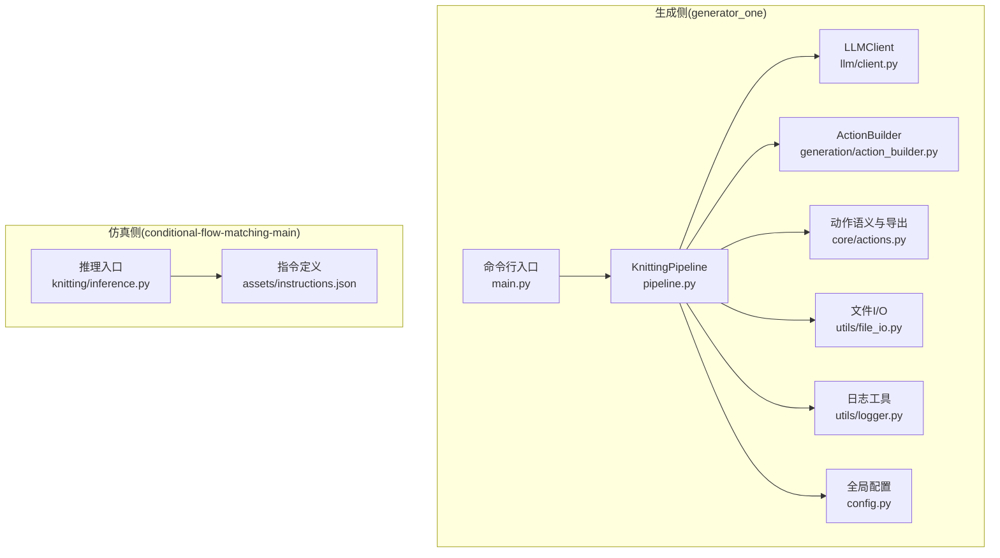
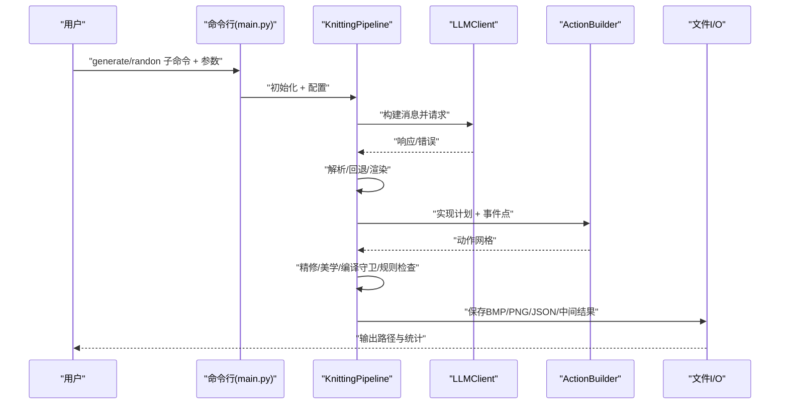
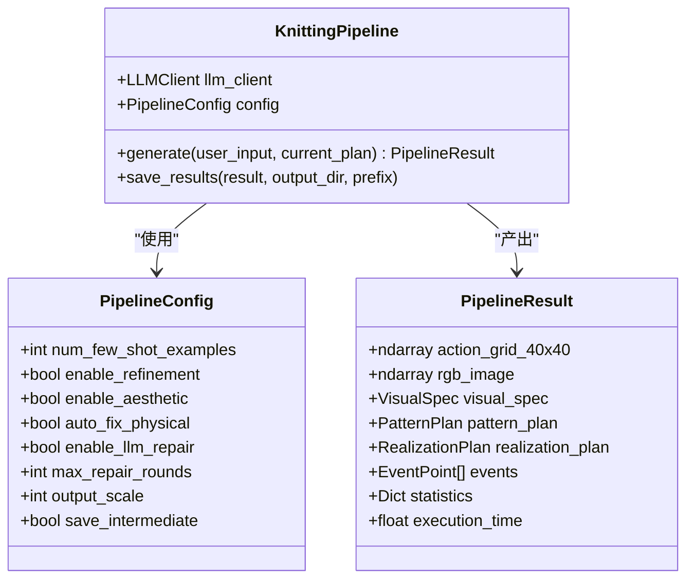
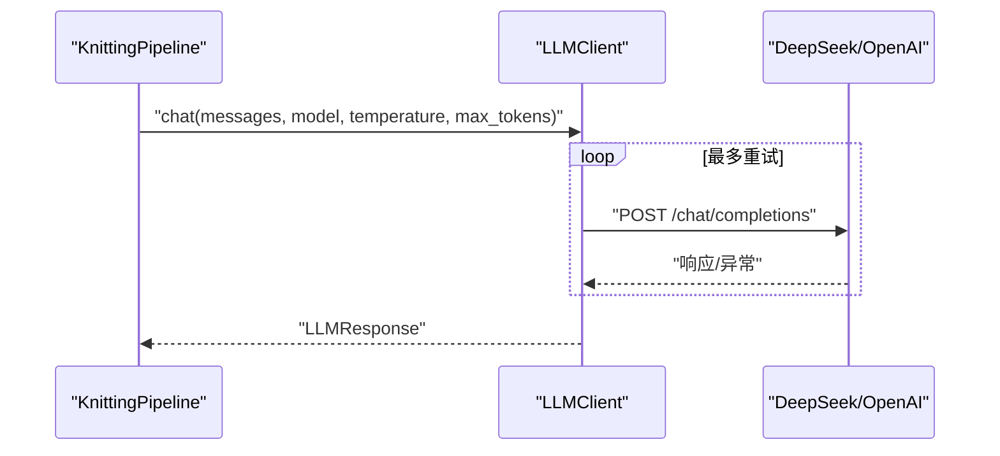
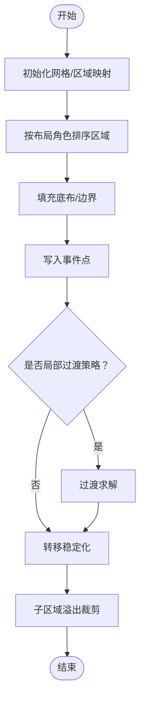
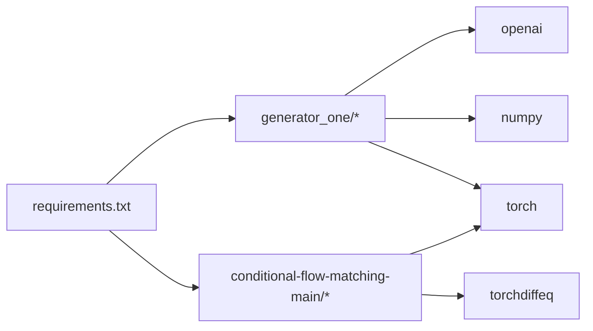

# API参考

<cite>
**本文引用的文件**
- [main.py](file://generator_one/main.py)
- [pipeline.py](file://generator_one/pipeline.py)
- [config.py](file://generator_one/config.py)
- [run_pipeline.py](file://run_pipeline.py)
- [actions.py](file://generator_one/core/actions.py)
- [client.py](file://generator_one/llm/client.py)
- [action_builder.py](file://generator_one/generation/action_builder.py)
- [craft_rules.py](file://generator_one/rules/craft_rules.py)
- [logger.py](file://generator_one/utils/logger.py)
- [file_io.py](file://generator_one/utils/file_io.py)
- [instruction_info.json](file://generator_one/data/instruction_info.json)
- [inference.py](file://conditional-flow-matching-main/knitting/inference.py)
- [README.md](file://conditional-flow-matching-main/README.md)
- [requirements.txt](file://requirements.txt)
</cite>

## 目录
1. [简介](#简介)
2. [项目结构](#项目结构)
3. [核心组件](#核心组件)
4. [架构总览](#架构总览)
5. [详细组件分析](#详细组件分析)
6. [依赖分析](#依赖分析)
7. [性能考量](#性能考量)
8. [故障排查指南](#故障排查指南)
9. [结论](#结论)
10. [附录](#附录)

## 简介
本参考文档面向系统API与核心生成管线，覆盖以下方面：
- 核心类与方法：KnittingPipeline、LLMClient、PatternPlanEngine、ActionBuilder、规则检查器等
- 配置参数：全局配置、管道配置、LLM配置、日志配置
- 返回值与输出：PipelineResult、机器导出报告、统计指标
- 错误处理与重试：LLM重试、文件I/O异常、设备可用性
- 协议与接口：命令行接口（CLI）、模拟器推理接口（Stage 1–4）
- 安全与合规：导出报告中的机器映射与风险提示
- 性能优化与最佳实践：CUDA设备选择、候选采样、缓存与预处理
- 迁移与兼容：动作语义与导出字段演进

## 项目结构
项目采用模块化分层设计：
- generator_one：主生成管线与工具模块（LLM、规则、生成器、工具）
- conditional-flow-matching-main：针织仿真（Stage 1–4）推理模块
- outputs：运行产物输出目录
- data：动作语义与导出映射（instruction_info.json）

图表来源
- [main.py:13-207](file://generator_one/main.py#L13-L207)
- [pipeline.py:93-189](file://generator_one/pipeline.py#L93-L189)
- [client.py:35-168](file://generator_one/llm/client.py#L35-L168)
- [action_builder.py:35-118](file://generator_one/generation/action_builder.py#L35-L118)
- [actions.py:18-338](file://generator_one/core/actions.py#L18-L338)
- [config.py:14-76](file://generator_one/config.py#L14-L76)
- [logger.py:9-52](file://generator_one/utils/logger.py#L9-L52)
- [file_io.py:74-158](file://generator_one/utils/file_io.py#L74-L158)
- [inference.py:64-117](file://conditional-flow-matching-main/knitting/inference.py#L64-L117)

章节来源
- [main.py:13-207](file://generator_one/main.py#L13-L207)
- [run_pipeline.py:196-279](file://run_pipeline.py#L196-L279)

## 核心组件
- KnittingPipeline：端到端生成管线，串联LLM设计、可视化转实现、事件规划、动作构建、精修、美学、编译守卫、规则检查、LLM修复与输出保存
- LLMClient：OpenAI兼容客户端，封装DeepSeek调用、自动重试、超时与用量统计
- ActionBuilder：基于实现计划与事件点构建40×40动作网格，执行过渡求解与转移稳定化
- PatternPlanEngine：从自然语言解析/编辑图案计划，渲染为视觉规格
- 规则模块：物理规则与工艺规则检查、自动修复与张力评分
- 导出与工具：动作语义与机器导出映射、文件I/O、日志

章节来源
- [pipeline.py:93-189](file://generator_one/pipeline.py#L93-L189)
- [client.py:35-168](file://generator_one/llm/client.py#L35-L168)
- [action_builder.py:35-118](file://generator_one/generation/action_builder.py#L35-L118)
- [craft_rules.py:34-166](file://generator_one/rules/craft_rules.py#L34-L166)
- [actions.py:18-338](file://generator_one/core/actions.py#L18-L338)
- [file_io.py:74-158](file://generator_one/utils/file_io.py#L74-L158)
- [logger.py:9-52](file://generator_one/utils/logger.py#L9-L52)

## 架构总览
生成与仿真两条主线：
- 文本到色码：KnittingPipeline + LLMClient + ActionBuilder → BMP输出
- 色码到仿真：BMP输入 → conditional-flow-matching-main推理（Stage 1–4）→ 仿真图像

图表来源
- [main.py:117-203](file://generator_one/main.py#L117-L203)
- [pipeline.py:114-189](file://generator_one/pipeline.py#L114-L189)
- [client.py:81-161](file://generator_one/llm/client.py#L81-L161)
- [action_builder.py:43-118](file://generator_one/generation/action_builder.py#L43-L118)
- [file_io.py:74-158](file://generator_one/utils/file_io.py#L74-L158)

## 详细组件分析

### 命令行接口（CLI）
- 子命令：generate、random
- 关键参数：
  - --output/-o：输出目录
  - --prefix：输出文件前缀
  - --save-intermediate：保存中间结果
  - --no-refinement/--no-aesthetic/--no-repair：开关各阶段
  - --plan-in：增量修改的pattern_plan.json路径
- 运行流程：解析参数 → 构建PipelineConfig → 初始化LLMClient与KnittingPipeline → 生成与保存结果

章节来源
- [main.py:14-115](file://generator_one/main.py#L14-L115)
- [main.py:117-203](file://generator_one/main.py#L117-L203)

### KnittingPipeline（生成管线）
- 核心步骤：
  1) 设计/编辑 → PatternPlan + VisualSpec
  2) 可视化 → 实现计划（RealizationPlan）
  3) 事件规划（EventPoints）
  4) 动作构建（ActionGrid）
  5) 精修（RefinementCompiler）
  6) 美学（AestheticPass）
  7) 层裁剪/编译守卫/规则检查
  8) LLM修复（RepairAgent）
  9) 保存结果（BMP/PNG/JSON/中间）
- PipelineConfig：few-shot示例数、启用/禁用阶段、自动修复、输出缩放、中间结果保存
- PipelineResult：动作网格、RGB图像、统计信息、执行时间、各阶段产物

图表来源
- [pipeline.py:69-91](file://generator_one/pipeline.py#L69-L91)
- [pipeline.py:93-189](file://generator_one/pipeline.py#L93-L189)

章节来源
- [pipeline.py:69-91](file://generator_one/pipeline.py#L69-L91)
- [pipeline.py:114-189](file://generator_one/pipeline.py#L114-L189)

### LLMClient（LLM调用）
- 支持模型：deepseek-chat / deepseek-coder
- 关键能力：自动重试（指数回退）、超时控制、用量统计、错误捕获
- 返回：LLMResponse(success/content/error/latency/model/usage)

图表来源
- [client.py:81-161](file://generator_one/llm/client.py#L81-L161)

章节来源
- [client.py:25-168](file://generator_one/llm/client.py#L25-L168)

### ActionBuilder（动作构建）
- 输入：实现计划 + 事件点
- 流程：底布填充 → 边界绘制 → 事件点写入 → 过渡求解 → 转移稳定化 → 子区域溢出裁剪
- 关键算法：按布局角色优先级填充、掩码形状判断、边界修复、行级转移平衡

图表来源
- [action_builder.py:43-118](file://generator_one/generation/action_builder.py#L43-L118)
- [action_builder.py:422-467](file://generator_one/generation/action_builder.py#L422-L467)
- [action_builder.py:543-580](file://generator_one/generation/action_builder.py#L543-L580)

章节来源
- [action_builder.py:35-118](file://generator_one/generation/action_builder.py#L35-L118)

### 规则与质量控制
- 工艺规则（Craft）：C1–C6，包括列切换、负载平衡、支撑缺失、语义层隔离与缓冲
- 物理规则（Physical）：硬性违规检查与自动修复
- 张力评分：相邻动作张力差的全局评估
- 报告与修复：Violation对象、自动修复策略、LLM修复代理

章节来源
- [craft_rules.py:34-166](file://generator_one/rules/craft_rules.py#L34-L166)
- [craft_rules.py:236-253](file://generator_one/rules/craft_rules.py#L236-L253)

### 动作语义与导出映射
- instruction_info.json：15色动作定义、语义层属性、机器导出字段
- actions.py：动作索引、颜色、语义、张力、导出安全状态、机器映射与调色板
- 机器导出报告：统计各动作种类与数量、导出安全状态、需要确认项、未映射项

章节来源
- [instruction_info.json:1-352](file://generator_one/data/instruction_info.json#L1-L352)
- [actions.py:18-338](file://generator_one/core/actions.py#L18-L338)
- [pipeline.py:686-726](file://generator_one/pipeline.py#L686-L726)

### 文件I/O与日志
- 保存：BMP（内部/机器色表）、PNG（仿真输入）、JSON（pattern_plan/stats/machine_export）
- 加载：JSON、Pickle、图像
- 日志：控制台与文件双通道，可配置级别与格式

章节来源
- [file_io.py:74-158](file://generator_one/utils/file_io.py#L74-L158)
- [logger.py:9-52](file://generator_one/utils/logger.py#L9-L52)
- [pipeline.py:627-677](file://generator_one/pipeline.py#L627-L677)

### 仿真推理接口（Stage 1–4）
- 设备解析：支持cuda/cpu，CUDA不可用时回退CPU
- 模型加载：按stage加载对应UNet，载入checkpoint权重
- 邻域输入构造：将10×10 ID矩阵扩展为3×3邻域
- 候选采样：多种子候选输出，便于人工挑选
- 入口：knitting/inference.py

章节来源
- [inference.py:40-57](file://conditional-flow-matching-main/knitting/inference.py#L40-L57)
- [inference.py:64-117](file://conditional-flow-matching-main/knitting/inference.py#L64-L117)
- [inference.py:124-156](file://conditional-flow-matching-main/knitting/inference.py#L124-L156)
- [README.md:23-35](file://conditional-flow-matching-main/README.md#L23-L35)

## 依赖分析
- 运行时依赖：numpy、torch、Pillow、OpenAI SDK、dotenv等
- 生成侧：KnittingPipeline依赖LLMClient、ActionBuilder、规则模块、文件I/O与日志
- 仿真侧：推理脚本依赖torchdiffeq、PIL、数据预处理模块

图表来源
- [requirements.txt:1-46](file://requirements.txt#L1-L46)

章节来源
- [requirements.txt:1-46](file://requirements.txt#L1-L46)

## 性能考量
- 设备选择：run_pipeline自动检测CUDA并回退CPU，推理脚本支持显式设备参数
- 候选采样：仿真阶段支持多候选输出，提高命中率但增加耗时
- 网格尺寸：固定40×40逻辑网格，输出可缩放
- I/O与缓存：中间结果可选保存，减少重复计算
- LLM重试：指数回退降低瞬时峰值，提升稳定性

章节来源
- [run_pipeline.py:30-36](file://run_pipeline.py#L30-L36)
- [run_pipeline.py:149-188](file://run_pipeline.py#L149-L188)
- [config.py:45-45](file://generator_one/config.py#L45-L45)
- [client.py:103-154](file://generator_one/llm/client.py#L103-L154)

## 故障排查指南
- LLM相关
  - 缺少API Key：初始化时抛出异常，检查DEEPSEEK_API_KEY与config.py
  - 超时/网络异常：自动重试，查看日志与latency/usage
- 文件I/O
  - 权限不足：捕获并记录异常，检查输出目录权限
  - 路径不存在：FileNotFoundError，检查输入/输出路径
- 设备与CUDA
  - CUDA不可用：run_pipeline与推理脚本均提供回退逻辑
- 生成结果
  - 统计缺失：检查PipelineConfig.save_intermediate与日志输出
  - 机器导出报告：关注requires_confirmation/unmapped项，按提示确认宏参数

章节来源
- [client.py:55-80](file://generator_one/llm/client.py#L55-L80)
- [file_io.py:22-27](file://generator_one/utils/file_io.py#L22-L27)
- [file_io.py:111-116](file://generator_one/utils/file_io.py#L111-L116)
- [run_pipeline.py:30-36](file://run_pipeline.py#L30-L36)
- [pipeline.py:686-726](file://generator_one/pipeline.py#L686-L726)

## 结论
本系统以KnittingPipeline为核心，结合LLM设计、动作构建与规则质量控制，形成从文本到色码再到仿真的完整链路。通过清晰的模块划分、完善的错误处理与可观测性，既满足研究探索也具备工程化落地能力。仿真侧提供多阶段模型与候选采样，进一步提升结果多样性与可控性。

## 附录

### 配置参数总览
- 全局配置（config.py）
  - 路径：PROJECT_ROOT、DATA_DIR、OUTPUT_DIR、INSTRUCTION_INFO_PATH
  - 网格：GRID_SIZE=40
  - LLM：provider、api_key、base_url、default_model、models、timeout、retry
  - 日志：level、format、file、console
- 管道配置（PipelineConfig）
  - num_few_shot_examples、enable_refinement、enable_aesthetic、auto_fix_physical、enable_llm_repair、max_repair_rounds、output_scale、save_intermediate

章节来源
- [config.py:14-76](file://generator_one/config.py#L14-L76)
- [pipeline.py:69-79](file://generator_one/pipeline.py#L69-L79)

### 输出产物与格式
- BMP（内部色表）：pattern_output.bmp
- BMP（机器色表）：pattern_machine_output.bmp
- 机器导出报告：pattern_machine_export_report.json（动作映射、安全状态、需要确认项、未映射项）
- 仿真输入PNG：pattern_sim_input.png
- 中间结果（可选）：intermediate/*.npy、preview.bmp
- 图案计划JSON：pattern_pattern_plan.json
- 统计JSON：pattern_stats.json

章节来源
- [pipeline.py:627-677](file://generator_one/pipeline.py#L627-L677)

### 常见用例与最佳实践
- 快速生成：python main.py generate "中心麻花菱形" -o outputs/images
- 禁用阶段：--no-refinement / --no-aesthetic / --no-repair
- 增量修改：--plan-in 指向现有pattern_plan.json
- 仿真：python run_pipeline.py simulate --input ... --stage 4 --num_candidates 4
- 性能优化：CUDA可用时自动使用，多候选采样按需开启

章节来源
- [main.py:17-39](file://generator_one/main.py#L17-L39)
- [run_pipeline.py:226-246](file://run_pipeline.py#L226-L246)
- [run_pipeline.py:133-188](file://run_pipeline.py#L133-L188)

### 安全与合规要点
- 机器导出报告明确标注“需要确认”与“未映射”，避免上机风险
- 内部生成与机器导出使用不同色表，确保导出颜色符合机器软件规范
- 张力评分与规则检查帮助规避织物质量问题

章节来源
- [pipeline.py:686-726](file://generator_one/pipeline.py#L686-L726)
- [craft_rules.py:236-253](file://generator_one/rules/craft_rules.py#L236-L253)

### 迁移与向后兼容
- 动作语义与导出字段以instruction_info.json为准，新增动作需同步更新
- 机器导出字段（如machine_action_id/name）为可选，若缺失将被标记为“未映射”
- 保留历史行为：默认启用精修与美学，可通过开关禁用

章节来源
- [instruction_info.json:1-352](file://generator_one/data/instruction_info.json#L1-L352)
- [actions.py:95-115](file://generator_one/core/actions.py#L95-L115)
- [pipeline.py:69-79](file://generator_one/pipeline.py#L69-L79)