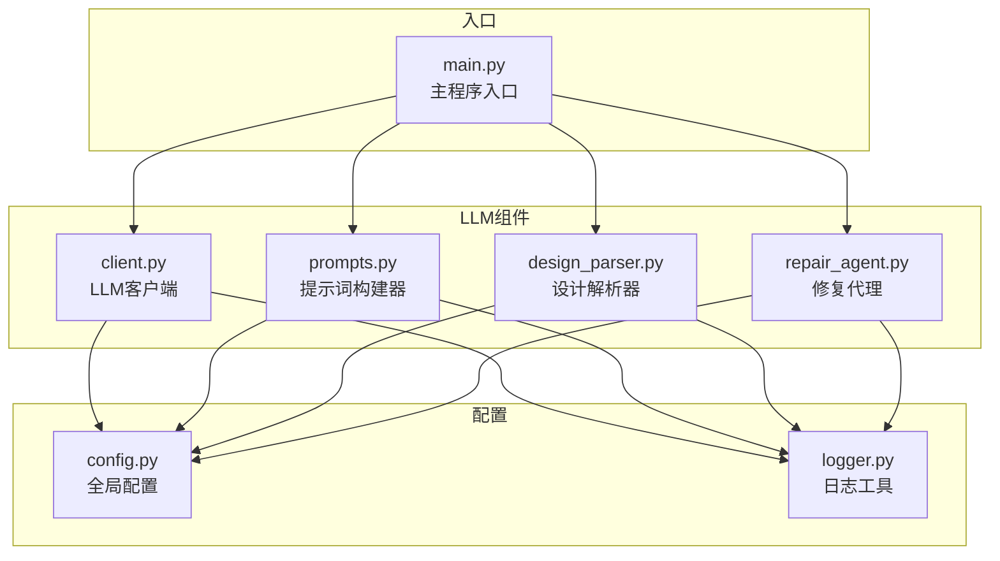
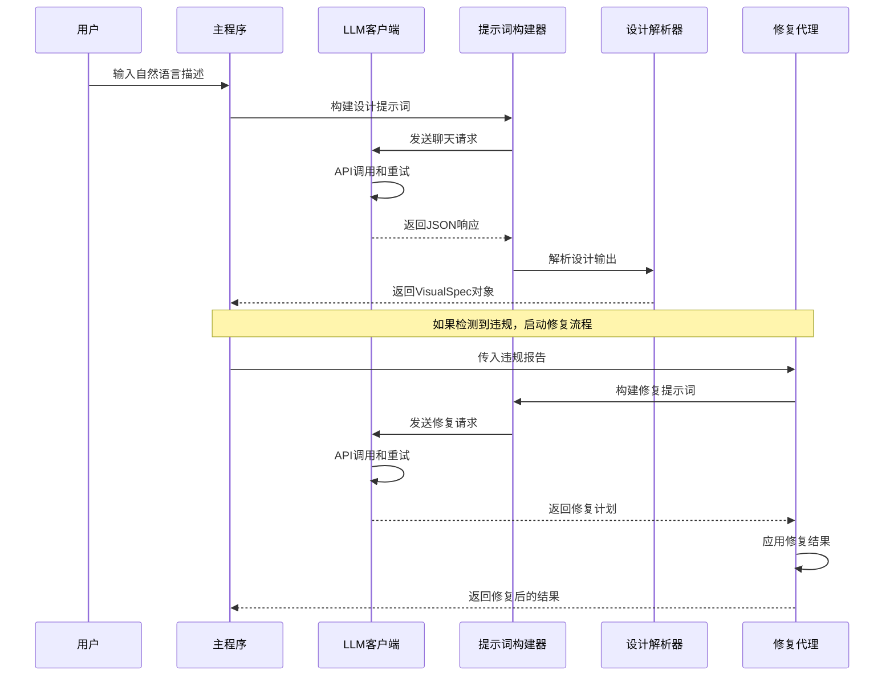
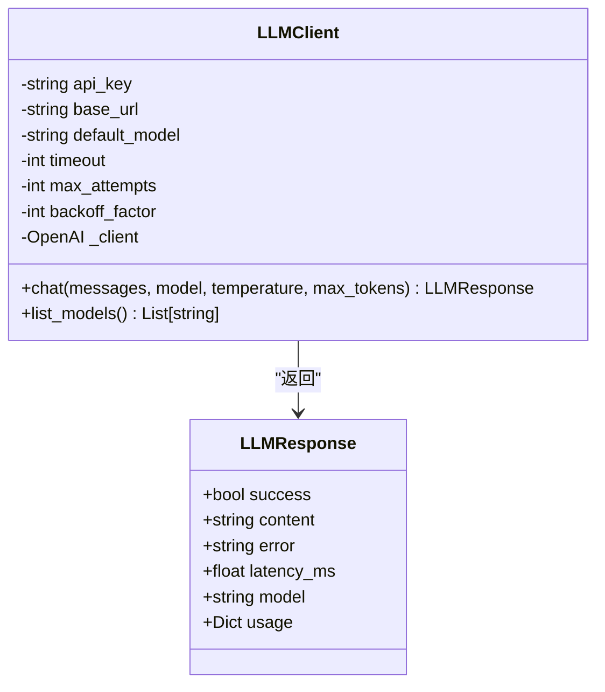
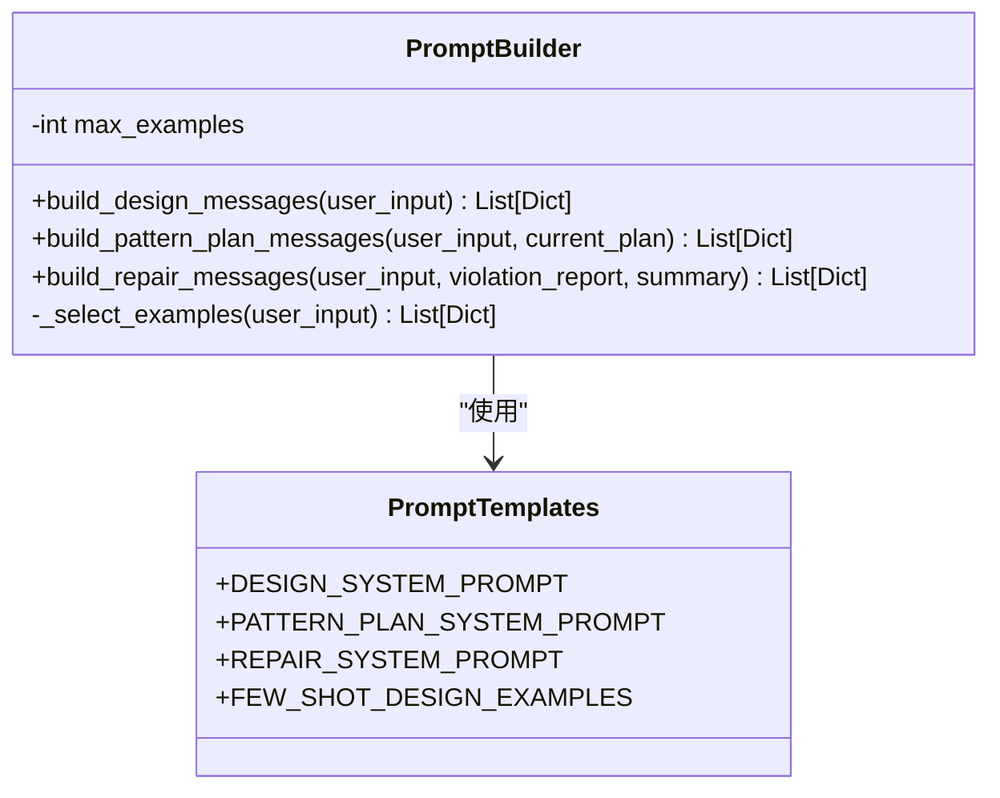
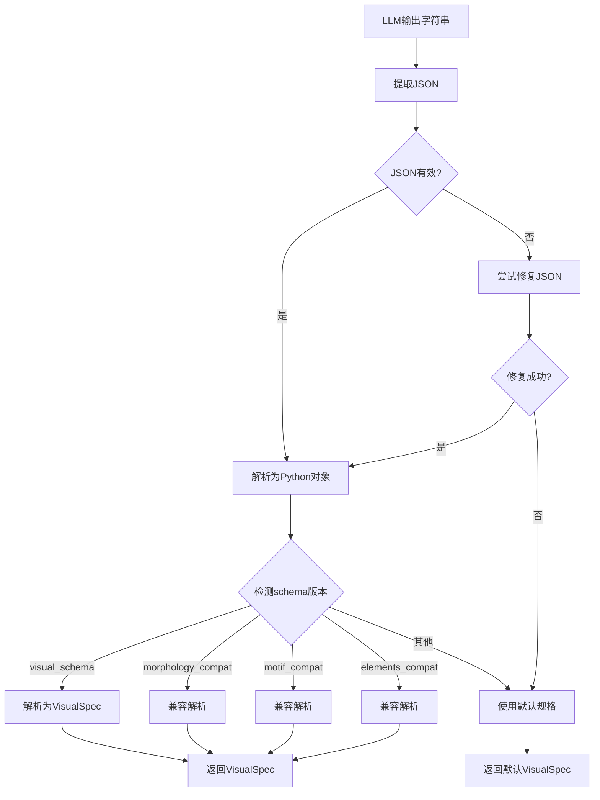
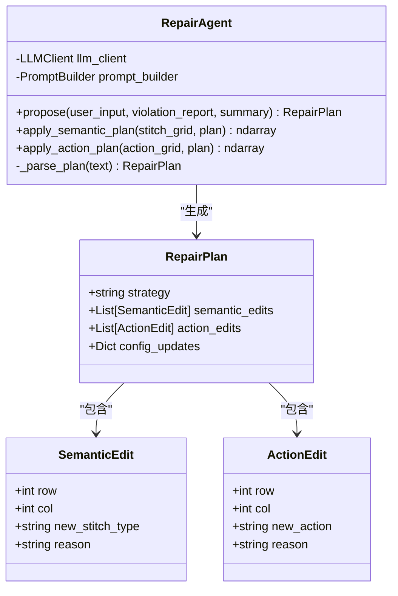
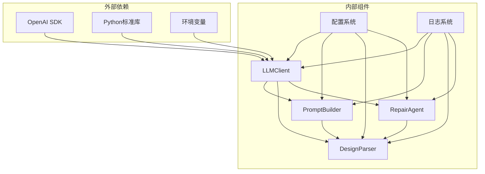

# LLM接口

<cite>
**本文档引用的文件**
- [client.py](file://generator_one/llm/client.py)
- [prompts.py](file://generator_one/llm/prompts.py)
- [design_parser.py](file://generator_one/llm/design_parser.py)
- [repair_agent.py](file://generator_one/llm/repair_agent.py)
- [config.py](file://generator_one/config.py)
- [logger.py](file://generator_one/utils/logger.py)
- [main.py](file://generator_one/main.py)
</cite>

## 目录
1. [简介](#简介)
2. [项目结构](#项目结构)
3. [核心组件](#核心组件)
4. [架构概览](#架构概览)
5. [详细组件分析](#详细组件分析)
6. [依赖关系分析](#依赖关系分析)
7. [性能考虑](#性能考虑)
8. [故障排除指南](#故障排除指南)
9. [结论](#结论)

## 简介

本文档提供了针织图案生成系统中LLM集成接口的全面API参考文档。该系统实现了基于深度学习的针织图案自动生成，通过LLM客户端、提示词构建器、设计解析器和修复代理等核心组件，实现了从自然语言描述到可执行针织图案的完整流程。

系统支持多种LLM提供商，目前主要针对DeepSeek和OpenAI兼容接口进行优化，能够处理复杂的针织图案设计需求，包括多区域布局、纹理效果和针法组织等。

## 项目结构

LLM相关组件位于`generator_one/llm/`目录下，包含以下核心文件：



**图表来源**
- [client.py:1-168](file://generator_one/llm/client.py#L1-L168)
- [prompts.py:1-654](file://generator_one/llm/prompts.py#L1-L654)
- [design_parser.py:1-415](file://generator_one/llm/design_parser.py#L1-L415)
- [repair_agent.py:1-242](file://generator_one/llm/repair_agent.py#L1-L242)

**章节来源**
- [client.py:1-168](file://generator_one/llm/client.py#L1-L168)
- [prompts.py:1-654](file://generator_one/llm/prompts.py#L1-L654)
- [design_parser.py:1-415](file://generator_one/llm/design_parser.py#L1-L415)
- [repair_agent.py:1-242](file://generator_one/llm/repair_agent.py#L1-L242)

## 核心组件

系统包含四个核心LLM组件，每个组件都有明确的职责分工：

### LLMClient - LLM客户端
负责与外部LLM服务的直接通信，提供统一的API调用接口和错误处理机制。

### PromptBuilder - 提示词构建器
专门负责构建和管理各种类型的提示词消息，包括设计提示、模式规划提示和修复提示。

### DesignParser - 设计解析器
负责解析LLM返回的JSON输出，将其转换为内部的视觉规格对象，并提供多种历史版本的兼容性支持。

### RepairAgent - 修复代理
处理违反报告到修复计划的转换，协调LLM修复过程并应用修复结果。

**章节来源**
- [client.py:35-168](file://generator_one/llm/client.py#L35-L168)
- [prompts.py:494-654](file://generator_one/llm/prompts.py#L494-L654)
- [design_parser.py:24-415](file://generator_one/llm/design_parser.py#L24-L415)
- [repair_agent.py:39-242](file://generator_one/llm/repair_agent.py#L39-L242)

## 架构概览

系统采用分层架构设计，各组件之间通过清晰的接口进行交互：



**图表来源**
- [main.py:117-203](file://generator_one/main.py#L117-L203)
- [client.py:81-161](file://generator_one/llm/client.py#L81-L161)
- [prompts.py:498-621](file://generator_one/llm/prompts.py#L498-L621)
- [design_parser.py:29-44](file://generator_one/llm/design_parser.py#L29-L44)
- [repair_agent.py:51-69](file://generator_one/llm/repair_agent.py#L51-L69)

## 详细组件分析

### LLMClient 类分析

LLMClient是系统的核心通信组件，提供了完整的LLM API封装：

#### 核心数据结构



**图表来源**
- [client.py:25-33](file://generator_one/llm/client.py#L25-L33)
- [client.py:35-79](file://generator_one/llm/client.py#L35-L79)

#### 主要方法详解

##### chat() 方法
这是LLMClient的核心方法，负责发送聊天请求并处理所有异常情况：

**方法签名**
- `chat(messages: List[Dict[str, str]], model: Optional[str] = None, temperature: float = 0.3, max_tokens: int = 1024, **kwargs) -> LLMResponse`

**参数说明**
- `messages`: 消息列表，格式为`[{"role": "...", "content": "..."}]`
- `model`: 模型名称，默认使用配置中的默认模型
- `temperature`: 采样温度，0.3用于结构化输出
- `max_tokens`: 最大输出token数
- `**kwargs`: 传递给底层API的其他参数

**返回值**
LLMResponse对象，包含成功状态、内容、错误信息、延迟时间和使用量统计。

**错误处理策略**
- 支持指数退避重试（最多3次）
- 捕获所有异常并记录详细信息
- 超时自动重试
- 网络错误透明化处理

**章节来源**
- [client.py:81-161](file://generator_one/llm/client.py#L81-L161)

#### 配置管理

LLMClient从全局配置中读取连接参数：

**配置项**
- `api_key`: LLM API密钥
- `base_url`: API基础URL（默认DeepSeek）
- `default_model`: 默认使用的模型
- `timeout`: 超时时间（秒）
- `retry.max_attempts`: 最大重试次数
- `retry.backoff_factor`: 退避因子

**章节来源**
- [client.py:45-79](file://generator_one/llm/client.py#L45-L79)
- [config.py:51-65](file://generator_one/config.py#L51-L65)

### PromptBuilder 类分析

PromptBuilder专门负责构建各种类型的提示词消息，采用少样本学习策略：

#### 核心功能



**图表来源**
- [prompts.py:494-654](file://generator_one/llm/prompts.py#L494-L654)
- [prompts.py:17-243](file://generator_one/llm/prompts.py#L17-L243)

#### 设计提示词构建

`build_design_messages()`方法构建设计阶段的提示词：

**输入参数**
- `user_input`: 用户的自然语言描述

**构建策略**
- 选择最相关的示例（最多4个）
- 动态匹配关键词以选择合适的示例
- 包含系统提示词和用户输入

**示例匹配规则**
- 麻花/绞花 → 示例1
- 菱形/diamond → 示例0  
- 波浪/吊目 → 示例2
- 边带/罗纹 → 示例3
- 网眼/镂空/边框 → 示例5
- 条纹/横向 → 示例6
- 柱/纵向 → 示例7

**章节来源**
- [prompts.py:498-508](file://generator_one/llm/prompts.py#L498-L508)
- [prompts.py:623-653](file://generator_one/llm/prompts.py#L623-L653)

#### 模式规划提示词构建

`build_pattern_plan_messages()`方法构建模式规划阶段的提示词：

**支持两种模式**
1. **新建模式**: 直接生成新的PatternPlan
2. **增量修改**: 基于现有模式进行修改

**参数处理**
- 支持传入现有的PatternPlan对象
- 自动检测对象的序列化能力
- 将对象转换为字典格式

**章节来源**
- [prompts.py:510-605](file://generator_one/llm/prompts.py#L510-L605)

#### 修复提示词构建

`build_repair_messages()`方法构建修复阶段的提示词：

**输入参数**
- `user_input`: 用户输入
- `violation_report`: 违规报告
- `summary`: 总结信息

**输出格式**
返回标准的消息格式，包含系统提示词和用户负载。

**章节来源**
- [prompts.py:607-621](file://generator_one/llm/prompts.py#L607-L621)

### DesignParser 类分析

DesignParser负责解析LLM返回的JSON输出，提供多种历史版本的兼容性支持：

#### 解析流程



**图表来源**
- [design_parser.py:29-44](file://generator_one/llm/design_parser.py#L29-L44)
- [design_parser.py:77-94](file://generator_one/llm/design_parser.py#L77-L94)

#### 支持的Schema版本

**visual_schema** (当前推荐)
- `layout_type`: 布局类型
- `regions`: 区域列表
- `region_id`: 区域标识符
- `visual_shape`: 视觉形状
- `visual_effect`: 视觉效果
- `layout_role`: 布局角色
- `placement`: 位置信息
- `params`: 参数字典
- `symmetry`: 对称性
- `allow_refinement`: 是否允许细化

**morphology_compat** (旧版兼容)
支持多种历史版本的形态学描述格式

**motif_compat** (旧版兼容)
支持基于动机的描述格式

**elements_compat** (旧版兼容)
支持基于元素的描述格式

**章节来源**
- [design_parser.py:77-302](file://generator_one/llm/design_parser.py#L77-L302)

#### 规范化机制

DesignParser内置了完整的规范化机制，确保输出的一致性和有效性：

**布局类型规范化**
- `center` → `centered`
- `allover` → `allover_repeat`
- `frame` → `framed`
- `bands` → `side_bands`
- `mirror` → `mirror_pair`
- `vertical` → `vertical_repeat`

**视觉形状规范化**
- `rectangle` → `panel`
- `line` → `stripe`
- `oval` → `circle`
- `triangle` → `triangle`
- `hexagon` → `hexagon`

**视觉效果规范化**
- `cable_knit` → `cable`
- `tuck` → `wave_tuck`
- `mesh` → `lace`
- `embossed` → `relief`

**章节来源**
- [design_parser.py:308-378](file://generator_one/llm/design_parser.py#L308-L378)

### RepairAgent 类分析

RepairAgent处理违规检测到的图案问题，并通过LLM生成修复方案：

#### 数据结构



**图表来源**
- [repair_agent.py:15-37](file://generator_one/llm/repair_agent.py#L15-L37)
- [repair_agent.py:39-105](file://generator_one/llm/repair_agent.py#L39-L105)

#### 修复流程

**主要步骤**
1. 构建修复提示词
2. 调用LLM生成修复计划
3. 解析JSON响应
4. 应用修复到网格

**修复策略**
- **最小改动**: 优先选择影响最小的修复方案
- **语义修复**: 修改语义层的针法类型
- **动作修复**: 修改具体的操作指令
- **配置更新**: 更新相关配置参数

**章节来源**
- [repair_agent.py:51-105](file://generator_one/llm/repair_agent.py#L51-L105)

#### 修复验证机制

RepairAgent内置了严格的验证机制：

**语义验证**
- 检查新的针法类型是否在允许列表中
- 验证坐标的有效性
- 确保索引在网格范围内

**动作验证**
- 检查新的操作是否存在于允许的动作列表中
- 使用安全索引查找机制
- 防止无效操作的应用

**章节来源**
- [repair_agent.py:132-156](file://generator_one/llm/repair_agent.py#L132-L156)

## 依赖关系分析

系统组件之间的依赖关系如下：



**图表来源**
- [client.py:17-22](file://generator_one/llm/client.py#L17-L22)
- [prompts.py:13-14](file://generator_one/llm/prompts.py#L13-L14)
- [design_parser.py:13-21](file://generator_one/llm/design_parser.py#L13-L21)
- [repair_agent.py:5-12](file://generator_one/llm/repair_agent.py#L5-L12)

### 外部依赖

**OpenAI SDK**
- 作为LLM API的统一接口
- 提供聊天补全和模型列表功能
- 支持异步和同步调用

**Python标准库**
- `os`: 环境变量访问
- `time`: 时间戳和退避延迟
- `traceback`: 异常跟踪
- `json`: JSON解析和序列化

### 内部依赖

**配置系统**
- LLM_CONFIG: LLM连接配置
- LOGGING_CONFIG: 日志配置
- 全局路径配置

**日志系统**
- 统一的日志记录接口
- 支持控制台和文件输出
- 多级别的日志记录

**章节来源**
- [client.py:8-15](file://generator_one/llm/client.py#L8-L15)
- [config.py:14-18](file://generator_one/config.py#L14-L18)

## 性能考虑

### 重试机制优化

系统实现了智能的指数退避重试机制：

**重试策略**
- 最大重试次数：3次
- 退避因子：2
- 第1次等待：2^0 = 1秒
- 第2次等待：2^1 = 2秒  
- 第3次等待：2^2 = 4秒

**超时管理**
- 默认超时：30秒
- 可配置的超时时间
- 自动超时重试

### 内存优化

**JSON解析优化**
- 流式JSON提取，避免一次性加载大JSON
- 智能的JSON修复机制
- 内存友好的字符串处理

**缓存策略**
- 示例选择的去重机制
- 避免重复的LLM调用
- 合理的内存使用

### 并发处理

**异步支持**
- OpenAI SDK支持异步调用
- 可扩展的并发处理能力
- 资源池管理

## 故障排除指南

### 常见问题及解决方案

#### API密钥问题
**症状**: 初始化LLMClient时抛出ValueError
**原因**: 未设置DEEPSEEK_API_KEY环境变量
**解决方案**: 
- 设置环境变量：`export DEEPSEEK_API_KEY=your_api_key`
- 或在配置文件中设置API密钥

#### 网络连接问题
**症状**: LLM调用失败，出现网络异常
**原因**: 网络不稳定或API服务不可用
**解决方案**:
- 检查网络连接
- 验证API基础URL可达性
- 查看重试日志

#### JSON解析失败
**症状**: DesignParser无法解析LLM输出
**原因**: LLM返回非标准JSON格式
**解决方案**:
- 检查LLM输出格式
- 查看JSON修复日志
- 验证系统提示词完整性

#### 修复应用失败
**症状**: RepairAgent无法应用修复
**原因**: 修复坐标超出网格范围或动作无效
**解决方案**:
- 检查修复计划的有效性
- 验证网格尺寸一致性
- 查看动作映射表

### 调试技巧

**启用详细日志**
```python
import logging
logging.getLogger().setLevel(logging.DEBUG)
```

**检查LLM响应**
```python
response = client.chat(messages)
print(f"Content preview: {response.content[:200]}...")
print(f"Latency: {response.latency_ms}ms")
```

**验证配置**
```python
from config import LLM_CONFIG
print(f"Active provider: {LLM_CONFIG['provider']}")
print(f"Default model: {LLM_CONFIG['default_model']}")
```

**章节来源**
- [client.py:140-154](file://generator_one/llm/client.py#L140-L154)
- [design_parser.py:384-414](file://generator_one/llm/design_parser.py#L384-L414)
- [repair_agent.py:165-229](file://generator_one/llm/repair_agent.py#L165-L229)

## 结论

本LLM集成接口提供了完整的针织图案生成解决方案，具有以下特点：

**可靠性**
- 完善的错误处理和重试机制
- 多种JSON解析策略
- 严格的输入验证

**灵活性**
- 支持多种LLM提供商
- 可配置的参数体系
- 灵活的提示词构建

**可维护性**
- 清晰的组件分离
- 完善的文档和注释
- 易于扩展的架构设计

该系统为针织图案生成提供了强大的AI驱动能力，能够处理复杂的多区域、多层次设计需求，为用户提供高质量的自动化设计体验。