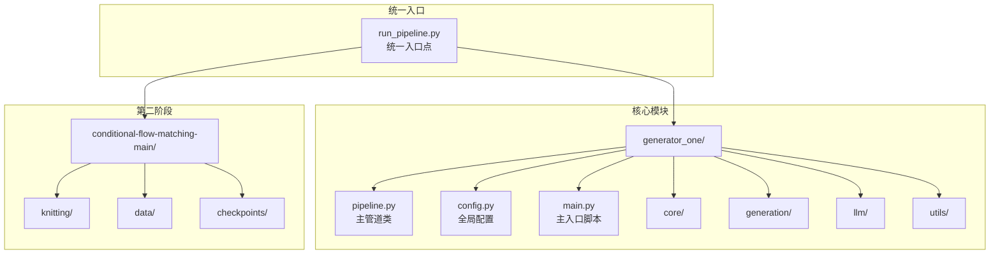
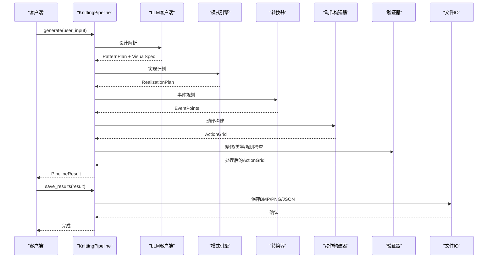
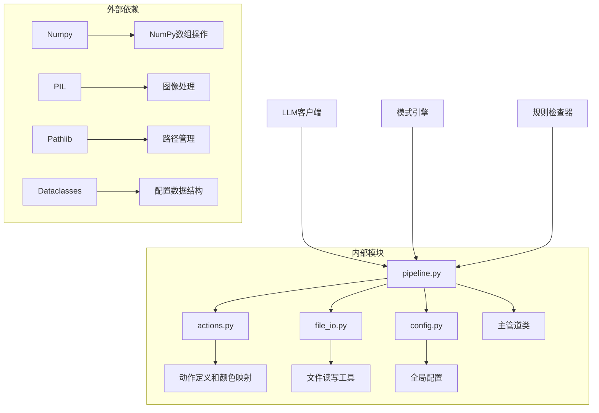

# 核心API

<cite>
**本文档引用的文件**
- [pipeline.py](file://generator_one/pipeline.py)
- [config.py](file://generator_one/config.py)
- [main.py](file://generator_one/main.py)
- [actions.py](file://generator_one/core/actions.py)
- [file_io.py](file://generator_one/utils/file_io.py)
- [run_pipeline.py](file://run_pipeline.py)
- [instruction_info.json](file://generator_one/data/instruction_info.json)
</cite>

## 目录
1. [简介](#简介)
2. [项目结构](#项目结构)
3. [核心组件](#核心组件)
4. [架构概览](#架构概览)
5. [详细组件分析](#详细组件分析)
6. [依赖关系分析](#依赖关系分析)
7. [性能考虑](#性能考虑)
8. [故障排除指南](#故障排除指南)
9. [结论](#结论)

## 简介

本文档为针织图案生成系统的核心API参考文档，重点记录KnittingPipeline主类的所有公共方法、PipelineConfig配置类和PipelineResult数据结构。该系统采用端到端的生成流程，从自然语言描述到最终的针织色码图输出，包含九个主要处理步骤：LLM设计解析、视觉规格生成、实现计划、事件规划、动作构建、精修、美学处理、编译器保护、规则检查和LLM修复。

## 项目结构

该项目采用模块化架构，主要分为以下核心模块：



**图表来源**
- [pipeline.py:1-749](file://generator_one/pipeline.py#L1-L749)
- [config.py:1-76](file://generator_one/config.py#L1-L76)
- [run_pipeline.py:1-279](file://run_pipeline.py#L1-L279)

**章节来源**
- [pipeline.py:1-749](file://generator_one/pipeline.py#L1-L749)
- [config.py:1-76](file://generator_one/config.py#L1-L76)
- [run_pipeline.py:1-279](file://run_pipeline.py#L1-L279)

## 核心组件

### KnittingPipeline 主类

KnittingPipeline是系统的核心控制器，负责协调整个生成流程。它管理多个子组件，包括LLM客户端、设计解析器、模式引擎、修复代理以及各种处理步骤。

**章节来源**
- [pipeline.py:93-113](file://generator_one/pipeline.py#L93-L113)

### PipelineConfig 配置类

PipelineConfig提供了管道运行时的配置选项，支持细粒度的流程控制和行为定制。

**章节来源**
- [pipeline.py:69-79](file://generator_one/pipeline.py#L69-L79)

### PipelineResult 数据结构

PipelineResult封装了整个生成过程的输出结果，包含原始动作网格、RGB图像以及丰富的统计信息。

**章节来源**
- [pipeline.py:81-91](file://generator_one/pipeline.py#L81-L91)

## 架构概览

系统采用流水线架构，每个处理步骤都有明确的输入输出规范：



**图表来源**
- [pipeline.py:114-189](file://generator_one/pipeline.py#L114-L189)
- [pipeline.py:627-677](file://generator_one/pipeline.py#L627-L677)

## 详细组件分析

### KnittingPipeline 类详解

#### 公共方法

##### generate() 方法

**方法签名**: `generate(self, user_input: str, current_plan: Optional[PatternPlan] = None) -> PipelineResult`

**功能**: 执行完整的生成流程，从用户输入到最终结果输出。

**参数**:
- `user_input`: 用户的自然语言描述，支持中文或英文
- `current_plan`: 可选的现有模式计划，用于增量修改

**返回值**: `PipelineResult`对象，包含完整的生成结果

**异常处理**: 
- LLM通信失败时自动降级到启发式解析
- 各步骤异常会被捕获并记录日志
- 规则违反可通过配置自动修复

**使用示例**:
```python
# 基本使用
pipeline = KnittingPipeline(llm_client, config=config)
result = pipeline.generate("中心麻花菱形")

# 增量修改
current_plan = PatternPlan.from_dict(existing_plan)
result = pipeline.generate("中心麻花菱形", current_plan=current_plan)
```

**章节来源**
- [pipeline.py:114-189](file://generator_one/pipeline.py#L114-L189)

##### save_results() 方法

**方法签名**: `save_results(self, result: PipelineResult, output_dir: Path, prefix: str = "pattern")`

**功能**: 将生成结果保存到指定目录，包含多种格式的输出文件。

**参数**:
- `result`: PipelineResult对象
- `output_dir`: 输出目录路径
- `prefix`: 文件前缀，默认为"pattern"

**返回值**: 无（void）

**生成的文件**:
- `{prefix}_output.bmp`: 内部颜色调色板的BMP文件
- `{prefix}_machine_output.bmp`: 机器软件颜色调色板的BMP文件
- `{prefix}_machine_export_report.json`: 机器导出报告
- `{prefix}_sim_input.png`: 仿真输入PNG文件
- `{prefix}_pattern_plan.json`: 模式计划JSON文件（可选）
- `{prefix}_stats.json`: 统计信息JSON文件

**使用示例**:
```python
pipeline.save_results(result, "outputs/images", "diamond_pattern")
```

**章节来源**
- [pipeline.py:627-677](file://generator_one/pipeline.py#L627-L677)

#### 私有处理步骤

系统包含九个主要处理步骤，每个都有特定的功能和配置选项：

1. **设计解析** (`_step1_design`): LLM解析用户输入，生成PatternPlan和VisualSpec
2. **实现转换** (`_step2_realization`): 将视觉规格转换为实现计划
3. **事件规划** (`_step3_events`): 规划关键事件点
4. **动作构建** (`_step4_build`): 构建初始动作网格
5. **精修** (`_step5_refinement`): 基于配置的精修处理
6. **美学处理** (`_step6_aesthetic`): 美学优化
7. **层裁剪** (`_step6_25_layer_clip`): 层级裁剪处理
8. **编译器保护** (`_step6_5_compiler_guard`): 编译器级保护
9. **规则检查** (`_step7_rules`): 物理和工艺规则检查
10. **LLM修复** (`_step8_repair`): 基于LLM的自动修复

**章节来源**
- [pipeline.py:195-621](file://generator_one/pipeline.py#L195-L621)

### PipelineConfig 配置类

PipelineConfig提供了全面的管道配置选项：

| 配置项 | 类型 | 默认值 | 描述 |
|--------|------|--------|------|
| `num_few_shot_examples` | int | 4 | LLM提示中的少样本示例数量 |
| `enable_refinement` | bool | True | 是否启用精修步骤 |
| `enable_aesthetic` | bool | True | 是否启用美学处理步骤 |
| `auto_fix_physical` | bool | True | 是否自动修复物理违规 |
| `enable_llm_repair` | bool | True | 是否启用LLM修复步骤 |
| `max_repair_rounds` | int | 1 | LLM修复的最大轮次 |
| `output_scale` | int | 1 | 输出缩放比例 |
| `save_intermediate` | bool | False | 是否保存中间结果 |

**章节来源**
- [pipeline.py:69-79](file://generator_one/pipeline.py#L69-L79)

### PipelineResult 数据结构

PipelineResult是生成结果的数据容器：

| 字段名 | 类型 | 描述 |
|--------|------|------|
| `action_grid_40x40` | np.ndarray | 40x40的动作网格数组 |
| `rgb_image` | np.ndarray | RGB彩色图像数组 |
| `visual_spec` | Optional[VisualSpec] | 视觉规格对象 |
| `pattern_plan` | Optional[PatternPlan] | 模式计划对象 |
| `realization_plan` | Optional[RealizationPlan] | 实现计划对象 |
| `events` | Optional[List[EventPoint]] | 事件点列表 |
| `statistics` | Dict[str, Any] | 丰富的统计信息字典 |
| `execution_time` | float | 执行时间（秒） |

**章节来源**
- [pipeline.py:81-91](file://generator_one/pipeline.py#L81-L91)

### 动作网格操作函数

#### action_grid_to_rgb()

**函数签名**: `action_grid_to_rgb(action_grid: np.ndarray) -> np.ndarray`

**功能**: 将动作网格转换为RGB彩色图像，使用内部颜色调色板。

**参数**:
- `action_grid`: 40x40的动作网格数组

**返回值**: RGB图像数组，形状为(rows, cols, 3)

**使用示例**:
```python
rgb_image = action_grid_to_rgb(action_grid)
```

#### action_grid_to_machine_rgb()

**函数签名**: `action_grid_to_machine_rgb(action_grid: np.ndarray) -> np.ndarray`

**功能**: 将动作网格转换为机器软件颜色的RGB图像。

**参数**:
- `action_grid`: 40x40的动作网格数组

**返回值**: RGB图像数组，形状为(rows, cols, 3)

**使用示例**:
```python
machine_rgb = action_grid_to_machine_rgb(action_grid)
```

**章节来源**
- [pipeline.py:51-66](file://generator_one/pipeline.py#L51-L66)

### 初始化和使用示例

#### 完整的使用流程

```python
from llm.client import LLMClient
from pipeline import KnittingPipeline, PipelineConfig
from generation.pattern_plan import PatternPlan

# 1. 创建LLM客户端
llm_client = LLMClient()

# 2. 配置管道参数
config = PipelineConfig(
    enable_refinement=True,
    enable_aesthetic=True,
    enable_llm_repair=True,
    auto_fix_physical=True,
    max_repair_rounds=3,
    save_intermediate=False
)

# 3. 创建管道实例
pipeline = KnittingPipeline(
    llm_client=llm_client,
    rasterizer=None,
    config=config
)

# 4. 执行生成
result = pipeline.generate("中心麻花菱形")

# 5. 保存结果
pipeline.save_results(result, "outputs/images", "pattern")

# 6. 查看统计信息
print(f"执行时间: {result.execution_time:.2f}s")
print(f"动作分布: {result.statistics.get('distribution')}")
print(f"张力评分: {result.statistics.get('tension_score')}")
```

**章节来源**
- [main.py:117-203](file://generator_one/main.py#L117-L203)

## 依赖关系分析

系统采用清晰的模块化依赖关系：



**图表来源**
- [pipeline.py:23-48](file://generator_one/pipeline.py#L23-L48)
- [actions.py:1-338](file://generator_one/core/actions.py#L1-L338)
- [file_io.py:1-158](file://generator_one/utils/file_io.py#L1-L158)

**章节来源**
- [pipeline.py:23-48](file://generator_one/pipeline.py#L23-L48)

## 性能考虑

### 时间复杂度分析

- **生成流程**: O(n²)，其中n=40（网格大小）
- **LLM交互**: O(1)（单次请求）
- **图像处理**: O(n²)
- **规则检查**: O(n²)

### 内存使用

- 动作网格: 40×40×1字节 = 1.6KB
- RGB图像: 40×40×3×1字节 = 4.8KB
- 统计信息: 动态增长，最多约10KB

### 优化建议

1. **批量处理**: 支持同时处理多个生成请求
2. **缓存机制**: LLM响应和动作映射结果的缓存
3. **异步处理**: LLM调用可以异步进行
4. **内存池**: 大型数组的重用和回收

## 故障排除指南

### 常见问题及解决方案

#### LLM连接失败

**症状**: 生成过程中出现LLM错误日志

**解决方案**:
1. 检查网络连接和API密钥
2. 验证环境变量设置
3. 查看日志文件获取详细错误信息

#### 动作网格为空

**症状**: 输出的BMP文件为纯白色

**解决方案**:
1. 检查输入描述是否过于简单
2. 启用`save_intermediate`查看中间结果
3. 调整`num_few_shot_examples`参数

#### 规则违规

**症状**: 出现物理或工艺违规警告

**解决方案**:
1. 检查`auto_fix_physical`配置
2. 增加`max_repair_rounds`尝试自动修复
3. 手动调整设计描述

**章节来源**
- [pipeline.py:204-212](file://generator_one/pipeline.py#L204-L212)
- [pipeline.py:577-621](file://generator_one/pipeline.py#L577-L621)

## 结论

KnittingPipeline系统提供了完整的针织图案生成解决方案，具有以下特点：

1. **模块化设计**: 清晰的组件分离和职责划分
2. **可配置性**: 丰富的配置选项满足不同需求
3. **鲁棒性**: 完善的错误处理和降级机制
4. **可扩展性**: 易于添加新的处理步骤和功能

该API为开发者提供了强大的工具来创建高质量的针织图案，支持从简单的文本描述到复杂的艺术设计的各种应用场景。