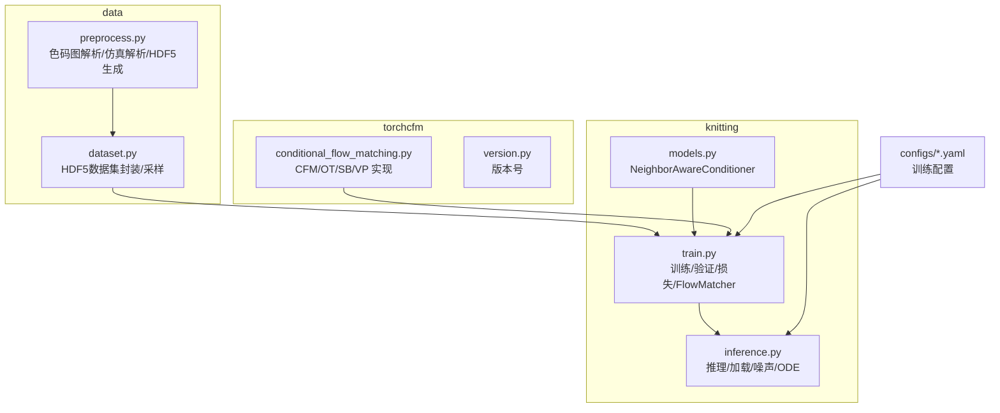
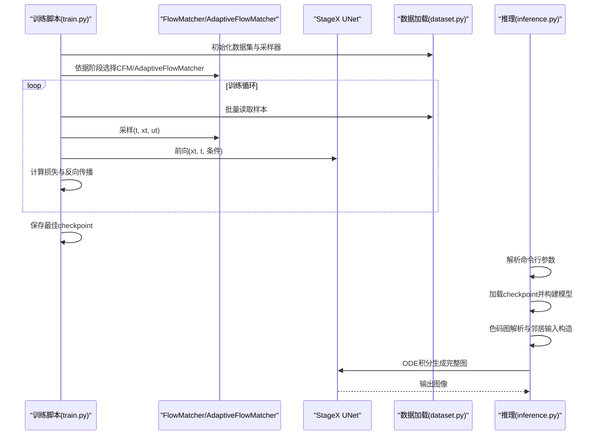
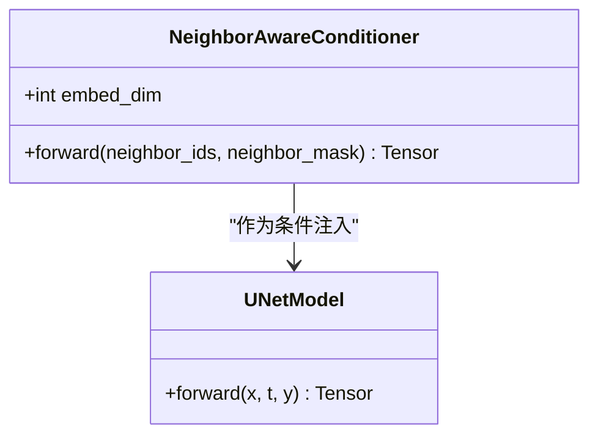
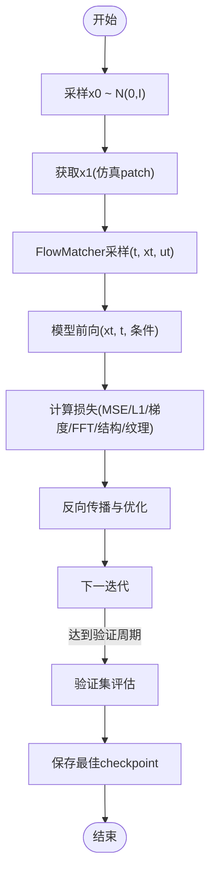
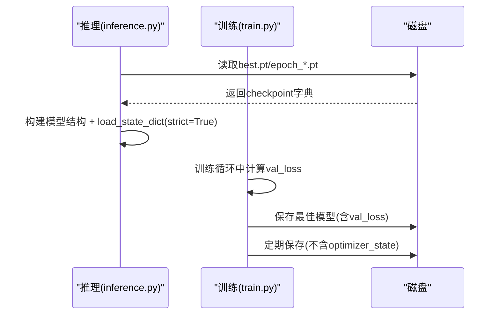
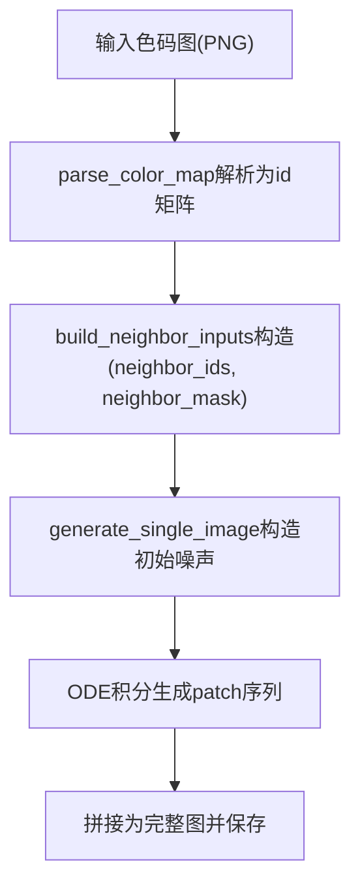
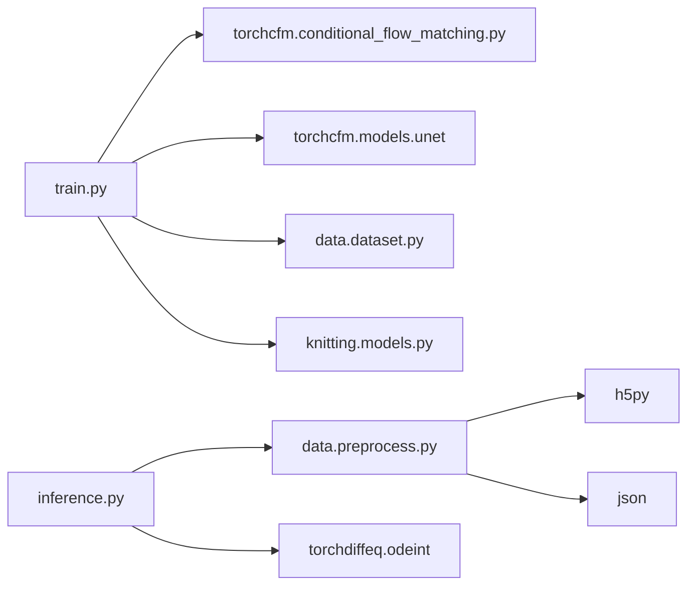

# 模型接口

<cite>
**本文引用的文件**
- [conditional_flow_matching.py](file://conditional-flow-matching-main/torchcfm/conditional_flow_matching.py)
- [models.py](file://conditional-flow-matching-main/knitting/models.py)
- [inference.py](file://conditional-flow-matching-main/knitting/inference.py)
- [train.py](file://conditional-flow-matching-main/knitting/train.py)
- [stage1.yaml](file://conditional-flow-matching-main/configs/stage1.yaml)
- [stage2.yaml](file://conditional-flow-matching-main/configs/stage2.yaml)
- [stage3.yaml](file://conditional-flow-matching-main/configs/stage3.yaml)
- [stage4.yaml](file://conditional-flow-matching-main/configs/stage4.yaml)
- [preprocess.py](file://conditional-flow-matching-main/data/preprocess.py)
- [dataset.py](file://conditional-flow-matching-main/data/dataset.py)
- [version.py](file://conditional-flow-matching-main/torchcfm/version.py)
</cite>

## 目录
1. [简介](#简介)
2. [项目结构](#项目结构)
3. [核心组件](#核心组件)
4. [架构总览](#架构总览)
5. [详细组件分析](#详细组件分析)
6. [依赖分析](#依赖分析)
7. [性能考虑](#性能考虑)
8. [故障排查指南](#故障排查指南)
9. [结论](#结论)
10. [附录](#附录)

## 简介
本文件为“条件流匹配模型接口”的全面API参考，覆盖以下要点：
- NeighborAwareConditioner 类的构造参数与 forward() 方法
- ConditionalFlowMatcher 的训练与推理接口
- 模型加载与保存（checkpoint）格式与版本兼容性
- 训练配置参数详解（batch_size、learning_rate、epochs 等）
- 推理接口的输入输出格式，含色码图的预处理与后处理
- 性能优化建议与 GPU 加速配置

## 项目结构
项目采用模块化组织，核心分为三层：
- torchcfm：条件流匹配算法实现（CFM、OT-CFM、SB-CFM、Variance Preserving 等）
- knitting：UNet 条件模型与训练/推理脚本
- data：数据预处理与数据集封装
- configs：各阶段训练配置

图表来源
- [conditional_flow_matching.py](file://conditional-flow-matching-main/torchcfm/conditional_flow_matching.py)
- [models.py](file://conditional-flow-matching-main/knitting/models.py)
- [inference.py](file://conditional-flow-matching-main/knitting/inference.py)
- [train.py](file://conditional-flow-matching-main/knitting/train.py)
- [preprocess.py](file://conditional-flow-matching-main/data/preprocess.py)
- [dataset.py](file://conditional-flow-matching-main/data/dataset.py)
- [stage1.yaml](file://conditional-flow-matching-main/configs/stage1.yaml)

章节来源
- [train.py](file://conditional-flow-matching-main/knitting/train.py)
- [inference.py](file://conditional-flow-matching-main/knitting/inference.py)
- [preprocess.py](file://conditional-flow-matching-main/data/preprocess.py)
- [dataset.py](file://conditional-flow-matching-main/data/dataset.py)

## 核心组件
- 条件流匹配基类与变体：ConditionalFlowMatcher 及其子类（Exact OT、Target、Schrödinger Bridge、Variance Preserving）
- 邻居感知条件编码器：NeighborAwareConditioner
- UNet 条件模型族：Stage1/2/3/4 对应不同条件注入方式
- 流匹配适配器：AdaptiveFlowMatcher（Stage4）

章节来源
- [conditional_flow_matching.py](file://conditional-flow-matching-main/torchcfm/conditional_flow_matching.py)
- [models.py](file://conditional-flow-matching-main/knitting/models.py)
- [train.py](file://conditional-flow-matching-main/knitting/train.py)

## 架构总览
训练与推理的关键交互如下：

图表来源
- [train.py](file://conditional-flow-matching-main/knitting/train.py)
- [inference.py](file://conditional-flow-matching-main/knitting/inference.py)
- [dataset.py](file://conditional-flow-matching-main/data/dataset.py)
- [conditional_flow_matching.py](file://conditional-flow-matching-main/torchcfm/conditional_flow_matching.py)

## 详细组件分析

### NeighborAwareConditioner 类 API
- 功能：基于 3×3 邻域的邻居感知条件编码，输出固定维度条件向量
- 构造参数
  - num_classes：类别总数，默认 15
  - embed_dim：嵌入维度，默认 256
  - num_heads：多头注意力头数，默认 8
- forward(neighbor_ids, neighbor_mask) 输入
  - neighbor_ids：形状 (B, 3, 3)，long，中心为 [1,1]
  - neighbor_mask：形状 (B, 3, 3)，bool，True 表示有效邻居
- forward 输出
  - 条件向量：形状 (B, embed_dim)

图表来源
- [models.py](file://conditional-flow-matching-main/knitting/models.py)

章节来源
- [models.py](file://conditional-flow-matching-main/knitting/models.py)

### ConditionalFlowMatcher 训练与推理接口
- 基类接口
  - 构造：sigma（扩散系数）
  - compute_mu_t(x0, x1, t)、compute_sigma_t(t)、compute_conditional_flow(x0, x1, t, xt)
  - sample_xt(x0, x1, t, ε)、sample_location_and_conditional_flow(...)
  - compute_lambda(t)（用于得分权重）
- 子类差异
  - Exact OT：通过 OTPlanSampler 重采样耦合
  - Target：目标 OT 方案，μ_t、σ_t、u_t 不同
  - Schrödinger Bridge：entropic OT，σ_t 与桥向量场不同
  - Variance Preserving：三角插值 μ_t、u_t
- 推理流程（训练侧）
  - 从数据采样 x0 ~ N(0, I)，x1 为目标（仿真patch）
  - 使用 FlowMatcher 采样 (t, xt, ut)
  - 将 xt 与时间 t、条件输入送入模型，最小化 ||v_t - u_t|| 或相关损失

图表来源
- [conditional_flow_matching.py](file://conditional-flow-matching-main/torchcfm/conditional_flow_matching.py)
- [train.py](file://conditional-flow-matching-main/knitting/train.py)

章节来源
- [conditional_flow_matching.py](file://conditional-flow-matching-main/torchcfm/conditional_flow_matching.py)
- [train.py](file://conditional-flow-matching-main/knitting/train.py)

### 模型加载与保存（Checkpoint）
- 加载
  - 推理：load_model(stage, model_path, json_path, device) 会加载权重并设置 eval
  - 训练：torch.load(..., map_location=..., weights_only=False)，恢复 epoch、stage、patch_size、model_state、optimizer_state（可选）
- 保存
  - 最优模型：包含 epoch、stage、patch_size、model_state、optimizer_state、val_loss
  - 定期模型：包含 epoch、stage、patch_size、model_state
- 版本兼容
  - 版本号：1.0.7
  - 跨 stage 热启动：load_pretrained_weights 支持前缀重映射与形状不匹配跳过

图表来源
- [inference.py](file://conditional-flow-matching-main/knitting/inference.py)
- [train.py](file://conditional-flow-matching-main/knitting/train.py)
- [version.py](file://conditional-flow-matching-main/torchcfm/version.py)

章节来源
- [inference.py](file://conditional-flow-matching-main/knitting/inference.py)
- [train.py](file://conditional-flow-matching-main/knitting/train.py)
- [version.py](file://conditional-flow-matching-main/torchcfm/version.py)

### 训练配置参数详解
- 通用参数
  - data.processed_dir：HDF5 数据目录
  - data.json_path：指令与颜色表定义
  - data.use_weighted_sampling / sampling_strategy：加权采样策略
  - train.batch_size / epochs / warmup_epochs / lr / num_workers
  - train.val_every / save_every / log_every
  - train.checkpoint_dir：保存目录
- 损失权重（多阶段通用）
  - mse_weight / l1_weight / grad_weight / fft_weight
- 阶段特有
  - Stage 1：基础 UNet，条件为中心类别 id
  - Stage 2：NeighborAwareConditioner + UNet，条件向量经时间/空间投影融合
  - Stage 3：物理特征编码 + 邻域注意力 + UNet，带物理一致性损失
  - Stage 4：自适应 Stochastic Interpolants（AdaptiveFlowMatcher），边界区域更高随机性，结合结构/纹理/边界损失

章节来源
- [stage1.yaml](file://conditional-flow-matching-main/configs/stage1.yaml)
- [stage2.yaml](file://conditional-flow-matching-main/configs/stage2.yaml)
- [stage3.yaml](file://conditional-flow-matching-main/configs/stage3.yaml)
- [stage4.yaml](file://conditional-flow-matching-main/configs/stage4.yaml)
- [train.py](file://conditional-flow-matching-main/knitting/train.py)

### 推理接口输入输出与预处理/后处理
- 输入
  - 色码图：PNG（20×20 或 10×10），解析为 id 矩阵（整数类别）
  - 邻居输入：(100, 3, 3) 的 neighbor_ids 与 neighbor_mask（全图 10×10，展开为 100 个 patch）
  - 可选：instructions.json（颜色表与物理指令）
- 预处理
  - parse_color_map：将 RGB 色码图转为 id 矩阵
  - build_neighbor_inputs：为每个 patch 构造 3×3 邻域 id 与 mask
- 推理
  - generate_single_image：构造初始噪声（支持多种噪声模式），按 ODE 积分生成完整图
  - 支持多候选导出与拼图
- 后处理
  - 将模型输出从 [-1,1] 映射到 [0,255]，拼接为完整图像

图表来源
- [inference.py](file://conditional-flow-matching-main/knitting/inference.py)
- [preprocess.py](file://conditional-flow-matching-main/data/preprocess.py)

章节来源
- [inference.py](file://conditional-flow-matching-main/knitting/inference.py)
- [preprocess.py](file://conditional-flow-matching-main/data/preprocess.py)

## 依赖分析
- 模块耦合
  - train.py 依赖：torchcfm.ConditionalFlowMatcher、torchcfm.models.unet.UNetModel、knitting.models.NeighborAwareConditioner、data.dataset.KnittingWindowDataset
  - inference.py 依赖：data.preprocess.parse_color_map、data.stage1_adapter.parse_stage1_color_map、torchdiffeq.odeint
  - data.preprocess 依赖：PIL、h5py、JSON
- 外部依赖
  - PyTorch、HDF5、PIL、torchdiffeq

图表来源
- [train.py](file://conditional-flow-matching-main/knitting/train.py)
- [inference.py](file://conditional-flow-matching-main/knitting/inference.py)
- [preprocess.py](file://conditional-flow-matching-main/data/preprocess.py)
- [dataset.py](file://conditional-flow-matching-main/data/dataset.py)

章节来源
- [train.py](file://conditional-flow-matching-main/knitting/train.py)
- [inference.py](file://conditional-flow-matching-main/knitting/inference.py)
- [preprocess.py](file://conditional-flow-matching-main/data/preprocess.py)
- [dataset.py](file://conditional-flow-matching-main/data/dataset.py)

## 性能考虑
- 数据加载
  - 使用 HDF5 并启用 gzip 压缩，chunks 与预分配提升 I/O
  - 支持流式读取与内存加载两种模式，按需选择
  - 加权采样平衡长尾类别分布
- 训练
  - DDP 多卡分布式训练，跨卡损失归约
  - 学习率余弦退火与 warmup
  - 梯度裁剪防止不稳定
- 推理
  - 支持 CUDA 优先，自动回退 CPU
  - 多候选导出与候选拼图便于人工筛选
- GPU 加速配置
  - 使用 torchrun 多进程启动
  - NCCL 后端，确保本地 GPU 设备可见
  - 合理设置 batch_size 与 num_workers，避免 OOM

[本节为通用指导，无需特定文件引用]

## 故障排查指南
- HDF5 文件问题
  - 缺少 neighbor_mask 或 patch_size 不匹配：需重新运行预处理脚本
- 设备不可用
  - CUDA 不可用时自动回退 CPU，检查驱动与 PyTorch CUDA 版本
- 配置不一致
  - patch_size 与 HDF5 属性不一致：删除旧 dataset.h5 后重新预处理
- 检查点加载失败
  - strict=True 导致键名不匹配：使用 load_pretrained_weights 的前缀重映射与形状过滤

章节来源
- [dataset.py](file://conditional-flow-matching-main/data/dataset.py)
- [inference.py](file://conditional-flow-matching-main/knitting/inference.py)
- [train.py](file://conditional-flow-matching-main/knitting/train.py)

## 结论
本文档系统梳理了条件流匹配模型的接口与实现细节，涵盖 NeighborAwareConditioner、ConditionalFlowMatcher 及其子类、UNet 条件模型族、训练与推理流程、数据与配置管理、以及性能优化与故障排查。按本文档进行模型加载、训练与推理，可获得稳定且高性能的针织仿真图生成能力。

[本节为总结，无需特定文件引用]

## 附录
- 关键参数速查
  - batch_size、epochs、learning_rate、warmup_epochs、val_every、save_every、log_every
  - 损失权重：mse_weight、l1_weight、grad_weight、fft_weight、physics_weight、boundary_weight、structure_weight、texture_weight
  - 自适应 SI 参数：sigma_inner、sigma_boundary、boundary_band_width
- 命令行示例
  - 训练：torchrun --nproc_per_node=N knitting/train.py --config configs/stage4.yaml
  - 推理：python knitting/inference.py --stage 4 --checkpoint checkpoints/stage4/best.pt

[本节为概览，无需特定文件引用]