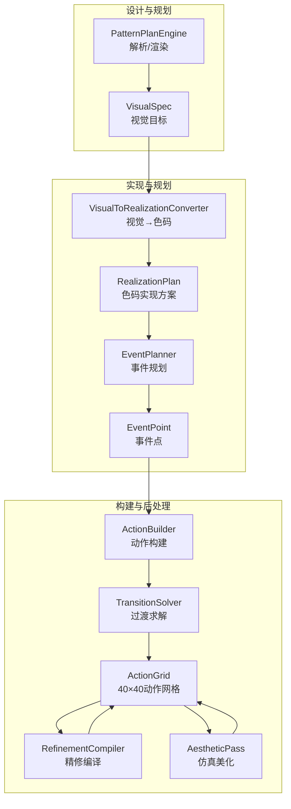
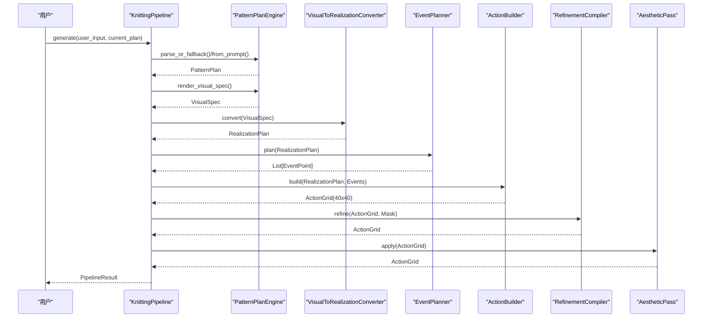
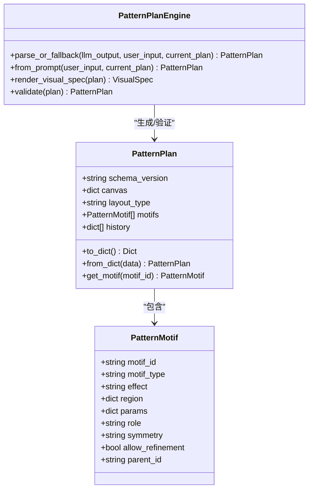
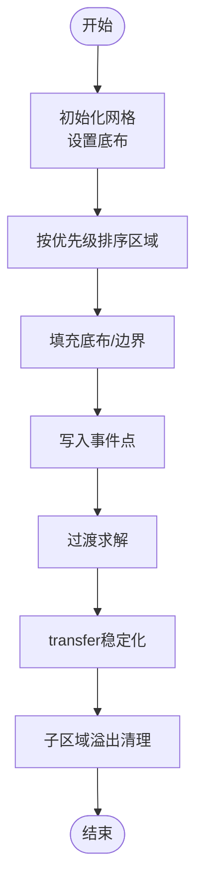
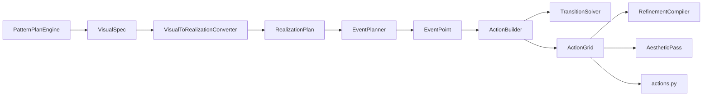

# 生成模块API

<cite>
**本文档引用的文件**
- [pipeline.py](file://generator_one/pipeline.py)
- [pattern_plan.py](file://generator_one/generation/pattern_plan.py)
- [visual_types.py](file://generator_one/generation/visual_types.py)
- [visual_to_realization.py](file://generator_one/generation/visual_to_realization.py)
- [event_planner.py](file://generator_one/generation/event_planner.py)
- [action_builder.py](file://generator_one/generation/action_builder.py)
- [refinement_compiler.py](file://generator_one/generation/refinement_compiler.py)
- [aesthetic_pass.py](file://generator_one/generation/aesthetic_pass.py)
- [transition_solver.py](file://generator_one/generation/transition_solver.py)
- [actions.py](file://generator_one/core/actions.py)
- [main.py](file://generator_one/main.py)
</cite>

## 目录
1. [简介](#简介)
2. [项目结构](#项目结构)
3. [核心组件](#核心组件)
4. [架构总览](#架构总览)
5. [详细组件分析](#详细组件分析)
6. [依赖关系分析](#依赖关系分析)
7. [性能考虑](#性能考虑)
8. [故障排除指南](#故障排除指南)
9. [结论](#结论)
10. [附录](#附录)

## 简介
本文件为图案生成模块的API参考文档，聚焦于PatternPlanEngine、ActionBuilder、VisualToRealizationConverter、EventPlanner、AestheticPass、RefinementCompiler等核心组件。文档详细说明各模块的方法签名、参数、返回值、数据结构以及模块间的调用关系与数据流，帮助开发者快速理解并正确使用这些API。

## 项目结构
生成模块位于generator_one/generation目录，围绕“设计意图→视觉目标→色码实现→事件规划→动作构建→精修→美化”的流水线展开。核心文件如下：
- pattern_plan.py：模式计划引擎，负责将用户意图解析为可编辑的PatternPlan，并渲染为VisualSpec
- visual_types.py：视觉与色码实现相关的数据结构定义
- visual_to_realization.py：视觉到色码实现的转换器
- event_planner.py：事件规划器，生成稀疏事件点集合
- action_builder.py：动作构建器，将事件点与实现方案组合为40×40动作网格
- refinement_compiler.py：精修编译器，对基础动作网格进行受控替换
- aesthetic_pass.py：仿真感知美化层
- transition_solver.py：过渡求解器，解决相邻冲突
- pipeline.py：端到端生成管线，串联上述模块
- actions.py：动作定义与工具函数
- main.py：命令行入口

图表来源
- [pipeline.py:93-189](file://generator_one/pipeline.py#L93-L189)
- [pattern_plan.py:175-352](file://generator_one/generation/pattern_plan.py#L175-L352)
- [visual_to_realization.py:240-295](file://generator_one/generation/visual_to_realization.py#L240-L295)
- [event_planner.py:24-80](file://generator_one/generation/event_planner.py#L24-L80)
- [action_builder.py:35-118](file://generator_one/generation/action_builder.py#L35-L118)
- [transition_solver.py:23-110](file://generator_one/generation/transition_solver.py#L23-L110)
- [refinement_compiler.py:44-182](file://generator_one/generation/refinement_compiler.py#L44-L182)
- [aesthetic_pass.py:21-52](file://generator_one/generation/aesthetic_pass.py#L21-L52)

章节来源
- [pipeline.py:1-749](file://generator_one/pipeline.py#L1-L749)

## 核心组件

### PatternPlanEngine
- 方法
  - parse_or_fallback(llm_output, user_input, current_plan=None) → PatternPlan
    - 解析LLM输出为PatternPlan，失败时回退到启发式规划
  - from_prompt(user_input, current_plan=None) → PatternPlan
    - 从纯文本提示生成PatternPlan
  - render_visual_spec(plan) → VisualSpec
    - 将PatternPlan渲染为VisualSpec
- 数据结构
  - PatternPlan：包含布局类型、画布尺寸、动机列表等
  - PatternMotif：单个动机的类型、效果、区域、参数、角色等
- 关键特性
  - 支持结构化编辑（增删改）、启发式编辑（尺寸、密度、位置调整）
  - 自动修复布局语义（如背景与几何容器的互斥）
  - 支持随机生成与历史记录

章节来源
- [pattern_plan.py:175-352](file://generator_one/generation/pattern_plan.py#L175-L352)
- [visual_types.py:121-140](file://generator_one/generation/visual_types.py#L121-L140)

### VisualToRealizationConverter
- 方法
  - convert(visual_spec) → RealizationPlan
    - 将VisualSpec转换为RealizationPlan
- 关键机制
  - 效果与形状的标准化与别名映射
  - 嵌套关系对齐与保护（父/子纹理互不干扰）
  - 事件模式推导（如波浪、麻花、网眼等）

章节来源
- [visual_to_realization.py:240-295](file://generator_one/generation/visual_to_realization.py#L240-L295)
- [visual_types.py:127-179](file://generator_one/generation/visual_types.py#L127-L179)

### EventPlanner
- 方法
  - plan(realization_plan) → List[EventPoint]
    - 为每个区域生成稀疏事件点，严格遵循色码实现规则
- 关键机制
  - 按事件模式（如对角波浪、麻花侧向、网眼等）生成事件点
  - 剪枝未配对的波浪事件，保证最终色码图的连贯性

章节来源
- [event_planner.py:24-80](file://generator_one/generation/event_planner.py#L24-L80)
- [visual_types.py:185-196](file://generator_one/generation/visual_types.py#L185-L196)

### ActionBuilder
- 方法
  - build(realization_plan, events) → np.ndarray
    - 将事件点与实现方案组合为40×40动作网格
- 参数与返回
  - 输入：RealizationPlan、EventPoint列表
  - 返回：np.ndarray，形状(40,40)，元素为动作索引
- 关键步骤
  - 底布填充与边界绘制
  - 事件点写入
  - 过渡求解（仅对local_only策略启用）
  - transfer稳定化与子区域溢出清理

章节来源
- [action_builder.py:35-118](file://generator_one/generation/action_builder.py#L35-L118)
- [transition_solver.py:23-110](file://generator_one/generation/transition_solver.py#L23-L110)

### RefinementCompiler
- 方法
  - refine(action_grid, refinement_mask, stitch_grid=None, role_grid=None) → np.ndarray
    - 在基础动作网格上进行稀疏、受控的低频动作替换
- 关键配置
  - RefinementConfig：tuck变体替换比例、split_v预算、邻域差异阈值
- 替换策略
  - tuck → tuck_2（核心区限制）
  - split/b_split → split_v（仅在transition/boundary且邻域语义差异足够时）

章节来源
- [refinement_compiler.py:44-182](file://generator_one/generation/refinement_compiler.py#L44-L182)

### AestheticPass
- 方法
  - apply(action_grid, role_grid=None, realization_plan=None) → np.ndarray
    - 在规则检查前进行轻量级结构美化
- 美化策略
  - 交叉对称性修正（平衡左右transfer数量）
  - 几何边缘柔化（边界环统一为b_knit，孤立特殊动作回退）
  - 可选的区域边界过渡处理

章节来源
- [aesthetic_pass.py:21-52](file://generator_one/generation/aesthetic_pass.py#L21-L52)

## 架构总览
端到端生成管线KnittingPipeline串联各模块，形成以下流程：
1. 设计解析：PatternPlanEngine.parse_or_fallback()与render_visual_spec()
2. 视觉到色码：VisualToRealizationConverter.convert()
3. 事件规划：EventPlanner.plan()
4. 动作构建：ActionBuilder.build()
5. 精修：RefinementCompiler.refine()
6. 美化：AestheticPass.apply()
7. 规则检查与LLM修复：规则校验与RepairAgent
8. 结果保存：BMP与JSON导出

图表来源
- [pipeline.py:114-189](file://generator_one/pipeline.py#L114-L189)
- [pattern_plan.py:175-352](file://generator_one/generation/pattern_plan.py#L175-L352)
- [visual_to_realization.py:258-295](file://generator_one/generation/visual_to_realization.py#L258-L295)
- [event_planner.py:33-80](file://generator_one/generation/event_planner.py#L33-L80)
- [action_builder.py:43-118](file://generator_one/generation/action_builder.py#L43-L118)
- [refinement_compiler.py:48-182](file://generator_one/generation/refinement_compiler.py#L48-L182)
- [aesthetic_pass.py:24-52](file://generator_one/generation/aesthetic_pass.py#L24-L52)

## 详细组件分析

### PatternPlanEngine 类
- 核心方法
  - parse_or_fallback(llm_output, user_input, current_plan=None) → PatternPlan
    - 从LLM输出提取JSON，失败时回退到启发式规划
    - 支持结构化编辑与文本修复
  - from_prompt(user_input, current_plan=None) → PatternPlan
    - 文本提示→动机池→布局推断→验证
  - render_visual_spec(plan) → VisualSpec
    - 将PatternPlan转换为VisualSpec，用于后续视觉到色码的转换
- 数据结构
  - PatternPlan：schema_version、canvas、layout_type、motifs、history
  - PatternMotif：motif_id、motif_type、effect、region、params、role、symmetry、allow_refinement、parent_id
- 关键流程
  - 文本别名解析（形状/效果）
  - 布局语义修复（背景与几何容器互斥）
  - 随机生成策略（布局类型、动机类型、尺寸、对称性）

图表来源
- [pattern_plan.py:121-174](file://generator_one/generation/pattern_plan.py#L121-L174)
- [pattern_plan.py:175-352](file://generator_one/generation/pattern_plan.py#L175-L352)

章节来源
- [pattern_plan.py:175-352](file://generator_one/generation/pattern_plan.py#L175-L352)
- [visual_types.py:121-140](file://generator_one/generation/visual_types.py#L121-L140)

### ActionBuilder 类
- 核心方法
  - build(realization_plan, events) → np.ndarray
    - 参数：RealizationPlan、EventPoint列表
    - 返回：(40,40)动作网格
- 关键步骤
  - 底布填充：按layout_role与base_field填充
  - 边界绘制：back_loop_outline、rib_border等
  - 事件点写入：安全解析动作缩写，越界与区域外事件过滤
  - 过渡求解：仅对local_only策略启用
  - transfer稳定化：左右transfer数量平衡、无效转移清理
  - 子区域溢出清理：防止子区域动作溢出到父区域

图表来源
- [action_builder.py:43-118](file://generator_one/generation/action_builder.py#L43-L118)
- [transition_solver.py:37-110](file://generator_one/generation/transition_solver.py#L37-L110)

章节来源
- [action_builder.py:35-118](file://generator_one/generation/action_builder.py#L35-L118)
- [transition_solver.py:23-110](file://generator_one/generation/transition_solver.py#L23-L110)

### VisualToRealizationConverter 类
- 核心方法
  - convert(visual_spec) → RealizationPlan
- 关键机制
  - 效果与形状标准化：别名映射、优先级列表、默认回退
  - 事件模式推导：根据effect/shape映射到具体事件模式
  - 嵌套关系处理：对齐父子区域、保护纹理不重叠
  - 参数补全：为缺失参数提供合理默认值（如波浪周期、边缘衰减等）

章节来源
- [visual_to_realization.py:240-295](file://generator_one/generation/visual_to_realization.py#L240-L295)
- [visual_types.py:127-179](file://generator_one/generation/visual_types.py#L127-L179)

### EventPlanner 类
- 核心方法
  - plan(realization_plan) → List[EventPoint]
- 关键机制
  - 按事件模式生成稀疏事件点（对角波浪、麻花侧向、网眼、浮雕、蜂巢、种子针等）
  - 剪枝未配对的波浪事件，保证成对结构
  - 区域扫描边界与掩码一致性检查

章节来源
- [event_planner.py:24-80](file://generator_one/generation/event_planner.py#L24-L80)
- [visual_types.py:185-196](file://generator_one/generation/visual_types.py#L185-L196)

### AestheticPass 类
- 核心方法
  - apply(action_grid, role_grid=None, realization_plan=None) → np.ndarray
- 关键机制
  - 交叉对称性修正：平衡每行左右transfer数量
  - 几何边缘柔化：边界环统一为b_knit，孤立特殊动作回退
  - 区域边界过渡处理：在边界区域插入过渡动作

章节来源
- [aesthetic_pass.py:21-52](file://generator_one/generation/aesthetic_pass.py#L21-L52)

### RefinementCompiler 类
- 核心方法
  - refine(action_grid, refinement_mask, stitch_grid=None, role_grid=None) → np.ndarray
- 关键机制
  - tuck变体替换：f_tuck/b_tuck → f_tuck_2/b_tuck_2（稀疏、核心区限制）
  - split_v替换：split/b_split → split_v（仅在transition/boundary且邻域语义差异足够时）

章节来源
- [refinement_compiler.py:44-182](file://generator_one/generation/refinement_compiler.py#L44-L182)

## 依赖关系分析

图表来源
- [pipeline.py:30-36](file://generator_one/pipeline.py#L30-L36)
- [pattern_plan.py:175-352](file://generator_one/generation/pattern_plan.py#L175-L352)
- [visual_to_realization.py:240-295](file://generator_one/generation/visual_to_realization.py#L240-L295)
- [event_planner.py:24-80](file://generator_one/generation/event_planner.py#L24-L80)
- [action_builder.py:35-118](file://generator_one/generation/action_builder.py#L35-L118)
- [transition_solver.py:23-110](file://generator_one/generation/transition_solver.py#L23-L110)
- [refinement_compiler.py:44-182](file://generator_one/generation/refinement_compiler.py#L44-L182)
- [aesthetic_pass.py:21-52](file://generator_one/generation/aesthetic_pass.py#L21-L52)
- [actions.py:1-338](file://generator_one/core/actions.py#L1-L338)

章节来源
- [pipeline.py:30-36](file://generator_one/pipeline.py#L30-L36)

## 性能考虑
- 稀疏事件生成：EventPlanner仅生成必要事件点，显著降低后续构建成本
- 局部过渡求解：TransitionSolver仅在相邻格插入过渡，避免全局填充
- 精修预算控制：RefinementCompiler通过配置限制替换频率与范围
- 缓存与别名映射：VisualToRealizationConverter对形状/效果标准化使用缓存
- 网格尺寸固定：40×40网格简化计算复杂度，便于规则检查与仿真

## 故障排除指南
- 事件规划返回0事件
  - 检查VisualSpec中各区域的event_pattern是否为none或布局角色为ground
  - 核对事件参数（如period_x/period_y、offset等）是否有效
- 色码图出现孤立特殊动作
  - 启用AestheticPass的孤立动作清理（当前版本禁用，可按需求启用）
- transfer不平衡
  - ActionBuilder的transfer稳定化会自动平衡左右数量
- 波浪配对不完整
  - EventPlanner会剪枝未配对的波浪事件，确保最终色码图连贯

章节来源
- [event_planner.py:82-139](file://generator_one/generation/event_planner.py#L82-L139)
- [aesthetic_pass.py:217-240](file://generator_one/generation/aesthetic_pass.py#L217-L240)
- [action_builder.py:422-467](file://generator_one/generation/action_builder.py#L422-L467)

## 结论
本模块通过清晰的层次化设计与严格的规则约束，实现了从用户意图到色码图的可靠转换。PatternPlanEngine负责意图解析与渲染，VisualToRealizationConverter完成视觉到色码的翻译，EventPlanner与ActionBuilder确保稀疏且结构化的动作网格，RefinementCompiler与AestheticPass进一步提升仿真质量。整体架构具备良好的扩展性与可维护性。

## 附录

### 数据结构一览
- PatternPlan：布局类型、动机列表、历史记录
- PatternMotif：动机标识、类型、效果、区域、参数、角色、父ID等
- VisualSpec：整体视觉目标，包含多个VisualRegion
- RealizationPlan：色码实现方案，包含多个RealizationRegion
- RealizationRegion：底布、边界样式、事件模式、过渡策略等
- EventPoint：事件坐标、动作缩写、所属区域、原因说明
- ActionGrid：40×40动作网格，元素为动作索引

章节来源
- [visual_types.py:77-196](file://generator_one/generation/visual_types.py#L77-L196)

### 实际使用示例

- 独立使用PatternPlanEngine
  - 从文本生成PatternPlan并渲染为VisualSpec
  - 参考路径：[pattern_plan.py:190-207](file://generator_one/generation/pattern_plan.py#L190-L207)、[pattern_plan.py:319-351](file://generator_one/generation/pattern_plan.py#L319-L351)

- 独立使用VisualToRealizationConverter
  - 将VisualSpec转换为RealizationPlan
  - 参考路径：[visual_to_realization.py:258-295](file://generator_one/generation/visual_to_realization.py#L258-L295)

- 独立使用EventPlanner
  - 为RealizationPlan生成事件点
  - 参考路径：[event_planner.py:33-80](file://generator_one/generation/event_planner.py#L33-L80)

- 独立使用ActionBuilder
  - 将事件点与实现方案组合为动作网格
  - 参考路径：[action_builder.py:43-118](file://generator_one/generation/action_builder.py#L43-L118)

- 独立使用RefinementCompiler
  - 对动作网格进行精修替换
  - 参考路径：[refinement_compiler.py:48-182](file://generator_one/generation/refinement_compiler.py#L48-L182)

- 独立使用AestheticPass
  - 对动作网格进行仿真美化
  - 参考路径：[aesthetic_pass.py:24-52](file://generator_one/generation/aesthetic_pass.py#L24-L52)

- 命令行使用
  - 生成图案：python main.py generate "中心麻花菱形"
  - 随机生成：python main.py random "风格描述"
  - 参考路径：[main.py:117-202](file://generator_one/main.py#L117-L202)