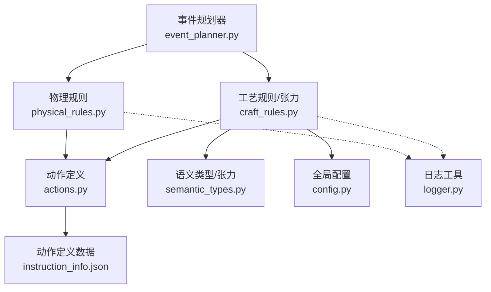
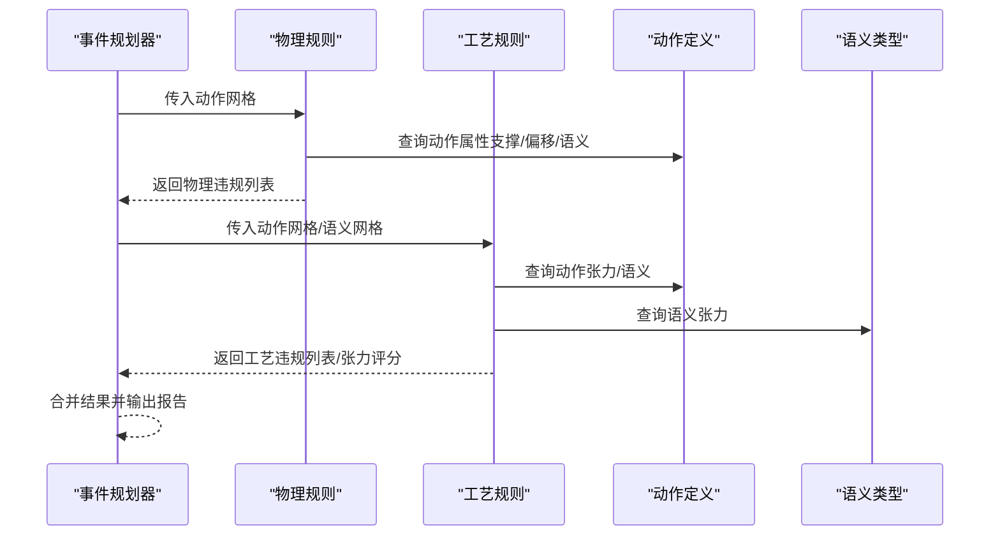
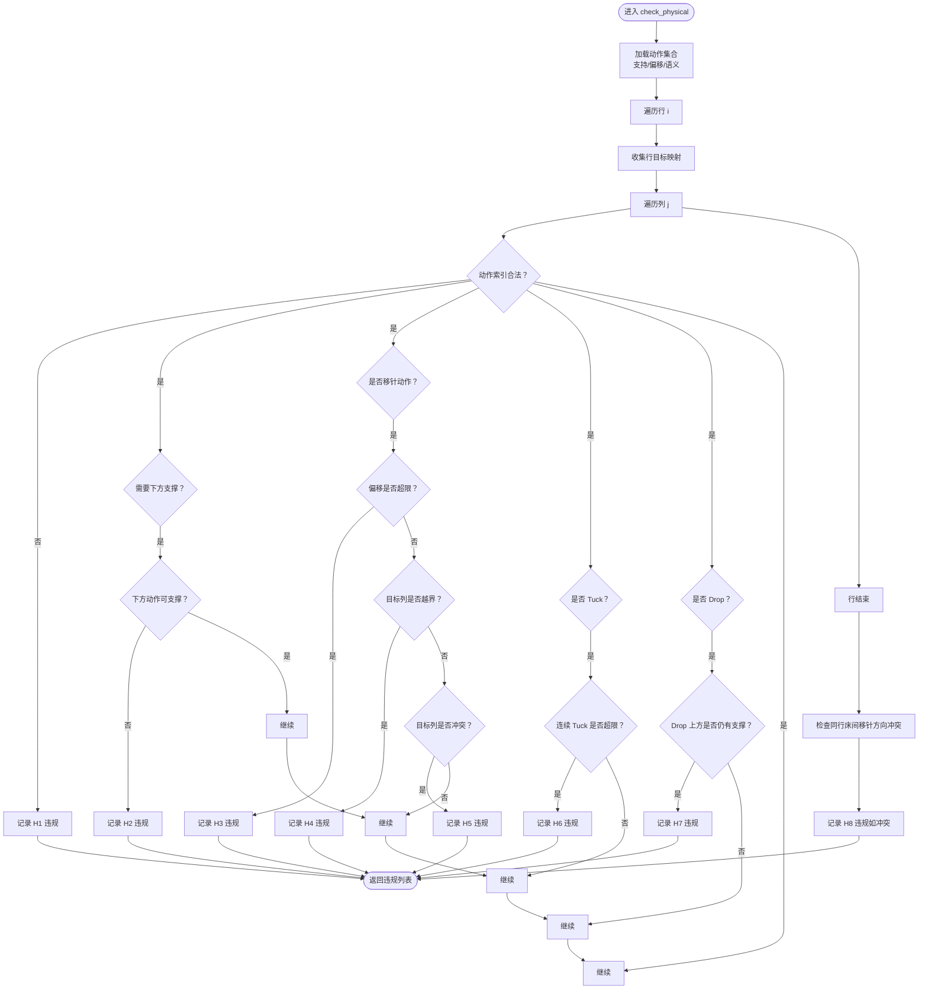
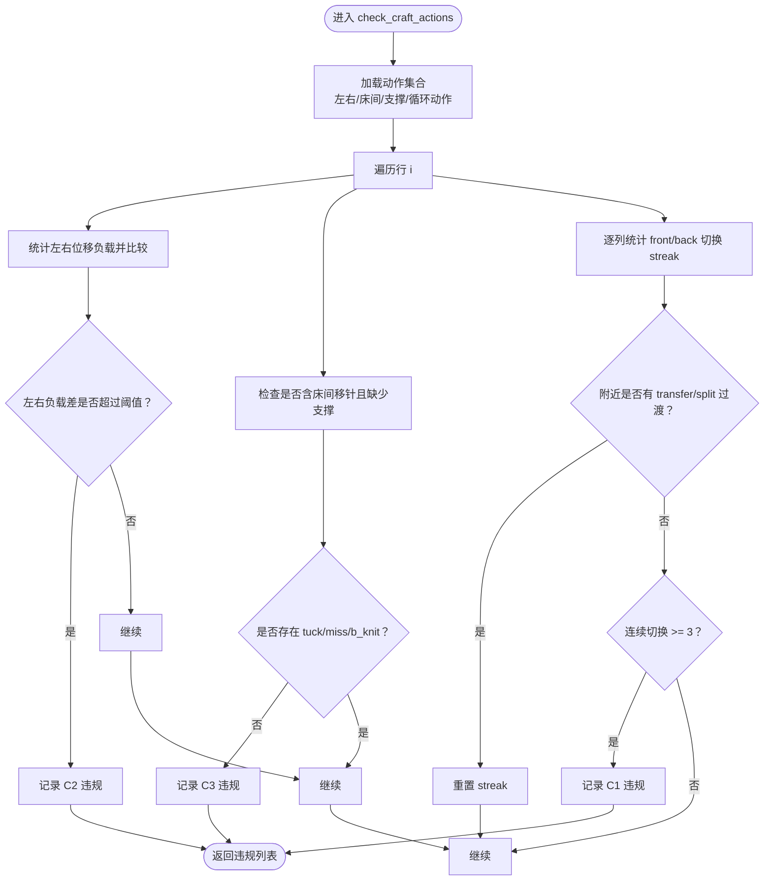
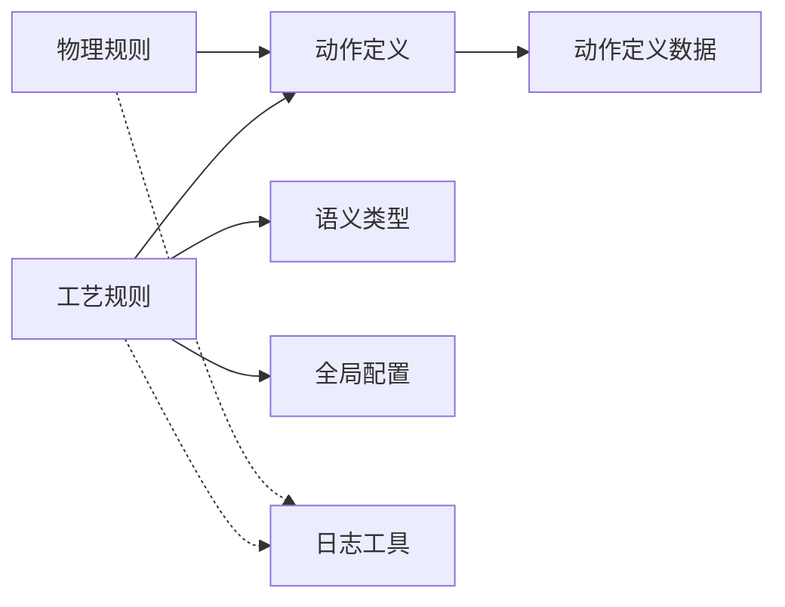

# 规则验证API

<cite>
**本文档引用的文件**
- [physical_rules.py](file://generator_one/rules/physical_rules.py)
- [craft_rules.py](file://generator_one/rules/craft_rules.py)
- [actions.py](file://generator_one/core/actions.py)
- [semantic_types.py](file://generator_one/core/semantic_types.py)
- [config.py](file://generator_one/config.py)
- [instruction_info.json](file://generator_one/data/instruction_info.json)
- [logger.py](file://generator_one/utils/logger.py)
- [event_planner.py](file://generator_one/generation/event_planner.py)
</cite>

## 目录
1. [简介](#简介)
2. [项目结构](#项目结构)
3. [核心组件](#核心组件)
4. [架构总览](#架构总览)
5. [详细组件分析](#详细组件分析)
6. [依赖关系分析](#依赖关系分析)
7. [性能考虑](#性能考虑)
8. [故障排查指南](#故障排查指南)
9. [结论](#结论)
10. [附录](#附录)

## 简介
本文件为规则验证系统API的权威参考，聚焦以下能力：
- 物理规则检查与自动修复：check_physical() 与 fix_physical() 的参数、返回值与使用方法
- 工艺规则检查：check_craft_actions() 的违规检测机制与修复策略
- 违规报告结构：Violation 报告数据结构与各违规类型的说明
- 张力评分：tension_score() 的计算方法与阈值设置
- 规则分类：硬性规则与软性规则的差异与适用场景
- 性能优化：规则检查的性能优化建议与自定义规则扩展方法

## 项目结构
规则验证系统位于 generator_one/rules 目录，核心文件如下：
- 物理规则：generator_one/rules/physical_rules.py
- 工艺规则与张力评分：generator_one/rules/craft_rules.py
- 动作定义与属性：generator_one/core/actions.py
- 语义类型与张力表：generator_one/core/semantic_types.py
- 全局配置：generator_one/config.py
- 动作定义数据：generator_one/data/instruction_info.json
- 日志工具：generator_one/utils/logger.py
- 事件规划器（与规则验证交互）：generator_one/generation/event_planner.py

图表来源
- [physical_rules.py:1-212](file://generator_one/rules/physical_rules.py#L1-L212)
- [craft_rules.py:1-414](file://generator_one/rules/craft_rules.py#L1-L414)
- [actions.py:1-338](file://generator_one/core/actions.py#L1-L338)
- [semantic_types.py:1-198](file://generator_one/core/semantic_types.py#L1-L198)
- [config.py:1-76](file://generator_one/config.py#L1-L76)
- [instruction_info.json:1-352](file://generator_one/data/instruction_info.json#L1-L352)
- [logger.py:1-52](file://generator_one/utils/logger.py#L1-L52)
- [event_planner.py:1-200](file://generator_one/generation/event_planner.py#L1-L200)

章节来源
- [physical_rules.py:1-212](file://generator_one/rules/physical_rules.py#L1-L212)
- [craft_rules.py:1-414](file://generator_one/rules/craft_rules.py#L1-L414)
- [actions.py:1-338](file://generator_one/core/actions.py#L1-L338)
- [semantic_types.py:1-198](file://generator_one/core/semantic_types.py#L1-L198)
- [config.py:1-76](file://generator_one/config.py#L1-L76)
- [instruction_info.json:1-352](file://generator_one/data/instruction_info.json#L1-L352)
- [logger.py:1-52](file://generator_one/utils/logger.py#L1-L52)
- [event_planner.py:1-200](file://generator_one/generation/event_planner.py#L1-L200)

## 核心组件
- 物理规则模块：提供 check_physical() 与 fix_physical()，执行硬性物理/制造约束检查与自动修复
- 工艺规则模块：提供 check_craft_actions() 与相关修复函数，执行软性工艺约束与张力评分
- 动作定义模块：提供动作属性查询接口，支撑规则检查与修复决策
- 语义类型模块：提供语义层张力表与属性，支撑语义层连接规则与张力评分
- 配置模块：提供全局网格尺寸等配置，影响规则检查范围
- 数据模块：instruction_info.json 提供动作语义、张力、偏移等属性

章节来源
- [physical_rules.py:36-159](file://generator_one/rules/physical_rules.py#L36-L159)
- [craft_rules.py:34-166](file://generator_one/rules/craft_rules.py#L34-L166)
- [actions.py:66-191](file://generator_one/core/actions.py#L66-L191)
- [semantic_types.py:27-63](file://generator_one/core/semantic_types.py#L27-L63)
- [config.py:45](file://generator_one/config.py#L45)
- [instruction_info.json:13-74](file://generator_one/data/instruction_info.json#L13-L74)

## 架构总览
规则验证系统以“动作层 + 语义层”的双层规则体系运行：
- 动作层：基于动作索引网格，检查物理约束与工艺约束
- 语义层：基于语义针法网格，检查连接与边界规则，并进行张力评分

图表来源
- [event_planner.py:33-80](file://generator_one/generation/event_planner.py#L33-L80)
- [physical_rules.py:36-159](file://generator_one/rules/physical_rules.py#L36-L159)
- [craft_rules.py:34-166](file://generator_one/rules/craft_rules.py#L34-L166)
- [actions.py:66-191](file://generator_one/core/actions.py#L66-L191)
- [semantic_types.py:27-63](file://generator_one/core/semantic_types.py#L27-L63)

## 详细组件分析

### 物理规则检查与修复 API
- 函数：check_physical(grid)
  - 参数
    - grid: 40×40 动作索引网格，dtype=uint8，值 0~16
  - 返回
    - 违规列表（Violation），空列表表示全部通过
  - 说明
    - 执行全部物理 + 制造硬性规则检查
    - 涵盖非法动作索引、物理支撑、移针偏移/越界/目标冲突、连续 Tuck 堆叠、Drop 上方支撑、床间移针方向冲突等
- 函数：fix_physical(grid, violations)
  - 参数
    - grid: 原始动作网格
    - violations: 违规列表（来自 check_physical）
  - 返回
    - 修复后的网格（保守修复策略）
  - 说明
    - 优先降级为安全动作，无法确定时退化为 f_knit

图表来源
- [physical_rules.py:36-159](file://generator_one/rules/physical_rules.py#L36-L159)

章节来源
- [physical_rules.py:36-159](file://generator_one/rules/physical_rules.py#L36-L159)
- [physical_rules.py:162-211](file://generator_one/rules/physical_rules.py#L162-L211)
- [actions.py:174-186](file://generator_one/core/actions.py#L174-L186)
- [actions.py:189-190](file://generator_one/core/actions.py#L189-L190)

### 工艺规则检查 API
- 函数：check_craft_actions(grid)
  - 参数
    - grid: 40×40 动作索引网格
  - 返回
    - 违规列表（Violation），空列表表示全部通过
  - 说明
    - 执行动作层工艺规则检查，包括：
      - C1: 同列 front/back loop 直接切换（收紧条件：附近无 transfer/split 过渡，垂直连续 >= 2 行）
      - C2: Cable 左右位移负载不平衡
      - C3: 含床间移针的行缺少 tuck/miss/b_knit 支撑
- 函数：tension_score(grid)
  - 参数
    - grid: 40×40 动作索引网格
  - 返回
    - 浮点数：平均相邻张力差
  - 说明
    - 计算相邻动作张力差的平均值，用于评估张力过渡平滑度
  - 阈值设置
    - 项目未内置固定阈值，建议结合业务需求设定；可参考语义层张力差阈值（例如 1.5）进行对比

图表来源
- [craft_rules.py:34-166](file://generator_one/rules/craft_rules.py#L34-L166)

章节来源
- [craft_rules.py:34-166](file://generator_one/rules/craft_rules.py#L34-L166)
- [craft_rules.py:236-253](file://generator_one/rules/craft_rules.py#L236-L253)
- [actions.py:225-234](file://generator_one/core/actions.py#L225-L234)
- [actions.py:216-222](file://generator_one/core/actions.py#L216-L222)

### 违规报告数据结构
- Violation 报告对象
  - 字段
    - level: "HARD" 或 "CRAFT"
    - rule: 规则编号（如 "H1"、"C1"、"C2" 等）
    - row: 行坐标
    - col: 列坐标
    - detail: 详细违规描述
    - suggestion: 修复建议（可选）
  - 用途
    - 统一记录物理/工艺违规，便于修复与报告

章节来源
- [physical_rules.py:23-34](file://generator_one/rules/physical_rules.py#L23-L34)
- [craft_rules.py:24-27](file://generator_one/rules/craft_rules.py#L24-L27)

### 语义层连接规则与张力评分
- 语义层连接规则
  - C4: CABLE/TUCK 区域外围缺少 STRUCTURE 边框
  - C5: 相邻 VOID 区域未隔离
  - C6: TUCK 与 CABLE 直接相邻
- 张力评分
  - tension_score(grid): 基于动作层张力差计算平均相邻张力差
  - 语义层张力差阈值：1.5（用于 needs_transition 判断）

章节来源
- [craft_rules.py:173-229](file://generator_one/rules/craft_rules.py#L173-L229)
- [craft_rules.py:236-253](file://generator_one/rules/craft_rules.py#L236-L253)
- [semantic_types.py:184-185](file://generator_one/core/semantic_types.py#L184-L185)

### 规则分类：硬性规则 vs 软性规则
- 硬性规则（H1-H8）
  - 违反将导致织物无法成型或机器损坏
  - 必须在生成前强制修复
- 软性规则（C1-C6）
  - 违反不影响机器安全，但会影响织物质量
  - 可由 LLM 修复代理进行更智能修复

章节来源
- [physical_rules.py:1-15](file://generator_one/rules/physical_rules.py#L1-L15)
- [craft_rules.py:1-19](file://generator_one/rules/craft_rules.py#L1-L19)

## 依赖关系分析
- 物理规则依赖动作定义模块提供的动作属性（支撑、偏移、语义、最大偏移等）
- 工艺规则依赖动作定义模块与语义类型模块（张力、语义属性）
- 张力评分依赖动作张力表与语义张力表
- 全局配置提供网格尺寸等参数

图表来源
- [physical_rules.py:20-53](file://generator_one/rules/physical_rules.py#L20-L53)
- [craft_rules.py:24-27](file://generator_one/rules/craft_rules.py#L24-L27)
- [actions.py:12-32](file://generator_one/core/actions.py#L12-L32)
- [semantic_types.py:27-63](file://generator_one/core/semantic_types.py#L27-L63)
- [config.py:45](file://generator_one/config.py#L45)
- [logger.py:9-49](file://generator_one/utils/logger.py#L9-L49)

章节来源
- [physical_rules.py:20-53](file://generator_one/rules/physical_rules.py#L20-L53)
- [craft_rules.py:24-27](file://generator_one/rules/craft_rules.py#L24-L27)
- [actions.py:12-32](file://generator_one/core/actions.py#L12-L32)
- [semantic_types.py:27-63](file://generator_one/core/semantic_types.py#L27-L63)
- [config.py:45](file://generator_one/config.py#L45)
- [logger.py:9-49](file://generator_one/utils/logger.py#L9-L49)

## 性能考虑
- 时间复杂度
  - check_physical/grid: O(R*C)，R=40，C=40，线性扫描
  - check_craft_actions/grid: O(R*C)，行扫描与列统计
  - tension_score/grid: O(R*C)，相邻差值累加
- 空间复杂度
  - 多数为原地操作，额外空间主要来自临时集合与字典
- 优化建议
  - 使用向量化操作（NumPy）减少 Python 循环开销
  - 将动作集合预计算为集合/字典，降低查找成本
  - 对行目标映射与列统计使用缓存，避免重复计算
  - 在大规模批量检查时，分块处理网格并并行化（注意线程安全）

[本节为通用性能讨论，无需特定文件来源]

## 故障排查指南
- 常见问题
  - 动作索引越界：检查动作定义数据与动作映射
  - 物理支撑缺失：确认下方动作是否具备支撑属性
  - 移针目标冲突：调整移针偏移或间距
  - 连续 Tuck 超限：插入 knit/split 打断堆叠
  - Drop 上方未清空：确保 Drop 上方为空位
  - 床间移针方向冲突：拆分到相邻行或只保留单方向
  - 左右负载不平衡：使 cable 左右位移尽量成对
  - 缺少 tuck/miss/b_knit 支撑：在含床间移针的行补入支撑动作
- 日志与调试
  - 使用日志工具输出详细信息，定位违规位置与原因
  - 结合 Violation.suggestion 获取修复建议

章节来源
- [physical_rules.py:62-157](file://generator_one/rules/physical_rules.py#L62-L157)
- [craft_rules.py:73-91](file://generator_one/rules/craft_rules.py#L73-L91)
- [logger.py:9-49](file://generator_one/utils/logger.py#L9-L49)

## 结论
规则验证系统通过“动作层 + 语义层”的双层规则体系，实现了对织物生成过程的全面约束与质量保障。物理规则确保机器安全与织物可成形，工艺规则提升织物外观与稳定性，张力评分提供量化指标。建议在生产流程中优先执行物理规则检查与修复，在设计阶段引入工艺规则与张力评分，持续优化规则阈值与修复策略。

[本节为总结性内容，无需特定文件来源]

## 附录

### API 定义与使用方法

- check_physical(grid)
  - 参数
    - grid: 40×40 动作索引网格，dtype=uint8，值 0~16
  - 返回
    - List[Violation]
  - 使用示例
    - 在事件规划完成后，先调用 check_physical 检查硬性规则，再根据返回的 Violation 列表决定是否执行 fix_physical

- fix_physical(grid, violations)
  - 参数
    - grid: 原始动作网格
    - violations: 来自 check_physical 的违规列表
  - 返回
    - np.ndarray: 修复后的网格
  - 使用示例
    - 对于 H1-H8 违规，采用保守修复策略，优先降级为安全动作

- check_craft_actions(grid)
  - 参数
    - grid: 40×40 动作索引网格
  - 返回
    - List[Violation]
  - 使用示例
    - 在物理规则通过后，调用此函数检查软性规则，结合 Violation.suggestion 进行修复

- tension_score(grid)
  - 参数
    - grid: 40×40 动作索引网格
  - 返回
    - float: 平均相邻张力差
  - 使用示例
    - 作为织物质量评估指标，结合语义层张力差阈值进行对比

章节来源
- [physical_rules.py:36-159](file://generator_one/rules/physical_rules.py#L36-L159)
- [physical_rules.py:162-211](file://generator_one/rules/physical_rules.py#L162-L211)
- [craft_rules.py:34-166](file://generator_one/rules/craft_rules.py#L34-L166)
- [craft_rules.py:236-253](file://generator_one/rules/craft_rules.py#L236-L253)

### 规则与动作属性对照
- 动作属性来源：instruction_info.json
  - 语义层属性：requires_support_below、supports_above、max_vertical_stack、max_offset
  - 动作张力：tension
  - 偏移：offset
- 动作集合
  - loop_ids、tuck_ids、transfer_ids、split_ids、miss_ids、drop_ids、bed_transfer_ids
  - left_transfer_ids、right_transfer_ids

章节来源
- [instruction_info.json:13-74](file://generator_one/data/instruction_info.json#L13-L74)
- [actions.py:174-186](file://generator_one/core/actions.py#L174-L186)
- [actions.py:189-190](file://generator_one/core/actions.py#L189-L190)
- [actions.py:216-234](file://generator_one/core/actions.py#L216-L234)