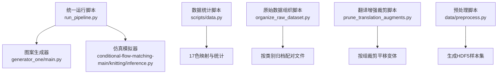
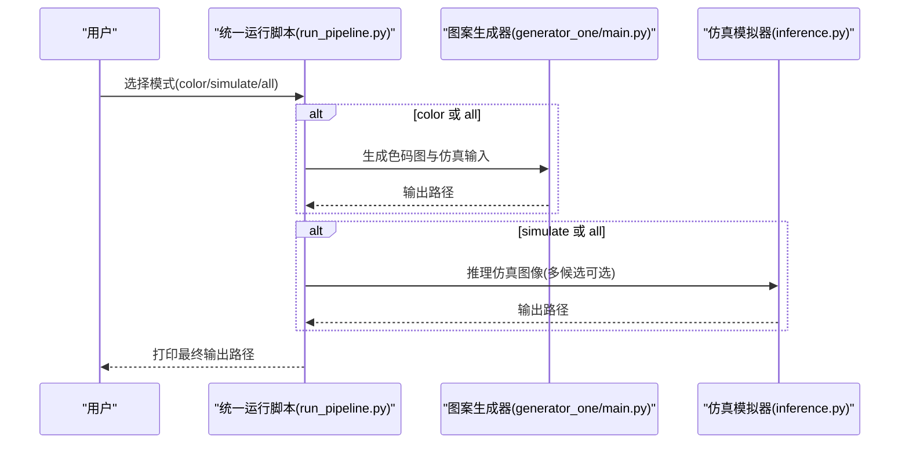
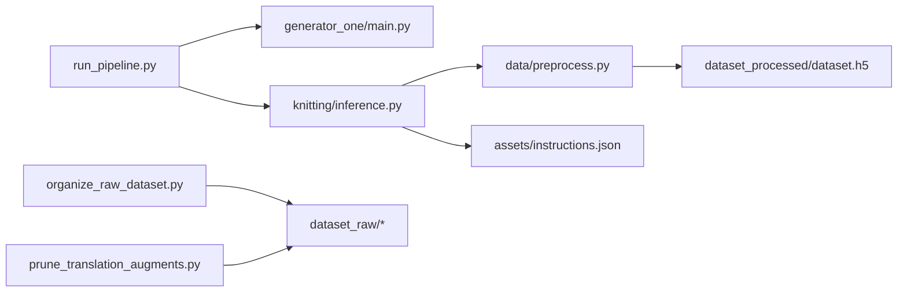

# 工具和脚本

<cite>
**本文引用的文件列表**
- [run_pipeline.py](file://run_pipeline.py)
- [scripts/data.py](file://scripts/data.py)
- [conditional-flow-matching-main/scripts/organize_raw_dataset.py](file://conditional-flow-matching-main/scripts/organize_raw_dataset.py)
- [conditional-flow-matching-main/scripts/prune_translation_augments.py](file://conditional-flow-matching-main/scripts/prune_translation_augments.py)
- [conditional-flow-matching-main/README.md](file://conditional-flow-matching-main/README.md)
- [conditional-flow-matching-main/knitting/inference.py](file://conditional-flow-matching-main/knitting/inference.py)
- [conditional-flow-matching-main/data/preprocess.py](file://conditional-flow-matching-main/data/preprocess.py)
- [conditional-flow-matching-main/assets/instructions.json](file://conditional-flow-matching-main/assets/instructions.json)
- [conditional-flow-matching-main/configs/stage1.yaml](file://conditional-flow-matching-main/configs/stage1.yaml)
- [generator_one/main.py](file://generator_one/main.py)
- [requirements.txt](file://requirements.txt)
</cite>

## 目录
1. [简介](#简介)
2. [项目结构](#项目结构)
3. [核心组件](#核心组件)
4. [架构总览](#架构总览)
5. [详细组件分析](#详细组件分析)
6. [依赖关系分析](#依赖关系分析)
7. [性能考虑](#性能考虑)
8. [故障排除指南](#故障排除指南)
9. [结论](#结论)
10. [附录](#附录)

## 简介
本指南面向“工具和脚本”的使用者，系统讲解统一运行脚本、批量处理工具与结果分析脚本的使用方法、操作流程、命令行示例与参数说明，并提供开发调试工具的使用方法与最佳实践，以及常见问题与故障排除方案。目标是帮助用户快速上手从“文本提示”到“色码图”再到“仿真图像”的完整工作流，同时高效地组织与清洗原始数据集，进行统计分析与可视化。

## 项目结构
该项目由两大部分组成：
- 统一运行脚本与生成器：通过统一入口脚本协调“图案生成器”与“仿真模拟器”，实现端到端流水线。
- 数据与仿真模块：包含原始数据组织、裁剪与清洗、预处理、推理与评估等工具脚本。

图表来源
- [run_pipeline.py:1-279](file://run_pipeline.py#L1-L279)
- [generator_one/main.py:1-207](file://generator_one/main.py#L1-L207)
- [conditional-flow-matching-main/knitting/inference.py:1-720](file://conditional-flow-matching-main/knitting/inference.py#L1-L720)
- [scripts/data.py:1-275](file://scripts/data.py#L1-L275)
- [conditional-flow-matching-main/scripts/organize_raw_dataset.py:1-174](file://conditional-flow-matching-main/scripts/organize_raw_dataset.py#L1-L174)
- [conditional-flow-matching-main/scripts/prune_translation_augments.py:1-350](file://conditional-flow-matching-main/scripts/prune_translation_augments.py#L1-L350)
- [conditional-flow-matching-main/data/preprocess.py:1-285](file://conditional-flow-matching-main/data/preprocess.py#L1-L285)

章节来源
- [run_pipeline.py:1-279](file://run_pipeline.py#L1-L279)
- [conditional-flow-matching-main/README.md:1-47](file://conditional-flow-matching-main/README.md#L1-L47)

## 核心组件
- 统一运行脚本：负责解析参数、选择模式（仅生成色码图、仅仿真、全部）、自动推断设备、调用子模块并打印输出路径。
- 图案生成器：接收自然语言描述，生成色码图与中间产物，输出标准命名文件。
- 仿真模拟器：将色码图转换为仿真图像，支持多候选导出与拼图，支持多种噪声模式与求解器。
- 数据统计脚本：扫描指定目录下的图像，统计颜色分布、类别交叉表，输出JSON报告。
- 原始数据组织脚本：将“原始配对文件”按类别归档，仅保留完全配对的文件，支持干跑与应用两种模式。
- 翻译增强裁剪脚本：识别带平移偏移的文件名，按组裁剪保留若干变体，支持备份或删除策略。
- 预处理脚本：将配对图像解析为HDF5样本集，便于训练与评估。

章节来源
- [run_pipeline.py:196-247](file://run_pipeline.py#L196-L247)
- [generator_one/main.py:13-207](file://generator_one/main.py#L13-L207)
- [conditional-flow-matching-main/knitting/inference.py:493-608](file://conditional-flow-matching-main/knitting/inference.py#L493-L608)
- [scripts/data.py:121-275](file://scripts/data.py#L121-L275)
- [conditional-flow-matching-main/scripts/organize_raw_dataset.py:146-174](file://conditional-flow-matching-main/scripts/organize_raw_dataset.py#L146-L174)
- [conditional-flow-matching-main/scripts/prune_translation_augments.py:188-350](file://conditional-flow-matching-main/scripts/prune_translation_augments.py#L188-L350)
- [conditional-flow-matching-main/data/preprocess.py:71-276](file://conditional-flow-matching-main/data/preprocess.py#L71-L276)

## 架构总览
统一运行脚本作为入口，根据模式调用相应子流程：
- color 模式：调用图案生成器生成色码图与仿真输入，输出路径打印。
- simulate 模式：调用仿真模拟器，支持多候选导出与拼图。
- all 模式：先执行 color 再执行 simulate。

图表来源
- [run_pipeline.py:250-279](file://run_pipeline.py#L250-L279)
- [generator_one/main.py:117-207](file://generator_one/main.py#L117-L207)
- [conditional-flow-matching-main/knitting/inference.py:615-720](file://conditional-flow-matching-main/knitting/inference.py#L615-L720)

## 详细组件分析

### 统一运行脚本（run_pipeline.py）
- 功能概述
  - 提供三种模式：color（仅生成色码图）、simulate（仅仿真）、all（两者串联）。
  - 自动检测CUDA可用性并回退CPU，支持显式设备选择。
  - 自动推断仿真输入来源（来自第一阶段输出或数据集），并生成候选拼图。
- 关键参数
  - 通用参数：--stage、--checkpoint、--json_path、--device、--seed、--num_candidates、--seed_stride、--noise_mode、--num_steps、--solver、--perturb_scale、--batch_size。
  - color/all 模式：prompt、--prefix、--save-intermediate、--no-refinement、--no-aesthetic、--no-repair、--plan-in。
  - simulate 模式：--input（色码图路径）。
- 使用示例
  - 仅生成色码图：python run_pipeline.py color "你的文本描述"
  - 仅仿真：python run_pipeline.py simulate --input outputs/runs/.../color_map/pattern_output.bmp --stage 4
  - 全流程：python run_pipeline.py all "你的文本描述" --stage 4
- 注意事项
  - 若未指定 --checkpoint，将自动定位到 checkpoints/stageN/best.pt。
  - 当 num_candidates > 1 时，会生成候选目录与拼图。
  - --plan-in 仅在 color/all 模式下生效，用于增量修改生成计划。

章节来源
- [run_pipeline.py:196-247](file://run_pipeline.py#L196-L247)
- [run_pipeline.py:72-110](file://run_pipeline.py#L72-L110)
- [run_pipeline.py:113-193](file://run_pipeline.py#L113-L193)
- [run_pipeline.py:250-279](file://run_pipeline.py#L250-L279)

### 图案生成器（generator_one/main.py）
- 功能概述
  - 接收自然语言描述，生成色码图与中间产物，输出标准命名文件。
  - 支持禁用 refinement/aesthetic/repair 三个阶段以加速或对比实验。
- 关键参数
  - generate 子命令：prompt、--output、--prefix、--save-intermediate、--no-refinement、--no-aesthetic、--no-repair、--plan-in。
- 使用示例
  - python main.py generate "中心麻花菱形"
  - python main.py generate "整幅波浪吊目纹理" --no-aesthetic
- 注意事项
  - 输出目录默认 outputs/images，可通过 --output 指定。
  - --plan-in 支持相对路径，内部会尝试项目根路径解析。

章节来源
- [generator_one/main.py:13-207](file://generator_one/main.py#L13-L207)

### 仿真模拟器（conditional-flow-matching-main/knitting/inference.py）
- 功能概述
  - 将色码图转换为仿真图像，支持多候选导出与拼图。
  - 支持多种噪声模式（独立/全局相关/区域相关）、求解器（euler/midpoint/rk4）、步数与扰动强度。
- 关键参数
  - --stage、--checkpoint、--input、--input_source、--output、--json_path、--device、--num_steps、--solver、--noise_mode、--perturb_scale、--region_alpha、--seed、--num_candidates、--seed_stride、--candidate_dir、--save_grid、--grid_cols、--batch_size。
- 使用示例
  - python knitting/inference.py --stage 4 --input dataset_raw/color_maps/Cable/Cable1_001_0_0.png
  - 通过统一脚本：python ../run_pipeline.py simulate --input outputs/runs/.../color_map/pattern_sim_input.png --stage 4
- 注意事项
  - --input_source 支持 auto/dataset/stage1，自动判断路径来源。
  - 多候选模式会导出候选图与拼图，候选目录可自定义。

章节来源
- [conditional-flow-matching-main/knitting/inference.py:493-608](file://conditional-flow-matching-main/knitting/inference.py#L493-L608)
- [conditional-flow-matching-main/README.md:23-35](file://conditional-flow-matching-main/README.md#L23-L35)

### 数据统计脚本（scripts/data.py）
- 功能概述
  - 扫描指定根目录下的子文件夹，统计每张图像的颜色分布，输出类别与全局汇总，生成交叉表，并保存为JSON。
- 关键参数
  - ROOT_DIR（根目录）、OUTPUT_JSON（输出JSON路径，设为None则仅控制台输出）。
- 使用示例
  - python scripts/data.py
- 输出
  - 控制台打印每个类别的统计信息与全局汇总，以及类别×色值交叉表。
  - 保存 JSON 文件（若启用），包含全局摘要与各分类详情。

章节来源
- [scripts/data.py:121-275](file://scripts/data.py#L121-L275)

### 原始数据组织脚本（conditional-flow-matching-main/scripts/organize_raw_dataset.py）
- 功能概述
  - 将原始配对文件按类别归档，仅保留完全配对的文件；支持干跑与应用两种模式。
- 关键参数
  - --root（数据根目录，默认 dataset_raw）、--apply（应用移动/删除）。
- 使用示例
  - 干跑查看计划：python scripts/organize_raw_dataset.py
  - 应用归档：python scripts/organize_raw_dataset.py --apply
- 注意事项
  - 仅保留与目标类别前缀匹配的配对，未知类别的文件会被删除或标记。

章节来源
- [conditional-flow-matching-main/scripts/organize_raw_dataset.py:146-174](file://conditional-flow-matching-main/scripts/organize_raw_dataset.py#L146-L174)

### 翻译增强裁剪脚本（conditional-flow-matching-main/scripts/prune_translation_augments.py）
- 功能概述
  - 识别带平移偏移的文件名（如 Cable1_048_6_11），按组裁剪保留若干变体，支持备份或删除策略。
- 关键参数
  - --raw-dir、--manifest、--keep-shifts、--min-group-size、--min-category-pairs、--keep-unpaired、--apply、--delete、--backup-dir。
- 使用示例
  - 干跑查看计划：python scripts/prune_translation_augments.py
  - 应用裁剪并备份：python scripts/prune_translation_augments.py --apply --backup-dir dataset_raw_pruned_backup
- 注意事项
  - 生成的 manifest CSV 记录了每个文件的动作与原因，便于审计。
  - 应用后需要重新生成 dataset_processed/dataset.h5。

章节来源
- [conditional-flow-matching-main/scripts/prune_translation_augments.py:188-350](file://conditional-flow-matching-main/scripts/prune_translation_augments.py#L188-L350)

### 预处理脚本（conditional-flow-matching-main/data/preprocess.py）
- 功能概述
  - 将配对的色码图与仿真图像解析为HDF5样本集，包含邻域ID、掩码、中心仿真块等字段。
- 关键参数
  - color_map_dir、simulation_dir、output_dir、json_path、chunk_size。
- 使用示例
  - python data/preprocess.py
- 注意事项
  - 会自动计算网格尺寸并生成HDF5文件，适合后续训练与评估。

章节来源
- [conditional-flow-matching-main/data/preprocess.py:71-276](file://conditional-flow-matching-main/data/preprocess.py#L71-L276)

## 依赖关系分析
- 统一运行脚本依赖：
  - generator_one/main.py：生成色码图与仿真输入。
  - conditional-flow-matching-main/knitting/inference.py：执行仿真推理。
  - torch（CUDA/CPU自动检测）、subprocess、argparse 等。
- 仿真模拟器依赖：
  - data/preprocess.py：解析色码图与颜色表。
  - assets/instructions.json：动作语义与颜色定义。
  - configs/stage*.yaml：训练配置（推理时可忽略）。
- 数据统计脚本依赖：
  - PIL.Image、json、numpy、pandas（可选）。
- 原始数据组织与裁剪脚本：
  - pathlib.Path、shutil、re、csv 等。

图表来源
- [run_pipeline.py:17-19](file://run_pipeline.py#L17-L19)
- [conditional-flow-matching-main/knitting/inference.py:35-36](file://conditional-flow-matching-main/knitting/inference.py#L35-L36)
- [conditional-flow-matching-main/data/preprocess.py:17-27](file://conditional-flow-matching-main/data/preprocess.py#L17-L27)
- [conditional-flow-matching-main/assets/instructions.json:1-352](file://conditional-flow-matching-main/assets/instructions.json#L1-L352)
- [conditional-flow-matching-main/scripts/organize_raw_dataset.py:56-67](file://conditional-flow-matching-main/scripts/organize_raw_dataset.py#L56-L67)
- [conditional-flow-matching-main/scripts/prune_translation_augments.py:234-235](file://conditional-flow-matching-main/scripts/prune_translation_augments.py#L234-L235)
- [conditional-flow-matching-main/data/preprocess.py:118-119](file://conditional-flow-matching-main/data/preprocess.py#L118-L119)

章节来源
- [requirements.txt:1-46](file://requirements.txt#L1-L46)

## 性能考虑
- 设备选择
  - 统一运行脚本会自动检测CUDA并回退CPU；建议优先使用GPU以提升推理速度。
- 噪声模式与求解器
  - --noise_mode 与 --solver 对速度与质量有影响，建议在 Stage 4 使用 midpoint 与 global_correlated。
- 批处理与候选导出
  - --batch_size 控制分批推理的patch数量；--num_candidates 与 --seed_stride 影响候选生成数量与耗时。
- 数据预处理
  - 预处理脚本会生成HDF5文件，建议合理设置 chunk_size 以平衡I/O与内存占用。

[本节为通用指导，无需特定文件来源]

## 故障排除指南
- CUDA不可用
  - 现象：请求cuda但不可用时会回退CPU。
  - 解决：确认环境变量与驱动安装；或显式指定 --device cpu。
- 检查点文件缺失
  - 现象：找不到 checkpoints/stageN/best.pt。
  - 解决：使用 --checkpoint 指定绝对路径或相对项目根路径。
- 输入文件不存在
  - 现象：色码图或 instructions.json 路径错误。
  - 解决：确保 --input 与 --json_path 指向正确文件；统一脚本会自动解析相对路径。
- 候选导出失败
  - 现象：多候选模式未生成拼图或候选目录。
  - 解决：确认 --num_candidates > 1 且 --save_grid 已启用；检查候选目录权限。
- 原始数据组织/裁剪
  - 现象：未知类别或未配对文件过多。
  - 解决：先运行干跑模式查看计划；确认文件命名规范与类别前缀一致；必要时使用 --keep-unpaired 保留未配对文件。
- 预处理失败
  - 现象：HDF5文件为空或尺寸异常。
  - 解决：检查配对文件是否存在；确认色码图与仿真图尺寸一致；重新运行预处理脚本。

章节来源
- [run_pipeline.py:30-36](file://run_pipeline.py#L30-L36)
- [run_pipeline.py:113-128](file://run_pipeline.py#L113-L128)
- [conditional-flow-matching-main/knitting/inference.py:68-71](file://conditional-flow-matching-main/knitting/inference.py#L68-L71)
- [conditional-flow-matching-main/scripts/organize_raw_dataset.py:120-144](file://conditional-flow-matching-main/scripts/organize_raw_dataset.py#L120-L144)
- [conditional-flow-matching-main/scripts/prune_translation_augments.py:313-344](file://conditional-flow-matching-main/scripts/prune_translation_augments.py#L313-L344)
- [conditional-flow-matching-main/data/preprocess.py:105-107](file://conditional-flow-matching-main/data/preprocess.py#L105-L107)

## 结论
通过统一运行脚本与配套工具，用户可以高效完成从文本描述到色码图再到仿真图像的全流程；同时，数据组织与统计脚本提供了可靠的数据治理能力。建议在生产环境中：
- 明确设备与候选策略，合理设置噪声模式与求解器；
- 使用干跑模式先验证数据组织与裁剪计划；
- 严格管理输出目录与日志，定期备份重要中间产物。

[本节为总结，无需特定文件来源]

## 附录

### 开发调试工具与最佳实践
- 日志与可视化
  - 使用统一运行脚本的打印输出跟踪流程；在仿真模式下启用多候选导出以便人工筛选。
- 参数微调
  - 从 Stage 1 开始逐步提升 --stage，观察质量与耗时的变化；在 Stage 4 中优先尝试 midpoint 求解器与 global_correlated 噪声。
- 数据质量
  - 使用 scripts/data.py 对现有数据进行颜色分布统计，识别异常色值与类别不平衡问题。
- 备份与回滚
  - 原始数据裁剪脚本支持备份策略，建议在大规模变更前先备份 dataset_raw。

章节来源
- [run_pipeline.py:39-44](file://run_pipeline.py#L39-L44)
- [conditional-flow-matching-main/knitting/inference.py:670-720](file://conditional-flow-matching-main/knitting/inference.py#L670-L720)
- [scripts/data.py:252-270](file://scripts/data.py#L252-L270)
- [conditional-flow-matching-main/scripts/prune_translation_augments.py:313-344](file://conditional-flow-matching-main/scripts/prune_translation_augments.py#L313-L344)