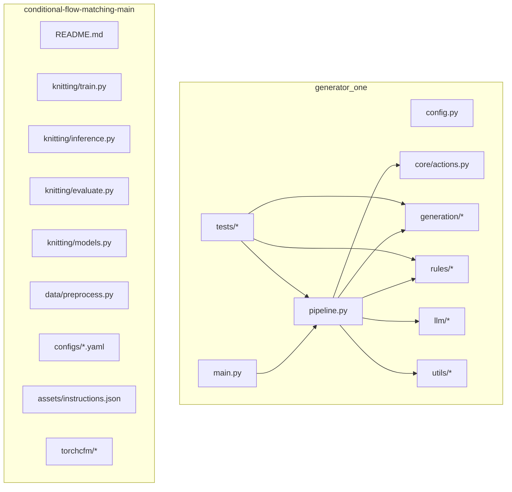
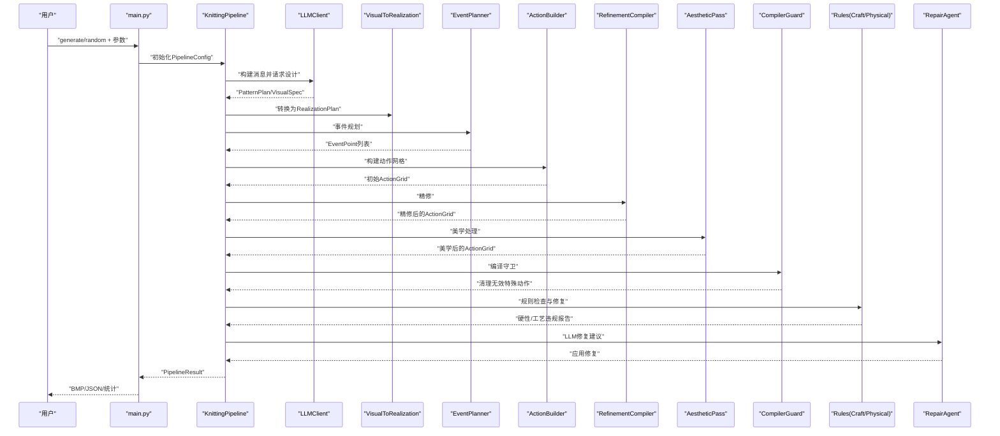
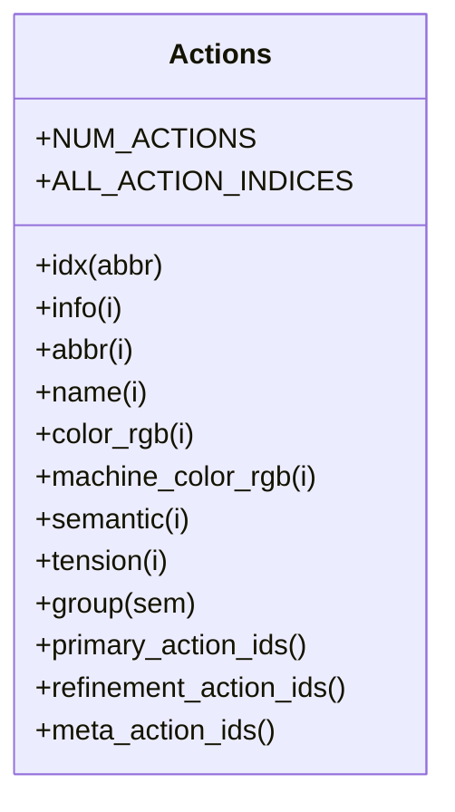
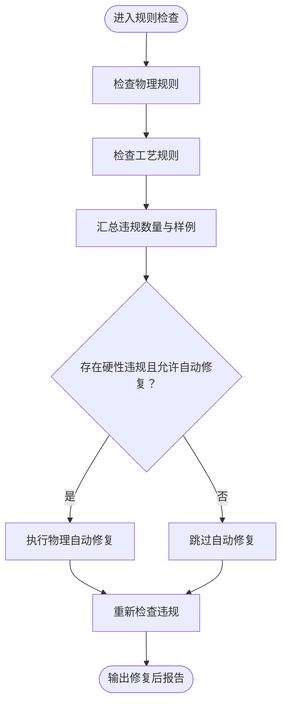
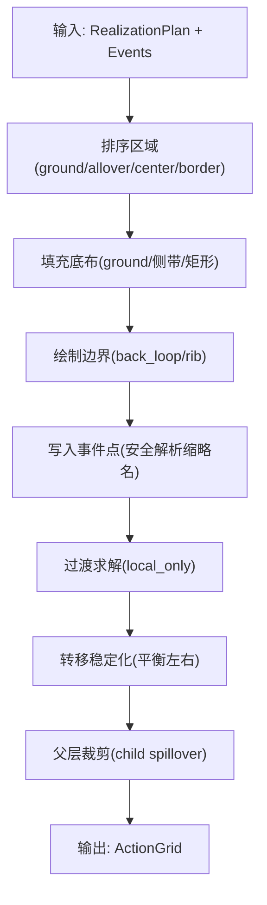
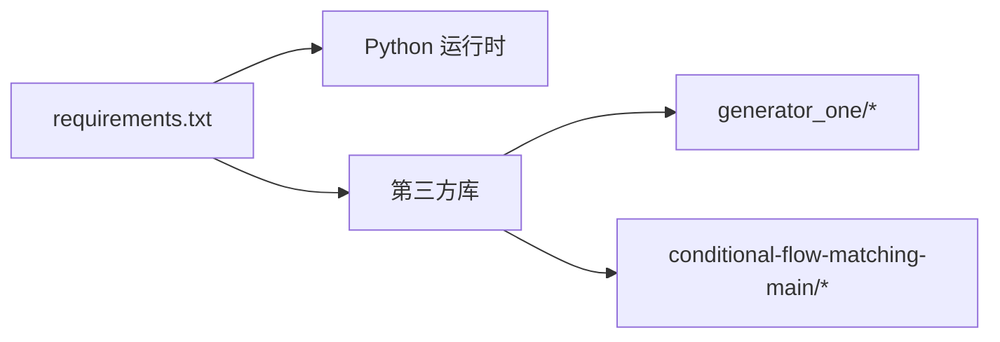

# 开发指南

<cite>
**本文引用的文件**
- [README.md](file://conditional-flow-matching-main/README.md)
- [requirements.txt](file://requirements.txt)
- [config.py](file://generator_one/config.py)
- [main.py](file://generator_one/main.py)
- [pipeline.py](file://generator_one/pipeline.py)
- [actions.py](file://generator_one/core/actions.py)
- [craft_rules.py](file://generator_one/rules/craft_rules.py)
- [action_builder.py](file://generator_one/generation/action_builder.py)
- [logger.py](file://generator_one/utils/logger.py)
- [test_pattern_plan.py](file://generator_one/tests/test_pattern_plan.py)
- [test_instruction_pipeline.py](file://generator_one/tests/test_instruction_pipeline.py)
- [SHAPE_NORMALIZATION_FIX.md](file://generator_one/SHAPE_NORMALIZATION_FIX.md)
</cite>

## 目录
1. [简介](#简介)
2. [项目结构](#项目结构)
3. [核心组件](#核心组件)
4. [架构总览](#架构总览)
5. [详细组件分析](#详细组件分析)
6. [依赖分析](#依赖分析)
7. [性能考虑](#性能考虑)
8. [故障排查指南](#故障排查指南)
9. [结论](#结论)
10. [附录](#附录)

## 简介
本指南面向贡献者，提供从开发环境搭建、代码风格与提交规范，到新功能开发、测试编写、文档更新与版本管理的全流程说明。项目包含两大部分：
- 条件流匹配模拟模块（conditional-flow-matching-main）：负责将色码图映射为仿真图像，支持多阶段模型与评估。
- 图案生成管线（generator_one）：端到端从自然语言描述生成针织图案，包含设计解析、事件规划、动作构建、规则校验、美学与编译守卫、LLM修复等步骤。

## 项目结构
项目采用按功能域划分的目录组织方式，核心模块包括：
- generator_one：主生成管线与规则引擎
  - core：动作与语义类型定义
  - generation：可视化到实现、事件规划、动作构建、过渡求解、美学与编译守卫
  - rules：物理与工艺规则、张力评分与自动修复
  - llm：提示词构建、设计解析、修复代理
  - utils：日志与文件IO
  - tests：单元与集成测试
- conditional-flow-matching-main：条件流匹配与UNet实现，以及训练/推理/评估脚本
- docs：论文与文档素材
- outputs：实验与案例输出目录
- scripts：数据处理脚本

图表来源
- [main.py:1-207](file://generator_one/main.py#L1-L207)
- [pipeline.py:1-749](file://generator_one/pipeline.py#L1-L749)
- [actions.py:1-338](file://generator_one/core/actions.py#L1-L338)
- [README.md:1-47](file://conditional-flow-matching-main/README.md#L1-L47)

章节来源
- [README.md:1-47](file://conditional-flow-matching-main/README.md#L1-L47)
- [requirements.txt:1-46](file://requirements.txt#L1-L46)
- [config.py:1-76](file://generator_one/config.py#L1-L76)

## 核心组件
- 配置与路径：统一管理项目根、数据与输出目录、网格尺寸、LLM参数与日志配置。
- 主入口：命令行接口，支持 generate/random 子命令，控制各阶段开关与中间结果保存。
- 管线：端到端生成流程，包含LLM设计、可视化到实现、事件规划、动作构建、精修、美学、编译守卫、规则检查、LLM修复与输出。
- 动作系统：集中定义动作索引、颜色、语义、张力、机器导出属性与分组。
- 规则引擎：物理与工艺规则检查、张力评分、自动修复与保守修复策略。
- 生成器：可视化规格到动作网格的构建器，含边界绘制、过渡求解、转移稳定化与父层裁剪。
- 日志与测试：统一日志配置与测试套件。

章节来源
- [config.py:1-76](file://generator_one/config.py#L1-L76)
- [main.py:1-207](file://generator_one/main.py#L1-L207)
- [pipeline.py:1-749](file://generator_one/pipeline.py#L1-L749)
- [actions.py:1-338](file://generator_one/core/actions.py#L1-L338)
- [craft_rules.py:1-414](file://generator_one/rules/craft_rules.py#L1-L414)
- [action_builder.py:1-603](file://generator_one/generation/action_builder.py#L1-L603)
- [logger.py:1-52](file://generator_one/utils/logger.py#L1-L52)

## 架构总览
下图展示从用户输入到最终输出的关键交互与数据流。

图表来源
- [main.py:117-202](file://generator_one/main.py#L117-L202)
- [pipeline.py:114-189](file://generator_one/pipeline.py#L114-L189)

## 详细组件分析

### 动作系统与调色板
- 动作定义集中于单一数据源，通过缩略名映射索引，提供颜色、语义、张力、床侧偏移、机器导出属性等。
- 提供按语义分组（LOOP/TUCK/TRANSFER/SPLIT/MISS/DROP/CARRIER）与基础/精修/元动作分类。
- 构建内部与机器导出调色板，确保生成与导出一致性。

图表来源
- [actions.py:1-338](file://generator_one/core/actions.py#L1-L338)

章节来源
- [actions.py:1-338](file://generator_one/core/actions.py#L1-L338)

### 规则引擎与张力评分
- 工艺规则涵盖行级负载平衡、支撑缺失、前后环直接切换、语义层边界与隔离、TUCK与CABLE相邻等。
- 物理规则检查与自动修复策略，结合张力评分衡量相邻张力差异。
- 保守修复策略优先使用主动作而非精修变体，降低复杂度。

图表来源
- [craft_rules.py:552-575](file://generator_one/rules/craft_rules.py#L552-L575)

章节来源
- [craft_rules.py:1-414](file://generator_one/rules/craft_rules.py#L1-L414)

### 动作构建器与过渡求解
- 依据实现计划与事件点构建动作网格，按布局角色确定填充顺序与边界样式。
- 实现过渡求解与转移稳定化，确保行内左右转移平衡与目标落点有效。
- 父层裁剪与前景排除掩码处理，保证嵌套结构的正确性。

图表来源
- [action_builder.py:43-118](file://generator_one/generation/action_builder.py#L43-L118)

章节来源
- [action_builder.py:1-603](file://generator_one/generation/action_builder.py#L1-L603)

### 管线配置与结果保存
- PipelineConfig 控制各阶段开关、修复轮次、中间结果保存等。
- 保存BMP（内部/机器）、机器导出报告、仿真PNG、中间数组与统计信息。

章节来源
- [pipeline.py:69-91](file://generator_one/pipeline.py#L69-L91)
- [pipeline.py:627-677](file://generator_one/pipeline.py#L627-L677)

### 主入口与命令行
- 支持 generate 与 random 子命令，参数控制输出目录、前缀、中间结果保存、禁用精修/美学/修复等。
- 支持从现有 pattern_plan.json 增量修改。

章节来源
- [main.py:13-115](file://generator_one/main.py#L13-L115)
- [main.py:117-202](file://generator_one/main.py#L117-L202)

## 依赖分析
- Python 与第三方依赖集中在 requirements.txt，包含深度学习、科学计算、可视化、LLM SDK、评估工具与测试框架。
- generator_one 内部模块间耦合清晰：pipeline 作为协调者，依赖 core、generation、rules、llm、utils；tests 依赖各模块进行集成验证。

图表来源
- [requirements.txt:1-46](file://requirements.txt#L1-L46)

章节来源
- [requirements.txt:1-46](file://requirements.txt#L1-L46)

## 性能考虑
- 管线阶段的计算复杂度主要受网格大小（40x40）与事件数量影响，过渡求解与规则检查为 O(N^2) 级别。
- 通过编译守卫与父层裁剪减少后续处理的无效像素，避免冗余计算。
- 张力评分与边界修复为轻量级操作，整体开销可忽略。

## 故障排查指南
- 日志配置：统一通过 logger.setup_logger 初始化，支持控制台与文件输出，便于定位问题。
- 常见问题与修复：
  - 形状标准化修复：当 effect/shape 组合不在映射表中时，系统通过优先级表与回退策略进行标准化，确保事件生成与参数填充。
  - 规则违规：若硬性违规存在，可启用自动修复；若仍存在，可通过 LLM 修复代理进行迭代修复。
  - 机器导出报告：检查动作的机器导出安全标记与宏映射，必要时在导出前进行确认。

章节来源
- [logger.py:1-52](file://generator_one/utils/logger.py#L1-L52)
- [SHAPE_NORMALIZATION_FIX.md:1-122](file://generator_one/SHAPE_NORMALIZATION_FIX.md#L1-L122)
- [pipeline.py:577-621](file://generator_one/pipeline.py#L577-L621)

## 结论
本指南提供了从开发环境到贡献流程的完整路径。遵循统一的配置、日志与测试规范，严格控制模块间依赖，有助于快速扩展新动作类型、规则与功能模块，并确保生成质量与可维护性。

## 附录

### 开发环境搭建
- 安装依赖：使用 requirements.txt 安装所需包。
- 配置环境变量：LLM 提供商相关密钥与URL需在 .env 中设置。
- 运行主程序：通过命令行入口执行 generate/random 子命令，或在根目录使用统一脚本调用。

章节来源
- [requirements.txt:1-46](file://requirements.txt#L1-L46)
- [config.py:51-65](file://generator_one/config.py#L51-L65)
- [main.py:13-115](file://generator_one/main.py#L13-L115)

### 代码风格与提交规范
- 统一日志：使用 utils/logger 提供的 logger 实例记录关键步骤与统计信息。
- 配置集中：全局路径、网格尺寸、LLM参数与日志配置集中在 config.py。
- 模块职责：core 定义动作与语义，rules 负责规则与修复，generation 负责构建与过渡，llm 负责解析与修复，pipeline 协调流程。
- 提交建议：每次提交聚焦单一功能或修复，包含测试用例与必要的文档更新。

章节来源
- [logger.py:1-52](file://generator_one/utils/logger.py#L1-L52)
- [config.py:1-76](file://generator_one/config.py#L1-L76)

### 新功能开发流程
- 扩展动作类型：在 instruction_info.json 中新增动作定义，更新 core/actions.py 的映射与属性访问方法。
- 新增规则：在 rules 下新增规则模块，提供检查与修复函数，并在 pipeline 中接入调用链。
- 新增生成器模块：在 generation 下新增模块，遵循现有接口约定，注册到 pipeline 的对应步骤。
- 文档与测试：补充 SHAPE_NORMALIZATION_FIX.md 或相应文档，完善 tests 下的单元与集成测试。

章节来源
- [actions.py:1-338](file://generator_one/core/actions.py#L1-L338)
- [craft_rules.py:1-414](file://generator_one/rules/craft_rules.py#L1-L414)
- [action_builder.py:1-603](file://generator_one/generation/action_builder.py#L1-L603)
- [SHAPE_NORMALIZATION_FIX.md:1-122](file://generator_one/SHAPE_NORMALIZATION_FIX.md#L1-L122)

### 测试编写指南
- 单元测试：针对 PatternPlan、事件规划、掩码工具与可视化到实现转换的测试用例。
- 端到端测试：验证从自然语言到指令网格的完整流程，包含统计信息与输出保存。
- 测试运行：使用 pytest 执行 tests 目录下的测试文件，确保覆盖率与稳定性。

章节来源
- [test_pattern_plan.py:1-457](file://generator_one/tests/test_pattern_plan.py#L1-L457)
- [test_instruction_pipeline.py:1-244](file://generator_one/tests/test_instruction_pipeline.py#L1-L244)

### 文档更新流程与版本管理
- 文档更新：在 docs 目录下维护论文与说明文档，遵循 Markdown 格式，必要时提供图示与示例。
- 版本管理：参考 SHAPE_NORMALIZATION_FIX.md 的修复流程，记录 effect/shape 标准化与映射表演进，形成版本化修复记录。

章节来源
- [SHAPE_NORMALIZATION_FIX.md:1-122](file://generator_one/SHAPE_NORMALIZATION_FIX.md#L1-L122)