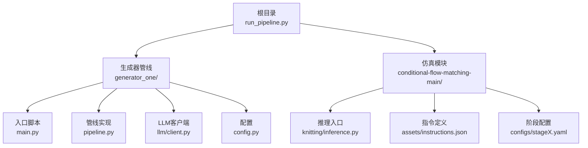
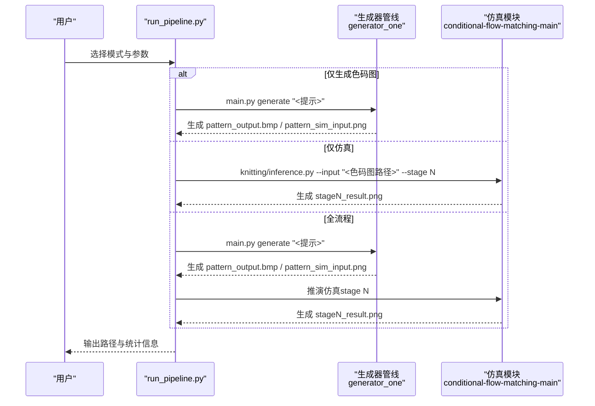
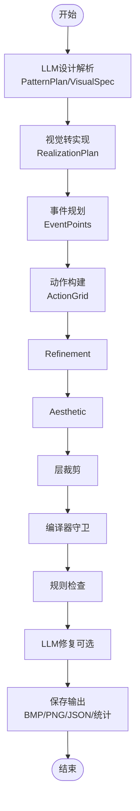

# 快速开始

<cite>
**本文引用的文件**
- [run_pipeline.py](file://run_pipeline.py)
- [requirements.txt](file://requirements.txt)
- [main.py](file://generator_one/main.py)
- [pipeline.py](file://generator_one/pipeline.py)
- [config.py](file://generator_one/config.py)
- [client.py](file://generator_one/llm/client.py)
- [logger.py](file://generator_one/utils/logger.py)
- [README.md](file://conditional-flow-matching-main/README.md)
- [stage4.yaml](file://conditional-flow-matching-main/configs/stage4.yaml)
- [instructions.json](file://conditional-flow-matching-main/assets/instructions.json)
</cite>

## 目录
1. [简介](#简介)
2. [项目结构](#项目结构)
3. [核心组件](#核心组件)
4. [架构总览](#架构总览)
5. [详细组件分析](#详细组件分析)
6. [依赖分析](#依赖分析)
7. [性能考虑](#性能考虑)
8. [故障排除指南](#故障排除指南)
9. [结论](#结论)
10. [附录](#附录)

## 简介
本指南面向首次使用者，帮助你在约30分钟内完成环境准备、依赖安装与首次运行，体验从“文本描述”到“色码图/仿真图”的完整流程。你将学会：
- 配置Python虚拟环境与安装依赖
- 配置LLM API密钥
- 使用统一入口脚本运行“生成色码图”“仿真推演”“全流程”
- 理解常用命令行参数与常见使用场景

## 项目结构
该项目由两大部分组成：
- 文本到色码图的生成管线（generator_one）
- 条件流匹配仿真模块（conditional-flow-matching-main）

图表来源
- [run_pipeline.py:17-19](file://run_pipeline.py#L17-L19)
- [main.py:13-207](file://generator_one/main.py#L13-L207)
- [pipeline.py:93-189](file://generator_one/pipeline.py#L93-L189)
- [README.md:1-47](file://conditional-flow-matching-main/README.md#L1-L47)

章节来源
- [run_pipeline.py:17-19](file://run_pipeline.py#L17-L19)
- [README.md:1-47](file://conditional-flow-matching-main/README.md#L1-L47)

## 核心组件
- 统一入口脚本：负责解析参数、选择模式（仅生成色码图、仅仿真、全链路）、调度两个子系统。
- 生成器管线：接收自然语言描述，经LLM解析、视觉转实现、事件规划、动作构建、优化与规则校验，输出色码图与中间产物。
- 仿真模块：基于条件流匹配模型，将色码图转换为仿真图像，支持多阶段模型。

章节来源
- [run_pipeline.py:196-247](file://run_pipeline.py#L196-L247)
- [main.py:117-203](file://generator_one/main.py#L117-L203)
- [pipeline.py:114-189](file://generator_one/pipeline.py#L114-L189)

## 架构总览
下图展示了从文本输入到最终输出的端到端流程，以及各模块间的调用关系。

图表来源
- [run_pipeline.py:250-279](file://run_pipeline.py#L250-L279)
- [main.py:117-203](file://generator_one/main.py#L117-L203)
- [README.md:23-35](file://conditional-flow-matching-main/README.md#L23-L35)

## 详细组件分析

### 环境与依赖准备
- Python版本：建议使用Python 3.10及以上（以requirements.txt中的依赖兼容为准）。
- 建议创建独立虚拟环境并激活。
- 安装依赖：在仓库根目录执行安装命令，确保所有依赖（含LLM、深度学习、可视化、科学计算等）就绪。

章节来源
- [requirements.txt:1-46](file://requirements.txt#L1-L46)

### LLM API密钥配置
- 默认使用DeepSeek服务，API密钥通过环境变量传入。
- 在运行前设置环境变量：DEEPSEEK_API_KEY。
- 若使用其他OpenAI兼容服务，可在配置文件中调整base_url与模型名。

章节来源
- [config.py:51-65](file://generator_one/config.py#L51-L65)
- [client.py:55-63](file://generator_one/llm/client.py#L55-L63)

### 首次运行：三种模式
- 仅生成色码图（color）
  - 示例：python run_pipeline.py color "中心麻花菱形"
  - 输出：color_map目录下的 BMP 与 PNG 输入
- 仅仿真（simulate）
  - 示例：python run_pipeline.py simulate --input "<你的色码图路径>" --stage 4
  - 输出：simulation目录下的仿真图
- 全流程（all）
  - 示例：python run_pipeline.py all "整幅波浪吊目纹理"
  - 输出：色码图与仿真图

章节来源
- [run_pipeline.py:196-247](file://run_pipeline.py#L196-L247)
- [README.md:23-35](file://conditional-flow-matching-main/README.md#L23-L35)

### 常用命令行参数说明
- 通用参数
  - --stage：仿真阶段（1~4），默认4
  - --checkpoint：指定检查点路径，未指定时使用默认路径
  - --json_path：指令定义文件，默认指向assets/instructions.json
  - --device：设备选择（auto/cuda/cpu），默认auto
  - --seed：随机种子，默认42
  - --num_candidates：候选数量，>1时保存网格图
  - --seed_stride：候选种子步长
  - --noise_mode：噪声模式（auto/independent/global_correlated/region_correlated）
  - --num_steps、--solver、--perturb_scale：仿真细节参数
  - --batch_size：批大小（若推理脚本支持）
- 生成模式特有
  - --prefix：输出文件前缀
  - --save-intermediate：保存中间结果
  - --no-refinement/--no-aesthetic/--no-repair：开关某些处理步骤
  - --plan-in：读取已有pattern_plan.json进行增量修改

章节来源
- [run_pipeline.py:196-247](file://run_pipeline.py#L196-L247)
- [main.py:44-88](file://generator_one/main.py#L44-L88)

### 生成器管线工作流（代码级）

图表来源
- [pipeline.py:114-189](file://generator_one/pipeline.py#L114-L189)
- [pipeline.py:627-677](file://generator_one/pipeline.py#L627-L677)

章节来源
- [pipeline.py:114-189](file://generator_one/pipeline.py#L114-L189)

### 仿真模块工作流（概念）
- 输入：色码图（BMP/PNG）
- 配置：assets/instructions.json（动作语义、机台映射、等级）
- 模型：configs/stageX.yaml（不同阶段的权重与损失配置）
- 输出：仿真图像（PNG）

图表来源
- [README.md:11-21](file://conditional-flow-matching-main/README.md#L11-L21)
- [stage4.yaml:1-46](file://conditional-flow-matching-main/configs/stage4.yaml#L1-L46)
- [instructions.json:1-352](file://conditional-flow-matching-main/assets/instructions.json#L1-L352)

章节来源
- [README.md:23-35](file://conditional-flow-matching-main/README.md#L23-L35)

## 依赖分析
- Python核心库与第三方依赖集中在requirements.txt中，涵盖：
  - 科学计算与图像处理（numpy、scipy、pillow、opencv-python）
  - 数据处理与机器学习（pandas、scikit-learn、torch、torchvision）
  - 可视化（matplotlib、seaborn）
  - LLM接入（openai、groq）
  - 其他（pyyaml、python-dotenv、tqdm、h5py、pot、clean-fid等）
- 运行时还会根据CUDA可用性自动选择设备（cuda或cpu）。

章节来源
- [requirements.txt:1-46](file://requirements.txt#L1-L46)
- [run_pipeline.py:22-36](file://run_pipeline.py#L22-L36)

## 性能考虑
- 设备选择：优先使用GPU（CUDA），若不可用将回退CPU。
- 候选数量：--num_candidates>1时会生成候选网格图，增加计算与I/O开销。
- 阶段选择：仿真阶段越高，质量越好但耗时越长；默认stage4通常效果最佳。
- 批大小：--batch_size影响显存占用与吞吐，需结合硬件调优。

章节来源
- [run_pipeline.py:149-189](file://run_pipeline.py#L149-L189)
- [stage4.yaml:12-18](file://conditional-flow-matching-main/configs/stage4.yaml#L12-L18)

## 故障排除指南
- 未安装LLM库
  - 现象：初始化LLM客户端时报错
  - 处理：安装openai库
- 未设置API密钥
  - 现象：抛出缺失API Key错误
  - 处理：设置环境变量DEEPSEEK_API_KEY
- CUDA不可用
  - 现象：请求cuda但不可用时会回退cpu并打印警告
  - 处理：确认GPU驱动与CUDA版本，或手动指定--device cpu
- 仿真输入路径不存在
  - 现象：报错提示色码图路径不存在
  - 处理：使用实际存在的色码图路径（可参考outputs/runs下生成的文件）
- 检查点不存在
  - 现象：报错提示检查点路径不存在
  - 处理：确认--checkpoint或默认路径是否存在

章节来源
- [client.py:52-63](file://generator_one/llm/client.py#L52-L63)
- [run_pipeline.py:117-122](file://run_pipeline.py#L117-L122)
- [run_pipeline.py:140-147](file://run_pipeline.py#L140-L147)
- [run_pipeline.py:30-36](file://run_pipeline.py#L30-L36)

## 结论
按照本指南，你可以在30分钟内完成环境搭建、LLM密钥配置与首次运行。建议先以“全链路”模式快速验证整体流程，再逐步尝试不同参数与阶段，深入理解生成与仿真的交互关系。

## 附录

### 快速开始清单
- [ ] 创建并激活Python虚拟环境
- [ ] 在根目录安装依赖
- [ ] 设置DEEPSEEK_API_KEY
- [ ] 运行：python run_pipeline.py all "你的提示词"
- [ ] 查看outputs/runs/<时间戳>/color_map与simulation目录

### 常见提示词示例
- 中心麻花菱形
- 整幅波浪吊目纹理
- 中间柱状纹理两侧罗纹边带
- 带边框的网眼菱形

章节来源
- [main.py:17-39](file://generator_one/main.py#L17-L39)