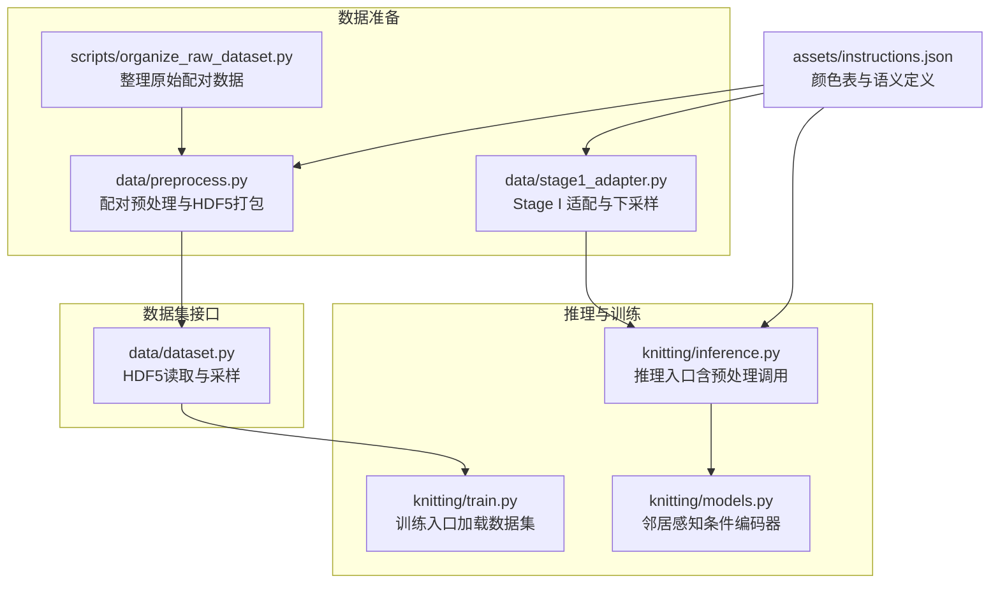
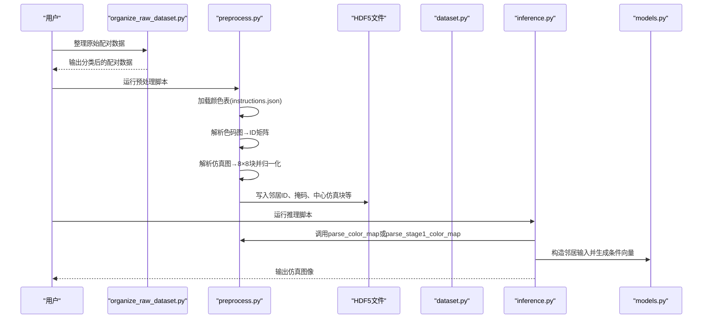
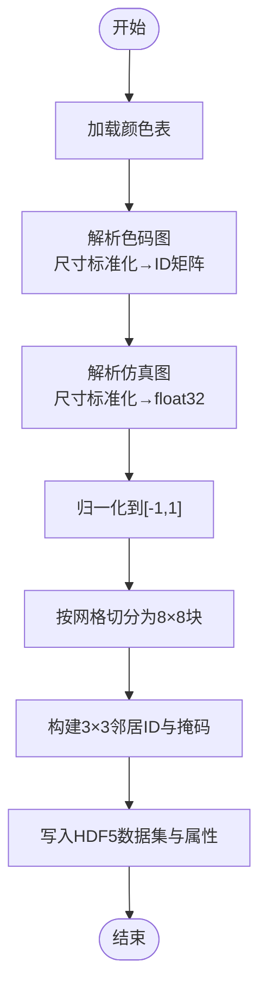
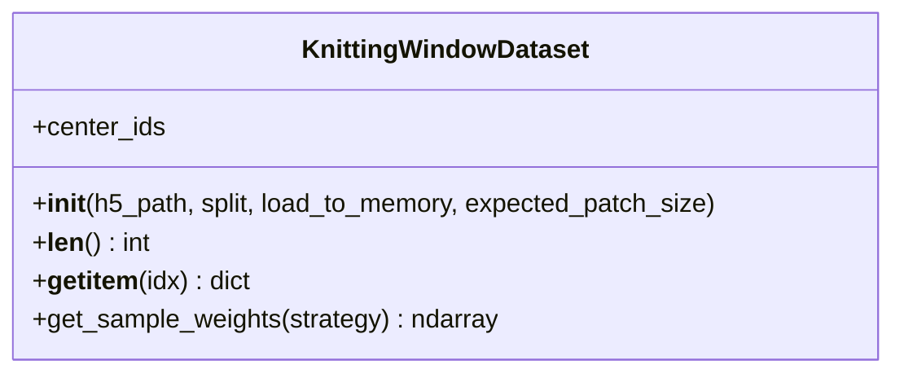
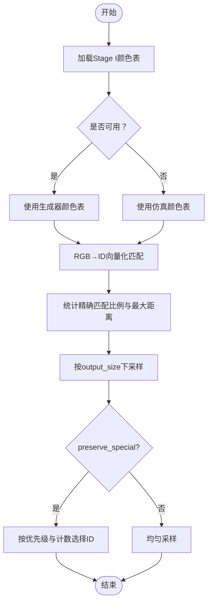
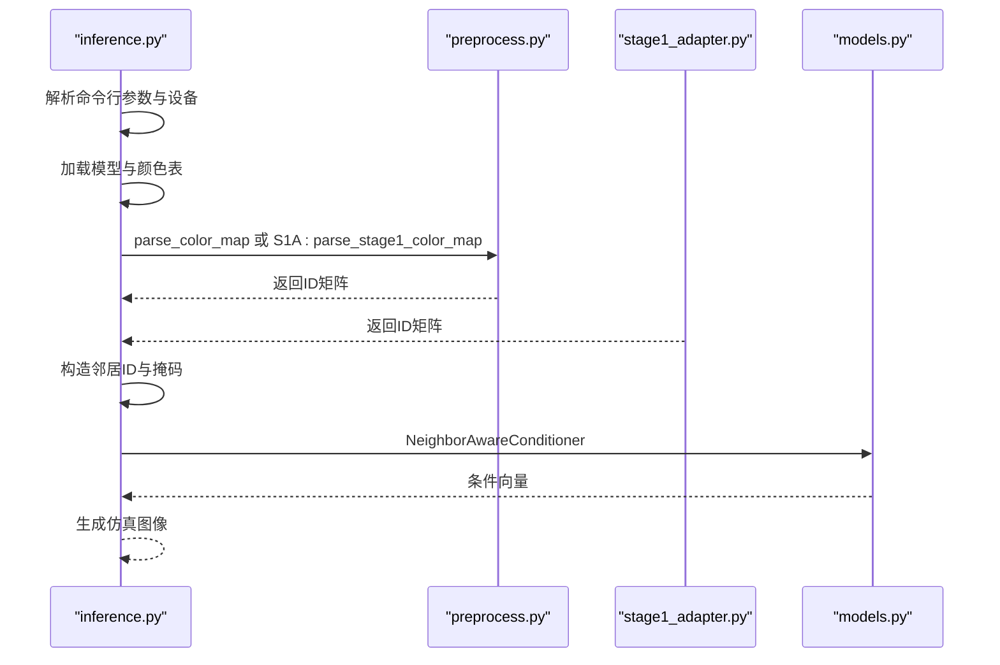
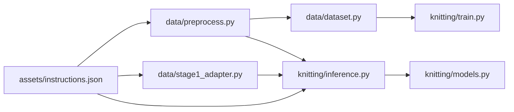

# 图像预处理

<cite>
**本文引用的文件**   
- [conditional-flow-matching-main/data/preprocess.py](file://conditional-flow-matching-main/data/preprocess.py)
- [conditional-flow-matching-main/data/dataset.py](file://conditional-flow-matching-main/data/dataset.py)
- [conditional-flow-matching-main/data/stage1_adapter.py](file://conditional-flow-matching-main/data/stage1_adapter.py)
- [conditional-flow-matching-main/knitting/inference.py](file://conditional-flow-matching-main/knitting/inference.py)
- [conditional-flow-matching-main/knitting/models.py](file://conditional-flow-matching-main/knitting/models.py)
- [conditional-flow-matching-main/knitting/train.py](file://conditional-flow-matching-main/knitting/train.py)
- [conditional-flow-matching-main/assets/instructions.json](file://conditional-flow-matching-main/assets/instructions.json)
- [conditional-flow-matching-main/configs/stage1.yaml](file://conditional-flow-matching-main/configs/stage1.yaml)
- [conditional-flow-matching-main/configs/stage2.yaml](file://conditional-flow-matching-main/configs/stage2.yaml)
- [conditional-flow-matching-main/configs/stage3.yaml](file://conditional-flow-matching-main/configs/stage3.yaml)
- [conditional-flow-matching-main/configs/stage4.yaml](file://conditional-flow-matching-main/configs/stage4.yaml)
- [conditional-flow-matching-main/scripts/organize_raw_dataset.py](file://conditional-flow-matching-main/scripts/organize_raw_dataset.py)
</cite>

## 目录
1. [简介](#简介)
2. [项目结构](#项目结构)
3. [核心组件](#核心组件)
4. [架构总览](#架构总览)
5. [详细组件分析](#详细组件分析)
6. [依赖分析](#依赖分析)
7. [性能考虑](#性能考虑)
8. [故障排查指南](#故障排查指南)
9. [结论](#结论)
10. [附录](#附录)

## 简介
本技术文档围绕“图像预处理”子系统展开，系统性阐述从原始色码图与仿真图配对数据到训练/推理可用的窗口样本的完整流程。重点覆盖以下方面：
- 输入图像的格式验证与尺寸标准化
- 颜色空间与颜色表映射（RGB→ID）
- 数据归一化与窗口切分策略
- 预处理管道的使用示例与性能优化建议
- 预处理对后续仿真生成质量的影响及策略调整方法

## 项目结构
与图像预处理直接相关的模块分布如下：
- 数据准备与预处理：data/preprocess.py、data/stage1_adapter.py、scripts/organize_raw_dataset.py
- 数据集加载与采样：data/dataset.py
- 推理与训练集成：knitting/inference.py、knitting/train.py
- 配置与资源：configs/*.yaml、assets/instructions.json

**图表来源**
- [conditional-flow-matching-main/scripts/organize_raw_dataset.py:1-174](file://conditional-flow-matching-main/scripts/organize_raw_dataset.py#L1-L174)
- [conditional-flow-matching-main/data/preprocess.py:1-285](file://conditional-flow-matching-main/data/preprocess.py#L1-L285)
- [conditional-flow-matching-main/data/stage1_adapter.py:1-140](file://conditional-flow-matching-main/data/stage1_adapter.py#L1-L140)
- [conditional-flow-matching-main/data/dataset.py:1-207](file://conditional-flow-matching-main/data/dataset.py#L1-L207)
- [conditional-flow-matching-main/knitting/inference.py:1-720](file://conditional-flow-matching-main/knitting/inference.py#L1-L720)
- [conditional-flow-matching-main/knitting/train.py:1-200](file://conditional-flow-matching-main/knitting/train.py#L1-L200)
- [conditional-flow-matching-main/knitting/models.py:1-119](file://conditional-flow-matching-main/knitting/models.py#L1-L119)
- [conditional-flow-matching-main/assets/instructions.json:1-352](file://conditional-flow-matching-main/assets/instructions.json#L1-L352)

**章节来源**
- [conditional-flow-matching-main/README.md:1-47](file://conditional-flow-matching-main/README.md#L1-L47)

## 核心组件
- 颜色表加载与RGB→ID映射：从JSON中提取15色指令的颜色表，将输入图像的RGB像素映射到离散ID矩阵。
- 色码图解析：对PNG色码图进行尺寸标准化（可选），随后执行向量化颜色匹配。
- 仿真图解析：对JPG仿真图进行尺寸标准化与归一化，按网格切分为8×8像素的小块。
- HDF5打包：将窗口样本（邻居ID、掩码、中心仿真块、元信息）批量写入HDF5文件。
- 数据集封装：支持按split过滤、内存/流式读取、加权采样。
- Stage I 适配：将稀疏的Stage I指令网格下采样到仿真网格，保留重要动作优先级。

**章节来源**
- [conditional-flow-matching-main/data/preprocess.py:17-275](file://conditional-flow-matching-main/data/preprocess.py#L17-L275)
- [conditional-flow-matching-main/data/dataset.py:13-207](file://conditional-flow-matching-main/data/dataset.py#L13-L207)
- [conditional-flow-matching-main/data/stage1_adapter.py:18-140](file://conditional-flow-matching-main/data/stage1_adapter.py#L18-L140)

## 架构总览
预处理与推理/训练的数据流如下：

**图表来源**
- [conditional-flow-matching-main/scripts/organize_raw_dataset.py:55-98](file://conditional-flow-matching-main/scripts/organize_raw_dataset.py#L55-L98)
- [conditional-flow-matching-main/data/preprocess.py:71-275](file://conditional-flow-matching-main/data/preprocess.py#L71-L275)
- [conditional-flow-matching-main/knitting/inference.py:459-486](file://conditional-flow-matching-main/knitting/inference.py#L459-L486)
- [conditional-flow-matching-main/knitting/models.py:61-119](file://conditional-flow-matching-main/knitting/models.py#L61-L119)

## 详细组件分析

### 组件A：配对预处理与HDF5打包（data/preprocess.py）
- 功能要点
  - 加载颜色表：从JSON中读取15种指令颜色，构建颜色表数组。
  - RGB→ID向量化映射：利用广播与欧氏距离快速匹配每个像素的最近颜色ID。
  - 色码图解析：可选将输入调整为固定网格尺寸（如20×20或指定grid_size），随后映射为ID矩阵。
  - 仿真图解析：将输入调整为目标尺寸（宽高均为网格单元数的8倍），转为float32并归一化到[-1,1]，再按网格切分为8×8块。
  - 邻居窗口构建：对每个网格单元，收集其3×3邻域ID与有效掩码。
  - HDF5写入：创建多数据集（邻居ID、掩码、中心仿真块、类别、分割标识等），并设置属性（如patch_size、网格策略）。
- 关键参数与配置
  - 颜色表来源：assets/instructions.json
  - 网格策略：one_color_cell_to_one_sim_patch（每个色码单元对应一个仿真块）
  - patch_size：8（仿真块尺寸）
  - 分割策略：每10对中抽取1对作为验证集
- 数学与算法
  - 颜色匹配：对每个像素计算与颜色表的平方距离，取最小者作为ID。
  - 归一化：(像素值/127.5) - 1，将[0,255]映射到[-1,1]。
  - 窗口切分：将H×W图像按网格划分为(h,w,8,8,3)，其中h=H/8、w=W/8。

**图表来源**
- [conditional-flow-matching-main/data/preprocess.py:17-275](file://conditional-flow-matching-main/data/preprocess.py#L17-L275)

**章节来源**
- [conditional-flow-matching-main/data/preprocess.py:17-275](file://conditional-flow-matching-main/data/preprocess.py#L17-L275)

### 组件B：数据集封装与采样（data/dataset.py）
- 功能要点
  - 读取HDF5属性与split信息，按训练/验证过滤索引。
  - 支持内存加载与HDF5流式读取两种模式。
  - 提供加权采样策略（三档权重、平衡、开方）。
  - 输出字典：邻居ID、邻居掩码、中心仿真块（通道优先）、中心ID。
- 关键参数
  - expected_patch_size：与HDF5属性patch_size一致性校验。
  - load_to_memory：是否将数据集全部载入内存。
  - sampling_strategy：采样权重策略。
- 性能特性
  - HDF5压缩（gzip/压缩级别）与分块（chunks）提升I/O效率。
  - 流式读取适合大规模数据集，降低内存占用。

**图表来源**
- [conditional-flow-matching-main/data/dataset.py:13-207](file://conditional-flow-matching-main/data/dataset.py#L13-L207)

**章节来源**
- [conditional-flow-matching-main/data/dataset.py:13-207](file://conditional-flow-matching-main/data/dataset.py#L13-L207)

### 组件C：Stage I 适配与下采样（data/stage1_adapter.py）
- 功能要点
  - 加载Stage I颜色表（generator_one/data/instruction_info.json），若缺失则回退到仿真颜色表。
  - RGB→ID映射并诊断：统计精确匹配比例与最大RGB距离，提示近似匹配。
  - 下采样策略：将稀疏的Stage I指令网格下采样到仿真网格，保留重要动作优先级（如miss、tuck、transfer等）。
- 关键参数
  - preserve_special：是否保留重要动作优先级。
  - output_size：目标网格尺寸（如10×10）。
- 算法说明
  - 块内统计各ID出现次数，结合优先级权重选择最优ID。

**图表来源**
- [conditional-flow-matching-main/data/stage1_adapter.py:18-140](file://conditional-flow-matching-main/data/stage1_adapter.py#L18-L140)

**章节来源**
- [conditional-flow-matching-main/data/stage1_adapter.py:18-140](file://conditional-flow-matching-main/data/stage1_adapter.py#L18-L140)

### 组件D：推理中的预处理调用（knitting/inference.py）
- 功能要点
  - 自动识别输入来源：dataset（训练色码图）或stage1（第一阶段输出）。
  - 调用parse_color_map或parse_stage1_color_map生成ID矩阵。
  - 构造全图邻居输入（10×10网格的3×3邻域）。
  - 生成条件向量（邻居感知条件编码器）。
- 关键参数
  - input_source：auto/dataset/stage1
  - json_path：instructions.json
  - device：cuda/cpu

**图表来源**
- [conditional-flow-matching-main/knitting/inference.py:459-486](file://conditional-flow-matching-main/knitting/inference.py#L459-L486)
- [conditional-flow-matching-main/knitting/models.py:61-119](file://conditional-flow-matching-main/knitting/models.py#L61-L119)

**章节来源**
- [conditional-flow-matching-main/knitting/inference.py:459-486](file://conditional-flow-matching-main/knitting/inference.py#L459-L486)
- [conditional-flow-matching-main/knitting/models.py:61-119](file://conditional-flow-matching-main/knitting/models.py#L61-L119)

## 依赖分析
- 资源依赖
  - assets/instructions.json：提供15色指令的颜色表与语义定义，是所有RGB→ID映射的基础。
- 模块耦合
  - data/preprocess.py 与 data/dataset.py：前者生成HDF5，后者读取HDF5并提供训练/验证数据加载。
  - data/stage1_adapter.py 与 knitting/inference.py：前者负责Stage I适配，后者在推理时根据输入来源选择解析策略。
  - knitting/models.py：依赖邻居ID与掩码，将离散ID编码为条件向量，供后续生成模型使用。
- 外部依赖
  - PIL：图像打开与尺寸调整
  - numpy：向量化运算与数组操作
  - h5py：HDF5文件读写
  - torch：训练/推理框架

**图表来源**
- [conditional-flow-matching-main/assets/instructions.json:1-352](file://conditional-flow-matching-main/assets/instructions.json#L1-L352)
- [conditional-flow-matching-main/data/preprocess.py:17-275](file://conditional-flow-matching-main/data/preprocess.py#L17-L275)
- [conditional-flow-matching-main/data/stage1_adapter.py:18-140](file://conditional-flow-matching-main/data/stage1_adapter.py#L18-L140)
- [conditional-flow-matching-main/data/dataset.py:13-207](file://conditional-flow-matching-main/data/dataset.py#L13-L207)
- [conditional-flow-matching-main/knitting/inference.py:459-486](file://conditional-flow-matching-main/knitting/inference.py#L459-L486)
- [conditional-flow-matching-main/knitting/models.py:61-119](file://conditional-flow-matching-main/knitting/models.py#L61-L119)

**章节来源**
- [conditional-flow-matching-main/configs/stage1.yaml:1-24](file://conditional-flow-matching-main/configs/stage1.yaml#L1-L24)
- [conditional-flow-matching-main/configs/stage2.yaml:1-24](file://conditional-flow-matching-main/configs/stage2.yaml#L1-L24)
- [conditional-flow-matching-main/configs/stage3.yaml:1-26](file://conditional-flow-matching-main/configs/stage3.yaml#L1-L26)
- [conditional-flow-matching-main/configs/stage4.yaml:1-46](file://conditional-flow-matching-main/configs/stage4.yaml#L1-L46)

## 性能考虑
- 向量化颜色匹配：使用广播与向量化运算替代逐像素循环，显著提升速度。
- HDF5优化：启用gzip压缩与分块（chunks），并按样本维度预分配空间，减少I/O与重分配成本。
- 流式读取：大数据集建议关闭内存加载，使用HDF5 SWMR模式与多进程DataLoader。
- 归一化与数据类型：仿真图使用float32并归一化到[-1,1]，有利于数值稳定性与模型收敛。
- 采样策略：针对类别不平衡问题，采用三档权重策略或平衡权重，提高训练效率。
- 设备选择：GPU加速推理与训练，CPU回退机制确保兼容性。

[本节为通用性能指导，无需特定文件引用]

## 故障排查指南
- 颜色表不匹配
  - 现象：RGB无法精确匹配，出现近似匹配提示。
  - 处理：确认assets/instructions.json与输入图像使用的颜色表一致；必要时更新颜色表或修正输入图像。
- 尺寸不一致
  - 现象：色码图尺寸与期望不一致导致报错。
  - 处理：在解析时指定grid_size或确保输入图像尺寸符合预期（如20×20）。
- HDF5属性不一致
  - 现象：expected_patch_size与HDF5属性不一致，抛出异常。
  - 处理：删除旧的dataset.h5并重新运行预处理脚本。
- 缺少邻居掩码
  - 现象：HDF5缺少neighbor_mask字段。
  - 处理：使用新版preprocess.py重新生成HDF5。
- split为空
  - 现象：指定split无样本。
  - 处理：确认HDF5是否为新版生成（v3），或检查配对数据是否正确。

**章节来源**
- [conditional-flow-matching-main/data/dataset.py:26-47](file://conditional-flow-matching-main/data/dataset.py#L26-L47)
- [conditional-flow-matching-main/data/preprocess.py:196-202](file://conditional-flow-matching-main/data/preprocess.py#L196-L202)

## 结论
本预处理子系统通过严格的RGB→ID映射、尺寸标准化与窗口切分，将原始色码图与仿真图转化为结构化窗口样本，并以HDF5持久化存储，为后续的条件编码与仿真生成奠定基础。合理的颜色表管理、向量化匹配与HDF5优化策略，显著提升了数据准备与训练/推理的效率与稳定性。针对不同输入来源（训练色码图 vs Stage I输出），系统提供了灵活的解析与适配流程，确保生成质量与一致性。

[本节为总结性内容，无需特定文件引用]

## 附录

### 使用示例与最佳实践
- 数据整理
  - 使用scripts/organize_raw_dataset.py将原始配对数据按类别归档，确保PNG色码图与JPG仿真图一一对应。
- 运行预处理
  - 执行data/preprocess.py，生成dataset_processed/dataset.h5。
  - 确保assets/instructions.json存在且与训练数据一致。
- 训练与推理
  - 训练：通过knitting/train.py加载data/dataset.py提供的数据集，按configs/*.yaml配置超参。
  - 推理：通过knitting/inference.py自动识别输入来源，调用parse_color_map或parse_stage1_color_map，随后生成仿真图像。
- 参数建议
  - 颜色表：以assets/instructions.json为准，避免混用不同版本颜色表。
  - 尺寸：色码图建议20×20（或指定grid_size），仿真图尺寸为(网格宽×8)×(网格高×8)。
  - 归一化：保持[-1,1]区间，避免超出范围导致数值不稳定。
  - HDF5：启用gzip压缩与合理chunk大小，平衡写入速度与读取性能。

**章节来源**
- [conditional-flow-matching-main/scripts/organize_raw_dataset.py:146-174](file://conditional-flow-matching-main/scripts/organize_raw_dataset.py#L146-L174)
- [conditional-flow-matching-main/data/preprocess.py:71-275](file://conditional-flow-matching-main/data/preprocess.py#L71-L275)
- [conditional-flow-matching-main/knitting/train.py:1-200](file://conditional-flow-matching-main/knitting/train.py#L1-L200)
- [conditional-flow-matching-main/knitting/inference.py:459-486](file://conditional-flow-matching-main/knitting/inference.py#L459-L486)