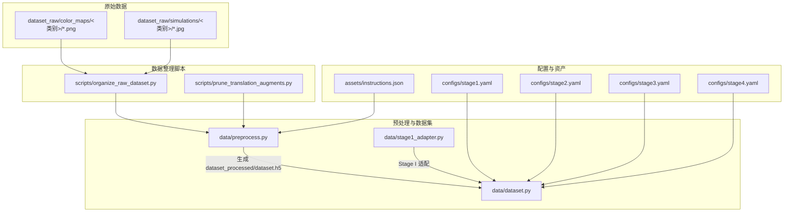
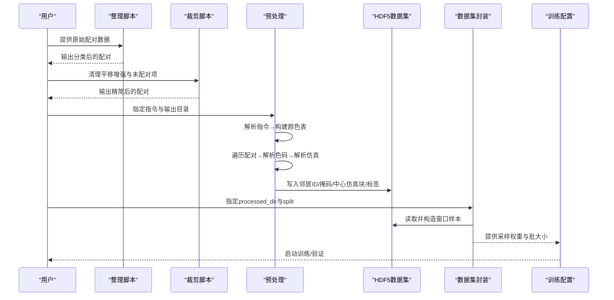
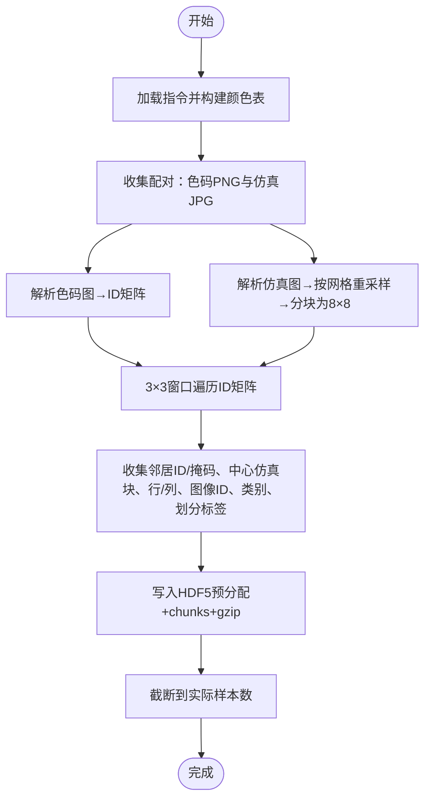
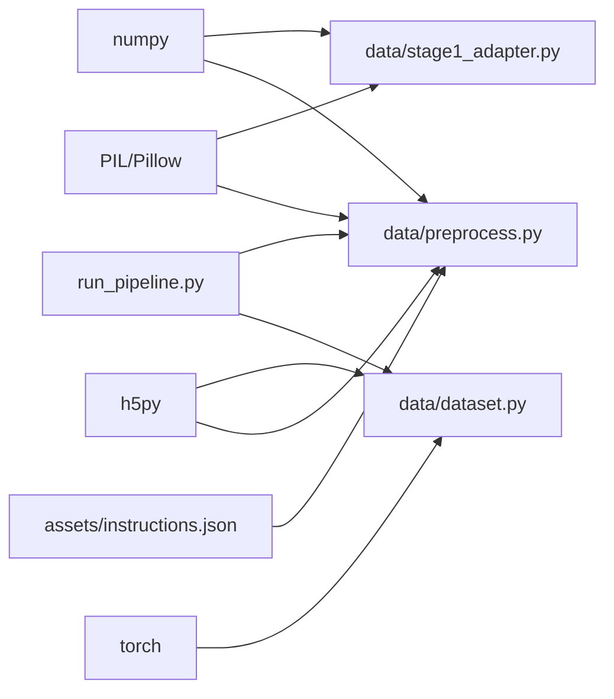

# 数据处理

<cite>
**本文引用的文件**
- [conditional-flow-matching-main/data/dataset.py](file://conditional-flow-matching-main/data/dataset.py)
- [conditional-flow-matching-main/data/preprocess.py](file://conditional-flow-matching-main/data/preprocess.py)
- [conditional-flow-matching-main/data/stage1_adapter.py](file://conditional-flow-matching-main/data/stage1_adapter.py)
- [conditional-flow-matching-main/assets/instructions.json](file://conditional-flow-matching-main/assets/instructions.json)
- [conditional-flow-matching-main/scripts/organize_raw_dataset.py](file://conditional-flow-matching-main/scripts/organize_raw_dataset.py)
- [conditional-flow-matching-main/scripts/prune_translation_augments.py](file://conditional-flow-matching-main/scripts/prune_translation_augments.py)
- [conditional-flow-matching-main/configs/stage1.yaml](file://conditional-flow-matching-main/configs/stage1.yaml)
- [conditional-flow-matching-main/configs/stage2.yaml](file://conditional-flow-matching-main/configs/stage2.yaml)
- [conditional-flow-matching-main/configs/stage3.yaml](file://conditional-flow-matching-main/configs/stage3.yaml)
- [conditional-flow-matching-main/configs/stage4.yaml](file://conditional-flow-matching-main/configs/stage4.yaml)
- [run_pipeline.py](file://run_pipeline.py)
- [data/color_palette.py](file://data/color_palette.py)
</cite>

## 目录
1. [引言](#引言)
2. [项目结构](#项目结构)
3. [核心组件](#核心组件)
4. [架构总览](#架构总览)
5. [详细组件分析](#详细组件分析)
6. [依赖分析](#依赖分析)
7. [性能考虑](#性能考虑)
8. [故障排查指南](#故障排查指南)
9. [结论](#结论)
10. [附录](#附录)

## 引言
本文件面向“数据处理”主题，系统化阐述颜色映射文件格式、图像预处理流程与数据集构建方法，详述数据转换过程、格式规范与验证规则，并给出最佳实践与性能优化建议。文档同时解释数据流在系统中的作用与影响，帮助读者从原始配对数据到可训练的HDF5样本，再到模型训练与推理的完整链路。

## 项目结构
数据处理相关模块主要分布在以下位置：
- conditional-flow-matching-main/data：数据集封装、预处理与适配
- conditional-flow-matching-main/assets：训练使用的指令与颜色定义
- conditional-flow-matching-main/scripts：原始数据整理与裁剪脚本
- conditional-flow-matching-main/configs：各阶段训练配置
- data：通用颜色调色板工具
- run_pipeline.py：统一入口，串联生成与仿真流程

图表来源
- [conditional-flow-matching-main/scripts/organize_raw_dataset.py:1-174](file://conditional-flow-matching-main/scripts/organize_raw_dataset.py#L1-L174)
- [conditional-flow-matching-main/scripts/prune_translation_augments.py:1-350](file://conditional-flow-matching-main/scripts/prune_translation_augments.py#L1-L350)
- [conditional-flow-matching-main/data/preprocess.py:1-285](file://conditional-flow-matching-main/data/preprocess.py#L1-L285)
- [conditional-flow-matching-main/data/dataset.py:1-207](file://conditional-flow-matching-main/data/dataset.py#L1-L207)
- [conditional-flow-matching-main/data/stage1_adapter.py:1-140](file://conditional-flow-matching-main/data/stage1_adapter.py#L1-L140)
- [conditional-flow-matching-main/configs/stage1.yaml:1-24](file://conditional-flow-matching-main/configs/stage1.yaml#L1-L24)
- [conditional-flow-matching-main/configs/stage2.yaml:1-24](file://conditional-flow-matching-main/configs/stage2.yaml#L1-L24)
- [conditional-flow-matching-main/configs/stage3.yaml:1-26](file://conditional-flow-matching-main/configs/stage3.yaml#L1-L26)
- [conditional-flow-matching-main/configs/stage4.yaml:1-46](file://conditional-flow-matching-main/configs/stage4.yaml#L1-L46)
- [conditional-flow-matching-main/assets/instructions.json:1-352](file://conditional-flow-matching-main/assets/instructions.json#L1-L352)

章节来源
- [conditional-flow-matching-main/scripts/organize_raw_dataset.py:1-174](file://conditional-flow-matching-main/scripts/organize_raw_dataset.py#L1-L174)
- [conditional-flow-matching-main/scripts/prune_translation_augments.py:1-350](file://conditional-flow-matching-main/scripts/prune_translation_augments.py#L1-L350)
- [conditional-flow-matching-main/data/preprocess.py:1-285](file://conditional-flow-matching-main/data/preprocess.py#L1-L285)
- [conditional-flow-matching-main/data/dataset.py:1-207](file://conditional-flow-matching-main/data/dataset.py#L1-L207)
- [conditional-flow-matching-main/data/stage1_adapter.py:1-140](file://conditional-flow-matching-main/data/stage1_adapter.py#L1-L140)
- [conditional-flow-matching-main/configs/stage1.yaml:1-24](file://conditional-flow-matching-main/configs/stage1.yaml#L1-L24)
- [conditional-flow-matching-main/configs/stage2.yaml:1-24](file://conditional-flow-matching-main/configs/stage2.yaml#L1-L24)
- [conditional-flow-matching-main/configs/stage3.yaml:1-26](file://conditional-flow-matching-main/configs/stage3.yaml#L1-L26)
- [conditional-flow-matching-main/configs/stage4.yaml:1-46](file://conditional-flow-matching-main/configs/stage4.yaml#L1-L46)
- [conditional-flow-matching-main/assets/instructions.json:1-352](file://conditional-flow-matching-main/assets/instructions.json#L1-L352)

## 核心组件
- 颜色映射与指令定义：通过 assets/instructions.json 提供15色指令定义与颜色映射，指导从RGB到ID的映射与训练。
- 预处理管线：将原始配对的彩色色码图与仿真图转换为窗口样本，写入HDF5，包含邻居掩码、中心仿真块与标签等。
- 数据集封装：KnittingWindowDataset支持按split切分、邻居掩码、邻居ID与中心仿真块的张量化输出，并提供加权采样策略。
- Stage I 适配：将生成器一的指令网格下采样到仿真网格，保留关键动作优先级，确保稀疏动作不被丢失。
- 颜色调色板工具：提供RGB↔ID双向映射与快速查找表，支持精确匹配与最近邻回退。

章节来源
- [conditional-flow-matching-main/assets/instructions.json:1-352](file://conditional-flow-matching-main/assets/instructions.json#L1-L352)
- [conditional-flow-matching-main/data/preprocess.py:1-285](file://conditional-flow-matching-main/data/preprocess.py#L1-L285)
- [conditional-flow-matching-main/data/dataset.py:1-207](file://conditional-flow-matching-main/data/dataset.py#L1-L207)
- [conditional-flow-matching-main/data/stage1_adapter.py:1-140](file://conditional-flow-matching-main/data/stage1_adapter.py#L1-L140)
- [data/color_palette.py:1-186](file://data/color_palette.py#L1-L186)

## 架构总览
数据处理链路从原始配对数据开始，经由整理与裁剪脚本，进入预处理生成HDF5，随后由数据集封装提供给训练/验证流水线。Stage I 适配用于将生成器一的指令网格转换为仿真网格输入。

图表来源
- [conditional-flow-matching-main/scripts/organize_raw_dataset.py:1-174](file://conditional-flow-matching-main/scripts/organize_raw_dataset.py#L1-L174)
- [conditional-flow-matching-main/scripts/prune_translation_augments.py:1-350](file://conditional-flow-matching-main/scripts/prune_translation_augments.py#L1-L350)
- [conditional-flow-matching-main/data/preprocess.py:1-285](file://conditional-flow-matching-main/data/preprocess.py#L1-L285)
- [conditional-flow-matching-main/data/dataset.py:1-207](file://conditional-flow-matching-main/data/dataset.py#L1-L207)
- [conditional-flow-matching-main/configs/stage1.yaml:1-24](file://conditional-flow-matching-main/configs/stage1.yaml#L1-L24)
- [conditional-flow-matching-main/configs/stage2.yaml:1-24](file://conditional-flow-matching-main/configs/stage2.yaml#L1-L24)
- [conditional-flow-matching-main/configs/stage3.yaml:1-26](file://conditional-flow-matching-main/configs/stage3.yaml#L1-L26)
- [conditional-flow-matching-main/configs/stage4.yaml:1-46](file://conditional-flow-matching-main/configs/stage4.yaml#L1-L46)

## 详细组件分析

### 颜色映射文件格式与指令定义
- 文件：assets/instructions.json
- 规范要点
  - metadata：版本号、颜色映射版本、参数尺度说明
  - semantic_layer：语义层定义（如 LOOP/TUCK/TRANSFER/SPLIT/MISS/DROP/CARRIER）
  - instructions：每个指令包含缩写、语义、床类型/偏移、颜色（十六进制）、机器颜色、机器动作ID/名称、导出安全性、描述、应用范围、频率、张力/弹性/稳定性等级等
- 验证规则
  - 颜色字段为合法十六进制（例如 "#FF0010"）
  - 语义字段属于预定义集合
  - 动作等级（tension/elasticity/stability）为整数范围
- 使用模式
  - 预处理阶段加载指令，构建颜色表（RGB→ID），用于将色码图转为ID矩阵
  - 推理阶段加载指令，用于将ID图转换为机器可执行的动作序列

章节来源
- [conditional-flow-matching-main/assets/instructions.json:1-352](file://conditional-flow-matching-main/assets/instructions.json#L1-L352)

### 图像预处理流程与数据集构建
- 输入配对：dataset_raw/color_maps/<类别>/*.png 与 dataset_raw/simulations/<类别>/*.jpg
- 关键步骤
  - 加载指令并构建颜色表
  - 遍历配对：读取色码图→解析为ID矩阵；读取仿真图→按网格尺寸重采样→分块为8×8仿真块
  - 以3×3窗口遍历ID矩阵，收集邻居ID与邻居掩码（边界外为False），同时记录中心仿真块、行/列、图像ID、类别、划分标签（每10对取1个做验证）
  - 写入HDF5：预分配数据集（含chunks/gzip压缩），写入邻居ID/掩码/中心仿真块/标签等字段
  - 截断到实际样本数，输出统计与文件大小
- 数据集封装
  - KnittingWindowDataset：按split读取索引、校验patch_size与neighbor_mask存在性、支持内存加载或HDF5流式读取
  - 输出张量：邻居ID/掩码（长/布尔）、中心仿真块（float32，通道在前）、中心ID
  - 采样权重：按类别频次提供三档/平衡/平方根权重策略
- 训练集成
  - get_dataloaders：根据processed_dir与配置选择加权采样或随机采样，设置pin_memory、drop_last、持久化工作进程等

图表来源
- [conditional-flow-matching-main/data/preprocess.py:71-275](file://conditional-flow-matching-main/data/preprocess.py#L71-L275)
- [conditional-flow-matching-main/data/dataset.py:13-104](file://conditional-flow-matching-main/data/dataset.py#L13-L104)

章节来源
- [conditional-flow-matching-main/data/preprocess.py:1-285](file://conditional-flow-matching-main/data/preprocess.py#L1-L285)
- [conditional-flow-matching-main/data/dataset.py:1-207](file://conditional-flow-matching-main/data/dataset.py#L1-L207)

### 数据转换过程与格式规范
- 色码图转换
  - 输入：RGB三通道uint8，尺寸为网格宽高
  - 步骤：向量化计算与颜色表差值平方和，取最小距离ID；若需要，对未知颜色进行最近邻匹配
  - 输出：ID矩阵（int32），背景ID通常为0
- 仿真图转换
  - 输入：RGB三通道uint8，尺寸为目标网格×8
  - 步骤：重采样到目标尺寸（双三次插值），归一化到[-1,1]，按网格划分为8×8块
  - 输出：(H_grid, W_grid, 8, 8, 3)的块张量
- HDF5字段规范
  - 邻居ID：(N, 3, 3)，int32
  - 邻居掩码：(N, 3, 3)，bool
  - 中心仿真块：(N, 8, 8, 3)，float32
  - 标签：center_id（int32）、image_id（int32）、row/col（int32）
  - 元数据：has_mask（bool）、grid_policy（str）、patch_size（int）
  - 划分：split（UTF-8字符串）、category（UTF-8字符串）

章节来源
- [conditional-flow-matching-main/data/preprocess.py:17-69](file://conditional-flow-matching-main/data/preprocess.py#L17-L69)
- [conditional-flow-matching-main/data/dataset.py:13-104](file://conditional-flow-matching-main/data/dataset.py#L13-L104)

### 验证规则与错误处理
- 预处理阶段
  - 颜色表为空或不匹配：抛出异常
  - 仿真块非方块：抛出异常
  - 未找到配对或样本数为0：提示重新运行预处理
- 数据集阶段
  - patch_size不一致：提示删除旧HDF5并重新预处理
  - split无样本：提示HDF5需新版生成
  - 缺失neighbor_mask：提示用最新版preprocess.py重建
- 适配阶段
  - Stage I 网格小于仿真网格：抛出异常
  - 无法加载生成器调色板时回退到仿真调色板并告警

章节来源
- [conditional-flow-matching-main/data/preprocess.py:196-202](file://conditional-flow-matching-main/data/preprocess.py#L196-L202)
- [conditional-flow-matching-main/data/dataset.py:26-47](file://conditional-flow-matching-main/data/dataset.py#L26-L47)
- [conditional-flow-matching-main/data/stage1_adapter.py:134-139](file://conditional-flow-matching-main/data/stage1_adapter.py#L134-L139)

### Stage I 适配与下采样策略
- 目标：将生成器一的指令网格（稀疏动作）下采样到仿真网格，保留关键动作优先级
- 策略
  - 默认：均匀下采样
  - 保留特殊：在每个源块中，按优先级（如 miss、f_tuck_2、b_tuck_2、xfer_l1/xfer_r1、xfer_f_b/xfer_b_f、f_tuck/b_tuck、f_split/b_split/split_v、b_knit/f_knit）选择“最高优先级且出现次数最多”的动作
- 输出：(grid_size, grid_size) 的ID图

章节来源
- [conditional-flow-matching-main/data/stage1_adapter.py:58-140](file://conditional-flow-matching-main/data/stage1_adapter.py#L58-L140)

### 颜色调色板工具（RGB↔ID）
- 功能
  - 从color_mapping.json加载映射，构建RGB24快速查找表
  - 提供精确匹配与最近邻匹配两种模式
  - 支持ID→RGB与RGB→ID双向转换
- 性能
  - LUT查询O(1)，适合大规模图像转换
  - 未知颜色数量较多时发出警告

章节来源
- [data/color_palette.py:1-186](file://data/color_palette.py#L1-L186)

### 训练配置与数据加载
- 配置项
  - processed_dir：HDF5输出目录
  - json_path：指令文件路径
  - use_weighted_sampling / sampling_strategy：采样策略
  - stage1-stage4各自独立配置，包含批大小、学习率、权重系数、保存/验证间隔等
- 数据加载
  - get_dataloaders：自动检测HDF5是否存在，按策略构建WeightedRandomSampler或随机采样，设置多进程、内存固定、丢弃最后一个不完整batch等

章节来源
- [conditional-flow-matching-main/configs/stage1.yaml:1-24](file://conditional-flow-matching-main/configs/stage1.yaml#L1-L24)
- [conditional-flow-matching-main/configs/stage2.yaml:1-24](file://conditional-flow-matching-main/configs/stage2.yaml#L1-L24)
- [conditional-flow-matching-main/configs/stage3.yaml:1-26](file://conditional-flow-matching-main/configs/stage3.yaml#L1-L26)
- [conditional-flow-matching-main/configs/stage4.yaml:1-46](file://conditional-flow-matching-main/configs/stage4.yaml#L1-L46)
- [conditional-flow-matching-main/data/dataset.py:151-207](file://conditional-flow-matching-main/data/dataset.py#L151-L207)

## 依赖分析
- 预处理依赖
  - assets/instructions.json：提供颜色表与指令元数据
  - PIL/Pillow：图像读取与重采样
  - numpy：向量化运算与数组操作
  - h5py：HDF5写入与读取
- 数据集封装依赖
  - h5py：HDF5读取
  - torch/torchvision：张量转换与DataLoader
- 适配依赖
  - PIL/Pillow：图像读取
  - numpy：数组操作与优先级聚合
- 统一入口
  - run_pipeline.py：协调生成与仿真流程，传递设备、种子、候选数等参数

图表来源
- [conditional-flow-matching-main/assets/instructions.json:1-352](file://conditional-flow-matching-main/assets/instructions.json#L1-L352)
- [conditional-flow-matching-main/data/preprocess.py:1-12](file://conditional-flow-matching-main/data/preprocess.py#L1-L12)
- [conditional-flow-matching-main/data/dataset.py:1-12](file://conditional-flow-matching-main/data/dataset.py#L1-L12)
- [conditional-flow-matching-main/data/stage1_adapter.py:1-12](file://conditional-flow-matching-main/data/stage1_adapter.py#L1-L12)
- [run_pipeline.py:1-279](file://run_pipeline.py#L1-L279)

章节来源
- [conditional-flow-matching-main/assets/instructions.json:1-352](file://conditional-flow-matching-main/assets/instructions.json#L1-L352)
- [conditional-flow-matching-main/data/preprocess.py:1-12](file://conditional-flow-matching-main/data/preprocess.py#L1-L12)
- [conditional-flow-matching-main/data/dataset.py:1-12](file://conditional-flow-matching-main/data/dataset.py#L1-L12)
- [conditional-flow-matching-main/data/stage1_adapter.py:1-12](file://conditional-flow-matching-main/data/stage1_adapter.py#L1-L12)
- [run_pipeline.py:1-279](file://run_pipeline.py#L1-L279)

## 性能考虑
- 预处理
  - 向量化颜色匹配：使用广播差值与sum(axis=-1)实现O(N*C)复杂度，显著优于逐像素循环
  - HDF5分块与压缩：chunks大小与gzip压缩可提升I/O吞吐与存储效率
  - 流式读取：大数据集可禁用内存加载，降低峰值内存占用
- 数据加载
  - WeightedRandomSampler：缓解类别不平衡，提高稀有类样本的曝光
  - pin_memory与persistent_workers：减少CPU→GPU拷贝开销与进程启动成本
  - drop_last：避免最后不完整batch导致的梯度不稳定
- 适配
  - 优先级聚合：在源块内聚合，兼顾稀疏性与关键动作保留
- 通用
  - 颜色调色板LUT：一次性构建，批量查询，避免重复距离计算

章节来源
- [conditional-flow-matching-main/data/preprocess.py:30-44](file://conditional-flow-matching-main/data/preprocess.py#L30-L44)
- [conditional-flow-matching-main/data/dataset.py:106-144](file://conditional-flow-matching-main/data/dataset.py#L106-L144)
- [data/color_palette.py:57-98](file://data/color_palette.py#L57-L98)

## 故障排查指南
- “找不到HDF5文件”
  - 现象：get_dataloaders报错
  - 处理：先运行预处理脚本生成dataset.h5
- “HDF5 patch_size不一致”
  - 现象：初始化数据集时报错
  - 处理：删除旧dataset_processed/dataset.h5，重新运行预处理
- “split无样本”
  - 现象：找不到对应split的样本
  - 处理：确认HDF5由新版预处理生成（v3及以上）
- “缺少neighbor_mask”
  - 现象：HDF5未包含neighbor_mask
  - 处理：用最新版preprocess.py重建
- “仿真块非方块”
  - 现象：parse_simulation报错
  - 处理：检查仿真图尺寸与网格尺寸关系，确保能被整除
- “Stage I 网格过小”
  - 现象：sample_id_map报错
  - 处理：确保色码图尺寸≥仿真网格尺寸

章节来源
- [conditional-flow-matching-main/data/dataset.py:26-47](file://conditional-flow-matching-main/data/dataset.py#L26-L47)
- [conditional-flow-matching-main/data/preprocess.py:55-68](file://conditional-flow-matching-main/data/preprocess.py#L55-L68)
- [conditional-flow-matching-main/data/stage1_adapter.py:134-139](file://conditional-flow-matching-main/data/stage1_adapter.py#L134-L139)

## 结论
本数据处理体系以指令定义为基准，通过严格的预处理与数据集封装，将原始配对数据转化为结构化窗口样本，配合加权采样与高效I/O，支撑多阶段模型训练。Stage I 适配与颜色调色板工具进一步保证了从生成器到仿真器的语义一致性与性能稳定性。遵循本文的格式规范与最佳实践，可显著提升数据质量与训练效率。

## 附录
- 使用模式示例
  - 预处理：在仓库根目录执行预处理脚本，指定原始色码与仿真目录、输出目录与指令文件路径
  - 数据加载：在训练配置中指定processed_dir与json_path，调用get_dataloaders获取训练/验证DataLoader
  - 统一入口：通过run_pipeline.py选择color/simulate/all模式，自动串联生成与仿真流程
- 相关脚本
  - scripts/organize_raw_dataset.py：将原始配对文件按类别整理
  - scripts/prune_translation_augments.py：裁剪平移增强与未配对项，生成清单CSV

章节来源
- [conditional-flow-matching-main/scripts/organize_raw_dataset.py:1-174](file://conditional-flow-matching-main/scripts/organize_raw_dataset.py#L1-L174)
- [conditional-flow-matching-main/scripts/prune_translation_augments.py:1-350](file://conditional-flow-matching-main/scripts/prune_translation_augments.py#L1-L350)
- [run_pipeline.py:1-279](file://run_pipeline.py#L1-L279)