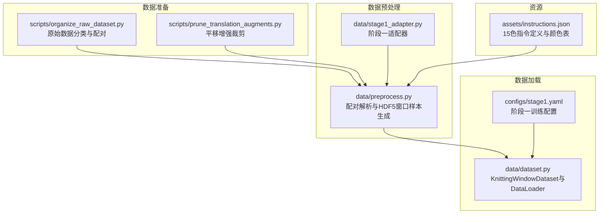
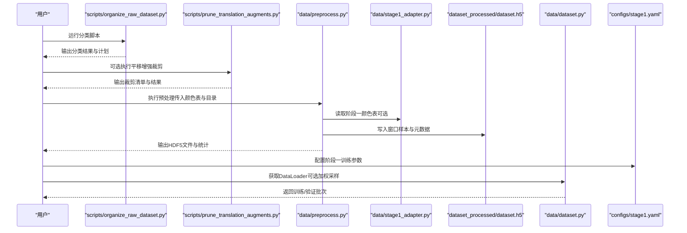
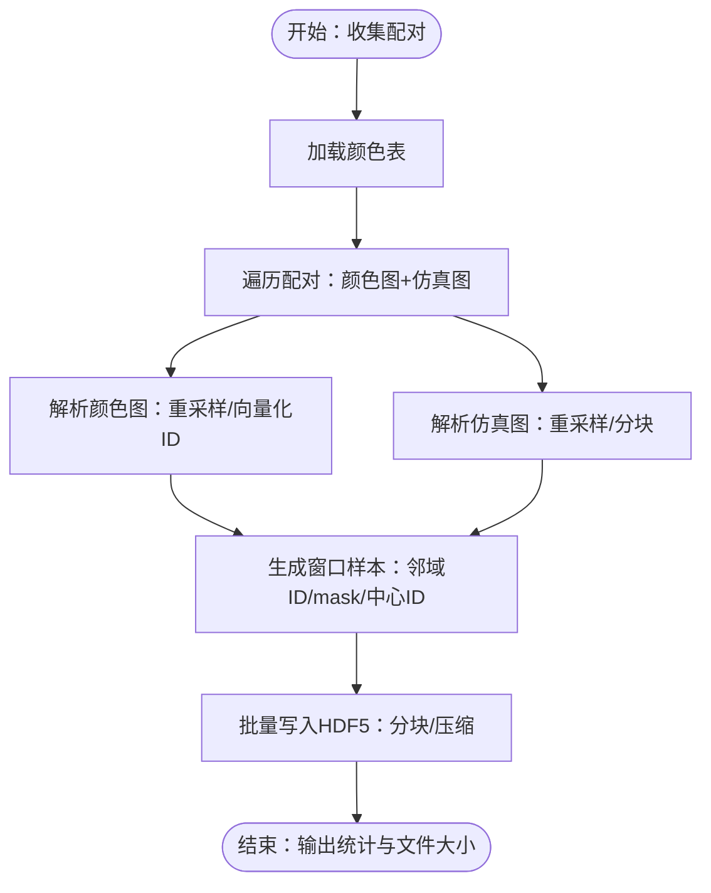
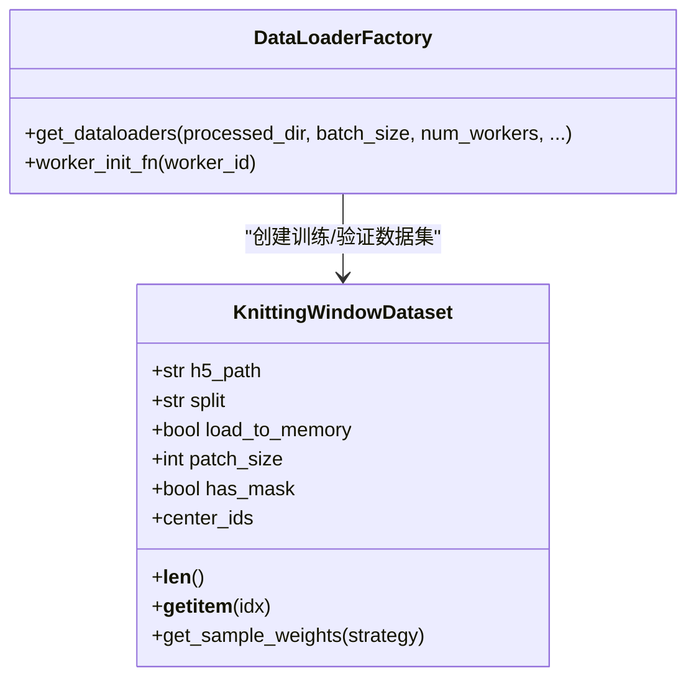
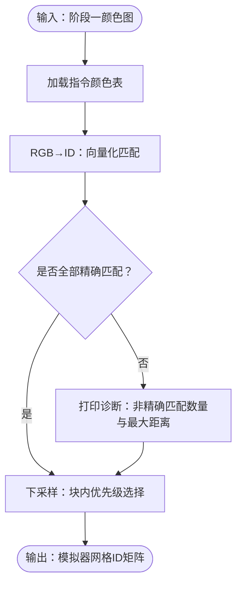
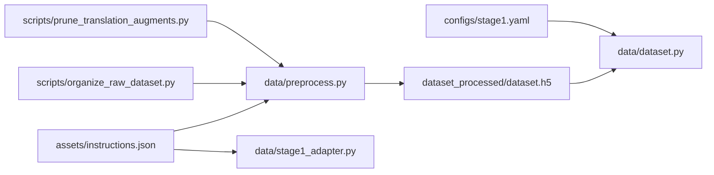

# 数据集构建

<cite>
**本文引用的文件**
- [dataset.py](file://conditional-flow-matching-main/data/dataset.py)
- [stage1_adapter.py](file://conditional-flow-matching-main/data/stage1_adapter.py)
- [preprocess.py](file://conditional-flow-matching-main/data/preprocess.py)
- [stage1.yaml](file://conditional-flow-matching-main/configs/stage1.yaml)
- [instructions.json](file://conditional-flow-matching-main/assets/instructions.json)
- [organize_raw_dataset.py](file://conditional-flow-matching-main/scripts/organize_raw_dataset.py)
- [prune_translation_augments.py](file://conditional-flow-matching-main/scripts/prune_translation_augments.py)
- [README.md](file://conditional-flow-matching-main/README.md)
</cite>

## 目录
1. [简介](#简介)
2. [项目结构](#项目结构)
3. [核心组件](#核心组件)
4. [架构总览](#架构总览)
5. [详细组件分析](#详细组件分析)
6. [依赖分析](#依赖分析)
7. [性能考虑](#性能考虑)
8. [故障排除指南](#故障排除指南)
9. [结论](#结论)
10. [附录](#附录)

## 简介
本技术文档围绕“数据集构建”主题，系统阐述针织图案生成项目中数据集的组织结构、文件格式规范、中间文件生成流程与最终数据集构建过程。重点覆盖以下方面：
- 原始数据的组织与清洗：类别化布局、配对校验与裁剪策略
- 中间文件与最终数据集：HDF5窗口样本的生成与元数据设计
- Dataset类的设计与实现：数据加载机制、批处理策略与内存管理
- Stage1适配器：从阶段一指令图到模拟器条件的确定性转换
- 完整工作流程、配置参数说明与故障排除
- 实际使用示例与性能调优建议

## 项目结构
数据集构建相关模块主要位于 conditional-flow-matching-main/data 与 scripts 子目录，并通过 configs 提供阶段化配置。整体结构如下：

图表来源
- [organize_raw_dataset.py:1-174](file://conditional-flow-matching-main/scripts/organize_raw_dataset.py#L1-L174)
- [prune_translation_augments.py:1-350](file://conditional-flow-matching-main/scripts/prune_translation_augments.py#L1-L350)
- [preprocess.py:1-285](file://conditional-flow-matching-main/data/preprocess.py#L1-L285)
- [stage1_adapter.py:1-140](file://conditional-flow-matching-main/data/stage1_adapter.py#L1-L140)
- [dataset.py:1-207](file://conditional-flow-matching-main/data/dataset.py#L1-L207)
- [stage1.yaml:1-24](file://conditional-flow-matching-main/configs/stage1.yaml#L1-L24)
- [instructions.json:1-352](file://conditional-flow-matching-main/assets/instructions.json#L1-L352)

章节来源
- [README.md:1-47](file://conditional-flow-matching-main/README.md#L1-L47)

## 核心组件
- 数据预处理模块：负责将原始配对（颜色图与仿真图）解析为窗口样本，写入HDF5文件，包含颜色表加载、向量化颜色匹配、仿真图分块与窗口采样等。
- 数据集加载模块：提供窗口级数据集类与DataLoader工厂函数，支持内存预加载与HDF5流式读取、加权采样与多进程加载。
- 阶段一适配器：将阶段一指令图（颜色映射）转换为模拟器网格上的ID矩阵，并进行下采样与优先级保留策略，确保稀疏动作在粗网格中的代表性。

章节来源
- [preprocess.py:1-285](file://conditional-flow-matching-main/data/preprocess.py#L1-L285)
- [dataset.py:1-207](file://conditional-flow-matching-main/data/dataset.py#L1-L207)
- [stage1_adapter.py:1-140](file://conditional-flow-matching-main/data/stage1_adapter.py#L1-L140)

## 架构总览
数据集构建的端到端流程如下：

图表来源
- [organize_raw_dataset.py:146-173](file://conditional-flow-matching-main/scripts/organize_raw_dataset.py#L146-L173)
- [prune_translation_augments.py:188-345](file://conditional-flow-matching-main/scripts/prune_translation_augments.py#L188-L345)
- [preprocess.py:71-275](file://conditional-flow-matching-main/data/preprocess.py#L71-L275)
- [stage1_adapter.py:18-139](file://conditional-flow-matching-main/data/stage1_adapter.py#L18-L139)
- [dataset.py:151-206](file://conditional-flow-matching-main/data/dataset.py#L151-L206)
- [stage1.yaml:1-24](file://conditional-flow-matching-main/configs/stage1.yaml#L1-L24)

## 详细组件分析

### 数据预处理模块（preprocess.py）
- 功能职责
  - 加载15色指令颜色表，构建向量化颜色匹配函数
  - 解析颜色图与仿真图：颜色图统一尺寸、向量化转ID；仿真图按网格尺寸重采样并切分为8×8像素块
  - 以滑动窗口方式生成每个网格点为中心的3×3邻域ID与mask，同时记录中心ID、行列坐标、图像ID、划分标签与类别
  - 写入HDF5文件，设置压缩与分块策略，保存patch_size、网格策略与mask可用性等元信息
- 关键数据结构
  - neighbor_ids: (N, 3, 3) 整型ID矩阵
  - neighbor_mask: (N, 3, 3) 布尔mask
  - center_sim: (N, 8, 8, 3) 浮点型仿真块（归一化[-1,1]）
  - center_id: (N,) 中心网格动作ID
  - image_id/row/col/split/category: 元数据
- 性能与内存
  - 向量化颜色匹配显著提升速度
  - HDF5分块与gzip压缩降低存储体积
  - 支持按配对数量动态估算样本总数，避免内存浪费

图表来源
- [preprocess.py:71-275](file://conditional-flow-matching-main/data/preprocess.py#L71-L275)

章节来源
- [preprocess.py:1-285](file://conditional-flow-matching-main/data/preprocess.py#L1-L285)
- [instructions.json:1-352](file://conditional-flow-matching-main/assets/instructions.json#L1-L352)

### 数据集加载模块（dataset.py）
- 类设计
  - KnittingWindowDataset：继承自Dataset，支持按split筛选索引、内存预加载与HDF5流式读取、中心ID访问与样本权重计算
  - get_dataloaders：工厂函数，返回训练/验证DataLoader，支持WeightedRandomSampler与多进程加载
- 数据加载机制
  - split筛选：根据UTF-8编码的split标签过滤样本
  - 邻域与中心数据：返回neighbor_ids、neighbor_mask、center_sim（通道优先）、center_id
  - 内存管理：可选预加载到内存，或SWMR模式流式读取
- 批处理与采样
  - 支持三种采样权重策略：三档、均衡、开方
  - WeightedRandomSampler保证类别分布更均衡
- 异常与校验
  - patch_size一致性检查
  - neighbor_mask存在性校验
  - split为空报错提示

图表来源
- [dataset.py:13-206](file://conditional-flow-matching-main/data/dataset.py#L13-L206)

章节来源
- [dataset.py:1-207](file://conditional-flow-matching-main/data/dataset.py#L1-L207)

### 阶段一适配器（stage1_adapter.py）
- 作用
  - 将阶段一颜色图（指令网格）转换为模拟器网格上的ID矩阵，用于与仿真块对齐
  - 提供下采样策略，保留稀疏动作（如移针、劈针、集圈等）在粗网格中的代表性
- 转换逻辑
  - 颜色表加载：优先使用generator_one提供的指令颜色表，否则回退到仿真器调色板
  - RGB到ID：向量化欧氏距离匹配，对非精确匹配给出诊断
  - 下采样：按块统计，结合优先级字典选择最优动作，保留关键结构
- 输入输出
  - 输入：阶段一颜色图路径、可选颜色表与目标网格尺寸
  - 输出：模拟器网格尺寸的ID矩阵（可含特殊动作优先级）

图表来源
- [stage1_adapter.py:18-139](file://conditional-flow-matching-main/data/stage1_adapter.py#L18-L139)

章节来源
- [stage1_adapter.py:1-140](file://conditional-flow-matching-main/data/stage1_adapter.py#L1-L140)
- [instructions.json:1-352](file://conditional-flow-matching-main/assets/instructions.json#L1-L352)

### 原始数据组织与清洗（scripts）
- 数据组织脚本
  - 将原始配对文件按类别归档，仅保留完全配对的条目，其余删除或移动到备份
  - 支持干运行与应用两种模式，便于审阅与执行
- 平移增强裁剪脚本
  - 识别带平移后缀的配对（如_0_0、_6_11），在满足最小组规模与类别配对数前提下，仅保留原图与少量平移变体，其余裁剪
  - 生成操作清单CSV，支持删除或移动到备份目录

章节来源
- [organize_raw_dataset.py:1-174](file://conditional-flow-matching-main/scripts/organize_raw_dataset.py#L1-L174)
- [prune_translation_augments.py:1-350](file://conditional-flow-matching-main/scripts/prune_translation_augments.py#L1-L350)

## 依赖分析
- 组件耦合
  - preprocess.py依赖assets/instructions.json提供颜色表
  - stage1_adapter.py依赖generator_one的指令颜色表，若缺失则回退
  - dataset.py依赖preprocess.py生成的HDF5文件结构与元信息
  - stage1.yaml提供训练阶段的超参配置入口
- 外部依赖
  - NumPy、PIL、h5py、PyTorch DataLoader
- 潜在环路
  - 无直接循环导入；模块职责清晰，接口稳定

图表来源
- [instructions.json:1-352](file://conditional-flow-matching-main/assets/instructions.json#L1-L352)
- [preprocess.py:1-285](file://conditional-flow-matching-main/data/preprocess.py#L1-L285)
- [stage1_adapter.py:1-140](file://conditional-flow-matching-main/data/stage1_adapter.py#L1-L140)
- [dataset.py:1-207](file://conditional-flow-matching-main/data/dataset.py#L1-L207)
- [stage1.yaml:1-24](file://conditional-flow-matching-main/configs/stage1.yaml#L1-L24)
- [organize_raw_dataset.py:1-174](file://conditional-flow-matching-main/scripts/organize_raw_dataset.py#L1-L174)
- [prune_translation_augments.py:1-350](file://conditional-flow-matching-main/scripts/prune_translation_augments.py#L1-L350)

## 性能考虑
- 预处理阶段
  - 向量化颜色匹配：显著减少逐像素循环开销
  - HDF5分块与压缩：平衡I/O与存储占用
  - 批量写入：减少多次打开/关闭文件的开销
- 数据加载阶段
  - 内存预加载：适合显存充足场景，避免频繁磁盘访问
  - SWMR流式读取：适合大规模数据，降低峰值内存
  - 多进程DataLoader：合理设置num_workers，注意pin_memory与persistent_workers
  - 加权采样：缓解类别不平衡，提高收敛稳定性
- 调优建议
  - 根据GPU显存与CPU核数调整batch_size与num_workers
  - 若样本极多，优先使用流式读取并启用持久化工作进程
  - 控制chunk_size与压缩级别以平衡写入速度与读取效率

## 故障排除指南
- HDF5文件缺失
  - 现象：DataLoader工厂函数抛出找不到HDF5文件
  - 处理：先运行预处理脚本生成dataset.h5
  - 参考
    - [dataset.py:157-161](file://conditional-flow-matching-main/data/dataset.py#L157-L161)
    - [preprocess.py:278-285](file://conditional-flow-matching-main/data/preprocess.py#L278-L285)
- patch_size不一致
  - 现象：初始化Dataset时报错，提示HDF5与配置patch_size不一致
  - 处理：删除旧dataset_processed/dataset.h5后重新运行预处理
  - 参考
    - [dataset.py:26-30](file://conditional-flow-matching-main/data/dataset.py#L26-L30)
- 缺少neighbor_mask
  - 现象：初始化Dataset时报错，提示HDF5缺少neighbor_mask字段
  - 处理：使用最新版preprocess.py重新生成HDF5
  - 参考
    - [dataset.py:43-47](file://conditional-flow-matching-main/data/dataset.py#L43-L47)
- split为空
  - 现象：指定split无样本，抛出异常
  - 处理：确认HDF5由新版预处理生成，或检查类别与命名
  - 参考
    - [dataset.py:37-41](file://conditional-flow-matching-main/data/dataset.py#L37-L41)
- 颜色表加载失败
  - 现象：阶段一适配器无法加载指令颜色表
  - 处理：确保assets/instructions.json存在且格式正确；或显式提供颜色表
  - 参考
    - [stage1_adapter.py:18-35](file://conditional-flow-matching-main/data/stage1_adapter.py#L18-L35)
- 平移增强裁剪误删
  - 现象：裁剪后数据量骤减
  - 处理：先dry run查看清单，确认后再应用；必要时从备份恢复
  - 参考
    - [prune_translation_augments.py:313-344](file://conditional-flow-matching-main/scripts/prune_translation_augments.py#L313-L344)

## 结论
本数据集构建体系以HDF5为核心载体，结合向量化预处理与灵活的数据加载策略，实现了从原始配对到窗口样本的高效转换。阶段一适配器确保了不同来源数据格式的一致性与结构保留。通过合理的内存管理与采样策略，可在保证质量的同时提升训练效率。建议在生产环境中遵循“先组织/裁剪、再预处理、后加载”的流程，并根据硬件条件调整批大小与并行度。

## 附录

### 数据集构建完整工作流程
- 原始数据准备
  - 使用scripts/organize_raw_dataset.py将原始配对按类别归档
  - 可选：使用scripts/prune_translation_augments.py裁剪平移增强变体
- 预处理
  - 运行data/preprocess.py，生成dataset_processed/dataset.h5
  - 依赖assets/instructions.json提供颜色表
- 训练/推理
  - 使用configs/stage1.yaml配置阶段一训练参数
  - 通过data/dataset.py的get_dataloaders获取DataLoader

章节来源
- [organize_raw_dataset.py:146-173](file://conditional-flow-matching-main/scripts/organize_raw_dataset.py#L146-L173)
- [prune_translation_augments.py:188-345](file://conditional-flow-matching-main/scripts/prune_translation_augments.py#L188-L345)
- [preprocess.py:278-285](file://conditional-flow-matching-main/data/preprocess.py#L278-L285)
- [stage1.yaml:1-24](file://conditional-flow-matching-main/configs/stage1.yaml#L1-L24)
- [dataset.py:151-206](file://conditional-flow-matching-main/data/dataset.py#L151-L206)

### 配置参数说明（阶段一）
- data.processed_dir：HDF5输出目录
- data.json_path：指令颜色表路径
- data.use_weighted_sampling：是否使用加权采样
- data.sampling_strategy：采样权重策略（three_tier/balanced/sqrt）
- train.batch_size：批大小
- train.epochs/warmup_epochs：训练轮数与预热轮数
- train.lr/num_workers：学习率与数据加载并行数
- train.val_every/save_every：验证与保存频率
- train.mse_weight/l1_weight/grad_weight/fft_weight：损失权重
- train.checkpoint_dir：检查点保存目录

章节来源
- [stage1.yaml:1-24](file://conditional-flow-matching-main/configs/stage1.yaml#L1-L24)