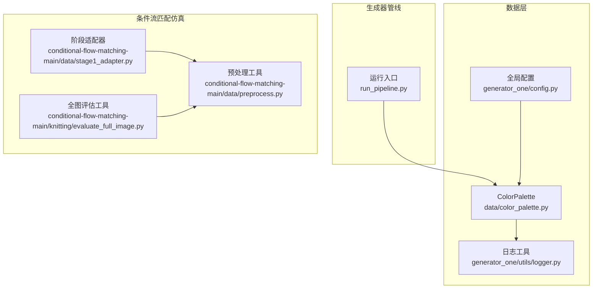
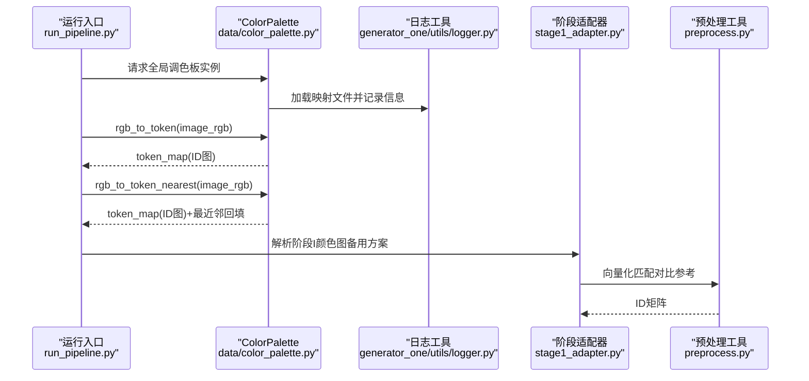
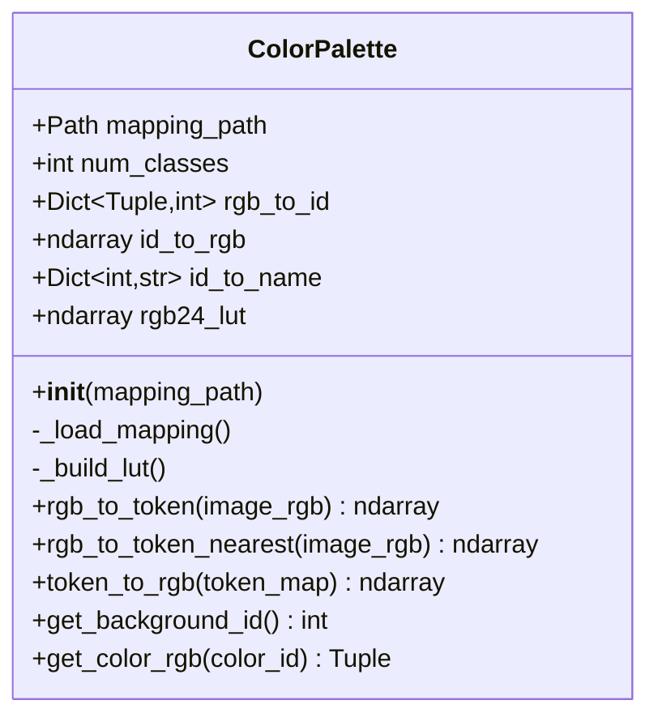
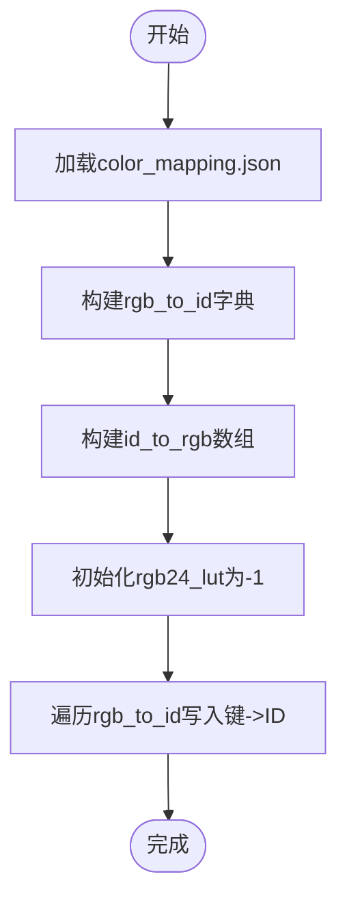
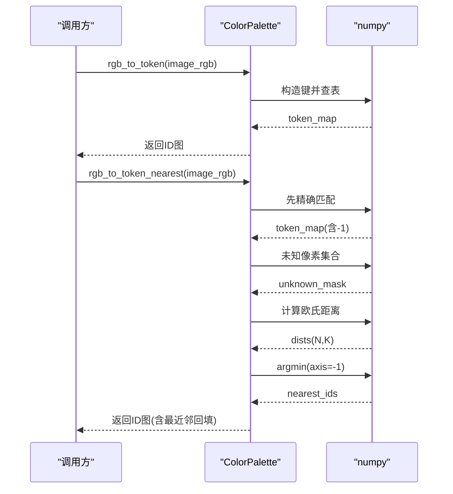
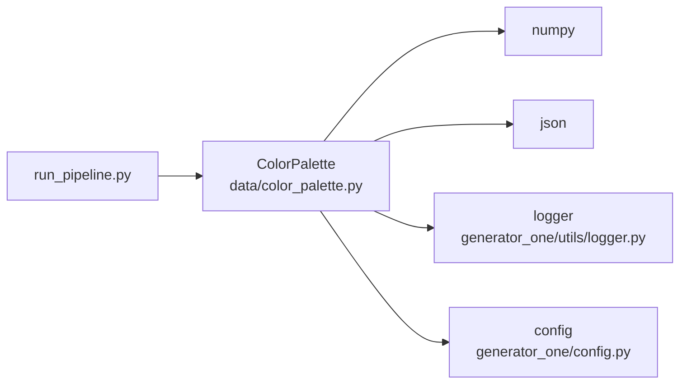

# 颜色管理

<cite>
**本文引用的文件**
- [color_palette.py](file://data/color_palette.py)
- [config.py](file://generator_one/config.py)
- [logger.py](file://generator_one/utils/logger.py)
- [stage1_adapter.py](file://conditional-flow-matching-main/data/stage1_adapter.py)
- [preprocess.py](file://conditional-flow-matching-main/data/preprocess.py)
- [evaluate_full_image.py](file://conditional-flow-matching-main/knitting/evaluate_full_image.py)
- [run_pipeline.py](file://run_pipeline.py)
</cite>

## 目录
1. [简介](#简介)
2. [项目结构](#项目结构)
3. [核心组件](#核心组件)
4. [架构总览](#架构总览)
5. [详细组件分析](#详细组件分析)
6. [依赖分析](#依赖分析)
7. [性能考虑](#性能考虑)
8. [故障排查指南](#故障排查指南)
9. [结论](#结论)
10. [附录](#附录)

## 简介
本技术文档围绕16色调色板的颜色管理系统展开，重点解释以下内容：
- RGB到ID的映射机制与快速查找表（LUT）的构建与优化策略
- 颜色转换函数的工作流程，涵盖精确匹配与最近邻匹配两种算法及其适用场景
- 颜色映射文件格式规范、调色板配置方法与最佳实践
- 使用ColorPalette类进行颜色转换的具体示例路径与性能优化技巧
- 常见问题的诊断与解决思路

## 项目结构
颜色管理功能主要位于data子模块，配合生成器与仿真器两套管线共同完成从颜色映射到仿真输出的端到端流程。

图表来源
- [color_palette.py:12-186](file://data/color_palette.py#L12-L186)
- [config.py:1-76](file://generator_one/config.py#L1-L76)
- [logger.py:1-52](file://generator_one/utils/logger.py#L1-L52)
- [stage1_adapter.py:18-56](file://conditional-flow-matching-main/data/stage1_adapter.py#L18-L56)
- [preprocess.py:17-52](file://conditional-flow-matching-main/data/preprocess.py#L17-L52)
- [evaluate_full_image.py:111-137](file://conditional-flow-matching-main/knitting/evaluate_full_image.py#L111-L137)
- [run_pipeline.py:72-110](file://run_pipeline.py#L72-L110)

章节来源
- [color_palette.py:12-186](file://data/color_palette.py#L12-L186)
- [config.py:1-76](file://generator_one/config.py#L1-L76)
- [run_pipeline.py:72-110](file://run_pipeline.py#L72-L110)

## 核心组件
- ColorPalette：负责加载颜色映射文件、维护RGB↔ID双向映射、构建RGB24快速查找表（LUT），并提供RGB图像到token ID图的转换接口（含精确匹配与最近邻匹配）。
- 全局palette实例：通过惰性初始化的工厂函数统一管理调色板生命周期，避免重复加载。
- 日志工具：统一记录加载、转换过程中的调试与警告信息。
- 阶段适配器与预处理工具：在仿真阶段提供向量化颜色匹配与网格采样能力，作为ColorPalette的补充。

章节来源
- [color_palette.py:12-186](file://data/color_palette.py#L12-L186)
- [logger.py:1-52](file://generator_one/utils/logger.py#L1-L52)
- [stage1_adapter.py:18-56](file://conditional-flow-matching-main/data/stage1_adapter.py#L18-L56)
- [preprocess.py:17-52](file://conditional-flow-matching-main/data/preprocess.py#L17-L52)

## 架构总览
下图展示了颜色管理在整体系统中的位置与交互：

图表来源
- [run_pipeline.py:72-110](file://run_pipeline.py#L72-L110)
- [color_palette.py:72-131](file://data/color_palette.py#L72-L131)
- [stage1_adapter.py:38-55](file://conditional-flow-matching-main/data/stage1_adapter.py#L38-L55)
- [preprocess.py:30-44](file://conditional-flow-matching-main/data/preprocess.py#L30-L44)

## 详细组件分析

### ColorPalette类设计与实现
- 职责边界清晰：仅负责颜色映射与快速查找，不涉及图像IO与业务流程编排。
- 数据结构选择：
  - RGB到ID：使用字典，键为三元组(r,g,b)，值为整型ID，便于O(1)精确查询。
  - ID到RGB：使用形状为(num_classes, 3)的numpy数组，便于向量化操作与内存局部性优化。
  - 名称映射：ID到名称的字典，便于可视化与调试。
- 快速查找表（LUT）：
  - 将24位RGB值(r<<16 | g<<8 | b)映射到ID，索引空间为2^24≈16M，一次性构建，查询复杂度O(1)。
  - 仅对调色板中的颜色有效；其他颜色统一标记为-1，用于后续最近邻回填。
- 转换流程：
  - 精确匹配：直接按像素点构造键并查表，返回ID图；同时统计未知颜色数量并记录日志。
  - 最近邻匹配：对未知像素集合，计算到全部调色板颜色的欧氏距离，取最小者作为ID。

图表来源
- [color_palette.py:12-186](file://data/color_palette.py#L12-L186)

章节来源
- [color_palette.py:22-98](file://data/color_palette.py#L22-L98)
- [color_palette.py:100-131](file://data/color_palette.py#L100-L131)
- [color_palette.py:133-150](file://data/color_palette.py#L133-L150)
- [color_palette.py:152-162](file://data/color_palette.py#L152-L162)
- [color_palette.py:168-186](file://data/color_palette.py#L168-L186)

### RGB到ID映射与LUT构建
- 键构造策略：将(r,g,b)压缩为单一整型键，避免多次查表时的重复计算。
- 内存占用：LUT大小为2^24，dtype为int16，约占用2^24×2B=16MB，属于可接受范围。
- 优化要点：
  - 预先分配并填充-1，确保未知颜色的默认行为一致。
  - 使用numpy向量化操作批量构建，避免Python循环。
  - 仅对调色板中存在的颜色写入有效ID，未命中区域保持-1。

图表来源
- [color_palette.py:31-70](file://data/color_palette.py#L31-L70)

章节来源
- [color_palette.py:31-70](file://data/color_palette.py#L31-L70)

### 精确匹配与最近邻匹配工作流
- 精确匹配：
  - 输入：RGB图像(H,W,3)
  - 步骤：构造键→查表→统计未知像素→返回ID图
  - 特点：O(HW)时间复杂度，常数因子小，适合高质量输入
- 最近邻匹配：
  - 触发条件：存在未知像素
  - 步骤：对未知像素集合计算到全部调色板颜色的欧氏距离→取最小者→回填ID
  - 特点：对噪声与轻微色差鲁棒，但时间复杂度上升至O(N×K)，其中N为未知像素数，K为调色板规模（此处K=16）

图表来源
- [color_palette.py:72-98](file://data/color_palette.py#L72-L98)
- [color_palette.py:100-131](file://data/color_palette.py#L100-L131)

章节来源
- [color_palette.py:72-98](file://data/color_palette.py#L72-L98)
- [color_palette.py:100-131](file://data/color_palette.py#L100-L131)

### 颜色映射文件格式规范
- 字段要求：
  - num_classes：整数，调色板颜色总数
  - rgb_to_id：字典，键为字符串形式的RGB数组（如"[R,G,B]"），值为整型ID
  - id_to_rgb：字典，键为ID字符串，值为长度为3的RGB数组
  - id_to_name：字典，键为ID，值为颜色名称字符串
- 加载流程：
  - 校验文件存在性
  - 读取JSON并解析各字段
  - 构建内部数据结构，记录日志

章节来源
- [color_palette.py:31-55](file://data/color_palette.py#L31-L55)

### 调色板配置方法与最佳实践
- 配置入口：
  - 首次调用get_palette时，若未显式传入路径，则从全局配置中读取COLOR_MAPPING_PATH
  - 建议在项目启动时显式传入mapping_path，避免依赖全局配置
- 最佳实践：
  - 确保调色板规模与业务需求匹配（当前系统以16色为主）
  - 保证rgb_to_id与id_to_rgb的键值一致性，避免ID越界
  - 对输入图像进行预处理（如缩放、去噪）以减少未知像素比例
  - 在高噪声场景优先使用rgb_to_token_nearest，平衡质量与性能

章节来源
- [color_palette.py:168-186](file://data/color_palette.py#L168-L186)
- [config.py:24-39](file://generator_one/config.py#L24-L39)

### 使用ColorPalette类进行颜色转换（示例路径）
- 精确匹配示例路径
  - [rgb_to_token:72-98](file://data/color_palette.py#L72-L98)
- 最近邻匹配示例路径
  - [rgb_to_token_nearest:100-131](file://data/color_palette.py#L100-L131)
- ID到RGB转换示例路径
  - [token_to_rgb:133-150](file://data/color_palette.py#L133-L150)
- 获取背景ID示例路径
  - [get_background_id:152-154](file://data/color_palette.py#L152-L154)
- 获取指定ID的RGB值示例路径
  - [get_color_rgb:156-162](file://data/color_palette.py#L156-L162)
- 全局palette实例获取示例路径
  - [get_palette:168-186](file://data/color_palette.py#L168-L186)

章节来源
- [color_palette.py:72-162](file://data/color_palette.py#L72-L162)
- [color_palette.py:168-186](file://data/color_palette.py#L168-L186)

### 与其他模块的协同
- 阶段适配器（Stage I → Simulator）
  - 提供向量化颜色匹配与网格采样能力，作为ColorPalette的补充方案
  - 示例路径：
    - [load_color_table:18-35](file://conditional-flow-matching-main/data/stage1_adapter.py#L18-L35)
    - [_rgb_to_id_with_diagnostics:38-55](file://conditional-flow-matching-main/data/stage1_adapter.py#L38-L55)
    - [sample_id_map:58-75](file://conditional-flow-matching-main/data/stage1_adapter.py#L58-L75)
- 预处理工具
  - 提供向量化RGB到ID的匹配函数，适合大规模批处理
  - 示例路径：
    - [load_color_table:17-27](file://conditional-flow-matching-main/data/preprocess.py#L17-L27)
    - [rgb_to_id_vectorized:30-44](file://conditional-flow-matching-main/data/preprocess.py#L30-L44)
    - [parse_color_map:47-52](file://conditional-flow-matching-main/data/preprocess.py#L47-L52)
- 全图评估工具
  - 展示了颜色表加载与ID矩阵提取的典型流程
  - 示例路径：
    - [load_color_table:111-121](file://conditional-flow-matching-main/knitting/evaluate_full_image.py#L111-L121)
    - [rgb_to_id_vectorized:124-127](file://conditional-flow-matching-main/knitting/evaluate_full_image.py#L124-L127)
    - [parse_color_map_to_id_matrix:130-137](file://conditional-flow-matching-main/knitting/evaluate_full_image.py#L130-L137)

章节来源
- [stage1_adapter.py:18-75](file://conditional-flow-matching-main/data/stage1_adapter.py#L18-L75)
- [preprocess.py:17-52](file://conditional-flow-matching-main/data/preprocess.py#L17-L52)
- [evaluate_full_image.py:111-137](file://conditional-flow-matching-main/knitting/evaluate_full_image.py#L111-L137)

## 依赖分析
- 内部依赖
  - ColorPalette依赖numpy进行高效数值计算，依赖json进行映射文件解析，依赖logger进行日志输出
- 外部依赖
  - 全局配置（config.py）提供COLOR_MAPPING_PATH，用于get_palette的默认路径解析
  - 运行入口（run_pipeline.py）协调生成器与仿真器流程，间接调用ColorPalette

图表来源
- [color_palette.py:4-9](file://data/color_palette.py#L4-L9)
- [config.py:24-39](file://generator_one/config.py#L24-L39)
- [run_pipeline.py:72-110](file://run_pipeline.py#L72-L110)

章节来源
- [color_palette.py:4-9](file://data/color_palette.py#L4-L9)
- [config.py:24-39](file://generator_one/config.py#L24-L39)
- [run_pipeline.py:72-110](file://run_pipeline.py#L72-L110)

## 性能考虑
- LUT查询
  - O(1)时间复杂度，建议在GPU/CPU上均可用，注意内存占用（约16MB）
- 精确匹配
  - 单次遍历，向量化键构造与查表，适合高质量输入
- 最近邻匹配
  - 对未知像素集合计算距离，复杂度O(N×K)，K=16；可通过阈值过滤或降采样减少N
- 日志与统计
  - 当未知像素超过阈值时记录警告，有助于定位输入质量问题
- 批处理与向量化
  - 参考stage1_adapter与preprocess中的向量化实现，可在大规模数据上显著提速

章节来源
- [color_palette.py:72-98](file://data/color_palette.py#L72-L98)
- [color_palette.py:100-131](file://data/color_palette.py#L100-L131)
- [stage1_adapter.py:38-55](file://conditional-flow-matching-main/data/stage1_adapter.py#L38-L55)
- [preprocess.py:30-44](file://conditional-flow-matching-main/data/preprocess.py#L30-L44)

## 故障排查指南
- 文件缺失
  - 现象：初始化ColorPalette时报错“找不到颜色映射文件”
  - 排查：确认mapping_path指向的文件存在；检查get_palette是否传入了正确路径
- ID越界
  - 现象：访问id_to_rgb或get_color_rgb时报错
  - 排查：核对id_to_rgb的键范围与num_classes；确保rgb_to_id与id_to_rgb一致
- 未知颜色过多
  - 现象：日志出现大量未知颜色警告
  - 排查：检查输入图像质量（噪声、缩放、色彩空间）；必要时启用最近邻匹配
- 性能异常
  - 现象：最近邻匹配耗时过长
  - 排查：减少未知像素比例（预处理/阈值过滤）；考虑降采样或分块处理

章节来源
- [color_palette.py:33-35](file://data/color_palette.py#L33-L35)
- [color_palette.py:156-162](file://data/color_palette.py#L156-L162)
- [color_palette.py:91-96](file://data/color_palette.py#L91-L96)

## 结论
本颜色管理系统以ColorPalette为核心，结合精确匹配与最近邻匹配两种策略，在保证性能的同时兼顾鲁棒性。通过构建高效的RGB24 LUT与向量化计算，系统能够在16色调色板场景下稳定运行。建议在实际部署中：
- 明确调色板配置与文件格式规范
- 在高噪声场景优先采用最近邻匹配
- 对大规模数据采用向量化与批处理策略
- 借助日志与统计信息持续优化输入质量

## 附录
- 相关示例路径汇总
  - [rgb_to_token:72-98](file://data/color_palette.py#L72-L98)
  - [rgb_to_token_nearest:100-131](file://data/color_palette.py#L100-L131)
  - [token_to_rgb:133-150](file://data/color_palette.py#L133-L150)
  - [get_background_id:152-154](file://data/color_palette.py#L152-L154)
  - [get_color_rgb:156-162](file://data/color_palette.py#L156-L162)
  - [get_palette:168-186](file://data/color_palette.py#L168-L186)
  - [stage1_adapter向量化匹配:38-55](file://conditional-flow-matching-main/data/stage1_adapter.py#L38-L55)
  - [preprocess向量化匹配:30-44](file://conditional-flow-matching-main/data/preprocess.py#L30-L44)
  - [evaluate全图评估:124-137](file://conditional-flow-matching-main/knitting/evaluate_full_image.py#L124-L137)