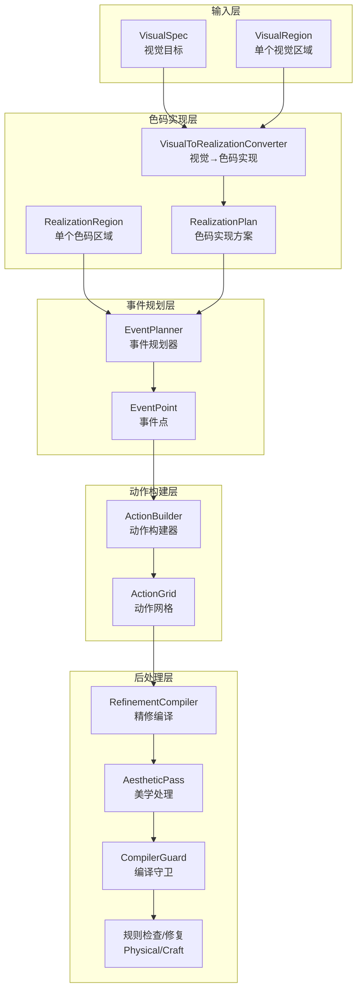
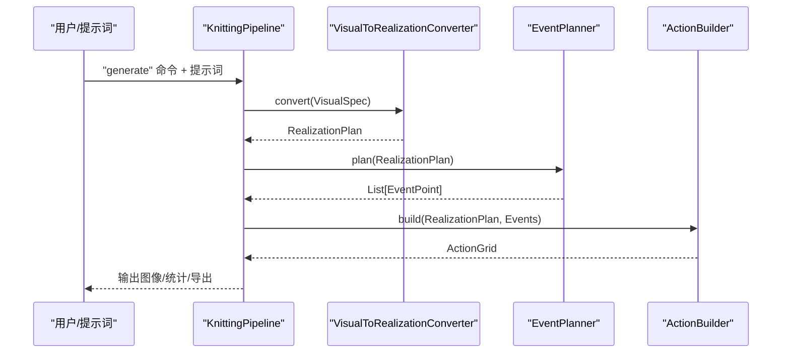
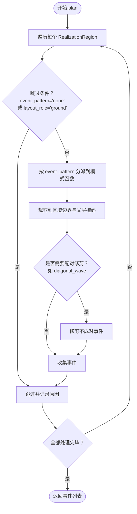
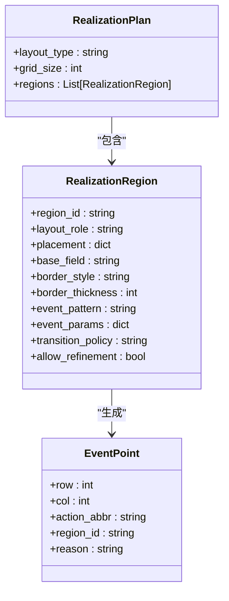
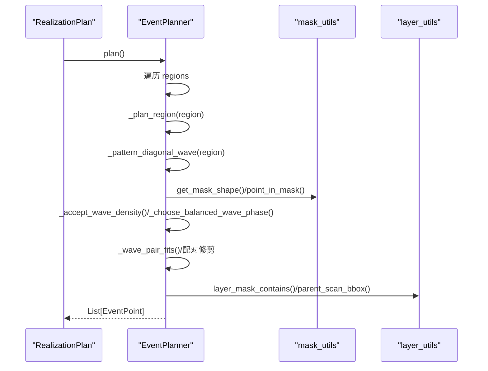
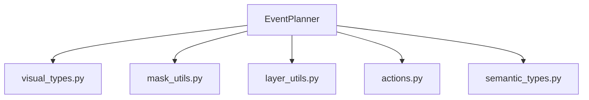

# 事件规划算法

<cite>
**本文引用的文件**
- [event_planner.py](file://generator_one/generation/event_planner.py)
- [visual_types.py](file://generator_one/generation/visual_types.py)
- [visual_to_realization.py](file://generator_one/generation/visual_to_realization.py)
- [mask_utils.py](file://generator_one/generation/mask_utils.py)
- [layer_utils.py](file://generator_one/generation/layer_utils.py)
- [pipeline.py](file://generator_one/pipeline.py)
- [actions.py](file://generator_one/core/actions.py)
- [semantic_types.py](file://generator_one/core/semantic_types.py)
- [main.py](file://generator_one/main.py)
</cite>

## 目录
1. [简介](#简介)
2. [项目结构](#项目结构)
3. [核心组件](#核心组件)
4. [架构总览](#架构总览)
5. [详细组件分析](#详细组件分析)
6. [依赖分析](#依赖分析)
7. [性能考虑](#性能考虑)
8. [故障排查指南](#故障排查指南)
9. [结论](#结论)
10. [附录](#附录)

## 简介
本技术文档围绕事件规划算法展开，系统阐述事件规划器在针织图案生成流程中的职责、核心算法实现、事件调度与时间安排策略、冲突与依赖处理机制，以及与色码实现层（visual-to-realization）的衔接关系。文档还提供事件类型的定义、事件优先级排序与依赖关系处理方法、在整体流水线中的位置与作用、使用示例与配置选项，以及性能优化与扩展建议。

## 项目结构
事件规划算法位于生成流水线的第三阶段，承接“视觉目标 → 色码实现”的中间产物（RealizationPlan），输出稀疏的事件点集合（EventPoint）。其上游依赖视觉目标类型与色码实现映射，下游用于构建动作网格并进入后续精修与美学处理阶段。

图表来源
- [pipeline.py:114-189](file://generator_one/pipeline.py#L114-L189)
- [visual_to_realization.py:258-295](file://generator_one/generation/visual_to_realization.py#L258-L295)
- [event_planner.py:33-80](file://generator_one/generation/event_planner.py#L33-L80)
- [visual_types.py:165-196](file://generator_one/generation/visual_types.py#L165-L196)

章节来源
- [pipeline.py:114-189](file://generator_one/pipeline.py#L114-L189)
- [visual_to_realization.py:258-295](file://generator_one/generation/visual_to_realization.py#L258-L295)
- [event_planner.py:33-80](file://generator_one/generation/event_planner.py#L33-L80)
- [visual_types.py:165-196](file://generator_one/generation/visual_types.py#L165-L196)

## 核心组件
- 事件规划器（EventPlanner）：根据 RealizationPlan 生成稀疏 EventPoint 列表，遵循“仿真图效果 → 色码图排列”的规则，确保事件点分布符合几何与布局约束。
- 视觉类型与色码类型：定义视觉目标（VisualSpec/VisualRegion）、色码实现（RealizationPlan/RealizationRegion）与事件点（EventPoint）的数据结构。
- 掩码与层工具：提供几何掩码判断、父层裁剪、扫描边界计算等底层能力，保障事件点在正确区域内生成。
- 动作与语义类型：动作定义与语义分组为事件点的合法性与后续编译提供依据。

章节来源
- [event_planner.py:24-80](file://generator_one/generation/event_planner.py#L24-L80)
- [visual_types.py:77-196](file://generator_one/generation/visual_types.py#L77-L196)
- [mask_utils.py:42-128](file://generator_one/generation/mask_utils.py#L42-L128)
- [layer_utils.py:15-117](file://generator_one/generation/layer_utils.py#L15-L117)
- [actions.py:18-338](file://generator_one/core/actions.py#L18-L338)
- [semantic_types.py:11-198](file://generator_one/core/semantic_types.py#L11-L198)

## 架构总览
事件规划器在流水线中的职责与调用链如下：

图表来源
- [pipeline.py:114-189](file://generator_one/pipeline.py#L114-L189)
- [visual_to_realization.py:258-295](file://generator_one/generation/visual_to_realization.py#L258-L295)
- [event_planner.py:33-80](file://generator_one/generation/event_planner.py#L33-L80)

章节来源
- [pipeline.py:114-189](file://generator_one/pipeline.py#L114-L189)
- [main.py:117-202](file://generator_one/main.py#L117-L202)

## 详细组件分析

### 事件规划器（EventPlanner）
- 输入：RealizationPlan（包含多个 RealizationRegion）
- 输出：稀疏 EventPoint 列表（仅包含必要、局部、有效的动作事件）
- 关键原则：
  - 仅生成真正必要的工艺事件点（极度稀疏）
  - 不在不需要的地方凭空放色块
  - 事件点分布严格遵循“仿真图效果 → 色码图排列”规则
  - 中心、角点等“视觉感知位置”不一定是事件位置

事件规划流程（概要）：
- 遍历每个 RealizationRegion，跳过 event_pattern='none' 或 layout_role='ground' 的区域
- 根据 event_pattern 分派到具体模式函数（如斜向波浪、菱形麻花、网眼等）
- 对生成的事件进行裁剪与配对修剪（如波浪成对、蜂巢配对）
- 最终汇总并记录统计信息

图表来源
- [event_planner.py:33-80](file://generator_one/generation/event_planner.py#L33-L80)
- [event_planner.py:145-175](file://generator_one/generation/event_planner.py#L145-L175)
- [event_planner.py:82-139](file://generator_one/generation/event_planner.py#L82-L139)

章节来源
- [event_planner.py:24-80](file://generator_one/generation/event_planner.py#L24-L80)
- [event_planner.py:145-175](file://generator_one/generation/event_planner.py#L145-L175)
- [event_planner.py:82-139](file://generator_one/generation/event_planner.py#L82-L139)

### 事件类型与参数体系
- 事件类型（event_pattern）：none、diagonal_wave、diamond_side_xfer、panel_center_xfer、column_xfer、lattice_miss、staggered_tuck、honeycomb_tuck、seed_tuck
- 事件参数（event_params）：如周期、相位、偏移、密度分布、边缘衰减、边界保护等
- 事件点（EventPoint）：包含行列坐标、动作缩写（对应动作库 abbr）、所属区域 ID、原因标签

章节来源
- [visual_types.py:127-196](file://generator_one/generation/visual_types.py#L127-L196)
- [visual_to_realization.py:30-138](file://generator_one/generation/visual_to_realization.py#L30-L138)

### 事件调度与时间安排
- 扫描边界与区域裁剪：根据布局角色（ground、allover、side_band、center）与掩码形状，计算事件扫描范围与最终裁剪
- 掩码与层裁剪：利用通用掩码判断与父层裁剪，确保事件仅出现在允许的几何区域内
- 密度与相位：对波浪等事件采用周期、相位与密度分布策略，平衡视觉均匀性与稀疏性

章节来源
- [event_planner.py:821-858](file://generator_one/generation/event_planner.py#L821-L858)
- [event_planner.py:860-954](file://generator_one/generation/event_planner.py#L860-L954)
- [mask_utils.py:42-128](file://generator_one/generation/mask_utils.py#L42-L128)
- [layer_utils.py:27-61](file://generator_one/generation/layer_utils.py#L27-L61)

### 冲突解决与依赖处理
- 波浪成对修剪：在波浪事件中，若分割/集圈配对缺失（如边缘截断），删除孤立项，保证纹理连续性
- 蜂巢配对修剪：对相邻集圈进行一致性检查，剔除不成对项
- 父子层依赖：通过父层裁剪与排除掩码，避免父层纹理事件与子层纹理事件重叠
- 边界保护与边缘衰减：为几何区域设置边界保护与边缘衰减，避免事件压边造成拼块感

章节来源
- [event_planner.py:82-139](file://generator_one/generation/event_planner.py#L82-L139)
- [event_planner.py:427-496](file://generator_one/generation/event_planner.py#L427-L496)
- [visual_to_realization.py:347-385](file://generator_one/generation/visual_to_realization.py#L347-L385)
- [layer_utils.py:64-91](file://generator_one/generation/layer_utils.py#L64-L91)

### 模式函数详解（代表性事件）
- 斜向波浪（diagonal_wave）：基于周期、相位与密度分布生成 f_split/f_tuck 成对事件，支持多种方向与密度策略，并进行配对修剪与边缘锚定控制
- 菱形麻花（diamond_side_xfer）：沿菱形左右骨架边界生成转移事件，避免中心与尖角，保持线结构
- 网眼（lattice_miss）：以床间转移交替表达孔洞结构，避免孤立 miss
- 浮雕集圈（staggered_tuck）：规则化排列的集圈事件，形成浮雕质感
- 蜂巢集圈（honeycomb_tuck）：对闭合几何（如六角形）采用轮廓策略，避免误读为波浪断裂
- 种子针（seed_tuck）：棋盘式集圈，形成种子纹理

章节来源
- [event_planner.py:395-533](file://generator_one/generation/event_planner.py#L395-L533)
- [event_planner.py:183-238](file://generator_one/generation/event_planner.py#L183-L238)
- [event_planner.py:672-699](file://generator_one/generation/event_planner.py#L672-L699)
- [event_planner.py:705-731](file://generator_one/generation/event_planner.py#L705-L731)
- [event_planner.py:737-772](file://generator_one/generation/event_planner.py#L737-L772)
- [event_planner.py:778-797](file://generator_one/generation/event_planner.py#L778-L797)

### 数据模型类图

图表来源
- [visual_types.py:165-196](file://generator_one/generation/visual_types.py#L165-L196)

章节来源
- [visual_types.py:165-196](file://generator_one/generation/visual_types.py#L165-L196)

### 事件规划序列图（以斜向波浪为例）

图表来源
- [event_planner.py:395-533](file://generator_one/generation/event_planner.py#L395-L533)
- [event_planner.py:821-954](file://generator_one/generation/event_planner.py#L821-L954)
- [mask_utils.py:15-128](file://generator_one/generation/mask_utils.py#L15-L128)
- [layer_utils.py:15-61](file://generator_one/generation/layer_utils.py#L15-L61)

章节来源
- [event_planner.py:395-533](file://generator_one/generation/event_planner.py#L395-L533)
- [event_planner.py:821-954](file://generator_one/generation/event_planner.py#L821-L954)

## 依赖分析
事件规划器的关键依赖关系如下：
- 输入类型：RealizationPlan/RealizationRegion/EventPoint
- 几何与掩码：mask_utils 提供形状识别与点在掩码内判断
- 层级与裁剪：layer_utils 提供父层裁剪与扫描边界
- 动作与语义：actions 提供动作属性与语义分组，semantic_types 提供语义类型与张力差评估

图表来源
- [event_planner.py:15-22](file://generator_one/generation/event_planner.py#L15-L22)
- [visual_types.py:13-21](file://generator_one/generation/visual_types.py#L13-L21)
- [mask_utils.py:8-12](file://generator_one/generation/mask_utils.py#L8-L12)
- [layer_utils.py:8-13](file://generator_one/generation/layer_utils.py#L8-L13)
- [actions.py:7-13](file://generator_one/core/actions.py#L7-L13)
- [semantic_types.py:7-8](file://generator_one/core/semantic_types.py#L7-L8)

章节来源
- [event_planner.py:15-22](file://generator_one/generation/event_planner.py#L15-L22)

## 性能考虑
- 稀疏性原则：仅生成必要事件，减少后续编译与渲染负担
- 扫描边界优化：根据布局角色与掩码形状快速定位扫描范围，避免全图遍历
- 参数校验与默认值：在模式函数中尽早进行参数校验与默认值设定，降低异常分支成本
- 配对修剪：在生成阶段即进行波浪/蜂巢配对修剪，减少后期修复成本
- 缓存与启发式：色码实现层具备形状与效果标准化缓存，间接提升事件规划效率

章节来源
- [event_planner.py:403-432](file://generator_one/generation/event_planner.py#L403-L432)
- [visual_to_realization.py:251-257](file://generator_one/generation/visual_to_realization.py#L251-L257)

## 故障排查指南
常见问题与定位要点：
- 事件规划返回 0 事件：检查 region 的 event_pattern 是否为 'none'、layout_role 是否为 'ground'，或参数无效
- 事件越界或跨区域：检查父层裁剪与掩码边界设置，确认 edge_fade 与 border_guard 参数
- 波浪/蜂巢成对缺失：确认配对修剪逻辑是否删除了边缘或排除掩码内的配对项
- 无纹理事件：确认色码实现层是否为该效果/形状生成了事件模式

章节来源
- [event_planner.py:69-76](file://generator_one/generation/event_planner.py#L69-L76)
- [event_planner.py:82-139](file://generator_one/generation/event_planner.py#L82-L139)
- [visual_to_realization.py:347-385](file://generator_one/generation/visual_to_realization.py#L347-L385)

## 结论
事件规划算法通过严格的稀疏性原则与几何/层级约束，将色码实现方案转化为高效、可解释的事件点集合。其与色码实现层的紧密协作确保了从视觉目标到可执行动作网格的正确映射，同时通过配对修剪与边界保护维持了纹理的一致性与美观性。在流水线中，事件规划器处于承上启下的关键位置，直接影响后续动作构建与后处理的质量与效率。

## 附录

### 在流水线中的位置与作用
- 位置：第三阶段（视觉 → 色码实现 → 事件规划 → 动作构建）
- 作用：将稀疏事件点注入动作网格，为后续精修与美学处理提供基础

章节来源
- [pipeline.py:139-142](file://generator_one/pipeline.py#L139-L142)

### 使用示例与配置选项
- 命令行示例：参考主入口脚本中的 generate/random 子命令与参数
- 关键参数：
  - 禁用精修：--no-refinement
  - 禁用美学：--no-aesthetic
  - 禁用 LLM 修复：--no-repair
  - 保存中间结果：--save-intermediate
  - 指定输出目录与前缀：--output, --prefix
  - 增量修改：--plan-in

章节来源
- [main.py:13-202](file://generator_one/main.py#L13-L202)

### 事件类型与参数参考
- 事件类型（event_pattern）：见“事件类型与参数体系”
- 事件参数（event_params）：周期、相位、偏移、密度分布、边缘衰减、边界保护等
- 动作缩写（action_abbr）：见动作定义与语义分组

章节来源
- [visual_types.py:127-196](file://generator_one/generation/visual_types.py#L127-L196)
- [actions.py:45-338](file://generator_one/core/actions.py#L45-L338)
- [semantic_types.py:11-198](file://generator_one/core/semantic_types.py#L11-L198)