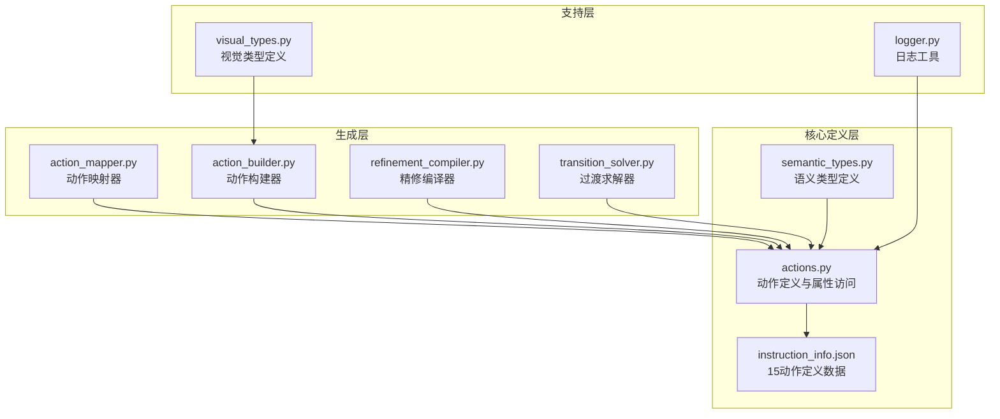
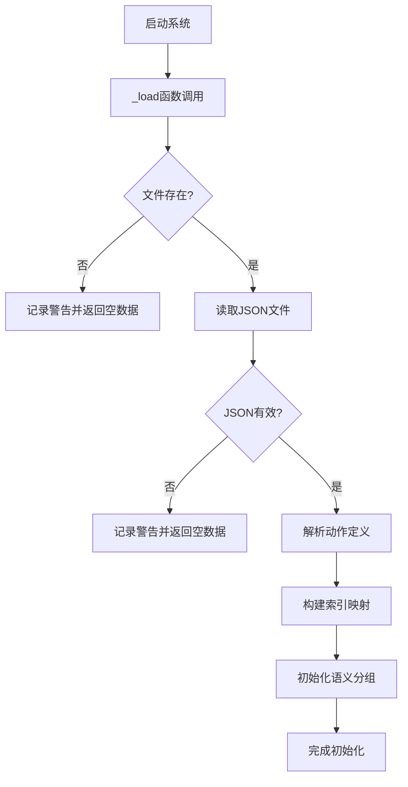
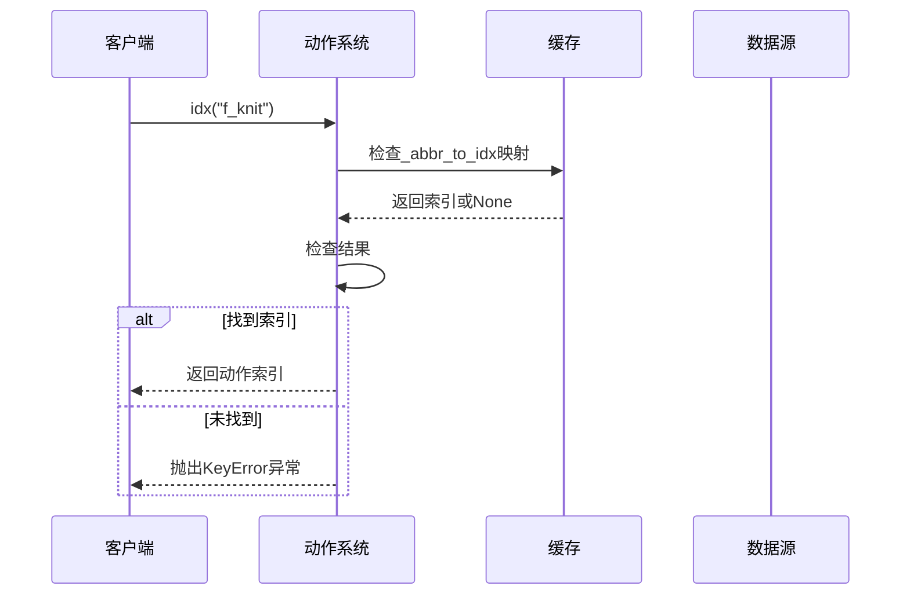
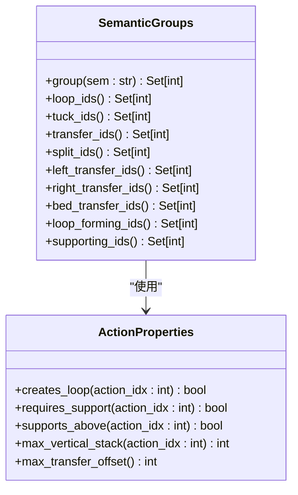
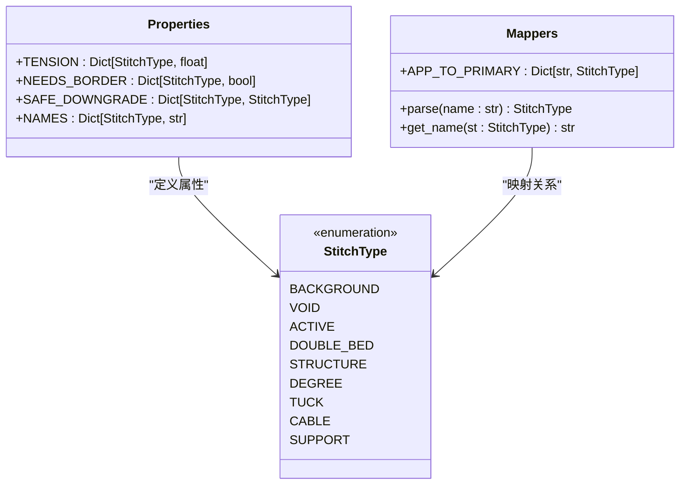
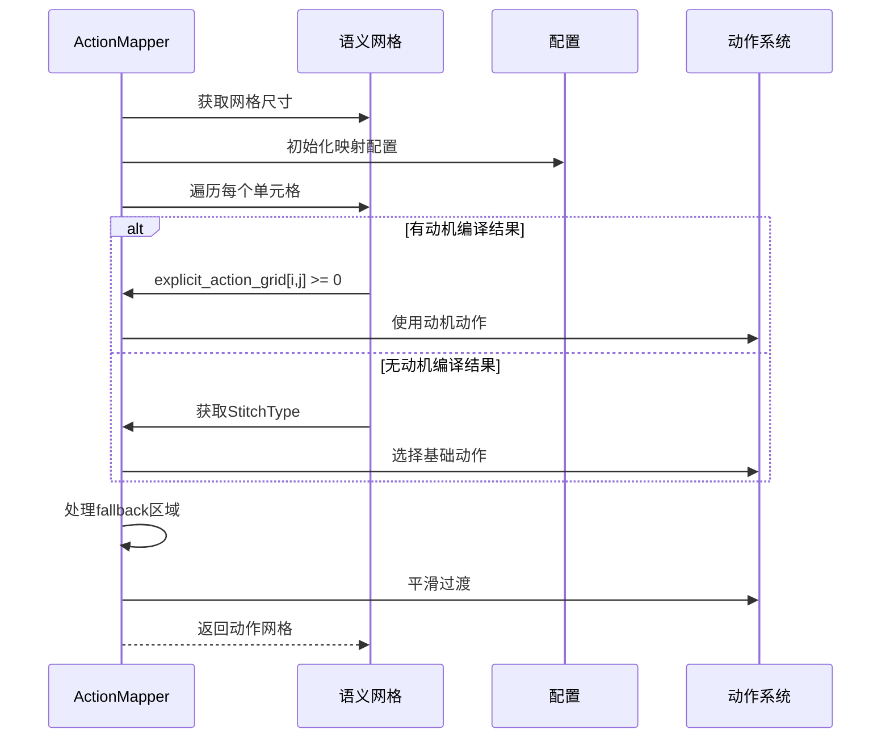
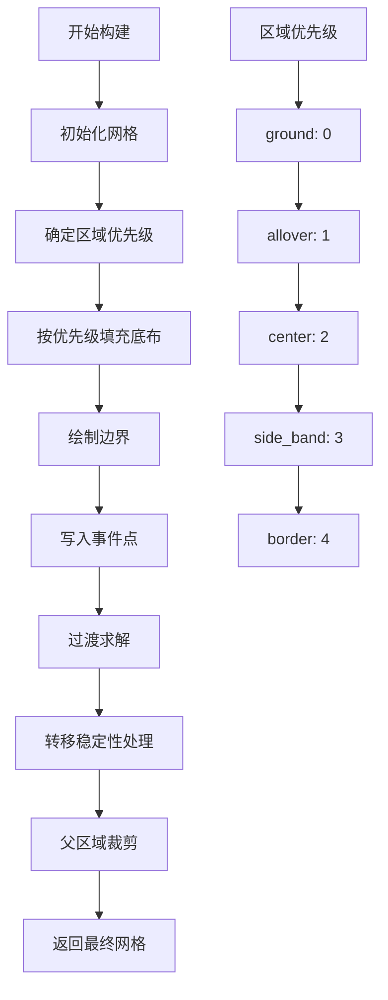
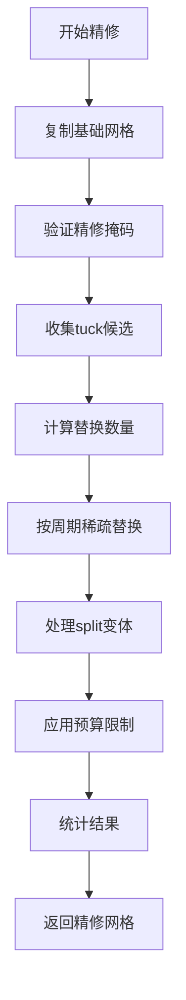
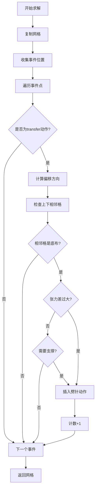
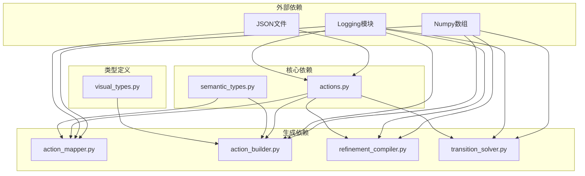

# 动作定义系统

<cite>
**本文档引用的文件**
- [actions.py](file://generator_one/core/actions.py)
- [semantic_types.py](file://generator_one/core/semantic_types.py)
- [instruction_info.json](file://generator_one/data/instruction_info.json)
- [action_mapper.py](file://generator_one/generation/action_mapper.py)
- [action_builder.py](file://generator_one/generation/action_builder.py)
- [refinement_compiler.py](file://generator_one/generation/refinement_compiler.py)
- [transition_solver.py](file://generator_one/generation/transition_solver.py)
- [visual_types.py](file://generator_one/generation/visual_types.py)
- [logger.py](file://generator_one/utils/logger.py)
</cite>

## 目录
1. [简介](#简介)
2. [项目结构](#项目结构)
3. [核心组件](#核心组件)
4. [架构概览](#架构概览)
5. [详细组件分析](#详细组件分析)
6. [依赖关系分析](#依赖关系分析)
7. [性能考虑](#性能考虑)
8. [故障排除指南](#故障排除指南)
9. [结论](#结论)

## 简介

动作定义系统是针织模式生成器的核心基础设施，负责管理15种标准针织动作的完整生命周期。该系统提供统一的动作定义、属性访问、语义分组和验证机制，确保从设计到生产的每个环节都能获得准确、一致的动作信息。

系统采用单一数据源设计，所有其他模块通过核心动作定义层查询动作属性，避免了张力表和颜色表的重复维护。这种设计不仅提高了代码的可维护性，还确保了动作定义的一致性和准确性。

## 项目结构

动作定义系统主要分布在以下目录中：



**图表来源**
- [actions.py:1-338](file://generator_one/core/actions.py#L1-L338)
- [semantic_types.py:1-198](file://generator_one/core/semantic_types.py#L1-L198)
- [instruction_info.json:1-352](file://generator_one/data/instruction_info.json#L1-L352)

**章节来源**
- [actions.py:1-338](file://generator_one/core/actions.py#L1-L338)
- [semantic_types.py:1-198](file://generator_one/core/semantic_types.py#L1-L198)
- [instruction_info.json:1-352](file://generator_one/data/instruction_info.json#L1-L352)

## 核心组件

### 动作定义数据源

系统以JSON格式存储15种标准针织动作的完整定义，包括动作的基本属性、语义分类和机器导出信息。

### 动作属性系统

每个动作都包含以下核心属性：
- **abbr缩写**：动作的简短标识符
- **name名称**：动作的完整名称
- **color颜色**：内部使用的十六进制颜色值
- **bed床层**：动作执行的针床（front/back）
- **offset偏移**：横向移针的偏移量
- **tension张力**：动作的张力等级（1-7）
- **frequency频率**：动作的使用频率等级
- **semantic语义**：动作的语义分类

### 语义分组机制

系统定义了8种语义类型，每种都有特定的属性和行为规则：
- **LOOP**：基础成圈动作，创建线圈并提供支撑
- **TUCK**：集圈动作，保留旧线圈并挂纱
- **TRANSFER**：移针动作，线圈在针床间的转移
- **SPLIT**：劈针动作，用于分离和过渡
- **MISS**：浮针动作，不形成新线圈
- **DROP**：脱圈动作，删除线圈支撑
- **CARRIER**：载体动作，纱线换色控制
- **EMPTY**：逻辑空位，用于支撑和规则检查

**章节来源**
- [instruction_info.json:75-350](file://generator_one/data/instruction_info.json#L75-L350)
- [actions.py:138-186](file://generator_one/core/actions.py#L138-L186)

## 架构概览

动作定义系统采用分层架构设计，确保了清晰的职责分离和良好的扩展性：

```mermaid
graph TB
subgraph "数据层"
A[instruction_info.json<br/>15动作定义]
B[semantic_layer<br/>语义层配置]
end
subgraph "服务层"
C[动作加载器<br/>_load()]
D[属性访问器<br/>info(), abbr(), name(), color_hex()]
E[语义处理器<br/>semantic(), bed(), offset(), tension()]
end
subgraph "缓存层"
F[LRU缓存<br/>_build_semantic_groups()]
G[索引映射<br/>_ABBR_TO_IDX]
end
subgraph "应用层"
H[ActionMapper<br/>动作映射]
I[ActionBuilder<br/>动作构建]
J[RefinementCompiler<br/>精修编译]
K[TransitionSolver<br/>过渡求解]
end
A --> C
B --> C
C --> D
D --> E
E --> F
E --> G
F --> H
G --> H
F --> I
G --> I
F --> J
G --> J
F --> K
G --> K
```

**图表来源**
- [actions.py:18-338](file://generator_one/core/actions.py#L18-L338)
- [action_mapper.py:43-107](file://generator_one/generation/action_mapper.py#L43-L107)
- [action_builder.py:35-118](file://generator_one/generation/action_builder.py#L35-L118)

## 详细组件分析

### 动作定义核心（actions.py）

动作定义核心是整个系统的基础，提供了完整的动作管理和查询接口。

#### 数据加载与初始化

系统通过`_load()`函数从JSON文件加载动作定义，支持文件不存在和JSON解析错误的健壮性处理：



**图表来源**
- [actions.py:18-30](file://generator_one/core/actions.py#L18-L30)

#### 动作索引查找机制

系统提供了两种索引查找方法：

1. **严格查找（idx）**：找不到动作时抛出异常
2. **安全查找（idx_safe）**：找不到动作时返回默认值



**图表来源**
- [actions.py:50-59](file://generator_one/core/actions.py#L50-L59)

#### 属性访问方法

系统提供了丰富的属性访问方法，涵盖动作的所有属性：

| 属性类型 | 访问方法 | 返回值 | 默认值 |
|---------|---------|--------|--------|
| 基本属性 | abbr(), name() | 字符串 | "unknown" |
| 颜色属性 | color_hex(), color_rgb() | 颜色值 | "#000000" |
| 机器属性 | machine_color_hex(), machine_action_id() | 机器信息 | 自动推断 |
| 物理属性 | bed(), offset(), tension() | 物理参数 | 适当默认值 |
| 语义属性 | semantic(), is_variant() | 语义信息 | 空字符串 |

#### 语义分组功能

系统实现了动态语义分组，支持按语义类型快速筛选动作：



**图表来源**
- [actions.py:197-242](file://generator_one/core/actions.py#L197-L242)

**章节来源**
- [actions.py:18-338](file://generator_one/core/actions.py#L18-L338)

### 语义类型系统（semantic_types.py）

语义类型系统提供了更高层次的抽象，将动作归类到9种StitchType枚举中：



**图表来源**
- [semantic_types.py:11-198](file://generator_one/core/semantic_types.py#L11-L198)

**章节来源**
- [semantic_types.py:1-198](file://generator_one/core/semantic_types.py#L1-L198)

### 动作映射器（action_mapper.py）

动作映射器负责将语义网格转换为动作网格，支持动机编译结果的优先覆盖：



**图表来源**
- [action_mapper.py:68-107](file://generator_one/generation/action_mapper.py#L68-L107)

**章节来源**
- [action_mapper.py:1-246](file://generator_one/generation/action_mapper.py#L1-L246)

### 动作构建器（action_builder.py）

动作构建器实现了复杂的动作生成流程，包括底布填充、边界绘制、事件点写入和过渡求解：



**图表来源**
- [action_builder.py:43-118](file://generator_one/generation/action_builder.py#L43-L118)

**章节来源**
- [action_builder.py:1-603](file://generator_one/generation/action_builder.py#L1-L603)

### 精修编译器（refinement_compiler.py）

精修编译器负责在基础动作网格上进行稀疏、受控的低频动作替换：



**图表来源**
- [refinement_compiler.py:48-181](file://generator_one/generation/refinement_compiler.py#L48-L181)

**章节来源**
- [refinement_compiler.py:1-184](file://generator_one/generation/refinement_compiler.py#L1-L184)

### 过渡求解器（transition_solver.py）

过渡求解器实现了基于相邻关系的局部过渡插入机制：



**图表来源**
- [transition_solver.py:37-109](file://generator_one/generation/transition_solver.py#L37-L109)

**章节来源**
- [transition_solver.py:1-110](file://generator_one/generation/transition_solver.py#L1-L110)

## 依赖关系分析

动作定义系统展现了良好的模块化设计，各组件之间的依赖关系清晰明确：



**图表来源**
- [actions.py:12-13](file://generator_one/core/actions.py#L12-L13)
- [action_mapper.py:16-22](file://generator_one/generation/action_mapper.py#L16-L22)
- [action_builder.py:15-23](file://generator_one/generation/action_builder.py#L15-L23)

**章节来源**
- [actions.py:1-338](file://generator_one/core/actions.py#L1-L338)
- [action_mapper.py:1-246](file://generator_one/generation/action_mapper.py#L1-L246)
- [action_builder.py:1-603](file://generator_one/generation/action_builder.py#L1-L603)

## 性能考虑

### 缓存策略

系统采用了多层次的缓存机制来优化性能：

1. **LRU缓存**：语义分组结果缓存，避免重复计算
2. **索引映射**：动作缩写到索引的快速查找
3. **属性缓存**：常用属性的内存缓存

### 内存优化

- 使用集合(set)而非列表(list)进行动作索引存储
- 采用生成器表达式减少中间对象创建
- 合理的数据类型选择（uint8用于动作网格）

### 计算复杂度

- 动作索引查找：O(1)平均时间复杂度
- 语义分组构建：O(N)时间复杂度，其中N为动作总数
- 属性访问：O(1)时间复杂度

## 故障排除指南

### 常见问题及解决方案

#### 动作定义文件问题

**问题**：instruction_info.json文件不存在或格式错误
**解决方案**：
1. 检查文件路径配置
2. 验证JSON格式的有效性
3. 使用默认配置回退

#### 动作查找失败

**问题**：使用idx()方法查找不存在的动作缩写
**解决方案**：
1. 使用idx_safe()方法进行安全查找
2. 检查动作缩写拼写
3. 验证动作定义文件完整性

#### 性能问题

**问题**：语义分组构建缓慢
**解决方案**：
1. 检查缓存配置
2. 优化动作数量
3. 考虑懒加载策略

#### 颜色转换错误

**问题**：十六进制颜色值格式不正确
**解决方案**：
1. 验证颜色值格式(#RRGGBB)
2. 检查颜色值长度
3. 使用默认颜色值回退

**章节来源**
- [actions.py:22-27](file://generator_one/core/actions.py#L22-L27)
- [actions.py:118-127](file://generator_one/core/actions.py#L118-L127)
- [logger.py:9-49](file://generator_one/utils/logger.py#L9-L49)

## 结论

动作定义系统通过精心设计的架构和实现，成功地将15种针织动作的定义、管理和使用整合在一个统一的框架中。系统的主要优势包括：

1. **单一数据源**：确保动作定义的一致性和准确性
2. **模块化设计**：清晰的职责分离和良好的扩展性
3. **健壮性**：完善的错误处理和回退机制
4. **性能优化**：多层次的缓存和优化策略
5. **语义抽象**：从具体动作到语义类型的完整抽象层次

该系统为针织模式生成器提供了坚实的基础，支持从简单的成圈动作到复杂的绞花和移针操作，满足了现代针织生产的需求。通过持续的优化和扩展，系统将继续为针织艺术的发展提供技术支持。