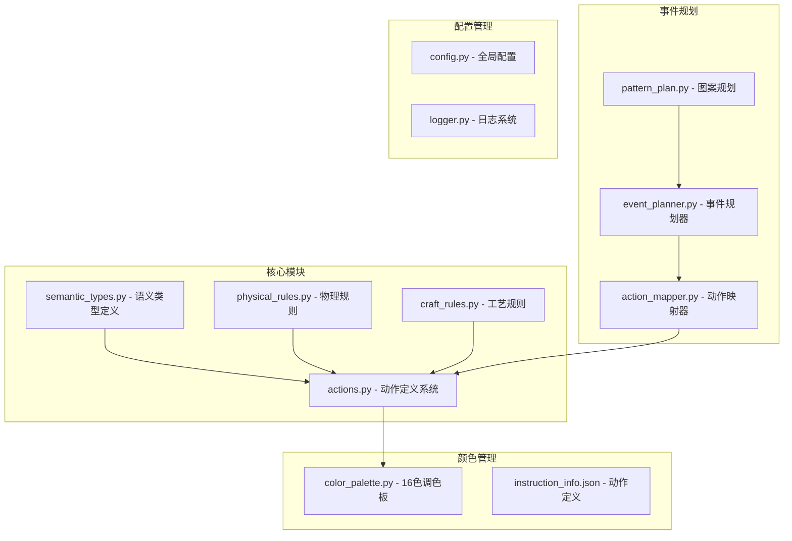
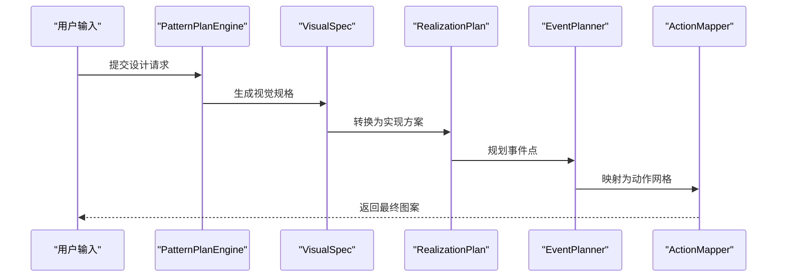
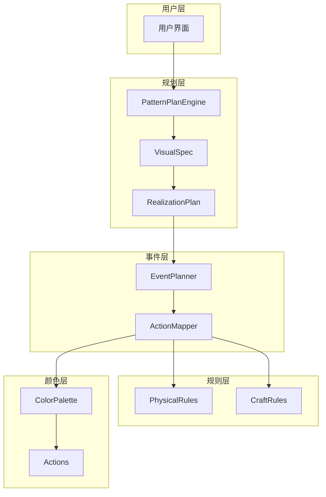
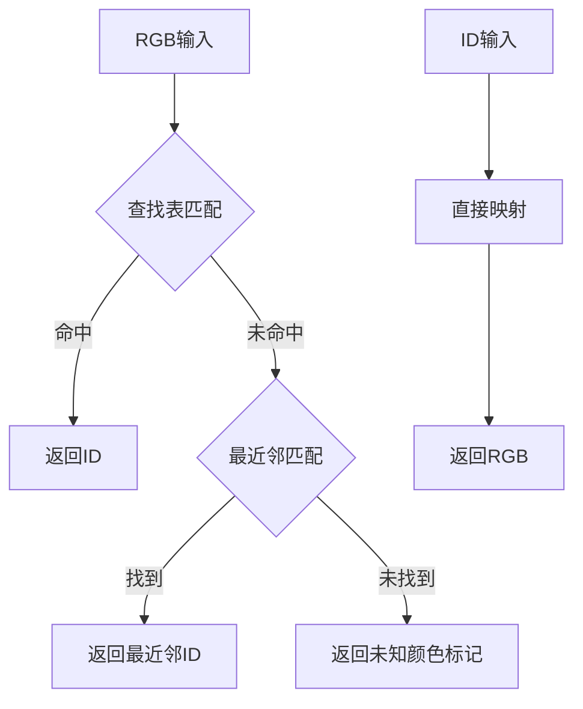
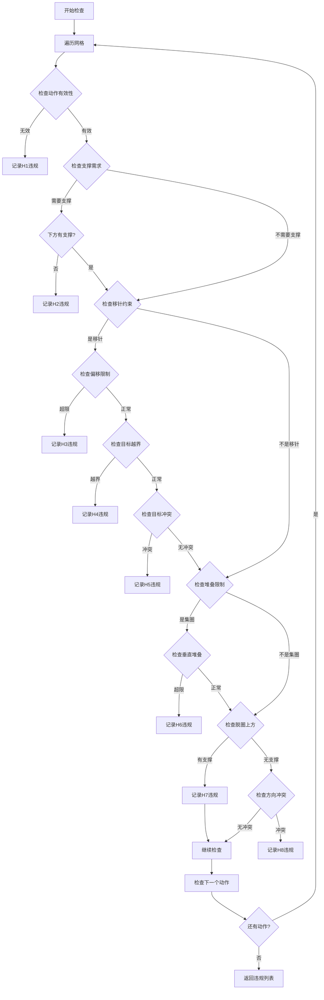
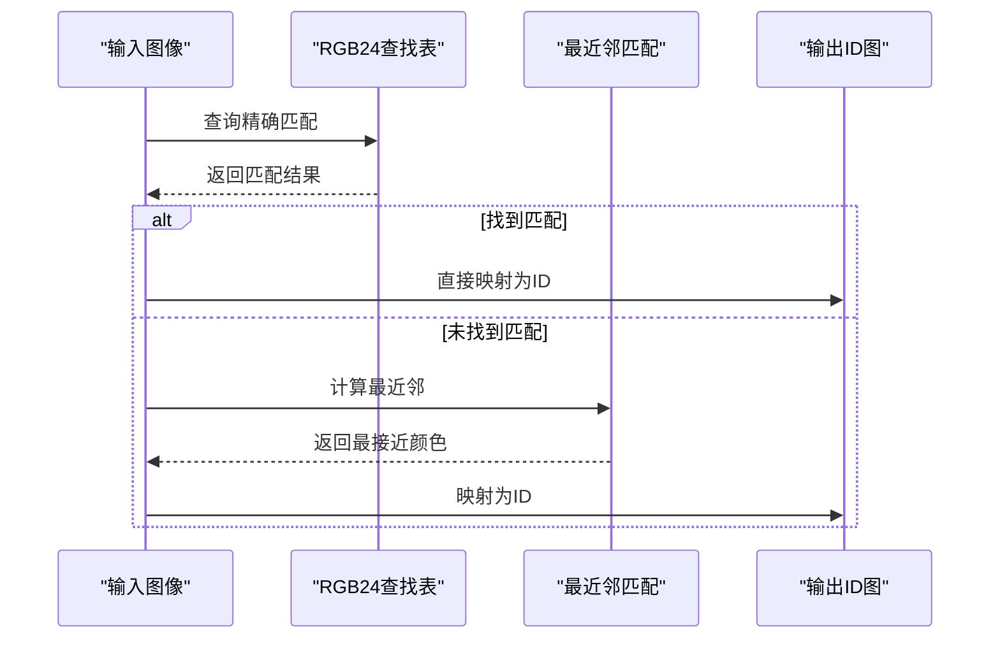
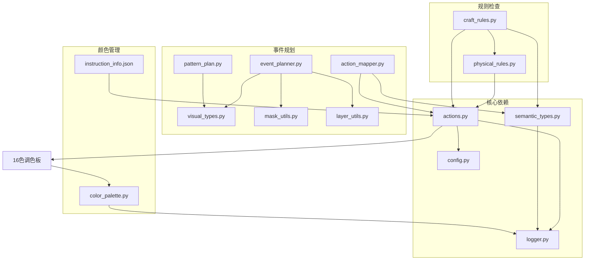

# 核心模块详解

## 目录
1. [简介](#简介)
2. [项目结构](#项目结构)
3. [核心组件](#核心组件)
4. [架构概览](#架构概览)
5. [详细组件分析](#详细组件分析)
6. [依赖关系分析](#依赖关系分析)
7. [性能考虑](#性能考虑)
8. [故障排除指南](#故障排除指南)
9. [结论](#结论)

## 简介

本文档深入解析针织图案生成器的核心模块，涵盖动作定义系统、颜色管理、规则检查机制和事件规划算法的完整实现。系统采用15色动作定义和16色调色板管理，结合严格的物理约束和制造规则检查，确保生成的针织图案既美观又可生产。

## 项目结构

该项目采用模块化设计，核心功能分布在以下主要模块中：

**图表来源**
- [actions.py:1-338](file://generator_one/core/actions.py#L1-L338)
- [color_palette.py:1-186](file://data/color_palette.py#L1-L186)
- [event_planner.py:1-800](file://generator_one/generation/event_planner.py#L1-L800)

**章节来源**
- [config.py:1-76](file://generator_one/config.py#L1-L76)
- [logger.py:1-52](file://generator_one/utils/logger.py#L1-L52)

## 核心组件

### 动作定义系统

动作定义系统是整个系统的基础，负责管理和查询所有可用的针织动作。系统支持15种不同的动作，每种动作都有明确的语义分类和属性定义。

#### 动作分类体系

系统将动作分为以下语义类别：

- **LOOP（成圈）**：基础线圈动作，构成织物主体
- **TUCK（集圈）**：保留旧线圈并挂纱，形成凸起纹理
- **TRANSFER（移针）**：将线圈从一个针床转移到另一个针床
- **SPLIT（劈针）**：用于分离、过渡和局部结构重组
- **EMPTY（空针）**：不织动作，用作安全背景
- **DROP（脱圈）**：删除线圈支撑，用于收针

#### 颜色管理系统

系统实现了完整的颜色管理机制，包括：

- **内部颜色映射**：使用RGB值进行精确的颜色识别
- **机器导出色值**：为不同机器软件提供专用的颜色映射
- **快速查找表**：使用RGB24查找表实现高效的颜色转换

**章节来源**
- [actions.py:75-100](file://generator_one/core/actions.py#L75-L100)
- [color_palette.py:12-71](file://data/color_palette.py#L12-L71)

### 规则检查机制

系统实现了双重规则检查机制，确保生成的图案既符合工艺要求又满足物理约束。

#### 物理规则（硬性约束）

物理规则是不可妥协的约束条件：

- **H1：非法动作索引** - 检查动作索引的有效性
- **H2：物理支撑** - 确保线圈下方有足够的支撑
- **H3：移针偏移限制** - 控制移针的最大横向偏移
- **H4：目标越界** - 防止移针目标超出网格范围
- **H5：目标冲突** - 避免同一行内移针目标冲突
- **H6：垂直堆叠限制** - 控制集圈动作的垂直堆叠高度
- **H7：上方清空** - 确保脱圈上方区域为空
- **H8：方向冲突** - 防止同一行内相反方向的床间移针

#### 工艺规则（软性约束）

工艺规则影响织物质量但不导致机器损坏：

- **C1：front/back循环切换** - 防止同列前后床循环直接切换
- **C2：负载不平衡** - 平衡左右位移的负载
- **C3：支撑不足** - 确保含床间移针的行有足够的支撑
- **C4：区域边框缺失** - 为CABLE/TUCK区域提供结构边框
- **C5：相邻VOID未隔离** - 隔离相邻的镂空区域
- **C6：TUCK与CABLE相邻** - 在两者之间插入缓冲结构

**章节来源**
- [physical_rules.py:23-159](file://generator_one/rules/physical_rules.py#L23-L159)
- [craft_rules.py:34-166](file://generator_one/rules/craft_rules.py#L34-L166)

### 事件规划算法

事件规划器负责将视觉目标转换为具体的工艺事件点，采用稀疏化策略确保只生成必要的工艺事件。

#### 事件规划流程

**图表来源**
- [pattern_plan.py:319-351](file://generator_one/generation/pattern_plan.py#L319-L351)
- [event_planner.py:33-80](file://generator_one/generation/event_planner.py#L33-L80)

**章节来源**
- [event_planner.py:24-80](file://generator_one/generation/event_planner.py#L24-L80)

## 架构概览

系统采用分层架构设计，从视觉目标到最终的工艺实现：

**图表来源**
- [pattern_plan.py:175-351](file://generator_one/generation/pattern_plan.py#L175-L351)
- [event_planner.py:24-80](file://generator_one/generation/event_planner.py#L24-L80)

## 详细组件分析

### 动作定义系统深度分析

#### 数据结构设计

动作定义系统采用JSON配置文件存储所有动作信息，每个动作包含以下关键字段：

- **abbr**：动作缩写标识符
- **semantic**：语义分类
- **bed/from_bed/to_bed**：针床信息
- **offset**：横向偏移量
- **color/machine_color**：颜色定义
- **tension/elasticity/stability**：工艺属性等级

#### 颜色映射机制

系统实现了多层次的颜色映射机制：

**图表来源**
- [color_palette.py:72-131](file://data/color_palette.py#L72-L131)

#### 调色板构建算法

系统提供两种调色板构建方法：

1. **内部调色板**：用于生成和仿真，包含256个颜色槽位
2. **机器调色板**：用于机器导出，同样包含256个颜色槽位

调色板构建过程：
- 使用默认背景色填充整个数组
- 将动作颜色按索引位置映射到对应槽位
- 最后一个槽位固定为白色

**章节来源**
- [actions.py:256-275](file://generator_one/core/actions.py#L256-L275)
- [color_palette.py:168-186](file://data/color_palette.py#L168-L186)

### 规则检查机制详细分析

#### 物理规则检查流程

**图表来源**
- [physical_rules.py:36-159](file://generator_one/rules/physical_rules.py#L36-L159)

#### 工艺规则检查算法

工艺规则检查采用区域扫描和边界检测相结合的方法：

1. **区域边界检查**：识别CABLE和TUCK区域的边界
2. **相邻区域检测**：使用洪水填充算法识别相邻VOID区域
3. **边框完整性检查**：验证区域周围是否有足够的结构边框

**章节来源**
- [craft_rules.py:173-229](file://generator_one/rules/craft_rules.py#L173-L229)

### 事件规划算法深度分析

#### 事件模式识别

系统支持多种事件模式，每种模式都有特定的几何分布规律：

| 事件模式 | 几何特征 | 应用场景 | 参数配置 |
|---------|---------|---------|---------|
| diamond_side_xfer | 菱形边骨架 | 麻花结构 | cable_pairs, edge_inset |
| diagonal_wave | 斜向波浪 | 波浪纹理 | period_x, period_y, split_col_offset |
| lattice_miss | 网格孔洞 | 镂空结构 | period_x, period_y, stagger |
| honeycomb_tuck | 蜂巢集圈 | 蜂巢纹理 | period_x, period_y, stagger |
| seed_tuck | 种子针 | 种子纹理 | 无特殊参数 |

#### 事件点稀疏化策略

事件规划器采用"极度稀疏"的设计原则：

1. **只生成必要事件**：避免在不需要的地方放置色块
2. **遵循仿真效果规则**：事件点分布严格遵循仿真图效果
3. **视觉感知优化**：中心、角点等视觉重要位置不一定是事件位置

**章节来源**
- [event_planner.py:145-175](file://generator_one/generation/event_planner.py#L145-L175)
- [event_planner.py:395-533](file://generator_one/generation/event_planner.py#L395-L533)

### 颜色调色板系统工作原理

#### 16色调色板架构

系统采用16色调色板管理，支持以下核心功能：

1. **RGB到ID映射**：快速查找颜色对应的ID
2. **ID到RGB映射**：根据ID获取RGB值
3. **快速查找表**：使用RGB24查找表实现O(1)查找
4. **未知颜色处理**：提供最近邻匹配功能

#### 颜色转换流程

**图表来源**
- [color_palette.py:72-131](file://data/color_palette.py#L72-L131)

**章节来源**
- [color_palette.py:12-186](file://data/color_palette.py#L12-L186)

## 依赖关系分析

系统采用清晰的模块化设计，各组件之间的依赖关系如下：

**图表来源**
- [actions.py:12-13](file://generator_one/core/actions.py#L12-L13)
- [physical_rules.py:20-27](file://generator_one/rules/physical_rules.py#L20-L27)

**章节来源**
- [actions.py:1-338](file://generator_one/core/actions.py#L1-L338)
- [craft_rules.py:25-27](file://generator_one/rules/craft_rules.py#L25-L27)

## 性能考虑

### 时间复杂度分析

1. **动作定义系统**：操作均为O(1)，使用字典查找和缓存机制
2. **颜色管理**：RGB24查找表实现O(1)查找，最近邻匹配为O(n)算法
3. **规则检查**：网格遍历O(w*h)，其中w和h为网格宽度和高度
4. **事件规划**：基于几何算法，复杂度取决于事件模式类型

### 空间复杂度优化

1. **内存映射**：使用numpy数组进行高效内存访问
2. **缓存策略**：动作分组使用LRU缓存减少重复计算
3. **查找表**：预构建RGB24查找表避免重复计算

### 并行处理能力

系统支持多线程并行处理，特别是在以下场景：

- 颜色映射的批量处理
- 规则检查的网格并行化
- 事件规划的多模式并行

## 故障排除指南

### 常见问题及解决方案

#### 动作定义错误

**问题**：动作索引超出范围
**解决方案**：检查`instruction_info.json`中的动作定义，确保索引连续且不重复

#### 颜色映射失败

**问题**：未知颜色过多导致图案异常
**解决方案**：检查调色板配置，使用最近邻匹配功能

#### 规则检查失败

**问题**：物理规则违规导致生成失败
**解决方案**：查看违规详情，按照建议修改图案设计

#### 事件规划异常

**问题**：事件点数量为零
**解决方案**：检查视觉效果参数设置，确保事件模式配置正确

**章节来源**
- [physical_rules.py:32-33](file://generator_one/rules/physical_rules.py#L32-L33)
- [event_planner.py:69-77](file://generator_one/generation/event_planner.py#L69-L77)

## 结论

本系统通过精心设计的动作定义系统、完善的颜色管理机制、严格的规则检查体系和智能的事件规划算法，实现了从视觉设计到可生产图案的完整转换。系统具有以下优势：

1. **模块化设计**：清晰的层次结构便于维护和扩展
2. **严格的质量控制**：双重规则检查确保图案质量和可生产性
3. **高效的性能表现**：优化的数据结构和算法实现
4. **灵活的配置选项**：丰富的参数配置满足不同设计需求

通过合理使用本系统的配置选项和参数，用户可以生成高质量、可生产的针织图案，同时确保生产过程的安全性和效率。