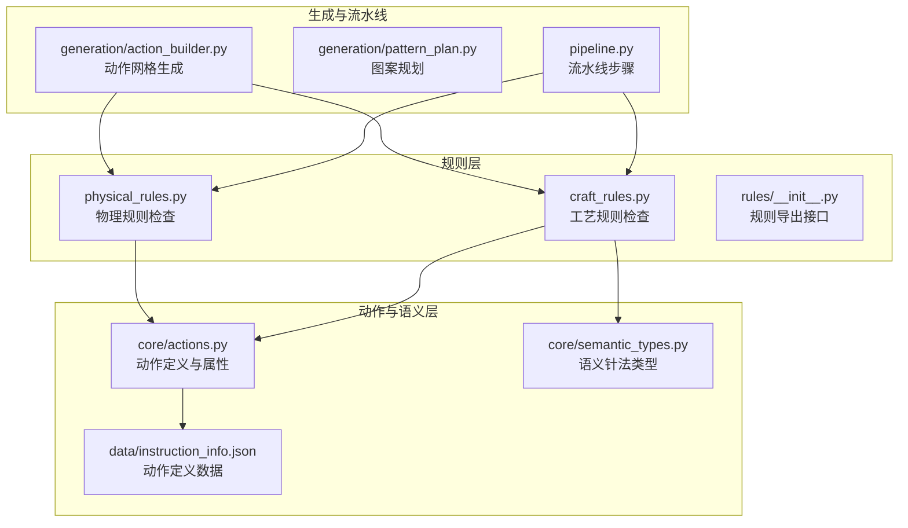
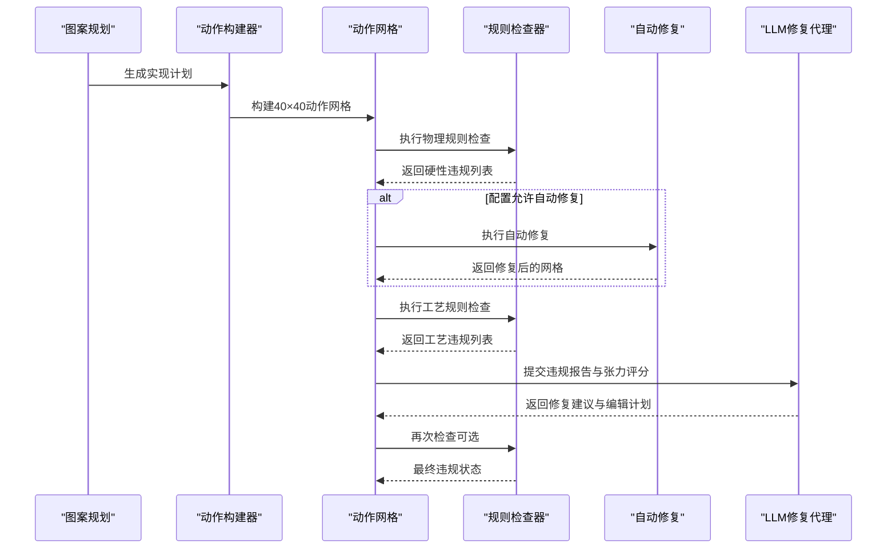
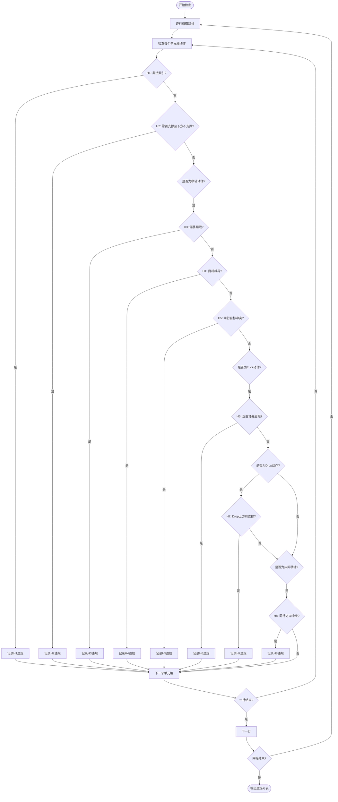
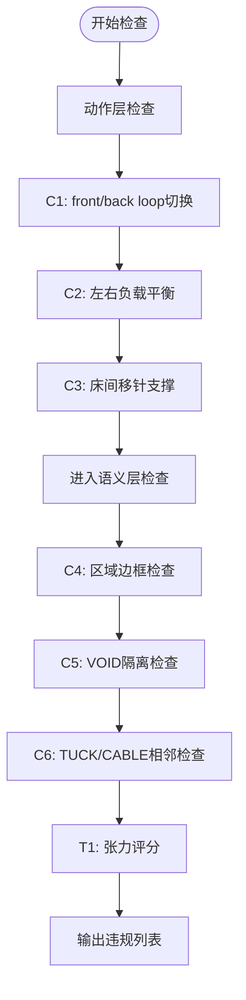
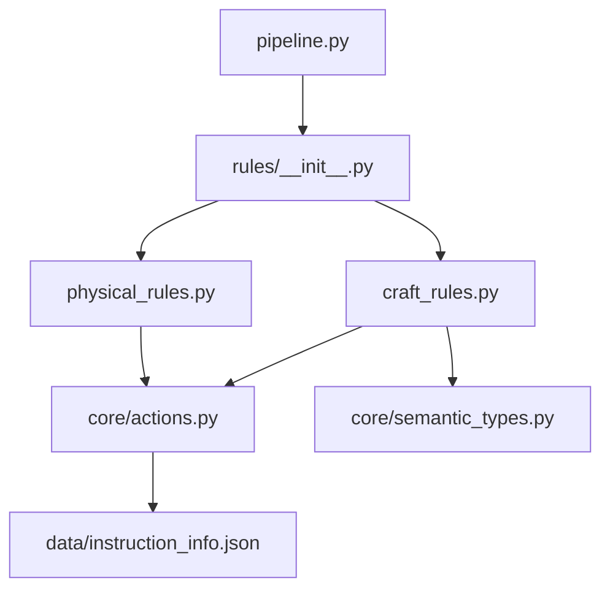

# 规则检查机制

<cite>
**本文档引用的文件**
- [physical_rules.py](file://generator_one/rules/physical_rules.py)
- [craft_rules.py](file://generator_one/rules/craft_rules.py)
- [__init__.py](file://generator_one/rules/__init__.py)
- [actions.py](file://generator_one/core/actions.py)
- [semantic_types.py](file://generator_one/core/semantic_types.py)
- [action_builder.py](file://generator_one/generation/action_builder.py)
- [pattern_plan.py](file://generator_one/generation/pattern_plan.py)
- [pipeline.py](file://generator_one/pipeline.py)
- [instruction_info.json](file://generator_one/data/instruction_info.json)
- [config.py](file://generator_one/config.py)
</cite>

## 目录
1. [简介](#简介)
2. [项目结构](#项目结构)
3. [核心组件](#核心组件)
4. [架构总览](#架构总览)
5. [详细组件分析](#详细组件分析)
6. [依赖关系分析](#依赖关系分析)
7. [性能考虑](#性能考虑)
8. [故障排除指南](#故障排除指南)
9. [结论](#结论)
10. [附录](#附录)

## 简介
本文件系统性阐述针织图案生成器中的规则检查机制，涵盖物理约束规则与制造规则的检查逻辑，包括动作的垂直堆叠限制、横向转移偏移限制、支撑关系验证等。文档详细说明规则检查器的实现原理，包括规则定义、检查算法和违规检测机制；解释不同类型规则的作用范围和优先级；提供规则检查的实际应用场景和配置方法；并包含规则扩展和自定义的开发指南。

## 项目结构
规则检查机制位于 generator_one/rules 目录，配合 core/actions.py 提供动作语义与属性查询，以及 generation/action_builder.py 生成动作网格。pipeline.py 在流水线第7步执行规则检查，并在第8步通过LLM修复代理进行人工修复。

**图表来源**
- [physical_rules.py:1-212](file://generator_one/rules/physical_rules.py#L1-L212)
- [craft_rules.py:1-414](file://generator_one/rules/craft_rules.py#L1-L414)
- [__init__.py:1-9](file://generator_one/rules/__init__.py#L1-L9)
- [actions.py:1-338](file://generator_one/core/actions.py#L1-L338)
- [semantic_types.py:1-198](file://generator_one/core/semantic_types.py#L1-L198)
- [action_builder.py:1-603](file://generator_one/generation/action_builder.py#L1-L603)
- [pattern_plan.py:1-800](file://generator_one/generation/pattern_plan.py#L1-L800)
- [pipeline.py:550-749](file://generator_one/pipeline.py#L550-L749)
- [instruction_info.json:1-352](file://generator_one/data/instruction_info.json#L1-L352)

**章节来源**
- [pipeline.py:552-621](file://generator_one/pipeline.py#L552-L621)
- [rules/__init__.py:1-9](file://generator_one/rules/__init__.py#L1-L9)

## 核心组件
- 物理规则检查器：执行硬性约束检查，如非法动作索引、物理支撑、移针偏移与越界、同行目标冲突、垂直堆叠限制、Drop后上方清空、床间移针方向冲突等。
- 工艺规则检查器：执行非硬性约束检查，如front/back loop直接切换、Cable左右负载不平衡、含床间移针行缺少支撑、语义层连接规则（C4-C6）、张力过渡评分。
- 规则导出接口：统一导出物理与工艺规则的检查函数与自动修复函数，便于流水线调用。
- 动作定义与属性：从 instruction_info.json 加载动作定义，提供语义、床、偏移、张力、频率等属性，支持规则检查所需的动态查询。
- 语义针法类型：定义StitchType枚举及张力、边框需求、名称映射等，支撑语义层规则检查。
- 动作网格生成：ActionBuilder根据实现计划生成40×40动作网格，并进行过渡求解与转移稳定性处理。
- 流水线集成：pipeline.py在第7步执行规则检查，在第8步通过LLM修复代理进行修复。

**章节来源**
- [physical_rules.py:36-159](file://generator_one/rules/physical_rules.py#L36-L159)
- [craft_rules.py:34-166](file://generator_one/rules/craft_rules.py#L34-L166)
- [craft_rules.py:173-229](file://generator_one/rules/craft_rules.py#L173-L229)
- [craft_rules.py:236-253](file://generator_one/rules/craft_rules.py#L236-L253)
- [rules/__init__.py:1-9](file://generator_one/rules/__init__.py#L1-L9)
- [actions.py:18-338](file://generator_one/core/actions.py#L18-L338)
- [semantic_types.py:11-198](file://generator_one/core/semantic_types.py#L11-L198)
- [action_builder.py:43-118](file://generator_one/generation/action_builder.py#L43-L118)
- [pipeline.py:552-621](file://generator_one/pipeline.py#L552-L621)

## 架构总览
规则检查机制贯穿动作网格生成后的流水线阶段，先进行硬性物理规则检查，再进行工艺规则检查。对于硬性规则，可根据配置自动修复；对于工艺规则，可通过LLM修复代理进行更智能的修复。

**图表来源**
- [pipeline.py:552-621](file://generator_one/pipeline.py#L552-L621)
- [physical_rules.py:162-211](file://generator_one/rules/physical_rules.py#L162-L211)
- [craft_rules.py:306-341](file://generator_one/rules/craft_rules.py#L306-L341)

## 详细组件分析

### 物理规则检查器
物理规则检查器负责执行不可妥协的硬性约束，确保织物能够正确成型且不损坏机器。检查内容包括：
- H1：非法动作索引
- H2：线圈下方缺少物理支撑（起针行除外）
- H3：移针横向偏移超限（±2）
- H4：移针目标越界
- H5：同行移针目标冲突
- H6：同列连续Tuck超过堆叠上限
- H7：Drop后上方未清空
- H8：同行床间移针方向冲突

检查算法逐行扫描动作网格，利用动作语义属性（如是否需要支撑、是否支持上方、最大垂直堆叠、最大横向偏移）进行判定。违规以统一的Violation对象记录，包含级别、规则编号、行列坐标、详情与建议。

自动修复策略保守：优先降级为安全动作，无法确定时退化为f_knit。例如，H2通过在下方补b_knit或在miss处插入miss来修复；H3/H4/H5通过替换为f_split；H6通过将Tuck替换为f_knit；H7通过将Drop替换为miss；H8通过将该行所有bed_transfer改为split_v。

**图表来源**
- [physical_rules.py:36-159](file://generator_one/rules/physical_rules.py#L36-L159)

**章节来源**
- [physical_rules.py:36-159](file://generator_one/rules/physical_rules.py#L36-L159)
- [physical_rules.py:162-211](file://generator_one/rules/physical_rules.py#L162-L211)

### 工艺规则检查器
工艺规则检查器负责执行影响织物质量但不会导致机器损坏的规则，可由LLM修复代理进行更智能修复。检查内容包括：
- C1：同列front/back loop直接切换（收紧条件：附近无transfer/split过渡，垂直方向连续≥2行才报）
- C2：Cable左右位移负载不平衡
- C3：含床间移针的行缺少tuck/miss/b_knit支撑
- C4：CABLE/TUCK区域外围缺少STRUCTURE边框（语义层检查）
- C5：相邻VOID区域未隔离（语义层检查）
- C6：TUCK与CABLE直接相邻（语义层检查）
- T1：张力过渡（软约束）

检查算法分为动作层与语义层两部分。动作层检查主要针对动作网格，如C1的front/back切换、C2的左右负载平衡、C3的床间移针支撑；语义层检查针对语义针法网格，如C4-C6的区域边框、隔离与相邻关系。张力评分通过计算相邻动作的张力差来评估过渡的平滑程度。

自动修复策略保守：动作层修复优先使用f_split与b_tuck等主动作；语义层修复通过补STRUCTURE边框、插入STRUCTURE隔离格等方式进行。

**图表来源**
- [craft_rules.py:34-166](file://generator_one/rules/craft_rules.py#L34-L166)
- [craft_rules.py:173-229](file://generator_one/rules/craft_rules.py#L173-L229)
- [craft_rules.py:236-253](file://generator_one/rules/craft_rules.py#L236-L253)

**章节来源**
- [craft_rules.py:34-166](file://generator_one/rules/craft_rules.py#L34-L166)
- [craft_rules.py:173-229](file://generator_one/rules/craft_rules.py#L173-L229)
- [craft_rules.py:236-253](file://generator_one/rules/craft_rules.py#L236-L253)
- [craft_rules.py:306-341](file://generator_one/rules/craft_rules.py#L306-L341)
- [craft_rules.py:260-298](file://generator_one/rules/craft_rules.py#L260-L298)

### 动作定义与属性
动作定义来源于 instruction_info.json，包含15种动作的缩写、语义、床、颜色、机器映射、描述、应用、频率、张力、弹性、稳定性等属性。core/actions.py提供统一的动作查询接口，包括按缩写查找索引、按索引查询属性、语义分组（LOOP/TUCK/TRANSFER/SPLIT/MISS/DROP/CARRIER）、偏移、张力、最大垂直堆叠、最大横向偏移等。

这些属性为规则检查提供了基础数据支撑，如requires_support/supports_above/max_vertical_stack/max_transfer_offset/offset/tension等。

**章节来源**
- [instruction_info.json:13-74](file://generator_one/data/instruction_info.json#L13-L74)
- [instruction_info.json:75-350](file://generator_one/data/instruction_info.json#L75-L350)
- [actions.py:18-338](file://generator_one/core/actions.py#L18-L338)

### 语义针法类型
语义针法类型定义了StitchType枚举（BACKGROUND/VOID/ACTIVE/DOUBLE_BED/STRUCTURE/DEGREE/TUCK/CABLE/SUPPORT），并提供张力值、是否需要边框、名称映射等。这些信息用于语义层规则检查，如C4-C6的边框与隔离要求。

**章节来源**
- [semantic_types.py:11-198](file://generator_one/core/semantic_types.py#L11-L198)

### 动作网格生成
ActionBuilder根据实现计划生成40×40动作网格，包含底布填充、边界绘制、事件点写入、过渡求解、转移稳定性处理、子区域溢出裁剪等步骤。生成的网格随后进入规则检查阶段。

**章节来源**
- [action_builder.py:43-118](file://generator_one/generation/action_builder.py#L43-L118)
- [action_builder.py:422-467](file://generator_one/generation/action_builder.py#L422-L467)

### 流水线集成
pipeline.py在第7步执行规则检查，分别调用check_physical与check_craft_actions，并根据配置决定是否自动修复硬性规则。在第8步，如果存在违规，通过LLM修复代理提出修复建议并应用，最终再次检查以确认修复效果。

**章节来源**
- [pipeline.py:552-621](file://generator_one/pipeline.py#L552-L621)

## 依赖关系分析
规则检查机制的关键依赖关系如下：
- physical_rules.py依赖core/actions.py提供的动作语义与属性查询。
- craft_rules.py依赖core/actions.py与core/semantic_types.py，用于动作层与语义层检查。
- rules/__init__.py统一导出规则检查与自动修复函数，供pipeline.py调用。
- pipeline.py在流水线中串联规则检查与LLM修复代理。
- instruction_info.json提供动作定义数据，被actions.py加载并缓存。

**图表来源**
- [physical_rules.py:20-53](file://generator_one/rules/physical_rules.py#L20-L53)
- [craft_rules.py:24-27](file://generator_one/rules/craft_rules.py#L24-L27)
- [rules/__init__.py:1-9](file://generator_one/rules/__init__.py#L1-L9)
- [actions.py:12-32](file://generator_one/core/actions.py#L12-L32)
- [instruction_info.json:1-12](file://generator_one/data/instruction_info.json#L1-L12)

**章节来源**
- [rules/__init__.py:1-9](file://generator_one/rules/__init__.py#L1-L9)
- [actions.py:12-32](file://generator_one/core/actions.py#L12-L32)

## 性能考虑
- 时间复杂度：物理规则检查为O(R×C)，其中R为行数（40），C为列数（40），整体为常数时间复杂度。工艺规则检查中，C1的front/back切换检查涉及列级状态跟踪，整体仍为O(R×C)。语义层检查中的区域连通性检测（flood-fill）在最坏情况下接近O(R×C)。
- 空间复杂度：主要为动作网格的空间占用O(R×C)，以及临时状态存储（如row_targets、列级状态等）。
- 优化建议：
  - 将动作语义查询结果缓存（如@lru_cache），减少重复查询开销。
  - 在行扫描过程中尽早短路，避免不必要的计算。
  - 对于语义层检查，可考虑预处理或增量更新，减少重复遍历。

[本节为一般性指导，无需特定文件来源]

## 故障排除指南
- 硬性规则违规（H1-H8）：检查动作索引是否在合法范围内，确认支撑关系是否满足，移针偏移与目标是否越界，同行目标是否冲突，垂直堆叠是否超限，Drop上方是否清空，床间移针方向是否冲突。可通过自动修复函数快速定位并修复。
- 工艺规则违规（C1-C6）：检查front/back切换是否频繁且无过渡，Cable左右负载是否平衡，含床间移针的行是否具备支撑，语义区域是否具备边框与隔离，TUCK与CABLE是否直接相邻。可通过LLM修复代理进行更精细的修复。
- 张力评分异常：通过tension_score评估相邻动作的张力差，识别过渡不平滑的区域，结合C1的过渡动作插入进行改善。
- 配置问题：确认auto_fix_physical配置项，以及max_repair_rounds等参数设置，确保规则检查与修复流程按预期执行。

**章节来源**
- [physical_rules.py:162-211](file://generator_one/rules/physical_rules.py#L162-L211)
- [craft_rules.py:306-341](file://generator_one/rules/craft_rules.py#L306-L341)
- [craft_rules.py:236-253](file://generator_one/rules/craft_rules.py#L236-L253)
- [pipeline.py:552-621](file://generator_one/pipeline.py#L552-L621)

## 结论
规则检查机制通过物理规则与工艺规则的协同，确保生成的针织图案既满足机器可执行的硬性约束，又具备良好的织物质量与外观。动作定义与语义层的统一数据源为规则检查提供了可靠的基础。流水线集成使得规则检查与自动修复、LLM修复代理有机结合，形成完整的质量保障体系。未来可在缓存优化、增量更新与语义层预处理等方面进一步提升性能与可扩展性。

[本节为总结性内容，无需特定文件来源]

## 附录

### 规则作用范围与优先级
- 物理规则（H1-H8）：硬性约束，优先级最高，直接影响织物成型与机器安全，必须严格遵守。
- 工艺规则（C1-C6）：软性约束，优先级次之，影响织物质量与外观，可通过LLM修复代理进行修复。
- 张力过渡（T1）：软约束，用于评估过渡平滑度，指导修复策略。

**章节来源**
- [physical_rules.py:6-14](file://generator_one/rules/physical_rules.py#L6-L14)
- [craft_rules.py:18-19](file://generator_one/rules/craft_rules.py#L18-L19)

### 实际应用场景与配置方法
- 场景1：生成基础底布与主体纹理，确保H2支撑关系与H3/H4/H5移针约束满足。
- 场景2：生成Cable与Tuck纹理，注意C2负载平衡与C1切换过渡，必要时插入f_split/b_split。
- 场景3：生成镂空与边框结构，确保C4边框与C5隔离满足，TUCK与CABLE之间插入STRUCTURE或DEGREE。
- 配置方法：通过pipeline配置auto_fix_physical启用自动修复，设置max_repair_rounds控制LLM修复轮次，结合tension_score评估修复效果。

**章节来源**
- [pipeline.py:552-621](file://generator_one/pipeline.py#L552-L621)
- [craft_rules.py:236-253](file://generator_one/rules/craft_rules.py#L236-L253)

### 规则扩展与自定义开发指南
- 新增动作：在instruction_info.json中添加新动作定义，确保语义、床、偏移、张力等属性完整。
- 新增规则：在rules目录新增规则模块，遵循Violation格式与check/auto_fix模式，注册到rules/__init__.py。
- 规则优先级：硬性规则置于物理规则检查器，软性规则置于工艺规则检查器，必要时通过语义层补充。
- 性能优化：利用@lru_cache缓存动作属性查询，减少重复计算；在行扫描中尽早短路；对语义层检查进行预处理或增量更新。

**章节来源**
- [instruction_info.json:13-74](file://generator_one/data/instruction_info.json#L13-L74)
- [rules/__init__.py:1-9](file://generator_one/rules/__init__.py#L1-L9)
- [actions.py:197-338](file://generator_one/core/actions.py#L197-L338)