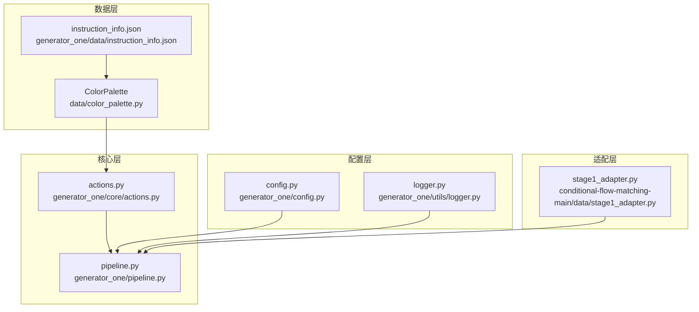
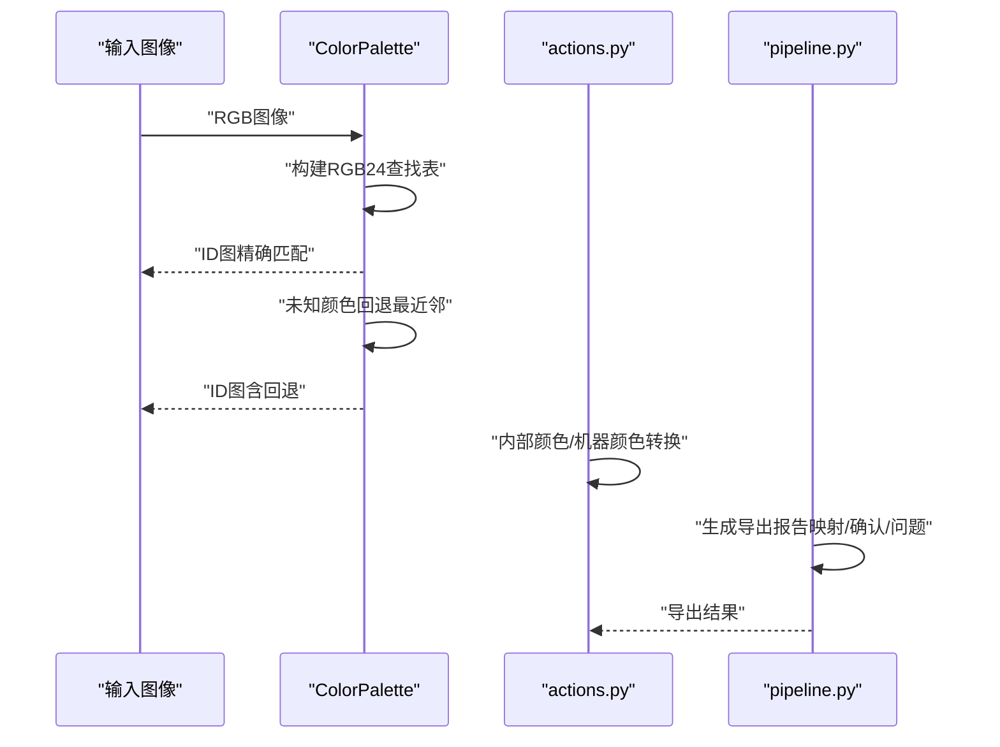
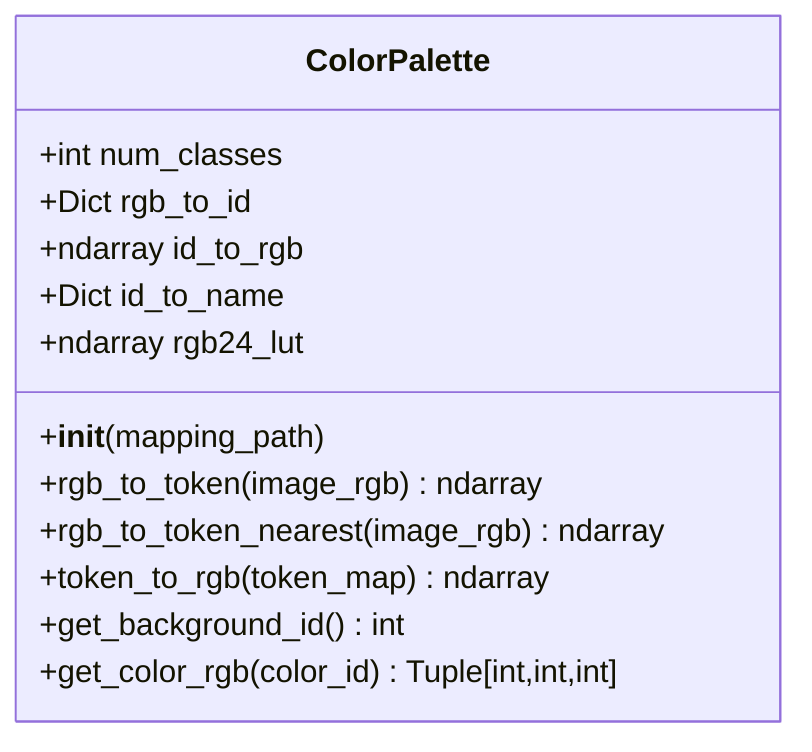
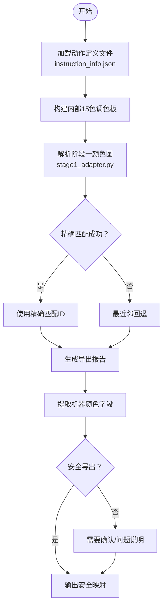
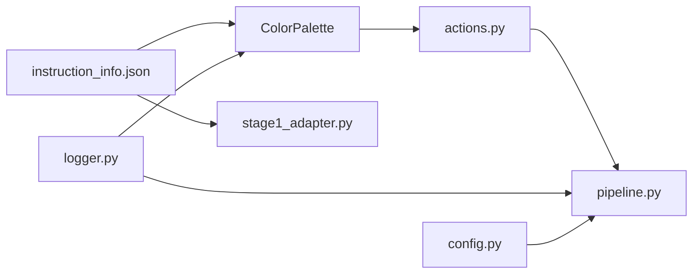

# 颜色管理系统

<cite>
**本文引用的文件**
- [data/color_palette.py](file://data/color_palette.py)
- [data/__init__.py](file://data/__init__.py)
- [generator_one/core/actions.py](file://generator_one/core/actions.py)
- [generator_one/pipeline.py](file://generator_one/pipeline.py)
- [generator_one/data/instruction_info.json](file://generator_one/data/instruction_info.json)
- [conditional-flow-matching-main/data/stage1_adapter.py](file://conditional-flow-matching-main/data/stage1_adapter.py)
- [generator_one/utils/logger.py](file://generator_one/utils/logger.py)
- [generator_one/config.py](file://generator_one/config.py)
</cite>

## 目录
1. [引言](#引言)
2. [项目结构](#项目结构)
3. [核心组件](#核心组件)
4. [架构总览](#架构总览)
5. [详细组件分析](#详细组件分析)
6. [依赖分析](#依赖分析)
7. [性能考虑](#性能考虑)
8. [故障排查指南](#故障排查指南)
9. [结论](#结论)
10. [附录](#附录)

## 引言
本技术文档围绕颜色管理系统展开，重点解释16色调色板的实现原理与应用流程，涵盖颜色定义、RGB转换、调色板构建机制、颜色映射与验证、错误处理策略，以及内部生成与机器导出两套颜色体系的差异与转换逻辑。文档还提供颜色属性访问方法的使用示例与最佳实践，帮助读者在不同阶段正确使用颜色系统。

## 项目结构
颜色管理涉及以下关键模块：
- 数据层：调色板定义与工具，负责从映射文件加载颜色、构建查找表、执行RGB↔ID转换。
- 核心层：动作与导出逻辑，负责将内部颜色与机器颜色进行转换与导出报告生成。
- 配置层：全局配置与日志配置，确保颜色系统运行环境一致。
- 适配层：阶段一颜色图到模拟器条件的确定性适配，支持最近邻回退与采样策略。

**图表来源**
- [data/color_palette.py:12-186](file://data/color_palette.py#L12-L186)
- [generator_one/core/actions.py:84-135](file://generator_one/core/actions.py#L84-L135)
- [generator_one/pipeline.py:686-726](file://generator_one/pipeline.py#L686-L726)
- [generator_one/data/instruction_info.json:1-200](file://generator_one/data/instruction_info.json#L1-L200)
- [conditional-flow-matching-main/data/stage1_adapter.py:1-140](file://conditional-flow-matching-main/data/stage1_adapter.py#L1-L140)
- [generator_one/config.py:1-76](file://generator_one/config.py#L1-L76)
- [generator_one/utils/logger.py:1-52](file://generator_one/utils/logger.py#L1-L52)

**章节来源**
- [data/color_palette.py:12-186](file://data/color_palette.py#L12-L186)
- [generator_one/core/actions.py:84-135](file://generator_one/core/actions.py#L84-L135)
- [generator_one/pipeline.py:686-726](file://generator_one/pipeline.py#L686-L726)
- [generator_one/data/instruction_info.json:1-200](file://generator_one/data/instruction_info.json#L1-L200)
- [conditional-flow-matching-main/data/stage1_adapter.py:1-140](file://conditional-flow-matching-main/data/stage1_adapter.py#L1-L140)
- [generator_one/config.py:1-76](file://generator_one/config.py#L1-L76)
- [generator_one/utils/logger.py:1-52](file://generator_one/utils/logger.py#L1-L52)

## 核心组件
- ColorPalette：负责从映射文件加载颜色，构建RGB24查找表，提供RGB到ID的快速映射与最近邻回退、ID到RGB的反向映射、背景色ID查询与颜色RGB值获取。
- 全局获取函数：通过延迟初始化提供全局单例，首次调用时解析配置中的映射文件路径。
- 内部颜色与机器颜色：动作模块提供内部颜色（用于生成与规则判断）与机器颜色（仅用于导出）的转换接口。
- 导出报告：管道模块根据动作信息生成机器导出报告，包含映射状态、确认需求与问题提示。

**章节来源**
- [data/color_palette.py:12-186](file://data/color_palette.py#L12-L186)
- [generator_one/core/actions.py:84-135](file://generator_one/core/actions.py#L84-L135)
- [generator_one/pipeline.py:686-726](file://generator_one/pipeline.py#L686-L726)

## 架构总览
颜色系统在不同阶段的职责分工如下：
- 内部生成阶段：使用15色调色板（语义驱动）与内部颜色，强调语义一致性与规则判断。
- 机器导出阶段：使用256色调色表（恒强机器色表），将内部颜色映射到机器可识别的颜色，并输出导出报告。

**图表来源**
- [data/color_palette.py:72-131](file://data/color_palette.py#L72-L131)
- [generator_one/core/actions.py:118-135](file://generator_one/core/actions.py#L118-L135)
- [generator_one/pipeline.py:686-726](file://generator_one/pipeline.py#L686-L726)

## 详细组件分析

### ColorPalette 类设计与实现
- 加载与存储
  - 从映射文件读取类别数量、RGB到ID映射、ID到RGB数组、ID到名称映射。
  - 校验映射文件存在性，不存在则抛出异常。
- 查找表构建
  - 构建RGB24快速查找表，将24位RGB键值映射到颜色ID；未在调色板中的颜色映射为-1。
- 图像到ID映射
  - 使用查找表进行O(1)级快速映射；统计未知颜色像素数量，超过阈值发出告警。
  - 提供最近邻回退策略，对未知颜色计算到调色板所有颜色的欧氏距离，选择最近者。
- ID到RGB还原
  - 通过ID到RGB数组进行批量赋值，重建RGB图像。
- 辅助方法
  - 获取背景色ID（默认索引0）、按ID获取RGB值并进行边界校验。

**图表来源**
- [data/color_palette.py:12-186](file://data/color_palette.py#L12-L186)

**章节来源**
- [data/color_palette.py:31-56](file://data/color_palette.py#L31-L56)
- [data/color_palette.py:57-70](file://data/color_palette.py#L57-L70)
- [data/color_palette.py:72-98](file://data/color_palette.py#L72-L98)
- [data/color_palette.py:100-131](file://data/color_palette.py#L100-L131)
- [data/color_palette.py:133-150](file://data/color_palette.py#L133-L150)
- [data/color_palette.py:152-162](file://data/color_palette.py#L152-L162)
- [data/color_palette.py:168-186](file://data/color_palette.py#L168-L186)

### 颜色映射与转换逻辑
- 内部生成使用的15色调色板
  - 来源于语义驱动的动作定义文件，包含15种语义动作及其内部颜色。
  - 适配器模块加载该颜色表，用于阶段一颜色图到模拟器条件的确定性映射。
- 机器导出使用的256色调色板
  - 由动作模块提供机器颜色字段，导出报告中以恒强机器色表颜色呈现。
  - 导出报告区分“安全映射”“需要确认”“未映射”三类，并记录问题说明。
- 转换与验证
  - 十六进制颜色到RGB的转换统一在动作模块完成，包含长度校验与异常回退。
  - 导出阶段通过动作信息决定是否安全导出、是否需要确认、是否存在导出问题。

**图表来源**
- [generator_one/data/instruction_info.json:75-184](file://generator_one/data/instruction_info.json#L75-L184)
- [conditional-flow-matching-main/data/stage1_adapter.py:18-55](file://conditional-flow-matching-main/data/stage1_adapter.py#L18-L55)
- [conditional-flow-matching-main/data/stage1_adapter.py:114-139](file://conditional-flow-matching-main/data/stage1_adapter.py#L114-L139)
- [generator_one/core/actions.py:84-135](file://generator_one/core/actions.py#L84-L135)
- [generator_one/pipeline.py:686-726](file://generator_one/pipeline.py#L686-L726)

**章节来源**
- [generator_one/data/instruction_info.json:1-200](file://generator_one/data/instruction_info.json#L1-L200)
- [conditional-flow-matching-main/data/stage1_adapter.py:18-55](file://conditional-flow-matching-main/data/stage1_adapter.py#L18-L55)
- [conditional-flow-matching-main/data/stage1_adapter.py:114-139](file://conditional-flow-matching-main/data/stage1_adapter.py#L114-L139)
- [generator_one/core/actions.py:84-135](file://generator_one/core/actions.py#L84-L135)
- [generator_one/pipeline.py:686-726](file://generator_one/pipeline.py#L686-L726)

### 颜色属性访问方法与使用示例
- 十六进制值到RGB
  - 步骤：去除前缀、校验长度、分段转十进制。
  - 示例路径：[十六进制到RGB转换:118-127](file://generator_one/core/actions.py#L118-L127)
- 内部颜色与机器颜色
  - 内部颜色：用于生成与规则判断。
  - 机器颜色：仅用于导出，若缺失则回退到内部颜色。
  - 示例路径：[内部颜色与机器颜色转换:84-92](file://generator_one/core/actions.py#L84-L92)
- 颜色验证与错误处理
  - 非法输入时记录告警并回退到黑色。
  - 示例路径：[颜色验证与回退:118-127](file://generator_one/core/actions.py#L118-L127)
- 导出报告字段
  - 包含缩写、数量、内部颜色、导出颜色、安全导出标记、需要确认标记、机器动作ID、机器动作名及问题说明。
  - 示例路径：[导出报告生成:686-726](file://generator_one/pipeline.py#L686-L726)

**章节来源**
- [generator_one/core/actions.py:84-135](file://generator_one/core/actions.py#L84-L135)
- [generator_one/pipeline.py:686-726](file://generator_one/pipeline.py#L686-L726)

### 阶段一颜色图解析与采样
- 颜色表加载
  - 从动作定义文件提取15种内部颜色，构建颜色表。
  - 示例路径：[加载阶段一颜色表:18-35](file://conditional-flow-matching-main/data/stage1_adapter.py#L18-L35)
- 精确匹配与最近邻回退
  - 计算每个像素到颜色表的欧氏距离，选择最小距离；若非精确匹配，打印诊断信息并使用最近邻。
  - 示例路径：[RGB到ID诊断与回退:38-55](file://conditional-flow-matching-main/data/stage1_adapter.py#L38-L55)
- 下采样策略
  - 在保持稀疏动作优先的前提下，对每个块选择高优先级动作或多数动作，避免丢失关键结构。
  - 示例路径：[下采样与优先级策略:58-111](file://conditional-flow-matching-main/data/stage1_adapter.py#L58-L111)

**章节来源**
- [conditional-flow-matching-main/data/stage1_adapter.py:18-55](file://conditional-flow-matching-main/data/stage1_adapter.py#L18-L55)
- [conditional-flow-matching-main/data/stage1_adapter.py:58-111](file://conditional-flow-matching-main/data/stage1_adapter.py#L58-L111)

## 依赖分析
- ColorPalette 依赖映射文件与日志模块，提供RGB↔ID双向映射能力。
- 动作模块依赖映射文件中的颜色定义，提供内部颜色与机器颜色转换。
- 管道模块依赖动作模块的导出信息，生成导出报告。
- 阶段一适配器依赖映射文件中的颜色表，进行确定性映射与回退。

**图表来源**
- [generator_one/data/instruction_info.json:1-200](file://generator_one/data/instruction_info.json#L1-L200)
- [data/color_palette.py:12-186](file://data/color_palette.py#L12-L186)
- [conditional-flow-matching-main/data/stage1_adapter.py:1-140](file://conditional-flow-matching-main/data/stage1_adapter.py#L1-L140)
- [generator_one/core/actions.py:84-135](file://generator_one/core/actions.py#L84-L135)
- [generator_one/pipeline.py:686-726](file://generator_one/pipeline.py#L686-L726)
- [generator_one/utils/logger.py:1-52](file://generator_one/utils/logger.py#L1-L52)
- [generator_one/config.py:1-76](file://generator_one/config.py#L1-L76)

**章节来源**
- [data/color_palette.py:12-186](file://data/color_palette.py#L12-L186)
- [generator_one/core/actions.py:84-135](file://generator_one/core/actions.py#L84-L135)
- [generator_one/pipeline.py:686-726](file://generator_one/pipeline.py#L686-L726)
- [generator_one/data/instruction_info.json:1-200](file://generator_one/data/instruction_info.json#L1-L200)
- [conditional-flow-matching-main/data/stage1_adapter.py:1-140](file://conditional-flow-matching-main/data/stage1_adapter.py#L1-L140)
- [generator_one/utils/logger.py:1-52](file://generator_one/utils/logger.py#L1-L52)
- [generator_one/config.py:1-76](file://generator_one/config.py#L1-L76)

## 性能考虑
- RGB24查找表
  - 使用固定大小的整型数组存储键到ID的映射，内存占用约256^3×2字节≈33MB，但提供O(1)查找性能。
  - 仅对调色板内的颜色有效，未知颜色统一返回-1，便于后续回退处理。
- 最近邻回退
  - 对未知像素计算到全部调色板颜色的欧氏距离，复杂度为O(N×C)，其中N为未知像素数，C为调色板大小。
  - 当未知像素比例较高时，建议优化为KD树或量化空间预索引以降低时间复杂度。
- 导出报告
  - 使用NumPy统计唯一ID与计数，随后遍历生成报告项，整体复杂度与网格大小线性相关。

[本节为通用性能讨论，无需特定文件引用]

## 故障排查指南
- 映射文件缺失
  - 现象：初始化调色板时报错。
  - 排查：确认映射文件路径存在，检查配置中的路径变量。
  - 参考路径：[映射文件加载与异常:33-34](file://data/color_palette.py#L33-L34)
- 未知颜色过多
  - 现象：日志出现大量未知颜色告警。
  - 排查：检查输入图像是否经过预处理，确认颜色表是否与生成阶段一致；必要时启用最近邻回退。
  - 参考路径：[未知颜色统计与告警:91-96](file://data/color_palette.py#L91-L96)
- 颜色格式非法
  - 现象：十六进制颜色转换失败，回退为黑色。
  - 排查：检查颜色字符串长度与格式，确保为6位十六进制。
  - 参考路径：[颜色验证与回退:118-127](file://generator_one/core/actions.py#L118-L127)
- 导出映射问题
  - 现象：导出报告中标记为“未映射”或“需要确认”。
  - 排查：核对动作定义中的机器颜色、机器动作ID与导出安全标记，必要时补充映射或人工确认。
  - 参考路径：[导出报告生成:686-726](file://generator_one/pipeline.py#L686-726)

**章节来源**
- [data/color_palette.py:33-34](file://data/color_palette.py#L33-L34)
- [data/color_palette.py:91-96](file://data/color_palette.py#L91-L96)
- [generator_one/core/actions.py:118-127](file://generator_one/core/actions.py#L118-L127)
- [generator_one/pipeline.py:686-726](file://generator_one/pipeline.py#L686-L726)

## 结论
颜色管理系统通过16色调色板与15/256色双通道体系，在内部生成与机器导出两个阶段实现了清晰的职责分离。ColorPalette提供高效的RGB↔ID映射与回退策略，动作模块与导出报告确保颜色在不同阶段的一致性与可追溯性。配合严格的颜色验证与日志记录，系统能够在复杂图像与多阶段流程中保持稳定性与可维护性。

[本节为总结性内容，无需特定文件引用]

## 附录
- 关键文件清单
  - [data/color_palette.py](file://data/color_palette.py)
  - [generator_one/core/actions.py](file://generator_one/core/actions.py)
  - [generator_one/pipeline.py](file://generator_one/pipeline.py)
  - [generator_one/data/instruction_info.json](file://generator_one/data/instruction_info.json)
  - [conditional-flow-matching-main/data/stage1_adapter.py](file://conditional-flow-matching-main/data/stage1_adapter.py)
  - [generator_one/utils/logger.py](file://generator_one/utils/logger.py)
  - [generator_one/config.py](file://generator_one/config.py)

[本节为概要性内容，无需特定文件引用]