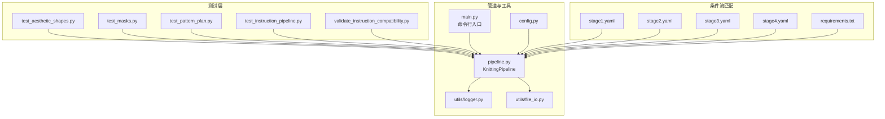
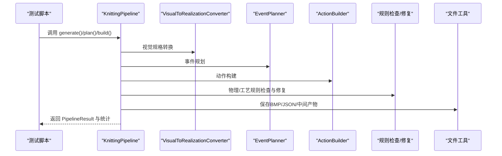
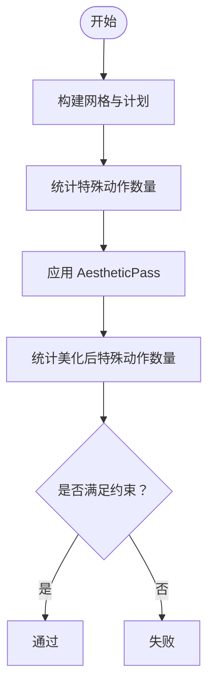
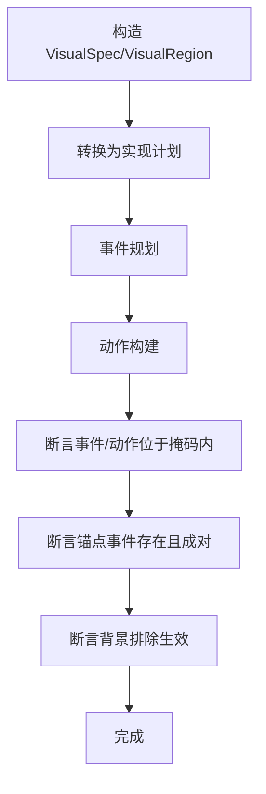
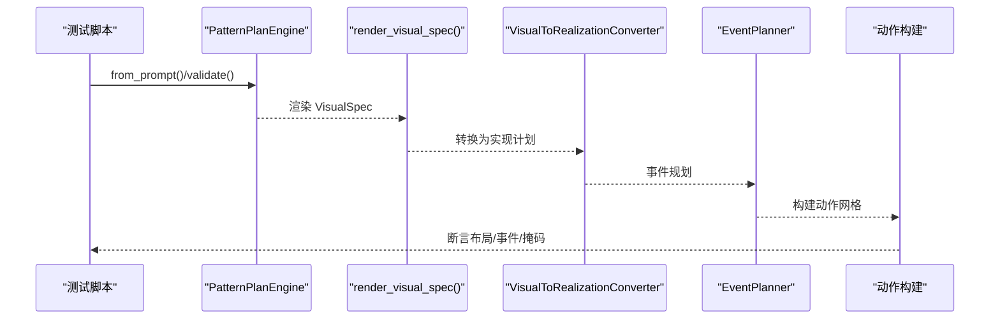
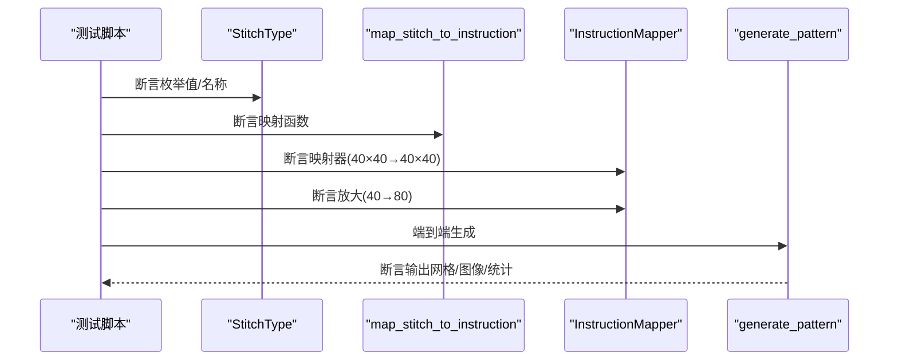
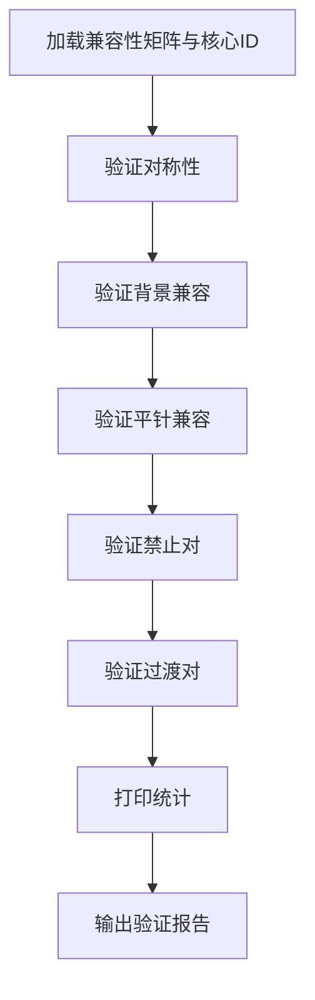
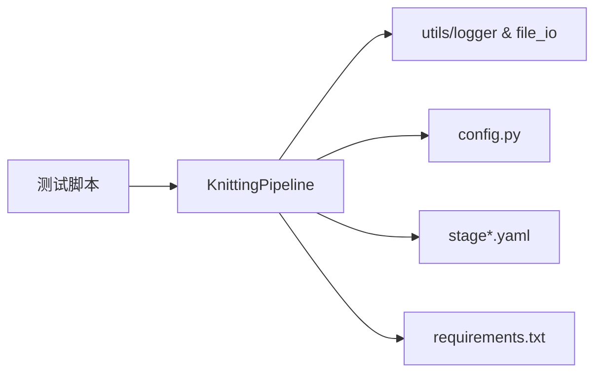

# 测试和验证

<cite>
**本文引用的文件**
- [generator_one/tests/test_aesthetic_shapes.py](file://generator_one/tests/test_aesthetic_shapes.py)
- [generator_one/tests/test_masks.py](file://generator_one/tests/test_masks.py)
- [generator_one/tests/test_pattern_plan.py](file://generator_one/tests/test_pattern_plan.py)
- [generator_one/tests/test_instruction_pipeline.py](file://generator_one/tests/test_instruction_pipeline.py)
- [generator_one/tests/validate_instruction_compatibility.py](file://generator_one/tests/validate_instruction_compatibility.py)
- [generator_one/utils/logger.py](file://generator_one/utils/logger.py)
- [generator_one/utils/file_io.py](file://generator_one/utils/file_io.py)
- [generator_one/pipeline.py](file://generator_one/pipeline.py)
- [generator_one/main.py](file://generator_one/main.py)
- [generator_one/config.py](file://generator_one/config.py)
- [conditional-flow-matching-main/requirements.txt](file://conditional-flow-matching-main/requirements.txt)
- [conditional-flow-matching-main/configs/stage1.yaml](file://conditional-flow-matching-main/configs/stage1.yaml)
- [conditional-flow-matching-main/configs/stage2.yaml](file://conditional-flow-matching-main/configs/stage2.yaml)
- [conditional-flow-matching-main/configs/stage3.yaml](file://conditional-flow-matching-main/configs/stage3.yaml)
- [conditional-flow-matching-main/configs/stage4.yaml](file://conditional-flow-matching-main/configs/stage4.yaml)
</cite>

## 目录
1. [引言](#引言)
2. [项目结构](#项目结构)
3. [核心组件](#核心组件)
4. [架构总览](#架构总览)
5. [详细组件分析](#详细组件分析)
6. [依赖分析](#依赖分析)
7. [性能考虑](#性能考虑)
8. [故障排查指南](#故障排查指南)
9. [结论](#结论)
10. [附录](#附录)

## 引言
本文件面向“测试与验证”主题，系统梳理针织图案生成系统中的测试体系与验证方法，涵盖单元测试、集成测试与兼容性矩阵验证，并给出测试编写指南、最佳实践、质量评估指标与验证标准，以及测试运行方式与结果解读要点。文档同时结合代码库中的测试文件、管道组件与配置，帮助读者快速定位测试入口、理解测试覆盖范围与执行流程。

## 项目结构
测试与验证相关的关键位置如下：
- 单元测试与验证脚本集中在 generator_one/tests 目录，包含针对外观形状美化、掩码几何、图案计划引擎、指令映射与兼容性矩阵的测试。
- 管道与结果保存逻辑位于 generator_one/pipeline.py，提供端到端生成流程与中间产物导出能力，便于集成测试与回归验证。
- 日志与文件工具位于 generator_one/utils，统一的日志与文件保存接口为测试输出与问题定位提供支撑。
- 主入口 generator_one/main.py 提供命令行运行方式，便于批量执行与回归测试。
- 条件流匹配阶段的配置文件与依赖清单位于 conditional-flow-matching-main，用于对照不同阶段的配置与环境一致性。

**图表来源**
- [generator_one/tests/test_aesthetic_shapes.py:1-64](file://generator_one/tests/test_aesthetic_shapes.py#L1-L64)
- [generator_one/tests/test_masks.py:1-349](file://generator_one/tests/test_masks.py#L1-L349)
- [generator_one/tests/test_pattern_plan.py:1-457](file://generator_one/tests/test_pattern_plan.py#L1-L457)
- [generator_one/tests/test_instruction_pipeline.py:1-244](file://generator_one/tests/test_instruction_pipeline.py#L1-L244)
- [generator_one/tests/validate_instruction_compatibility.py:1-196](file://generator_one/tests/validate_instruction_compatibility.py#L1-L196)
- [generator_one/pipeline.py:1-749](file://generator_one/pipeline.py#L1-L749)
- [generator_one/main.py:1-207](file://generator_one/main.py#L1-L207)
- [generator_one/utils/logger.py:1-52](file://generator_one/utils/logger.py#L1-L52)
- [generator_one/utils/file_io.py:1-158](file://generator_one/utils/file_io.py#L1-L158)
- [generator_one/config.py:1-76](file://generator_one/config.py#L1-L76)
- [conditional-flow-matching-main/configs/stage1.yaml](file://conditional-flow-matching-main/configs/stage1.yaml)
- [conditional-flow-matching-main/configs/stage2.yaml](file://conditional-flow-matching-main/configs/stage2.yaml)
- [conditional-flow-matching-main/configs/stage3.yaml](file://conditional-flow-matching-main/configs/stage3.yaml)
- [conditional-flow-matching-main/configs/stage4.yaml](file://conditional-flow-matching-main/configs/stage4.yaml)
- [conditional-flow-matching-main/requirements.txt:1-19](file://conditional-flow-matching-main/requirements.txt#L1-L19)

**章节来源**
- [generator_one/tests/test_aesthetic_shapes.py:1-64](file://generator_one/tests/test_aesthetic_shapes.py#L1-L64)
- [generator_one/tests/test_masks.py:1-349](file://generator_one/tests/test_masks.py#L1-L349)
- [generator_one/tests/test_pattern_plan.py:1-457](file://generator_one/tests/test_pattern_plan.py#L1-L457)
- [generator_one/tests/test_instruction_pipeline.py:1-244](file://generator_one/tests/test_instruction_pipeline.py#L1-L244)
- [generator_one/tests/validate_instruction_compatibility.py:1-196](file://generator_one/tests/validate_instruction_compatibility.py#L1-L196)
- [generator_one/pipeline.py:1-749](file://generator_one/pipeline.py#L1-L749)
- [generator_one/main.py:1-207](file://generator_one/main.py#L1-L207)
- [generator_one/utils/logger.py:1-52](file://generator_one/utils/logger.py#L1-L52)
- [generator_one/utils/file_io.py:1-158](file://generator_one/utils/file_io.py#L1-L158)
- [generator_one/config.py:1-76](file://generator_one/config.py#L1-L76)
- [conditional-flow-matching-main/configs/stage1.yaml](file://conditional-flow-matching-main/configs/stage1.yaml)
- [conditional-flow-matching-main/configs/stage2.yaml](file://conditional-flow-matching-main/configs/stage2.yaml)
- [conditional-flow-matching-main/configs/stage3.yaml](file://conditional-flow-matching-main/configs/stage3.yaml)
- [conditional-flow-matching-main/configs/stage4.yaml](file://conditional-flow-matching-main/configs/stage4.yaml)
- [conditional-flow-matching-main/requirements.txt:1-19](file://conditional-flow-matching-main/requirements.txt#L1-L19)

## 核心组件
- 测试套件与验证脚本
  - 外观形状美化测试：验证不同几何形状与效果组合下，特殊动作数量不会增加。
  - 掩码几何测试：验证圆形、矩形、钻石、六角等形状的掩码判断、密度分布、波纹方向与锚点事件等。
  - 图案计划测试：验证从提示词到可视化规格、再到事件规划与构建的全链路行为，包括嵌套与裁剪、背景排除、角色修复等。
  - 指令映射与管线测试：验证针法枚举、指令映射函数、映射器、放大与端到端管线。
  - 指令兼容性矩阵验证：验证矩阵对称性、背景与平针的兼容性、禁止对与过渡对等。
- 管道与工具
  - KnittingPipeline：封装设计、实现、事件规划、动作构建、优化与规则校验的完整流水线，支持保存中间产物与统计信息。
  - 日志与文件工具：统一日志输出与图像/JSON保存，便于测试结果记录与问题复现。
  - 配置：统一路径、网格尺寸、LLM参数与日志配置。
- 命令行入口：提供 generate/random 子命令，支持禁用某些处理步骤、保存中间结果与增量编辑现有方案。

**章节来源**
- [generator_one/tests/test_aesthetic_shapes.py:31-64](file://generator_one/tests/test_aesthetic_shapes.py#L31-L64)
- [generator_one/tests/test_masks.py:8-349](file://generator_one/tests/test_masks.py#L8-L349)
- [generator_one/tests/test_pattern_plan.py:10-457](file://generator_one/tests/test_pattern_plan.py#L10-L457)
- [generator_one/tests/test_instruction_pipeline.py:22-244](file://generator_one/tests/test_instruction_pipeline.py#L22-L244)
- [generator_one/tests/validate_instruction_compatibility.py:19-196](file://generator_one/tests/validate_instruction_compatibility.py#L19-L196)
- [generator_one/pipeline.py:93-749](file://generator_one/pipeline.py#L93-L749)
- [generator_one/utils/logger.py:9-52](file://generator_one/utils/logger.py#L9-L52)
- [generator_one/utils/file_io.py:74-158](file://generator_one/utils/file_io.py#L74-L158)
- [generator_one/config.py:24-76](file://generator_one/config.py#L24-L76)
- [generator_one/main.py:13-207](file://generator_one/main.py#L13-L207)

## 架构总览
测试与验证围绕“输入描述/配置 → 管道执行 → 结果与统计 → 验证断言”的闭环展开。下图展示典型测试场景与组件交互：

**图表来源**
- [generator_one/pipeline.py:114-189](file://generator_one/pipeline.py#L114-L189)
- [generator_one/pipeline.py:229-244](file://generator_one/pipeline.py#L229-L244)
- [generator_one/pipeline.py:233-235](file://generator_one/pipeline.py#L233-L235)
- [generator_one/pipeline.py:237-243](file://generator_one/pipeline.py#L237-L243)
- [generator_one/pipeline.py:552-575](file://generator_one/pipeline.py#L552-L575)
- [generator_one/utils/file_io.py:74-158](file://generator_one/utils/file_io.py#L74-L158)

## 详细组件分析

### 外观形状美化测试（Aesthetic Pass）
- 设计思路：构造多种几何形状与效果组合，先构建网格，统计特殊动作数量，应用美化后再次统计，断言特殊动作数量不增加。
- 覆盖范围：圆形、矩形、钻石、六角、三角、条纹、柱状、椭圆等形状，波纹/麻花等效果。
- 关键断言：美化后特殊动作计数 ≤ 美化前。
- 测试入口：[test_aesthetic_shapes.py:31-64](file://generator_one/tests/test_aesthetic_shapes.py#L31-L64)

**图表来源**
- [generator_one/tests/test_aesthetic_shapes.py:10-28](file://generator_one/tests/test_aesthetic_shapes.py#L10-L28)
- [generator_one/tests/test_aesthetic_shapes.py:31-64](file://generator_one/tests/test_aesthetic_shapes.py#L31-L64)

**章节来源**
- [generator_one/tests/test_aesthetic_shapes.py:10-64](file://generator_one/tests/test_aesthetic_shapes.py#L10-L64)

### 掩码几何与事件分布测试（Masks & Events）
- 设计思路：针对不同形状（圆形、矩形、钻石、六角、三角等）与参数（密度、波纹方向、边框厚度、裁剪父层等），验证事件与动作均位于掩码内、锚点事件存在且成对、背景排除策略等。
- 覆盖范围：轴对齐矩形判定、中心稠密分布、波纹方向参数、裁剪锚点成对、蜂巢纹理、侧边带宽度、框架内子区域等。
- 关键断言：事件坐标满足 point_in_mask；波纹/蜂窝配对完整性；exclude_masks 生效。
- 测试入口：[test_masks.py:8-349](file://generator_one/tests/test_masks.py#L8-L349)

**图表来源**
- [generator_one/tests/test_masks.py:8-83](file://generator_one/tests/test_masks.py#L8-L83)
- [generator_one/tests/test_masks.py:128-209](file://generator_one/tests/test_masks.py#L128-L209)
- [generator_one/tests/test_masks.py:211-244](file://generator_one/tests/test_masks.py#L211-L244)

**章节来源**
- [generator_one/tests/test_masks.py:8-349](file://generator_one/tests/test_masks.py#L8-L349)

### 图案计划引擎测试（Pattern Plan Engine）
- 设计思路：从自然语言提示词出发，验证渲染后的可视化规格、事件规划与构建、嵌套与裁剪、角色修复、背景排除、重复布局等行为。
- 覆盖范围：提示词编辑、嵌套星形/菱形波纹、全幅重复、框架布局、侧边带修复、三角强调等。
- 关键断言：motif 属性与 parent/role 正确；事件计数与掩码约束；exclude_masks 生效。
- 测试入口：[test_pattern_plan.py:10-457](file://generator_one/tests/test_pattern_plan.py#L10-L457)

**图表来源**
- [generator_one/tests/test_pattern_plan.py:10-57](file://generator_one/tests/test_pattern_plan.py#L10-L57)
- [generator_one/tests/test_pattern_plan.py:59-127](file://generator_one/tests/test_pattern_plan.py#L59-L127)
- [generator_one/tests/test_pattern_plan.py:129-172](file://generator_one/tests/test_pattern_plan.py#L129-L172)

**章节来源**
- [generator_one/tests/test_pattern_plan.py:10-457](file://generator_one/tests/test_pattern_plan.py#L10-L457)

### 指令映射与端到端管线测试（Instruction Pipeline）
- 设计思路：验证针法枚举、映射函数、映射器、放大、端到端生成与输出产物。
- 覆盖范围：枚举值与名称、背景/平针/罗纹/麻花/镂空/边缘映射、40×40→80×80 放大、端到端网格与图像。
- 关键断言：映射 ID 符合预期；输出形状与内容一致；统计信息存在。
- 测试入口：[test_instruction_pipeline.py:22-244](file://generator_one/tests/test_instruction_pipeline.py#L22-244)

**图表来源**
- [generator_one/tests/test_instruction_pipeline.py:22-201](file://generator_one/tests/test_instruction_pipeline.py#L22-L201)

**章节来源**
- [generator_one/tests/test_instruction_pipeline.py:22-244](file://generator_one/tests/test_instruction_pipeline.py#L22-L244)

### 指令兼容性矩阵验证（Compatibility Matrix）
- 设计思路：一次性验证兼容性矩阵的对称性、背景与平针的兼容性、禁止对与过渡对，并打印统计。
- 覆盖范围：对称性、背景兼容、平针兼容、已知禁止对、已知过渡对。
- 关键断言：矩阵元素符合 0.0/0.5/1.0；统计比例合理。
- 测试入口：[validate_instruction_compatibility.py:19-196](file://generator_one/tests/validate_instruction_compatibility.py#L19-196)

**图表来源**
- [generator_one/tests/validate_instruction_compatibility.py:19-196](file://generator_one/tests/validate_instruction_compatibility.py#L19-L196)

**章节来源**
- [generator_one/tests/validate_instruction_compatibility.py:19-196](file://generator_one/tests/validate_instruction_compatibility.py#L19-L196)

## 依赖分析
- 测试与管道的耦合关系
  - 测试脚本直接依赖管道组件（如 VisualToRealizationConverter、EventPlanner、ActionBuilder、AestheticPass）进行端到端验证。
  - 测试脚本通过 utils/logger 与 utils/file_io 间接依赖日志与文件工具，确保测试输出与可追溯性。
- 外部依赖与配置
  - 条件流匹配阶段的 requirements 与配置文件用于对照不同阶段的依赖与参数设置，便于回归测试时比对环境差异。
- 潜在循环依赖
  - 当前测试与管道之间为单向依赖（测试使用管道），未见循环依赖迹象。

**图表来源**
- [generator_one/pipeline.py:93-112](file://generator_one/pipeline.py#L93-L112)
- [generator_one/utils/logger.py:9-52](file://generator_one/utils/logger.py#L9-L52)
- [generator_one/utils/file_io.py:74-158](file://generator_one/utils/file_io.py#L74-L158)
- [generator_one/config.py:24-76](file://generator_one/config.py#L24-L76)
- [conditional-flow-matching-main/configs/stage1.yaml](file://conditional-flow-matching-main/configs/stage1.yaml)
- [conditional-flow-matching-main/requirements.txt:1-19](file://conditional-flow-matching-main/requirements.txt#L1-L19)

**章节来源**
- [generator_one/pipeline.py:93-112](file://generator_one/pipeline.py#L93-L112)
- [generator_one/utils/logger.py:9-52](file://generator_one/utils/logger.py#L9-L52)
- [generator_one/utils/file_io.py:74-158](file://generator_one/utils/file_io.py#L74-L158)
- [generator_one/config.py:24-76](file://generator_one/config.py#L24-L76)
- [conditional-flow-matching-main/configs/stage1.yaml](file://conditional-flow-matching-main/configs/stage1.yaml)
- [conditional-flow-matching-main/requirements.txt:1-19](file://conditional-flow-matching-main/requirements.txt#L1-L19)

## 性能考虑
- 测试执行时间
  - 管道各阶段均记录执行时间，可用于评估测试耗时与回归对比。参考 [pipeline.py:114-189](file://generator_one/pipeline.py#L114-L189) 中的计时与统计字段。
- 执行开销控制
  - 测试中尽量使用小规模网格（如 40×40）与有限样本，避免大规模事件规划与构建带来的额外开销。
- 输出与日志
  - 使用统一日志接口与文件工具，避免频繁 I/O 影响测试吞吐。

[本节为通用指导，无需特定文件来源]

## 故障排查指南
- 日志与输出
  - 使用统一日志接口输出测试过程与断言失败详情，便于定位问题。参考 [logger.py:9-52](file://generator_one/utils/logger.py#L9-L52)。
  - 使用文件工具保存测试图像与中间产物，便于人工复核。参考 [file_io.py:74-158](file://generator_one/utils/file_io.py#L74-158)。
- 管道统计与违规
  - 管道输出包含分布统计、张力评分、违规数量等，可在测试失败时作为辅助诊断依据。参考 [pipeline.py:184-186](file://generator_one/pipeline.py#L184-L186) 与 [pipeline.py:567-575](file://generator_one/pipeline.py#L567-L575)。
- 命令行运行
  - 通过命令行入口运行生成与随机生成，便于批量回归与对比。参考 [main.py:13-207](file://generator_one/main.py#L13-L207)。

**章节来源**
- [generator_one/utils/logger.py:9-52](file://generator_one/utils/logger.py#L9-L52)
- [generator_one/utils/file_io.py:74-158](file://generator_one/utils/file_io.py#L74-L158)
- [generator_one/pipeline.py:184-186](file://generator_one/pipeline.py#L184-L186)
- [generator_one/pipeline.py:567-575](file://generator_one/pipeline.py#L567-L575)
- [generator_one/main.py:13-207](file://generator_one/main.py#L13-L207)

## 结论
本测试与验证体系以单元测试为核心，覆盖外观美化、掩码几何、图案计划与指令映射等关键环节，并通过兼容性矩阵验证确保指令组合的正确性。配合管道统计与命令行工具，形成从断言到可观测性的完整闭环。建议在持续集成中定期运行上述测试，结合阶段配置与依赖清单进行环境一致性校验，确保系统稳定性与质量。

[本节为总结性内容，无需特定文件来源]

## 附录

### 测试编写指南与最佳实践
- 断言设计
  - 针对几何与掩码：优先断言事件/动作坐标满足掩码条件；对成对结构（如波纹/蜂窝）断言配对完整性。
  - 针对计划与布局：断言 motif 的 parent/role/shape/params 等属性符合预期；断言 exclude_masks 生效。
  - 针对映射与兼容性：断言映射 ID 符合规则；对矩阵进行对称性与分档统计验证。
- 输入构造
  - 使用最小可验证的 VisualRegion/VisualSpec，避免不必要的复杂性；对关键参数（密度、周期、偏移）进行边界与典型值测试。
- 输出与回溯
  - 在测试失败时保存中间产物（网格、图像、统计），并记录日志，便于人工复核与自动化分析。
- 环境与配置
  - 对照阶段配置与依赖清单，确保测试环境与生产一致；对不同阶段的配置差异进行专项验证。

[本节为通用指导，无需特定文件来源]

### 质量评估指标与验证标准
- 几何与掩码
  - 事件/动作位于掩码内的比例 ≥ 阈值；波纹/蜂窝配对完整率 ≥ 阈值；背景排除命中率 ≥ 阈值。
- 计划与布局
  - 角色修复正确率、父层继承一致性、重复布局覆盖率。
- 指令映射
  - 映射 ID 准确率、放大一致性、端到端生成产物完整性。
- 兼容性矩阵
  - 对称性通过率、禁止对识别率、过渡对识别率、兼容分布统计。

[本节为通用指导，无需特定文件来源]

### 如何运行测试套件与解读结果
- 运行方式
  - 单元测试：直接运行各测试脚本，例如 [test_aesthetic_shapes.py:31-64](file://generator_one/tests/test_aesthetic_shapes.py#L31-L64)、[test_masks.py:8-349](file://generator_one/tests/test_masks.py#L8-L349)、[test_pattern_plan.py:10-457](file://generator_one/tests/test_pattern_plan.py#L10-L457)、[test_instruction_pipeline.py:22-244](file://generator_one/tests/test_instruction_pipeline.py#L22-L244)、[validate_instruction_compatibility.py:163-196](file://generator_one/tests/validate_instruction_compatibility.py#L163-L196)。
  - 端到端测试：通过命令行入口运行生成或随机生成，例如 [main.py:13-207](file://generator_one/main.py#L13-L207)。
- 结果解读
  - 成功：所有断言通过，日志输出汇总统计与耗时。
  - 失败：断言异常或异常抛出，日志输出失败原因与堆栈；结合保存的中间产物进一步分析。

**章节来源**
- [generator_one/tests/test_aesthetic_shapes.py:31-64](file://generator_one/tests/test_aesthetic_shapes.py#L31-L64)
- [generator_one/tests/test_masks.py:8-349](file://generator_one/tests/test_masks.py#L8-L349)
- [generator_one/tests/test_pattern_plan.py:10-457](file://generator_one/tests/test_pattern_plan.py#L10-L457)
- [generator_one/tests/test_instruction_pipeline.py:22-244](file://generator_one/tests/test_instruction_pipeline.py#L22-L244)
- [generator_one/tests/validate_instruction_compatibility.py:163-196](file://generator_one/tests/validate_instruction_compatibility.py#L163-L196)
- [generator_one/main.py:13-207](file://generator_one/main.py#L13-L207)