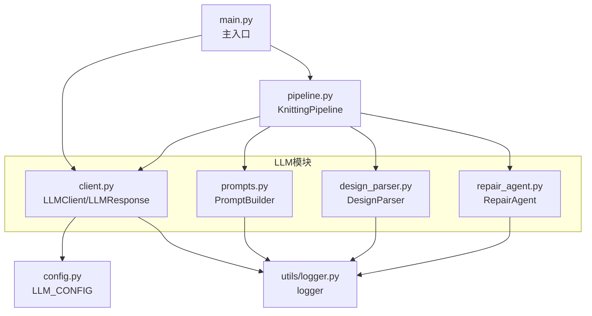
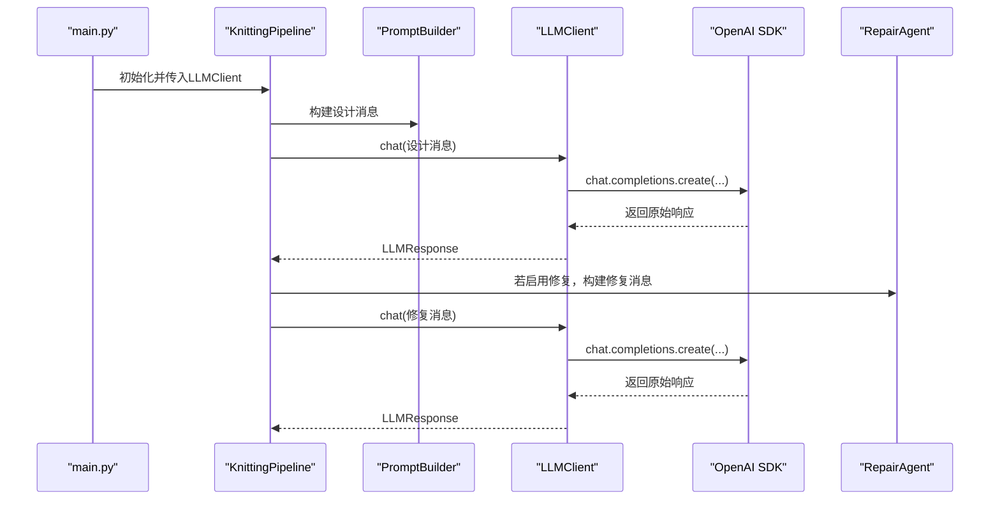
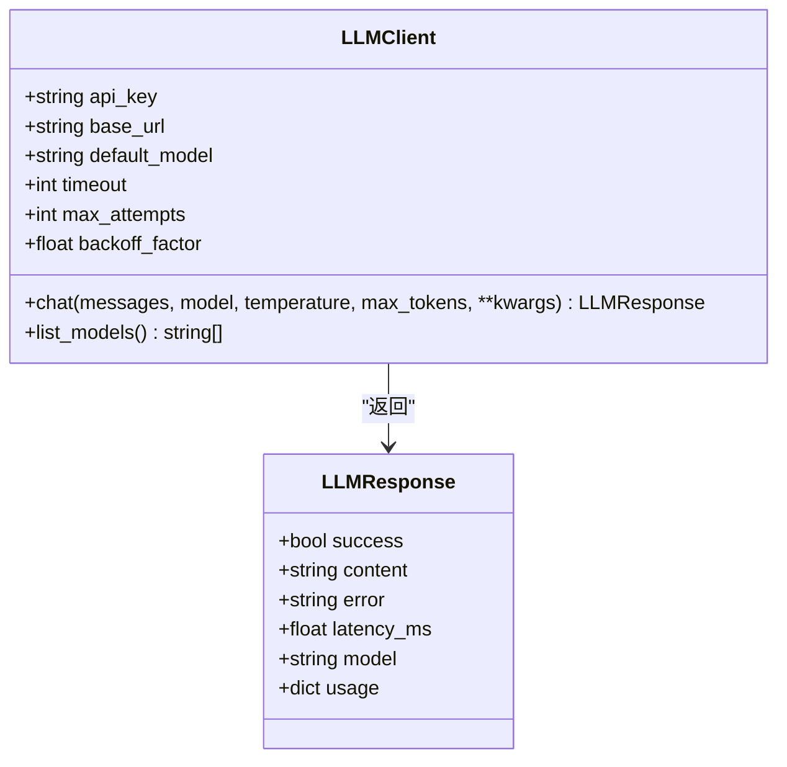
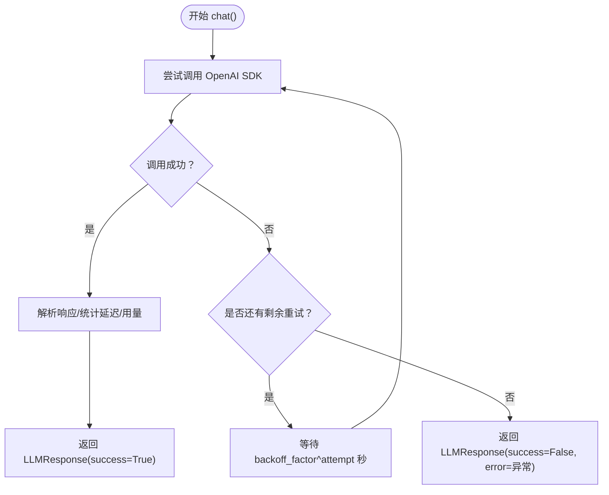
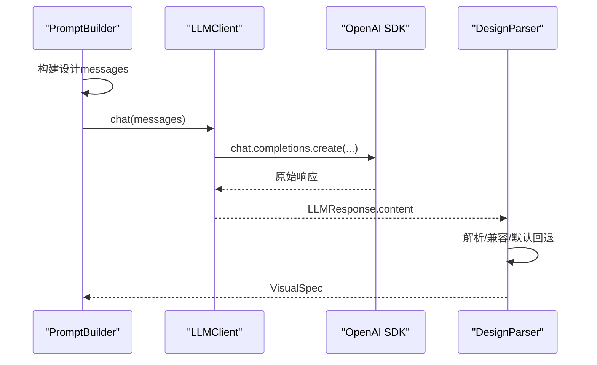
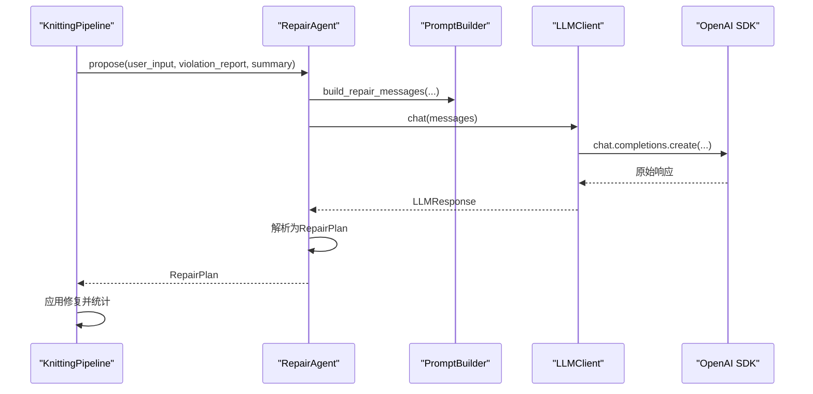
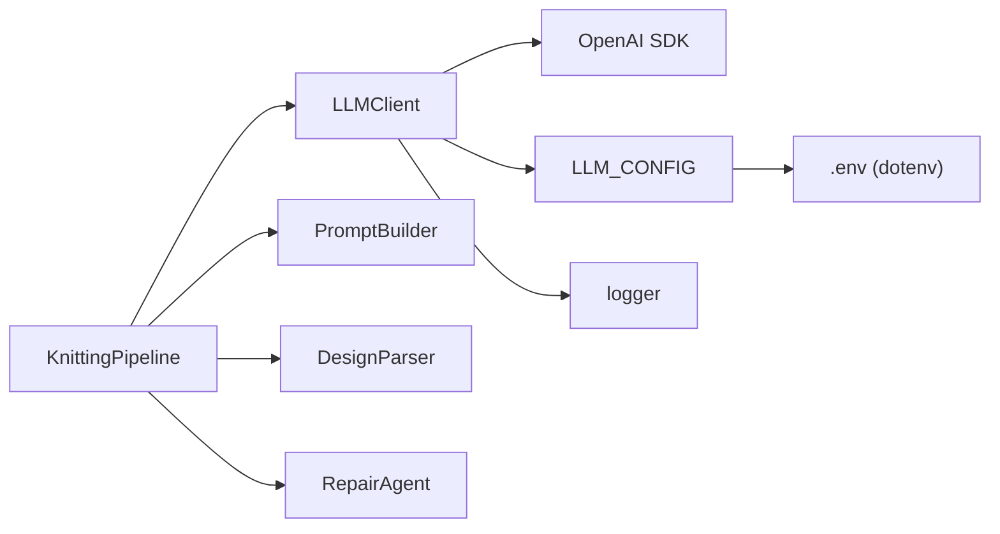

# LLM客户端集成

<cite>
**本文档引用的文件**
- [client.py](file://generator_one/llm/client.py)
- [config.py](file://generator_one/config.py)
- [main.py](file://generator_one/main.py)
- [pipeline.py](file://generator_one/pipeline.py)
- [prompts.py](file://generator_one/llm/prompts.py)
- [design_parser.py](file://generator_one/llm/design_parser.py)
- [repair_agent.py](file://generator_one/llm/repair_agent.py)
- [logger.py](file://generator_one/utils/logger.py)
</cite>

## 目录
1. [简介](#简介)
2. [项目结构](#项目结构)
3. [核心组件](#核心组件)
4. [架构总览](#架构总览)
5. [详细组件分析](#详细组件分析)
6. [依赖关系分析](#依赖关系分析)
7. [性能考虑](#性能考虑)
8. [故障排除指南](#故障排除指南)
9. [结论](#结论)
10. [附录](#附录)

## 简介
本文件面向LLM客户端集成模块，重点阐述LLMClient类的设计与实现，包括DeepSeek/OpenAI兼容接口封装、API调用机制、错误处理与重试策略；详解LLM响应数据结构LLMResponse的定义与使用；说明配置管理机制（API密钥、基础URL、超时设置等）；提供具体使用示例，展示初始化客户端、发送消息请求、处理响应与错误；说明与配置系统的集成方式；并给出常见API连接问题的解决方案与性能优化建议。

## 项目结构
LLM客户端集成位于generator_one/llm目录下，核心文件包括：
- client.py：LLM客户端与响应数据结构
- prompts.py：提示词构建与示例
- design_parser.py：LLM输出解析器
- repair_agent.py：二次修复代理（基于LLM的违规修复）
- config.py：全局配置（含LLM配置）
- main.py：主入口，演示如何初始化LLMClient并接入管道
- pipeline.py：端到端生成管线，展示LLMClient在整体流程中的使用
- utils/logger.py：日志工具

**图表来源**
- [client.py:1-168](file://generator_one/llm/client.py#L1-L168)
- [prompts.py:1-654](file://generator_one/llm/prompts.py#L1-L654)
- [design_parser.py:1-415](file://generator_one/llm/design_parser.py#L1-L415)
- [repair_agent.py:1-242](file://generator_one/llm/repair_agent.py#L1-L242)
- [config.py:1-76](file://generator_one/config.py#L1-L76)
- [main.py:1-207](file://generator_one/main.py#L1-L207)
- [pipeline.py:1-749](file://generator_one/pipeline.py#L1-L749)
- [logger.py:1-52](file://generator_one/utils/logger.py#L1-L52)

**章节来源**
- [client.py:1-168](file://generator_one/llm/client.py#L1-L168)
- [config.py:1-76](file://generator_one/config.py#L1-L76)
- [main.py:1-207](file://generator_one/main.py#L1-L207)
- [pipeline.py:1-749](file://generator_one/pipeline.py#L1-L749)

## 核心组件
- LLMClient：封装DeepSeek/OpenAI兼容接口，负责聊天请求、模型列表查询、自动重试与错误处理。
- LLMResponse：统一的LLM响应数据结构，包含成功标志、内容、错误信息、延迟、模型名与用量。
- PromptBuilder：构建设计与修复阶段的提示词消息序列。
- DesignParser：解析LLM输出的JSON，兼容多种历史schema。
- RepairAgent：接收违规报告，通过LLM提出最小修复计划并应用。
- 配置系统：集中于config.py的LLM_CONFIG，支持环境变量覆盖。

**章节来源**
- [client.py:25-168](file://generator_one/llm/client.py#L25-L168)
- [prompts.py:494-654](file://generator_one/llm/prompts.py#L494-L654)
- [design_parser.py:24-415](file://generator_one/llm/design_parser.py#L24-L415)
- [repair_agent.py:39-242](file://generator_one/llm/repair_agent.py#L39-L242)
- [config.py:51-65](file://generator_one/config.py#L51-L65)

## 架构总览
LLM客户端在整体管线中的位置如下：
- 主入口main.py创建KnittingPipeline并注入LLMClient。
- KnittingPipeline在步骤1中调用LLMClient进行模式设计（Pattern Plan）。
- 步骤8中，若启用LLM修复，RepairAgent再次调用LLMClient进行违规修复。
- 所有调用均通过LLMClient的chat方法，内部执行OpenAI兼容的chat.completions.create，并内置重试与日志记录。

**图表来源**
- [main.py:117-144](file://generator_one/main.py#L117-L144)
- [pipeline.py:195-227](file://generator_one/pipeline.py#L195-L227)
- [pipeline.py:577-621](file://generator_one/pipeline.py#L577-L621)
- [client.py:81-161](file://generator_one/llm/client.py#L81-L161)

## 详细组件分析

### LLMClient类与LLMResponse数据结构
- 设计要点
  - 通过OpenAI SDK的OpenAI客户端封装，兼容DeepSeek与OpenAI接口。
  - 支持从参数、环境变量、配置文件三种途径获取API密钥。
  - 统一响应结构LLMResponse，便于上层一致处理。
  - 内置指数退避重试，支持自定义最大尝试次数与回退因子。
  - 记录延迟与token用量（如可用）。

- 关键实现点
  - 初始化：校验OpenAI库可用性，加载配置（API密钥、基础URL、默认模型、超时、重试参数），创建OpenAI客户端。
  - chat方法：构造消息、调用SDK、解析响应、计算延迟、提取用量、返回LLMResponse；异常时按指数退避重试，最终失败返回错误响应。
  - list_models方法：查询可用模型列表，异常时返回默认模型清单。

**图表来源**
- [client.py:25-168](file://generator_one/llm/client.py#L25-L168)

**章节来源**
- [client.py:35-168](file://generator_one/llm/client.py#L35-L168)

### 配置管理机制
- 配置来源优先级
  - 参数显式传入（最高优先级）
  - 环境变量DEEPSEEK_API_KEY
  - 配置文件LLM_CONFIG
- LLM_CONFIG关键字段
  - provider：提供方标识
  - api_key：API密钥
  - base_url：基础URL（默认DeepSeek）
  - default_model：默认模型名
  - models：模型映射
  - timeout：默认超时秒数
  - retry：重试配置（max_attempts、backoff_factor）

- 环境变量与dotenv
  - config.py加载.env文件，使DEEPSEEK_API_KEY等环境变量生效。

**章节来源**
- [config.py:51-65](file://generator_one/config.py#L51-L65)
- [client.py:52-79](file://generator_one/llm/client.py#L52-L79)
- [config.py:14-18](file://generator_one/config.py#L14-L18)

### 错误处理与重试策略
- 异常捕获与记录：每次尝试捕获异常，记录警告与堆栈信息。
- 指数退避重试：按backoff_factor的attempt次幂等待，最多max_attempts次。
- 失败兜底：达到最大尝试次数后，返回LLMResponse(success=False, error=异常信息)。

**图表来源**
- [client.py:103-154](file://generator_one/llm/client.py#L103-L154)

**章节来源**
- [client.py:103-154](file://generator_one/llm/client.py#L103-L154)

### 提示词与解析流程
- PromptBuilder
  - 设计阶段：构建系统提示词与少量示例，拼接用户输入，形成messages。
  - 修复阶段：构建系统提示词与payload（包含用户输入、违规报告、统计摘要），形成messages。
- DesignParser
  - 从LLM输出中提取JSON，兼容新schema与历史schema（morphology、motif、elements）。
  - 默认回退到标准VisualSpec。

**图表来源**
- [prompts.py:494-654](file://generator_one/llm/prompts.py#L494-L654)
- [design_parser.py:24-415](file://generator_one/llm/design_parser.py#L24-L415)
- [pipeline.py:195-227](file://generator_one/pipeline.py#L195-L227)

**章节来源**
- [prompts.py:494-654](file://generator_one/llm/prompts.py#L494-L654)
- [design_parser.py:24-415](file://generator_one/llm/design_parser.py#L24-L415)

### 修复代理与二次调用
- RepairAgent
  - 接收违规报告与统计摘要，构建修复messages。
  - 调用LLMClient进行修复建议生成，解析为RepairPlan。
  - 应用语义或动作级修复到色码图网格。
- 与Pipeline集成
  - Pipeline在规则检查后，若启用LLM修复，则调用RepairAgent.propose并应用修复，随后再次执行编译守卫与层裁剪等步骤。

**图表来源**
- [pipeline.py:577-621](file://generator_one/pipeline.py#L577-L621)
- [repair_agent.py:51-163](file://generator_one/llm/repair_agent.py#L51-L163)

**章节来源**
- [repair_agent.py:39-242](file://generator_one/llm/repair_agent.py#L39-L242)
- [pipeline.py:577-621](file://generator_one/pipeline.py#L577-L621)

## 依赖关系分析
- LLMClient依赖
  - OpenAI SDK（动态导入，缺失时抛出ImportError）
  - config.LLM_CONFIG（默认值）
  - utils.logger（日志）
- Pipeline依赖
  - LLMClient（作为可注入组件）
  - PromptBuilder、DesignParser、RepairAgent
  - 规则检查与编译守卫模块
- 配置依赖
  - config.py提供LLM_CONFIG与LOGGING_CONFIG
  - .env文件通过dotenv加载环境变量

**图表来源**
- [client.py:17-22](file://generator_one/llm/client.py#L17-L22)
- [client.py:14-15](file://generator_one/llm/client.py#L14-L15)
- [config.py:14-18](file://generator_one/config.py#L14-L18)
- [pipeline.py:26-36](file://generator_one/pipeline.py#L26-L36)

**章节来源**
- [client.py:17-22](file://generator_one/llm/client.py#L17-L22)
- [config.py:14-18](file://generator_one/config.py#L14-L18)
- [pipeline.py:26-36](file://generator_one/pipeline.py#L26-L36)

## 性能考虑
- 超时设置：默认30秒，可根据网络状况调整LLM_CONFIG.timeout。
- 重试策略：默认最多3次，回退因子2，适合应对瞬时网络抖动。
- 延迟与用量：LLMResponse记录latency_ms与usage，可用于性能监控与成本控制。
- 模型选择：默认deepseek-chat，可在调用时指定model参数以适配不同任务。
- 日志级别：INFO级别记录关键指标，避免过度日志影响性能。

[本节为通用指导，无需特定文件来源]

## 故障排除指南
- 缺少OpenAI库
  - 现象：初始化时报ImportError
  - 处理：安装openai库
  - 参考：[client.py:52-53](file://generator_one/llm/client.py#L52-L53)
- 未设置API密钥
  - 现象：初始化时报ValueError
  - 处理：设置DEEPSEEK_API_KEY环境变量或在config.py中配置
  - 参考：[client.py:60-63](file://generator_one/llm/client.py#L60-L63)
- API调用失败
  - 现象：chat返回success=False
  - 处理：查看error字段，检查网络、超时、模型可用性；可增加max_attempts或backoff_factor
  - 参考：[client.py:140-154](file://generator_one/llm/client.py#L140-L154)
- JSON解析失败
  - 现象：DesignParser无法解析LLM输出
  - 处理：检查LLM输出格式，确保返回合法JSON；可启用few-shot示例提升稳定性
  - 参考：[design_parser.py:29-44](file://generator_one/llm/design_parser.py#L29-L44)
- 修复建议无效
  - 现象：RepairAgent返回空计划
  - 处理：检查messages构建与LLM输出；验证动作名在actions映射中
  - 参考：[repair_agent.py:147-156](file://generator_one/llm/repair_agent.py#L147-L156)

**章节来源**
- [client.py:52-63](file://generator_one/llm/client.py#L52-L63)
- [client.py:140-154](file://generator_one/llm/client.py#L140-L154)
- [design_parser.py:29-44](file://generator_one/llm/design_parser.py#L29-L44)
- [repair_agent.py:147-156](file://generator_one/llm/repair_agent.py#L147-L156)

## 结论
LLM客户端集成模块以LLMClient为核心，通过OpenAI兼容接口实现DeepSeek/OpenAI的统一封装，结合统一响应结构、指数退避重试与完善的日志体系，满足复杂生成管线对LLM调用的高可靠需求。配合PromptBuilder、DesignParser与RepairAgent，实现了从设计到修复的完整闭环。配置系统通过环境变量与配置文件提供灵活的参数来源，便于在不同部署环境中快速切换。

[本节为总结，无需特定文件来源]

## 附录

### 使用示例（路径指引）
- 初始化客户端
  - 参考：[main.py:139](file://generator_one/main.py#L139)
- 发送消息请求
  - 参考：[pipeline.py:202](file://generator_one/pipeline.py#L202)
- 处理响应与错误
  - 参考：[pipeline.py:204-212](file://generator_one/pipeline.py#L204-L212)
- 与配置系统集成
  - 参考：[config.py:51-65](file://generator_one/config.py#L51-L65)，[client.py:55-67](file://generator_one/llm/client.py#L55-L67)

**章节来源**
- [main.py:139](file://generator_one/main.py#L139)
- [pipeline.py:202-212](file://generator_one/pipeline.py#L202-L212)
- [config.py:51-65](file://generator_one/config.py#L51-L65)
- [client.py:55-67](file://generator_one/llm/client.py#L55-L67)