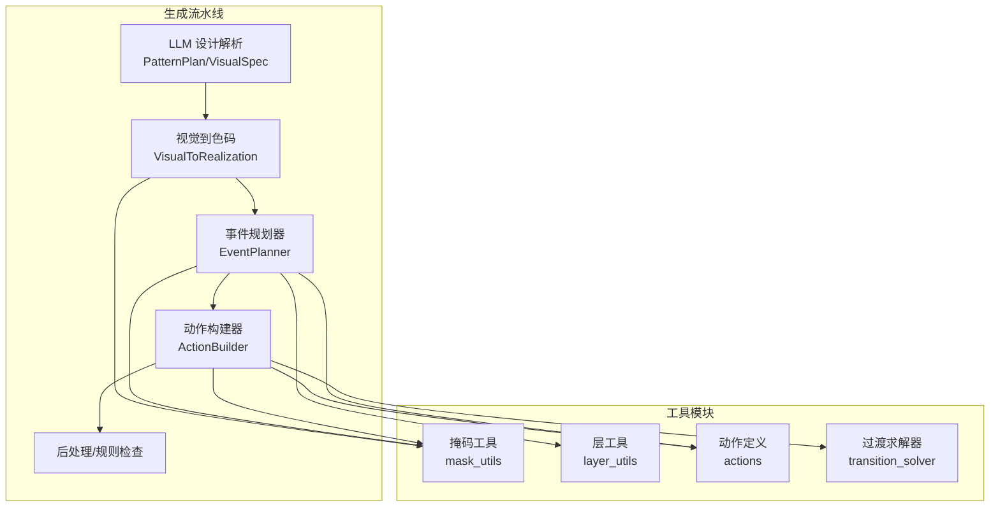
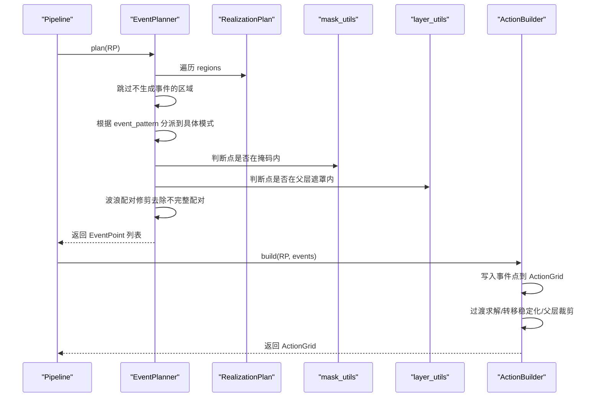
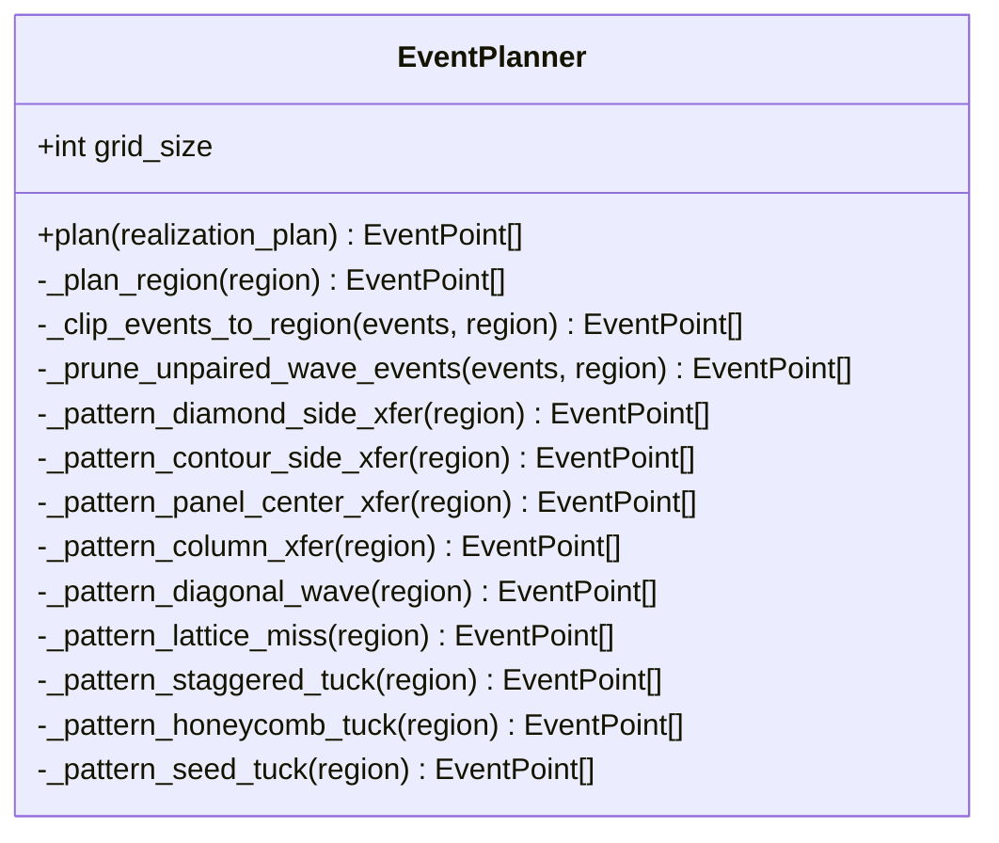
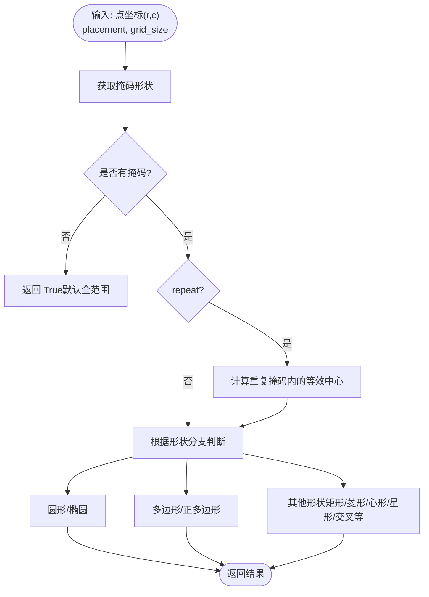
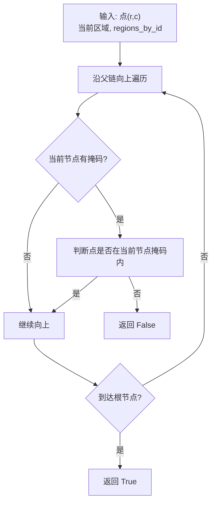
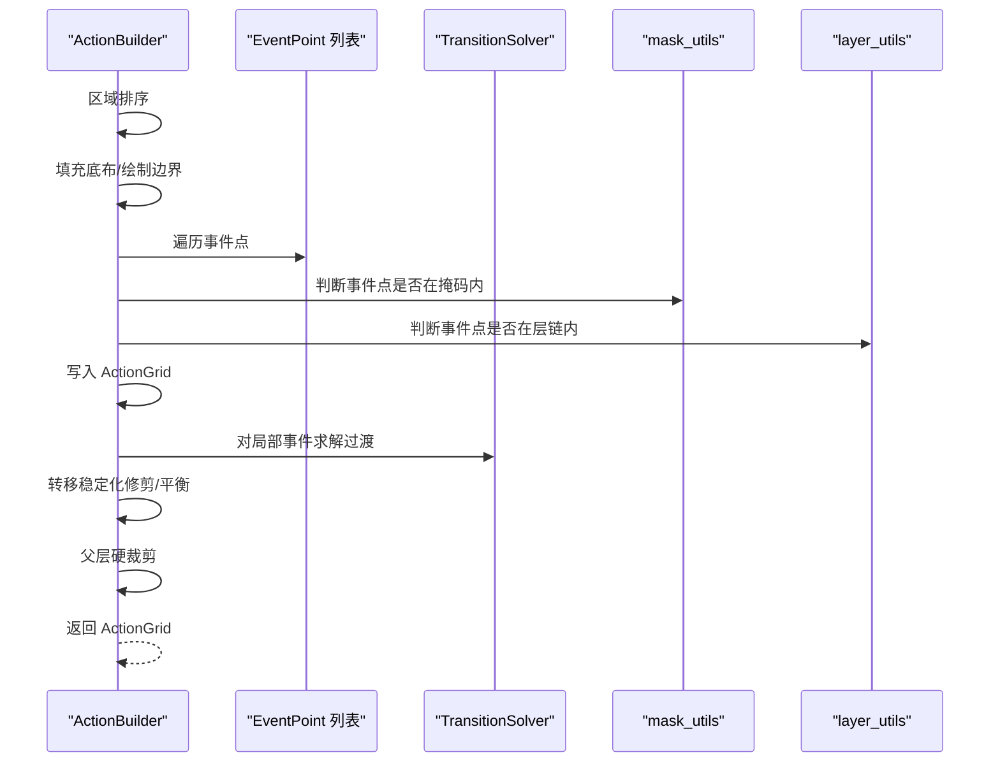
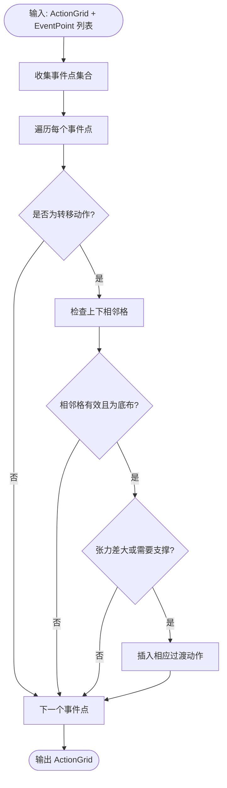
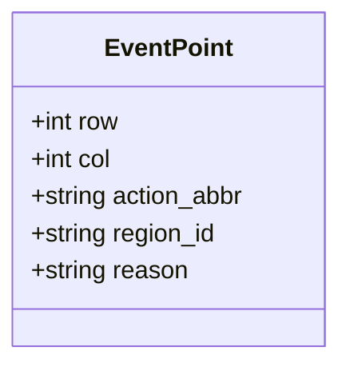
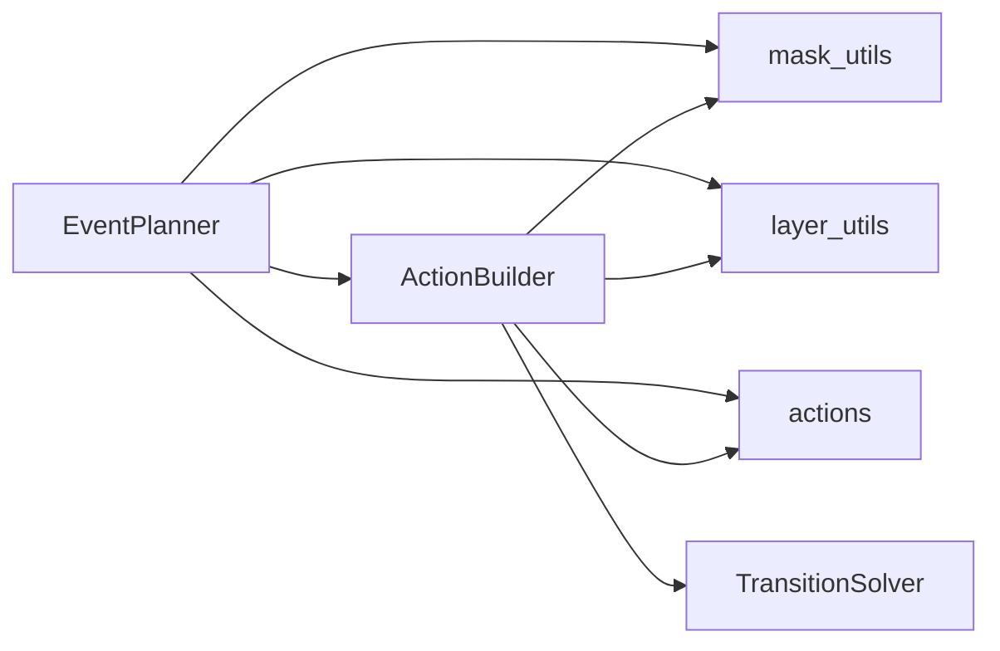

# 事件规划器

<cite>
**本文档引用的文件**
- [event_planner.py](file://generator_one/generation/event_planner.py)
- [mask_utils.py](file://generator_one/generation/mask_utils.py)
- [visual_types.py](file://generator_one/generation/visual_types.py)
- [layer_utils.py](file://generator_one/generation/layer_utils.py)
- [action_builder.py](file://generator_one/generation/action_builder.py)
- [transition_solver.py](file://generator_one/generation/transition_solver.py)
- [actions.py](file://generator_one/core/actions.py)
- [pipeline.py](file://generator_one/pipeline.py)
- [test_masks.py](file://generator_one/tests/test_masks.py)
- [test_pattern_plan.py](file://generator_one/tests/test_pattern_plan.py)
</cite>

## 目录
1. [简介](#简介)
2. [项目结构](#项目结构)
3. [核心组件](#核心组件)
4. [架构总览](#架构总览)
5. [详细组件分析](#详细组件分析)
6. [依赖关系分析](#依赖关系分析)
7. [性能考量](#性能考量)
8. [故障排查指南](#故障排查指南)
9. [结论](#结论)
10. [附录](#附录)

## 简介
事件规划器负责将“色码实现方案”（RealizationPlan）转换为稀疏的事件点列表（EventPoint）。其核心目标是在满足视觉效果的前提下，仅生成真正必要的工艺事件，避免在不需要的位置凭空放置色块，并确保事件点的分布严格遵循“仿真图效果 → 色码图排列”的规则。事件规划器还提供波浪事件的配对修剪、区域裁剪、以及与掩码工具的紧密协作，从而保证最终生成的 ActionGrid 在物理可织性和美学上均符合要求。

## 项目结构
事件规划器位于生成流水线的第三步，上游是视觉到色码的转换（VisualToRealization），下游是动作构建（ActionBuilder）。它依赖于掩码工具（mask_utils）进行几何判断，依赖层工具（layer_utils）进行父子层遮罩判断，依赖动作定义（actions）进行动作索引与属性查询。

图表来源
- [pipeline.py:114-189](file://generator_one/pipeline.py#L114-L189)
- [event_planner.py:33-80](file://generator_one/generation/event_planner.py#L33-L80)
- [action_builder.py:43-118](file://generator_one/generation/action_builder.py#L43-L118)

章节来源
- [pipeline.py:114-189](file://generator_one/pipeline.py#L114-L189)
- [event_planner.py:33-80](file://generator_one/generation/event_planner.py#L33-L80)
- [action_builder.py:43-118](file://generator_one/generation/action_builder.py#L43-L118)

## 核心组件
- 事件规划器（EventPlanner）：根据 RealizationPlan 生成稀疏 EventPoint 列表，支持多种事件模式（波浪、麻花、集圈、网眼等），并进行波浪配对修剪与区域裁剪。
- 掩码工具（mask_utils）：提供通用的几何掩码判断，支持圆形、椭圆、多边形、心形、星形等多种形状，以及重复掩码。
- 层工具（layer_utils）：实现层级遮罩逻辑，确保子层内容仅在父层掩码范围内可见与生效。
- 动作构建器（ActionBuilder）：将 EventPoint 列表写入 ActionGrid，执行过渡求解、转移稳定化、父层硬裁剪等步骤。
- 过渡求解器（TransitionSolver）：在相邻行插入过渡动作，解决张力差异与支撑需求导致的冲突。
- 动作定义（actions）：统一的动作索引、颜色、语义、偏移、张力等属性，供各模块查询。

章节来源
- [event_planner.py:24-80](file://generator_one/generation/event_planner.py#L24-L80)
- [mask_utils.py:15-26](file://generator_one/generation/mask_utils.py#L15-L26)
- [layer_utils.py:15-61](file://generator_one/generation/layer_utils.py#L15-L61)
- [action_builder.py:35-118](file://generator_one/generation/action_builder.py#L35-L118)
- [transition_solver.py:23-110](file://generator_one/generation/transition_solver.py#L23-L110)
- [actions.py:45-160](file://generator_one/core/actions.py#L45-L160)

## 架构总览
事件规划器的执行流程如下：
1. 输入：RealizationPlan（包含多个区域及其事件模式、参数、布局角色等）
2. 遍历每个区域，跳过不生成事件的区域（如 event_pattern='none' 或 layout_role='ground'）
3. 根据区域的事件模式调用对应的规划方法，生成候选事件点
4. 对候选事件点进行区域裁剪与波浪配对修剪
5. 输出稀疏的 EventPoint 列表

图表来源
- [pipeline.py:233-243](file://generator_one/pipeline.py#L233-L243)
- [event_planner.py:33-80](file://generator_one/generation/event_planner.py#L33-L80)
- [action_builder.py:43-118](file://generator_one/generation/action_builder.py#L43-L118)

## 详细组件分析

### 事件规划器（EventPlanner）
- 职责：根据 RealizationPlan 生成稀疏 EventPoint 列表，严格遵循“仿真图效果 → 色码图排列”的规则。
- 关键特性：
  - 区域过滤：跳过 event_pattern='none' 与 layout_role='ground' 的区域
  - 模式分发：根据 event_pattern 调用不同规划方法（如 diamond_side_xfer、contour_side_xfer、panel_center_xfer、column_xfer、diagonal_wave、lattice_miss、staggered_tuck、honeycomb_tuck、seed_tuck）
  - 区域裁剪：将超出区域范围的事件点剔除
  - 波浪配对修剪：对 diagonal_wave 等成对事件进行完整性检查，剔除不完整的配对
  - 日志记录：记录每个区域生成的事件数量与原因

图表来源
- [event_planner.py:24-80](file://generator_one/generation/event_planner.py#L24-L80)
- [event_planner.py:145-175](file://generator_one/generation/event_planner.py#L145-L175)

章节来源
- [event_planner.py:33-80](file://generator_one/generation/event_planner.py#L33-L80)
- [event_planner.py:145-175](file://generator_one/generation/event_planner.py#L145-L175)

### 掩码工具（mask_utils）
- 职责：提供通用的几何掩码判断函数，支持多种形状与参数组合。
- 关键功能：
  - 获取掩码形状与是否存在掩码
  - 判断点是否在掩码内（支持圆形、椭圆、多边形、心形、星形、交叉、人字形等）
  - 支持重复掩码（periodic tiling）
  - 提供网格六边形、正多边形等专用判断

图表来源
- [mask_utils.py:42-128](file://generator_one/generation/mask_utils.py#L42-L128)
- [mask_utils.py:154-175](file://generator_one/generation/mask_utils.py#L154-L175)

章节来源
- [mask_utils.py:15-26](file://generator_one/generation/mask_utils.py#L15-L26)
- [mask_utils.py:42-128](file://generator_one/generation/mask_utils.py#L42-L128)
- [mask_utils.py:154-175](file://generator_one/generation/mask_utils.py#L154-L175)

### 层工具（layer_utils）
- 职责：实现层级遮罩逻辑，确保子层内容仅在父层掩码范围内可见与生效。
- 关键功能：
  - region_by_id：按 region_id 构建映射
  - layer_mask_contains：判断点是否在当前区域及其父层链的掩码范围内
  - parent_scan_bbox：返回父层的扫描边界

图表来源
- [layer_utils.py:27-61](file://generator_one/generation/layer_utils.py#L27-L61)

章节来源
- [layer_utils.py:15-61](file://generator_one/generation/layer_utils.py#L15-L61)

### 动作构建器（ActionBuilder）
- 职责：将 EventPoint 列表写入 ActionGrid，执行过渡求解、转移稳定化、父层硬裁剪等步骤。
- 关键流程：
  - 区域优先级排序（ground < allover < center < side_band < border）
  - 填充底布与绘制边界
  - 写入事件点（按区域限制）
  - 过渡求解（仅对 transition_policy='local_only' 的区域启用）
  - 转移稳定化（修剪无效转移、平衡左右列数量）
  - 父层硬裁剪（移除子层掩码外的支持动作）

图表来源
- [action_builder.py:43-118](file://generator_one/generation/action_builder.py#L43-L118)
- [transition_solver.py:37-110](file://generator_one/generation/transition_solver.py#L37-L110)

章节来源
- [action_builder.py:43-118](file://generator_one/generation/action_builder.py#L43-L118)
- [transition_solver.py:23-110](file://generator_one/generation/transition_solver.py#L23-L110)

### 过渡求解器（TransitionSolver）
- 职责：在相邻行插入过渡动作，解决张力差异与支撑需求导致的冲突。
- 关键原则：
  - 仅对相邻行（上下）插入过渡
  - 仅在相邻格为底布（f_knit）时插入
  - 当张力差过大或需要支撑时才插入
  - 不覆盖其他主事件点

图表来源
- [transition_solver.py:37-110](file://generator_one/generation/transition_solver.py#L37-L110)

章节来源
- [transition_solver.py:23-110](file://generator_one/generation/transition_solver.py#L23-L110)

### 事件定义与属性
- 事件点（EventPoint）包含以下属性：
  - row、col：网格坐标
  - action_abbr：动作缩写（对应动作定义中的 abbr）
  - region_id：所属区域 ID
  - reason：事件生成的原因（调试用途）

图表来源
- [visual_types.py:185-196](file://generator_one/generation/visual_types.py#L185-L196)

章节来源
- [visual_types.py:185-196](file://generator_one/generation/visual_types.py#L185-L196)

## 依赖关系分析
事件规划器与其它模块的依赖关系如下：
- 事件规划器依赖掩码工具进行几何判断
- 事件规划器依赖层工具进行父子层遮罩判断
- 事件规划器依赖动作定义进行动作索引与属性查询
- 动作构建器依赖掩码工具、层工具、过渡求解器与动作定义

图表来源
- [event_planner.py:18-22](file://generator_one/generation/event_planner.py#L18-L22)
- [action_builder.py:18-23](file://generator_one/generation/action_builder.py#L18-L23)

章节来源
- [event_planner.py:18-22](file://generator_one/generation/event_planner.py#L18-L22)
- [action_builder.py:18-23](file://generator_one/generation/action_builder.py#L18-L23)

## 性能考量
- 事件稀疏性：事件规划器仅生成真正必要的事件点，避免在不需要的位置放置动作，从而降低后续过渡求解与渲染成本。
- 区域裁剪：在生成事件后立即进行区域裁剪，减少无效事件进入后续流程。
- 波浪配对修剪：在波浪事件中剔除不完整的配对，避免后续阶段的无效工作。
- 掩码判断优化：掩码工具对常见形状提供高效判断，减少不必要的复杂计算。
- 过渡求解局部性：过渡求解器仅在相邻行插入过渡，避免全局扫描带来的开销。

## 故障排查指南
- 事件规划返回 0 事件：检查是否所有区域的 event_pattern='none' 或 layout_role='ground'，或事件参数无效。
- 事件点越界：检查事件坐标是否在网格范围内，以及是否在区域掩码内。
- 波浪事件不完整：检查 split_col_offset 与 tuck_col_offset 是否合理，以及是否进行了配对修剪。
- 子层内容溢出：检查父层裁剪是否正确执行，确保子层掩码外的支持动作被移除。
- 过渡冲突：检查相邻格的张力差异与支撑需求，必要时调整参数或增加过渡。

章节来源
- [event_planner.py:69-76](file://generator_one/generation/event_planner.py#L69-L76)
- [action_builder.py:543-580](file://generator_one/generation/action_builder.py#L543-L580)
- [transition_solver.py:96-107](file://generator_one/generation/transition_solver.py#L96-L107)

## 结论
事件规划器通过严格的区域过滤、模式分发、掩码判断与波浪配对修剪，实现了从“仿真图效果”到“色码图排列”的高效转换。配合动作构建器的过渡求解、转移稳定化与父层裁剪，最终生成的 ActionGrid 在物理可织性、美学一致性与稀疏性方面均达到较高水平。该模块的设计体现了“只生成必要事件”的原则，为后续流水线的稳定性与效率奠定了坚实基础。

## 附录

### 事件调度与优先级处理机制
- 区域优先级：ground < allover < center < side_band < border
- 事件写入顺序：先填充底布与边界，再写入事件点，最后进行过渡求解与稳定化
- 过渡策略：仅对 transition_policy='local_only' 的区域启用过渡求解

章节来源
- [action_builder.py:124-132](file://generator_one/generation/action_builder.py#L124-L132)
- [action_builder.py:93-101](file://generator_one/generation/action_builder.py#L93-L101)

### 事件冲突与时序问题解决
- 张力差异：通过过渡求解器在相邻行插入过渡动作，解决张力差过大的问题
- 支撑需求：对需要支撑的动作（如某些转移）在相邻行插入过渡
- 波浪配对：确保 f_split 与 f_tuck 成对出现，避免孤立事件

章节来源
- [transition_solver.py:96-107](file://generator_one/generation/transition_solver.py#L96-L107)
- [event_planner.py:82-139](file://generator_one/generation/event_planner.py#L82-L139)

### 事件验证与回放技术
- 掩码验证：事件点与 ActionGrid 中的非底布操作均需位于掩码内
- 父层裁剪审计：统计子层内容在父层掩码外的异常数量
- 波浪配对守卫：在最终阶段再次检查并移除不完整的波浪配对

章节来源
- [test_masks.py:23-33](file://generator_one/tests/test_masks.py#L23-L33)
- [pipeline.py:312-340](file://generator_one/pipeline.py#L312-L340)
- [pipeline.py:427-496](file://generator_one/pipeline.py#L427-L496)