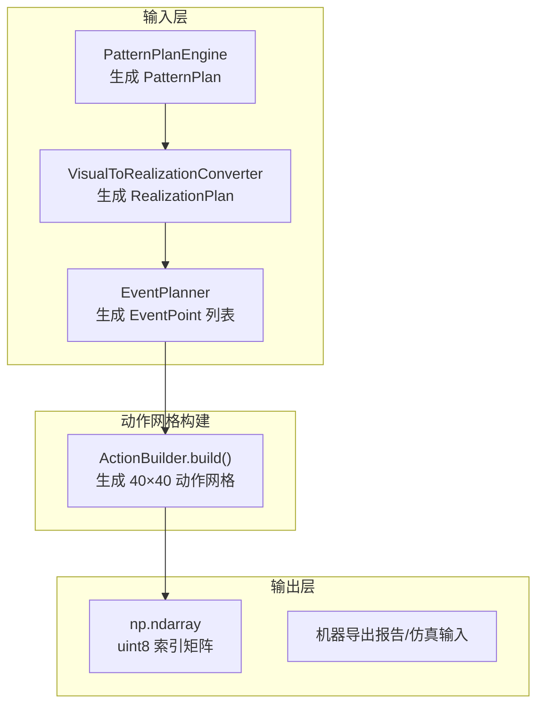
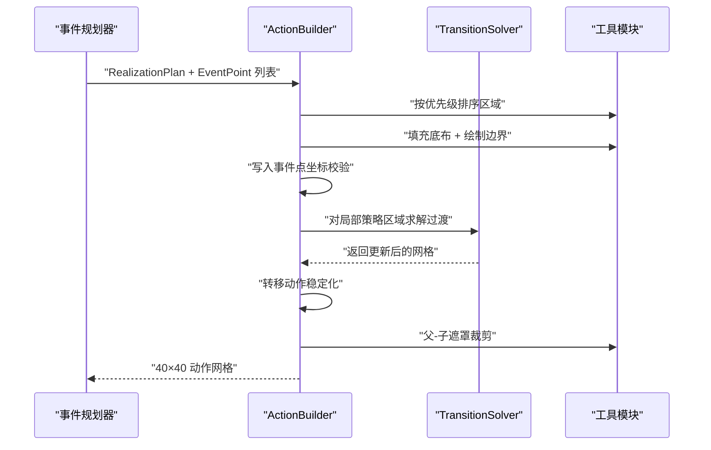
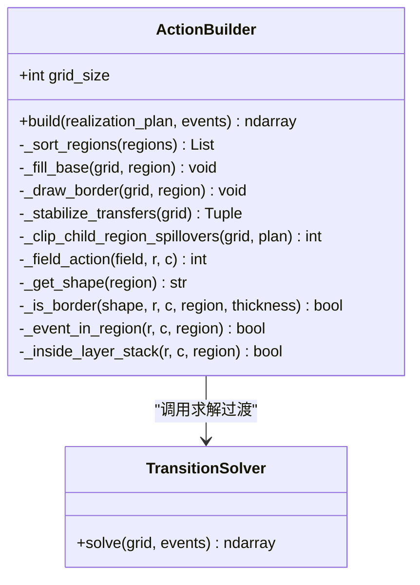
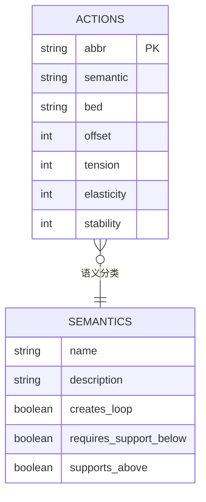
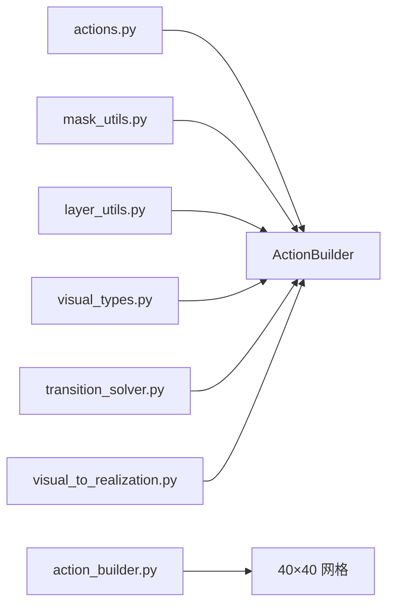

# 动作网格构建

<cite>
**本文档引用的文件**
- [action_builder.py](file://generator_one/generation/action_builder.py)
- [actions.py](file://generator_one/core/actions.py)
- [visual_types.py](file://generator_one/generation/visual_types.py)
- [transition_solver.py](file://generator_one/generation/transition_solver.py)
- [mask_utils.py](file://generator_one/generation/mask_utils.py)
- [layer_utils.py](file://generator_one/generation/layer_utils.py)
- [instruction_info.json](file://generator_one/data/instruction_info.json)
- [config.py](file://generator_one/config.py)
- [visual_to_realization.py](file://generator_one/generation/visual_to_realization.py)
- [pattern_plan.py](file://generator_one/generation/pattern_plan.py)
- [test_pattern_plan.py](file://generator_one/tests/test_pattern_plan.py)
</cite>

## 目录
1. [简介](#简介)
2. [项目结构](#项目结构)
3. [核心组件](#核心组件)
4. [架构总览](#架构总览)
5. [详细组件分析](#详细组件分析)
6. [依赖关系分析](#依赖关系分析)
7. [性能考虑](#性能考虑)
8. [故障排查指南](#故障排查指南)
9. [结论](#结论)
10. [附录](#附录)

## 简介
本文件面向动作网格构建模块，重点围绕 ActionBuilder 类的实现进行技术文档编写。内容涵盖：
- 如何将图案计划（Pattern Plan）转化为 40×40 的动作网格
- 15 种针织动作类型的定义与属性来源
- 动作网格的数据结构与索引机制
- 具体构建示例与映射关系
- 动作间的空间关系与时间顺序
- 网格边界处理与动作冲突解决
- 网格验证与优化技术细节

## 项目结构
动作网格构建位于生成流水线的后期阶段，承接“视觉目标 → 色码实现”的翻译结果，最终输出 40×40 的动作矩阵。

图表来源
- [visual_to_realization.py:258-295](file://generator_one/generation/visual_to_realization.py#L258-L295)
- [action_builder.py:43-118](file://generator_one/generation/action_builder.py#L43-L118)

章节来源
- [visual_to_realization.py:258-295](file://generator_one/generation/visual_to_realization.py#L258-L295)
- [action_builder.py:43-118](file://generator_one/generation/action_builder.py#L43-L118)

## 核心组件
- ActionBuilder：主控制器，负责初始化底布、绘制边界、写入事件点、过渡求解、转移动作稳定化、父-子遮罩裁剪等。
- TransitionSolver：在相邻格按需插入过渡动作，确保张力差异与支撑需求得到满足。
- actions：统一的动作数据库与属性查询接口，提供 abbr↔索引映射、语义分组、偏移、张力等。
- mask_utils / layer_utils：通用掩码判断与层级遮罩逻辑，保证嵌套结构与父-子关系正确。
- visual_types：定义视觉形状、效果、布局角色与色码实现方案的数据结构。

章节来源
- [action_builder.py:35-118](file://generator_one/generation/action_builder.py#L35-L118)
- [transition_solver.py:23-110](file://generator_one/generation/transition_solver.py#L23-L110)
- [actions.py:45-338](file://generator_one/core/actions.py#L45-L338)
- [mask_utils.py:42-206](file://generator_one/generation/mask_utils.py#L42-L206)
- [layer_utils.py:27-117](file://generator_one/generation/layer_utils.py#L27-L117)
- [visual_types.py:127-196](file://generator_one/generation/visual_types.py#L127-L196)

## 架构总览
ActionBuilder 的工作流分为五个阶段：
1) 初始化底布（按区域优先级填充）
2) 绘制边界（按形状与厚度）
3) 写入事件点（来自事件规划）
4) 过渡求解（仅对局部策略启用的区域）
5) 转移稳定化与父-子遮罩裁剪

图表来源
- [action_builder.py:43-118](file://generator_one/generation/action_builder.py#L43-L118)
- [transition_solver.py:37-110](file://generator_one/generation/transition_solver.py#L37-L110)

## 详细组件分析

### ActionBuilder 类详解
- 数据结构
  - 网格：40×40 的 uint8 索引矩阵，索引对应 instruction_info.json 中的动作 ID。
  - 区域优先级：ground → allover → center → side_band → border，按此顺序填充底布与边界。
- 关键方法
  - build：主流程入口，串联五步。
  - _fill_base/_draw_border：按区域布局与形状填充底布与边界。
  - _event_in_region/_inside_layer_stack：判断点是否在区域内与层级可见。
  - _stabilize_transfers：对转移动作进行边界修剪与平衡。
  - _clip_child_region_spillovers：对嵌套子区域进行溢出裁剪。
  - _field_action/_get_shape/_is_border：底布动作选择与边界判定。
- 索引机制
  - 使用 actions.idx_safe 将 abbr 映射为索引，未识别时回退到默认动作（通常为前床平针）。

图表来源
- [action_builder.py:35-602](file://generator_one/generation/action_builder.py#L35-L602)
- [transition_solver.py:23-110](file://generator_one/generation/transition_solver.py#L23-L110)

章节来源
- [action_builder.py:35-602](file://generator_one/generation/action_builder.py#L35-L602)

### 动作类型与属性（15种）
动作的定义与属性来源于 instruction_info.json，核心字段包括：
- abbr：动作简称（如 f_knit、b_knit、xfer_f_b 等）
- semantic：语义类别（LOOP、TUCK、TRANSFER、SPLIT、MISS、DROP、CARRIER）
- bed/from_bed/to_bed：针床信息
- offset：横向偏移（仅 TRANSFER）
- color/machine_color：颜色值
- machine_action_id/name：机器导出映射
- tension/elasticity/stability：工艺等级
- application/frequency：应用领域与频率

图表来源
- [instruction_info.json:75-350](file://generator_one/data/instruction_info.json#L75-L350)
- [actions.py:13-108](file://generator_one/core/actions.py#L13-L108)

章节来源
- [instruction_info.json:75-350](file://generator_one/data/instruction_info.json#L75-L350)
- [actions.py:138-243](file://generator_one/core/actions.py#L138-L243)

### 动作网格数据结构与索引
- 网格大小：固定 40×40，由配置文件定义。
- 数据类型：uint8，值为动作索引。
- 索引来源：instruction_info.json 中按顺序编号的动作 ID。
- 默认背景：前床平针（f_knit）作为默认底布与回退动作。

章节来源
- [config.py:45-45](file://generator_one/config.py#L45-L45)
- [actions.py:249-249](file://generator_one/core/actions.py#L249-L249)
- [action_builder.py:49-53](file://generator_one/generation/action_builder.py#L49-L53)

### 构建示例：从图案到网格
以下示例展示典型映射关系（以路径代替代码片段）：
- 中心菱形波浪集圈：visual effect=wave_tuck + shape=diamond → 实现为对角波纹事件，底布为 front 平针，边界为反针轮廓。
  - 参考路径：[visual_to_realization.py:68-80](file://generator_one/generation/visual_to_realization.py#L68-L80)
- 圆形镂空网眼：visual effect=lace + shape=circle → 实现为格状浮针事件，底布为 front 平针，边界为反针轮廓。
  - 参考路径：[visual_to_realization.py:92-101](file://generator_one/generation/visual_to_realization.py#L92-L101)
- 六边形蜂巢：visual effect=honeycomb + shape=hexagon → 实现为蜂窝集圈事件，底布为 front 平针，边界为反针轮廓。
  - 参考路径：[visual_to_realization.py:115-126](file://generator_one/generation/visual_to_realization.py#L115-L126)
- 条纹/柱状罗纹：visual effect=rib + shape=stripe/column → 实现为对角波纹事件。
  - 参考路径：[visual_to_realization.py:83-85](file://generator_one/generation/visual_to_realization.py#L83-L85)

章节来源
- [visual_to_realization.py:30-151](file://generator_one/generation/visual_to_realization.py#L30-L151)

### 动作的空间关系与时间顺序
- 空间关系
  - 掩码形状：支持多种几何形状（diamond、circle、triangle、hexagon、polygon、heart、star、chevron、zigzag、cross、frame、mesh 等），通过 mask_utils.point_in_mask 判断点是否在掩码内。
  - 层级遮罩：layer_utils 提供父-子遮罩裁剪，确保子区域内容不超出父区域可绘制范围。
- 时间顺序
  - 事件点写入遵循“先填充底布与边界，再写入事件点，最后过渡求解”的顺序。
  - 过渡求解仅针对局部策略启用的区域，且仅在相邻格（上下）插入过渡动作，避免跨区域扩散。

章节来源
- [mask_utils.py:42-206](file://generator_one/generation/mask_utils.py#L42-L206)
- [layer_utils.py:27-117](file://generator_one/generation/layer_utils.py#L27-L117)
- [action_builder.py:43-118](file://generator_one/generation/action_builder.py#L43-L118)
- [transition_solver.py:37-110](file://generator_one/generation/transition_solver.py#L37-L110)

### 网格边界处理与动作冲突
- 边界绘制
  - 根据形状与厚度计算边界像素，并按样式（反针轮廓、罗纹边界）设置动作。
  - 对离散几何轮廓进行修复（如填充单像素缺口、桥接相邻空洞）。
- 冲突处理
  - 过渡求解：仅在相邻格为底布且存在张力差异或需要支撑时插入劈针动作。
  - 转移稳定化：对越界或冗余转移动作进行修剪，保持左右转移数量平衡。
  - 父-子裁剪：对嵌套子区域溢出动作进行清理，确保子区域内容严格在父区域掩码内。

章节来源
- [action_builder.py:193-356](file://generator_one/generation/action_builder.py#L193-L356)
- [transition_solver.py:37-110](file://generator_one/generation/transition_solver.py#L37-L110)
- [action_builder.py:422-580](file://generator_one/generation/action_builder.py#L422-L580)

### 网格验证与优化
- 验证要点
  - 事件点坐标合法性与边界检查
  - 区域优先级与层级遮罩一致性
  - 过渡插入数量与合理性
- 优化策略
  - 转移动作修剪与平衡，减少冗余动作
  - 父-子遮罩裁剪，避免无效溢出
  - 事件参数默认值与密度分布，提升视觉一致性

章节来源
- [action_builder.py:64-118](file://generator_one/generation/action_builder.py#L64-L118)
- [test_pattern_plan.py:41-57](file://generator_one/tests/test_pattern_plan.py#L41-L57)

## 依赖关系分析
- ActionBuilder 依赖
  - actions：动作 abbr→索引、语义分组、偏移、张力、属性查询
  - transition_solver：过渡求解
  - mask_utils / layer_utils：掩码与层级遮罩
  - visual_types：数据结构定义
- 数据流向
  - PatternPlanEngine → VisualToRealizationConverter → EventPlanner → ActionBuilder → 网格

图表来源
- [action_builder.py:15-23](file://generator_one/generation/action_builder.py#L15-L23)
- [actions.py:12-13](file://generator_one/core/actions.py#L12-L13)
- [visual_types.py:13-14](file://generator_one/generation/visual_types.py#L13-L14)

章节来源
- [action_builder.py:15-23](file://generator_one/generation/action_builder.py#L15-L23)
- [actions.py:12-13](file://generator_one/core/actions.py#L12-L13)
- [visual_types.py:13-14](file://generator_one/generation/visual_types.py#L13-L14)

## 性能考虑
- 时间复杂度
  - 填充底布与边界：O(R×W×H)，R 为区域数，W/H 为网格尺寸
  - 事件点写入：O(E)，E 为事件数
  - 过渡求解：O(T)，T 为转移事件数
  - 转移稳定化：O(R×W×H)
- 空间复杂度
  - 网格占用 O(W×H)，其余为常数级临时结构
- 优化建议
  - 合理设置事件参数（周期、密度），减少过渡插入
  - 使用父-子遮罩裁剪避免无效像素
  - 控制转移偏移范围，降低冲突概率

## 故障排查指南
- 常见问题
  - 事件点坐标越界：检查 EventPoint 的 row/col 是否在 [0,40)
  - 动作 abbr 不存在：使用 idx_safe 回退到默认动作
  - 过渡过多导致视觉不均衡：检查局部策略区域与张力差异
  - 嵌套子区域溢出：确认父-子遮罩裁剪是否生效
- 排查步骤
  - 打开日志，关注 ActionBuilder 与 TransitionSolver 的统计信息
  - 核对 RealizationPlan 的 base_field、border_style、event_pattern
  - 验证掩码形状与边界厚度参数

章节来源
- [action_builder.py:64-118](file://generator_one/generation/action_builder.py#L64-L118)
- [transition_solver.py:42-110](file://generator_one/generation/transition_solver.py#L42-L110)

## 结论
ActionBuilder 将“视觉目标 → 色码实现 → 事件规划”的结果整合为 40×40 的动作网格，通过严格的区域优先级、掩码与层级遮罩、过渡求解与转移稳定化，确保生成结果在空间与时间维度上的合理性与可生产性。结合 instruction_info.json 的 15 种动作定义，系统能够覆盖主流针织纹理与结构的编译需求。

## 附录

### 动作类型速览（节选）
- LOOP：f_knit、b_knit（基础成圈）
- TUCK：f_tuck、b_tuck、f_tuck_2、b_tuck_2（集圈）
- TRANSFER：xfer_f_b、xfer_b_f、xfer_l1、xfer_r1（移针）
- SPLIT：f_split、b_split、split_v（劈针）
- MISS：miss（空针背景）
- DROP：carrier（落布）
- CARRIER：carrier（载体动作）

章节来源
- [instruction_info.json:75-350](file://generator_one/data/instruction_info.json#L75-L350)
- [actions.py:281-332](file://generator_one/core/actions.py#L281-L332)