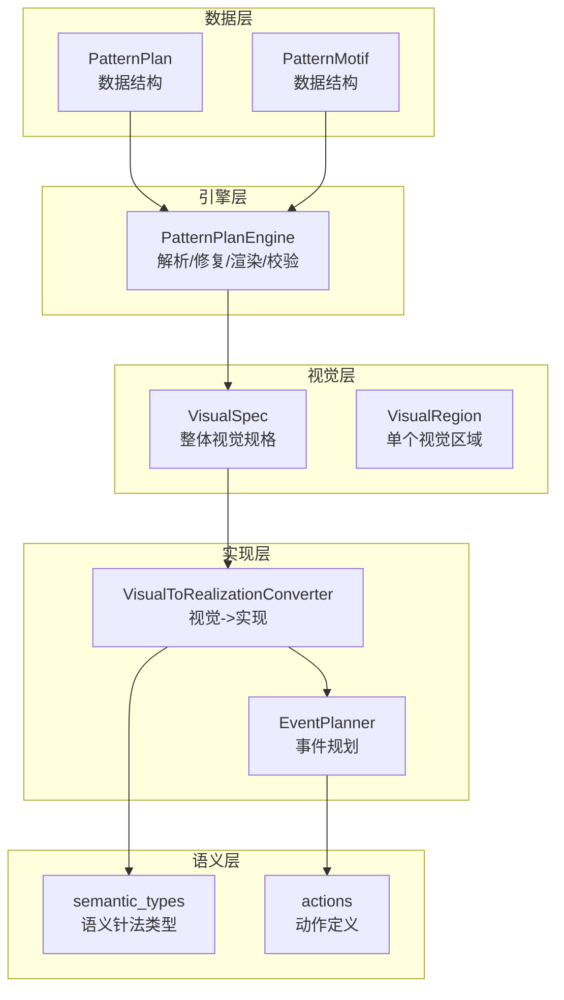
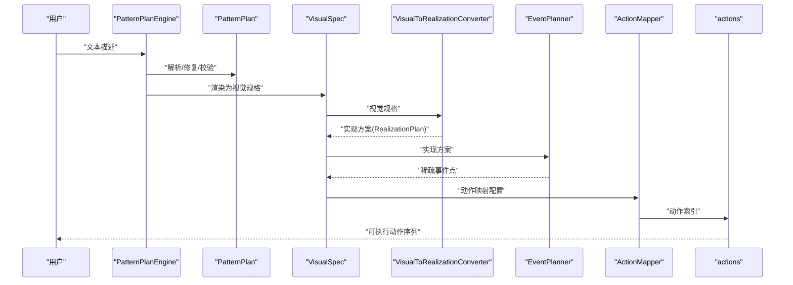
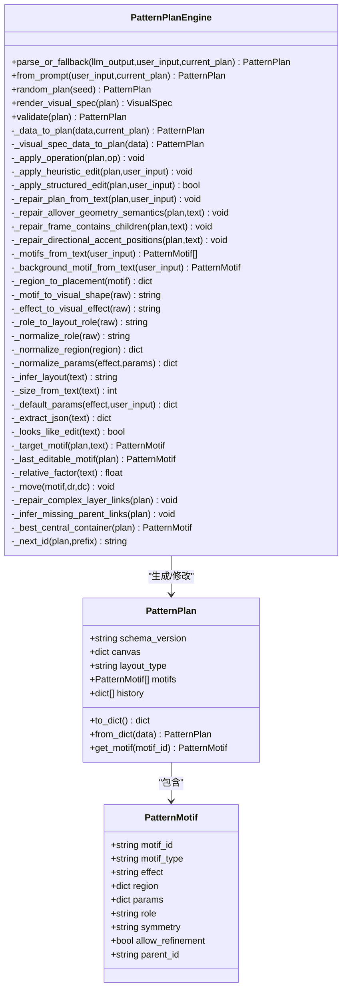
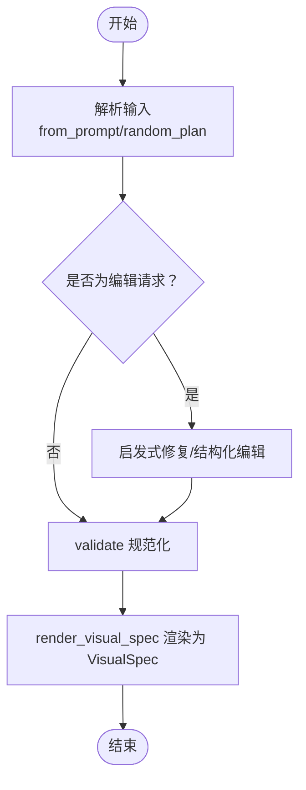
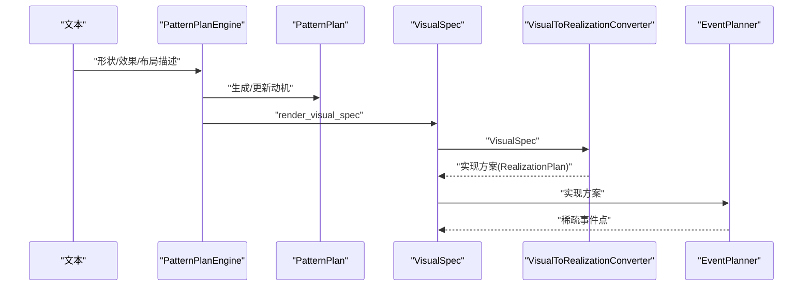
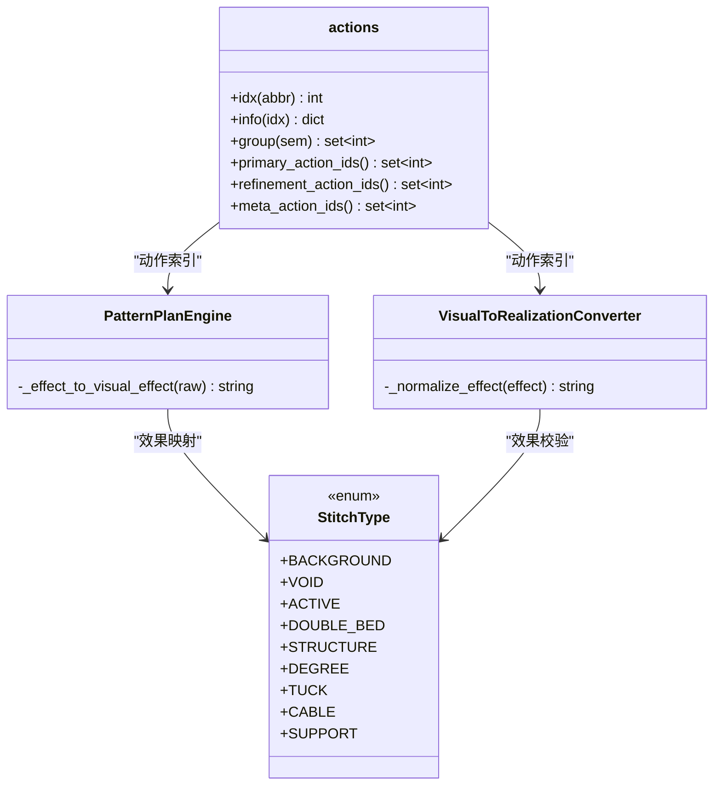
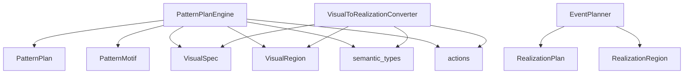

# 图案计划引擎

<cite>
**本文档引用的文件**
- [pattern_plan.py](file://generator_one/generation/pattern_plan.py)
- [test_pattern_plan.py](file://generator_one/tests/test_pattern_plan.py)
- [visual_types.py](file://generator_one/generation/visual_types.py)
- [visual_to_realization.py](file://generator_one/generation/visual_to_realization.py)
- [event_planner.py](file://generator_one/generation/event_planner.py)
- [semantic_types.py](file://generator_one/core/semantic_types.py)
- [actions.py](file://generator_one/core/actions.py)
- [main.py](file://generator_one/main.py)
- [config.py](file://generator_one/config.py)
- [logger.py](file://generator_one/utils/logger.py)
</cite>

## 目录
1. [简介](#简介)
2. [项目结构](#项目结构)
3. [核心组件](#核心组件)
4. [架构总览](#架构总览)
5. [详细组件分析](#详细组件分析)
6. [依赖关系分析](#依赖关系分析)
7. [性能考虑](#性能考虑)
8. [故障排除指南](#故障排除指南)
9. [结论](#结论)
10. [附录](#附录)

## 简介
本技术文档围绕图案计划引擎模块展开，重点阐述 PatternPlan 类的设计与实现，涵盖以下方面：
- 图案计划的数据结构、状态管理与操作方法
- 图案计划的生命周期：从创建、修改到最终确认的完整流程
- 视觉规格到图案计划的转换机制
- 与语义类型系统的集成
- 并发访问与数据一致性的解决方案
- 性能优化与内存管理最佳实践

## 项目结构
图案计划引擎位于 generator_one/generation 子模块中，采用“数据层 + 引擎层 + 视觉层 + 实现层”的分层设计：
- 数据层：PatternPlan/PattenMotif 等数据结构
- 引擎层：PatternPlanEngine 负责解析、修复、渲染与校验
- 视觉层：VisualSpec/VisualRegion 等视觉规格定义
- 实现层：VisualToRealizationConverter 将视觉规格翻译为可执行的实现方案
- 语义层：semantic_types 与 actions 提供语义针法与动作映射

图表来源
- [pattern_plan.py:134-141](file://generator_one/generation/pattern_plan.py#L134-L141)
- [visual_types.py:106-121](file://generator_one/generation/visual_types.py#L106-L121)
- [visual_to_realization.py:240-295](file://generator_one/generation/visual_to_realization.py#L240-L295)
- [event_planner.py:24-80](file://generator_one/generation/event_planner.py#L24-L80)
- [semantic_types.py:11-63](file://generator_one/core/semantic_types.py#L11-L63)
- [actions.py:18-38](file://generator_one/core/actions.py#L18-L38)

章节来源
- [pattern_plan.py:1-80](file://generator_one/generation/pattern_plan.py#L1-L80)
- [visual_types.py:1-70](file://generator_one/generation/visual_types.py#L1-L70)
- [visual_to_realization.py:1-30](file://generator_one/generation/visual_to_realization.py#L1-L30)
- [event_planner.py:1-25](file://generator_one/generation/event_planner.py#L1-L25)
- [semantic_types.py:1-25](file://generator_one/core/semantic_types.py#L1-L25)
- [actions.py:1-20](file://generator_one/core/actions.py#L1-L20)

## 核心组件
- PatternPlan：图案计划的核心数据容器，包含画布尺寸、布局类型、动机列表与历史记录
- PatternMotif：单个动机的数据结构，包含动机类型、效果、区域、参数、角色、对称性、父动机ID等
- PatternPlanEngine：引擎核心，负责从用户输入解析/修复/渲染/校验，生成 VisualSpec，并进行语义修复与层级链接恢复
- VisualSpec/VisualRegion：视觉规格定义，描述仿真图中的区域与布局角色
- VisualToRealizationConverter：将视觉规格翻译为可执行的实现方案，包含形状标准化、效果映射与保护规则
- EventPlanner：基于实现方案生成稀疏事件点，确保只在必要位置放置动作
- semantic_types/actions：语义针法类型与动作定义，提供张力、兼容性与动作分组等能力

章节来源
- [pattern_plan.py:121-141](file://generator_one/generation/pattern_plan.py#L121-L141)
- [visual_types.py:77-121](file://generator_one/generation/visual_types.py#L77-L121)
- [visual_to_realization.py:240-295](file://generator_one/generation/visual_to_realization.py#L240-L295)
- [event_planner.py:24-80](file://generator_one/generation/event_planner.py#L24-L80)
- [semantic_types.py:11-63](file://generator_one/core/semantic_types.py#L11-L63)
- [actions.py:18-38](file://generator_one/core/actions.py#L18-L38)

## 架构总览
图案计划引擎的端到端流程如下：
1. 用户输入文本描述（中文/英文）
2. PatternPlanEngine 解析输入，生成/更新 PatternPlan
3. PatternPlanEngine 渲染为 VisualSpec
4. VisualToRealizationConverter 将 VisualSpec 翻译为实现方案（RealizationPlan）
5. EventPlanner 基于实现方案生成稀疏事件点
6. ActionMapper 将事件点映射为具体动作索引
7. 输出统计与可视化结果

图表来源
- [pattern_plan.py:175-207](file://generator_one/generation/pattern_plan.py#L175-L207)
- [visual_to_realization.py:258-295](file://generator_one/generation/visual_to_realization.py#L258-L295)
- [event_planner.py:33-80](file://generator_one/generation/event_planner.py#L33-L80)
- [actions.py:50-59](file://generator_one/core/actions.py#L50-L59)

## 详细组件分析

### PatternPlan 类设计与实现
- 数据结构
  - canvas：画布尺寸（默认 40x40）
  - layout_type：布局类型（centered/allover_repeat/framed/side_bands 等）
  - motifs：动机列表（PatternMotif）
  - history：历史记录（输入来源与时间戳等）
- 状态管理
  - 提供 to_dict/from_dict 序列化/反序列化
  - 提供 get_motif 查询动机
- 操作方法
  - from_prompt：从文本生成/编辑图案计划
  - random_plan：随机生成图案计划
  - render_visual_spec：渲染为 VisualSpec
  - validate：规范化与修复（角色、区域、参数、父子关系等）

图表来源
- [pattern_plan.py:121-141](file://generator_one/generation/pattern_plan.py#L121-L141)
- [pattern_plan.py:175-369](file://generator_one/generation/pattern_plan.py#L175-L369)

章节来源
- [pattern_plan.py:121-141](file://generator_one/generation/pattern_plan.py#L121-L141)
- [pattern_plan.py:175-369](file://generator_one/generation/pattern_plan.py#L175-L369)

### 图案计划生命周期
- 创建阶段
  - from_prompt：解析文本，提取形状/效果/布局，生成初始动机
  - random_plan：随机生成布局与动机组合
- 修改阶段
  - parse_or_fallback：优先解析 LLM 输出的 JSON，否则启发式修复
  - _apply_heuristic_edit/_apply_structured_edit：基于用户指令进行局部修改
  - _repair_plan_from_text：基于自然语言语义修复动机角色、区域与父子关系
- 确认阶段
  - validate：规范化动机类型/效果/角色/区域/参数，修复复杂层级关系
  - render_visual_spec：将 PatternPlan 渲染为 VisualSpec，供后续翻译

图表来源
- [pattern_plan.py:175-207](file://generator_one/generation/pattern_plan.py#L175-L207)
- [pattern_plan.py:353-369](file://generator_one/generation/pattern_plan.py#L353-L369)
- [pattern_plan.py:319-351](file://generator_one/generation/pattern_plan.py#L319-L351)

章节来源
- [pattern_plan.py:175-207](file://generator_one/generation/pattern_plan.py#L175-L207)
- [pattern_plan.py:319-369](file://generator_one/generation/pattern_plan.py#L319-L369)

### 视觉规格到图案计划的转换机制
- 文本到动机
  - _motifs_from_text：从文本中识别形状、效果、角色与尺寸
  - _background_motif_from_text：从文本中识别背景纹理
- 动机到视觉规格
  - _region_to_placement：将动机区域转换为 VisualRegion 的 placement
  - _motif_to_visual_shape/_effect_to_visual_effect/_role_to_layout_role：规范化形状/效果/角色
- 视觉规格到实现方案
  - VisualToRealizationConverter：形状标准化、效果映射、保护规则与对齐
- 实现方案到事件点
  - EventPlanner：基于实现方案生成稀疏事件点，确保只在必要位置放置动作

图表来源
- [pattern_plan.py:319-351](file://generator_one/generation/pattern_plan.py#L319-L351)
- [visual_to_realization.py:258-295](file://generator_one/generation/visual_to_realization.py#L258-L295)
- [event_planner.py:33-80](file://generator_one/generation/event_planner.py#L33-L80)

章节来源
- [pattern_plan.py:781-846](file://generator_one/generation/pattern_plan.py#L781-L846)
- [pattern_plan.py:1221-1259](file://generator_one/generation/pattern_plan.py#L1221-L1259)
- [visual_to_realization.py:521-582](file://generator_one/generation/visual_to_realization.py#L521-L582)

### 与语义类型系统的集成
- 语义针法类型（semantic_types.StitchType）
  - 提供张力、过渡需求、安全降级等属性
  - 提供关键词解析与兼容性判断
- 动作定义（actions）
  - 统一的动作索引、名称、颜色、语义属性
  - 动作分组（基础/精修/元动作），支持兼容性与过渡策略
- 在引擎中的应用
  - PatternPlanEngine 的 _effect_to_visual_effect 使用语义映射
  - VisualToRealizationConverter 的 _normalize_effect 使用语义校验
  - ActionMapper 基于语义兼容性进行过渡平滑

图表来源
- [semantic_types.py:11-63](file://generator_one/core/semantic_types.py#L11-L63)
- [actions.py:50-59](file://generator_one/core/actions.py#L50-L59)
- [pattern_plan.py:1279-1283](file://generator_one/generation/pattern_plan.py#L1279-L1283)
- [visual_to_realization.py:583-612](file://generator_one/generation/visual_to_realization.py#L583-L612)

章节来源
- [semantic_types.py:11-63](file://generator_one/core/semantic_types.py#L11-L63)
- [actions.py:18-38](file://generator_one/core/actions.py#L18-L38)
- [pattern_plan.py:1279-1283](file://generator_one/generation/pattern_plan.py#L1279-L1283)
- [visual_to_realization.py:583-612](file://generator_one/generation/visual_to_realization.py#L583-L612)

### 使用示例
- 创建图案计划
  - 从文本生成：调用 from_prompt
  - 随机生成：调用 random_plan
- 修改图案计划
  - 结构化编辑：通过 operation changes 更新动机
  - 启发式编辑：通过文本指令调整大小、密度、位置
- 查询与导出
  - get_motif 查询动机
  - to_dict/from_dict 序列化/反序列化
  - render_visual_spec 导出为 VisualSpec

章节来源
- [pattern_plan.py:175-207](file://generator_one/generation/pattern_plan.py#L175-L207)
- [pattern_plan.py:614-655](file://generator_one/generation/pattern_plan.py#L614-L655)
- [pattern_plan.py:142-166](file://generator_one/generation/pattern_plan.py#L142-L166)

## 依赖关系分析
- PatternPlanEngine 依赖
  - PatternPlan/PattenMotif：数据结构
  - VisualSpec/VisualRegion：视觉规格
  - semantic_types/actions：语义与动作
- VisualToRealizationConverter 依赖
  - VisualSpec/VisualRegion：输入
  - semantic_types/actions：语义与动作
- EventPlanner 依赖
  - RealizationPlan/RealizationRegion：输入
  - mask_utils/layer_utils：掩码与层级工具

图表来源
- [pattern_plan.py:19-20](file://generator_one/generation/pattern_plan.py#L19-L20)
- [visual_types.py:17-22](file://generator_one/generation/visual_types.py#L17-L22)
- [visual_to_realization.py:17-23](file://generator_one/generation/visual_to_realization.py#L17-L23)
- [event_planner.py:18-22](file://generator_one/generation/event_planner.py#L18-L22)

章节来源
- [pattern_plan.py:19-20](file://generator_one/generation/pattern_plan.py#L19-L20)
- [visual_types.py:17-22](file://generator_one/generation/visual_types.py#L17-L22)
- [visual_to_realization.py:17-23](file://generator_one/generation/visual_to_realization.py#L17-L23)
- [event_planner.py:18-22](file://generator_one/generation/event_planner.py#L18-L22)

## 性能考虑
- 缓存与复用
  - VisualToRealizationConverter 内置 shape/effect 标准化缓存，减少重复计算
- 稀疏事件生成
  - EventPlanner 仅在必要位置生成事件点，避免在无效区域放置动作
- 参数约束
  - _normalize_params/_normalize_region 限制参数范围，避免过度密集导致的计算开销
- 并发与一致性
  - 当前实现为单线程流程，建议在外部通过任务队列或锁机制保证并发安全
  - 对共享数据结构（如全局配置）应使用不可变对象或复制策略

章节来源
- [visual_to_realization.py:251-257](file://generator_one/generation/visual_to_realization.py#L251-L257)
- [event_planner.py:33-80](file://generator_one/generation/event_planner.py#L33-L80)
- [pattern_plan.py:1210-1219](file://generator_one/generation/pattern_plan.py#L1210-L1219)

## 故障排除指南
- LLM 输出解析失败
  - parse_or_fallback 会回退到启发式规划，检查日志以定位失败原因
- 动机角色/区域异常
  - validate 会规范化角色与区域，_repair_plan_from_text 修复语义错误
- 父子关系缺失
  - _infer_missing_parent_links 与 _repair_complex_layer_links 恢复层级关系
- 事件点为空
  - EventPlanner 返回 0 事件时，检查 visual_effect 与参数设置

章节来源
- [pattern_plan.py:176-188](file://generator_one/generation/pattern_plan.py#L176-L188)
- [pattern_plan.py:353-369](file://generator_one/generation/pattern_plan.py#L353-L369)
- [pattern_plan.py:1309-1360](file://generator_one/generation/pattern_plan.py#L1309-L1360)
- [event_planner.py:33-80](file://generator_one/generation/event_planner.py#L33-L80)

## 结论
图案计划引擎通过清晰的分层设计与严格的规范化流程，实现了从自然语言描述到可执行动作序列的高效转换。其核心优势在于：
- 可编辑的动机模型与灵活的修复机制
- 严谨的视觉规格到实现方案的翻译
- 基于语义类型的兼容性与过渡策略
- 稀疏事件生成与缓存优化

建议在生产环境中结合任务队列与配置管理，进一步提升并发安全性与可维护性。

## 附录
- 配置与入口
  - config.py 提供全局路径、网格尺寸与日志配置
  - main.py 提供命令行入口，支持生成/随机与中间结果保存

章节来源
- [config.py:24-76](file://generator_one/config.py#L24-L76)
- [main.py:117-202](file://generator_one/main.py#L117-L202)