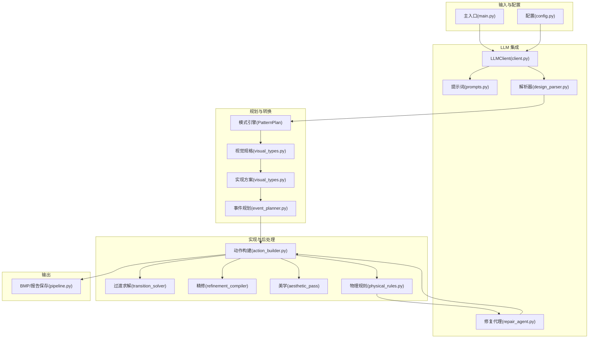
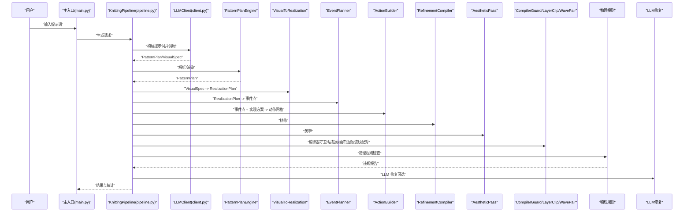
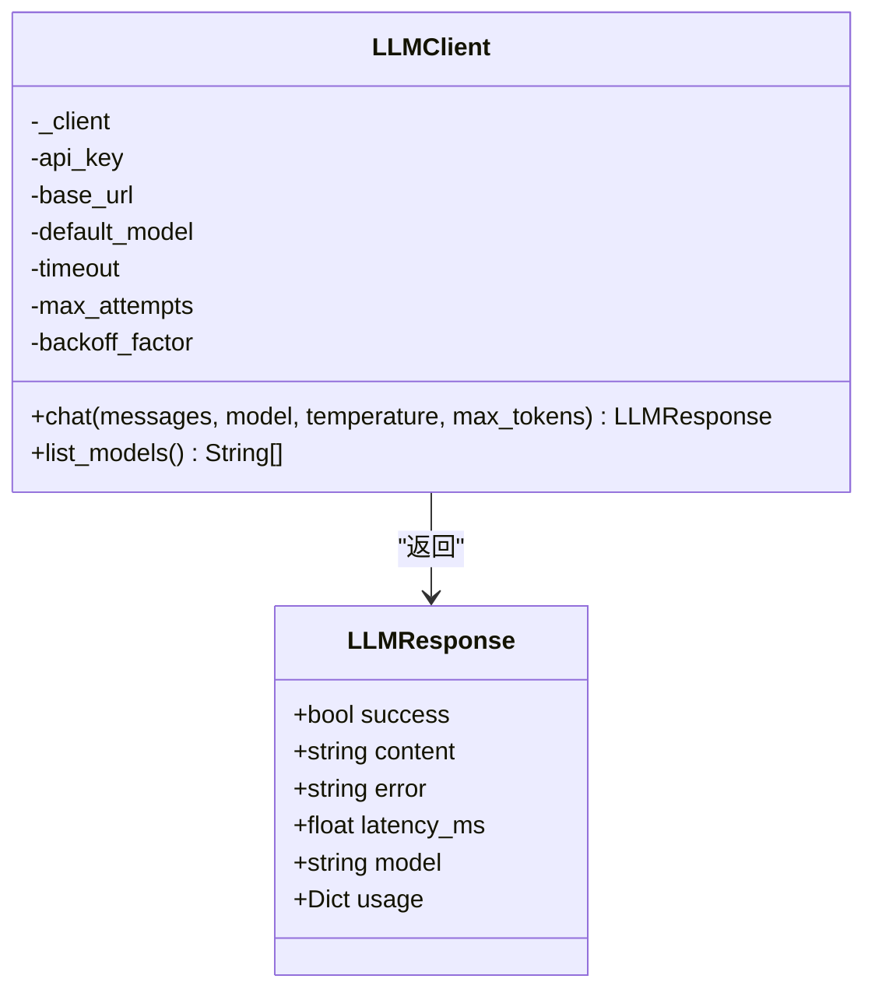
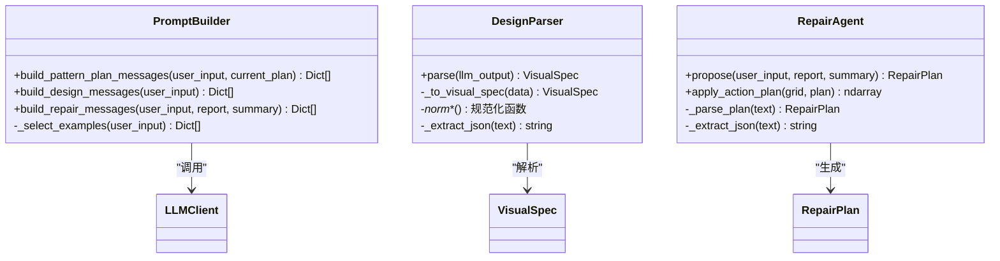
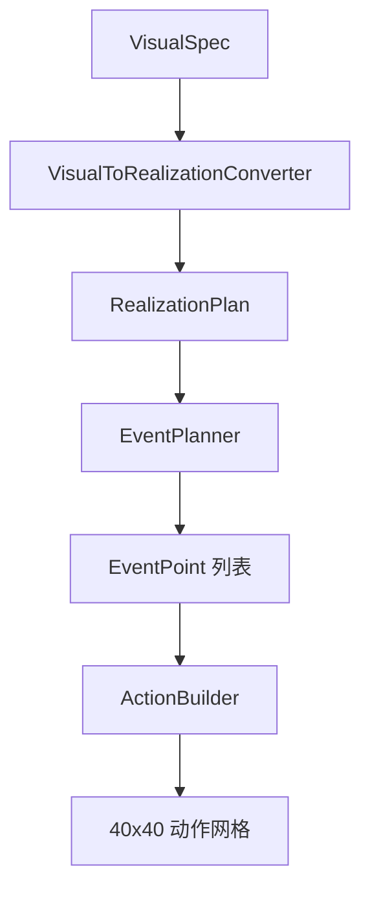
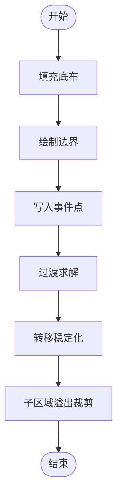
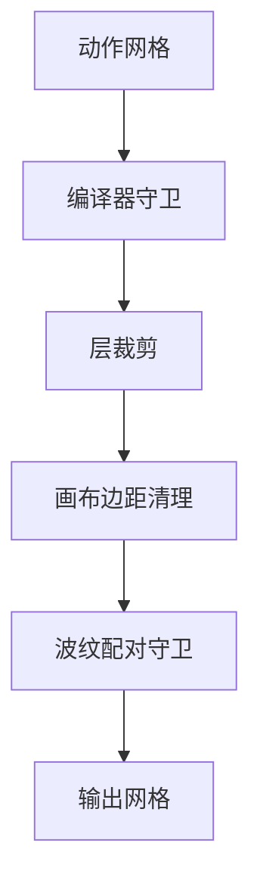
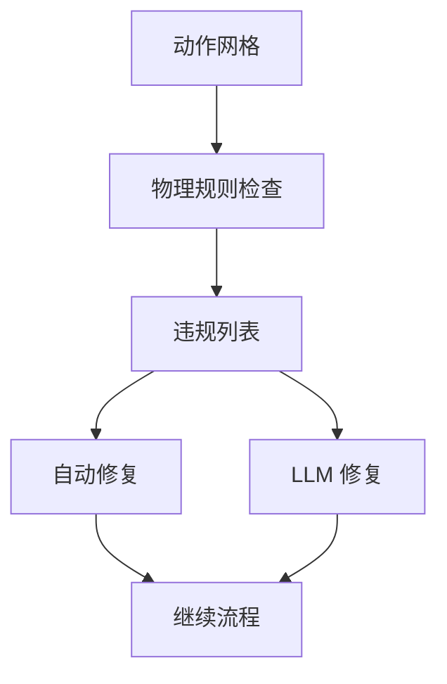
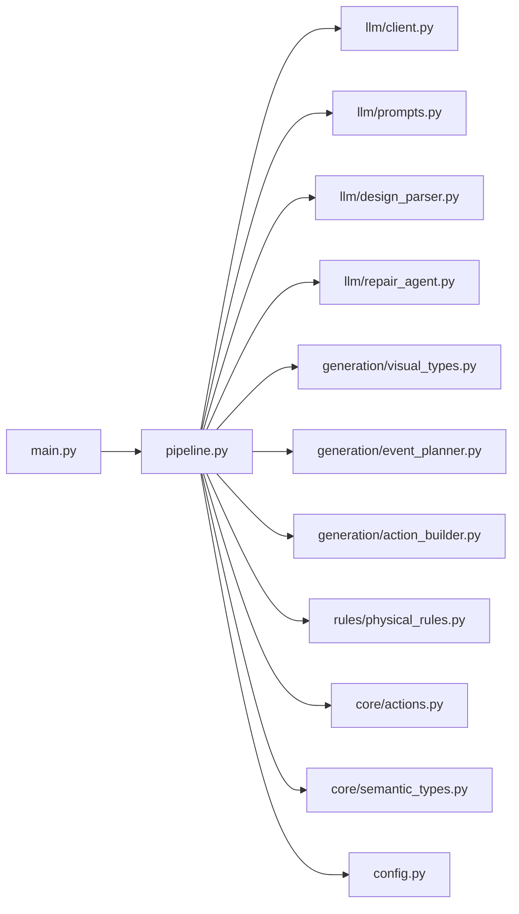

# 第一阶段：图案生成

<cite>
**本文档引用的文件**
- [main.py](file://generator_one/main.py)
- [pipeline.py](file://generator_one/pipeline.py)
- [config.py](file://generator_one/config.py)
- [actions.py](file://generator_one/core/actions.py)
- [semantic_types.py](file://generator_one/core/semantic_types.py)
- [client.py](file://generator_one/llm/client.py)
- [prompts.py](file://generator_one/llm/prompts.py)
- [design_parser.py](file://generator_one/llm/design_parser.py)
- [repair_agent.py](file://generator_one/llm/repair_agent.py)
- [action_builder.py](file://generator_one/generation/action_builder.py)
- [visual_types.py](file://generator_one/generation/visual_types.py)
- [event_planner.py](file://generator_one/generation/event_planner.py)
- [physical_rules.py](file://generator_one/rules/physical_rules.py)
</cite>

## 目录
1. [简介](#简介)
2. [项目结构](#项目结构)
3. [核心组件](#核心组件)
4. [架构总览](#架构总览)
5. [详细组件分析](#详细组件分析)
6. [依赖关系分析](#依赖关系分析)
7. [性能考虑](#性能考虑)
8. [故障排除指南](#故障排除指南)
9. [结论](#结论)
10. [附录](#附录)

## 简介
本文件面向第一阶段图案生成功能，系统性阐述从用户提示到最终色码图输出的完整流水线。重点包括：
- LLM 客户端集成与提示词工程
- 图案计划引擎（Pattern Plan）与视觉规格转换
- 事件规划与动作网格构建
- 物理规则检查与智能修复系统
- 15种针织动作类型的定义与使用
- 与其他组件的协作关系与数据流

## 项目结构
项目采用模块化分层设计，围绕 KnittingPipeline 串联各子系统：
- LLM 层：LLMClient、PromptBuilder、DesignParser、RepairAgent
- 规划层：PatternPlan 引擎、VisualSpec/RealizationPlan、EventPlanner
- 实现层：ActionBuilder、TransitionSolver、RefinementCompiler、AestheticPass
- 规则层：物理规则检查与自动修复
- 工具层：mask/layer 工具、调色板、日志与文件 IO

**图表来源**
- [pipeline.py](file://generator_one/pipeline.py)
- [client.py](file://generator_one/llm/client.py)
- [prompts.py](file://generator_one/llm/prompts.py)
- [design_parser.py](file://generator_one/llm/design_parser.py)
- [repair_agent.py](file://generator_one/llm/repair_agent.py)
- [visual_types.py](file://generator_one/generation/visual_types.py)
- [event_planner.py](file://generator_one/generation/event_planner.py)
- [action_builder.py](file://generator_one/generation/action_builder.py)
- [physical_rules.py](file://generator_one/rules/physical_rules.py)

**章节来源**
- [main.py](file://generator_one/main.py)
- [pipeline.py](file://generator_one/pipeline.py)
- [config.py](file://generator_one/config.py)

## 核心组件
- LLM 客户端与提示词工程：负责将自然语言描述转换为可执行的视觉规格与修复计划
- 规划与转换：将视觉规格渲染为色码实现方案，并生成事件点
- 动作构建：基于事件点与过渡求解生成 40×40 动作网格
- 规则检查与修复：执行物理规则检查并进行自动修复与 LLM 智能修复
- 调色板与导出：生成内部与机器色图，输出 BMP 与导出报告

**章节来源**
- [client.py](file://generator_one/llm/client.py)
- [prompts.py](file://generator_one/llm/prompts.py)
- [design_parser.py](file://generator_one/llm/design_parser.py)
- [visual_types.py](file://generator_one/generation/visual_types.py)
- [event_planner.py](file://generator_one/generation/event_planner.py)
- [action_builder.py](file://generator_one/generation/action_builder.py)
- [physical_rules.py](file://generator_one/rules/physical_rules.py)

## 架构总览
第一阶段端到端流程如下：
1) LLM 将用户输入转换为 PatternPlan 与 VisualSpec
2) VisualSpec 转换为 RealizationPlan
3) EventPlanner 基于实现方案生成稀疏事件点
4) ActionBuilder 填充底布、绘制边界、写入事件点并求解过渡
5) RefinementCompiler、AestheticPass 进行精修与美化
6) Compiler Guard、Layer Clip、Canvas Margin、Wave Pair Guard 等后处理
7) 物理规则检查与自动修复
8) LLM 修复（可选）
9) 导出 BMP 与机器导出报告

**图表来源**
- [pipeline.py](file://generator_one/pipeline.py)
- [client.py](file://generator_one/llm/client.py)
- [prompts.py](file://generator_one/llm/prompts.py)
- [design_parser.py](file://generator_one/llm/design_parser.py)
- [visual_types.py](file://generator_one/generation/visual_types.py)
- [event_planner.py](file://generator_one/generation/event_planner.py)
- [action_builder.py](file://generator_one/generation/action_builder.py)
- [physical_rules.py](file://generator_one/rules/physical_rules.py)

## 详细组件分析

### LLM 客户端集成
- LLMClient 封装 OpenAI 兼容接口，支持重试、超时与模型选择
- 提供统一响应对象，包含内容、延迟、用量等信息
- 与 PromptBuilder 协作，构建设计与修复两类提示词

**图表来源**
- [client.py](file://generator_one/llm/client.py)

**章节来源**
- [client.py](file://generator_one/llm/client.py)
- [config.py](file://generator_one/config.py)

### 提示词与解析器
- PromptBuilder 构建设计与修复两类提示词，支持示例选择与动态负载
- DesignParser 将 LLM 输出解析为 VisualSpec，兼容多种历史 schema
- RepairAgent 将违规报告转化为修复计划，支持语义与动作级修复

**图表来源**
- [prompts.py](file://generator_one/llm/prompts.py)
- [design_parser.py](file://generator_one/llm/design_parser.py)
- [repair_agent.py](file://generator_one/llm/repair_agent.py)
- [visual_types.py](file://generator_one/generation/visual_types.py)

**章节来源**
- [prompts.py](file://generator_one/llm/prompts.py)
- [design_parser.py](file://generator_one/llm/design_parser.py)
- [repair_agent.py](file://generator_one/llm/repair_agent.py)

### 图案计划引擎与视觉规格转换
- PatternPlanEngine 负责解析 LLM 输出或回退到启发式生成
- VisualToRealizationConverter 将 VisualSpec 转换为 RealizationPlan，定义底布、边界、事件模式与过渡策略
- VisualSpec/RealizationPlan/EventPoint 定义清晰的数据契约，确保跨模块一致性

**图表来源**
- [visual_types.py](file://generator_one/generation/visual_types.py)
- [event_planner.py](file://generator_one/generation/event_planner.py)
- [action_builder.py](file://generator_one/generation/action_builder.py)

**章节来源**
- [visual_types.py](file://generator_one/generation/visual_types.py)

### 事件规划与动作网格构建
- EventPlanner 基于不同事件模式（如斜向波纹、菱形麻花、网眼等）生成稀疏事件点
- ActionBuilder 填充底布、绘制边界、写入事件点并求解过渡，最后进行转移稳定化与子区域溢出裁剪

**图表来源**
- [event_planner.py](file://generator_one/generation/event_planner.py)
- [action_builder.py](file://generator_one/generation/action_builder.py)

**章节来源**
- [event_planner.py](file://generator_one/generation/event_planner.py)
- [action_builder.py](file://generator_one/generation/action_builder.py)

### 动作网格构建与后处理
- ActionBuilder 负责将事件点转化为动作网格，处理底布、边界、过渡与稳定性
- 后处理阶段包括编译器守卫（去除无上下文的特殊动作）、层裁剪（子层外动作清理）、画布边距清理、波纹配对守卫等

**图表来源**
- [pipeline.py](file://generator_one/pipeline.py)
- [action_builder.py](file://generator_one/generation/action_builder.py)

**章节来源**
- [pipeline.py](file://generator_one/pipeline.py)

### 物理规则检查与智能修复
- 物理规则涵盖非法索引、支撑缺失、移针偏移/越界/冲突、垂直堆叠限制、Drop 上方清理、床间移针方向冲突等
- 自动修复策略保守：优先降级为安全动作，无法确定时退化为 f_knit
- LLM 修复 Agent 基于违规报告与统计摘要，输出最小修复方案

**图表来源**
- [physical_rules.py](file://generator_one/rules/physical_rules.py)
- [repair_agent.py](file://generator_one/llm/repair_agent.py)

**章节来源**
- [physical_rules.py](file://generator_one/rules/physical_rules.py)
- [repair_agent.py](file://generator_one/llm/repair_agent.py)

### 15种针织动作类型详解
动作定义来源于 instruction_info.json，核心属性包括 abbr、name、颜色、bed、offset、tension、frequency、variant 等。以下为关键动作分类与用途：

- 基础编织动作
  - f_knit / b_knit：前后针目，作为底布与边界的基础
- 移针动作（TRANSFER）
  - xfer_f_b / xfer_b_f：前后床移针，形成麻花/链接组织
  - xfer_l1 / xfer_r1：左右向移针，常用于菱形麻花边
  - bed transfers：同床跨行移针，需注意方向冲突
- 集圈动作（TUCK）
  - f_tuck / b_tuck：形成波浪/吊目纹理
  - f_tuck_2 / b_tuck_2：精细纹理微调
- 劈针动作（SPLIT）
  - f_split / b_split：破坏环路，形成镂空/浮线
- 空针动作（MISS）
  - miss：浮线/镂空，常用于网眼与支撑
- 元动作（CARRIER）
  - carrier：行级控制，不参与常规像素填充
- 精修动作（REFINEMENT）
  - split_v：复合结构衔接
  - f_tuck_2 / b_tuck_2：细纹理微调

动作语义与张力属性由 core.actions 与 semantic_types 共同管理，确保规则检查与导出一致性。

**章节来源**
- [actions.py](file://generator_one/core/actions.py)
- [semantic_types.py](file://generator_one/core/semantic_types.py)

## 依赖关系分析

**图表来源**
- [main.py](file://generator_one/main.py)
- [pipeline.py](file://generator_one/pipeline.py)
- [client.py](file://generator_one/llm/client.py)
- [prompts.py](file://generator_one/llm/prompts.py)
- [design_parser.py](file://generator_one/llm/design_parser.py)
- [repair_agent.py](file://generator_one/llm/repair_agent.py)
- [visual_types.py](file://generator_one/generation/visual_types.py)
- [event_planner.py](file://generator_one/generation/event_planner.py)
- [action_builder.py](file://generator_one/generation/action_builder.py)
- [physical_rules.py](file://generator_one/rules/physical_rules.py)
- [actions.py](file://generator_one/core/actions.py)
- [semantic_types.py](file://generator_one/core/semantic_types.py)
- [config.py](file://generator_one/config.py)

**章节来源**
- [pipeline.py](file://generator_one/pipeline.py)

## 性能考虑
- 稀疏事件点：事件规划器仅生成必要事件，显著降低网格复杂度
- 分步后处理：编译器守卫、层裁剪、波纹配对等在早期阶段执行，减少后续计算量
- 自动修复策略：优先保守降级，避免反复迭代
- 调色板复用：统一颜色表与机器色表，减少内存与 I/O 开销

## 故障排除指南
- LLM 未返回有效 JSON
  - 检查提示词构建与示例选择
  - 使用 DesignParser 的 JSON 提取与修复逻辑
- 事件规划返回 0 事件
  - 检查 visual_effect 是否正确映射到事件模式
  - 核对参数（如 period、offset）是否合理
- 物理规则违规
  - H2 支撑缺失：在下方补 b_knit 或保留 miss 以维持镂空结构
  - H3/H4/H5 移针违规：降级为 f_split 或调整偏移
  - H6 垂直堆叠：插入 knit/split 打断堆叠
  - H7 Drop 上方清理：移除上方支撑或调整 Drop 位置
  - H8 床间移针冲突：拆到相邻行或仅保留单方向
- LLM 修复无效
  - 检查违规报告与统计摘要是否正确传递
  - 确认允许的动作集合与修复策略

**章节来源**
- [design_parser.py](file://generator_one/llm/design_parser.py)
- [event_planner.py](file://generator_one/generation/event_planner.py)
- [physical_rules.py](file://generator_one/rules/physical_rules.py)
- [repair_agent.py](file://generator_one/llm/repair_agent.py)

## 结论
第一阶段图案生成以 KnittingPipeline 为核心，通过 LLM 驱动的视觉规格与事件驱动的动作网格构建，结合严格的物理规则与智能修复，实现了从自然语言到可织造色码图的自动化流程。模块化设计确保了扩展性与可维护性，为后续阶段（如第二阶段仿真与优化）奠定了坚实基础。

## 附录

### 使用模式与示例
- 基本生成
  - python main.py generate "中心麻花菱形"
- 指定输出目录与前缀
  - python main.py generate "整幅波浪吊目纹理" -o outputs/images --prefix case_01
- 禁用特定步骤
  - python main.py generate "中心麻花菱形" --no-refinement --no-aesthetic --no-repair
- 增量修改现有图案
  - python main.py generate "波浪更大一点" --plan-in ./outputs/images/case_01_pattern_plan.json

**章节来源**
- [main.py](file://generator_one/main.py)