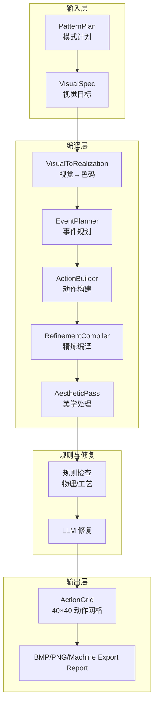
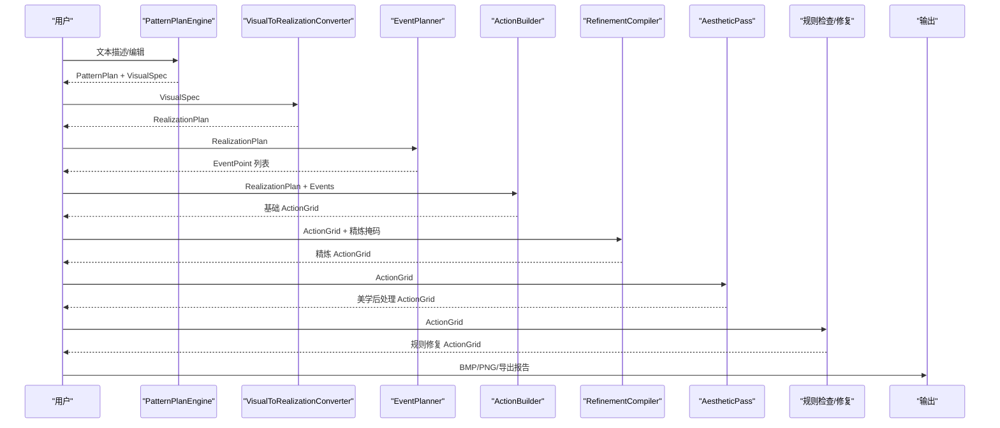
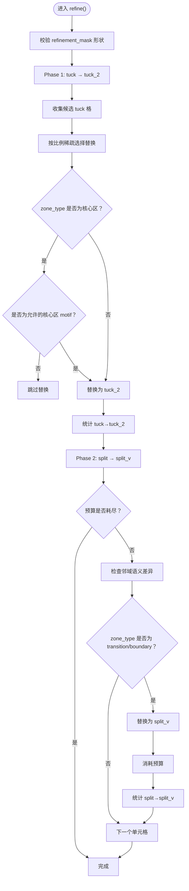
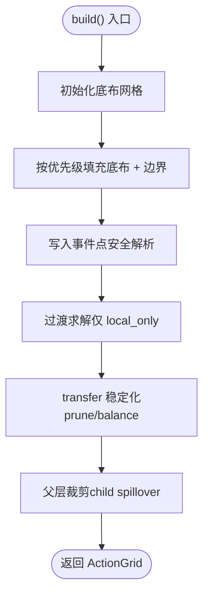
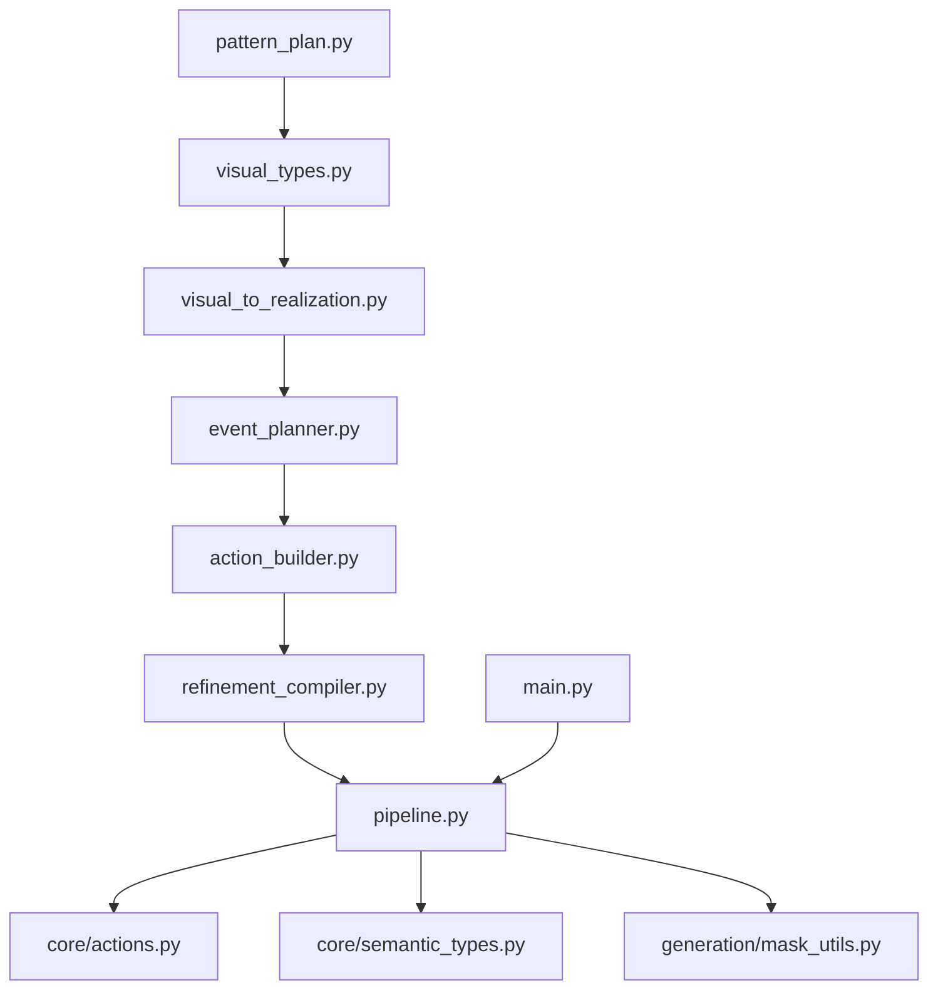

# 精炼编译器

<cite>
**本文引用的文件**
- [refinement_compiler.py](file://generator_one/generation/refinement_compiler.py)
- [action_builder.py](file://generator_one/generation/action_builder.py)
- [action_mapper.py](file://generator_one/generation/action_mapper.py)
- [pattern_plan.py](file://generator_one/generation/pattern_plan.py)
- [visual_types.py](file://generator_one/generation/visual_types.py)
- [visual_to_realization.py](file://generator_one/generation/visual_to_realization.py)
- [event_planner.py](file://generator_one/generation/event_planner.py)
- [actions.py](file://generator_one/core/actions.py)
- [semantic_types.py](file://generator_one/core/semantic_types.py)
- [mask_utils.py](file://generator_one/generation/mask_utils.py)
- [config.py](file://generator_one/config.py)
- [main.py](file://generator_one/main.py)
- [pipeline.py](file://generator_one/pipeline.py)
</cite>

## 目录
1. [简介](#简介)
2. [项目结构](#项目结构)
3. [核心组件](#核心组件)
4. [架构总览](#架构总览)
5. [详细组件分析](#详细组件分析)
6. [依赖分析](#依赖分析)
7. [性能考量](#性能考量)
8. [故障排查指南](#故障排查指南)
9. [结论](#结论)
10. [附录](#附录)

## 简介
本技术文档围绕“精炼编译器”展开，系统阐述从高级图案规格到可执行编织指令的完整编译流程。编译器采用分层设计：先由 PatternPlan 引导生成视觉目标（VisualSpec），再经由 VisualToRealization 转换为色码实现（RealizationPlan），随后通过 EventPlanner 生成稀疏事件点，ActionBuilder 构建基础动作网格，RefinementCompiler 进行局部精炼替换，最后经 AestheticPass、规则校验与 LLM 修复，输出可用于模拟与机器导出的最终动作网格。

## 项目结构
编译器相关代码主要集中在 generator_one/generation 与 generator_one/core 两大模块：
- generation：编译流水线各阶段实现（事件规划、动作构建、精炼、美学、规则检查等）
- core：动作语义与类型定义（动作索引、语义属性、张力模型等）

图表来源
- [visual_to_realization.py:240-295](file://generator_one/generation/visual_to_realization.py#L240-L295)
- [event_planner.py:33-80](file://generator_one/generation/event_planner.py#L33-L80)
- [action_builder.py:43-118](file://generator_one/generation/action_builder.py#L43-L118)
- [refinement_compiler.py:48-181](file://generator_one/generation/refinement_compiler.py#L48-L181)
- [pipeline.py:114-189](file://generator_one/pipeline.py#L114-L189)

章节来源
- [pattern_plan.py:175-370](file://generator_one/generation/pattern_plan.py#L175-L370)
- [visual_types.py:106-179](file://generator_one/generation/visual_types.py#L106-L179)
- [visual_to_realization.py:240-295](file://generator_one/generation/visual_to_realization.py#L240-L295)
- [event_planner.py:33-80](file://generator_one/generation/event_planner.py#L33-L80)
- [action_builder.py:43-118](file://generator_one/generation/action_builder.py#L43-L118)
- [refinement_compiler.py:48-181](file://generator_one/generation/refinement_compiler.py#L48-L181)
- [pipeline.py:114-189](file://generator_one/pipeline.py#L114-L189)

## 核心组件
- PatternPlan 与 PatternPlanEngine：解析用户意图，生成可编辑的 PatternPlan，并渲染为 VisualSpec。
- VisualToRealizationConverter：将 VisualSpec 转换为 RealizationPlan，决定每个区域的底布、边界样式与事件模式。
- EventPlanner：根据 RealizationPlan 生成稀疏事件点，确保“仿真效果→色码排列”的一致性。
- ActionBuilder：在 40×40 网格上构建基础动作网格，填充底布、绘制边界、写入事件点、求解过渡、稳定化与父层裁剪。
- RefinementCompiler：在基础网格上进行受控的低频精炼替换（tuck→tuck_2、split→split_v），遵守预算与区域约束。
- AestheticPass：对动作网格进行美学后处理（此处为占位，具体实现见相关模块）。
- 规则与修复：物理/工艺规则检查与自动修复，以及 LLM 修复代理的交互式修复。
- 动作与语义：core.actions 提供动作索引与属性，core.semantic_types 提供 StitchType 语义与兼容性评估。

章节来源
- [pattern_plan.py:175-370](file://generator_one/generation/pattern_plan.py#L175-L370)
- [visual_to_realization.py:240-295](file://generator_one/generation/visual_to_realization.py#L240-L295)
- [event_planner.py:24-80](file://generator_one/generation/event_planner.py#L24-L80)
- [action_builder.py:35-118](file://generator_one/generation/action_builder.py#L35-L118)
- [refinement_compiler.py:44-181](file://generator_one/generation/refinement_compiler.py#L44-L181)
- [actions.py:18-338](file://generator_one/core/actions.py#L18-L338)
- [semantic_types.py:11-198](file://generator_one/core/semantic_types.py#L11-L198)

## 架构总览
编译器采用“模式计划→视觉目标→色码实现→事件规划→动作构建→精炼→美学→规则与修复”的流水线架构。每一步均以数据类（dataclass）承载状态，确保可追踪与可扩展。

图表来源
- [pipeline.py:114-189](file://generator_one/pipeline.py#L114-L189)
- [pattern_plan.py:175-370](file://generator_one/generation/pattern_plan.py#L175-L370)
- [visual_to_realization.py:258-295](file://generator_one/generation/visual_to_realization.py#L258-L295)
- [event_planner.py:33-80](file://generator_one/generation/event_planner.py#L33-L80)
- [action_builder.py:43-118](file://generator_one/generation/action_builder.py#L43-L118)
- [refinement_compiler.py:48-181](file://generator_one/generation/refinement_compiler.py#L48-L181)
- [pipeline.py:552-575](file://generator_one/pipeline.py#L552-L575)

## 详细组件分析

### 精炼编译器（RefinementCompiler）
职责与策略
- 在基础动作网格上进行稀疏、受控的低频精炼替换，仅允许 primary→refinement 的替换，且不得破坏硬性规则。
- 支持两类替换：
  - tuck → tuck_2：在细纹理区、张力补偿区稀疏使用，优先在非核心区域替换，核心区仅允许特定 motif。
  - split → split_v：仅在 transition/boundary 且邻域存在足够语义差异时使用，受预算约束。

关键实现要点
- 配置项：tuck_variant_ratio、split_v_max_budget、split_v_min_neighbor_diff。
- 统计信息：记录 tuck→tuck_2、split→split_v 数量与剩余预算。
- 邻域与区域约束：通过 role_grid.zone_type 与 stitch_grid 的邻域语义差异判断是否触发 split_v。
- 稀疏策略：按相位周期稀疏采样，避免密集替换。

图表来源
- [refinement_compiler.py:48-181](file://generator_one/generation/refinement_compiler.py#L48-L181)

章节来源
- [refinement_compiler.py:26-42](file://generator_one/generation/refinement_compiler.py#L26-L42)
- [refinement_compiler.py:48-181](file://generator_one/generation/refinement_compiler.py#L48-L181)

### 动作构建器（ActionBuilder）
职责与流程
- 输入：RealizationPlan + EventPoint 列表，输出 40×40 的基础 ActionGrid。
- 步骤：
  1) 初始化底布（base field）
  2) 绘制边界（border style）
  3) 写入事件点（event points）
  4) 过渡求解（TransitionSolver）
  5) 稳定化（transfer pruning/balancing）
  6) 父层裁剪（parent-mask hard clipping）

关键实现要点
- 底布与边界：根据区域布局角色与形状选择底布动作与边界样式。
- 事件点写入：安全解析动作缩写，越界与不在区域内的事件点会被丢弃并记录警告。
- 过渡求解：仅对 transition_policy==local_only 的区域启用。
- 稳定化：移除越界或冗余的 transfer，平衡左右传输数量。
- 父层裁剪：防止 nested motif 的动作溢出到父层之外。

图表来源
- [action_builder.py:43-118](file://generator_one/generation/action_builder.py#L43-L118)

章节来源
- [action_builder.py:35-118](file://generator_one/generation/action_builder.py#L35-L118)

### 动作映射器（ActionMapper）
职责与流程
- 将 StitchTypeGrid 映射为 ActionGrid，仅使用 primary 结构动作作为保守 fallback。
- 支持 motif 编译结果优先覆盖，fallback 区域仅做过渡平滑。
- 提供映射统计与分布信息。

关键实现要点
- 基础映射：根据 StitchType 返回 primary 动作（如 f_knit/b_knit、f_tuck/b_tuck、f_split/b_split 等）。
- 过渡平滑：在 fallback 区域的语义边界使用安全过渡动作，避免张力不兼容。
- fallback 区域：仅对 motif 未覆盖的区域进行映射与过渡处理。

章节来源
- [action_mapper.py:43-107](file://generator_one/generation/action_mapper.py#L43-L107)
- [action_mapper.py:113-162](file://generator_one/generation/action_mapper.py#L113-L162)
- [action_mapper.py:172-215](file://generator_one/generation/action_mapper.py#L172-L215)

### 模式计划（PatternPlan）与引擎（PatternPlanEngine）
职责与流程
- 解析用户输入（LLM 或启发式），生成可编辑的 PatternPlan。
- 支持结构化编辑（增删改）、随机生成、布局推断与修复。
- 渲染为 VisualSpec，驱动后续编译流程。

关键实现要点
- 文本别名与效果映射：统一形状与效果的别名，提升鲁棒性。
- 结构化编辑：支持“增大/缩小”、“密度变化”、“移动”等操作。
- 视觉规范修复：对“背景/纹理/几何”语义进行纠偏，避免误判。

章节来源
- [pattern_plan.py:175-370](file://generator_one/generation/pattern_plan.py#L175-L370)
- [pattern_plan.py:319-352](file://generator_one/generation/pattern_plan.py#L319-L352)

### 视觉到色码实现（VisualToRealizationConverter）
职责与流程
- 将 VisualSpec 转换为 RealizationPlan，决定每个区域的底布、边界样式与事件模式。
- 提供 shape/效果的标准化与别名映射，处理未知组合的降级策略。
- 对嵌套关系进行对齐与保护，避免纹理事件与父层轮廓冲突。

关键实现要点
- 映射表：effect×shape 到 (base_field, border_style, event_pattern) 的映射。
- 形状标准化：别名映射与优先级列表，确保几何形状的正确性。
- 嵌套保护：为父层与子层纹理事件设置 exclude_masks，避免重叠。

章节来源
- [visual_to_realization.py:240-295](file://generator_one/generation/visual_to_realization.py#L240-L295)
- [visual_to_realization.py:521-555](file://generator_one/generation/visual_to_realization.py#L521-L555)
- [visual_to_realization.py:577-581](file://generator_one/generation/visual_to_realization.py#L577-L581)
- [visual_to_realization.py:635-727](file://generator_one/generation/visual_to_realization.py#L635-L727)

### 事件规划器（EventPlanner）
职责与流程
- 根据 RealizationPlan 生成稀疏事件点，严格遵循“仿真效果→色码排列”的规则。
- 支持多种纹理事件模式：对角波纹、网眼、浮雕集圈、蜂巢集圈、种子针等。
- 对波纹事件进行配对修剪，避免边缘孤立项导致的视觉缺陷。

关键实现要点
- 模式分支：按 event_pattern 分派到具体事件生成函数。
- 参数校验与默认值：对 period、偏移、密度分布等参数进行合法性检查与默认填充。
- 波纹配对：确保同一行上的 f_split 与 f_tuck 成对出现，边缘不可靠配对会被剔除。

章节来源
- [event_planner.py:24-80](file://generator_one/generation/event_planner.py#L24-L80)
- [event_planner.py:395-533](file://generator_one/generation/event_planner.py#L395-L533)
- [event_planner.py:82-139](file://generator_one/generation/event_planner.py#L82-L139)

### 动作与语义（core.actions 与 core.semantic_types）
职责与流程
- core.actions：统一加载 instruction_info.json，提供动作索引、属性、语义分组与导出信息。
- core.semantic_types：定义 StitchType 枚举与语义属性，提供张力差、兼容性与降级规则。

关键实现要点
- 动作分组：primary/refinement/meta 动作集合，区分基础结构、精修与元控制。
- 语义兼容：基于张力差的兼容性评分，指导过渡与替换策略。

章节来源
- [actions.py:18-338](file://generator_one/core/actions.py#L18-L338)
- [semantic_types.py:11-198](file://generator_one/core/semantic_types.py#L11-L198)

### 掩码工具（mask_utils）
职责与流程
- 提供 point_in_mask(r, c, placement, grid_size) 等通用掩码判断函数。
- 支持多种几何形状（圆/椭圆、正多边形、V字/十字、心形/星形等）与重复掩码。

章节来源
- [mask_utils.py:42-128](file://generator_one/generation/mask_utils.py#L42-L128)
- [mask_utils.py:154-175](file://generator_one/generation/mask_utils.py#L154-L175)

### 管线与入口（pipeline.py 与 main.py）
职责与流程
- KnittingPipeline：串联编译流水线，提供步骤化日志、统计与中间结果保存。
- main：命令行入口，支持生成/随机生成、禁用精炼/美学/修复、保存中间结果等选项。

关键实现要点
- 步骤化执行：Step 1-8 的清晰划分，便于调试与扩展。
- 统计与导出：动作分布、张力分数、违规统计、机器导出报告等。
- 修复循环：根据规则检查结果，最多进行 N 轮 LLM 修复。

章节来源
- [pipeline.py:93-189](file://generator_one/pipeline.py#L93-L189)
- [pipeline.py:552-575](file://generator_one/pipeline.py#L552-L575)
- [pipeline.py:577-621](file://generator_one/pipeline.py#L577-L621)
- [main.py:117-202](file://generator_one/main.py#L117-L202)

## 依赖分析
编译器模块之间的依赖关系如下：

图表来源
- [pattern_plan.py:19-21](file://generator_one/generation/pattern_plan.py#L19-L21)
- [visual_to_realization.py:17-23](file://generator_one/generation/visual_to_realization.py#L17-L23)
- [event_planner.py:18-22](file://generator_one/generation/event_planner.py#L18-L22)
- [action_builder.py:18-23](file://generator_one/generation/action_builder.py#L18-L23)
- [refinement_compiler.py:22-23](file://generator_one/generation/refinement_compiler.py#L22-L23)
- [pipeline.py:30-48](file://generator_one/pipeline.py#L30-L48)
- [actions.py:12-13](file://generator_one/core/actions.py#L12-L13)
- [semantic_types.py:7-8](file://generator_one/core/semantic_types.py#L7-L8)
- [mask_utils.py:8-9](file://generator_one/generation/mask_utils.py#L8-L9)
- [main.py:11-11](file://generator_one/main.py#L11-L11)

章节来源
- [pattern_plan.py:19-21](file://generator_one/generation/pattern_plan.py#L19-L21)
- [visual_to_realization.py:17-23](file://generator_one/generation/visual_to_realization.py#L17-L23)
- [event_planner.py:18-22](file://generator_one/generation/event_planner.py#L18-L22)
- [action_builder.py:18-23](file://generator_one/generation/action_builder.py#L18-L23)
- [refinement_compiler.py:22-23](file://generator_one/generation/refinement_compiler.py#L22-L23)
- [pipeline.py:30-48](file://generator_one/pipeline.py#L30-L48)
- [actions.py:12-13](file://generator_one/core/actions.py#L12-L13)
- [semantic_types.py:7-8](file://generator_one/core/semantic_types.py#L7-L8)
- [mask_utils.py:8-9](file://generator_one/generation/mask_utils.py#L8-L9)
- [main.py:11-11](file://generator_one/main.py#L11-L11)

## 性能考量
- 稀疏事件生成：EventPlanner 通过周期与密度分布策略，显著降低事件点数量，提高后续编译效率。
- 网格尺寸固定：统一 40×40 尺寸，减少内存占用与计算复杂度。
- 稀疏精炼：RefinementCompiler 采用比例与预算双重限制，避免大规模替换带来的稳定性问题。
- 缓存与分组：VisualToRealization 的 shape/effect 标准化缓存与 core.actions 的语义分组，减少重复计算。
- 后处理阶段：Layer clipping、Wave pair guard 等在输出前进行一次性清理，避免多次扫描。

## 故障排查指南
常见问题与定位方法
- 事件规划返回 0 事件
  - 检查 VisualSpec 的 event_pattern 是否被正确识别，或参数是否非法。
  - 参考日志提示，定位被跳过的区域。
- 精炼未生效
  - 确认 enable_refinement 未被禁用，且 refinement_mask 有效。
  - 检查预算与邻域条件是否满足。
- 过渡不稳定
  - 检查 ActionBuilder 的稳定化步骤是否正常执行，左右传输数量是否平衡。
- 规则违规
  - 物理/工艺规则检查失败时，查看 Violations 统计与详细位置，必要时启用自动修复或 LLM 修复。
- 机器导出异常
  - 检查 machine_action_id 与 machine_export_safe，关注 requires_confirmation 的动作。

章节来源
- [event_planner.py:69-77](file://generator_one/generation/event_planner.py#L69-L77)
- [pipeline.py:552-575](file://generator_one/pipeline.py#L552-L575)
- [pipeline.py:577-621](file://generator_one/pipeline.py#L577-L621)
- [pipeline.py:686-726](file://generator_one/pipeline.py#L686-L726)

## 结论
精炼编译器通过“模式计划→视觉→色码→事件→动作→精炼→美学→规则与修复”的流水线，实现了从自然语言到可执行编织指令的高效转换。其稀疏策略、预算约束与语义兼容性设计，既保证了编译效率，又提升了最终织物的质量与可生产性。通过模块化的数据类与清晰的日志输出，系统具备良好的可扩展性与可维护性。

## 附录
- 配置与路径
  - 全局网格尺寸、LLM 配置、日志配置等集中于 config.py。
- 命令行使用
  - main.py 提供 generate/random 子命令，支持禁用精炼/美学/修复、保存中间结果等选项。

章节来源
- [config.py:45-76](file://generator_one/config.py#L45-L76)
- [main.py:14-104](file://generator_one/main.py#L14-L104)