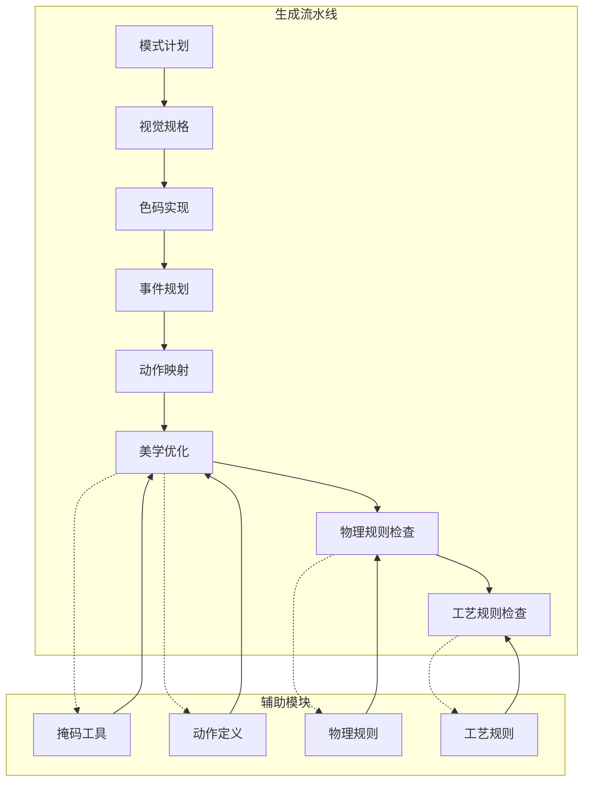
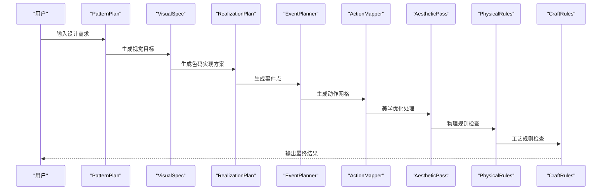
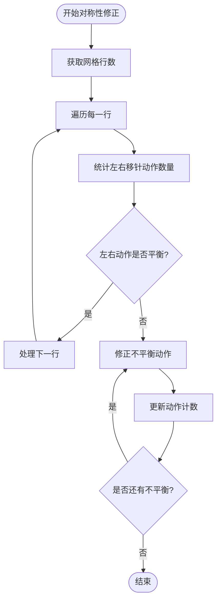
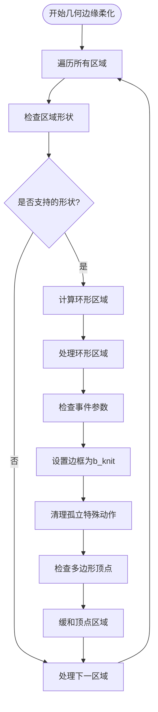
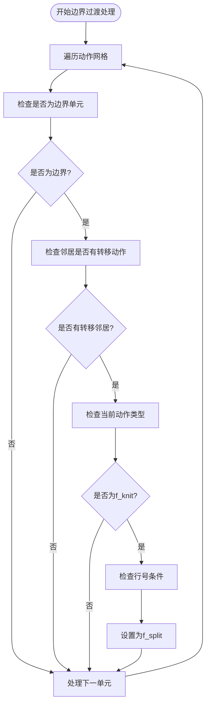
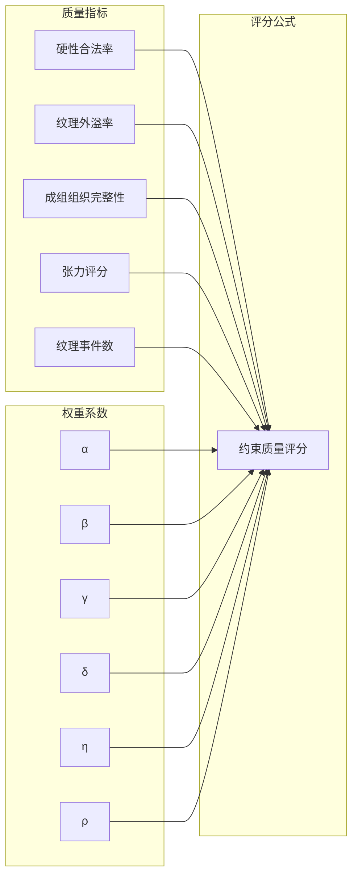
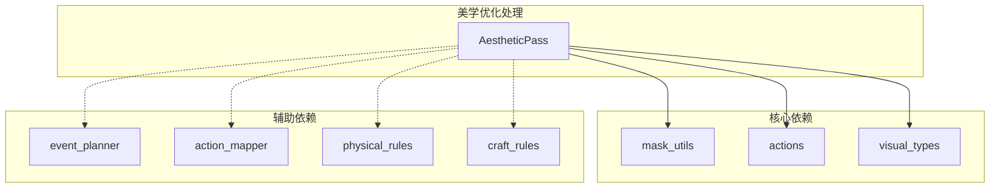
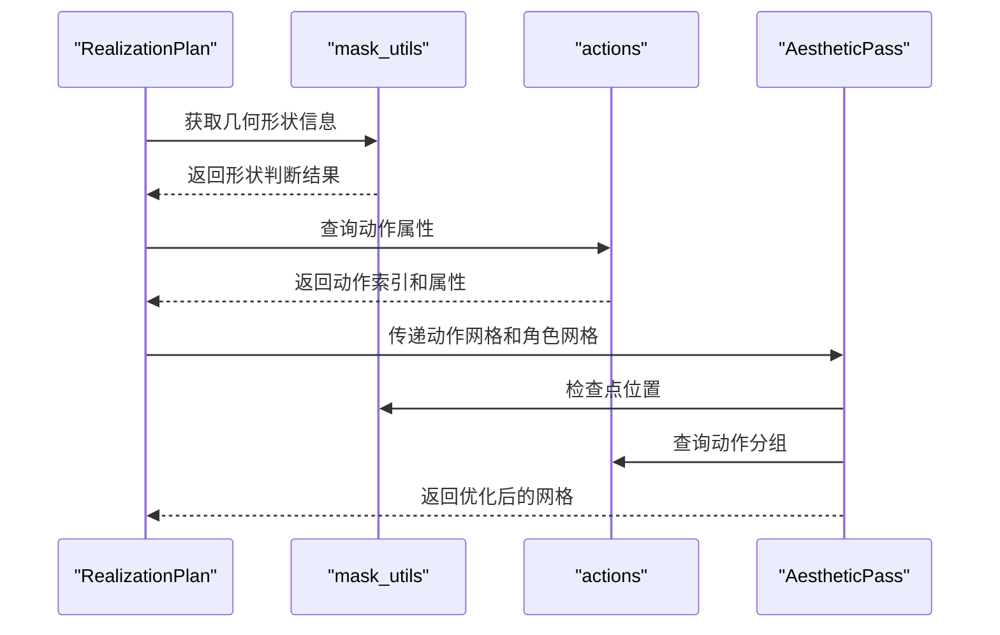
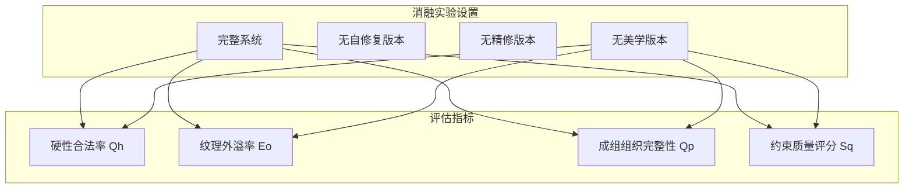

# 美学优化处理

<cite>
**本文档引用的文件**
- [aesthetic_pass.py](file://generator_one/generation/aesthetic_pass.py)
- [refinement_compiler.py](file://generator_one/generation/refinement_compiler.py)
- [mask_utils.py](file://generator_one/generation/mask_utils.py)
- [action_mapper.py](file://generator_one/generation/action_mapper.py)
- [visual_types.py](file://generator_one/generation/visual_types.py)
- [event_planner.py](file://generator_one/generation/event_planner.py)
- [actions.py](file://generator_one/core/actions.py)
- [physical_rules.py](file://generator_one/rules/physical_rules.py)
- [craft_rules.py](file://generator_one/rules/craft_rules.py)
- [pattern_plan.py](file://generator_one/generation/pattern_plan.py)
- [evaluate_full_image.py](file://conditional-flow-matching-main/conditional_flow_matching/evaluate_full_image.py)
- [论文初稿.md](file://docs/论文初稿.md)
</cite>

## 目录
1. [简介](#简介)
2. [项目结构](#项目结构)
3. [核心组件](#核心组件)
4. [架构概览](#架构概览)
5. [详细组件分析](#详细组件分析)
6. [依赖关系分析](#依赖关系分析)
7. [性能考虑](#性能考虑)
8. [故障排除指南](#故障排除指南)
9. [结论](#结论)
10. [附录](#附录)

## 简介
本文件详细阐述编织图案生成器中的美学优化处理模块。该模块位于动作网格生成流程的后期阶段，负责在不改变图案逻辑的前提下，对最终的动作网格进行轻量级结构美化，以提升仿真后的视觉质量和编织质量。美学优化处理主要包含以下策略：
- 对称性修正：确保每行左右移针动作数量平衡，避免视觉上的不对称感
- 边界过渡柔化：在不同区域交界处确保合适的过渡，减少锯齿状边缘
- 几何边缘微调：针对矩形、圆形、菱形等几何掩码的轻量边缘修整，减少颗粒感
- 孤立动作清理：清理完全孤立的特殊动作，避免视觉噪声

美学优化处理与物理约束和工艺规则紧密配合，既保证了编织的可行性，又提升了视觉效果。通过与精修编译器的协作，实现了在保持图案语义不变的前提下，对细节进行精细化调整。

## 项目结构
美学优化处理模块位于生成流水线的后期阶段，与动作映射、事件规划、物理规则检查等模块协同工作：

**图表来源**
- [pattern_plan.py:175-352](file://generator_one/generation/pattern_plan.py#L175-L352)
- [visual_types.py:106-179](file://generator_one/generation/visual_types.py#L106-L179)
- [event_planner.py:24-80](file://generator_one/generation/event_planner.py#L24-L80)
- [action_mapper.py:43-107](file://generator_one/generation/action_mapper.py#L43-L107)
- [aesthetic_pass.py:21-52](file://generator_one/generation/aesthetic_pass.py#L21-L52)

## 核心组件
美学优化处理模块的核心组件包括：

### AestheticPass 类
这是美学优化处理的主要实现类，提供以下功能：
- 对称性修正：平衡每行左右移针动作的数量
- 边界过渡处理：在区域交界处提供合适的过渡
- 几何边缘柔化：针对各种几何形状的边缘进行微调
- 孤立动作清理：移除完全孤立的特殊动作

### 掩码工具模块
提供几何形状判断和点位置检测功能：
- 支持多种几何形状：圆形、椭圆、正多边形、菱形、六边形、三角形等
- 提供点是否在掩码内的判断
- 支持重复图案的掩码评估

### 动作定义模块
提供动作属性查询和分组功能：
- 动作索引查询
- 动作属性访问（颜色、张力、语义等）
- 动作分组（基础动作、精修动作、元动作）

**章节来源**
- [aesthetic_pass.py:21-52](file://generator_one/generation/aesthetic_pass.py#L21-L52)
- [mask_utils.py:15-26](file://generator_one/generation/mask_utils.py#L15-L26)
- [actions.py:50-160](file://generator_one/core/actions.py#L50-L160)

## 架构概览
美学优化处理在整个编织生成系统中的位置和交互关系如下：

**图表来源**
- [pattern_plan.py:175-352](file://generator_one/generation/pattern_plan.py#L175-L352)
- [visual_types.py:106-179](file://generator_one/generation/visual_types.py#L106-L179)
- [event_planner.py:24-80](file://generator_one/generation/event_planner.py#L24-L80)
- [action_mapper.py:43-107](file://generator_one/generation/action_mapper.py#L43-L107)
- [aesthetic_pass.py:21-52](file://generator_one/generation/aesthetic_pass.py#L21-L52)

## 详细组件分析

### 美学优化算法实现

#### 对称性修正算法
美学优化处理首先检查每行左右移针动作的平衡性：

**图表来源**
- [aesthetic_pass.py:187-215](file://generator_one/generation/aesthetic_pass.py#L187-L215)

#### 几何边缘柔化算法
针对不同几何形状的边缘进行柔化处理：

**图表来源**
- [aesthetic_pass.py:54-185](file://generator_one/generation/aesthetic_pass.py#L54-L185)

#### 边界过渡处理算法
在不同区域交界处提供合适的过渡：

**图表来源**
- [aesthetic_pass.py:242-273](file://generator_one/generation/aesthetic_pass.py#L242-L273)

### 精修编译器对比分析
美学优化处理与精修编译器在功能上有明确分工：

| 特征 | 美学优化处理 | 精修编译器 |
|------|-------------|-----------|
| **执行时机** | 动作网格最终输出前 | 基础动作网格生成后 |
| **动作类型** | 仅使用基础动作(primary actions) | 使用精修动作(refinement actions) |
| **替换策略** | 局部、稀疏、轻量级 | 全局、系统性、深度替换 |
| **约束要求** | 不改变图案逻辑 | 保持硬性规则不变 |
| **目标效果** | 视觉质量提升 | 织物质量优化 |

**章节来源**
- [aesthetic_pass.py:1-12](file://generator_one/generation/aesthetic_pass.py#L1-L12)
- [refinement_compiler.py:1-16](file://generator_one/generation/refinement_compiler.py#L1-L16)

### 美学评分机制和质量评估标准

#### 约束质量评分体系
基于论文中的约束质量评分公式：

**图表来源**
- [论文初稿.md:441-445](file://docs/论文初稿.md#L441-L445)

#### 美学效果量化方法
美学优化处理的效果可以通过以下指标进行量化评估：

1. **视觉质量指标**
   - 边缘平滑度：通过边缘像素变化率评估
   - 对称性指数：左右动作分布的平衡度
   - 颗粒感指数：孤立动作密度

2. **编织质量指标**
   - 物理约束满足率：硬性规则违规次数
   - 工艺约束满足率：软性规则违规次数
   - 张力均匀性：相邻动作张力差的平均值

3. **主观评价方法**
   - 专家评审：编织专家对视觉效果打分
   - 用户调查：目标用户对美观度评价
   - 一致性测试：多用户对同一图案的评价一致性

**章节来源**
- [论文初稿.md:419-445](file://docs/论文初稿.md#L419-L445)

### 具体优化示例

#### 示例1：波浪吊目优化
原始图案问题：
- 边缘呈现锯齿状，视觉不连贯
- 左右移针动作数量不平衡
- 孤立的特殊动作造成视觉噪声

优化后效果：
- 边缘经过柔化处理，呈现平滑曲线
- 每行左右移针动作数量平衡
- 孤立特殊动作被清理，视觉更加纯净

#### 示例2：几何形状优化
原始图案问题：
- 正方形边框呈现阶梯状锯齿
- 多边形顶点区域出现尖锐角度
- 边界区域动作密度不均

优化后效果：
- 边框呈现平滑的矩形轮廓
- 多边形顶点经过缓和处理
- 边界区域动作分布更加均匀

**章节来源**
- [aesthetic_pass.py:54-185](file://generator_one/generation/aesthetic_pass.py#L54-L185)

## 依赖关系分析

### 模块依赖关系
美学优化处理模块与其他模块的依赖关系如下：

**图表来源**
- [aesthetic_pass.py:14-18](file://generator_one/generation/aesthetic_pass.py#L14-L18)
- [mask_utils.py:8-9](file://generator_one/generation/mask_utils.py#L8-L9)
- [actions.py:9-13](file://generator_one/core/actions.py#L9-L13)

### 数据流依赖
美学优化处理的数据流依赖关系：

**图表来源**
- [aesthetic_pass.py:24-52](file://generator_one/generation/aesthetic_pass.py#L24-L52)
- [mask_utils.py:42-62](file://generator_one/generation/mask_utils.py#L42-L62)
- [actions.py:207-243](file://generator_one/core/actions.py#L207-L243)

**章节来源**
- [aesthetic_pass.py:14-52](file://generator_one/generation/aesthetic_pass.py#L14-L52)
- [mask_utils.py:15-26](file://generator_one/generation/mask_utils.py#L15-L26)
- [actions.py:197-243](file://generator_one/core/actions.py#L197-L243)

## 性能考虑
美学优化处理在设计时充分考虑了性能因素：

### 时间复杂度分析
- **对称性修正**：O(H×W)，其中H为网格高度，W为网格宽度
- **几何边缘柔化**：O(H×W×P)，其中P为形状参数处理开销
- **边界过渡处理**：O(H×W)
- **整体复杂度**：O(H×W×(1+P))

### 空间复杂度
- **额外内存**：O(H×W)，主要用于存储优化过程中的临时状态
- **掩码计算**：O(1)，每个点的掩码判断为常数时间

### 性能优化策略
1. **早期退出**：对于不支持的形状直接跳过处理
2. **批量操作**：对相似的优化操作进行批量处理
3. **缓存机制**：利用动作分组的LRU缓存提高查询效率
4. **稀疏处理**：只对需要优化的区域进行处理

## 故障排除指南

### 常见问题及解决方案

#### 问题1：优化后图案逻辑改变
**症状**：优化后的动作网格改变了原有的图案设计
**原因**：美学优化处理错误地修改了基础动作
**解决方案**：
- 检查动作映射阶段是否正确
- 验证精修编译器是否与美学优化处理协调工作
- 确保美学优化仅使用基础动作，不引入精修动作

#### 问题2：物理约束违规
**症状**：优化后的图案出现物理约束违规
**原因**：美学优化处理破坏了编织的物理可行性
**解决方案**：
- 在美学优化后重新运行物理规则检查
- 调整优化参数，减少对物理可行性的干扰
- 实施更严格的边界检查

#### 问题3：视觉效果不佳
**症状**：优化后的视觉效果不如预期
**原因**：优化参数设置不当或算法实现问题
**解决方案**：
- 调整几何形状的平滑阈值
- 优化孤立动作清理的敏感度
- 增加更多的几何形状支持

**章节来源**
- [physical_rules.py:36-159](file://generator_one/rules/physical_rules.py#L36-L159)
- [craft_rules.py:34-166](file://generator_one/rules/craft_rules.py#L34-L166)

### 调试工具和方法
1. **日志记录**：详细的优化过程日志，便于追踪问题
2. **可视化工具**：动作网格的RGB可视化，直观显示优化效果
3. **性能监控**：实时监控优化处理的时间和内存使用
4. **对比分析**：提供优化前后的对比视图

## 结论
美学优化处理模块通过轻量级的结构美化，在不改变图案逻辑的前提下，显著提升了编织图案的视觉质量和编织质量。该模块与精修编译器形成互补关系，前者专注于视觉效果的微调，后者负责织物质量的系统性优化。

通过合理的参数配置和严格的约束检查，美学优化处理能够在保持编织可行性的同时，实现以下目标：
- 提升视觉连贯性和美感
- 减少边缘锯齿和颗粒感
- 保持图案的几何精度
- 维护编织的物理可行性

未来的工作方向包括：
- 扩展更多几何形状的支持
- 优化算法性能，支持更大规模的网格
- 增强主观评价的自动化程度
- 集成更多的美学优化策略

## 附录

### 美学优化处理参数配置
美学优化处理提供了灵活的参数配置选项：

| 参数名称 | 类型 | 默认值 | 说明 |
|---------|------|--------|------|
| smoothing_threshold | int | 1 | 边缘柔化阈值，控制孤立动作清理的敏感度 |
| vertex_smoothing | bool | False | 是否启用多边形顶点缓和处理 |
| vertex_neighbor_threshold | int | 2 | 顶点区域邻居数量阈值 |

### 支持的几何形状
美学优化处理支持以下几何形状的边缘柔化：
- **矩形系列**：rectangle、rect、frame、border、panel、square、box
- **圆形系列**：circle、oval、ellipse、round
- **多边形系列**：diamond、rhombus、hexagon、hex、triangle、polygon
- **其他形状**：stripe、stripes、column、chevron、zigzag、cross、heart、star

### 优化效果评估
通过对比实验验证美学优化处理的效果：

**图表来源**
- [论文初稿.md:419-445](file://docs/论文初稿.md#L419-L445)