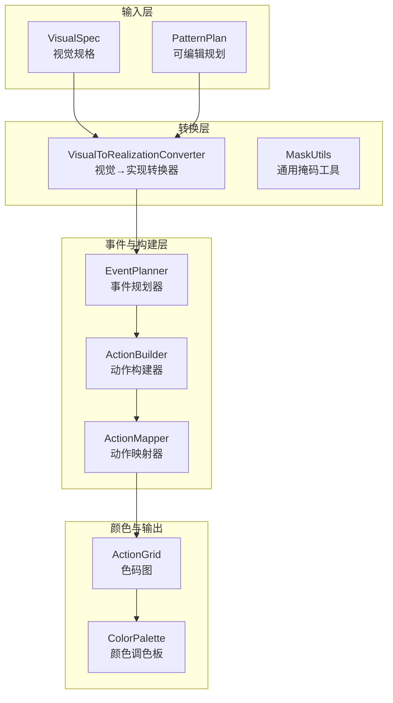
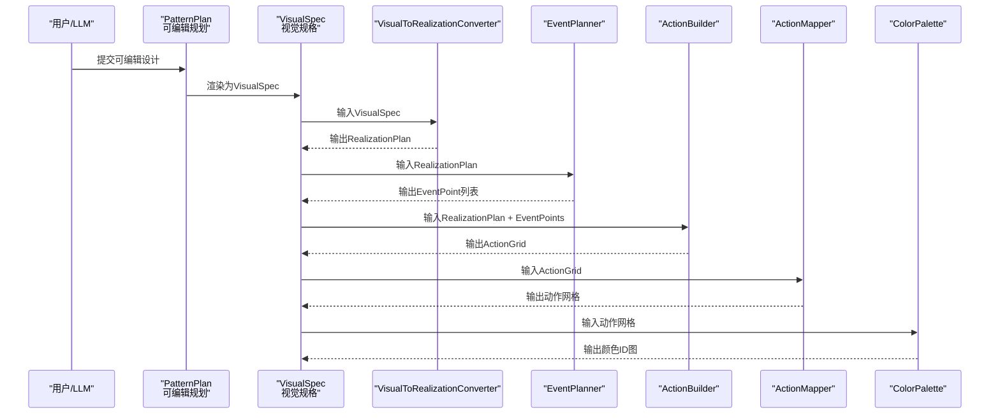
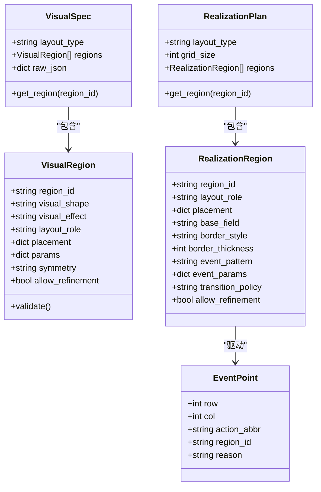
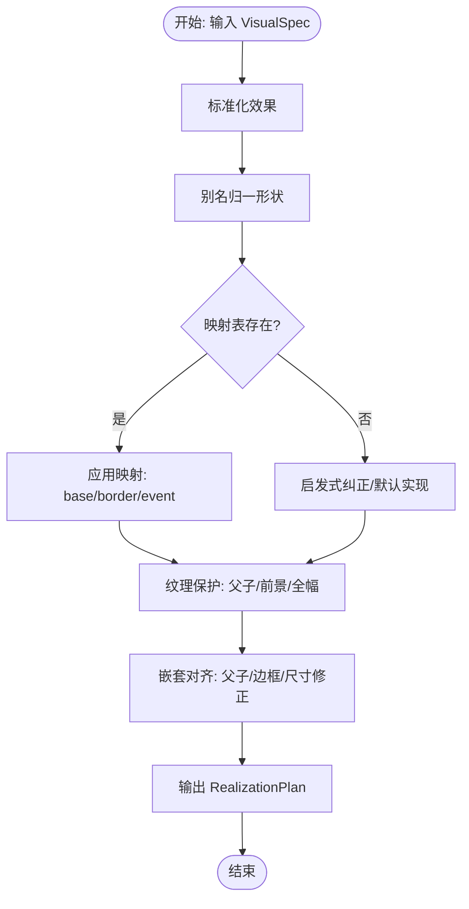
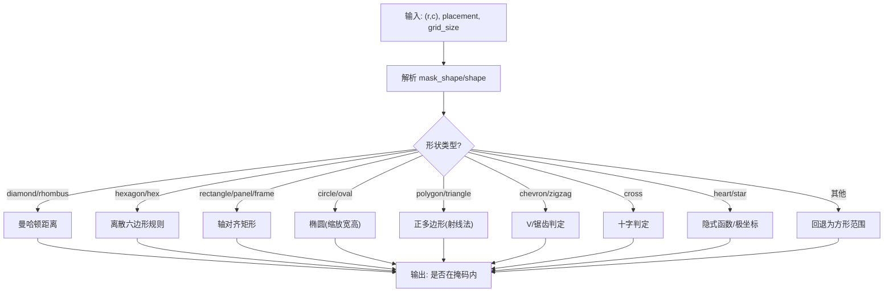
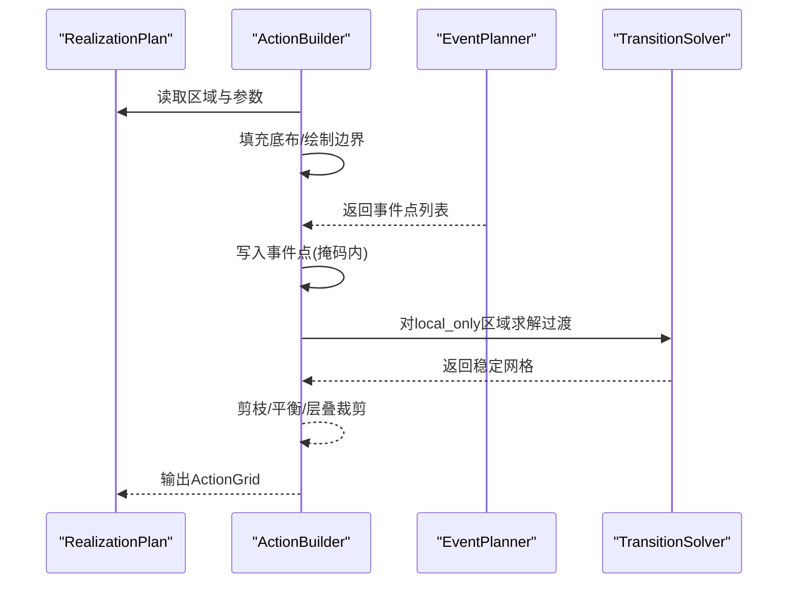
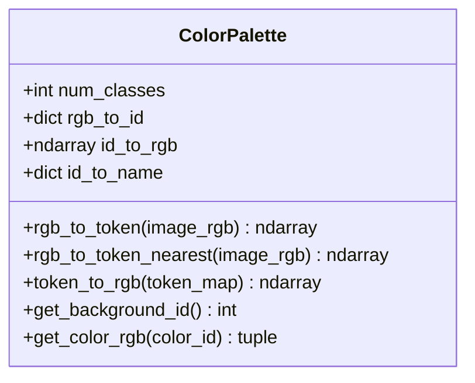
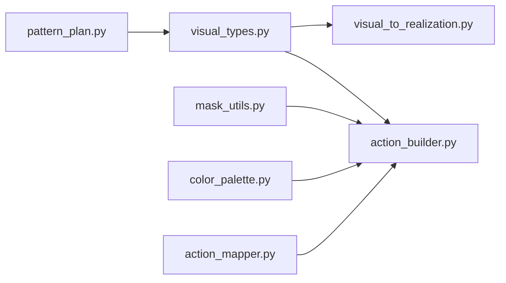

# 视觉规格转换

<cite>
**本文引用的文件**
- [visual_types.py](file://generator_one/generation/visual_types.py)
- [visual_to_realization.py](file://generator_one/generation/visual_to_realization.py)
- [action_builder.py](file://generator_one/generation/action_builder.py)
- [mask_utils.py](file://generator_one/generation/mask_utils.py)
- [pattern_plan.py](file://generator_one/generation/pattern_plan.py)
- [color_palette.py](file://data/color_palette.py)
- [action_mapper.py](file://generator_one/generation/action_mapper.py)
- [test_masks.py](file://generator_one/tests/test_masks.py)
- [test_aesthetic_shapes.py](file://generator_one/tests/test_aesthetic_shapes.py)
- [logger.py](file://generator_one/utils/logger.py)
</cite>

## 目录
1. [引言](#引言)
2. [项目结构](#项目结构)
3. [核心组件](#核心组件)
4. [架构总览](#架构总览)
5. [详细组件分析](#详细组件分析)
6. [依赖分析](#依赖分析)
7. [性能考虑](#性能考虑)
8. [故障排查指南](#故障排查指南)
9. [结论](#结论)
10. [附录](#附录)

## 引言
本技术文档聚焦“视觉规格转换模块”，系统阐述从“仿真图上的视觉目标”到“色码图实现方案”的完整转换链路，涵盖颜色映射、形状变换、纹理生成、事件规划与动作构建等环节。文档还解释视觉类型系统的设计与使用、转换算法的实现原理（含插值、缩放与变形）、与颜色管理系统的集成、以及转换精度与性能的平衡策略，并提供可视化流程图与具体转换示例。

## 项目结构
视觉规格转换模块位于 generator_one/generation 目录，围绕以下关键文件协同工作：
- 视觉类型定义：visual_types.py
- 视觉到实现转换：visual_to_realization.py
- 动作构建与掩码：action_builder.py、mask_utils.py
- 规划与渲染：pattern_plan.py
- 颜色管理：data/color_palette.py
- 动作映射与过渡：action_mapper.py
- 测试验证：tests/test_masks.py、tests/test_aesthetic_shapes.py
- 日志工具：utils/logger.py

图表来源
- [visual_types.py](file://generator_one/generation/visual_types.py)
- [visual_to_realization.py](file://generator_one/generation/visual_to_realization.py)
- [mask_utils.py](file://generator_one/generation/mask_utils.py)
- [action_builder.py](file://generator_one/generation/action_builder.py)
- [action_mapper.py](file://generator_one/generation/action_mapper.py)
- [color_palette.py](file://data/color_palette.py)

章节来源
- [visual_types.py](file://generator_one/generation/visual_types.py)
- [visual_to_realization.py](file://generator_one/generation/visual_to_realization.py)
- [action_builder.py](file://generator_one/generation/action_builder.py)
- [mask_utils.py](file://generator_one/generation/mask_utils.py)
- [pattern_plan.py](file://generator_one/generation/pattern_plan.py)
- [color_palette.py](file://data/color_palette.py)
- [action_mapper.py](file://generator_one/generation/action_mapper.py)
- [logger.py](file://generator_one/utils/logger.py)

## 核心组件
- 视觉类型系统：定义合法的视觉形状、效果与布局角色，统一表达仿真图上的视觉意图。
- 转换器：将视觉规格映射为色码实现方案，包含形状别名归一、效果标准化、映射表查询与启发式纠正。
- 掩码工具：提供通用几何掩码判断与形状生成，支持多边形、椭圆、心形、星形等复杂形状。
- 动作构建器：按区域优先级填充底布、绘制边界、写入事件点、求解过渡与稳定化。
- 颜色管理：提供RGB↔ID的快速查找与最近邻匹配，支持未知颜色处理与背景色识别。
- 动作映射器：将语义网格映射为动作网格，保守回退与过渡平滑，保证工艺可行性。

章节来源
- [visual_types.py](file://generator_one/generation/visual_types.py)
- [visual_to_realization.py](file://generator_one/generation/visual_to_realization.py)
- [mask_utils.py](file://generator_one/generation/mask_utils.py)
- [action_builder.py](file://generator_one/generation/action_builder.py)
- [color_palette.py](file://data/color_palette.py)
- [action_mapper.py](file://generator_one/generation/action_mapper.py)

## 架构总览
视觉规格转换的端到端流程如下：

图表来源
- [pattern_plan.py](file://generator_one/generation/pattern_plan.py)
- [visual_types.py](file://generator_one/generation/visual_types.py)
- [visual_to_realization.py](file://generator_one/generation/visual_to_realization.py)
- [action_builder.py](file://generator_one/generation/action_builder.py)
- [action_mapper.py](file://generator_one/generation/action_mapper.py)
- [color_palette.py](file://data/color_palette.py)

## 详细组件分析

### 视觉类型系统与数据模型
- 视觉形状集合：包含几何形状与装饰形状，如 diamond、wave、circle、hexagon、polygon、heart、star、chevron、zigzag、cross、allover 等。
- 视觉效果集合：包含基础效果与纹理效果，如 plain、reverse、cable、wave_tuck、rib、links、lace、relief、honeycomb、seed。
- 布局角色集合：ground、center、border、side_band、allover。
- 数据模型：
  - VisualRegion：描述单个区域的视觉目标与参数。
  - VisualSpec：整体视觉设计方案。
  - RealizationRegion：色码实现方案的区域定义。
  - RealizationPlan：整体色码实现方案。
  - EventPoint：事件点，包含行列坐标、动作缩写与所属区域。

图表来源
- [visual_types.py](file://generator_one/generation/visual_types.py)

章节来源
- [visual_types.py](file://generator_one/generation/visual_types.py)

### 视觉到实现的转换器
- 核心职责：将 VisualSpec 转为 RealizationPlan，处理形状别名归一、效果标准化、映射表查询与启发式纠正。
- 关键机制：
  - 形状别名映射：将非标准形状名称（如 oval→circle，rect→rectangle）统一为标准形状。
  - 形状优先级：针对每种效果提供可用形状的优先级列表，用于未知组合的启发式纠正。
  - 效果降级：未知效果默认降级为 plain，避免生成不可实现的动作。
  - 嵌套关系保护：防止父纹理事件与子纹理事件重叠，确保色码图可解释性。
  - 对齐与尺寸修正：根据父容器对齐子区域，修正尺寸与边缘衰减，避免视觉溢出。

图表来源
- [visual_to_realization.py](file://generator_one/generation/visual_to_realization.py)

章节来源
- [visual_to_realization.py](file://generator_one/generation/visual_to_realization.py)

### 掩码与形状变换
- 掩码工具提供通用几何判断：支持 diamond、hexagon、rectangle/frame、circle/oval、regular polygon、chevron、zigzag、cross、heart、star 等。
- 支持参数：center、size、sides、rotation、aspect、repeat 等，满足复杂形状与重复纹理需求。
- 离散栅格友好：针对六边形等形状提供专门的栅格化规则，保证边界对称与连通性。

图表来源
- [mask_utils.py](file://generator_one/generation/mask_utils.py)

章节来源
- [mask_utils.py](file://generator_one/generation/mask_utils.py)

### 动作构建与过渡求解
- 区域优先级：ground > allover > center > side_band > border，按优先级填充底布与边界。
- 底布与边界：根据 base_field 与 border_style 绘制区域底布与轮廓。
- 事件写入：将 EventPoint 列表写入 ActionGrid，严格约束在掩码范围内。
- 过渡求解：对 local_only 策略启用过渡求解，消除语义边界处的不连续。
- 稳定化：修剪越界转移、平衡左右传输列数，提升织造稳定性。
- 层叠裁剪：对嵌套区域进行硬裁剪，防止子区域外溢影响上层处理。

图表来源
- [action_builder.py](file://generator_one/generation/action_builder.py)

章节来源
- [action_builder.py](file://generator_one/generation/action_builder.py)

### 颜色管理与映射
- ColorPalette 提供：
  - RGB→ID 快速查找表（RGB24 LUT），O(1) 查询。
  - 未知颜色的最近邻匹配，降低色差。
  - ID→RGB 映射与背景色识别。
- 在动作网格生成后，可将其转换为颜色ID图，用于下游渲染与一致性校验。

图表来源
- [color_palette.py](file://data/color_palette.py)

章节来源
- [color_palette.py](file://data/color_palette.py)

### 动作映射与过渡平滑
- 将语义网格映射为动作网格，采用保守回退策略，优先使用主动作。
- 对 fallback 区域在语义边界处进行过渡平滑，避免张力差异导致的织造问题。
- 提供统计信息，便于评估映射覆盖率与过渡数量。

章节来源
- [action_mapper.py](file://generator_one/generation/action_mapper.py)

### 示例：圆形波浪纹理的转换
- 输入：VisualRegion(visual_shape="circle", visual_effect="wave_tuck", layout_role="center")
- 转换步骤：
  - 形状别名归一：circle 保持不变。
  - 映射表查询：(wave_tuck, circle) → base=plain_front, border=back_loop_outline, event=diagonal_wave。
  - 事件参数默认化：根据 size 推导 period_x/y、edge_fade、密度分布等。
  - 事件规划：生成 diagonal_wave 事件点，限制在圆形掩码内。
  - 动作构建：填充底布、绘制轮廓、写入事件点、过渡求解与稳定化。
  - 输出：ActionGrid，可用于颜色映射与渲染。

章节来源
- [visual_to_realization.py](file://generator_one/generation/visual_to_realization.py)
- [mask_utils.py](file://generator_one/generation/mask_utils.py)
- [action_builder.py](file://generator_one/generation/action_builder.py)

## 依赖分析
- 模块耦合：
  - visual_to_realization 依赖 visual_types 的数据模型与常量。
  - action_builder 依赖 mask_utils 的几何判断与 layer_utils 的层级关系。
  - pattern_plan 依赖 visual_types 生成 VisualSpec。
  - color_palette 与 action_mapper 独立，通过中间产物（动作网格）间接协作。
- 外部依赖：
  - numpy 用于数值计算与数组操作。
  - logging 用于运行时日志记录。

图表来源
- [visual_types.py](file://generator_one/generation/visual_types.py)
- [visual_to_realization.py](file://generator_one/generation/visual_to_realization.py)
- [action_builder.py](file://generator_one/generation/action_builder.py)
- [mask_utils.py](file://generator_one/generation/mask_utils.py)
- [pattern_plan.py](file://generator_one/generation/pattern_plan.py)
- [color_palette.py](file://data/color_palette.py)
- [action_mapper.py](file://generator_one/generation/action_mapper.py)

章节来源
- [visual_types.py](file://generator_one/generation/visual_types.py)
- [visual_to_realization.py](file://generator_one/generation/visual_to_realization.py)
- [action_builder.py](file://generator_one/generation/action_builder.py)
- [mask_utils.py](file://generator_one/generation/mask_utils.py)
- [pattern_plan.py](file://generator_one/generation/pattern_plan.py)
- [color_palette.py](file://data/color_palette.py)
- [action_mapper.py](file://generator_one/generation/action_mapper.py)

## 性能考虑
- 缓存与预计算：
  - 形状与效果标准化使用缓存，避免重复归一化开销。
  - RGB24 LUT 将颜色查找从 O(n) 降到 O(1)。
- 数组化操作：
  - 掩码判断与动作构建大量使用 numpy 向量化，减少循环开销。
- 保守策略：
  - 未知效果降级为 plain，避免复杂纹理带来的额外规划与求解成本。
- 过渡与稳定化：
  - 仅对 fallback 区域进行过渡平滑，控制计算量。
- 嵌套裁剪：
  - 在动作构建阶段进行硬裁剪，减少后续处理负担。

## 故障排查指南
- 事件越界或不在掩码内：
  - 检查 placement 的 center/size/mask_shape 是否合理。
  - 确认 _inside_shape 与 point_in_mask 的实现是否一致。
- 纹理事件冲突：
  - 检查父/子纹理的 exclude_masks 是否正确设置。
  - 确认 _protect_child_textures_from_parent 与 _protect_foreground_from_allover 的逻辑。
- 边界不连续或张力突变：
  - 检查过渡求解与稳定化步骤是否生效。
  - 调整 border_thickness 与 event_params 的密度分布。
- 颜色识别异常：
  - 使用 rgb_to_token_nearest 替代精确匹配，启用最近邻以降低未知色影响。
- 日志定位：
  - 通过 logger 输出的转换与构建阶段信息，逐步定位问题区间。

章节来源
- [action_builder.py](file://generator_one/generation/action_builder.py)
- [mask_utils.py](file://generator_one/generation/mask_utils.py)
- [color_palette.py](file://data/color_palette.py)
- [logger.py](file://generator_one/utils/logger.py)

## 结论
视觉规格转换模块通过严谨的数据模型、稳健的映射策略与高效的几何工具，实现了从仿真图视觉目标到可织造色码图的可靠转换。模块在精度与性能之间取得平衡，具备良好的扩展性与鲁棒性，适合进一步引入更复杂的纹理与形状族。

## 附录
- 测试用例要点：
  - 掩码覆盖与事件分布：验证圆形、矩形、六边形等形状的掩码覆盖与事件密度分布。
  - 嵌套与裁剪：验证父子纹理、边框与内部纹理的互斥与裁剪。
  - 美化与稳定性：验证美化后特殊动作数量不增，且过渡稳定。
- 参考测试文件：
  - [test_masks.py](file://generator_one/tests/test_masks.py)
  - [test_aesthetic_shapes.py](file://generator_one/tests/test_aesthetic_shapes.py)