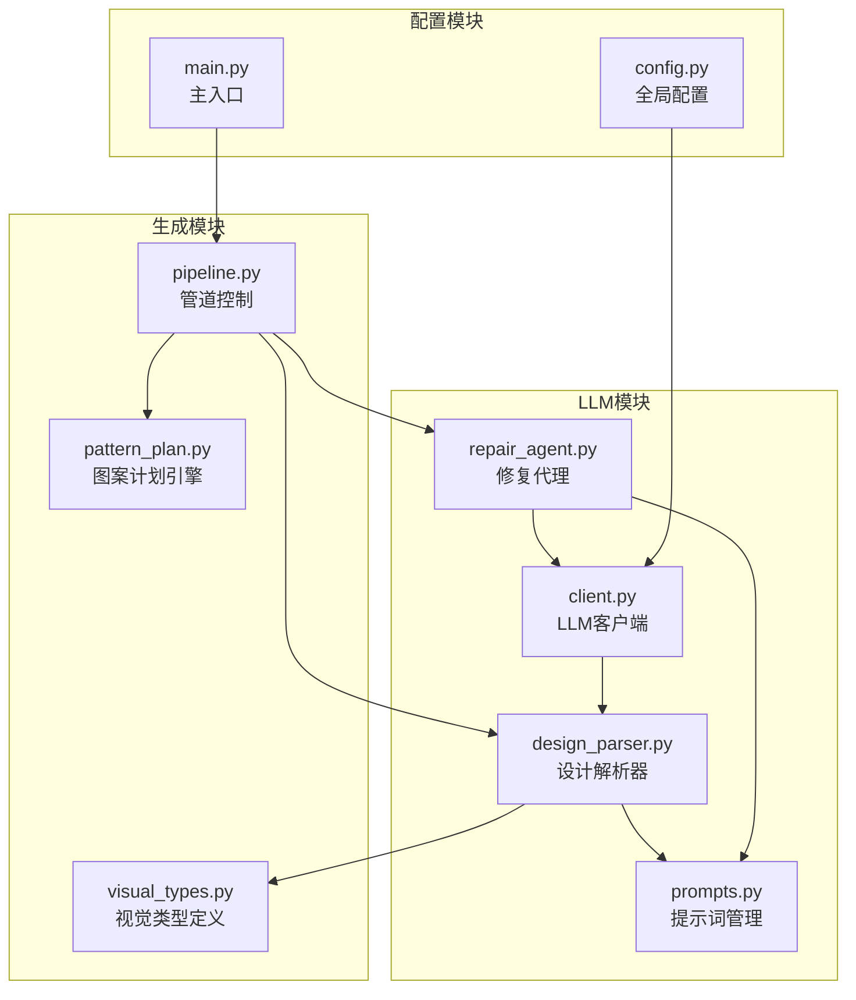
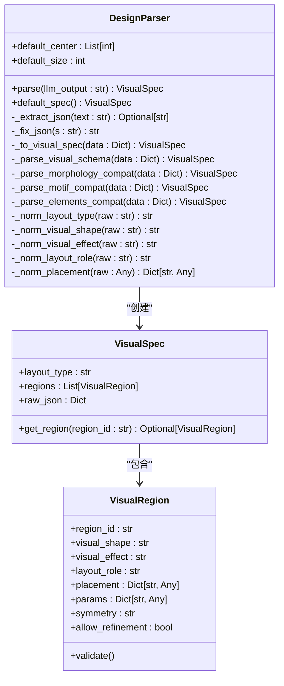
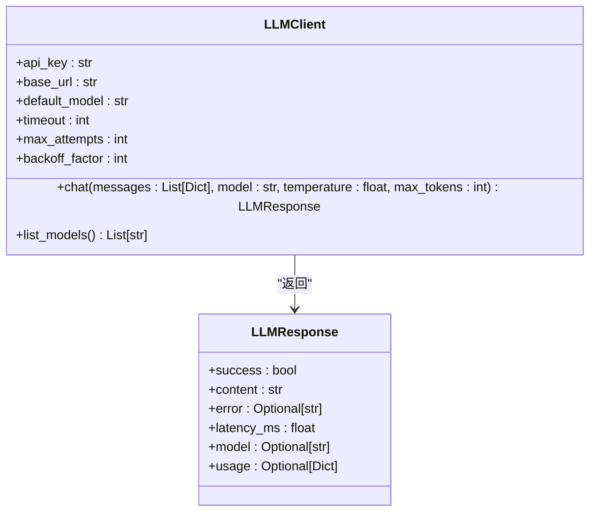
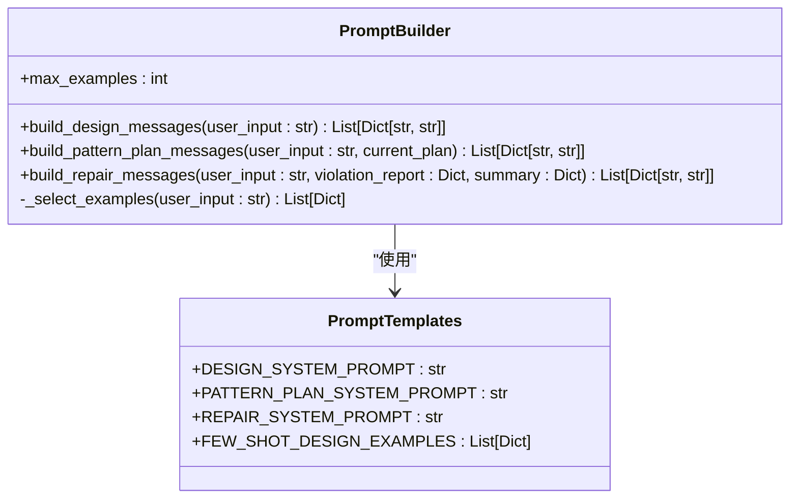
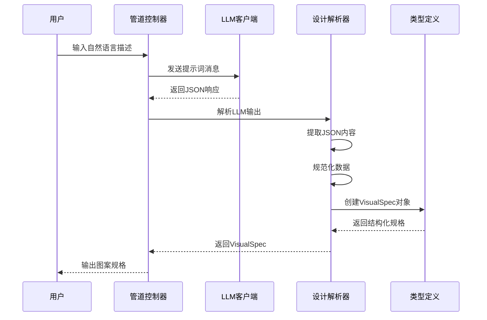
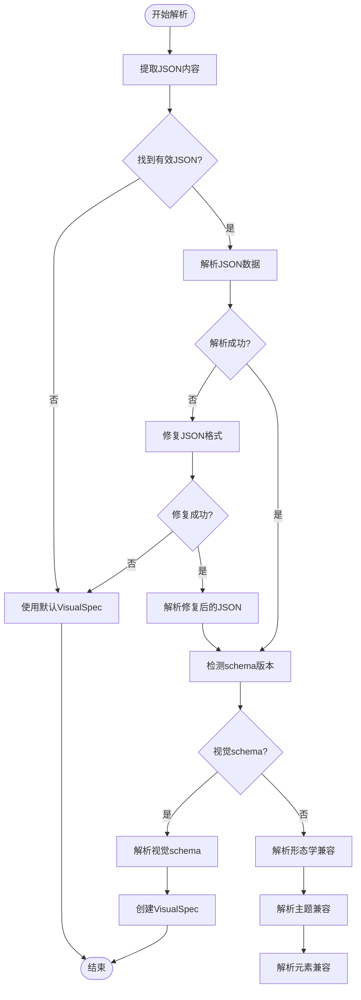
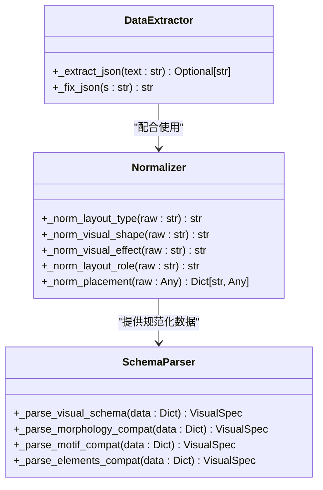
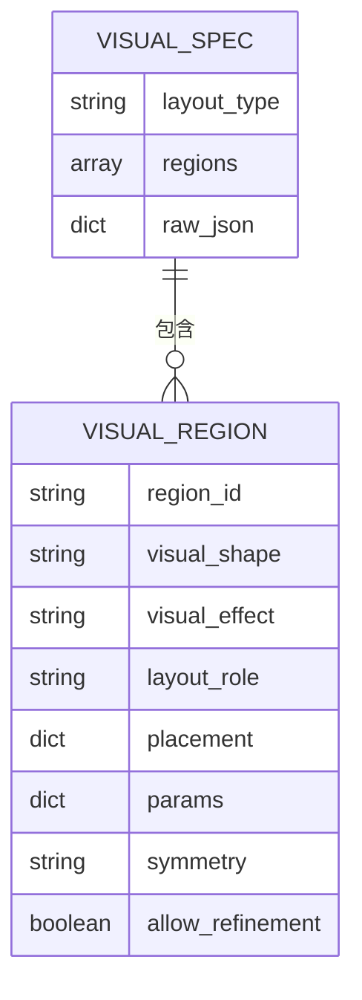
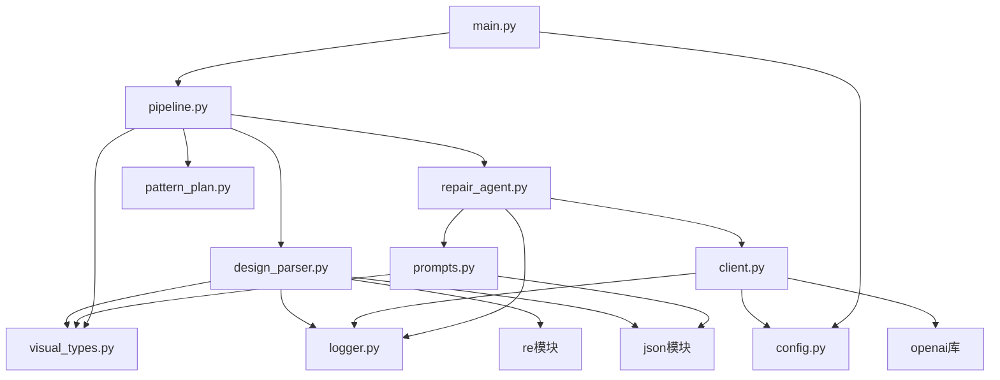
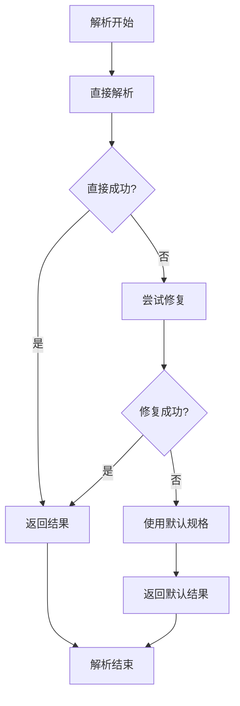

# 设计解析器

<cite>
**本文档引用的文件**
- [design_parser.py](file://generator_one/llm/design_parser.py)
- [client.py](file://generator_one/llm/client.py)
- [prompts.py](file://generator_one/llm/prompts.py)
- [repair_agent.py](file://generator_one/llm/repair_agent.py)
- [visual_types.py](file://generator_one/generation/visual_types.py)
- [pattern_plan.py](file://generator_one/generation/pattern_plan.py)
- [pipeline.py](file://generator_one/pipeline.py)
- [main.py](file://generator_one/main.py)
- [config.py](file://generator_one/config.py)
</cite>

## 目录
1. [简介](#简介)
2. [项目结构](#项目结构)
3. [核心组件](#核心组件)
4. [架构概览](#架构概览)
5. [详细组件分析](#详细组件分析)
6. [依赖分析](#依赖分析)
7. [性能考虑](#性能考虑)
8. [故障排除指南](#故障排除指南)
9. [结论](#结论)

## 简介

设计解析器是针织图案生成系统的核心模块，负责将用户的自然语言描述转换为结构化的图案规格。该系统采用多阶段解析策略，通过LLM客户端与设计解析器的协作，实现了从自然语言到可执行图案设计的完整转换。

系统的主要特点包括：
- 支持多种输入格式的智能解析
- 多版本模式兼容的降级处理
- 结构化的视觉目标定义
- 完整的错误处理和恢复机制
- 高性能的JSON解析和规范化

## 项目结构

设计解析器模块位于generator_one/llm目录下，包含以下核心文件：



**图表来源**
- [design_parser.py:1-415](file://generator_one/llm/design_parser.py#L1-L415)
- [client.py:1-168](file://generator_one/llm/client.py#L1-L168)
- [prompts.py:1-654](file://generator_one/llm/prompts.py#L1-L654)
- [repair_agent.py:1-242](file://generator_one/llm/repair_agent.py#L1-L242)
- [visual_types.py:1-196](file://generator_one/generation/visual_types.py#L1-L196)
- [pattern_plan.py:1-800](file://generator_one/generation/pattern_plan.py#L1-L800)
- [pipeline.py:1-749](file://generator_one/pipeline.py#L1-L749)
- [main.py:1-207](file://generator_one/main.py#L1-L207)
- [config.py:1-76](file://generator_one/config.py#L1-L76)

**章节来源**
- [design_parser.py:1-415](file://generator_one/llm/design_parser.py#L1-L415)
- [pipeline.py:1-749](file://generator_one/pipeline.py#L1-L749)

## 核心组件

### 设计解析器类

设计解析器是系统的核心组件，负责将LLM输出的JSON数据转换为结构化的视觉规格对象。



**图表来源**
- [design_parser.py:24-415](file://generator_one/llm/design_parser.py#L24-L415)
- [visual_types.py:106-121](file://generator_one/generation/visual_types.py#L106-L121)
- [visual_types.py:77-100](file://generator_one/generation/visual_types.py#L77-L100)

### LLM客户端

LLM客户端封装了与OpenAI兼容的API调用，提供了稳定的重试机制和错误处理。



**图表来源**
- [client.py:35-168](file://generator_one/llm/client.py#L35-L168)

### 提示词管理器

提示词管理器负责构建和管理不同场景下的提示词模板，支持动态示例选择。



**图表来源**
- [prompts.py:494-654](file://generator_one/llm/prompts.py#L494-L654)

**章节来源**
- [design_parser.py:24-415](file://generator_one/llm/design_parser.py#L24-L415)
- [client.py:35-168](file://generator_one/llm/client.py#L35-L168)
- [prompts.py:494-654](file://generator_one/llm/prompts.py#L494-L654)

## 架构概览

设计解析器采用分层架构，实现了从自然语言到结构化数据的完整转换流程：



**图表来源**
- [pipeline.py:195-227](file://generator_one/pipeline.py#L195-L227)
- [design_parser.py:29-44](file://generator_one/llm/design_parser.py#L29-L44)

系统的关键特性包括：

1. **多阶段解析**：支持新旧两种schema的兼容解析
2. **智能降级**：当解析失败时自动回退到默认规格
3. **数据规范化**：统一处理各种输入格式和别名
4. **错误恢复**：提供完整的错误处理和恢复机制

## 详细组件分析

### 解析算法实现

设计解析器的核心算法基于模式匹配和语义理解的结合：



**图表来源**
- [design_parser.py:29-94](file://generator_one/llm/design_parser.py#L29-L94)
- [design_parser.py:96-131](file://generator_one/llm/design_parser.py#L96-L131)

### 数据提取和规范化

系统实现了多层次的数据提取和规范化机制：



**图表来源**
- [design_parser.py:384-415](file://generator_one/llm/design_parser.py#L384-L415)
- [design_parser.py:308-378](file://generator_one/llm/design_parser.py#L308-L378)
- [design_parser.py:96-302](file://generator_one/llm/design_parser.py#L96-L302)

### 支持的输入格式

设计解析器支持多种输入格式和数据源：

| 输入类型 | 格式示例 | 解析方式 |
|---------|----------|----------|
| 标准JSON | `{...}` | 直接解析 |
| Markdown代码块 | ```json {...} ``` | 提取后解析 |
| 带引号JSON | `"json": {...}` | 正则表达式提取 |
| 旧版schema | `{"regions": [...]}` | 兼容解析 |
| LLM输出 | 包含JSON的文本 | 智能提取 |

### 输出结构定义

系统输出的标准结构为VisualSpec对象，包含以下核心字段：



**图表来源**
- [visual_types.py:106-121](file://generator_one/generation/visual_types.py#L106-L121)
- [visual_types.py:77-100](file://generator_one/generation/visual_types.py#L77-L100)

**章节来源**
- [design_parser.py:77-131](file://generator_one/llm/design_parser.py#L77-L131)
- [design_parser.py:133-302](file://generator_one/llm/design_parser.py#L133-L302)
- [visual_types.py:17-70](file://generator_one/generation/visual_types.py#L17-L70)

## 依赖分析

设计解析器模块的依赖关系相对简单，主要依赖于类型定义和配置模块：



**图表来源**
- [design_parser.py:8-21](file://generator_one/llm/design_parser.py#L8-L21)
- [client.py:14-22](file://generator_one/llm/client.py#L14-L22)
- [prompts.py:13-14](file://generator_one/llm/prompts.py#L13-L14)
- [repair_agent.py:5-12](file://generator_one/llm/repair_agent.py#L5-L12)

**章节来源**
- [design_parser.py:1-415](file://generator_one/llm/design_parser.py#L1-L415)
- [client.py:1-168](file://generator_one/llm/client.py#L1-L168)
- [prompts.py:1-654](file://generator_one/llm/prompts.py#L1-L654)
- [repair_agent.py:1-242](file://generator_one/llm/repair_agent.py#L1-L242)

## 性能考虑

设计解析器在性能方面采用了多项优化策略：

### 解析性能优化

1. **早期失败检测**：快速识别无效JSON格式
2. **缓存机制**：避免重复的正则表达式计算
3. **流式处理**：支持大文本的增量解析
4. **内存优化**：使用生成器和迭代器减少内存占用

### 错误处理优化



**图表来源**
- [design_parser.py:35-44](file://generator_one/llm/design_parser.py#L35-L44)

### 准确性提升技巧

1. **多级验证**：逐层验证数据的有效性
2. **类型约束**：严格的类型检查和转换
3. **边界检查**：坐标和尺寸的范围验证
4. **一致性检查**：确保解析结果的逻辑一致性

## 故障排除指南

### 常见解析错误

| 错误类型 | 症状 | 解决方案 |
|---------|------|----------|
| JSON格式错误 | 解析异常 | 使用内置修复器 |
| Schema不匹配 | 字段缺失 | 回退到兼容模式 |
| 数据类型错误 | 类型转换失败 | 使用规范化函数 |
| 缺失必需字段 | 验证失败 | 设置默认值 |

### 调试建议

1. **启用详细日志**：检查解析过程中的每一步
2. **验证输入格式**：确保JSON格式正确
3. **检查schema版本**：确认使用的schema兼容性
4. **测试边界条件**：验证极端输入的处理

**章节来源**
- [design_parser.py:35-44](file://generator_one/llm/design_parser.py#L35-L44)
- [design_parser.py:46-71](file://generator_one/llm/design_parser.py#L46-L71)

## 结论

设计解析器模块成功实现了从自然语言到结构化图案规格的转换，具有以下优势：

1. **高可靠性**：多重错误处理和降级机制确保系统稳定性
2. **灵活性**：支持多种输入格式和schema版本
3. **可扩展性**：模块化设计便于功能扩展和维护
4. **性能优化**：高效的解析算法和内存管理

该模块为整个针织图案生成系统奠定了坚实的基础，通过LLM客户端与设计解析器的紧密协作，实现了高质量的图案生成能力。未来可以在以下方面进一步改进：

- 增强语义理解能力
- 扩展支持的输入格式
- 优化解析性能
- 加强错误诊断功能