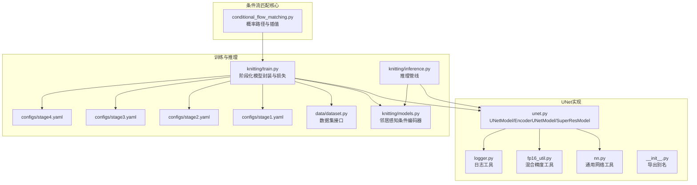
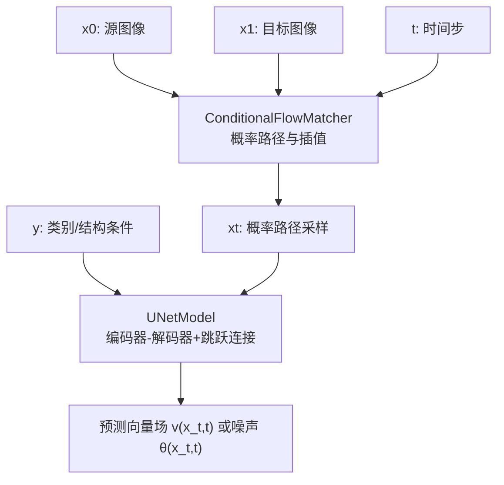
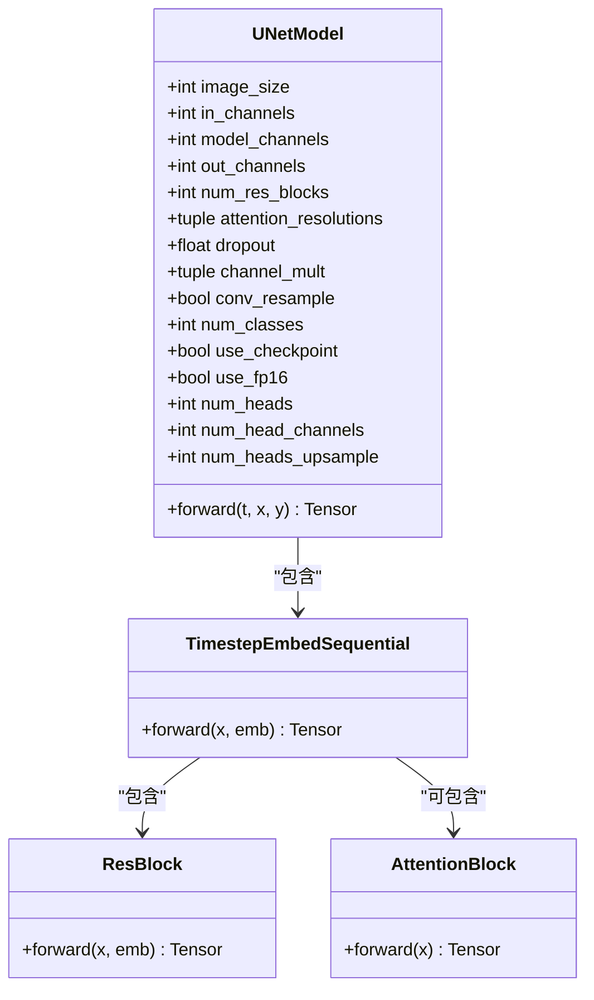
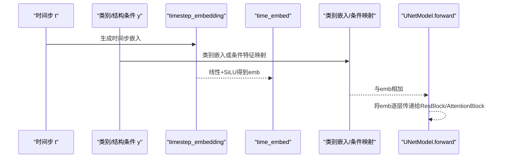
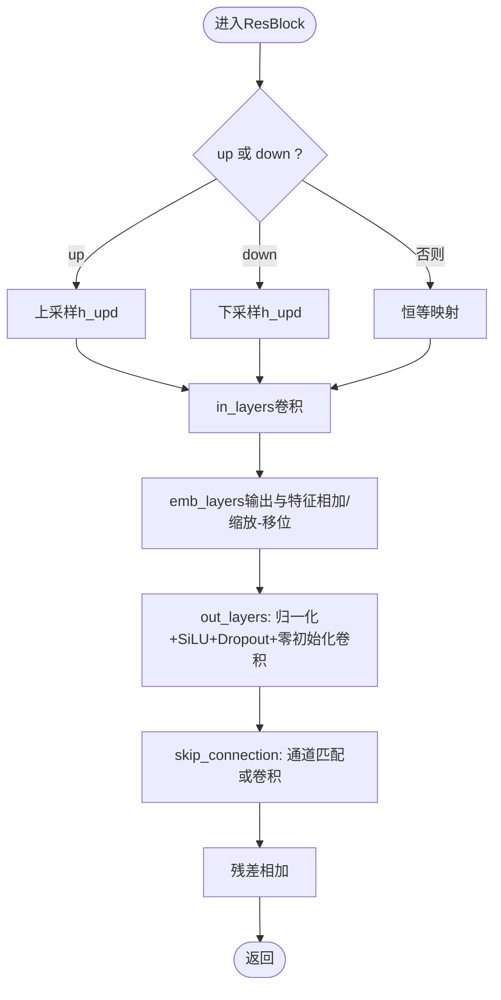
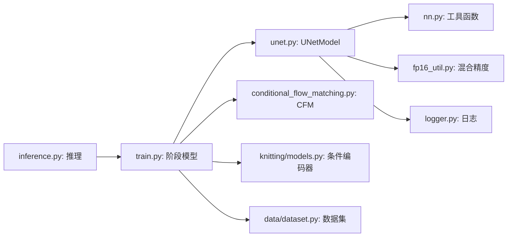

# UNet模型架构

<cite>
**本文档引用的文件**
- [unet.py](file://conditional-flow-matching-main/torchcfm/models/unet/unet.py)
- [nn.py](file://conditional-flow-matching-main/torchcfm/models/unet/nn.py)
- [__init__.py](file://conditional-flow-matching-main/torchcfm/models/unet/__init__.py)
- [fp16_util.py](file://conditional-flow-matching-main/torchcfm/models/unet/fp16_util.py)
- [logger.py](file://conditional-flow-matching-main/torchcfm/models/unet/logger.py)
- [conditional_flow_matching.py](file://conditional-flow-matching-main/torchcfm/conditional_flow_matching.py)
- [stage1.yaml](file://conditional-flow-matching-main/configs/stage1.yaml)
- [stage2.yaml](file://conditional-flow-matching-main/configs/stage2.yaml)
- [stage3.yaml](file://conditional-flow-matching-main/configs/stage3.yaml)
- [stage4.yaml](file://conditional-flow-matching-main/configs/stage4.yaml)
- [train.py](file://conditional-flow-matching-main/knitting/train.py)
- [inference.py](file://conditional-flow-matching-main/knitting/inference.py)
- [models.py](file://conditional-flow-matching-main/knitting/models.py)
- [dataset.py](file://conditional-flow-matching-main/data/dataset.py)
</cite>

## 目录
1. [简介](#简介)
2. [项目结构](#项目结构)
3. [核心组件](#核心组件)
4. [架构总览](#架构总览)
5. [详细组件分析](#详细组件分析)
6. [依赖关系分析](#依赖关系分析)
7. [性能考虑](#性能考虑)
8. [故障排除指南](#故障排除指南)
9. [结论](#结论)
10. [附录](#附录)

## 简介
本文件针对条件流匹配（Conditional Flow Matching, CFM）框架中的UNet变体进行系统化技术文档整理，重点覆盖以下方面：
- 编码器-解码器结构、跳跃连接与条件输入处理
- 时间步嵌入、类别嵌入与条件特征的融合策略
- 上采样/下采样实现、卷积层配置与激活函数选择
- 参数统计、计算复杂度与内存占用估算
- 模型配置选项、训练超参数与性能调优建议
- 完整的模型定义与使用示例

该实现基于扩散/流匹配的统一框架，结合阶段化的训练策略（Stage 1–4），在针织图案生成任务中实现了从基础条件UNet到结构感知与自适应插值的演进。

## 项目结构
与UNet模型直接相关的代码主要位于以下模块：
- torchcfm/models/unet：UNet核心实现与工具
- torchcfm/conditional_flow_matching：CFM概率路径与插值方法
- knitting/train.py / knitting/inference.py：阶段化训练与推理管线
- configs/*：各阶段训练配置
- knitting/models.py：条件编码器（用于Stage 2/3/4）
- data/dataset.py：数据集接口与采样策略

**图表来源**
- [unet.py:369-925](file://conditional-flow-matching-main/torchcfm/models/unet/unet.py#L369-L925)
- [nn.py:1-154](file://conditional-flow-matching-main/torchcfm/models/unet/nn.py#L1-L154)
- [conditional_flow_matching.py:41-619](file://conditional-flow-matching-main/torchcfm/conditional_flow_matching.py#L41-L619)
- [train.py:318-691](file://conditional-flow-matching-main/knitting/train.py#L318-L691)
- [inference.py:64-117](file://conditional-flow-matching-main/knitting/inference.py#L64-L117)
- [models.py:10-119](file://conditional-flow-matching-main/knitting/models.py#L10-L119)
- [dataset.py:13-207](file://conditional-flow-matching-main/data/dataset.py#L13-L207)

**章节来源**
- [unet.py:1-925](file://conditional-flow-matching-main/torchcfm/models/unet/unet.py#L1-L925)
- [nn.py:1-154](file://conditional-flow-matching-main/torchcfm/models/unet/nn.py#L1-L154)
- [conditional_flow_matching.py:1-619](file://conditional-flow-matching-main/torchcfm/conditional_flow_matching.py#L1-L619)
- [train.py:1-1322](file://conditional-flow-matching-main/knitting/train.py#L1-L1322)
- [inference.py:1-720](file://conditional-flow-matching-main/knitting/inference.py#L1-L720)
- [models.py:1-119](file://conditional-flow-matching-main/knitting/models.py#L1-L119)
- [dataset.py:1-207](file://conditional-flow-matching-main/data/dataset.py#L1-L207)

## 核心组件
本节概述UNet变体的关键组件及其职责：
- UNetModel：主干UNet，支持编码器-解码器、注意力、上/下采样、条件融合
- ResBlock：残差块，支持上/下采样、尺度移位归一化（FiLM风格）、梯度检查点
- AttentionBlock：空间注意力模块，支持新/旧注意力顺序
- Upsample/Downsample：上/下采样层，可选卷积
- TimestepEmbedSequential：序列模块，将时间步嵌入作为额外输入传递给子模块
- UNetModelWrapper：对UNetModel的轻量包装，根据图像尺寸自动推导通道倍率与注意力分辨率
- EncoderUNetModel：编码器半结构，用于特征提取或中间表征
- SuperResModel：超分辨率变体，将低分辨率条件拼接至输入通道
- 条件融合：时间步嵌入 + 类别嵌入（可选）+ 条件特征（来自外部编码器）

**章节来源**
- [unet.py:130-235](file://conditional-flow-matching-main/torchcfm/models/unet/unet.py#L130-L235)
- [unet.py:237-283](file://conditional-flow-matching-main/torchcfm/models/unet/unet.py#L237-L283)
- [unet.py:74-128](file://conditional-flow-matching-main/torchcfm/models/unet/unet.py#L74-L128)
- [unet.py:369-585](file://conditional-flow-matching-main/torchcfm/models/unet/unet.py#L369-L585)
- [unet.py:598-632](file://conditional-flow-matching-main/torchcfm/models/unet/unet.py#L598-L632)
- [unet.py:858-925](file://conditional-flow-matching-main/torchcfm/models/unet/unet.py#L858-L925)

## 架构总览
下图展示了条件流匹配框架下的UNet整体架构：输入图像与时间步经由UNet主干，结合类别或结构条件，输出去噪/流场估计，再由CFM概率路径驱动生成过程。

**图表来源**
- [conditional_flow_matching.py:159-200](file://conditional-flow-matching-main/torchcfm/conditional_flow_matching.py#L159-L200)
- [unet.py:598-632](file://conditional-flow-matching-main/torchcfm/models/unet/unet.py#L598-L632)

**章节来源**
- [conditional_flow_matching.py:41-200](file://conditional-flow-matching-main/torchcfm/conditional_flow_matching.py#L41-L200)
- [unet.py:369-632](file://conditional-flow-matching-main/torchcfm/models/unet/unet.py#L369-L632)

## 详细组件分析

### UNetModel类与编码器-解码器结构
- 结构组成
  - 输入块：首个卷积层将输入通道映射到基础通道数
  - 下采样路径：重复若干残差块 + 注意力（按指定分辨率启用）+ 下采样
  - 中间块：残差块 + 注意力 + 残差块
  - 上采样路径：残差块 + 注意力 + 上采样（在特定分辨率启用）
  - 输出头：归一化 + SiLU + 3×3卷积 + 零初始化
- 跳跃连接：输入块特征列表在上采样路径中按通道拼接
- 条件融合：时间步嵌入与类别嵌入相加后，逐层传递给ResBlock/AttentionBlock

**图表来源**
- [unet.py:369-585](file://conditional-flow-matching-main/torchcfm/models/unet/unet.py#L369-L585)
- [unet.py:130-235](file://conditional-flow-matching-main/torchcfm/models/unet/unet.py#L130-L235)
- [unet.py:237-283](file://conditional-flow-matching-main/torchcfm/models/unet/unet.py#L237-L283)
- [unet.py:61-72](file://conditional-flow-matching-main/torchcfm/models/unet/unet.py#L61-L72)

**章节来源**
- [unet.py:369-585](file://conditional-flow-matching-main/torchcfm/models/unet/unet.py#L369-L585)

### 条件输入处理与时间步/类别嵌入融合
- 时间步嵌入：通过timestep_embedding生成与模型通道数相关的嵌入维度，经两层线性+SiLU得到time_embed_dim
- 类别嵌入：当num_classes非空时，使用Embedding将类别标签映射到相同维度并与时间步嵌入相加
- 条件特征融合：在Stage 2/3/4中，外部条件编码器（如NeighborAwareConditioner）输出条件向量，经线性映射到time_embed_dim后与时间步嵌入相加，再逐层注入到UNet中

**图表来源**
- [nn.py:87-105](file://conditional-flow-matching-main/torchcfm/models/unet/nn.py#L87-L105)
- [unet.py:440-448](file://conditional-flow-matching-main/torchcfm/models/unet/unet.py#L440-L448)
- [unet.py:617-621](file://conditional-flow-matching-main/torchcfm/models/unet/unet.py#L617-L621)
- [train.py:355-376](file://conditional-flow-matching-main/knitting/train.py#L355-L376)
- [models.py:61-119](file://conditional-flow-matching-main/knitting/models.py#L61-L119)

**章节来源**
- [nn.py:87-105](file://conditional-flow-matching-main/torchcfm/models/unet/nn.py#L87-L105)
- [unet.py:440-448](file://conditional-flow-matching-main/torchcfm/models/unet/unet.py#L440-L448)
- [unet.py:617-621](file://conditional-flow-matching-main/torchcfm/models/unet/unet.py#L617-L621)
- [train.py:355-376](file://conditional-flow-matching-main/knitting/train.py#L355-L376)
- [models.py:61-119](file://conditional-flow-matching-main/knitting/models.py#L61-L119)

### 上采样与下采样实现
- Downsample：支持卷积或平均池化，步幅为2（3D场景为(1,2,2)），可改变通道数
- Upsample：最近邻插值放大2倍，可选卷积层调整通道数
- ResBlock中的up/down标志决定是否在残差分支中同步上/下采样

**图表来源**
- [unet.py:130-235](file://conditional-flow-matching-main/torchcfm/models/unet/unet.py#L130-L235)
- [unet.py:103-128](file://conditional-flow-matching-main/torchcfm/models/unet/unet.py#L103-L128)
- [unet.py:74-101](file://conditional-flow-matching-main/torchcfm/models/unet/unet.py#L74-L101)

**章节来源**
- [unet.py:130-235](file://conditional-flow-matching-main/torchcfm/models/unet/unet.py#L130-L235)
- [unet.py:103-128](file://conditional-flow-matching-main/torchcfm/models/unet/unet.py#L103-L128)
- [unet.py:74-101](file://conditional-flow-matching-main/torchcfm/models/unet/unet.py#L74-L101)

### 注意力模块与注意力分辨率
- AttentionBlock：对通道进行归一化后投影到3倍通道，执行注意力计算，再通过零初始化卷积投影回原通道
- 注意力在指定分辨率（attention_resolutions）启用，通常在中高分辨率处引入以捕捉长程依赖
- 支持两种注意力顺序（新/旧），影响Q/K/V拆分与注意力计算顺序

**章节来源**
- [unet.py:237-283](file://conditional-flow-matching-main/torchcfm/models/unet/unet.py#L237-L283)

### UNetWrapper与通道倍率/注意力分辨率推导
- UNetWrapper根据输入图像尺寸自动选择channel_mult与attention_ds，确保不同分辨率下的通道增长与注意力位置合理
- 输出通道根据learn_sigma参数决定是否为输入通道的两倍（含方差估计）

**章节来源**
- [unet.py:858-925](file://conditional-flow-matching-main/torchcfm/models/unet/unet.py#L858-L925)

### 条件编码器（Stage 2/3/4）
- NeighborAwareConditioner：对中心与8邻域ID进行嵌入，加入位置编码，通过自注意力与交叉注意力聚合，最终融合输出条件向量
- 在Stage 2/3/4中，条件向量经线性映射到time_embed_dim后与时间步嵌入相加，再注入UNet

**章节来源**
- [models.py:10-119](file://conditional-flow-matching-main/knitting/models.py#L10-L119)
- [train.py:335-377](file://conditional-flow-matching-main/knitting/train.py#L335-L377)
- [train.py:437-523](file://conditional-flow-matching-main/knitting/train.py#L437-L523)
- [train.py:603-691](file://conditional-flow-matching-main/knitting/train.py#L603-L691)

## 依赖关系分析
- UNetModel依赖于：
  - nn.py中的timestep_embedding、normalization、zero_module、conv_nd等工具
  - fp16_util.py提供的混合精度转换与优化器封装
  - logger.py的日志记录能力
- 训练脚本train.py依赖：
  - torchcfm.conditional_flow_matching提供CFM概率路径
  - knitting.models提供条件编码器
  - data.dataset提供数据加载与加权采样
- 推理脚本inference.py依赖：
  - 各阶段模型封装（Stage1ConditionedUNet等）
  - 条件构建（邻域ID矩阵与掩码）

**图表来源**
- [unet.py:1-21](file://conditional-flow-matching-main/torchcfm/models/unet/unet.py#L1-L21)
- [nn.py:1-154](file://conditional-flow-matching-main/torchcfm/models/unet/nn.py#L1-L154)
- [fp16_util.py:1-217](file://conditional-flow-matching-main/torchcfm/models/unet/fp16_util.py#L1-L217)
- [logger.py:1-469](file://conditional-flow-matching-main/torchcfm/models/unet/logger.py#L1-L469)
- [train.py:30-34](file://conditional-flow-matching-main/knitting/train.py#L30-L34)
- [inference.py:30-36](file://conditional-flow-matching-main/knitting/inference.py#L30-L36)

**章节来源**
- [unet.py:1-21](file://conditional-flow-matching-main/torchcfm/models/unet/unet.py#L1-L21)
- [train.py:30-34](file://conditional-flow-matching-main/knitting/train.py#L30-L34)
- [inference.py:30-36](file://conditional-flow-matching-main/knitting/inference.py#L30-L36)

## 性能考虑
- 梯度检查点：通过use_checkpoint减少显存占用，适合大模型或显存受限场景
- 混合精度：convert_to_fp16/convert_to_fp32与MixedPrecisionTrainer配合，降低显存与加速训练
- 注意力效率：use_new_attention_order可调整注意力顺序以提升效率
- 上/下采样：卷积上/下采样比纯插值更灵活，但计算成本更高；平均池化下采样更高效
- Dropout与归一化：适度Dropout有助于泛化，GroupNorm32在FP16下自动类型转换保证数值稳定

**章节来源**
- [unet.py:586-596](file://conditional-flow-matching-main/torchcfm/models/unet/unet.py#L586-L596)
- [fp16_util.py:127-217](file://conditional-flow-matching-main/torchcfm/models/unet/fp16_util.py#L127-L217)
- [nn.py:15-17](file://conditional-flow-matching-main/torchcfm/models/unet/nn.py#L15-L17)

## 故障排除指南
- 类别条件与模型配置不匹配：forward中断言要求y存在时必须配置num_classes，否则抛出异常
- 时间步维度问题：若timesteps为标量或形状不正确，会在forward中规约为批次大小
- 数据集缺失neighbor_mask：Dataset初始化会检查HDF5是否包含neighbor_mask，缺失则报错
- 预训练权重跨阶段加载：train.py提供权重重映射与形状不匹配自动跳过机制

**章节来源**
- [unet.py:607-614](file://conditional-flow-matching-main/torchcfm/models/unet/unet.py#L607-L614)
- [dataset.py:43-47](file://conditional-flow-matching-main/data/dataset.py#L43-L47)
- [train.py:783-800](file://conditional-flow-matching-main/knitting/train.py#L783-L800)

## 结论
本UNet变体在条件流匹配框架下，通过时间步嵌入、类别/结构条件融合以及编码器-解码器与注意力机制，实现了对复杂针织图案的高质量建模。随着阶段推进，从简单类别条件到结构感知与自适应插值，模型逐步增强对局部与全局结构的理解能力。训练配置随阶段递增而精细化，结合混合精度与梯度检查点，可在保证质量的同时控制资源消耗。

## 附录

### 模型参数统计与复杂度估算
- 参数规模估算要点
  - 输入卷积：C_in × 3×3卷积核 × C_base，随channel_mult线性增长
  - 残差块：每层包含3×3卷积，通道按mult倍增长；注意：具体参数需结合实际分辨率与层数
  - 注意力模块：QKV投影与注意力矩阵乘法，复杂度约O(N^2·C)，其中N为空间像素数，C为通道数
  - 上/下采样：卷积上/下采样为O(N·C^2)，纯插值为O(N)
  - 输出头：最后一层3×3卷积，参数约O(C_last×C_out×9)
- 计算复杂度
  - 前向：主要瓶颈在注意力与卷积，整体近似O(B·N·C^2)，其中B为批量大小
  - 显存：受分辨率、通道数、注意力头数与use_checkpoint影响显著
- 内存占用估算
  - 以256×256输入为例，采用channel_mult≈(1,2,4,4)、num_res_blocks=2、注意力在8×8与4×4启用，结合use_fp16与use_checkpoint，可将峰值显存控制在中高端GPU可承受范围内

[本节为通用指导，不直接分析具体文件]

### 训练配置与超参数
- Stage 1：基础条件UNet，batch_size=256，lr=2e-4，epochs=120
- Stage 2：邻居感知，引入NeighborAwareConditioner，增加梯度与FFT损失权重
- Stage 3：物理特征编码，引入PhysicsFeatureEncoder与自注意力，增加物理损失权重
- Stage 4：自适应插值，采用自适应σ与边界带权重，进一步细化结构与纹理

**章节来源**
- [stage1.yaml:9-24](file://conditional-flow-matching-main/configs/stage1.yaml#L9-L24)
- [stage2.yaml:9-24](file://conditional-flow-matching-main/configs/stage2.yaml#L9-L24)
- [stage3.yaml:9-26](file://conditional-flow-matching-main/configs/stage3.yaml#L9-L26)
- [stage4.yaml:11-46](file://conditional-flow-matching-main/configs/stage4.yaml#L11-L46)

### 使用示例（训练与推理）
- 训练入口：torchrun --nproc_per_node=2 knitting/train.py [--config configs/stageX.yaml]
- 推理入口：python knitting/inference.py --stage X --checkpoint checkpoints/stageX/best.pt --input path/to/color_map.png
- 阶段化模型封装：Stage1ConditionedUNet、Stage2NeighborAwareUNet、Stage3PhysicsAwareUNet、Stage4AdaptiveSIUNet

**章节来源**
- [train.py:5-8](file://conditional-flow-matching-main/knitting/train.py#L5-L8)
- [inference.py:10-20](file://conditional-flow-matching-main/knitting/inference.py#L10-L20)
- [train.py:318-329](file://conditional-flow-matching-main/knitting/train.py#L318-L329)
- [train.py:335-377](file://conditional-flow-matching-main/knitting/train.py#L335-L377)
- [train.py:437-523](file://conditional-flow-matching-main/knitting/train.py#L437-L523)
- [train.py:603-691](file://conditional-flow-matching-main/knitting/train.py#L603-L691)