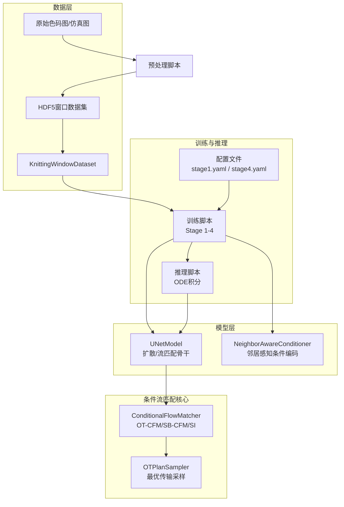
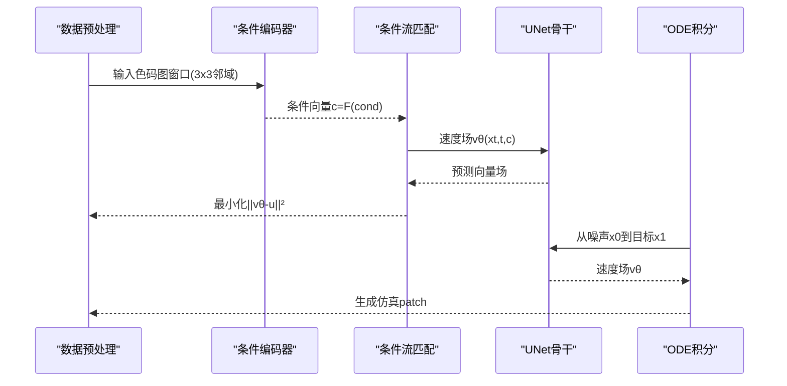
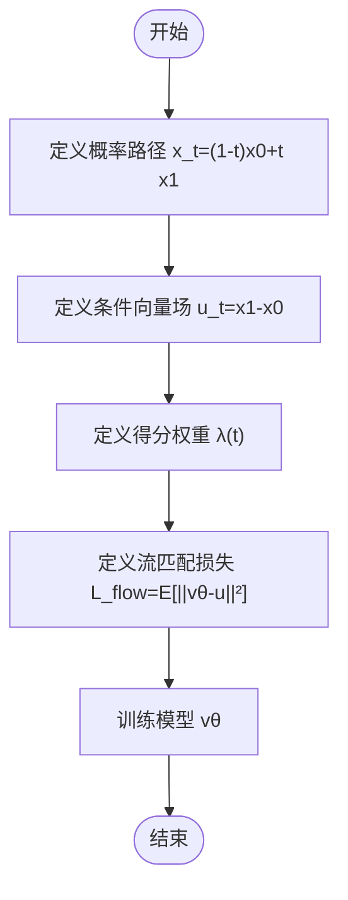
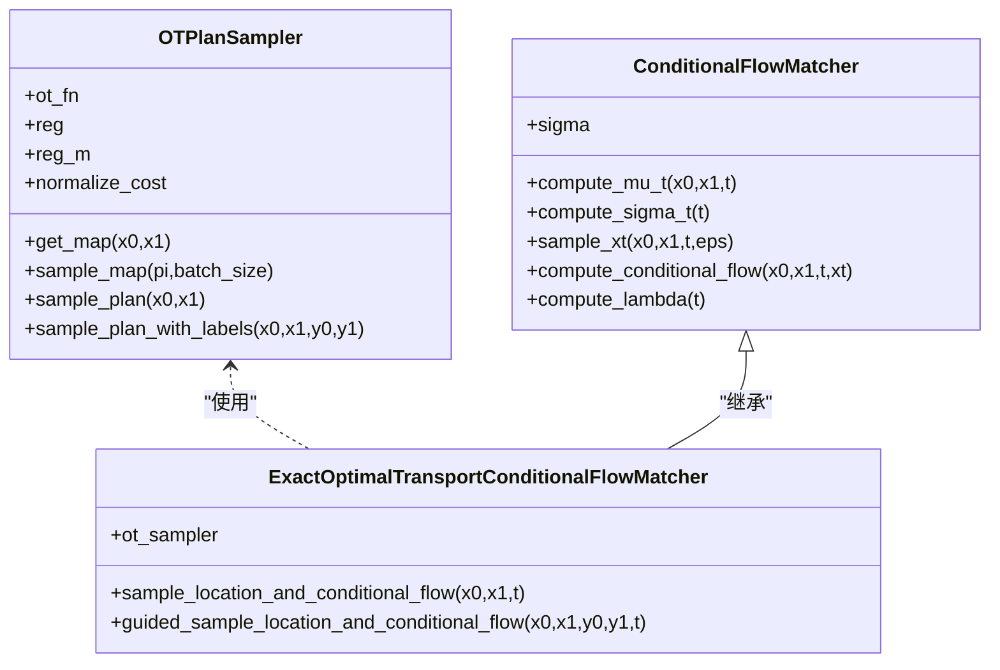
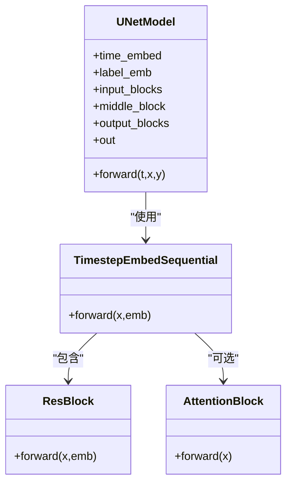
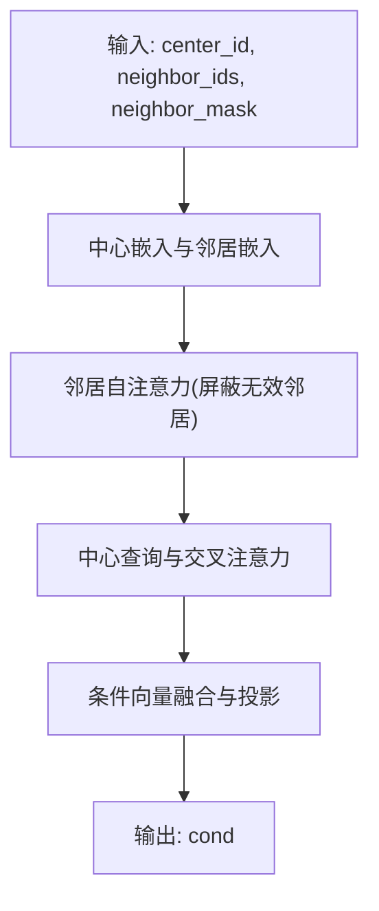
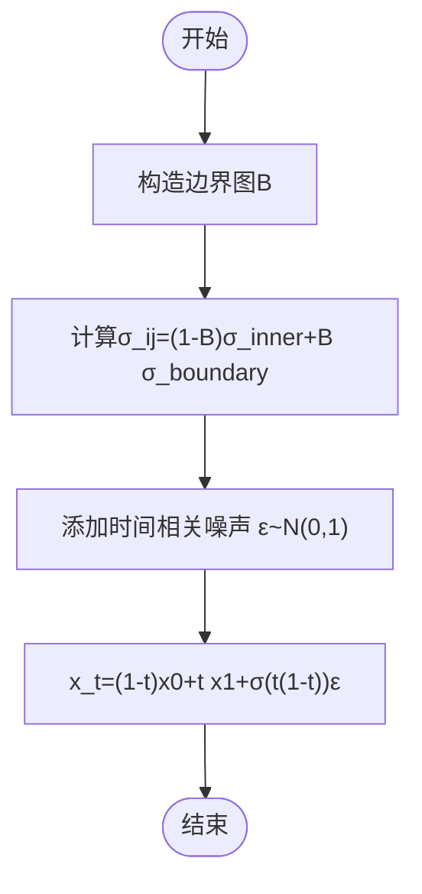
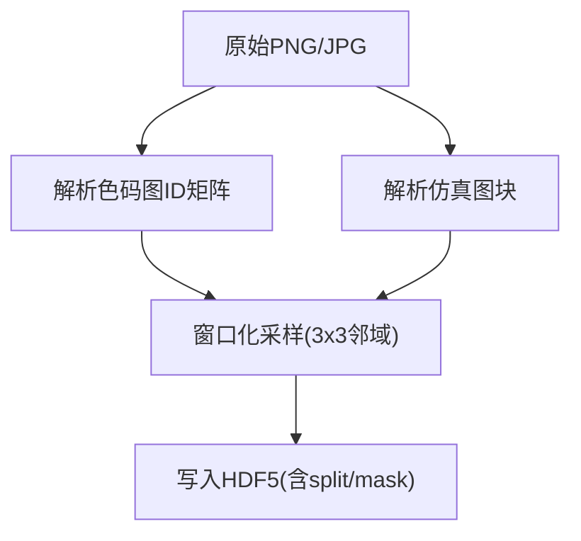
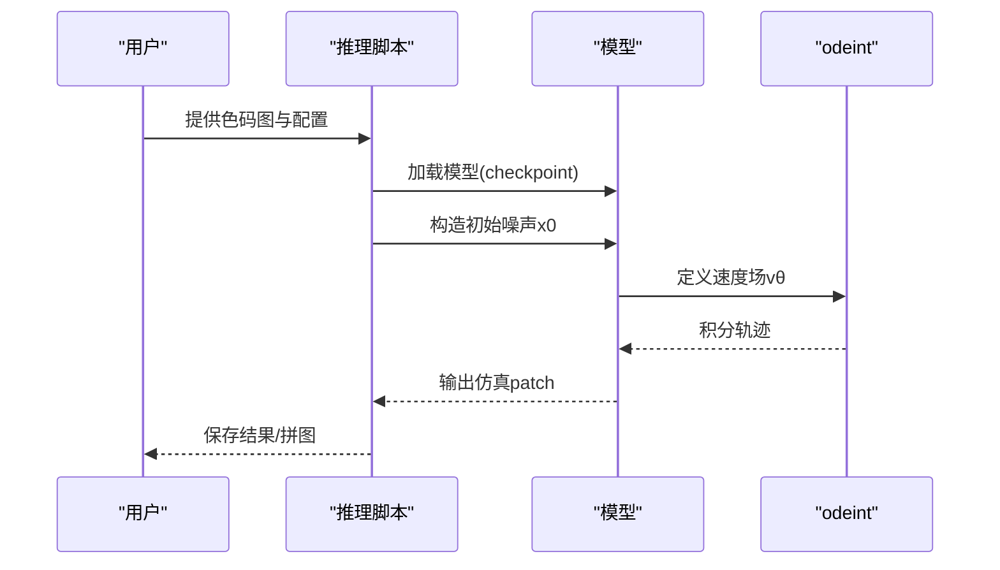
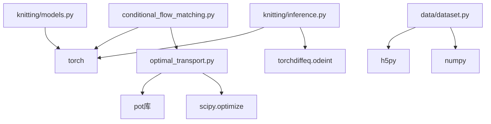

# 条件流匹配理论基础

<cite>
**本文档引用的文件**
- [README.md](file://conditional-flow-matching-main/README.md)
- [conditional_flow_matching.py](file://conditional-flow-matching-main/torchcfm/conditional_flow_matching.py)
- [optimal_transport.py](file://conditional-flow-matching-main/torchcfm/optimal_transport.py)
- [unet.py](file://conditional-flow-matching-main/torchcfm/models/unet/unet.py)
- [models.py](file://conditional-flow-matching-main/knitting/models.py)
- [dataset.py](file://conditional-flow-matching-main/data/dataset.py)
- [preprocess.py](file://conditional-flow-matching-main/data/preprocess.py)
- [inference.py](file://conditional-flow-matching-main/knitting/inference.py)
- [stage1.yaml](file://conditional-flow-matching-main/configs/stage1.yaml)
- [stage4.yaml](file://conditional-flow-matching-main/configs/stage4.yaml)
- [论文初稿.md](file://docs/论文初稿.md)
</cite>

## 目录
1. [引言](#引言)
2. [项目结构](#项目结构)
3. [核心组件](#核心组件)
4. [架构概览](#架构概览)
5. [详细组件分析](#详细组件分析)
6. [依赖分析](#依赖分析)
7. [性能考虑](#性能考虑)
8. [故障排除指南](#故障排除指南)
9. [结论](#结论)
10. [附录](#附录)

## 引言
本文件面向条件流匹配（Conditional Flow Matching, CFM）的理论基础，结合项目中的实现细节，系统阐述概率流的数学定义、OT-Conditional Flow Matching的目标函数与推导过程，解释如何将离散的针织动作序列建模为连续的概率流，以及条件分布的构造方法与正则化项的作用。文档同时提供与传统扩散模型的区别与优势分析，并为初学者提供直观的几何解释，为专家提供严格的数学证明与算法收敛性分析。

## 项目结构
该项目采用模块化设计，分为数据预处理、条件流匹配核心实现、UNet骨干网络、针织特定模型与推理管线等部分。核心模块包括：
- torchcfm：条件流匹配的数学实现与最优传输采样器
- data：HDF5数据集构建与窗口化采样
- knitting：针织特定的条件编码器与训练/推理脚本
- configs：各阶段训练配置
- docs：论文与系统说明文档

**图表来源**
- [README.md:1-47](file://conditional-flow-matching-main/README.md#L1-L47)
- [preprocess.py:71-275](file://conditional-flow-matching-main/data/preprocess.py#L71-L275)
- [dataset.py:13-206](file://conditional-flow-matching-main/data/dataset.py#L13-L206)
- [conditional_flow_matching.py:41-618](file://conditional-flow-matching-main/torchcfm/conditional_flow_matching.py#L41-L618)
- [optimal_transport.py:11-304](file://conditional-flow-matching-main/torchcfm/optimal_transport.py#L11-L304)
- [unet.py:369-632](file://conditional-flow-matching-main/torchcfm/models/unet/unet.py#L369-L632)
- [models.py:10-119](file://conditional-flow-matching-main/knitting/models.py#L10-L119)
- [inference.py:64-117](file://conditional-flow-matching-main/knitting/inference.py#L64-L117)
- [stage1.yaml:1-24](file://conditional-flow-matching-main/configs/stage1.yaml#L1-L24)
- [stage4.yaml:1-46](file://conditional-flow-matching-main/configs/stage4.yaml#L1-L46)

**章节来源**
- [README.md:1-47](file://conditional-flow-matching-main/README.md#L1-L47)
- [论文初稿.md:280-358](file://docs/论文初稿.md#L280-L358)

## 核心组件
本节聚焦条件流匹配的数学实现与关键组件，包括：
- ConditionalFlowMatcher：通用条件流匹配基类，定义概率路径、条件向量场与得分权重
- OTPlanSampler：最优传输计划采样器，支持精确EMD与Sinkhorn正则化
- UNetModel：扩散/流匹配骨干网络，支持时间步嵌入与条件注入
- NeighborAwareConditioner：邻居感知条件编码器，融合中心动作与邻域上下文
- AdaptiveFlowMatcher：自适应随机插值，按边界差异动态调整噪声强度

**章节来源**
- [conditional_flow_matching.py:41-618](file://conditional-flow-matching-main/torchcfm/conditional_flow_matching.py#L41-L618)
- [optimal_transport.py:11-304](file://conditional-flow-matching-main/torchcfm/optimal_transport.py#L11-L304)
- [unet.py:369-632](file://conditional-flow-matching-main/torchcfm/models/unet/unet.py#L369-L632)
- [models.py:10-119](file://conditional-flow-matching-main/knitting/models.py#L10-L119)
- [论文初稿.md:306-357](file://docs/论文初稿.md#L306-L357)

## 架构概览
条件流匹配在针织仿真中的整体流程如下：
- 数据预处理：将色码图与仿真图对齐，生成窗口化样本（3×3邻域+中心patch）
- 条件构造：使用邻居感知编码器提取中心动作与邻域上下文的条件向量
- 流匹配学习：在噪声到目标patch的速度场上最小化条件流匹配损失
- 推理生成：通过ODE积分从噪声到目标patch，形成全图仿真图

**图表来源**
- [preprocess.py:196-275](file://conditional-flow-matching-main/data/preprocess.py#L196-L275)
- [models.py:61-119](file://conditional-flow-matching-main/knitting/models.py#L61-L119)
- [conditional_flow_matching.py:159-200](file://conditional-flow-matching-main/torchcfm/conditional_flow_matching.py#L159-L200)
- [unet.py:598-632](file://conditional-flow-matching-main/torchcfm/models/unet/unet.py#L598-L632)
- [inference.py:299-378](file://conditional-flow-matching-main/knitting/inference.py#L299-L378)

## 详细组件分析

### 条件流匹配数学基础
条件流匹配的核心思想是学习从噪声到目标的概率流速度场。设x0为噪声，x1为目标，t∈[0,1]为时间参数，条件向量c为已知上下文。条件流匹配的目标是最小化速度场与条件向量场的差距：

$$
\mathcal{L}_{flow} = \mathbb{E}\left[\|v_\theta(x_t, t, c) - u_t\|^2\right]
$$

其中：
- $x_t = (1-t)x_0 + t x_1$（线性概率路径）
- $u_t = x_1 - x_0$（条件向量场）

在OT-Conditional Flow Matching中，概率路径与向量场通过最优传输计划进行耦合，使得样本间的对应关系在流过程中保持一致。

**图表来源**
- [conditional_flow_matching.py:62-217](file://conditional-flow-matching-main/torchcfm/conditional_flow_matching.py#L62-L217)

**章节来源**
- [conditional_flow_matching.py:41-218](file://conditional-flow-matching-main/torchcfm/conditional_flow_matching.py#L41-L218)

### 最优传输耦合与OT-CFM
OT-CFM通过最优传输计划对样本进行耦合，确保源与目标之间的对应关系在流过程中保持一致。OTPlanSampler支持多种求解器：
- 精确EMD（Earth Mover's Distance）
- Sinkhorn正则化
- 不平衡/部分Wasserstein

**图表来源**
- [optimal_transport.py:11-304](file://conditional-flow-matching-main/torchcfm/optimal_transport.py#L11-L304)
- [conditional_flow_matching.py:220-316](file://conditional-flow-matching-main/torchcfm/conditional_flow_matching.py#L220-L316)

**章节来源**
- [optimal_transport.py:11-304](file://conditional-flow-matching-main/torchcfm/optimal_transport.py#L11-L304)
- [conditional_flow_matching.py:220-316](file://conditional-flow-matching-main/torchcfm/conditional_flow_matching.py#L220-L316)

### UNet骨干网络与条件注入
UNet作为扩散/流匹配的骨干网络，支持时间步嵌入与条件注入。在条件流匹配中，条件向量c通过线性变换与时间步嵌入相加，然后在U-Net的各个模块中进行条件注入。

**图表来源**
- [unet.py:369-632](file://conditional-flow-matching-main/torchcfm/models/unet/unet.py#L369-L632)

**章节来源**
- [unet.py:369-632](file://conditional-flow-matching-main/torchcfm/models/unet/unet.py#L369-L632)

### 邻居感知条件编码器
邻居感知条件编码器将中心动作与3×3邻域动作编码为条件向量，通过自注意力与交叉注意力融合邻域上下文，并与中心动作进行融合，最终输出固定维度的条件向量用于UNet的条件注入。

**图表来源**
- [models.py:61-119](file://conditional-flow-matching-main/knitting/models.py#L61-L119)

**章节来源**
- [models.py:10-119](file://conditional-flow-matching-main/knitting/models.py#L10-L119)

### 自适应随机插值与边界噪声
在Stage 4中，根据3×3邻域动作差异构造边界图B，并对内部与边界区域使用不同的噪声强度σ_inner与σ_boundary，以提升边界过渡的鲁棒性并避免内部纹理被过度扰动。

**图表来源**
- [论文初稿.md:333-339](file://docs/论文初稿.md#L333-L339)
- [inference.py:581-600](file://conditional-flow-matching-main/knitting/inference.py#L581-L600)

**章节来源**
- [论文初稿.md:333-339](file://docs/论文初稿.md#L333-L339)
- [inference.py:529-600](file://conditional-flow-matching-main/knitting/inference.py#L529-L600)

### 数据预处理与窗口化采样
预处理脚本将色码图与仿真图对齐，生成窗口化样本，每个样本包含中心动作、3×3邻域动作、邻域掩码与对应的8×8仿真patch。数据集支持HDF5流式读取与加权采样。

**图表来源**
- [preprocess.py:47-275](file://conditional-flow-matching-main/data/preprocess.py#L47-L275)
- [dataset.py:13-206](file://conditional-flow-matching-main/data/dataset.py#L13-L206)

**章节来源**
- [preprocess.py:71-275](file://conditional-flow-matching-main/data/preprocess.py#L71-L275)
- [dataset.py:13-206](file://conditional-flow-matching-main/data/dataset.py#L13-L206)

### 推理流程与ODE积分
推理阶段通过ODE积分从噪声到目标patch，支持Euler、Midpoint与RK4求解器，默认采用Midpoint以平衡质量与效率。推理脚本支持多候选生成与拼图输出。

**图表来源**
- [inference.py:299-378](file://conditional-flow-matching-main/knitting/inference.py#L299-L378)

**章节来源**
- [inference.py:64-117](file://conditional-flow-matching-main/knitting/inference.py#L64-L117)
- [inference.py:299-378](file://conditional-flow-matching-main/knitting/inference.py#L299-L378)

## 依赖分析
条件流匹配模块的依赖关系如下：
- torchcfm/conditional_flow_matching.py 依赖 torch 与 optimal_transport.py
- torchcfm/optimal_transport.py 依赖 POT（Python Optimal Transport）与scipy
- knitting/models.py 依赖 torch 与 nn.Module
- data/dataset.py 依赖 h5py 与 numpy
- configs/*.yaml 提供训练超参与损失权重

**图表来源**
- [conditional_flow_matching.py:12-14](file://conditional-flow-matching-main/torchcfm/conditional_flow_matching.py#L12-L14)
- [optimal_transport.py:1-9](file://conditional-flow-matching-main/torchcfm/optimal_transport.py#L1-L9)
- [models.py:6-8](file://conditional-flow-matching-main/knitting/models.py#L6-L8)
- [dataset.py:9-10](file://conditional-flow-matching-main/data/dataset.py#L9-L10)
- [inference.py](file://conditional-flow-matching-main/knitting/inference.py#L33)

**章节来源**
- [conditional_flow_matching.py:12-14](file://conditional-flow-matching-main/torchcfm/conditional_flow_matching.py#L12-L14)
- [optimal_transport.py:1-9](file://conditional-flow-matching-main/torchcfm/optimal_transport.py#L1-L9)
- [models.py:6-8](file://conditional-flow-matching-main/knitting/models.py#L6-L8)
- [dataset.py:9-10](file://conditional-flow-matching-main/data/dataset.py#L9-L10)
- [inference.py](file://conditional-flow-matching-main/knitting/inference.py#L33)

## 性能考虑
- 训练稳定性：Stage 4引入复合损失（梯度、频域、物理、边界、结构、纹理），有助于提升全图连续性与纹理表现
- 计算效率：UNet采用残差块与注意力模块，支持混合精度与分布式训练
- 数据效率：HDF5流式读取与加权采样减少内存占用并提升样本多样性
- 推理效率：ODE求解器默认Midpoint，支持批量推理与多候选生成

**章节来源**
- [stage4.yaml:21-46](file://conditional-flow-matching-main/configs/stage4.yaml#L21-L46)
- [stage1.yaml:9-24](file://conditional-flow-matching-main/configs/stage1.yaml#L9-L24)
- [unet.py:440-531](file://conditional-flow-matching-main/torchcfm/models/unet/unet.py#L440-L531)
- [dataset.py:151-206](file://conditional-flow-matching-main/data/dataset.py#L151-L206)
- [inference.py:590-598](file://conditional-flow-matching-main/knitting/inference.py#L590-L598)

## 故障排除指南
- 数据加载错误：确认HDF5文件存在且包含neighbor_mask字段，检查patch_size与配置一致
- 训练不收敛：检查损失权重与学习率配置，逐步引入复合损失
- 推理卡顿：减小batch_size或切换CPU设备，检查CUDA可用性
- 边界断裂：增大边界损失权重或调整自适应噪声强度

**章节来源**
- [dataset.py:15-78](file://conditional-flow-matching-main/data/dataset.py#L15-L78)
- [stage4.yaml:21-46](file://conditional-flow-matching-main/configs/stage4.yaml#L21-L46)
- [inference.py:39-60](file://conditional-flow-matching-main/knitting/inference.py#L39-L60)

## 结论
条件流匹配为针织仿真提供了从噪声到目标patch的连续速度场学习框架。通过最优传输耦合、邻居感知条件编码与自适应随机插值，系统在边界连续性、纹理方向与区域层级关系方面取得显著改进。与传统扩散模型相比，条件流匹配在理论上更强调速度场的精确拟合与几何一致性，实践中通过复合损失与结构先验提升了生成质量与可解释性。

## 附录

### 与传统扩散模型的区别与优势
- 传统扩散模型：学习噪声到信号的逆向过程，依赖马尔可夫链与逐步去噪
- 条件流匹配：直接学习从噪声到目标的速度场，无需逆向过程，理论上更稳定
- 优势：在针织仿真中，条件流匹配能更好地保持边界闭合与纹理连续性，且推理过程更高效

**章节来源**
- [论文初稿.md:306-321](file://docs/论文初稿.md#L306-L321)