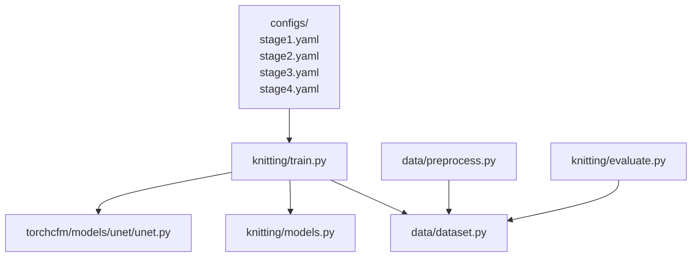
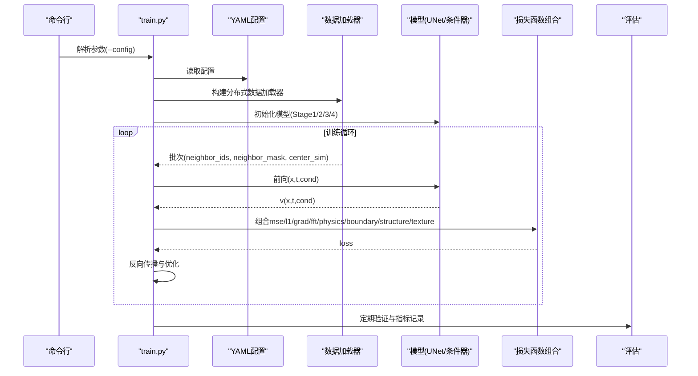
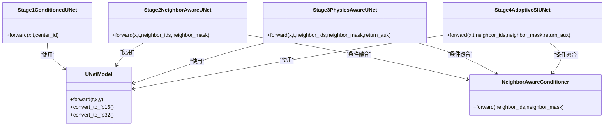
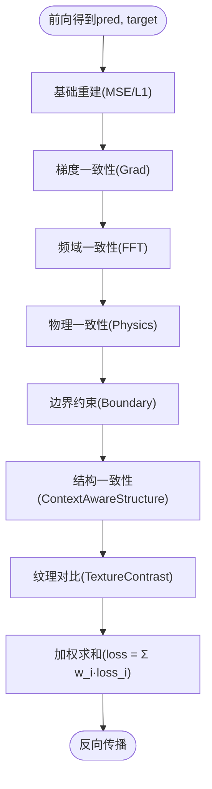

# 模型配置与参数

<cite>
**本文引用的文件**
- [stage1.yaml](file://conditional-flow-matching-main/configs/stage1.yaml)
- [stage2.yaml](file://conditional-flow-matching-main/configs/stage2.yaml)
- [stage3.yaml](file://conditional-flow-matching-main/configs/stage3.yaml)
- [stage4.yaml](file://conditional-flow-matching-main/configs/stage4.yaml)
- [train.py](file://conditional-flow-matching-main/knitting/train.py)
- [models.py](file://conditional-flow-matching-main/knitting/models.py)
- [dataset.py](file://conditional-flow-matching-main/data/dataset.py)
- [unet.py](file://conditional-flow-matching-main/torchcfm/models/unet/unet.py)
- [README.md](file://conditional-flow-matching-main/README.md)
- [preprocess.py](file://conditional-flow-matching-main/data/preprocess.py)
- [evaluate.py](file://conditional-flow-matching-main/knitting/evaluate.py)
- [requirements.txt](file://conditional-flow-matching-main/requirements.txt)
</cite>

## 目录
1. [引言](#引言)
2. [项目结构](#项目结构)
3. [核心组件](#核心组件)
4. [架构总览](#架构总览)
5. [详细组件分析](#详细组件分析)
6. [依赖分析](#依赖分析)
7. [性能考虑](#性能考虑)
8. [故障排查指南](#故障排查指南)
9. [结论](#结论)
10. [附录](#附录)

## 引言
本指南面向“针织图案生成”项目中的条件流匹配（Conditional Flow Matching, CFM）训练与推理配置，系统梳理各阶段（Stage 1–4）的配置文件结构、参数含义、训练超参数、数据处理选项及其对模型性能的影响。文档同时覆盖分布式训练（DDP）、损失函数组合、评估流程、以及在不同硬件环境下的优化建议与最佳实践。

## 项目结构
该项目采用按阶段分层的配置与代码组织方式：
- configs：各阶段训练配置（YAML）
- knitting：训练、推理、评估入口与模型定义
- data：数据预处理与数据集封装
- torchcfm：条件流匹配与UNet实现
- assets：指令与颜色定义资源
- checkpoints：各阶段训练权重输出

**图示来源**
- [stage1.yaml:1-24](file://conditional-flow-matching-main/configs/stage1.yaml#L1-L24)
- [stage2.yaml:1-24](file://conditional-flow-matching-main/configs/stage2.yaml#L1-L24)
- [stage3.yaml:1-26](file://conditional-flow-matching-main/configs/stage3.yaml#L1-L26)
- [stage4.yaml:1-46](file://conditional-flow-matching-main/configs/stage4.yaml#L1-L46)
- [train.py:1307-1321](file://conditional-flow-matching-main/knitting/train.py#L1307-L1321)
- [models.py:1-119](file://conditional-flow-matching-main/knitting/models.py#L1-L119)
- [dataset.py:1-207](file://conditional-flow-matching-main/data/dataset.py#L1-L207)
- [preprocess.py:1-285](file://conditional-flow-matching-main/data/preprocess.py#L1-L285)
- [unet.py:369-633](file://conditional-flow-matching-main/torchcfm/models/unet/unet.py#L369-L633)
- [evaluate.py:1-451](file://conditional-flow-matching-main/knitting/evaluate.py#L1-L451)

**章节来源**
- [README.md:1-47](file://conditional-flow-matching-main/README.md#L1-L47)

## 核心组件
- 配置文件（YAML）：定义数据路径、采样策略、训练超参、损失权重、检查点路径等
- 训练脚本（DDP版）：解析配置、构建数据加载器、定义损失函数、执行训练与验证
- 模型组件：UNet骨干、邻居感知条件器、物理特征编码器、自适应插值噪声
- 数据集与预处理：HDF5窗口样本、邻居掩码、三段式采样权重策略
- 评估脚本：统一指标（MSE/L1/SSIM/PSNR/LPIPS）与公平比较

**章节来源**
- [stage1.yaml:1-24](file://conditional-flow-matching-main/configs/stage1.yaml#L1-L24)
- [stage2.yaml:1-24](file://conditional-flow-matching-main/configs/stage2.yaml#L1-L24)
- [stage3.yaml:1-26](file://conditional-flow-matching-main/configs/stage3.yaml#L1-L26)
- [stage4.yaml:1-46](file://conditional-flow-matching-main/configs/stage4.yaml#L1-L46)
- [train.py:1-1322](file://conditional-flow-matching-main/knitting/train.py#L1-L1322)
- [models.py:1-119](file://conditional-flow-matching-main/knitting/models.py#L1-L119)
- [dataset.py:1-207](file://conditional-flow-matching-main/data/dataset.py#L1-L207)
- [preprocess.py:1-285](file://conditional-flow-matching-main/data/preprocess.py#L1-L285)
- [evaluate.py:1-451](file://conditional-flow-matching-main/knitting/evaluate.py#L1-L451)

## 架构总览
训练主流程（DDP）概览如下：

**图示来源**
- [train.py:40-1298](file://conditional-flow-matching-main/knitting/train.py#L40-L1298)
- [stage1.yaml:1-24](file://conditional-flow-matching-main/configs/stage1.yaml#L1-L24)
- [stage2.yaml:1-24](file://conditional-flow-matching-main/configs/stage2.yaml#L1-L24)
- [stage3.yaml:1-26](file://conditional-flow-matching-main/configs/stage3.yaml#L1-L26)
- [stage4.yaml:1-46](file://conditional-flow-matching-main/configs/stage4.yaml#L1-L46)

## 详细组件分析

### 阶段配置与参数详解
- Stage 1：基础中心指令条件UNet
  - 数据：processed_dir、json_path、weighted sampling、three-tier
  - 训练：batch_size、epochs、warmup_epochs、lr、num_workers、val/save频率、损失权重
  - 检查点：checkpoint_dir
- Stage 2：邻居感知条件器
  - 在Stage 1基础上增加grad/fft权重，提升边界与纹理一致性
- Stage 3：物理特征编码器
  - 新增physics_weight，使用预训练权重热启动（pretrained_path）
- Stage 4：自适应Stochastic Interpolants + 结构/纹理/边界损失
  - 新增boundary_weight、structure_*、texture_*、sigma_*等参数
  - patch_size、load_to_memory、sampling_strategy等数据选项

**章节来源**
- [stage1.yaml:1-24](file://conditional-flow-matching-main/configs/stage1.yaml#L1-L24)
- [stage2.yaml:1-24](file://conditional-flow-matching-main/configs/stage2.yaml#L1-L24)
- [stage3.yaml:1-26](file://conditional-flow-matching-main/configs/stage3.yaml#L1-L26)
- [stage4.yaml:1-46](file://conditional-flow-matching-main/configs/stage4.yaml#L1-L46)

### 数据与采样策略
- HDF5窗口样本：包含center_sim、neighbor_ids、neighbor_mask、split等字段
- 采样策略：three_tier、balanced、sqrt；默认three_tier
- 加载策略：load_to_memory控制是否预加载，影响内存占用与IO
- Patch尺寸：config.patch_size需与预处理生成的HDF5一致

**章节来源**
- [dataset.py:13-207](file://conditional-flow-matching-main/data/dataset.py#L13-L207)
- [preprocess.py:118-275](file://conditional-flow-matching-main/data/preprocess.py#L118-L275)

### 模型与条件器
- UNet骨干：来自torchcfm，支持注意力、残差块、上/下采样
- Stage1ConditionedUNet：以中心指令ID作为类别条件
- Stage2NeighborAwareUNet：邻居感知条件器，融合中心与邻居上下文
- Stage3/4PhysicsAwareUNet：引入物理特征编码器与跨注意力，增强结构一致性

**图示来源**
- [unet.py:369-633](file://conditional-flow-matching-main/torchcfm/models/unet/unet.py#L369-L633)
- [models.py:10-119](file://conditional-flow-matching-main/knitting/models.py#L10-L119)
- [train.py:318-691](file://conditional-flow-matching-main/knitting/train.py#L318-L691)

**章节来源**
- [unet.py:369-633](file://conditional-flow-matching-main/torchcfm/models/unet/unet.py#L369-L633)
- [models.py:1-119](file://conditional-flow-matching-main/knitting/models.py#L1-L119)
- [train.py:318-691](file://conditional-flow-matching-main/knitting/train.py#L318-L691)

### 损失函数与正则化
- 基础重建：MSE/L1
- 梯度一致性：GradientLoss（鼓励平滑解）
- 频域一致性：FFTLoss（保持频谱一致性）
- 物理一致性：PhysicsFeatureEncoder辅助预测与目标对齐
- 边界约束：BoundaryLoss（仅在相邻块边界带内计算）
- 结构一致性：ContextAwareStructureLoss（脊线/宽度/低纹理抑制/方向项）
- 纹理对比：TextureContrastLoss（基于目标高频响应的加权L1）

**图示来源**
- [train.py:71-121](file://conditional-flow-matching-main/knitting/train.py#L71-L121)
- [train.py:123-311](file://conditional-flow-matching-main/knitting/train.py#L123-L311)
- [stage4.yaml:21-37](file://conditional-flow-matching-main/configs/stage4.yaml#L21-L37)

**章节来源**
- [train.py:71-121](file://conditional-flow-matching-main/knitting/train.py#L71-L121)
- [train.py:123-311](file://conditional-flow-matching-main/knitting/train.py#L123-L311)
- [stage4.yaml:21-37](file://conditional-flow-matching-main/configs/stage4.yaml#L21-L37)

### 分布式训练（DDP）与环境变量
- 启动方式：torchrun --nproc_per_node=N knitting/train.py [--config ...]
- 环境变量：LOCAL_RANK（NCCL后端）、CUDA可见设备由torch.cuda.set_device(local_rank)设置
- 采样器：DistributedWeightedSampler/DistributedSampler确保多进程均衡采样
- 日志与同步：barrier、reduce_loss（all_reduce）

**章节来源**
- [train.py:40-64](file://conditional-flow-matching-main/knitting/train.py#L40-L64)
- [train.py:725-776](file://conditional-flow-matching-main/knitting/train.py#L725-L776)

### 推理与评估
- 推理：knitting/inference.py（从颜色码图生成仿真图像）
- 评估：统一指标（MSE/L1/SSIM/PSNR/LPIPS），Euler ODE求解器，相同噪声种子保证公平比较

**章节来源**
- [README.md:23-35](file://conditional-flow-matching-main/README.md#L23-L35)
- [evaluate.py:102-242](file://conditional-flow-matching-main/knitting/evaluate.py#L102-L242)

## 依赖分析
- PyTorch生态：torch、torchvision、torchdiffeq（用于数值积分）
- HDF5：h5py用于高效存储窗口样本
- 可选评估库：pytorch-msssim、lpips
- YAML解析：pyyaml

**章节来源**
- [requirements.txt:1-46](file://conditional-flow-matching-main/requirements.txt#L1-L46)

## 性能考虑
- 批大小与显存：增大batch_size可提升吞吐，但需平衡显存；FP16可降低显存占用
- 数据加载：num_workers与pin_memory提升IO；load_to_memory适合小数据集，否则节省内存
- 采样策略：three_tier对长尾类别进行加权，提升稀有类别的学习机会
- 梯度检查点：UNet支持checkpoint以降低显存
- 分布式：NCCL后端、合适的world_size与本地GPU数量匹配

**章节来源**
- [stage1.yaml:10-14](file://conditional-flow-matching-main/configs/stage1.yaml#L10-L14)
- [stage2.yaml:10-14](file://conditional-flow-matching-main/configs/stage2.yaml#L10-L14)
- [stage3.yaml:10-14](file://conditional-flow-matching-main/configs/stage3.yaml#L10-L14)
- [stage4.yaml:12-16](file://conditional-flow-matching-main/configs/stage4.yaml#L12-L16)
- [unet.py:586-596](file://conditional-flow-matching-main/torchcfm/models/unet/unet.py#L586-L596)

## 故障排查指南
- HDF5不匹配：patch_size不一致或缺少neighbor_mask将触发异常
  - 解决：删除旧dataset_processed/dataset.h5，重新运行预处理
- 权重加载失败：跨阶段热启动时形状不匹配会自动跳过
  - 解决：确认pretrained_path存在且与目标阶段结构兼容
- 采样权重统计：three_tier策略会打印各类别采样后期望占比，便于诊断类别不平衡
- 评估依赖缺失：未安装pytorch-msssim或lpips时会跳过对应指标
- 分布式初始化：LOCAL_RANK缺失时回退为单卡模式

**章节来源**
- [dataset.py:26-47](file://conditional-flow-matching-main/data/dataset.py#L26-L47)
- [dataset.py:106-144](file://conditional-flow-matching-main/data/dataset.py#L106-L144)
- [train.py:783-793](file://conditional-flow-matching-main/knitting/train.py#L783-L793)
- [evaluate.py:30-45](file://conditional-flow-matching-main/knitting/evaluate.py#L30-L45)

## 结论
本项目通过分阶段配置与渐进式损失设计，实现了从基础条件UNet到结构感知与物理一致性的逐步增强。合理的配置选择（数据采样、损失权重、分布式与FP16）直接影响收敛稳定性与生成质量。建议在不同硬件环境下优先调整batch_size与num_workers，结合three_tier采样策略与边界/结构/纹理损失，获得更稳健的性能表现。

## 附录

### 配置文件模板与参数调优建议
- Stage 1模板要点
  - 数据：processed_dir、json_path、use_weighted_sampling=true、sampling_strategy=three_tier
  - 训练：batch_size建议≥128；warmup_epochs≈5%~10%；lr≈1e-4；val_every/save_every按验证成本设定
  - 损失：mse_weight主导，l1_weight较小，grad/fft为0
- Stage 2模板要点
  - 在Stage 1基础上适度提升grad_weight与fft_weight，强化边界与纹理一致性
- Stage 3模板要点
  - 增加physics_weight≈0.1；使用pretrained_path从Stage2热启动
- Stage 4模板要点
  - 增加boundary_weight≈0.22、structure_*系列、texture_*系列、sigma_*系列
  - 建议减小学习率（如1e-6）与batch_size（如64~128），延长训练轮数

**章节来源**
- [stage1.yaml:1-24](file://conditional-flow-matching-main/configs/stage1.yaml#L1-L24)
- [stage2.yaml:1-24](file://conditional-flow-matching-main/configs/stage2.yaml#L1-L24)
- [stage3.yaml:1-26](file://conditional-flow-matching-main/configs/stage3.yaml#L1-L26)
- [stage4.yaml:1-46](file://conditional-flow-matching-main/configs/stage4.yaml#L1-L46)

### 环境变量与GPU配置
- LOCAL_RANK：NCCL后端的进程编号
- CUDA_VISIBLE_DEVICES：限制可见GPU集合
- NCCL环境变量（可选）：NCCL_SOCKET_IFNAME、NCCL_IB_DISABLE等（根据网络与IB适配情况）

**章节来源**
- [train.py:40-47](file://conditional-flow-matching-main/knitting/train.py#L40-L47)

### 分布式训练配置方法
- 单机多卡：torchrun --nproc_per_node=N knitting/train.py --config configs/stageX.yaml
- 多机多卡：扩展为多节点，确保网络互通与共享存储（若使用HDF5）

**章节来源**
- [train.py:5-8](file://conditional-flow-matching-main/knitting/train.py#L5-L8)

### 配置验证与错误诊断清单
- 预处理：确认HDF5包含neighbor_mask与正确patch_size
- 采样：three_tier权重统计是否符合预期
- 权重加载：跨阶段热启动是否存在形状不匹配
- 评估：指标缺失时检查pytorch-msssim与lpips安装

**章节来源**
- [dataset.py:43-47](file://conditional-flow-matching-main/data/dataset.py#L43-L47)
- [dataset.py:134-144](file://conditional-flow-matching-main/data/dataset.py#L134-L144)
- [train.py:783-793](file://conditional-flow-matching-main/knitting/train.py#L783-L793)
- [evaluate.py:30-45](file://conditional-flow-matching-main/knitting/evaluate.py#L30-L45)

### 性能基准测试方法
- 统一评估：使用knitting/evaluate.py对各Stage进行相同噪声种子与ODE步数的评估
- 指标对比：MSE/L1/SSIM/PSNR/LPIPS，关注每类别的MSE分布
- 速度基准：记录每轮迭代耗时与吞吐，结合batch_size与num_workers调整

**章节来源**
- [evaluate.py:102-242](file://conditional-flow-matching-main/knitting/evaluate.py#L102-L242)

### 硬件环境优化建议与最佳实践
- 小显存（≤16GB）：启用FP16、减小batch_size、使用load_to_memory=false、num_workers=2
- 大显存（≥24GB）：增大batch_size、开启three_tier采样、适当提高grad/fft/physics权重
- 多GPU：确保NCCL通信稳定，避免跨节点IO瓶颈；必要时将HDF5放置共享存储
- 稀有类别：优先使用three_tier采样策略，配合physics/structure损失提升泛化

**章节来源**
- [stage1.yaml:10-14](file://conditional-flow-matching-main/configs/stage1.yaml#L10-L14)
- [stage2.yaml:10-21](file://conditional-flow-matching-main/configs/stage2.yaml#L10-L21)
- [stage3.yaml:10-24](file://conditional-flow-matching-main/configs/stage3.yaml#L10-L24)
- [stage4.yaml:12-18](file://conditional-flow-matching-main/configs/stage4.yaml#L12-L18)
- [unet.py:586-596](file://conditional-flow-matching-main/torchcfm/models/unet/unet.py#L586-L596)