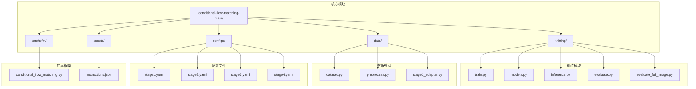
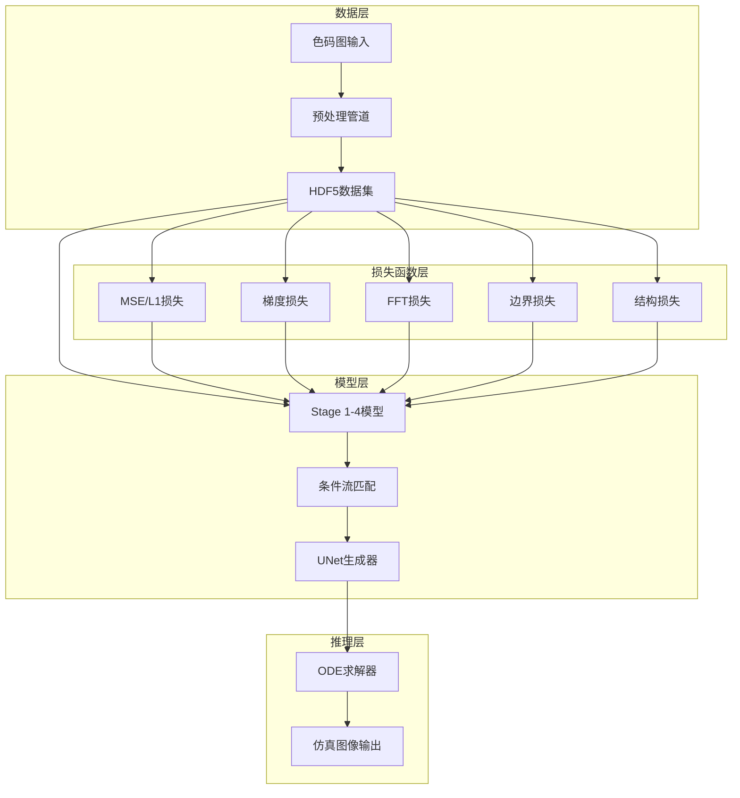
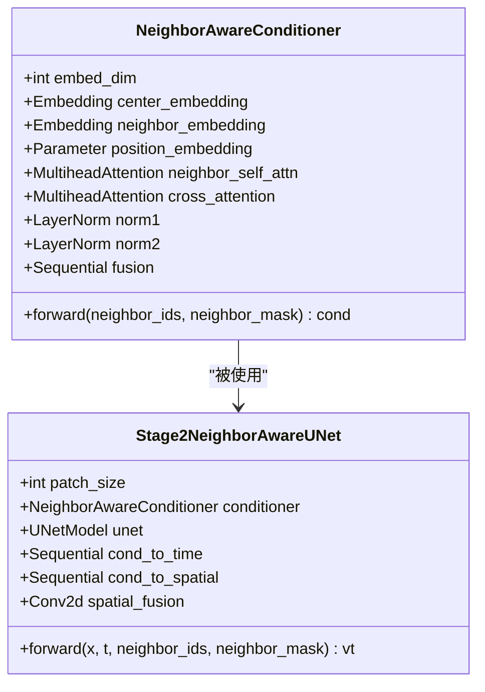
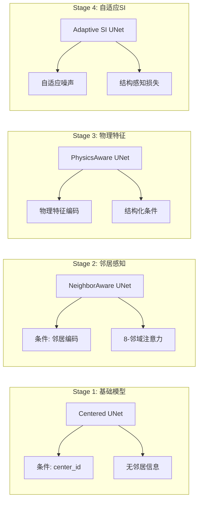
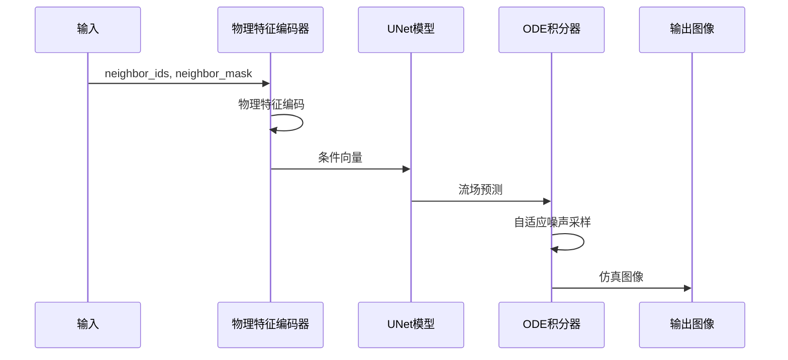
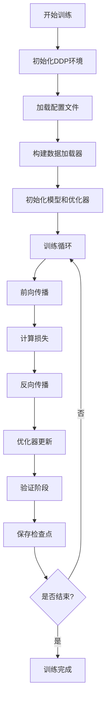
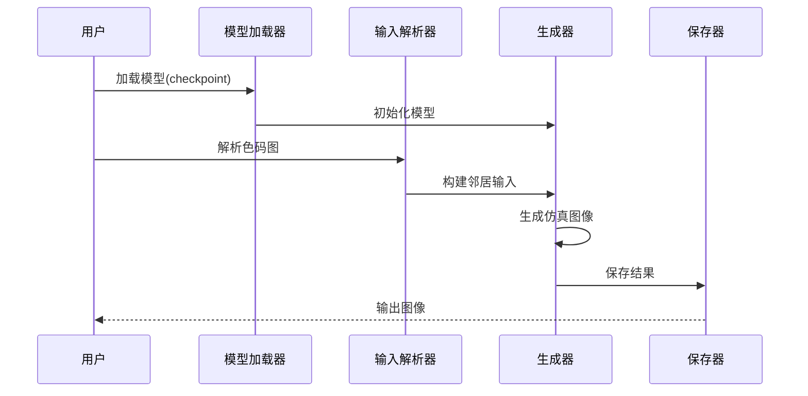
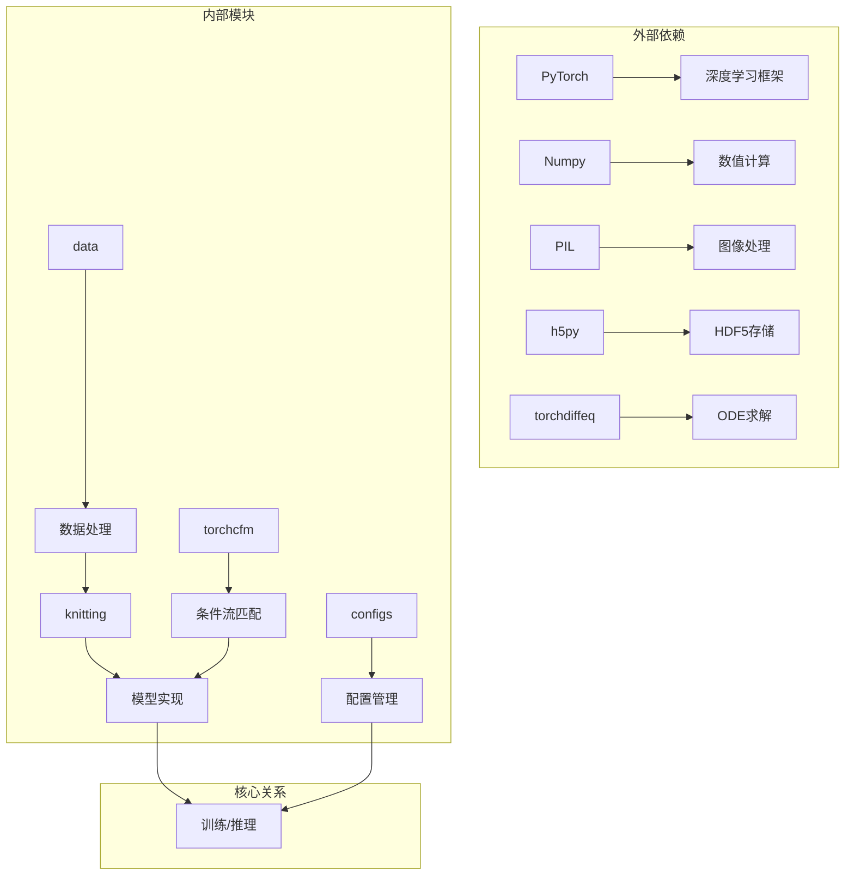

# 第二阶段：仿真生成

<cite>
**本文档引用的文件**
- [README.md](file://conditional-flow-matching-main/README.md)
- [models.py](file://conditional-flow-matching-main/knitting/models.py)
- [train.py](file://conditional-flow-matching-main/knitting/train.py)
- [inference.py](file://conditional-flow-matching-main/knitting/inference.py)
- [dataset.py](file://conditional-flow-matching-main/data/dataset.py)
- [preprocess.py](file://conditional-flow-matching-main/data/preprocess.py)
- [stage1_adapter.py](file://conditional-flow-matching-main/data/stage1_adapter.py)
- [evaluate.py](file://conditional-flow-matching-main/knitting/evaluate.py)
- [evaluate_full_image.py](file://conditional-flow-matching-main/knitting/evaluate_full_image.py)
- [stage1.yaml](file://conditional-flow-matching-main/configs/stage1.yaml)
- [stage2.yaml](file://conditional-flow-matching-main/configs/stage2.yaml)
- [stage3.yaml](file://conditional-flow-matching-main/configs/stage3.yaml)
- [stage4.yaml](file://conditional-flow-matching-main/configs/stage4.yaml)
- [conditional_flow_matching.py](file://conditional-flow-matching-main/torchcfm/conditional_flow_matching.py)
- [instructions.json](file://conditional-flow-matching-main/assets/instructions.json)
</cite>

## 目录
1. [简介](#简介)
2. [项目结构](#项目结构)
3. [核心组件](#核心组件)
4. [架构概览](#架构概览)
5. [详细组件分析](#详细组件分析)
6. [依赖关系分析](#依赖关系分析)
7. [性能考虑](#性能考虑)
8. [故障排除指南](#故障排除指南)
9. [结论](#结论)
10. [附录](#附录)

## 简介
本项目实现了基于条件流匹配的针织仿真生成功能，是完整项目中的第二阶段。该阶段的核心目标是将色码图（color-code map）转换为逼真的针织仿真图像（simulation image）。项目采用了多阶段渐进式架构，从基础的中心指令条件到复杂的邻居感知、物理特征编码，最终达到自适应随机插值的结构感知模型。

项目的主要特色包括：
- 条件流匹配（Conditional Flow Matching）理论基础
- 邻居感知条件编码器（Neighbor-aware Conditioning）
- 多阶段模型架构（Stage 1-4）
- 自适应随机插值（Adaptive Stochastic Interpolants）
- 结构感知损失函数（Structure-aware Loss Functions）

## 项目结构
该项目采用模块化设计，主要分为以下几个核心模块：



**图表来源**
- [README.md:1-47](file://conditional-flow-matching-main/README.md#L1-L47)
- [models.py:1-119](file://conditional-flow-matching-main/knitting/models.py#L1-L119)
- [train.py:1-800](file://conditional-flow-matching-main/knitting/train.py#L1-L800)

**章节来源**
- [README.md:1-47](file://conditional-flow-matching-main/README.md#L1-L47)
- [models.py:1-119](file://conditional-flow-matching-main/knitting/models.py#L1-L119)
- [train.py:1-800](file://conditional-flow-matching-main/knitting/train.py#L1-L800)

## 核心组件
本项目的核心组件包括条件流匹配框架、邻居感知条件编码器、多阶段UNet模型架构以及自适应随机插值机制。

### 条件流匹配框架
条件流匹配（CFM）是本项目的核心理论基础，它通过求解概率路径上的流场来实现从源分布到目标分布的映射。项目实现了多种CFM变体，包括标准条件流匹配、最优传输条件流匹配和变差保持条件流匹配。

### 邻居感知条件编码器
这是第二阶段的关键创新，通过8-邻域注意力机制对相邻块的指令进行编码，从而获得更丰富的上下文信息。该编码器能够：
- 提取中心块和8个邻居块的指令嵌入
- 通过交叉注意力机制融合邻居信息
- 生成结构化的条件向量用于UNet条件输入

### 多阶段模型架构
项目实现了四个阶段的渐进式模型架构：
- **Stage 1**: 基础中心指令条件模型
- **Stage 2**: 邻居感知条件模型
- **Stage 3**: 物理特征编码模型
- **Stage 4**: 自适应随机插值结构感知模型

### 自适应随机插值
第四阶段引入了自适应随机插值机制，根据块间的边界关系动态调整噪声强度，使得边界区域具有更高的随机性以实现自然过渡。

**章节来源**
- [models.py:10-119](file://conditional-flow-matching-main/knitting/models.py#L10-L119)
- [train.py:318-691](file://conditional-flow-matching-main/knitting/train.py#L318-L691)
- [conditional_flow_matching.py:41-619](file://conditional-flow-matching-main/torchcfm/conditional_flow_matching.py#L41-L619)

## 架构概览
整个系统的架构采用分层设计，从数据预处理到模型训练再到推理生成形成了完整的流水线。



**图表来源**
- [train.py:69-312](file://conditional-flow-matching-main/knitting/train.py#L69-L312)
- [inference.py:299-378](file://conditional-flow-matching-main/knitting/inference.py#L299-L378)

## 详细组件分析

### 邻居感知条件编码器
邻居感知条件编码器是第二阶段的核心创新，它通过8-邻域注意力机制实现对局部上下文的建模。



**图表来源**
- [models.py:10-119](file://conditional-flow-matching-main/knitting/models.py#L10-L119)
- [train.py:335-377](file://conditional-flow-matching-main/knitting/train.py#L335-L377)

该编码器的工作流程如下：

```mermaid
flowchart TD
A[输入: neighbor_ids, neighbor_mask] --> B[提取中心ID和邻居ID]
B --> C[嵌入编码: center_embedding, neighbor_embedding]
C --> D[添加位置编码]
D --> E[邻居自注意力: 8个邻居]
E --> F[层归一化]
F --> G[交叉注意力: 中心查询邻居]
G --> H[层归一化]
H --> I[特征融合: cat(center, attended)]
I --> J[线性变换: 生成条件向量]
J --> K[输出: cond]
```

**图表来源**
- [models.py:61-119](file://conditional-flow-matching-main/knitting/models.py#L61-L119)

**章节来源**
- [models.py:10-119](file://conditional-flow-matching-main/knitting/models.py#L10-L119)

### 多阶段模型架构
项目实现了四个阶段的渐进式模型架构，每个阶段都有特定的设计目标和改进。



**图表来源**
- [train.py:318-691](file://conditional-flow-matching-main/knitting/train.py#L318-L691)

**章节来源**
- [train.py:318-691](file://conditional-flow-matching-main/knitting/train.py#L318-L691)

### 自适应随机插值机制
第四阶段引入了自适应随机插值机制，根据块间的边界关系动态调整噪声强度。



**图表来源**
- [train.py:529-691](file://conditional-flow-matching-main/knitting/train.py#L529-L691)
- [inference.py:299-378](file://conditional-flow-matching-main/knitting/inference.py#L299-L378)

**章节来源**
- [train.py:529-691](file://conditional-flow-matching-main/knitting/train.py#L529-L691)

### 训练流程详解
训练流程采用分布式数据并行（DDP）架构，支持多GPU训练和混合精度训练。



**图表来源**
- [train.py:40-800](file://conditional-flow-matching-main/knitting/train.py#L40-L800)

**章节来源**
- [train.py:40-800](file://conditional-flow-matching-main/knitting/train.py#L40-L800)

### 推理流程详解
推理流程支持单图生成和多候选生成两种模式，提供了灵活的参数配置选项。



**图表来源**
- [inference.py:64-118](file://conditional-flow-matching-main/knitting/inference.py#L64-L118)
- [inference.py:459-487](file://conditional-flow-matching-main/knitting/inference.py#L459-L487)

**章节来源**
- [inference.py:64-118](file://conditional-flow-matching-main/knitting/inference.py#L64-L118)
- [inference.py:459-487](file://conditional-flow-matching-main/knitting/inference.py#L459-L487)

## 依赖关系分析



**图表来源**
- [train.py:17-33](file://conditional-flow-matching-main/knitting/train.py#L17-L33)
- [inference.py:30-36](file://conditional-flow-matching-main/knitting/inference.py#L30-L36)

**章节来源**
- [train.py:17-33](file://conditional-flow-matching-main/knitting/train.py#L17-L33)
- [inference.py:30-36](file://conditional-flow-matching-main/knitting/inference.py#L30-L36)

## 性能考虑
基于项目实现，以下是关键的性能优化建议：

### 训练性能优化
1. **分布式训练**: 使用DDP进行多GPU训练，提高训练效率
2. **混合精度**: 利用半精度训练减少内存占用
3. **数据加载优化**: 使用HDF5格式和多进程数据加载
4. **批大小调优**: 根据GPU内存调整批大小

### 推理性能优化
1. **内存管理**: 合理设置batch_size避免内存溢出
2. **设备选择**: 优先使用CUDA设备进行推理
3. **缓存策略**: 对重复使用的模型进行缓存
4. **并行处理**: 利用多核CPU进行数据预处理

### 模型性能优化
1. **注意力机制**: 8-邻域注意力相比全局注意力显著降低计算复杂度
2. **条件融合**: 通过线性层融合条件信息，计算开销可控
3. **损失函数**: 多任务损失平衡各任务的重要性

## 故障排除指南

### 常见问题及解决方案

**问题1: CUDA不可用**
- 检查CUDA版本兼容性
- 确认GPU驱动正确安装
- 降级到CPU模式运行

**问题2: 内存不足**
- 减少batch_size
- 关闭不必要的日志记录
- 使用更小的图像尺寸

**问题3: 数据加载错误**
- 验证HDF5文件完整性
- 检查数据预处理是否完成
- 确认文件路径正确

**问题4: 模型加载失败**
- 检查checkpoint文件是否存在
- 验证模型配置与checkpoint匹配
- 确认权重映射正确

**章节来源**
- [inference.py:39-58](file://conditional-flow-matching-main/knitting/inference.py#L39-L58)
- [dataset.py:43-47](file://conditional-flow-matching-main/data/dataset.py#L43-L47)

## 结论
第二阶段仿真生成功能通过条件流匹配理论和多阶段渐进式架构，实现了从色码图到逼真针织仿真图像的高质量转换。邻居感知条件编码器是该阶段的核心创新，通过8-邻域注意力机制有效捕获了局部上下文信息。自适应随机插值机制进一步提升了边界区域的自然度和整体图像质量。

该系统具有以下优势：
- 理论基础扎实，条件流匹配确保了生成过程的数学一致性
- 模块化设计便于扩展和维护
- 多阶段架构提供了渐进式的性能提升路径
- 丰富的损失函数组合确保了多方面的质量保证

未来可以考虑的方向包括：
- 更复杂的物理约束集成
- 实时推理优化
- 多尺度生成策略
- 交互式编辑功能

## 附录

### 配置参数说明

#### Stage 1配置参数
- `batch_size`: 256
- `epochs`: 120
- `lr`: 0.0002
- `mse_weight`: 1.0
- `l1_weight`: 0.1

#### Stage 2配置参数
- `batch_size`: 256
- `epochs`: 120
- `lr`: 0.0002
- `mse_weight`: 1.0
- `l1_weight`: 0.1
- `grad_weight`: 0.05
- `fft_weight`: 0.05

#### Stage 3配置参数
- `batch_size`: 256
- `epochs`: 80
- `lr`: 0.0001
- `physics_weight`: 0.10

#### Stage 4配置参数
- `batch_size`: 128
- `epochs`: 30
- `lr`: 0.000003
- `boundary_weight`: 0.22
- `structure_weight`: 0.12
- `texture_weight`: 0.08
- `sigma_inner`: 0.004
- `sigma_boundary`: 0.040

### 使用示例

**基本推理命令**:
```bash
python knitting/inference.py \
    --stage 4 \
    --input dataset_raw/color_maps/Cable/Cable1_001_0_0.png \
    --checkpoint checkpoints/stage4/best.pt
```

**多候选生成**:
```bash
python knitting/inference.py \
    --stage 4 \
    --input outputs/runs/20260601_154724/color_map/pattern_sim_input.png \
    --num_candidates 4 \
    --save_grid \
    --seed 42
```

**训练命令**:
```bash
torchrun --nproc_per_node=2 knitting/train.py \
    --config configs/stage4.yaml
```

**章节来源**
- [stage1.yaml:1-24](file://conditional-flow-matching-main/configs/stage1.yaml#L1-L24)
- [stage2.yaml:1-24](file://conditional-flow-matching-main/configs/stage2.yaml#L1-L24)
- [stage3.yaml:1-26](file://conditional-flow-matching-main/configs/stage3.yaml#L1-L26)
- [stage4.yaml:1-46](file://conditional-flow-matching-main/configs/stage4.yaml#L1-L46)
- [README.md:23-35](file://conditional-flow-matching-main/README.md#L23-L35)