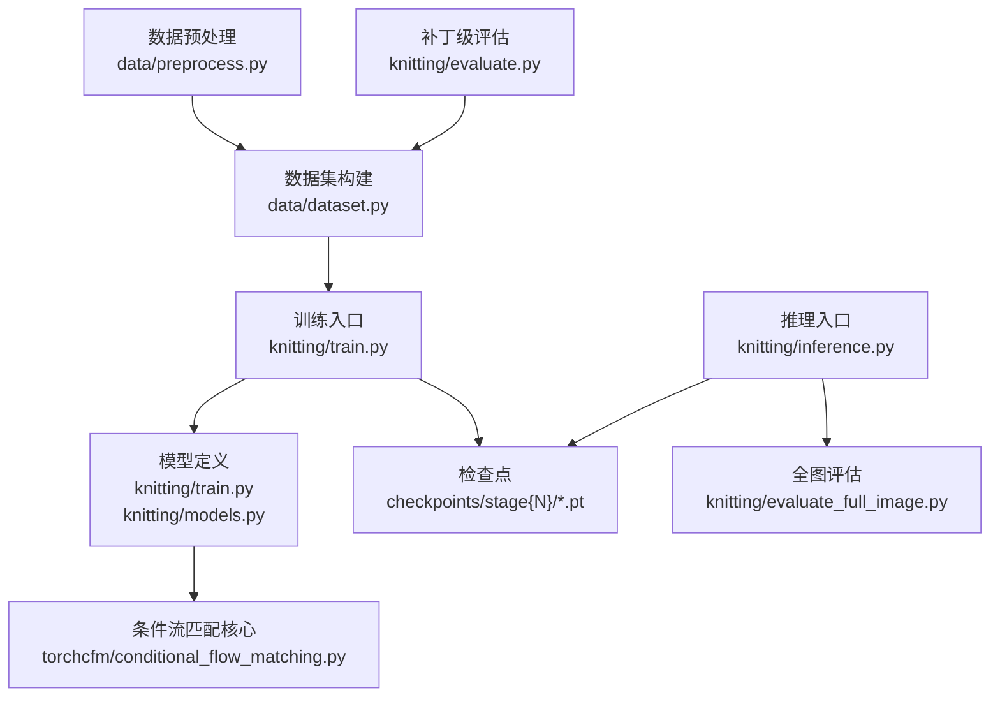
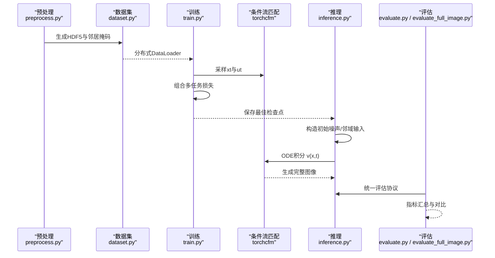
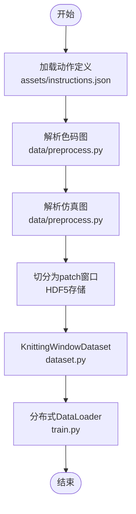
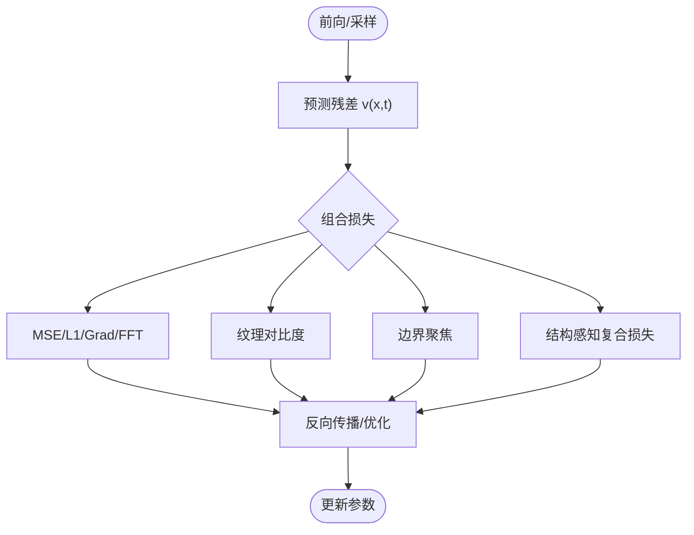
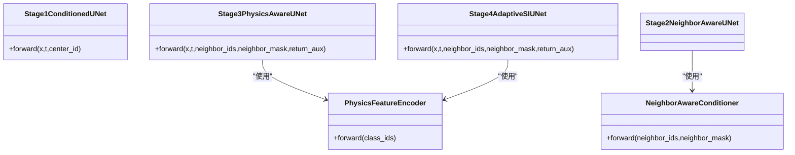
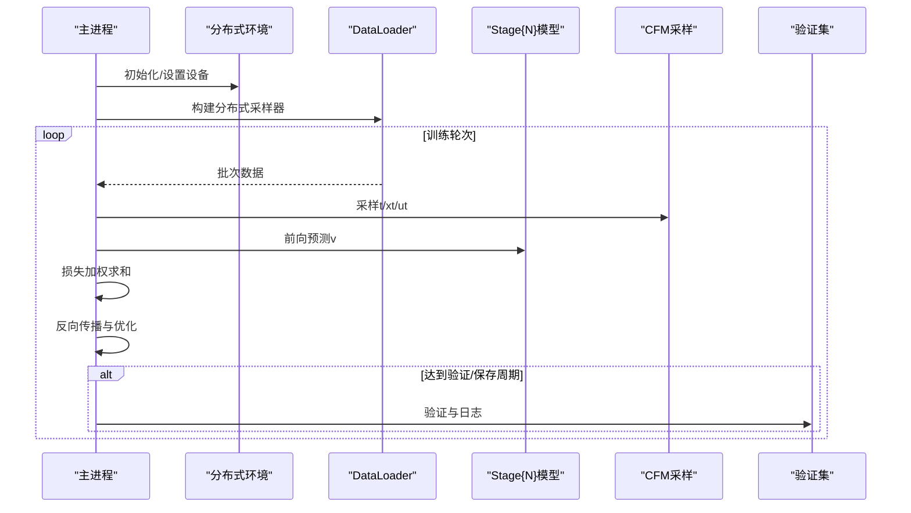
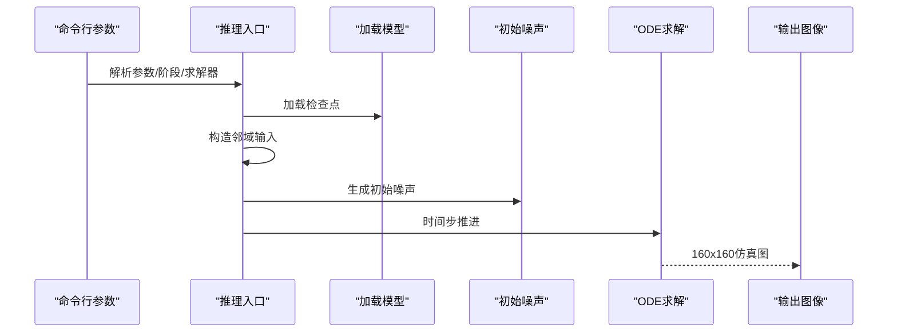
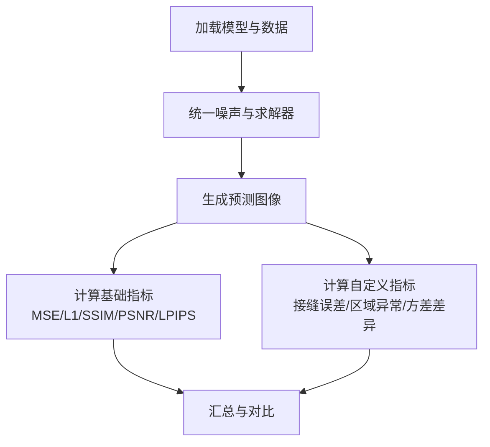
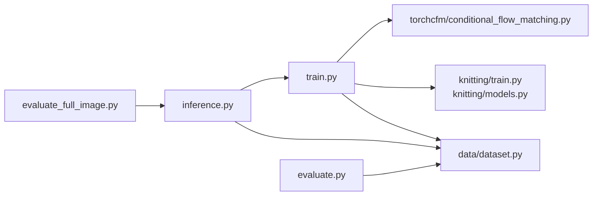

# 训练与推理流程

<cite>
**本文引用的文件**
- [README.md](file://conditional-flow-matching-main/README.md)
- [train.py](file://conditional-flow-matching-main/knitting/train.py)
- [inference.py](file://conditional-flow-matching-main/knitting/inference.py)
- [models.py](file://conditional-flow-matching-main/knitting/models.py)
- [conditional_flow_matching.py](file://conditional-flow-matching-main/torchcfm/conditional_flow_matching.py)
- [stage1.yaml](file://conditional-flow-matching-main/configs/stage1.yaml)
- [stage2.yaml](file://conditional-flow-matching-main/configs/stage2.yaml)
- [stage3.yaml](file://conditional-flow-matching-main/configs/stage3.yaml)
- [stage4.yaml](file://conditional-flow-matching-main/configs/stage4.yaml)
- [dataset.py](file://conditional-flow-matching-main/data/dataset.py)
- [evaluate.py](file://conditional-flow-matching-main/knitting/evaluate.py)
- [evaluate_full_image.py](file://conditional-flow-matching-main/knitting/evaluate_full_image.py)
- [preprocess.py](file://conditional-flow-matching-main/data/preprocess.py)
- [instructions.json](file://conditional-flow-matching-main/assets/instructions.json)
</cite>

## 目录
1. [简介](#简介)
2. [项目结构](#项目结构)
3. [核心组件](#核心组件)
4. [架构总览](#架构总览)
5. [详细组件分析](#详细组件分析)
6. [依赖关系分析](#依赖关系分析)
7. [性能考虑](#性能考虑)
8. [故障排查指南](#故障排查指南)
9. [结论](#结论)
10. [附录](#附录)

## 简介
本指南面向“条件流匹配”驱动的针织仿真项目，系统阐述从数据准备、损失设计、优化器配置到训练与推理的完整流程。项目分为四个阶段（Stage 1–4），逐步引入邻居感知、物理特征编码与自适应插值等机制，最终在全图尺度上实现高质量仿真图像重建。同时提供评估指标与可视化方法，帮助用户进行结果分析与模型迭代。

## 项目结构
- conditional-flow-matching-main：条件流匹配主模块
  - knitting：训练、推理、评估脚本与模型定义
  - data：数据集构建与预处理
  - configs：各阶段训练配置
  - torchcfm：条件流匹配与UNet实现
  - assets：动作与颜色定义
- outputs：运行产物与评估报告
- scripts：数据整理与裁剪脚本
- generator_one：与本模块并行的生成管线（非本文重点）

图表来源
- [preprocess.py:71-200](file://conditional-flow-matching-main/data/preprocess.py#L71-L200)
- [dataset.py:13-104](file://conditional-flow-matching-main/data/dataset.py#L13-L104)
- [train.py:10-35](file://conditional-flow-matching-main/knitting/train.py#L10-L35)
- [models.py:10-119](file://conditional-flow-matching-main/knitting/models.py#L10-L119)
- [conditional_flow_matching.py:41-200](file://conditional-flow-matching-main/torchcfm/conditional_flow_matching.py#L41-L200)
- [inference.py:64-117](file://conditional-flow-matching-main/knitting/inference.py#L64-L117)
- [evaluate.py:103-182](file://conditional-flow-matching-main/knitting/evaluate.py#L103-L182)
- [evaluate_full_image.py:321-411](file://conditional-flow-matching-main/knitting/evaluate_full_image.py#L321-L411)

章节来源
- [README.md:1-47](file://conditional-flow-matching-main/README.md#L1-L47)

## 核心组件
- 条件流匹配（CFM）与插值方案
  - 提供标准高斯路径、OT-CFM、SB-CFM、目标OT-CFM与正弦插值等实现，统一采样与向量场接口。
- UNet骨干与条件模块
  - Stage 1：中心类别条件
  - Stage 2：邻居感知条件编码（交叉注意力+掩码）
  - Stage 3/4：物理特征编码 + 邻域聚合 + 自适应噪声插值
- 损失函数族
  - 均方误差、L1、梯度域、频域、纹理对比度、边界聚焦、结构感知复合损失
- 数据集与采样
  - HDF5打包、邻居掩码、加权采样策略、分布式采样器
- 推理与评估
  - ODE求解器、多候选导出、全图/补丁级指标

章节来源
- [conditional_flow_matching.py:41-619](file://conditional-flow-matching-main/torchcfm/conditional_flow_matching.py#L41-L619)
- [train.py:318-691](file://conditional-flow-matching-main/knitting/train.py#L318-L691)
- [models.py:10-119](file://conditional-flow-matching-main/knitting/models.py#L10-L119)
- [dataset.py:13-144](file://conditional-flow-matching-main/data/dataset.py#L13-L144)

## 架构总览
训练与推理围绕“条件流匹配 + UNet + 邻域/物理条件”的统一框架展开。训练侧通过多阶段渐进增强，推理侧以ODE积分重建完整图像。

图表来源
- [preprocess.py:71-200](file://conditional-flow-matching-main/data/preprocess.py#L71-L200)
- [dataset.py:13-104](file://conditional-flow-matching-main/data/dataset.py#L13-L104)
- [train.py:725-776](file://conditional-flow-matching-main/knitting/train.py#L725-L776)
- [conditional_flow_matching.py:159-200](file://conditional-flow-matching-main/torchcfm/conditional_flow_matching.py#L159-L200)
- [inference.py:299-378](file://conditional-flow-matching-main/knitting/inference.py#L299-L378)
- [evaluate.py:103-242](file://conditional-flow-matching-main/knitting/evaluate.py#L103-L242)
- [evaluate_full_image.py:321-411](file://conditional-flow-matching-main/knitting/evaluate_full_image.py#L321-L411)

## 详细组件分析

### 数据准备与数据集
- 颜色表与ID矩阵
  - 从JSON加载颜色表，将RGB映射为ID矩阵；支持20×20色码图解析与10×10网格化。
- 预处理流程
  - 将配对的色码图与仿真图转换为窗口样本，写入HDF5，包含邻居ID、掩码、中心仿真块与标签。
- 数据集接口
  - 支持内存加载与HDF5流式读取；提供加权采样策略与分布式采样器。

图表来源
- [instructions.json:1-352](file://conditional-flow-matching-main/assets/instructions.json#L1-L352)
- [preprocess.py:47-68](file://conditional-flow-matching-main/data/preprocess.py#L47-L68)
- [dataset.py:13-104](file://conditional-flow-matching-main/data/dataset.py#L13-L104)
- [train.py:725-776](file://conditional-flow-matching-main/knitting/train.py#L725-L776)

章节来源
- [preprocess.py:17-68](file://conditional-flow-matching-main/data/preprocess.py#L17-L68)
- [dataset.py:13-144](file://conditional-flow-matching-main/data/dataset.py#L13-L144)

### 损失函数与训练策略
- 损失族
  - 均方误差、L1、梯度域、频域、纹理对比度、边界聚焦、结构感知复合损失（含脊峰/宽度、低纹理抑制、方向项）。
- 自适应插值（Stage 4）
  - 基于边界带动态调整噪声强度，提升块间自然过渡。
- 多任务加权
  - 通过配置文件为各损失项设置权重，平衡重建质量与结构一致性。

图表来源
- [train.py:71-121](file://conditional-flow-matching-main/knitting/train.py#L71-L121)
- [train.py:123-311](file://conditional-flow-matching-main/knitting/train.py#L123-L311)
- [train.py:529-601](file://conditional-flow-matching-main/knitting/train.py#L529-L601)

章节来源
- [train.py:71-311](file://conditional-flow-matching-main/knitting/train.py#L71-L311)
- [stage4.yaml:21-41](file://conditional-flow-matching-main/configs/stage4.yaml#L21-L41)

### 模型与条件模块
- Stage 1：中心类别条件UNet
- Stage 2：邻居感知条件编码器（交叉注意力+掩码），融合空间与时间嵌入
- Stage 3/4：物理特征编码 + 邻域自注意力 + 交叉注意力 + 自适应插值
- 条件融合
  - 将条件向量映射到时间嵌入与空间通道，与输入图像拼接后进入UNet主干

图表来源
- [train.py:318-377](file://conditional-flow-matching-main/knitting/train.py#L318-L377)
- [models.py:10-119](file://conditional-flow-matching-main/knitting/models.py#L10-L119)
- [train.py:437-523](file://conditional-flow-matching-main/knitting/train.py#L437-L523)
- [train.py:603-691](file://conditional-flow-matching-main/knitting/train.py#L603-L691)

章节来源
- [train.py:318-691](file://conditional-flow-matching-main/knitting/train.py#L318-L691)
- [models.py:10-119](file://conditional-flow-matching-main/knitting/models.py#L10-L119)

### 训练流程（DDP）
- 启动与分布式初始化
  - 使用torchrun启动多进程，自动设置CUDA设备
- 数据加载
  - 分布式加权采样或均匀采样，支持内存/磁盘两种加载策略
- 训练循环
  - 前向、采样xt/ut、损失计算、反向传播、梯度规约、验证与保存

图表来源
- [train.py:40-64](file://conditional-flow-matching-main/knitting/train.py#L40-L64)
- [train.py:725-776](file://conditional-flow-matching-main/knitting/train.py#L725-L776)
- [train.py:783-823](file://conditional-flow-matching-main/knitting/train.py#L783-L823)

章节来源
- [train.py:40-823](file://conditional-flow-matching-main/knitting/train.py#L40-L823)
- [stage1.yaml:9-23](file://conditional-flow-matching-main/configs/stage1.yaml#L9-L23)
- [stage2.yaml:9-23](file://conditional-flow-matching-main/configs/stage2.yaml#L9-L23)
- [stage3.yaml:9-25](file://conditional-flow-matching-main/configs/stage3.yaml#L9-L25)
- [stage4.yaml:11-45](file://conditional-flow-matching-main/configs/stage4.yaml#L11-L45)

### 推理流程
- 模型加载
  - 根据阶段实例化对应模型并加载检查点
- 邻域输入构造
  - 从10×10 ID矩阵构造3×3邻域ID与掩码
- 初始噪声
  - 支持独立/全局相关/区域相关三种模式，默认随阶段切换
- ODE积分
  - 使用Euler/Midpoint/RK4求解器，按时间步推进
- 图像重建
  - 将patch级输出拼接为160×160仿真图，支持多候选导出与拼图

图表来源
- [inference.py:493-608](file://conditional-flow-matching-main/knitting/inference.py#L493-L608)
- [inference.py:615-720](file://conditional-flow-matching-main/knitting/inference.py#L615-L720)
- [inference.py:299-378](file://conditional-flow-matching-main/knitting/inference.py#L299-L378)

章节来源
- [inference.py:64-117](file://conditional-flow-matching-main/knitting/inference.py#L64-L117)
- [inference.py:225-293](file://conditional-flow-matching-main/knitting/inference.py#L225-L293)
- [inference.py:299-378](file://conditional-flow-matching-main/knitting/inference.py#L299-L378)

### 评估指标与分析
- 补丁级评估（统一协议）
  - 使用相同噪声与求解器，计算MSE/L1/SSIM/PSNR/LPIPS，并按类别统计MSE
- 全图评估
  - 计算MSE/L1/SSIM/PSNR，以及自定义指标：接缝误差（同/异ID）、区域异常比例、区域方差差异
- 结果对比
  - 多阶段指标对比与相对改进分析，便于消融实验

图表来源
- [evaluate.py:103-242](file://conditional-flow-matching-main/knitting/evaluate.py#L103-L242)
- [evaluate_full_image.py:321-411](file://conditional-flow-matching-main/knitting/evaluate_full_image.py#L321-L411)

章节来源
- [evaluate.py:58-242](file://conditional-flow-matching-main/knitting/evaluate.py#L58-L242)
- [evaluate_full_image.py:164-315](file://conditional-flow-matching-main/knitting/evaluate_full_image.py#L164-L315)

## 依赖关系分析
- 模块耦合
  - train.py依赖torchcfm的CFM实现与自定义UNet/条件模块
  - inference.py依赖train.py中的模型类与数据解析工具
  - evaluate/evaluate_full_image依赖inference的生成流程与dataset的统一接口
- 外部依赖
  - torchdiffeq用于ODE求解（推理）
  - pytorch-msssim、lpips用于图像质量指标（可选）

图表来源
- [train.py:10-35](file://conditional-flow-matching-main/knitting/train.py#L10-L35)
- [inference.py:33-36](file://conditional-flow-matching-main/knitting/inference.py#L33-L36)
- [evaluate.py:25-46](file://conditional-flow-matching-main/knitting/evaluate.py#L25-L46)
- [evaluate_full_image.py:43-45](file://conditional-flow-matching-main/knitting/evaluate_full_image.py#L43-L45)

章节来源
- [train.py:10-35](file://conditional-flow-matching-main/knitting/train.py#L10-L35)
- [inference.py:33-36](file://conditional-flow-matching-main/knitting/inference.py#L33-L36)
- [evaluate.py:25-46](file://conditional-flow-matching-main/knitting/evaluate.py#L25-L46)

## 性能考虑
- 训练
  - 使用分布式采样器与加权采样，缓解类别不平衡
  - 合理设置批次大小与学习率，关注显存占用与吞吐
  - 结构损失与边界损失可能增加计算开销，可根据显存调参
- 推理
  - ODE步数与求解器影响速度与质量，Midpoint在Stage 2+表现稳定
  - 噪声模式选择影响收敛与多样性，Stage 4推荐全局相关噪声
- 存储与I/O
  - HDF5压缩与分块策略降低I/O压力；必要时启用内存加载以提升速度

## 故障排查指南
- HDF5/数据集错误
  - 确认HDF5包含neighbor_mask字段；若缺失需重新预处理
  - patch_size不匹配需清理旧文件并重新运行预处理
- 分布式训练
  - NCCL后端与CUDA设备设置；确保每进程独占GPU
  - 采样器与分布式采样器混用导致的数据重复/不足
- 指标不可用
  - 缺少pytorch-msssim或LPIPS依赖时会跳过相应指标
- 推理失败
  - 检查检查点路径与阶段一致性；确认输入色码图尺寸与解析源

章节来源
- [dataset.py:26-47](file://conditional-flow-matching-main/data/dataset.py#L26-L47)
- [train.py:40-64](file://conditional-flow-matching-main/knitting/train.py#L40-L64)
- [evaluate.py:30-44](file://conditional-flow-matching-main/knitting/evaluate.py#L30-L44)
- [inference.py:68-71](file://conditional-flow-matching-main/knitting/inference.py#L68-L71)

## 结论
本项目以条件流匹配为核心，结合邻居感知、物理特征与自适应插值，实现了从色码图到仿真图像的高质量重建。通过多阶段渐进增强与严格的评估协议，可在补丁级与全图级取得稳健的视觉与结构一致性。建议在实际部署中根据硬件资源与精度需求，灵活调整损失权重、噪声模式与求解器配置。

## 附录

### 训练配置参数说明（节选）
- Stage 1
  - 批次大小、学习率、训练轮数、验证/保存频率、损失权重
- Stage 2
  - 在Stage 1基础上引入梯度与频域损失
- Stage 3
  - 引入物理特征损失，支持跨阶段热启动
- Stage 4
  - 引入边界/结构/纹理损失与自适应插值，显著提升块间过渡与细节保持

章节来源
- [stage1.yaml:9-23](file://conditional-flow-matching-main/configs/stage1.yaml#L9-L23)
- [stage2.yaml:9-23](file://conditional-flow-matching-main/configs/stage2.yaml#L9-L23)
- [stage3.yaml:9-25](file://conditional-flow-matching-main/configs/stage3.yaml#L9-L25)
- [stage4.yaml:11-45](file://conditional-flow-matching-main/configs/stage4.yaml#L11-L45)

### 命令行参数速查
- 训练入口
  - --config：指定yaml配置
  - DDP：torchrun --nproc_per_node=N knitting/train.py
- 推理入口
  - --stage/--checkpoint/--input/--input_source/--output
  - --solver/--num_steps/--noise_mode/--perturb_scale/--seed
  - --num_candidates/--seed_stride/--candidate_dir/--save_grid/--grid_cols
- 评估入口
  - --stage/--all/--h5/--json_path/--output_dir
  - --batch_size/--n_steps/--max_batches/--device

章节来源
- [train.py:10-8](file://conditional-flow-matching-main/knitting/train.py#L10-L8)
- [inference.py:493-608](file://conditional-flow-matching-main/knitting/inference.py#L493-L608)
- [evaluate.py:374-390](file://conditional-flow-matching-main/knitting/evaluate.py#L374-L390)
- [evaluate_full_image.py:531-563](file://conditional-flow-matching-main/knitting/evaluate_full_image.py#L531-L563)