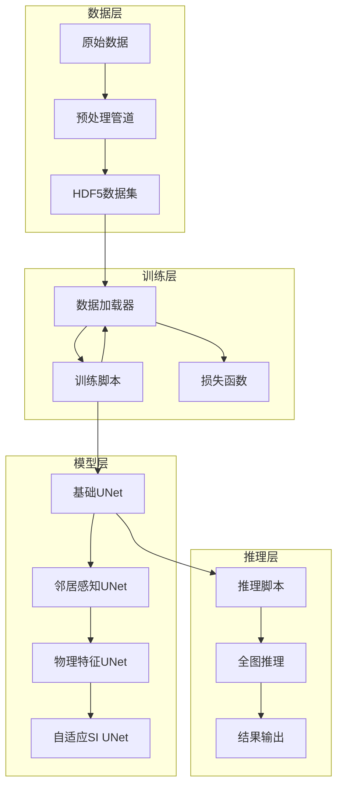
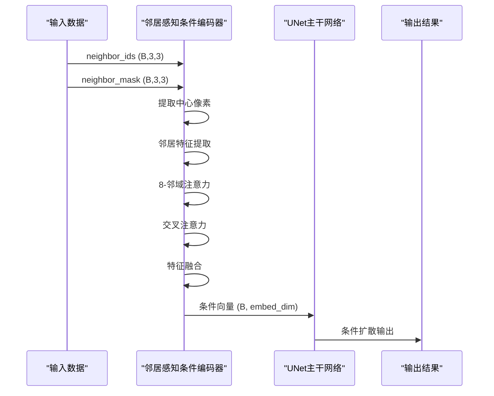
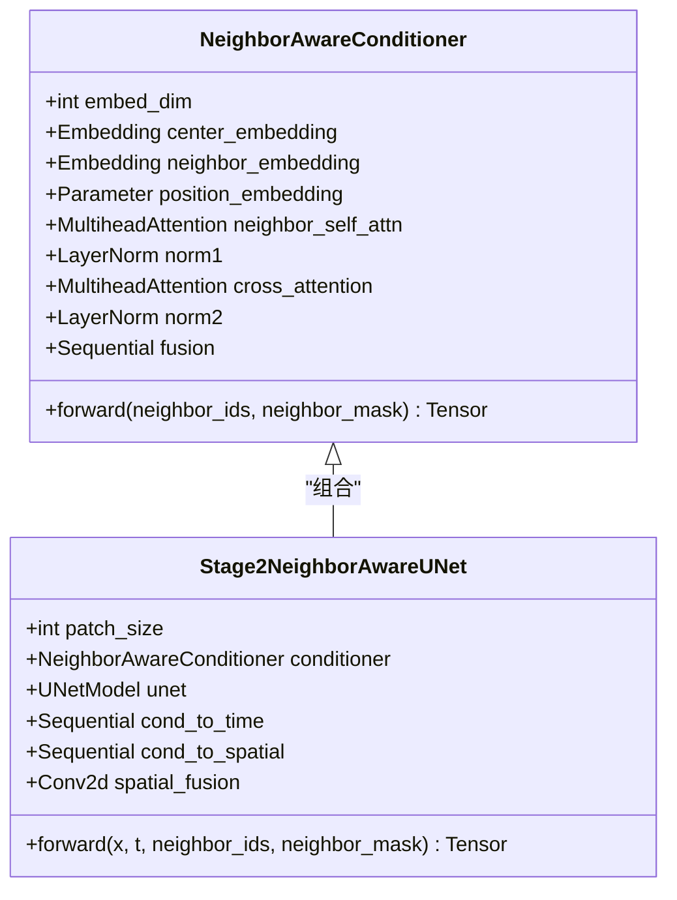
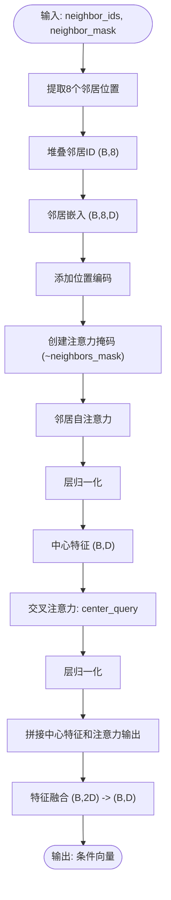
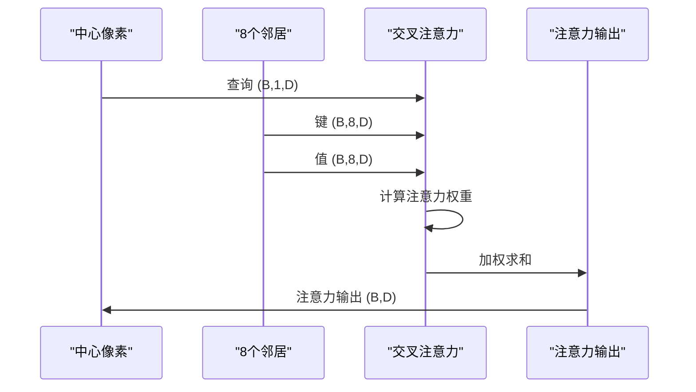
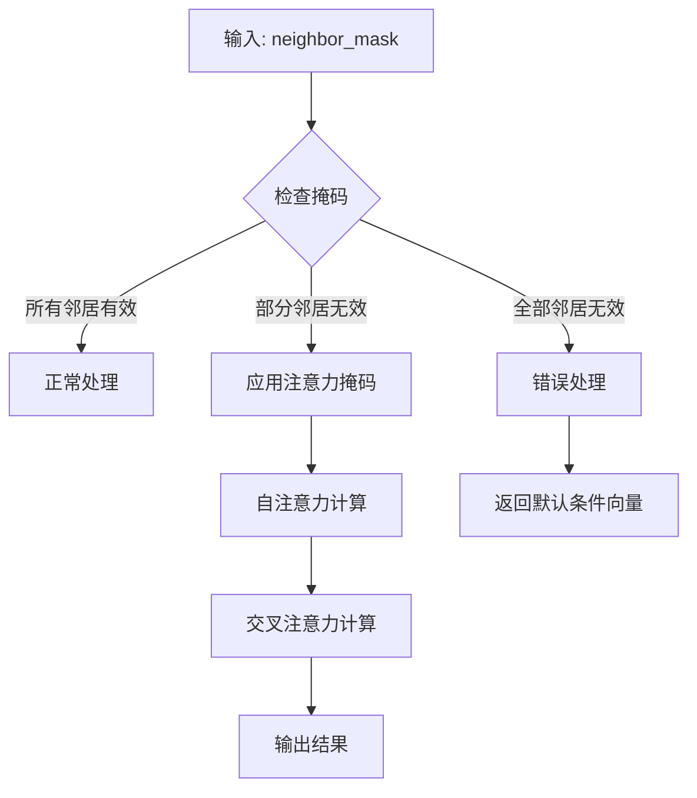
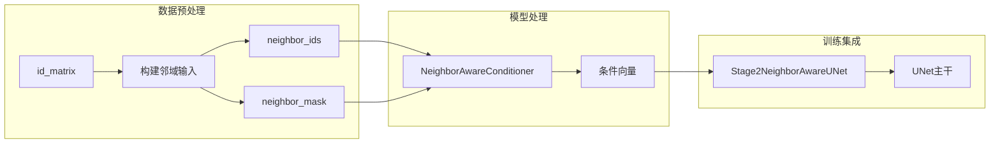
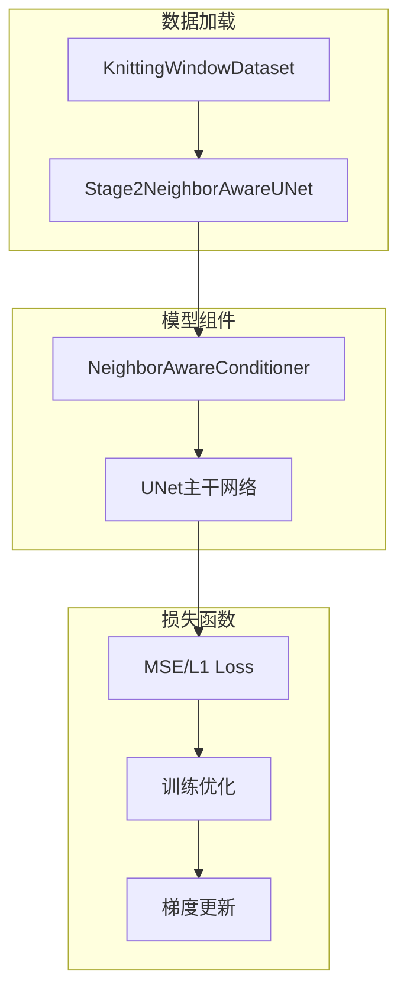

# 邻居感知条件编码器

<cite>
**本文档引用的文件**
- [models.py](file://conditional-flow-matching-main/knitting/models.py)
- [train.py](file://conditional-flow-matching-main/knitting/train.py)
- [dataset.py](file://conditional-flow-matching-main/data/dataset.py)
- [preprocess.py](file://conditional-flow-matching-main/data/preprocess.py)
- [inference.py](file://conditional-flow-matching-main/knitting/inference.py)
- [stage2.yaml](file://conditional-flow-matching-main/configs/stage2.yaml)
- [README.md](file://conditional-flow-matching-main/README.md)
</cite>

## 目录
1. [简介](#简介)
2. [项目结构](#项目结构)
3. [核心组件](#核心组件)
4. [架构概览](#架构概览)
5. [详细组件分析](#详细组件分析)
6. [依赖关系分析](#依赖关系分析)
7. [性能考虑](#性能考虑)
8. [故障排除指南](#故障排除指南)
9. [结论](#结论)
10. [附录](#附录)

## 简介
邻居感知条件编码器（NeighborAwareConditioner）是针织图案生成系统中的关键组件，负责从局部邻域信息中提取和融合条件特征。该模块采用8-邻域注意力机制，结合交叉注意力和特征融合策略，能够有效处理边界情况和无效邻居节点，为后续的条件扩散模型提供高质量的条件向量。

该编码器在第2阶段训练中发挥重要作用，通过分析目标像素点周围3×3网格内的邻居信息，生成具有丰富上下文语义的条件表示。设计上采用了注意力掩码机制来处理图像边界和无效邻居，确保模型能够稳健地处理各种输入情况。

## 项目结构
该项目采用模块化设计，将针织图案生成的不同阶段分离到独立的组件中：



**图表来源**
- [README.md:11-21](file://conditional-flow-matching-main/README.md#L11-L21)
- [stage2.yaml:1-24](file://conditional-flow-matching-main/configs/stage2.yaml#L1-L24)

**章节来源**
- [README.md:1-47](file://conditional-flow-matching-main/README.md#L1-L47)
- [stage2.yaml:1-24](file://conditional-flow-matching-main/configs/stage2.yaml#L1-L24)

## 核心组件
NeighborAwareConditioner是系统的核心组件，负责将局部邻域信息转换为条件向量。其主要特点包括：

### 主要功能
- **8-邻域注意力**：对目标像素周围的8个邻居进行建模
- **交叉注意力**：将中心像素作为查询，邻居像素作为键值
- **特征融合**：将中心特征与注意力聚合后的特征进行融合
- **边界处理**：通过注意力掩码处理图像边界和无效邻居

### 关键参数
- `num_classes=15`：针织指令类别数量
- `embed_dim=256`：嵌入维度
- `num_heads=8`：多头注意力头数

**章节来源**
- [models.py:10-23](file://conditional-flow-matching-main/knitting/models.py#L10-L23)
- [models.py:25-29](file://conditional-flow-matching-main/knitting/models.py#L25-L29)

## 架构概览
邻居感知条件编码器在整个系统中的位置和作用如下：



**图表来源**
- [models.py:61-119](file://conditional-flow-matching-main/knitting/models.py#L61-L119)
- [train.py:335-361](file://conditional-flow-matching-main/knitting/train.py#L335-L361)

## 详细组件分析

### 类结构设计
NeighborAwareConditioner采用标准的PyTorch模块设计模式，包含清晰的组件划分：



**图表来源**
- [models.py:10-59](file://conditional-flow-matching-main/knitting/models.py#L10-L59)
- [train.py:335-353](file://conditional-flow-matching-main/knitting/train.py#L335-L353)

### 8-邻域注意力机制
该机制通过以下步骤实现：

1. **邻域提取**：从3×3网格中提取8个邻居位置
2. **特征嵌入**：使用嵌入层将类别ID转换为向量表示
3. **位置编码**：为8个邻居位置添加可学习的位置向量
4. **自注意力**：对邻居特征进行自注意力计算
5. **掩码处理**：使用注意力掩码屏蔽无效邻居



**图表来源**
- [models.py:67-119](file://conditional-flow-matching-main/knitting/models.py#L67-L119)

**章节来源**
- [models.py:61-119](file://conditional-flow-matching-main/knitting/models.py#L61-L119)

### 交叉注意力设计
交叉注意力机制采用中心像素作为查询，邻居像素作为键值和值，实现信息的有效聚合：



**图表来源**
- [models.py:106-113](file://conditional-flow-matching-main/knitting/models.py#L106-L113)

### 特征融合策略
采用拼接后线性变换的方式进行特征融合：

1. **特征拼接**：将中心特征和注意力输出沿特征维拼接
2. **归一化**：对拼接后的特征进行层归一化
3. **非线性变换**：通过两层线性层和SiLU激活
4. **降维**：最终输出到目标嵌入维度

**章节来源**
- [models.py:115-119](file://conditional-flow-matching-main/knitting/models.py#L115-L119)

### 边界情况处理
系统通过注意力掩码机制优雅地处理各种边界情况：



**图表来源**
- [models.py:92-95](file://conditional-flow-matching-main/knitting/models.py#L92-L95)

**章节来源**
- [models.py:92-95](file://conditional-flow-matching-main/knitting/models.py#L92-L95)

### 位置编码设计
位置编码采用可学习的参数形式，为8个邻居位置提供额外的空间信息：

- **设计思路**：为每个邻居位置分配独立的可学习向量
- **维度选择**：与嵌入维度保持一致，便于后续的注意力计算
- **初始化方式**：使用较小的标准差进行正态分布初始化

**章节来源**
- [models.py:32-35](file://conditional-flow-matching-main/knitting/models.py#L32-L35)

## 依赖关系分析

### 数据流依赖


**图表来源**
- [preprocess.py:124-155](file://conditional-flow-matching-main/data/preprocess.py#L124-L155)
- [inference.py:124-156](file://conditional-flow-matching-main/knitting/inference.py#L124-L156)

### 训练依赖
训练过程中各组件的依赖关系：



**图表来源**
- [dataset.py:13-104](file://conditional-flow-matching-main/data/dataset.py#L13-L104)
- [train.py:1082-1107](file://conditional-flow-matching-main/knitting/train.py#L1082-L1107)

**章节来源**
- [dataset.py:13-104](file://conditional-flow-matching-main/data/dataset.py#L13-L104)
- [train.py:1082-1107](file://conditional-flow-matching-main/knitting/train.py#L1082-L1107)

## 性能考虑

### 计算复杂度分析
- **前向传播复杂度**：O(B × D × (8 + 1)) = O(B × D × 9)，其中B为批次大小，D为嵌入维度
- **注意力计算**：自注意力和交叉注意力均为O(8² × D)和O(8 × D)
- **内存占用**：主要由嵌入矩阵和注意力权重矩阵决定

### 优化技巧
1. **批处理优化**：充分利用批处理并行性
2. **掩码优化**：使用高效的注意力掩码实现
3. **内存管理**：合理设置嵌入维度以平衡性能和内存
4. **混合精度**：在支持的硬件上启用混合精度训练

### 参数配置建议
- **嵌入维度**：256-512之间，根据可用内存调整
- **注意力头数**：8-16，建议与嵌入维度成比例
- **dropout率**：0.1-0.3，平衡正则化效果
- **批次大小**：64-512，根据GPU内存调整

## 故障排除指南

### 常见问题及解决方案

#### 1. 数据格式错误
**症状**：运行时出现形状不匹配错误
**原因**：neighbor_ids或neighbor_mask形状不符合预期
**解决**：检查数据预处理管道，确保输出形状为(B,3,3)

#### 2. 掩码处理异常
**症状**：注意力计算出现NaN或Inf
**原因**：掩码逻辑错误或全零掩码
**解决**：验证掩码创建逻辑，确保至少有一个有效邻居

#### 3. 内存不足
**症状**：训练过程中OOM错误
**解决**：减小批次大小或嵌入维度，启用梯度检查点

#### 4. 训练不稳定
**症状**：损失震荡或发散
**解决**：调整学习率，增加正则化，检查数据质量

**章节来源**
- [dataset.py:43-47](file://conditional-flow-matching-main/data/dataset.py#L43-L47)
- [models.py:92-95](file://conditional-flow-matching-main/knitting/models.py#L92-L95)

## 结论
邻居感知条件编码器通过巧妙的8-邻域注意力机制和交叉注意力设计，成功地将局部上下文信息转换为高质量的条件表示。其设计充分考虑了边界情况处理和计算效率，在保证性能的同时提供了良好的鲁棒性。

该模块的成功实施为后续的条件扩散模型奠定了坚实基础，通过渐进式的模型改进（从基础UNet到最终的自适应SI UNet），实现了从简单条件到复杂结构感知的逐步增强。

## 附录

### 实际使用示例
```python
# 基本使用
conditioner = NeighborAwareConditioner(
    num_classes=15,
    embed_dim=256,
    num_heads=8
)

# 前向传播
cond_vector = conditioner(neighbor_ids, neighbor_mask)
```

### 调试方法
1. **中间特征检查**：打印各层输出的形状和统计信息
2. **注意力权重可视化**：检查注意力分布是否合理
3. **边界案例测试**：专门测试边界像素和无效邻居的情况
4. **性能基准测试**：测量不同配置下的推理时间

### 相关配置
- **训练配置**：参考`configs/stage2.yaml`
- **数据预处理**：参考`data/preprocess.py`
- **推理接口**：参考`knitting/inference.py`