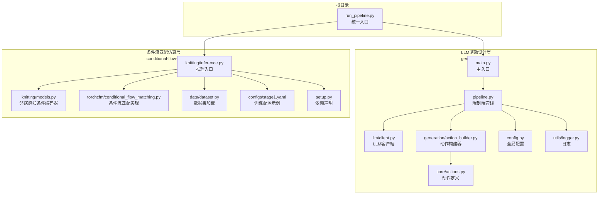
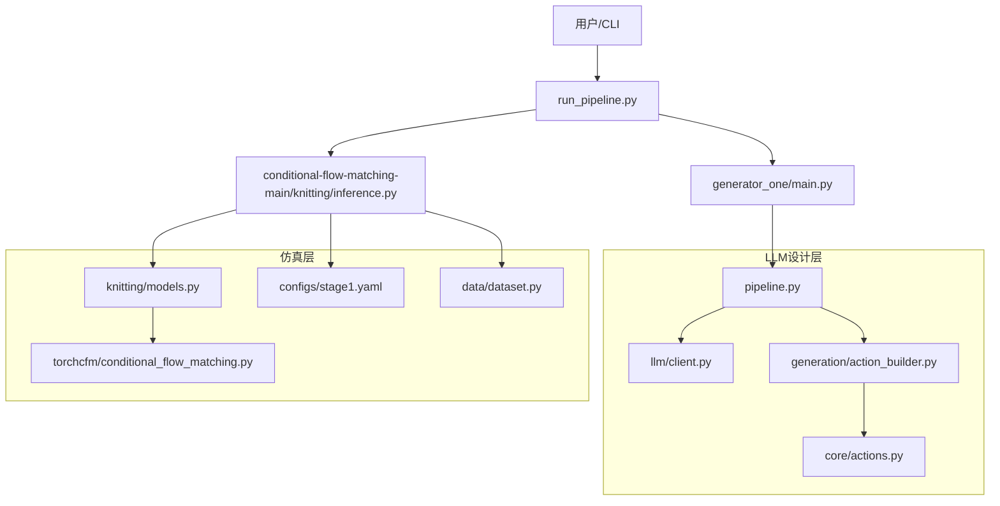
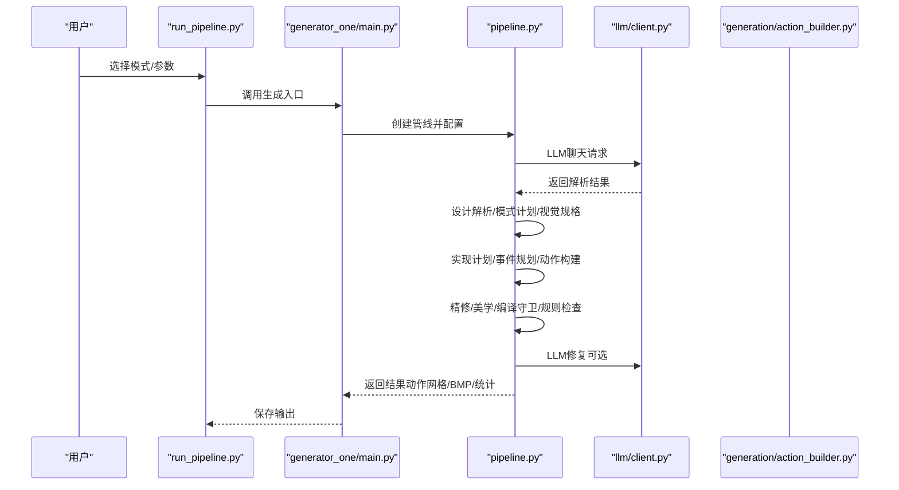
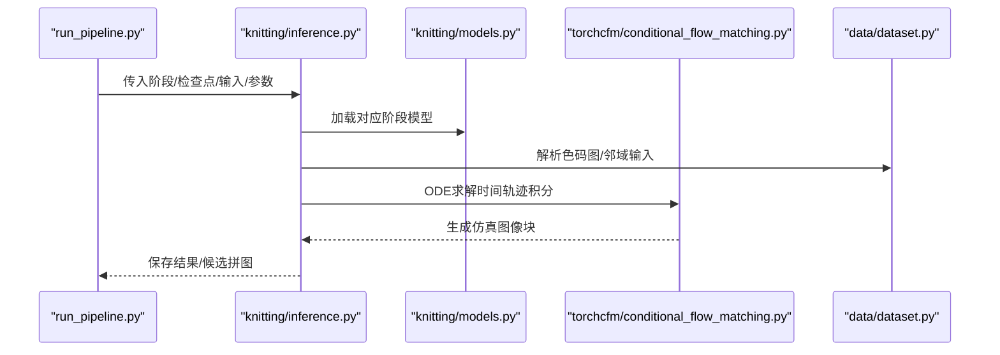
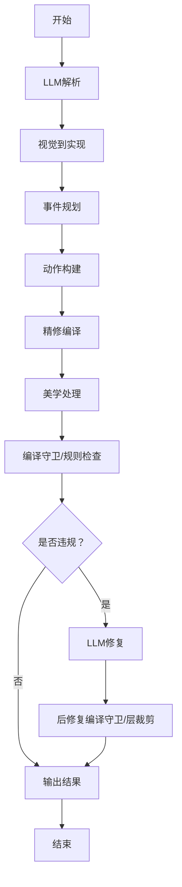
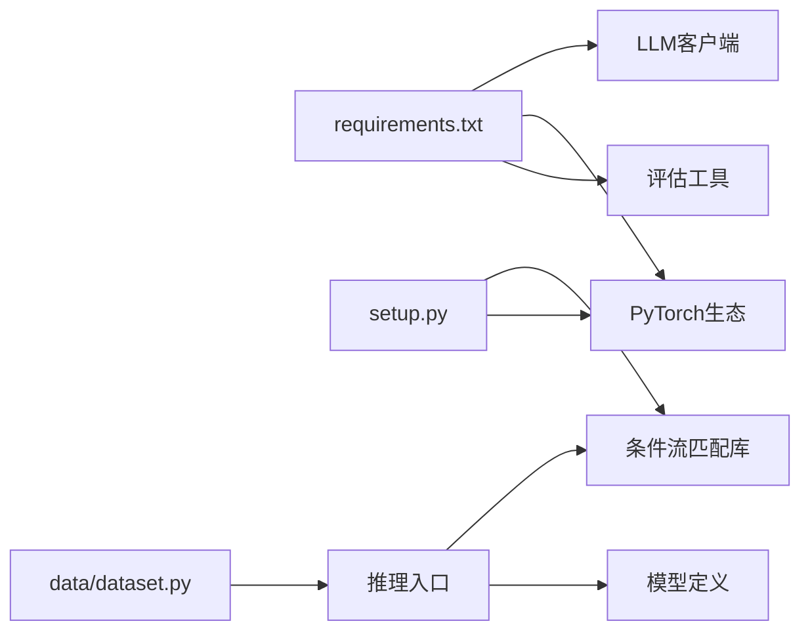

# 整体架构设计

<cite>
**本文档引用的文件**
- [README.md](file://conditional-flow-matching-main/README.md)
- [run_pipeline.py](file://run_pipeline.py)
- [main.py](file://generator_one/main.py)
- [pipeline.py](file://generator_one/pipeline.py)
- [client.py](file://generator_one/llm/client.py)
- [action_builder.py](file://generator_one/generation/action_builder.py)
- [actions.py](file://generator_one/core/actions.py)
- [inference.py](file://conditional-flow-matching-main/knitting/inference.py)
- [models.py](file://conditional-flow-matching-main/knitting/models.py)
- [conditional_flow_matching.py](file://conditional-flow-matching-main/torchcfm/conditional_flow_matching.py)
- [dataset.py](file://conditional-flow-matching-main/data/dataset.py)
- [stage1.yaml](file://conditional-flow-matching-main/configs/stage1.yaml)
- [requirements.txt](file://requirements.txt)
- [setup.py](file://conditional-flow-matching-main/setup.py)
- [config.py](file://generator_one/config.py)
- [logger.py](file://generator_one/utils/logger.py)
</cite>

## 目录
1. [简介](#简介)
2. [项目结构](#项目结构)
3. [核心组件](#核心组件)
4. [架构总览](#架构总览)
5. [详细组件分析](#详细组件分析)
6. [依赖关系分析](#依赖关系分析)
7. [性能考虑](#性能考虑)
8. [故障排除指南](#故障排除指南)
9. [结论](#结论)

## 简介
本项目是一个面向针织图案生成的端到端系统，采用两阶段流水线设计：  
- **第一阶段（LLM驱动设计层）**：基于自然语言描述生成色码图（color-code map），作为后续仿真阶段的输入。  
- **第二阶段（条件流匹配仿真层）**：将色码图转换为仿真针织图像，通过多阶段神经网络模型逐步增强结构一致性与物理合理性。

系统通过统一入口脚本协调两个模块，形成从“文本提示”到“仿真图像”的完整工作流。同时，系统具备模块化设计、可插拔的组件接口、完善的日志与错误处理机制，以及针对性能与稳定性的一系列优化策略。

## 项目结构
项目由三个主要部分组成：  
- **generator_one**：LLM驱动的设计与编译模块，负责将用户输入转化为可执行的针法网格。  
- **conditional-flow-matching-main**：条件流匹配仿真模块，负责将色码图映射为仿真图像。  
- **根目录脚本**：统一入口，协调两阶段执行与输出管理。

**图表来源**
- [run_pipeline.py:1-279](file://run_pipeline.py#L1-L279)
- [main.py:1-207](file://generator_one/main.py#L1-L207)
- [pipeline.py:1-749](file://generator_one/pipeline.py#L1-L749)
- [client.py:1-168](file://generator_one/llm/client.py#L1-L168)
- [action_builder.py:1-603](file://generator_one/generation/action_builder.py#L1-L603)
- [actions.py:1-338](file://generator_one/core/actions.py#L1-L338)
- [inference.py:1-720](file://conditional-flow-matching-main/knitting/inference.py#L1-L720)
- [models.py:1-119](file://conditional-flow-matching-main/knitting/models.py#L1-L119)
- [conditional_flow_matching.py:1-619](file://conditional-flow-matching-main/torchcfm/conditional_flow_matching.py#L1-L619)
- [dataset.py:1-207](file://conditional-flow-matching-main/data/dataset.py#L1-L207)
- [stage1.yaml:1-24](file://conditional-flow-matching-main/configs/stage1.yaml#L1-L24)
- [setup.py:1-37](file://conditional-flow-matching-main/setup.py#L1-L37)

**章节来源**
- [run_pipeline.py:1-279](file://run_pipeline.py#L1-L279)
- [README.md:1-47](file://conditional-flow-matching-main/README.md#L1-L47)

## 核心组件
- **统一入口与执行编排**：根目录脚本负责解析参数、选择执行模式（仅生成色码图、仅仿真、或全链路）、管理设备选择与输出目录。  
- **LLM驱动设计层**：包含LLM客户端、设计解析器、模式计划引擎、视觉到实现转换器、事件规划器、动作构建器、精修编译器、美学处理与规则检查等模块。  
- **条件流匹配仿真层**：包含推理入口、邻居感知条件编码器、条件流匹配实现、数据集加载与配置等。  
- **模块化与接口契约**：通过动作定义层统一针法语义，通过配置文件与数据类传递参数，确保各模块松耦合、可替换。

**章节来源**
- [run_pipeline.py:1-279](file://run_pipeline.py#L1-L279)
- [pipeline.py:1-749](file://generator_one/pipeline.py#L1-L749)
- [client.py:1-168](file://generator_one/llm/client.py#L1-L168)
- [action_builder.py:1-603](file://generator_one/generation/action_builder.py#L1-L603)
- [actions.py:1-338](file://generator_one/core/actions.py#L1-L338)
- [inference.py:1-720](file://conditional-flow-matching-main/knitting/inference.py#L1-L720)
- [models.py:1-119](file://conditional-flow-matching-main/knitting/models.py#L1-L119)
- [conditional_flow_matching.py:1-619](file://conditional-flow-matching-main/torchcfm/conditional_flow_matching.py#L1-L619)
- [dataset.py:1-207](file://conditional-flow-matching-main/data/dataset.py#L1-L207)

## 架构总览
系统采用分层与模块化相结合的架构：  
- **分层架构**：第一阶段（设计层）与第二阶段（仿真层）清晰分离，职责明确。  
- **模块化设计**：各功能模块通过清晰的接口交互，便于替换与扩展。  
- **数据流与控制流**：统一入口协调两阶段，LLM阶段输出色码图，仿真阶段将其转换为仿真图像。  
- **系统边界与外部依赖**：LLM客户端依赖外部API服务；仿真阶段依赖PyTorch生态与条件流匹配库；数据集采用HDF5格式存储。

**图表来源**
- [run_pipeline.py:1-279](file://run_pipeline.py#L1-L279)
- [main.py:1-207](file://generator_one/main.py#L1-L207)
- [pipeline.py:1-749](file://generator_one/pipeline.py#L1-L749)
- [client.py:1-168](file://generator_one/llm/client.py#L1-L168)
- [action_builder.py:1-603](file://generator_one/generation/action_builder.py#L1-L603)
- [actions.py:1-338](file://generator_one/core/actions.py#L1-L338)
- [inference.py:1-720](file://conditional-flow-matching-main/knitting/inference.py#L1-L720)
- [models.py:1-119](file://conditional-flow-matching-main/knitting/models.py#L1-L119)
- [conditional_flow_matching.py:1-619](file://conditional-flow-matching-main/torchcfm/conditional_flow_matching.py#L1-L619)
- [stage1.yaml:1-24](file://conditional-flow-matching-main/configs/stage1.yaml#L1-L24)
- [dataset.py:1-207](file://conditional-flow-matching-main/data/dataset.py#L1-L207)

## 详细组件分析

### LLM驱动设计层（第一阶段）
该阶段负责将自然语言描述转化为可执行的针法网格，包含以下核心模块：

- **LLM客户端**：封装OpenAI兼容接口，支持重试、超时与令牌用量统计，提供统一的聊天接口。  
- **设计解析与模式计划**：将用户输入解析为可编辑的模式计划（PatternPlan），并渲染为视觉规格（VisualSpec）。  
- **视觉到实现转换**：将视觉规格转换为可执行的实现计划（RealizationPlan）。  
- **事件规划与动作构建**：根据实现计划生成事件点列表，并构建基础动作网格。  
- **精修与美学处理**：对动作网格进行局部精修与美学优化，确保结构与观感平衡。  
- **编译守卫与规则检查**：强制执行编译器级不变量，剔除无上下文的动作；随后进行物理与工艺规则检查与修复。  
- **LLM修复（可选）**：当规则检查发现违规时，通过LLM提出修复建议并应用。  

**图表来源**
- [run_pipeline.py:1-279](file://run_pipeline.py#L1-L279)
- [main.py:1-207](file://generator_one/main.py#L1-L207)
- [pipeline.py:1-749](file://generator_one/pipeline.py#L1-L749)
- [client.py:1-168](file://generator_one/llm/client.py#L1-L168)
- [action_builder.py:1-603](file://generator_one/generation/action_builder.py#L1-L603)

**章节来源**
- [main.py:1-207](file://generator_one/main.py#L1-L207)
- [pipeline.py:1-749](file://generator_one/pipeline.py#L1-L749)
- [client.py:1-168](file://generator_one/llm/client.py#L1-L168)
- [action_builder.py:1-603](file://generator_one/generation/action_builder.py#L1-L603)
- [actions.py:1-338](file://generator_one/core/actions.py#L1-L338)
- [config.py:1-76](file://generator_one/config.py#L1-L76)
- [logger.py:1-52](file://generator_one/utils/logger.py#L1-L52)

### 条件流匹配仿真层（第二阶段）
该阶段将色码图映射为仿真针织图像，采用多阶段模型与条件流匹配方法：

- **推理入口**：支持Stage 1–4，按阶段加载对应模型结构与权重，构造初始噪声，沿时间轨迹求解常微分方程（ODE）。  
- **邻居感知条件编码器**：基于注意力掩码对3×3邻域进行建模，融合中心与邻居信息生成条件向量。  
- **条件流匹配实现**：提供多种流匹配损失与求解策略，支持目标OT、Schrödinger桥等方法。  
- **数据集与配置**：HDF5格式数据集，支持加权采样与流式读取；配置文件定义训练超参与损失权重。  

**图表来源**
- [run_pipeline.py:1-279](file://run_pipeline.py#L1-L279)
- [inference.py:1-720](file://conditional-flow-matching-main/knitting/inference.py#L1-L720)
- [models.py:1-119](file://conditional-flow-matching-main/knitting/models.py#L1-L119)
- [conditional_flow_matching.py:1-619](file://conditional-flow-matching-main/torchcfm/conditional_flow_matching.py#L1-L619)
- [dataset.py:1-207](file://conditional-flow-matching-main/data/dataset.py#L1-L207)

**章节来源**
- [inference.py:1-720](file://conditional-flow-matching-main/knitting/inference.py#L1-L720)
- [models.py:1-119](file://conditional-flow-matching-main/knitting/models.py#L1-L119)
- [conditional_flow_matching.py:1-619](file://conditional-flow-matching-main/torchcfm/conditional_flow_matching.py#L1-L619)
- [dataset.py:1-207](file://conditional-flow-matching-main/data/dataset.py#L1-L207)
- [stage1.yaml:1-24](file://conditional-flow-matching-main/configs/stage1.yaml#L1-L24)
- [setup.py:1-37](file://conditional-flow-matching-main/setup.py#L1-L37)

### 端到端流水线（八步走）
系统将LLM驱动设计层的生成过程抽象为八个核心步骤，职责清晰、数据流顺畅：

1. **LLM解析**：将用户输入解析为可编辑的模式计划与视觉规格。  
2. **视觉到实现**：将视觉规格转换为可执行的实现计划。  
3. **事件规划**：生成事件点列表，指导动作构建。  
4. **动作构建**：按区域与边界绘制基础网格，写入事件点并求解过渡。  
5. **精修编译**：对网格进行局部精修，提升结构一致性。  
6. **美学处理**：优化纹理分布与视觉效果。  
7. **编译守卫与规则检查**：强制执行编译器级不变量并进行物理/工艺规则检查。  
8. **LLM修复（可选）**：当存在违规时，通过LLM提出修复建议并再次校验。  

**图表来源**
- [pipeline.py:1-749](file://generator_one/pipeline.py#L1-L749)

**章节来源**
- [pipeline.py:1-749](file://generator_one/pipeline.py#L1-L749)

## 依赖关系分析
- **内部依赖**：  
  - generator_one内部模块通过配置与日志模块解耦，动作定义统一于actions.py，便于跨模块共享。  
  - conditional-flow-matching-main内部模块通过推理入口统一调度，模型与条件流匹配实现相对独立。  
- **外部依赖**：  
  - LLM客户端依赖OpenAI兼容接口，需正确配置API密钥与URL。  
  - 仿真阶段依赖PyTorch、torchdiffeq、HDF5等库，训练配置与依赖声明在setup.py中体现。  
- **潜在循环依赖**：  
  - 当前模块间通过清晰的接口与数据类传递参数，未见明显循环依赖。  

**图表来源**
- [requirements.txt:1-46](file://requirements.txt#L1-L46)
- [setup.py:1-37](file://conditional-flow-matching-main/setup.py#L1-L37)
- [dataset.py:1-207](file://conditional-flow-matching-main/data/dataset.py#L1-L207)
- [inference.py:1-720](file://conditional-flow-matching-main/knitting/inference.py#L1-L720)
- [models.py:1-119](file://conditional-flow-matching-main/knitting/models.py#L1-L119)
- [conditional_flow_matching.py:1-619](file://conditional-flow-matching-main/torchcfm/conditional_flow_matching.py#L1-L619)

**章节来源**
- [requirements.txt:1-46](file://requirements.txt#L1-L46)
- [setup.py:1-37](file://conditional-flow-matching-main/setup.py#L1-L37)
- [dataset.py:1-207](file://conditional-flow-matching-main/data/dataset.py#L1-L207)

## 性能考虑
- **设备选择与回退**：统一入口自动检测CUDA可用性并回退至CPU，确保在不同硬件环境下稳定运行。  
- **推理批处理与分块**：仿真阶段支持按块分批推理，减少显存占用并提高吞吐。  
- **噪声模式与求解器**：不同阶段采用不同的噪声模式与ODE求解器，平衡质量与速度。  
- **数据集优化**：HDF5格式与加权采样策略降低训练与推理成本，流式读取避免内存峰值。  
- **日志与统计**：内置统计输出与日志记录，便于性能监控与问题定位。  

**章节来源**
- [run_pipeline.py:22-36](file://run_pipeline.py#L22-L36)
- [inference.py:58-58](file://conditional-flow-matching-main/knitting/inference.py#L58-L58)
- [dataset.py:151-207](file://conditional-flow-matching-main/data/dataset.py#L151-L207)
- [logger.py:1-52](file://generator_one/utils/logger.py#L1-L52)

## 故障排除指南
- **LLM连接失败**：检查API密钥与网络配置，确认重试与超时参数合理。  
- **CUDA不可用**：统一入口会自动回退至CPU，若仍报错，检查PyTorch安装与CUDA版本兼容性。  
- **色码图解析异常**：确认输入路径与格式正确，检查指令定义文件与颜色表是否匹配。  
- **仿真阶段报错**：核对检查点路径、阶段编号与配置文件，确保patch_size与模型一致。  
- **数据集加载失败**：确认HDF5文件存在且包含必要的字段，必要时重新运行预处理脚本。  

**章节来源**
- [client.py:52-80](file://generator_one/llm/client.py#L52-L80)
- [run_pipeline.py:22-36](file://run_pipeline.py#L22-L36)
- [inference.py:68-117](file://conditional-flow-matching-main/knitting/inference.py#L68-L117)
- [dataset.py:15-47](file://conditional-flow-matching-main/data/dataset.py#L15-L47)

## 结论
本系统通过两阶段流水线实现了从自然语言到仿真图像的完整闭环：第一阶段以LLM为核心，将创意转化为可执行的针法网格；第二阶段以条件流匹配为基础，将色码图映射为高质量仿真图像。系统采用模块化设计与清晰的接口契约，具备良好的可扩展性与稳定性；配合统一入口与完善的依赖管理，能够满足从研究到生产的多样化需求。未来可在规则体系、修复策略与可视化展示等方面进一步增强，以提升用户体验与生产效率。