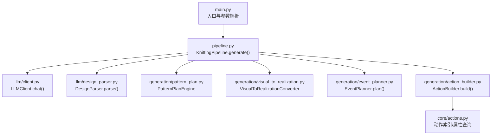
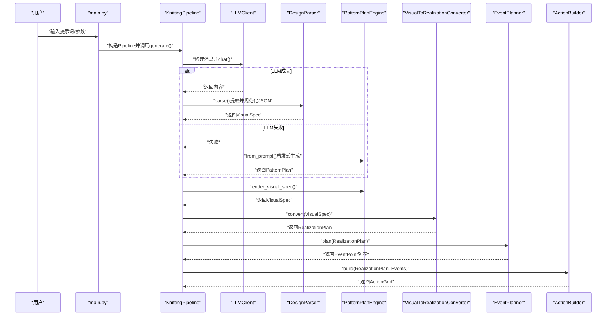
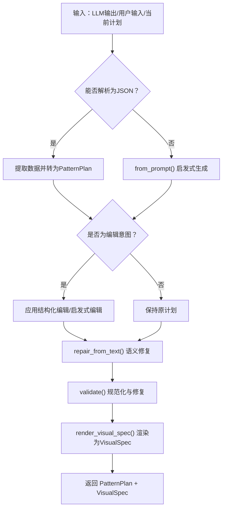
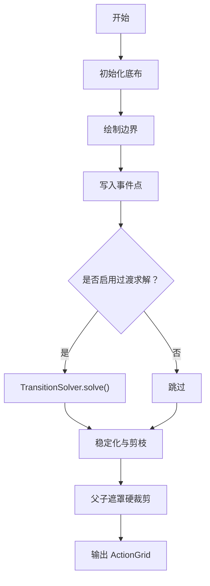
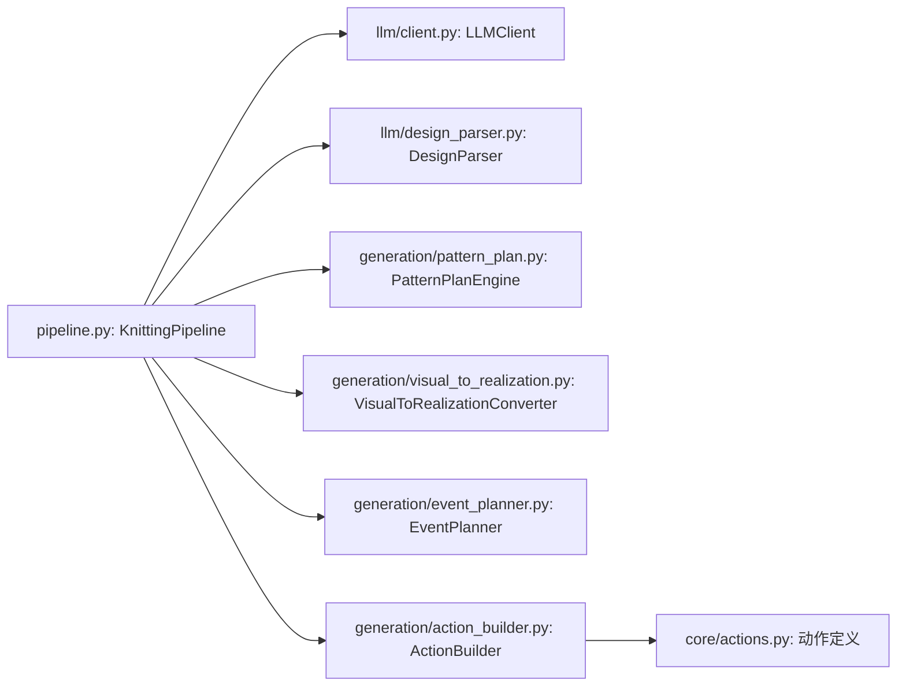

# 第一阶段架构

<cite>
**本文引用的文件**
- [main.py](file://generator_one/main.py)
- [pipeline.py](file://generator_one/pipeline.py)
- [config.py](file://generator_one/config.py)
- [client.py](file://generator_one/llm/client.py)
- [design_parser.py](file://generator_one/llm/design_parser.py)
- [pattern_plan.py](file://generator_one/generation/pattern_plan.py)
- [visual_to_realization.py](file://generator_one/generation/visual_to_realization.py)
- [event_planner.py](file://generator_one/generation/event_planner.py)
- [action_builder.py](file://generator_one/generation/action_builder.py)
- [actions.py](file://generator_one/core/actions.py)
</cite>

## 目录
1. [简介](#简介)
2. [项目结构](#项目结构)
3. [核心组件](#核心组件)
4. [架构总览](#架构总览)
5. [详细组件分析](#详细组件分析)
6. [依赖分析](#依赖分析)
7. [性能考虑](#性能考虑)
8. [故障排查指南](#故障排查指南)
9. [结论](#结论)

## 简介
本文件面向“第一阶段架构”，聚焦于从用户输入到可编辑图案计划（PatternPlan）与最终动作网格（ActionGrid）的完整转换链路。该阶段以LLM驱动为核心，结合设计解析器、图案计划引擎、视觉到实现转换器、事件规划器与动作构建器，形成闭环的可编辑设计管线，并在后续阶段引入编译守卫、规则校验、LLM修复与美学增强等保障步骤。

## 项目结构
- 顶层入口负责参数解析与流水线调度，统一调用KnittingPipeline执行端到端流程。
- 流水线内部按步骤拆分：LLM设计/编辑 → 可视化规格渲染 → 实现方案生成 → 事件规划 → 动作网格构建 → 编译守卫/规则检查 → LLM修复（可选） → 输出。
- 核心数据类型贯穿全链路：PatternPlan（可编辑）、VisualSpec（可视化规格）、RealizationPlan（实现方案）、EventPoint（事件点）、ActionGrid（动作网格）。

图表来源
- [main.py:117-207](file://generator_one/main.py#L117-L207)
- [pipeline.py:93-189](file://generator_one/pipeline.py#L93-L189)
- [client.py:35-168](file://generator_one/llm/client.py#L35-L168)
- [design_parser.py:24-415](file://generator_one/llm/design_parser.py#L24-L415)
- [pattern_plan.py:175-612](file://generator_one/generation/pattern_plan.py#L175-L612)
- [visual_to_realization.py:258-282](file://generator_one/generation/visual_to_realization.py#L258-L282)
- [event_planner.py:24-63](file://generator_one/generation/event_planner.py#L24-L63)
- [action_builder.py:35-115](file://generator_one/generation/action_builder.py#L35-L115)
- [actions.py:18-184](file://generator_one/core/actions.py#L18-L184)

章节来源
- [main.py:117-207](file://generator_one/main.py#L117-L207)
- [pipeline.py:93-189](file://generator_one/pipeline.py#L93-L189)

## 核心组件
- LLM客户端：负责与DeepSeek/OpenAI兼容接口通信，封装请求、重试与响应结构化。
- 设计解析器：从LLM输出中提取并规范化JSON，兼容多版本schema，生成VisualSpec。
- 图案计划引擎：将用户输入与LLM输出转化为可编辑的PatternPlan，并进行渲染与验证。
- 视觉到实现转换器：将VisualSpec翻译为RealizationPlan，建立“仿真图效果”到“色码图动作”的映射。
- 事件规划器：基于RealizationPlan生成稀疏事件点集合，确保仅在必要处放置关键动作。
- 动作构建器：依据RealizationPlan与事件点构建40×40动作网格，执行过渡求解与稳定性处理。
- 动作定义层：统一管理动作索引、缩写、颜色、语义与张力等属性，供全链路查询。

章节来源
- [client.py:25-168](file://generator_one/llm/client.py#L25-L168)
- [design_parser.py:24-415](file://generator_one/llm/design_parser.py#L24-L415)
- [pattern_plan.py:175-612](file://generator_one/generation/pattern_plan.py#L175-L612)
- [visual_to_realization.py:258-282](file://generator_one/generation/visual_to_realization.py#L258-L282)
- [event_planner.py:24-63](file://generator_one/generation/event_planner.py#L24-L63)
- [action_builder.py:35-115](file://generator_one/generation/action_builder.py#L35-L115)
- [actions.py:18-184](file://generator_one/core/actions.py#L18-L184)

## 架构总览
下图展示第一阶段从用户输入到可编辑图案计划与动作网格的关键交互：

图表来源
- [main.py:117-207](file://generator_one/main.py#L117-L207)
- [pipeline.py:195-243](file://generator_one/pipeline.py#L195-L243)
- [client.py:81-161](file://generator_one/llm/client.py#L81-L161)
- [design_parser.py:29-44](file://generator_one/llm/design_parser.py#L29-L44)
- [pattern_plan.py:175-351](file://generator_one/generation/pattern_plan.py#L175-L351)
- [visual_to_realization.py:258-282](file://generator_one/generation/visual_to_realization.py#L258-L282)
- [event_planner.py:33-63](file://generator_one/generation/event_planner.py#L33-L63)
- [action_builder.py:43-115](file://generator_one/generation/action_builder.py#L43-L115)

## 详细组件分析

### LLM客户端（LLMClient）
- 职责边界
  - 仅负责HTTP API调用与响应封装，不参与提示工程与业务语义。
  - 提供统一的chat接口，内置超时、重试与延迟记录。
- 关键能力
  - 从配置加载API密钥、基础URL与模型信息。
  - 支持指数回退重试，避免瞬时网络波动影响。
  - 返回结构化LLMResponse，便于上层统一处理成功/失败分支。
- 错误处理
  - 导入失败时抛出异常，提示安装依赖。
  - API异常时记录警告并返回失败响应，包含错误摘要。
- 性能优化
  - 低温度（0.3）用于结构化输出，提升一致性。
  - 限制最大token数，控制成本与延迟。

章节来源
- [client.py:35-168](file://generator_one/llm/client.py#L35-L168)
- [config.py:51-65](file://generator_one/config.py#L51-L65)

### 设计解析器（DesignParser）
- 职责边界
  - 从LLM输出中提取并清洗JSON字符串，兼容多版本schema。
  - 将不同历史schema映射到统一的VisualSpec结构。
- 关键能力
  - JSON提取与修复：支持三引号代码块、首尾包裹与尾部逗号修正。
  - 多版本兼容：morphology、motif、elements等旧schema映射。
  - 规范化：布局类型、形状、效果、角色与位置参数标准化。
- 回退策略
  - 无法提取有效JSON或解析失败时，返回默认VisualSpec，保证流程可用性。
- 数据格式
  - 输入：LLM原始文本
  - 输出：VisualSpec（含布局类型、区域列表）

章节来源
- [design_parser.py:24-415](file://generator_one/llm/design_parser.py#L24-L415)

### 图案计划引擎（PatternPlanEngine）
- 职责边界
  - 将用户输入与LLM输出转化为可编辑的PatternPlan。
  - 提供渲染为VisualSpec的能力，作为后续视觉到实现转换的桥梁。
- 关键流程
  - parse_or_fallback：优先解析LLM输出，失败则走启发式生成。
  - from_prompt：基于关键词与规则的启发式编辑/生成。
  - render_visual_spec：将PatternPlan转为VisualSpec，用于下一步转换。
  - validate：规范化与修复，确保motif字段合法、层级链接正确。
- 数据格式
  - 输入：LLM输出字符串、用户输入、当前PatternPlan（可选）
  - 输出：PatternPlan（可编辑）、VisualSpec（渲染后）

图表来源
- [pattern_plan.py:175-351](file://generator_one/generation/pattern_plan.py#L175-L351)
- [pattern_plan.py:595-612](file://generator_one/generation/pattern_plan.py#L595-L612)

章节来源
- [pattern_plan.py:175-612](file://generator_one/generation/pattern_plan.py#L175-L612)

### 视觉到实现转换器（VisualToRealizationConverter）
- 职责边界
  - 将VisualSpec翻译为RealizationPlan，建立“仿真图效果”到“色码图动作”的映射。
  - 处理形状标准化与保守编译，避免未知效果自动升级为复杂纹理。
- 关键能力
  - 效果到事件模式映射：如plain/plain_front、wave_tuck、lace、relief、honeycomb、cable等。
  - 形状标准化：将非标准形状映射为标准mask_shape，确保后续事件规划与动作构建一致。
  - 嵌套区域对齐：处理frame/border与中心区域的层次关系。
- 数据格式
  - 输入：VisualSpec
  - 输出：RealizationPlan（含布局类型、区域列表，每个区域包含基底场、边框样式、事件模式与参数）

章节来源
- [visual_to_realization.py:258-282](file://generator_one/generation/visual_to_realization.py#L258-L282)

### 事件规划器（EventPlanner）
- 职责边界
  - 基于RealizationPlan生成稀疏事件点集合，仅在必要处放置关键动作。
- 关键能力
  - 区域过滤：跳过ground与无事件模式的区域。
  - 事件裁剪：将事件限制在区域mask内。
  - 特殊处理：对diagonal_wave进行配对裁剪，确保波纹对称性。
- 数据格式
  - 输入：RealizationPlan
  - 输出：EventPoint列表（含行列坐标、动作缩写、所属区域ID）

章节来源
- [event_planner.py:24-63](file://generator_one/generation/event_planner.py#L24-L63)

### 动作构建器（ActionBuilder）
- 职责边界
  - 将RealizationPlan与事件点集合构建为40×40动作网格。
- 关键流程
  1) 初始化底布（base field）
  2) 绘制边界（border style）
  3) 写入事件点（event points）
  4) 过渡求解（transition solver），仅对local_only策略启用
  5) 稳定化与剪枝（如transfer）
  6) 父子遮罩硬裁剪（nested motifs溢出清理）
- 数据格式
  - 输入：RealizationPlan、EventPoint列表
  - 输出：ActionGrid（40×40整数矩阵，索引对应core.actions）

图表来源
- [action_builder.py:43-115](file://generator_one/generation/action_builder.py#L43-L115)

章节来源
- [action_builder.py:35-115](file://generator_one/generation/action_builder.py#L35-L115)
- [actions.py:18-184](file://generator_one/core/actions.py#L18-L184)

### 动作定义层（core/actions）
- 职责边界
  - 统一的动作索引、缩写、颜色、语义与物理属性数据源。
- 关键能力
  - 通过instruction_info.json加载动作定义，提供abbr→idx、idx→属性查询。
  - 提供语义层属性（如creates_loop、requires_support、supports_above等）。
- 性能与一致性
  - 使用LRU缓存与安全查询函数，避免重复解析与越界访问。

章节来源
- [actions.py:18-184](file://generator_one/core/actions.py#L18-L184)

## 依赖分析
- 组件耦合
  - KnittingPipeline聚合各子模块，形成清晰的步骤化流水线。
  - PatternPlanEngine与VisualToRealizationConverter双向协作：前者生成可编辑计划，后者将其翻译为实现方案。
  - ActionBuilder依赖core.actions进行动作索引与属性查询。
- 外部依赖
  - LLMClient依赖OpenAI兼容SDK与环境变量配置。
  - 文件IO与日志由工具模块提供，不侵入业务逻辑。

图表来源
- [pipeline.py:93-112](file://generator_one/pipeline.py#L93-L112)
- [client.py:35-77](file://generator_one/llm/client.py#L35-L77)
- [design_parser.py:24-415](file://generator_one/llm/design_parser.py#L24-L415)
- [pattern_plan.py:175-351](file://generator_one/generation/pattern_plan.py#L175-L351)
- [visual_to_realization.py:258-282](file://generator_one/generation/visual_to_realization.py#L258-L282)
- [event_planner.py:24-63](file://generator_one/generation/event_planner.py#L24-L63)
- [action_builder.py:35-115](file://generator_one/generation/action_builder.py#L35-L115)
- [actions.py:18-184](file://generator_one/core/actions.py#L18-L184)

## 性能考虑
- LLM调用
  - 低温度与结构化提示降低歧义，提高解析成功率，减少回退概率。
  - 指数回退重试避免瞬时抖动导致的失败。
- 解析与转换
  - VisualToRealizationConverter采用缓存与保守编译策略，避免无效升级与复杂计算。
  - EventPlanner生成稀疏事件点，显著降低后续动作构建的计算量。
- 动作构建
  - 仅对local_only区域启用过渡求解，减少不必要的全局求解。
  - 稳定化与父遮罩裁剪在早期完成，减轻后续规则检查与修复压力。

## 故障排查指南
- LLM不可用
  - 现象：LLMResponse.success为False，error非空。
  - 排查：检查DEEPSEEK_API_KEY、base_url与网络连通性；查看重试日志。
  - 处置：Pipeline会自动回退到启发式生成，确保流程继续。
- JSON解析失败
  - 现象：DesignParser无法提取有效JSON。
  - 排查：确认LLM输出格式；检查三引号与尾逗号问题。
  - 处置：解析器会尝试修复并回退到默认VisualSpec。
- PatternPlan校验失败
  - 现象：validate后仍存在非法字段或缺失层级链接。
  - 排查：检查motif字段、role/region规范与parent_id。
  - 处置：引擎会进行语义修复与层级推断，必要时补充ground区域。
- 动作网格异常
  - 现象：规则检查发现hard/craft违规。
  - 排查：关注编译守卫移除的特殊动作、画布边缘清理与波纹配对。
  - 处置：启用LLM修复或调整提示词，迭代优化。

章节来源
- [client.py:140-161](file://generator_one/llm/client.py#L140-L161)
- [design_parser.py:30-44](file://generator_one/llm/design_parser.py#L30-L44)
- [pattern_plan.py:353-369](file://generator_one/generation/pattern_plan.py#L353-L369)
- [pipeline.py:552-575](file://generator_one/pipeline.py#L552-L575)

## 结论
第一阶段架构以LLM为中心，通过可编辑的PatternPlan实现“从意图到实现”的可控转换。PatternPlanEngine承担设计与渲染职责，将用户意图转化为可操作的视觉规格；随后的视觉到实现转换、事件规划与动作构建形成高保真的色码图生成链路。配套的编译守卫、规则检查与LLM修复进一步提升了输出质量与鲁棒性。该架构在可编辑性、可扩展性与可维护性之间取得平衡，为后续阶段（如细化、美学增强）奠定坚实基础。