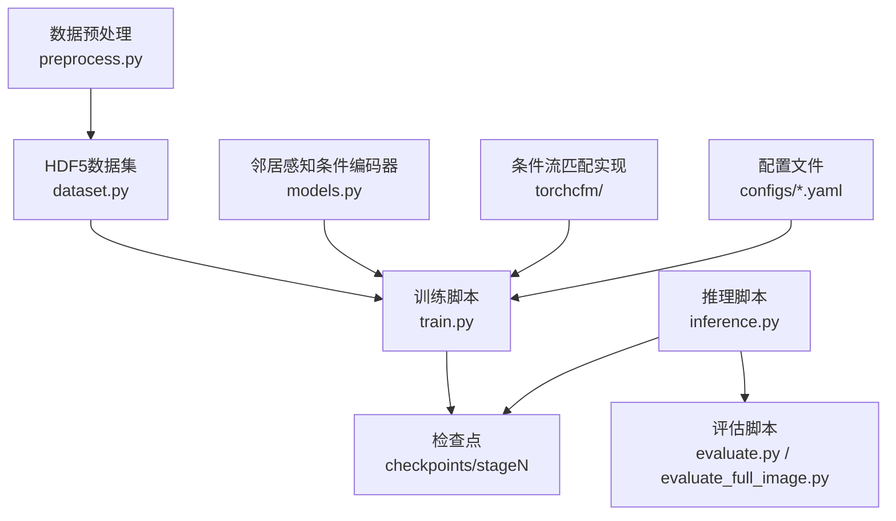
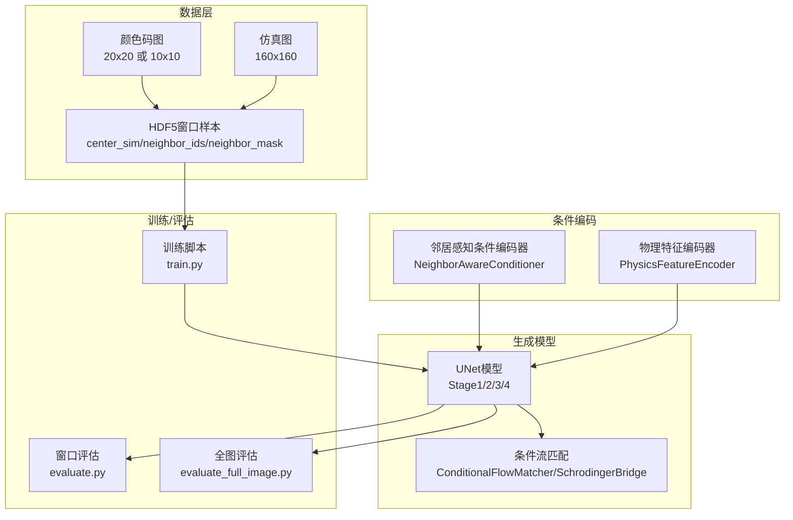
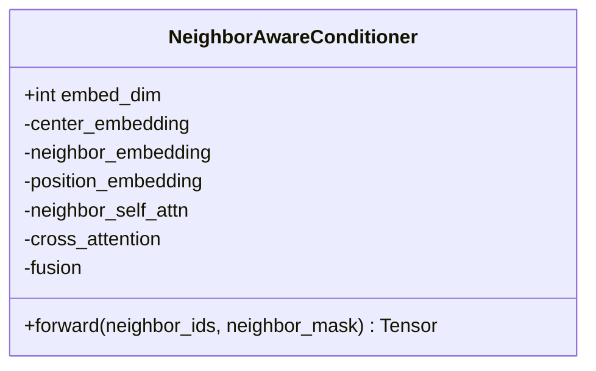
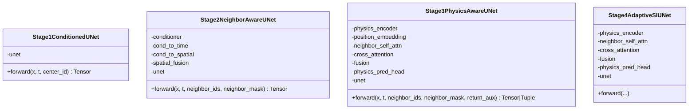
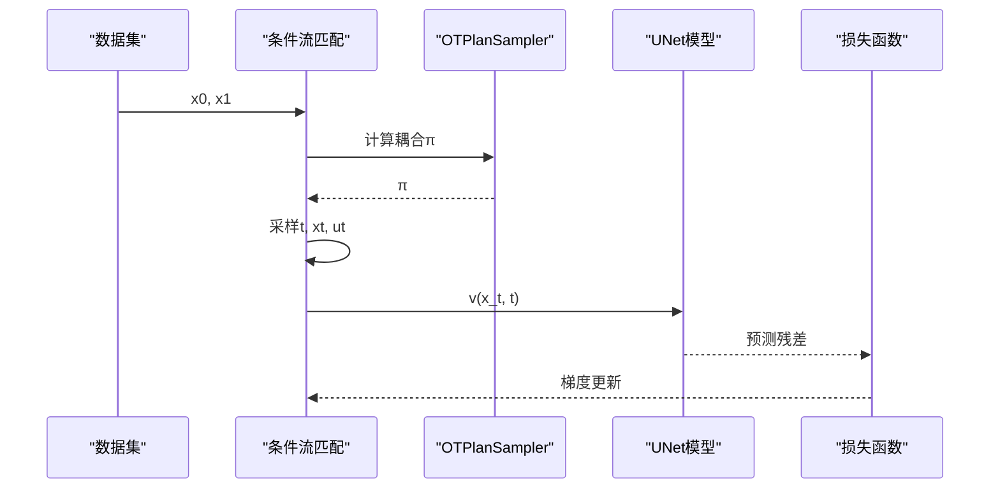
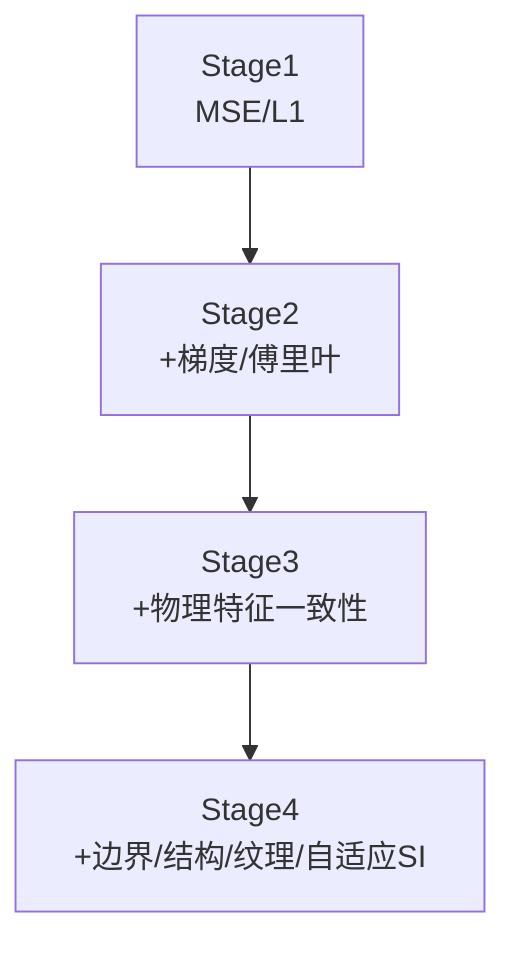
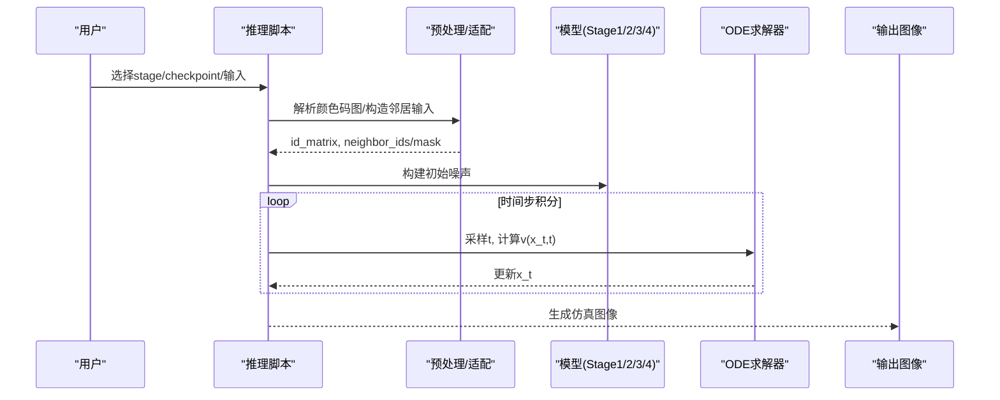
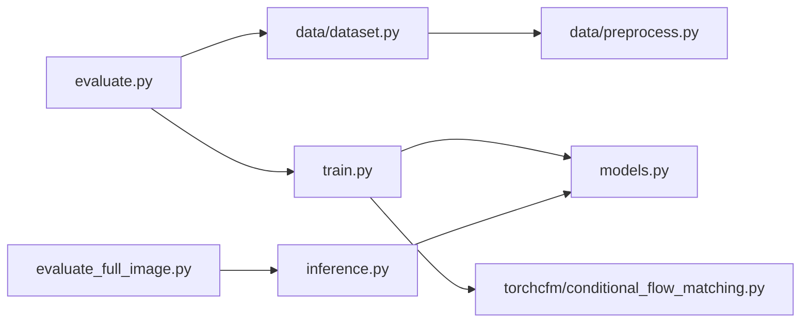

# 第二阶段架构

<cite>
**本文档引用的文件**
- [README.md](file://conditional-flow-matching-main/README.md)
- [train.py](file://conditional-flow-matching-main/knitting/train.py)
- [inference.py](file://conditional-flow-matching-main/knitting/inference.py)
- [models.py](file://conditional-flow-matching-main/knitting/models.py)
- [dataset.py](file://conditional-flow-matching-main/data/dataset.py)
- [preprocess.py](file://conditional-flow-matching-main/data/preprocess.py)
- [stage1_adapter.py](file://conditional-flow-matching-main/data/stage1_adapter.py)
- [stage1.yaml](file://conditional-flow-matching-main/configs/stage1.yaml)
- [stage2.yaml](file://conditional-flow-matching-main/configs/stage2.yaml)
- [stage3.yaml](file://conditional-flow-matching-main/configs/stage3.yaml)
- [stage4.yaml](file://conditional-flow-matching-main/configs/stage4.yaml)
- [conditional_flow_matching.py](file://conditional-flow-matching-main/torchcfm/conditional_flow_matching.py)
- [optimal_transport.py](file://conditional-flow-matching-main/torchcfm/optimal_transport.py)
- [evaluate.py](file://conditional-flow-matching-main/knitting/evaluate.py)
- [evaluate_full_image.py](file://conditional-flow-matching-main/knitting/evaluate_full_image.py)
</cite>

## 目录
1. [引言](#引言)
2. [项目结构](#项目结构)
3. [核心组件](#核心组件)
4. [架构总览](#架构总览)
5. [详细组件分析](#详细组件分析)
6. [依赖关系分析](#依赖关系分析)
7. [性能考量](#性能考量)
8. [故障排查指南](#故障排查指南)
9. [结论](#结论)
10. [附录](#附录)

## 引言
本文件系统化阐述“第二阶段架构”的设计与实现，聚焦条件流匹配技术在从颜色码图到仿真图像生成中的应用。该阶段以UNet为骨干网络，结合邻居感知条件编码器、物理特征编码与自适应随机插值（Stochastic Interpolants），形成从stage1到stage4的渐进式提升策略。文档覆盖训练配置、推理流程、评估机制、数学原理与实现细节，并提供可视化图示帮助理解。

## 项目结构
- 模块划分清晰：训练与推理脚本位于 `knitting/`，数据预处理与数据集封装位于 `data/`，条件流匹配与UNet实现位于 `torchcfm/`，配置文件位于 `configs/`。
- 数据管线：原始颜色码图与仿真图经预处理生成HDF5窗口样本，训练时按三段采样策略加权平衡类别分布；推理时支持从色码图到完整仿真图的端到端生成。
- 多阶段策略：stage1为中心指令基线，stage2引入邻居感知条件，stage3加入物理特征编码，stage4采用自适应SI与多种损失项，形成结构感知与边界/纹理/结构一致性约束。

**图表来源**
- [preprocess.py:1-285](file://conditional-flow-matching-main/data/preprocess.py#L1-L285)
- [dataset.py:1-207](file://conditional-flow-matching-main/data/dataset.py#L1-L207)
- [train.py:1-800](file://conditional-flow-matching-main/knitting/train.py#L1-L800)
- [inference.py:1-720](file://conditional-flow-matching-main/knitting/inference.py#L1-L720)
- [models.py:1-119](file://conditional-flow-matching-main/knitting/models.py#L1-L119)
- [stage1.yaml:1-24](file://conditional-flow-matching-main/configs/stage1.yaml#L1-L24)
- [stage2.yaml:1-24](file://conditional-flow-matching-main/configs/stage2.yaml#L1-L24)
- [stage3.yaml:1-26](file://conditional-flow-matching-main/configs/stage3.yaml#L1-L26)
- [stage4.yaml:1-46](file://conditional-flow-matching-main/configs/stage4.yaml#L1-L46)

**章节来源**
- [README.md:1-47](file://conditional-flow-matching-main/README.md#L1-L47)
- [preprocess.py:1-285](file://conditional-flow-matching-main/data/preprocess.py#L1-L285)
- [dataset.py:1-207](file://conditional-flow-matching-main/data/dataset.py#L1-L207)

## 核心组件
- 邻居感知条件编码器：基于注意力掩码的8邻域聚合，融合中心与邻居上下文，输出结构化条件向量，支撑stage2/3/4的条件UNet。
- 多阶段UNet架构：
  - stage1：中心指令条件UNet，直接以中心类别作为条件。
  - stage2：邻居感知UNet，将条件向量注入时间嵌入与空间通道，融合到UNet前向。
  - stage3：物理特征编码+邻居自注意力+交叉注意力，预测物理特征并融合到UNet。
  - stage4：自适应SI（像素级自适应σ），结合边界/结构/纹理等损失，形成最终结构感知模型。
- 条件流匹配与最优传输：基于TorchCFM的条件流匹配框架，支持标准CFM、目标OT-CFM、Schrödinger桥CFM与变差保持插值等，配合OTPlanSampler进行最小化二次成本耦合采样。
- 损失函数族：MSE/L1、梯度/傅里叶保形、纹理对比、边界损失、结构损失（含脊/宽度、低纹理抑制、方向性项）、物理特征一致性等。
- 数据与评估：窗口级patch评估与全图级评估，指标包括MSE/L1/SSIM/PSNR/LPIPS以及自定义的接缝误差、区域异常比例与方差差距。

**章节来源**
- [models.py:1-119](file://conditional-flow-matching-main/knitting/models.py#L1-L119)
- [train.py:318-691](file://conditional-flow-matching-main/knitting/train.py#L318-L691)
- [conditional_flow_matching.py:1-619](file://conditional-flow-matching-main/torchcfm/conditional_flow_matching.py#L1-L619)
- [optimal_transport.py:1-304](file://conditional-flow-matching-main/torchcfm/optimal_transport.py#L1-L304)
- [evaluate.py:1-451](file://conditional-flow-matching-main/knitting/evaluate.py#L1-L451)
- [evaluate_full_image.py:1-635](file://conditional-flow-matching-main/knitting/evaluate_full_image.py#L1-L635)

## 架构总览
条件流匹配在该系统中的角色是将源仿真patch（x0）与目标仿真patch（x1）沿概率路径插值，学习条件向量场v(x_t,t)以驱动扩散逆过程生成仿真图像。邻居感知与物理特征编码作为条件注入，使生成过程具备局部拓扑一致性与物理合理性。

**图表来源**
- [inference.py:459-486](file://conditional-flow-matching-main/knitting/inference.py#L459-L486)
- [models.py:10-119](file://conditional-flow-matching-main/knitting/models.py#L10-L119)
- [train.py:318-691](file://conditional-flow-matching-main/knitting/train.py#L318-L691)
- [evaluate.py:102-242](file://conditional-flow-matching-main/knitting/evaluate.py#L102-L242)
- [evaluate_full_image.py:321-411](file://conditional-flow-matching-main/knitting/evaluate_full_image.py#L321-L411)

## 详细组件分析

### 邻居感知条件编码器
- 输入：(B, 3, 3)的邻居ID矩阵与(3, 3)的有效性掩码。
- 设计要点：
  - 中心嵌入与邻居嵌入分别投影到条件维度，叠加位置参数化。
  - 使用多头注意力对邻居进行自注意聚合，并通过key_padding_mask屏蔽无效邻居。
  - 中心查询与邻居上下文进行交叉注意力，随后拼接融合得到最终条件向量。
- 适用阶段：stage2/3/4的条件UNet输入。

**图表来源**
- [models.py:10-119](file://conditional-flow-matching-main/knitting/models.py#L10-L119)

**章节来源**
- [models.py:10-119](file://conditional-flow-matching-main/knitting/models.py#L10-L119)

### 多阶段UNet架构
- stage1：中心指令条件UNet，直接以中心类别作为条件，适合纯类别指导的基线。
- stage2：在时间嵌入与空间通道上融合条件向量，增强局部邻域一致性。
- stage3：引入物理特征编码器，对8邻域执行自注意力与交叉注意力，预测物理特征并与条件融合，提升结构合理性。
- stage4：采用自适应SI，像素级自适应σ，结合边界损失、结构损失与纹理对比等，形成最终结构感知模型。

**图表来源**
- [train.py:318-691](file://conditional-flow-matching-main/knitting/train.py#L318-L691)

**章节来源**
- [train.py:318-691](file://conditional-flow-matching-main/knitting/train.py#L318-L691)

### 条件流匹配与最优传输
- 条件流匹配：提供标准高斯路径与条件向量场u_t，支持多种插值方案（如变差保持）。
- 最优传输：OTPlanSampler基于二次欧氏距离计算耦合计划π，支持精确EMD与Sinkhorn正则化，实现最小化成本的样本配对与轨迹采样。
- 应用：训练时通过条件流匹配损失学习v(x_t,t)，推理时以ODE积分从噪声恢复仿真图像。

**图表来源**
- [conditional_flow_matching.py:41-200](file://conditional-flow-matching-main/torchcfm/conditional_flow_matching.py#L41-L200)
- [optimal_transport.py:11-146](file://conditional-flow-matching-main/torchcfm/optimal_transport.py#L11-L146)

**章节来源**
- [conditional_flow_matching.py:1-619](file://conditional-flow-matching-main/torchcfm/conditional_flow_matching.py#L1-L619)
- [optimal_transport.py:1-304](file://conditional-flow-matching-main/torchcfm/optimal_transport.py#L1-L304)

### 损失函数族与多阶段训练策略
- stage1：MSE/L1为主，无梯度/傅里叶约束。
- stage2：引入梯度/傅里叶保形，鼓励边缘与频率一致性。
- stage3：增加物理特征一致性损失，引导模型学习物理合理性。
- stage4：引入边界损失、结构损失（脊/宽度、低纹理抑制、方向性项）、纹理对比、自适应SI等，形成综合正则化。
- 渐进式提升：跨stage热启动（stage2→3/4），利用预训练权重迁移，减少训练不稳定与收敛困难。

**图表来源**
- [stage1.yaml:1-24](file://conditional-flow-matching-main/configs/stage1.yaml#L1-L24)
- [stage2.yaml:1-24](file://conditional-flow-matching-main/configs/stage2.yaml#L1-L24)
- [stage3.yaml:1-26](file://conditional-flow-matching-main/configs/stage3.yaml#L1-L26)
- [stage4.yaml:1-46](file://conditional-flow-matching-main/configs/stage4.yaml#L1-L46)

**章节来源**
- [train.py:71-312](file://conditional-flow-matching-main/knitting/train.py#L71-L312)
- [stage1.yaml:1-24](file://conditional-flow-matching-main/configs/stage1.yaml#L1-L24)
- [stage2.yaml:1-24](file://conditional-flow-matching-main/configs/stage2.yaml#L1-L24)
- [stage3.yaml:1-26](file://conditional-flow-matching-main/configs/stage3.yaml#L1-L26)
- [stage4.yaml:1-46](file://conditional-flow-matching-main/configs/stage4.yaml#L1-L46)

### 从颜色码图到仿真图像的生成流程
- 预处理与解析：
  - 颜色码图解析为id矩阵（10x10或20x20），必要时通过适配器转换为模拟器网格。
  - 构造全图邻居输入（3x3邻域ID与掩码），用于stage2/3/4的条件UNet。
- 推理：
  - 选择stage与checkpoint，构建初始噪声（支持独立/全局相关/区域相关）。
  - 通过ODE求解器（Euler/Midpoint/RK4）积分，逐步去噪生成仿真图像。
  - 支持多候选导出与拼图，便于人工筛选最佳结果。
- 评估：
  - 窗口级：统一Euler ODE步数，计算MSE/L1/SSIM/PSNR/LPIPS与每类别MSE。
  - 全图级：生成160x160仿真图，计算MSE/L1/SSIM/PSNR与自定义指标（接缝误差、区域异常比例、方差差距）。

**图表来源**
- [inference.py:459-720](file://conditional-flow-matching-main/knitting/inference.py#L459-L720)
- [stage1_adapter.py:114-140](file://conditional-flow-matching-main/data/stage1_adapter.py#L114-L140)

**章节来源**
- [inference.py:1-720](file://conditional-flow-matching-main/knitting/inference.py#L1-L720)
- [stage1_adapter.py:1-140](file://conditional-flow-matching-main/data/stage1_adapter.py#L1-L140)

## 依赖关系分析
- 模块内聚与耦合：
  - knitting/train.py与knitting/models.py强耦合（条件UNet与条件编码器），与torchcfm/conditional_flow_matching.py弱耦合（仅使用接口）。
  - data/dataset.py与data/preprocess.py紧密协作，前者负责HDF5读取与加权采样，后者负责成对数据的窗口化与存储。
  - 评估脚本evaluate.py/evaluate_full_image.py依赖推理脚本generate_full_image与数据集接口，形成闭环验证链。
- 外部依赖：
  - TorchCFM提供条件流匹配与UNet实现；OTPlanSampler依赖pot库进行最优传输计算。
  - 评估脚本依赖pytorch-msssim与lpips（可选）。

**图表来源**
- [train.py:30-33](file://conditional-flow-matching-main/knitting/train.py#L30-L33)
- [dataset.py:13-104](file://conditional-flow-matching-main/data/dataset.py#L13-L104)
- [evaluate.py:46-95](file://conditional-flow-matching-main/knitting/evaluate.py#L46-L95)
- [evaluate_full_image.py:45-45](file://conditional-flow-matching-main/knitting/evaluate_full_image.py#L45-L45)

**章节来源**
- [train.py:30-33](file://conditional-flow-matching-main/knitting/train.py#L30-L33)
- [dataset.py:13-104](file://conditional-flow-matching-main/data/dataset.py#L13-L104)
- [evaluate.py:46-95](file://conditional-flow-matching-main/knitting/evaluate.py#L46-L95)
- [evaluate_full_image.py:45-45](file://conditional-flow-matching-main/knitting/evaluate_full_image.py#L45-L45)

## 性能考量
- 训练效率：
  - DDP分布式训练，支持多GPU并行；加权采样缓解类别不平衡；大批次与高效HDF5流式读取降低IO瓶颈。
- 推理效率：
  - 支持批量分片推理（batch_size参数），控制内存占用；ODE求解器可选Midpoint以兼顾精度与速度。
- 模型复杂度：
  - UNet通道与层数随stage递增，注意显存与吞吐平衡；条件注入（时间/空间）带来额外计算开销，需在精度与速度间折衷。
- 评估开销：
  - 全图评估需生成160x160图像，建议合理设置num_images与num_steps以控制总时长。

[本节为通用指导，无需特定文件引用]

## 故障排查指南
- HDF5与数据集问题：
  - 若HDF5缺少neighbor_mask或patch_size不一致，将触发运行时错误；请重新运行预处理脚本。
  - split为空或样本数为0时抛出异常，需确认HDF5是否由最新版preprocess.py生成。
- 配置与训练：
  - stage4配置包含自适应SI与多种损失权重，若数值不当可能导致训练不稳定；可参考configs/stage4.yaml微调。
  - 跨stage热启动时若键名不匹配，状态字典会自动跳过形状不匹配的参数，确保命名一致。
- 推理与评估：
  - 若SSIM/LPIPS不可用，评估脚本会提示并跳过相应指标；可通过pip安装所需依赖。
  - 全图评估时若颜色表加载失败，适配器会回退到模拟器调色板并打印诊断信息。

**章节来源**
- [dataset.py:15-47](file://conditional-flow-matching-main/data/dataset.py#L15-L47)
- [stage4.yaml:1-46](file://conditional-flow-matching-main/configs/stage4.yaml#L1-L46)
- [train.py:783-800](file://conditional-flow-matching-main/knitting/train.py#L783-L800)
- [evaluate.py:30-45](file://conditional-flow-matching-main/knitting/evaluate.py#L30-L45)
- [stage1_adapter.py:18-36](file://conditional-flow-matching-main/data/stage1_adapter.py#L18-L36)

## 结论
第二阶段架构以条件流匹配为核心，结合邻居感知与物理特征编码，形成从patch到全图的稳健生成范式。通过stage1到stage4的渐进式提升与多损失正则化，模型在结构一致性、边界连续性与纹理保真度方面显著优于基线。评估体系涵盖窗口级与全图级指标，为模型迭代提供了可靠依据。

[本节为总结性内容，无需特定文件引用]

## 附录
- 训练命令示例（DDP）：
  - torchrun --nproc_per_node=2 knitting/train.py --config configs/stage4.yaml
- 推理命令示例：
  - python knitting/inference.py --stage 4 --input dataset_raw/color_maps/Cable/Cable1_001_0_0.png
- 评估命令示例：
  - python knitting/evaluate.py --all
  - python knitting/evaluate_full_image.py --all --num_images 50

**章节来源**
- [README.md:23-47](file://conditional-flow-matching-main/README.md#L23-L47)
- [stage4.yaml:1-46](file://conditional-flow-matching-main/configs/stage4.yaml#L1-L46)