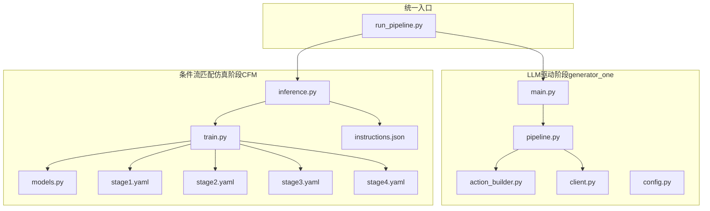
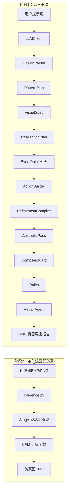
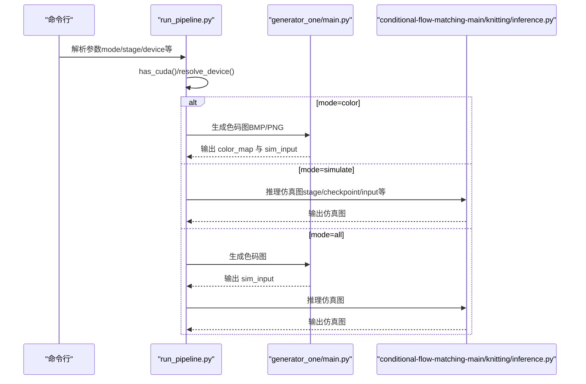
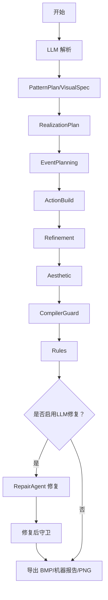
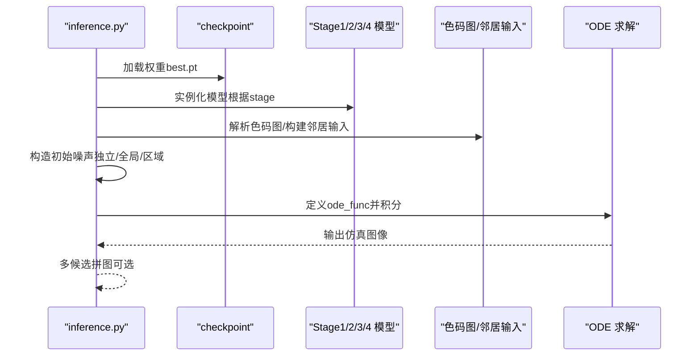
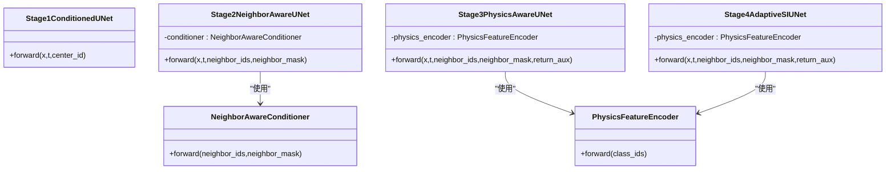
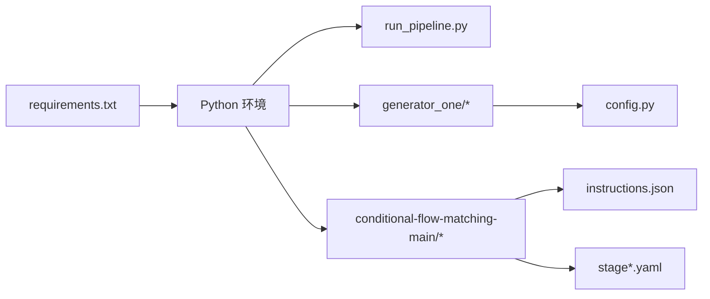

# 系统架构

<cite>
**本文引用的文件**
- [README.md](file://conditional-flow-matching-main/README.md)
- [run_pipeline.py](file://run_pipeline.py)
- [main.py](file://generator_one/main.py)
- [pipeline.py](file://generator_one/pipeline.py)
- [client.py](file://generator_one/llm/client.py)
- [action_builder.py](file://generator_one/generation/action_builder.py)
- [inference.py](file://conditional-flow-matching-main/knitting/inference.py)
- [train.py](file://conditional-flow-matching-main/knitting/train.py)
- [models.py](file://conditional-flow-matching-main/knitting/models.py)
- [stage1.yaml](file://conditional-flow-matching-main/configs/stage1.yaml)
- [stage2.yaml](file://conditional-flow-matching-main/configs/stage2.yaml)
- [stage3.yaml](file://conditional-flow-matching-main/configs/stage3.yaml)
- [stage4.yaml](file://conditional-flow-matching-main/configs/stage4.yaml)
- [instructions.json](file://conditional-flow-matching-main/assets/instructions.json)
- [requirements.txt](file://requirements.txt)
- [config.py](file://generator_one/config.py)
</cite>

## 目录
1. [引言](#引言)
2. [项目结构](#项目结构)
3. [核心组件](#核心组件)
4. [架构总览](#架构总览)
5. [详细组件分析](#详细组件分析)
6. [依赖分析](#依赖分析)
7. [性能考量](#性能考量)
8. [故障排查指南](#故障排查指南)
9. [结论](#结论)
10. [附录](#附录)

## 引言
本架构文档面向“针织图案生成系统”，聚焦两大阶段：第一阶段由LLM驱动的“文本到色码图”生成，第二阶段由条件流匹配（Conditional Flow Matching, CFM）驱动的“色码图到仿真图”生成。系统采用模块化分层设计，通过统一入口脚本协调两阶段执行，确保数据流清晰、组件职责明确、可扩展性强。

## 项目结构
系统由三层模块组成：
- LLM驱动阶段（generator_one）：负责将自然语言描述转换为可执行的编织动作网格，并进行规则校验与可机性导出。
- 条件流匹配仿真阶段（conditional-flow-matching-main）：将色码图映射为仿真图像，通过多阶段模型逐步增强结构一致性与物理合理性。
- 统一入口（run_pipeline.py）：提供跨阶段的统一命令行入口，自动选择设备、拼接路径、传递参数并触发各阶段。

图表来源
- [run_pipeline.py:17-279](file://run_pipeline.py#L17-L279)
- [main.py:13-207](file://generator_one/main.py#L13-L207)
- [pipeline.py:93-749](file://generator_one/pipeline.py#L93-L749)
- [action_builder.py:35-603](file://generator_one/generation/action_builder.py#L35-L603)
- [client.py:35-168](file://generator_one/llm/client.py#L35-L168)
- [inference.py:64-720](file://conditional-flow-matching-main/knitting/inference.py#L64-L720)
- [train.py:10-800](file://conditional-flow-matching-main/knitting/train.py#L10-L800)
- [models.py:10-119](file://conditional-flow-matching-main/knitting/models.py#L10-L119)
- [stage1.yaml:1-24](file://conditional-flow-matching-main/configs/stage1.yaml#L1-L24)
- [stage2.yaml:1-24](file://conditional-flow-matching-main/configs/stage2.yaml#L1-L24)
- [stage3.yaml:1-24](file://conditional-flow-matching-main/configs/stage3.yaml#L1-L24)
- [stage4.yaml:1-24](file://conditional-flow-matching-main/configs/stage4.yaml#L1-L24)
- [instructions.json:1-352](file://conditional-flow-matching-main/assets/instructions.json#L1-L352)

章节来源
- [run_pipeline.py:17-279](file://run_pipeline.py#L17-L279)
- [README.md:1-47](file://conditional-flow-matching-main/README.md#L1-L47)

## 核心组件
- 统一入口 run_pipeline.py：解析命令行参数，自动推断设备，协调两阶段执行，管理输出目录与日志。
- LLM客户端 LLMClient：封装OpenAI兼容接口，负责与DeepSeek等服务通信，具备重试与超时策略。
- 生成管线 KnittingPipeline：串联LLM解析、视觉转实现、事件规划、动作构建、精炼、美学优化、编译守卫、规则检查与LLM修复等步骤。
- 动作构建器 ActionBuilder：根据实现计划与事件点生成40×40动作网格，执行过渡求解与稳定性处理。
- 推理引擎 inference.py：加载指定阶段模型，构造邻居条件，生成仿真图像，支持多候选导出与拼图。
- 训练与模型 train.py / models.py：实现Stage1-4的UNet结构、邻居感知条件器、物理特征编码器、自适应随机插值等。
- 指令定义 instructions.json：提供15色语义指令与工艺属性，支撑动作映射与可机性导出。

章节来源
- [run_pipeline.py:22-279](file://run_pipeline.py#L22-L279)
- [client.py:35-168](file://generator_one/llm/client.py#L35-L168)
- [pipeline.py:93-749](file://generator_one/pipeline.py#L93-L749)
- [action_builder.py:35-603](file://generator_one/generation/action_builder.py#L35-L603)
- [inference.py:64-720](file://conditional-flow-matching-main/knitting/inference.py#L64-L720)
- [train.py:318-691](file://conditional-flow-matching-main/knitting/train.py#L318-L691)
- [models.py:10-119](file://conditional-flow-matching-main/knitting/models.py#L10-L119)
- [instructions.json:1-352](file://conditional-flow-matching-main/assets/instructions.json#L1-L352)

## 架构总览
系统采用“阶段化流水线 + 统一调度”的架构模式：
- 阶段1（LLM驱动）：以自然语言为输入，经LLM解析与设计解析器生成可编辑的PatternPlan，再转换为RealizationPlan并构建动作网格，随后进行精炼、美学优化、编译守卫与规则检查，必要时通过LLM修复。
- 阶段2（条件流匹配仿真）：将色码图作为条件，通过Stage1-4的UNet模型与CFM目标函数，结合邻居感知、物理特征与自适应插值，生成高质量仿真图像。

图表来源
- [main.py:117-207](file://generator_one/main.py#L117-L207)
- [pipeline.py:114-189](file://generator_one/pipeline.py#L114-L189)
- [inference.py:633-720](file://conditional-flow-matching-main/knitting/inference.py#L633-L720)

## 详细组件分析

### 组件A：统一入口与设备调度
- 职责：解析参数、自动探测CUDA、拼接路径、调用子模块、管理输出。
- 关键流程：has_cuda → resolve_device → run_command → 统一打印与错误提示。
- 集成点：generator_one与conditional-flow-matching-main之间的桥接。

图表来源
- [run_pipeline.py:22-279](file://run_pipeline.py#L22-L279)
- [main.py:117-207](file://generator_one/main.py#L117-L207)
- [inference.py:615-720](file://conditional-flow-matching-main/knitting/inference.py#L615-L720)

章节来源
- [run_pipeline.py:22-279](file://run_pipeline.py#L22-L279)

### 组件B：LLM驱动阶段（KnittingPipeline）
- 流程：LLM解析 → PatternPlan → VisualSpec → RealizationPlan → EventPlanning → ActionBuild → Refinement → Aesthetic → CompilerGuard → Rules → LLM Repair → 导出。
- 关键模块：
  - LLMClient：封装API调用与重试。
  - DesignParser：将LLM响应解析为结构化设计。
  - PatternPlanEngine：渲染视觉规格与可编辑计划。
  - VisualToRealizationConverter：将视觉规格转为实现计划。
  - EventPlanner：事件点规划。
  - ActionBuilder：动作网格构建与过渡求解。
  - RefinementCompiler / AestheticPass：后处理优化。
  - CompilerGuard / Rules：编译守卫与物理/工艺规则检查。
  - RepairAgent：基于违规报告的LLM修复。

图表来源
- [pipeline.py:114-189](file://generator_one/pipeline.py#L114-L189)
- [client.py:81-161](file://generator_one/llm/client.py#L81-L161)
- [action_builder.py:43-118](file://generator_one/generation/action_builder.py#L43-L118)

章节来源
- [pipeline.py:93-749](file://generator_one/pipeline.py#L93-L749)
- [client.py:35-168](file://generator_one/llm/client.py#L35-L168)
- [action_builder.py:35-603](file://generator_one/generation/action_builder.py#L35-L603)

### 组件C：条件流匹配仿真阶段（inference.py）
- 职责：按stage加载模型、解析色码图、构造邻居条件、生成仿真图像、多候选导出与拼图。
- 关键流程：
  - load_model：根据stage动态实例化模型并加载checkpoint。
  - build_neighbor_inputs：为Stage2/3/4构造3×3邻居输入。
  - build_initial_noise：支持独立/全局相关/区域相关噪声模式。
  - generate_single_image：构造ODE函数并积分生成图像。
  - 多候选：批量生成并拼图。

图表来源
- [inference.py:64-118](file://conditional-flow-matching-main/knitting/inference.py#L64-L118)
- [inference.py:124-156](file://conditional-flow-matching-main/knitting/inference.py#L124-L156)
- [inference.py:225-292](file://conditional-flow-matching-main/knitting/inference.py#L225-L292)
- [inference.py:299-378](file://conditional-flow-matching-main/knitting/inference.py#L299-L378)
- [inference.py:459-486](file://conditional-flow-matching-main/knitting/inference.py#L459-L486)

章节来源
- [inference.py:64-720](file://conditional-flow-matching-main/knitting/inference.py#L64-L720)

### 组件D：训练与模型（train.py / models.py）
- Stage1：中心指令条件UNet。
- Stage2：邻居感知条件器（MultiheadAttention + Cross-Attention融合）。
- Stage3：物理特征编码器（基于instructions.json的语义与床型特征）。
- Stage4：自适应Stochastic Interpolants（边界区域自适应噪声）。
- 损失函数：MSE/L1/梯度/FFT/边界/结构损失组合，支持纹理对比与方向项。

图表来源
- [train.py:318-691](file://conditional-flow-matching-main/knitting/train.py#L318-L691)
- [models.py:10-119](file://conditional-flow-matching-main/knitting/models.py#L10-L119)

章节来源
- [train.py:318-691](file://conditional-flow-matching-main/knitting/train.py#L318-L691)
- [models.py:10-119](file://conditional-flow-matching-main/knitting/models.py#L10-L119)

### 组件E：配置与指令
- YAML配置：stage1-4分别定义数据、训练超参与损失权重。
- 指令定义：15色语义指令与工艺属性，支撑动作映射与机器导出报告生成。

章节来源
- [stage1.yaml:1-24](file://conditional-flow-matching-main/configs/stage1.yaml#L1-L24)
- [stage2.yaml:1-24](file://conditional-flow-matching-main/configs/stage2.yaml#L1-L24)
- [stage3.yaml:1-24](file://conditional-flow-matching-main/configs/stage3.yaml#L1-L24)
- [stage4.yaml:1-24](file://conditional-flow-matching-main/configs/stage4.yaml#L1-L24)
- [instructions.json:1-352](file://conditional-flow-matching-main/assets/instructions.json#L1-L352)

## 依赖分析
- 外部依赖：PyTorch/TorchDiffeq、OpenAI/Groq、HDF5/Abseil、科学计算栈等。
- 模块耦合：
  - run_pipeline.py与generator_one、conditional-flow-matching-main之间通过子进程调用耦合，参数传递清晰。
  - generator_one内部通过config.py集中管理路径与LLM配置，降低硬编码。
  - CFM阶段通过YAML配置与JSON指令定义解耦模型结构与语义。

图表来源
- [requirements.txt:1-46](file://requirements.txt#L1-L46)
- [run_pipeline.py:17-279](file://run_pipeline.py#L17-L279)
- [config.py:24-76](file://generator_one/config.py#L24-L76)
- [instructions.json:1-352](file://conditional-flow-matching-main/assets/instructions.json#L1-L352)

章节来源
- [requirements.txt:1-46](file://requirements.txt#L1-L46)
- [config.py:24-76](file://generator_one/config.py#L24-L76)

## 性能考量
- 设备选择：自动检测CUDA可用性，优先使用GPU；若不可用回退CPU。
- 批处理与分块：inference.py支持batch_size分块推理，减少显存压力。
- 噪声模式：Stage1使用独立噪声，Stage2/3/4采用全局相关噪声，提升稳定性与一致性。
- ODE求解：默认midpoint（Stage4）与适当步数，兼顾质量与效率。
- 训练损失：多任务损失（MSE/L1/梯度/FFT/边界/结构）平衡细节与结构一致性。

章节来源
- [run_pipeline.py:22-37](file://run_pipeline.py#L22-L37)
- [inference.py:581-598](file://conditional-flow-matching-main/knitting/inference.py#L581-L598)
- [inference.py:590-598](file://conditional-flow-matching-main/knitting/inference.py#L590-L598)
- [train.py:71-312](file://conditional-flow-matching-main/knitting/train.py#L71-L312)

## 故障排查指南
- LLM不可用：检查OpenAI库安装与DEEPSEEK_API_KEY环境变量；查看重试与超时配置。
- CUDA不可用：run_pipeline.py会自动回退CPU；确认PyTorch与CUDA版本兼容。
- 模型权重缺失：inference.py会在加载checkpoint时报错；确认stage与checkpoint路径正确。
- 输入色码图异常：inference.py会解析色码图并打印分布；检查输入格式与尺寸。
- 规则违规：pipeline在规则检查与LLM修复环节输出违规详情；根据报告调整设计或启用修复。

章节来源
- [client.py:52-79](file://generator_one/llm/client.py#L52-L79)
- [run_pipeline.py:22-37](file://run_pipeline.py#L22-L37)
- [inference.py:68-117](file://conditional-flow-matching-main/knitting/inference.py#L68-L117)
- [inference.py:459-486](file://conditional-flow-matching-main/knitting/inference.py#L459-L486)
- [pipeline.py:552-575](file://generator_one/pipeline.py#L552-L575)

## 结论
系统通过“LLM驱动设计 + 条件流匹配仿真”的双阶段架构，实现了从自然语言到仿真图像的端到端生成。统一入口保证了跨阶段的一致性与可运维性；模块化设计便于扩展与维护；通过丰富的配置与损失函数，兼顾细节与结构合理性。建议在生产环境中强化监控与灾备，持续迭代指令定义与模型结构以提升可机性与稳定性。

## 附录
- 安全性：LLM密钥通过环境变量注入；日志记录关键信息但不泄露敏感内容。
- 监控：日志文件位于outputs/logs；可结合外部监控系统采集指标。
- 灾难恢复：checkpoint与中间产物保存在outputs/runs；建议定期备份关键权重与导出报告。