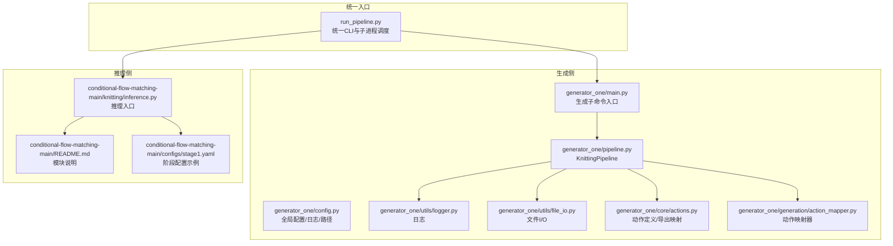
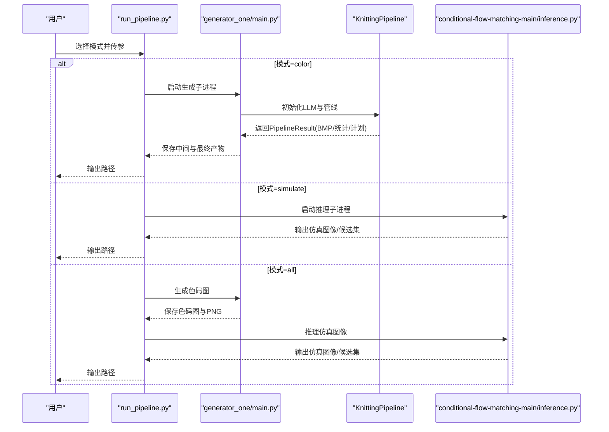
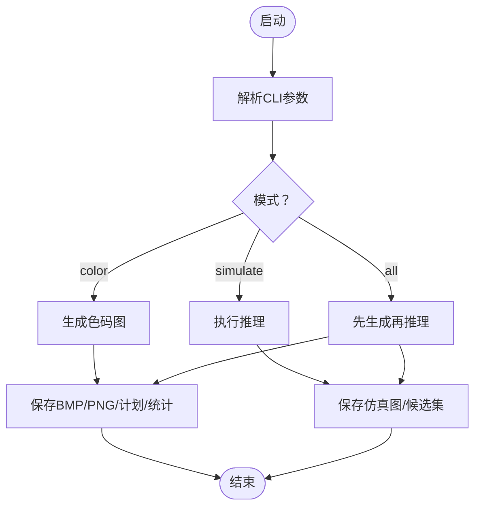
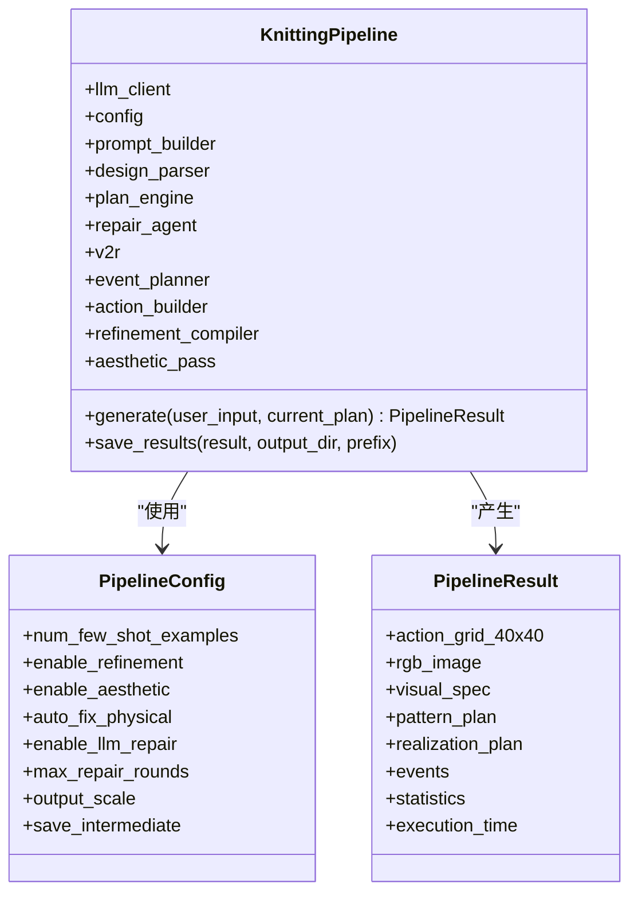
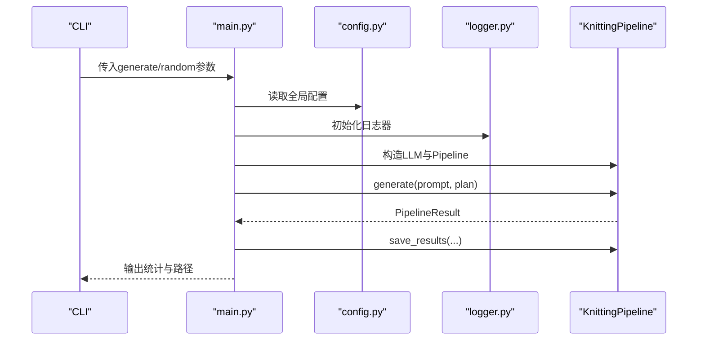
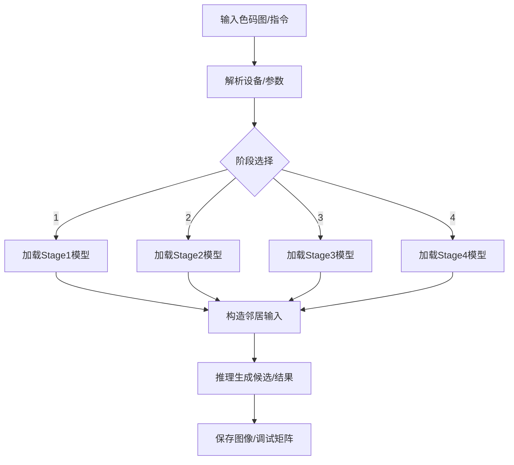
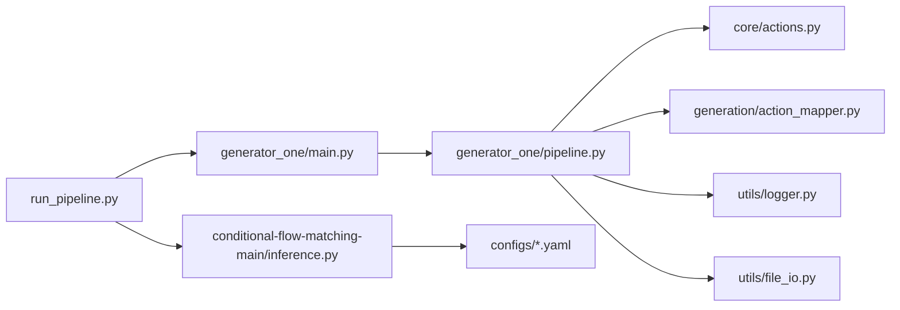

# 组件交互与集成

<cite>
**本文引用的文件**
- [run_pipeline.py](file://run_pipeline.py)
- [main.py](file://generator_one/main.py)
- [pipeline.py](file://generator_one/pipeline.py)
- [README.md](file://conditional-flow-matching-main/README.md)
- [requirements.txt](file://requirements.txt)
- [logger.py](file://generator_one/utils/logger.py)
- [file_io.py](file://generator_one/utils/file_io.py)
- [config.py](file://generator_one/config.py)
- [inference.py](file://conditional-flow-matching-main/knitting/inference.py)
- [stage1.yaml](file://conditional-flow-matching-main/configs/stage1.yaml)
- [actions.py](file://generator_one/core/actions.py)
- [action_mapper.py](file://generator_one/generation/action_mapper.py)
</cite>

## 目录
1. [简介](#简介)
2. [项目结构](#项目结构)
3. [核心组件](#核心组件)
4. [架构总览](#架构总览)
5. [详细组件分析](#详细组件分析)
6. [依赖分析](#依赖分析)
7. [性能考虑](#性能考虑)
8. [故障排查指南](#故障排查指南)
9. [结论](#结论)
10. [附录](#附录)

## 简介
本文件聚焦于“组件交互与集成”，围绕统一运行接口、KnittingPipeline工作流、模块间通信与数据交换协议展开，同时阐述日志与文件I/O机制、错误传播与异常处理策略、以及系统监控与最佳实践。目标是帮助读者快速理解从提示词到色码图再到仿真图像的端到端流程，掌握跨模块协作的关键点与扩展方法。

## 项目结构
该项目由两大部分组成：
- 生成侧（generator_one）：负责从自然语言提示生成色码图（BMP）、事件规划、动作构建、后处理与规则校验，并输出中间与最终产物。
- 推理侧（conditional-flow-matching-main）：基于色码图进行条件流匹配推理，生成仿真图像，支持多阶段模型与候选集导出。

**图表来源**
- [run_pipeline.py:1-279](file://run_pipeline.py#L1-L279)
- [main.py:1-207](file://generator_one/main.py#L1-L207)
- [pipeline.py:1-749](file://generator_one/pipeline.py#L1-L749)
- [config.py:1-76](file://generator_one/config.py#L1-L76)
- [logger.py:1-52](file://generator_one/utils/logger.py#L1-L52)
- [file_io.py:1-158](file://generator_one/utils/file_io.py#L1-L158)
- [actions.py:1-200](file://generator_one/core/actions.py#L1-L200)
- [action_mapper.py:1-200](file://generator_one/generation/action_mapper.py#L1-L200)
- [inference.py:1-200](file://conditional-flow-matching-main/knitting/inference.py#L1-L200)
- [README.md:1-47](file://conditional-flow-matching-main/README.md#L1-L47)
- [stage1.yaml:1-24](file://conditional-flow-matching-main/configs/stage1.yaml#L1-L24)

**章节来源**
- [run_pipeline.py:1-279](file://run_pipeline.py#L1-L279)
- [README.md:1-47](file://conditional-flow-matching-main/README.md#L1-L47)

## 核心组件
- 统一运行接口（run_pipeline.py）
  - 提供 color/simulate/all 三种模式，封装设备选择、子进程调用、参数透传与产物校验。
  - 通过子进程方式调用生成侧与推理侧，确保模块边界清晰、职责分离。
- 生成管线（generator_one/pipeline.py）
  - KnittingPipeline 将设计解析、视觉转实现、事件规划、动作构建、精炼、美学、编译守卫、规则检查、LLM修复等步骤串联为流水线。
  - 以 PipelineConfig/PipelineResult 管理配置与结果，支持中间产物保存与统计输出。
- 生成入口（generator_one/main.py）
  - 解析 CLI 参数，构造 LLM 客户端与 KnittingPipeline，执行生成并保存结果。
- 日志与文件I/O（generator_one/utils/logger.py, file_io.py）
  - 统一日志格式与落盘，提供 JSON/BMP/PNG 等多类型文件读写封装，含权限与异常处理。
- 动作体系（generator_one/core/actions.py）
  - 从 instruction_info.json 加载动作定义，提供 abbr/颜色/机器导出映射等查询接口，支撑生成与导出报告。
- 动作映射（generator_one/generation/action_mapper.py）
  - 将语义网格映射为底层动作网格，支持 motif 显式覆盖与 fallback 区域过渡平滑。
- 推理入口（conditional-flow-matching-main/knitting/inference.py）
  - 多阶段模型加载、邻居输入构造、候选集导出、设备解析与参数校验，面向色码图生成仿真图像。

**章节来源**
- [run_pipeline.py:196-247](file://run_pipeline.py#L196-L247)
- [main.py:117-203](file://generator_one/main.py#L117-L203)
- [pipeline.py:93-189](file://generator_one/pipeline.py#L93-L189)
- [logger.py:9-52](file://generator_one/utils/logger.py#L9-L52)
- [file_io.py:74-158](file://generator_one/utils/file_io.py#L74-L158)
- [actions.py:50-116](file://generator_one/core/actions.py#L50-L116)
- [action_mapper.py:68-107](file://generator_one/generation/action_mapper.py#L68-L107)
- [inference.py:64-118](file://conditional-flow-matching-main/knitting/inference.py#L64-L118)

## 架构总览
统一运行接口负责控制流与参数传递，生成侧完成从提示到色码图的端到端管线，推理侧将色码图转换为仿真图像。二者通过文件系统进行数据交换（BMP/PNG/JSON），并通过子进程解耦。

**图表来源**
- [run_pipeline.py:250-279](file://run_pipeline.py#L250-L279)
- [main.py:117-203](file://generator_one/main.py#L117-L203)
- [inference.py:1-200](file://conditional-flow-matching-main/knitting/inference.py#L1-L200)

## 详细组件分析

### 统一运行接口（CLI/子进程/参数解析）
- 模式与参数
  - color：接收提示词、输出目录、前缀、中间产物开关、禁用项（精炼/美学/修复）与增量计划输入。
  - simulate：接收色码图输入、阶段、检查点、设备、噪声模式、候选数、步数、求解器、扰动尺度等。
  - all：组合上述两种模式。
- 设备解析与回退
  - 自动检测 CUDA 可用性，若请求 cuda 但不可用则回退至 cpu。
- 子进程调用
  - 通过 subprocess.run 调用子模块入口，打印命令与工作目录便于排障。
- 产物校验
  - 生成阶段校验 BMP 与 PNG 是否生成；推理阶段校验输出图像是否存在。

**图表来源**
- [run_pipeline.py:196-247](file://run_pipeline.py#L196-L247)
- [run_pipeline.py:250-279](file://run_pipeline.py#L250-L279)

**章节来源**
- [run_pipeline.py:196-247](file://run_pipeline.py#L196-L247)
- [run_pipeline.py:250-279](file://run_pipeline.py#L250-L279)

### KnittingPipeline 工作流与状态管理
- 初始化与依赖注入
  - 通过构造函数注入 LLM 客户端、可选栅格化器与 PipelineConfig。
  - 内部装配 PromptBuilder、DesignParser、PatternPlanEngine、RepairAgent、VisualToRealizationConverter、EventPlanner、ActionBuilder、RefinementCompiler、AestheticPass 等组件。
- 流水线步骤
  - 步骤1：设计解析（PatternPlan/VisualSpec）
  - 步骤2：视觉转实现（RealizationPlan）
  - 步骤3：事件规划（EventPoints）
  - 步骤4：动作构建（ActionGrid）
  - 步骤5：精炼（可选）
  - 步骤6：美学（可选）
  - 步骤6.25：层裁剪（子层仅保留有效纹理）
  - 步骤6.5：编译守卫（特殊动作上下文合法性）
  - 步骤7：规则检查（物理/工艺）
  - 步骤8：LLM 修复（可选，迭代修复）
  - 步骤6.75/6.9：画布边缘与波纹配对守卫
- 结果与统计
  - PipelineResult 包含 action_grid、rgb_image、统计信息与执行时间。
  - 保存 BMP（通用/机器色表）、机器导出报告、仿真输入 PNG、中间数组与计划 JSON、统计 JSON。

**图表来源**
- [pipeline.py:93-189](file://generator_one/pipeline.py#L93-L189)
- [pipeline.py:69-91](file://generator_one/pipeline.py#L69-L91)

**章节来源**
- [pipeline.py:93-189](file://generator_one/pipeline.py#L93-L189)
- [pipeline.py:627-677](file://generator_one/pipeline.py#L627-L677)

### 生成入口与配置管理
- 入口行为
  - 解析 generate/random 子命令参数，构造 PipelineConfig，初始化 LLM 客户端与 KnittingPipeline。
  - 支持从外部读取 pattern_plan.json 作为增量修改源。
  - 生成完成后保存结果并输出统计摘要。
- 配置与日志
  - config.py 提供全局路径、网格尺寸、LLM 连接参数与日志配置。
  - utils/logger.py 提供统一日志器，支持控制台与文件输出。

**图表来源**
- [main.py:117-203](file://generator_one/main.py#L117-L203)
- [config.py:51-76](file://generator_one/config.py#L51-L76)
- [logger.py:9-52](file://generator_one/utils/logger.py#L9-L52)
- [pipeline.py:114-189](file://generator_one/pipeline.py#L114-L189)

**章节来源**
- [main.py:117-203](file://generator_one/main.py#L117-L203)
- [config.py:51-76](file://generator_one/config.py#L51-L76)
- [logger.py:9-52](file://generator_one/utils/logger.py#L9-L52)

### 推理侧接口与阶段配置
- 推理入口
  - 支持 stage 1/2/3/4，按阶段加载不同模型结构与权重，构造邻居输入，支持多候选导出与网格拼接。
  - 设备解析与回退、参数校验与错误提示。
- 阶段配置
  - configs/*.yaml 描述各阶段的数据、采样、训练超参与检查点路径，便于复现实验。

**图表来源**
- [inference.py:64-118](file://conditional-flow-matching-main/knitting/inference.py#L64-L118)
- [stage1.yaml:1-24](file://conditional-flow-matching-main/configs/stage1.yaml#L1-L24)

**章节来源**
- [inference.py:64-118](file://conditional-flow-matching-main/knitting/inference.py#L64-L118)
- [stage1.yaml:1-24](file://conditional-flow-matching-main/configs/stage1.yaml#L1-L24)

### 日志记录系统与文件I/O机制
- 日志
  - 统一格式与级别，支持控制台与文件双通道，避免重复 handler，便于定位问题。
- 文件I/O
  - 保存 JSON/Pickle/图像（8-bit 调色板/RGB），包含权限与通用异常捕获，失败时抛出明确异常。
- 产物组织
  - 生成侧输出 BMP（通用/机器色表）、机器导出报告、仿真输入 PNG、中间数组与计划 JSON、统计 JSON。
  - 推理侧输出仿真图像与候选集，必要时保存 id 矩阵与预览。

**章节来源**
- [logger.py:9-52](file://generator_one/utils/logger.py#L9-L52)
- [file_io.py:74-158](file://generator_one/utils/file_io.py#L74-L158)
- [pipeline.py:627-677](file://generator_one/pipeline.py#L627-L677)

### 错误传播机制与异常处理策略
- 子进程错误
  - run_pipeline.py 使用 subprocess.run 并设置 check=True，任何非零退出码均导致异常，便于上层感知失败。
- 生成侧校验
  - 生成阶段严格校验关键产物存在性（BMP/PNG），推理阶段校验输出图像存在性。
- 文件I/O异常
  - file_io.py 对权限与通用异常进行捕获并记录错误日志，随后重新抛出，保证调用方可见失败原因。
- 设备解析回退
  - 若请求 cuda 但不可用，自动回退至 cpu 并打印警告，避免静默失败。

**章节来源**
- [run_pipeline.py:44](file://run_pipeline.py#L44)
- [run_pipeline.py:104-110](file://run_pipeline.py#L104-L110)
- [run_pipeline.py:191-193](file://run_pipeline.py#L191-L193)
- [file_io.py:22-27](file://generator_one/utils/file_io.py#L22-L27)
- [file_io.py:52-57](file://generator_one/utils/file_io.py#L52-L57)
- [file_io.py:111-116](file://generator_one/utils/file_io.py#L111-L116)
- [run_pipeline.py:30-36](file://run_pipeline.py#L30-L36)

### 系统监控方案
- 统计指标
  - 生成侧统计动作分布、张力评分、违规数量、修复轮次与编辑次数等，便于质量评估。
- 导出报告
  - 机器导出报告汇总安全/需确认/未映射动作种类与数量，辅助打版确认。
- 日志与文件
  - 统一日志落盘，结合中间产物便于回溯与可视化分析。

**章节来源**
- [pipeline.py:184-186](file://generator_one/pipeline.py#L184-L186)
- [pipeline.py:577-621](file://generator_one/pipeline.py#L577-L621)
- [pipeline.py:686-726](file://generator_one/pipeline.py#L686-L726)

### 组件集成最佳实践与扩展指南
- 最佳实践
  - 使用统一运行接口进行端到端编排，避免跨模块硬编码路径。
  - 通过 PipelineConfig 开关控制可选步骤（精炼/美学/修复），便于 A/B 实验。
  - 严格校验中间产物存在性，失败即刻中断，减少无效计算。
  - 使用机器导出报告识别潜在风险动作，提前干预。
- 扩展指南
  - 新增生成步骤：在 KnittingPipeline 中新增步骤方法，并在 generate 流程中调用与统计。
  - 新增动作：在 instruction_info.json 中定义新动作，actions.py 自动加载并提供查询接口。
  - 新增推理阶段：在推理入口按 stage 分支加载新模型，更新配置文件并调整参数透传。
  - 新增规则：在规则模块中新增检查/修复逻辑，返回违规清单并纳入统计。

**章节来源**
- [pipeline.py:194-621](file://generator_one/pipeline.py#L194-L621)
- [actions.py:18-38](file://generator_one/core/actions.py#L18-L38)
- [inference.py:64-118](file://conditional-flow-matching-main/knitting/inference.py#L64-L118)
- [stage1.yaml:1-24](file://conditional-flow-matching-main/configs/stage1.yaml#L1-L24)

## 依赖分析
- 统一运行接口依赖
  - 生成侧：通过子进程调用 main.py，参数透传至生成管线。
  - 推理侧：通过子进程调用 inference.py，参数透传至推理模块。
- 生成侧依赖
  - LLM 客户端、PromptBuilder、DesignParser、PatternPlanEngine、RepairAgent、VisualToRealizationConverter、EventPlanner、ActionBuilder、RefinementCompiler、AestheticPass、日志与文件I/O。
- 推理侧依赖
  - 数据预处理、阶段适配器、配置文件、模型结构与权重。

**图表来源**
- [run_pipeline.py:1-279](file://run_pipeline.py#L1-L279)
- [main.py:1-207](file://generator_one/main.py#L1-L207)
- [pipeline.py:1-749](file://generator_one/pipeline.py#L1-L749)
- [actions.py:1-200](file://generator_one/core/actions.py#L1-L200)
- [action_mapper.py:1-200](file://generator_one/generation/action_mapper.py#L1-L200)
- [logger.py:1-52](file://generator_one/utils/logger.py#L1-L52)
- [file_io.py:1-158](file://generator_one/utils/file_io.py#L1-L158)
- [inference.py:1-200](file://conditional-flow-matching-main/knitting/inference.py#L1-L200)
- [stage1.yaml:1-24](file://conditional-flow-matching-main/configs/stage1.yaml#L1-L24)

**章节来源**
- [requirements.txt:1-46](file://requirements.txt#L1-L46)

## 性能考虑
- 设备选择
  - 自动检测 CUDA 并回退至 CPU，避免无效计算。
- 推理候选
  - 支持多候选导出与网格拼接，便于人工筛选最优结果，降低重复推理成本。
- 中间产物
  - 可选保存中间数组与预览，加速迭代与可视化分析。
- 规则与修复
  - 通过编译守卫与规则检查减少无效动作，LLM 修复限制轮次，避免过度迭代。

**章节来源**
- [run_pipeline.py:30-36](file://run_pipeline.py#L30-L36)
- [run_pipeline.py:184-187](file://run_pipeline.py#L184-L187)
- [pipeline.py:250-260](file://generator_one/pipeline.py#L250-L260)
- [pipeline.py:552-575](file://generator_one/pipeline.py#L552-L575)
- [pipeline.py:577-621](file://generator_one/pipeline.py#L577-L621)

## 故障排查指南
- 子进程失败
  - 检查命令与工作目录输出，确认参数透传正确。
- 产物缺失
  - 生成阶段：确认 BMP 与 PNG 是否存在；推理阶段：确认输出图像存在。
- 权限问题
  - file_io 捕获权限异常并记录错误，检查输出目录权限。
- 设备不可用
  - CUDA 请求但不可用时会回退 CPU，检查 GPU 环境与驱动。
- 日志定位
  - 查看统一日志文件与控制台输出，结合中间产物进行回溯。

**章节来源**
- [run_pipeline.py:44](file://run_pipeline.py#L44)
- [run_pipeline.py:104-110](file://run_pipeline.py#L104-L110)
- [run_pipeline.py:191-193](file://run_pipeline.py#L191-L193)
- [file_io.py:22-27](file://generator_one/utils/file_io.py#L22-L27)
- [file_io.py:52-57](file://generator_one/utils/file_io.py#L52-L57)
- [file_io.py:111-116](file://generator_one/utils/file_io.py#L111-L116)
- [run_pipeline.py:30-36](file://run_pipeline.py#L30-L36)

## 结论
该系统通过统一运行接口实现生成与推理两大模块的有序编排，KnittingPipeline 将设计、实现、事件、动作、后处理与规则检查等环节串接为可配置的流水线，配合完善的日志与文件I/O机制，形成高可观察性与可扩展的架构。建议在扩展新功能时遵循“配置开关+统计上报+导出报告”的模式，确保质量与效率兼顾。

## 附录
- 关键文件速览
  - 统一入口：[run_pipeline.py:1-279](file://run_pipeline.py#L1-L279)
  - 生成入口：[main.py:1-207](file://generator_one/main.py#L1-L207)
  - 生成管线：[pipeline.py:1-749](file://generator_one/pipeline.py#L1-L749)
  - 日志：[logger.py:1-52](file://generator_one/utils/logger.py#L1-L52)
  - 文件I/O：[file_io.py:1-158](file://generator_one/utils/file_io.py#L1-L158)
  - 配置：[config.py:1-76](file://generator_one/config.py#L1-L76)
  - 动作定义：[actions.py:1-200](file://generator_one/core/actions.py#L1-L200)
  - 动作映射：[action_mapper.py:1-200](file://generator_one/generation/action_mapper.py#L1-L200)
  - 推理入口：[inference.py:1-200](file://conditional-flow-matching-main/knitting/inference.py#L1-L200)
  - 阶段配置：[stage1.yaml:1-24](file://conditional-flow-matching-main/configs/stage1.yaml#L1-L24)
  - 模块说明：[README.md:1-47](file://conditional-flow-matching-main/README.md#L1-L47)
  - 依赖清单：[requirements.txt:1-46](file://requirements.txt#L1-L46)