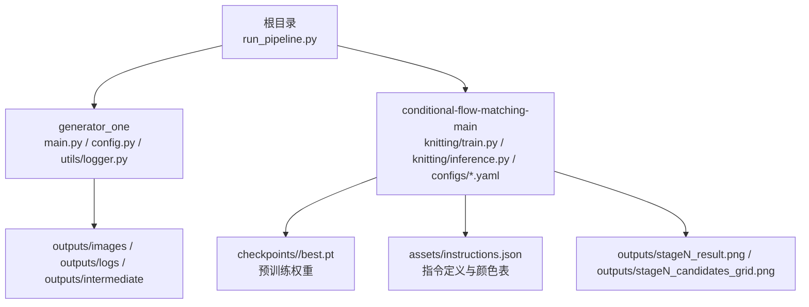
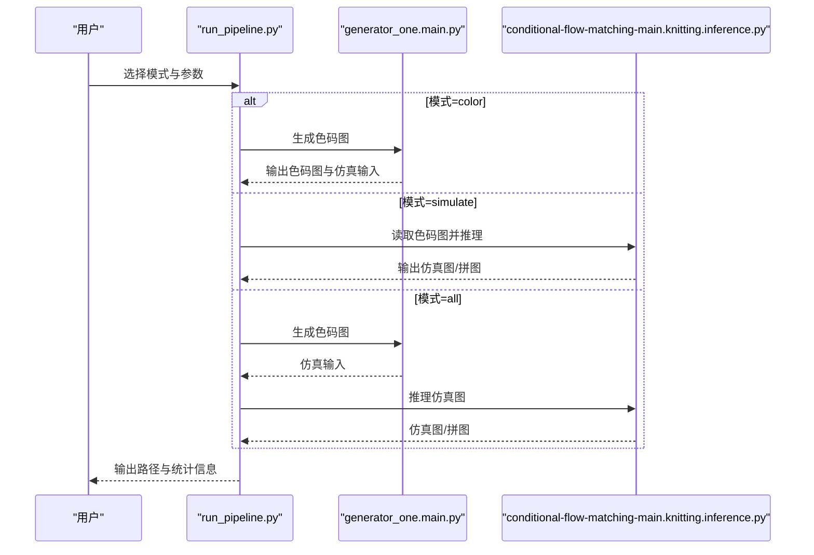
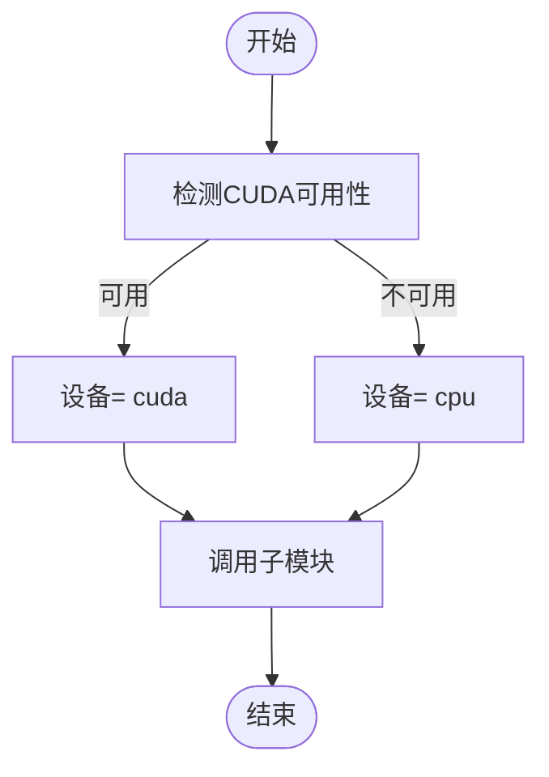
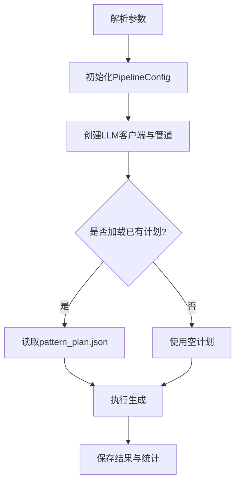
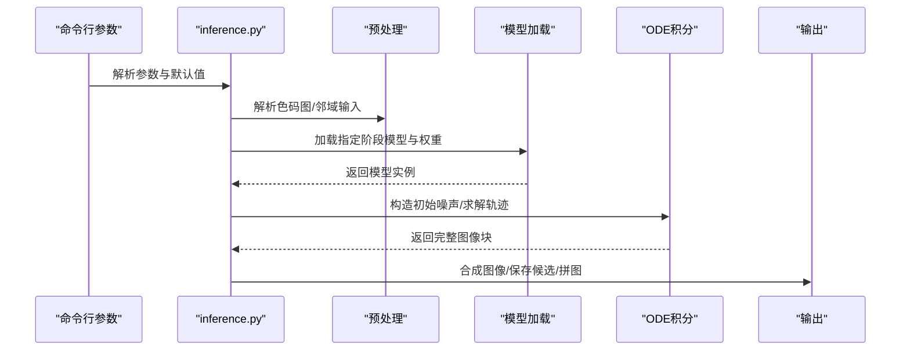
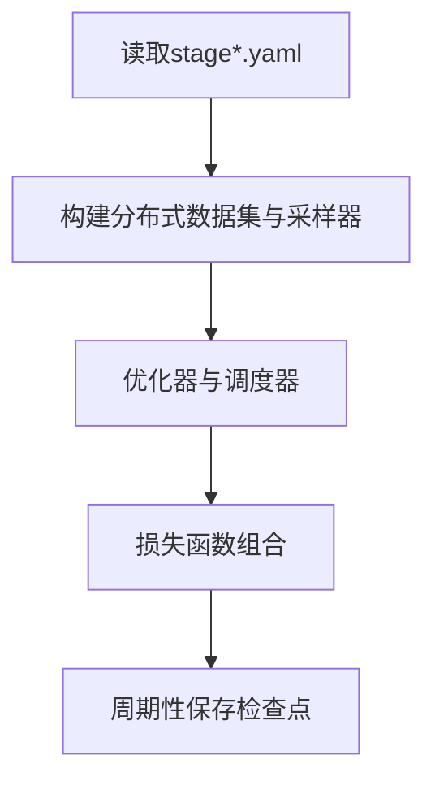
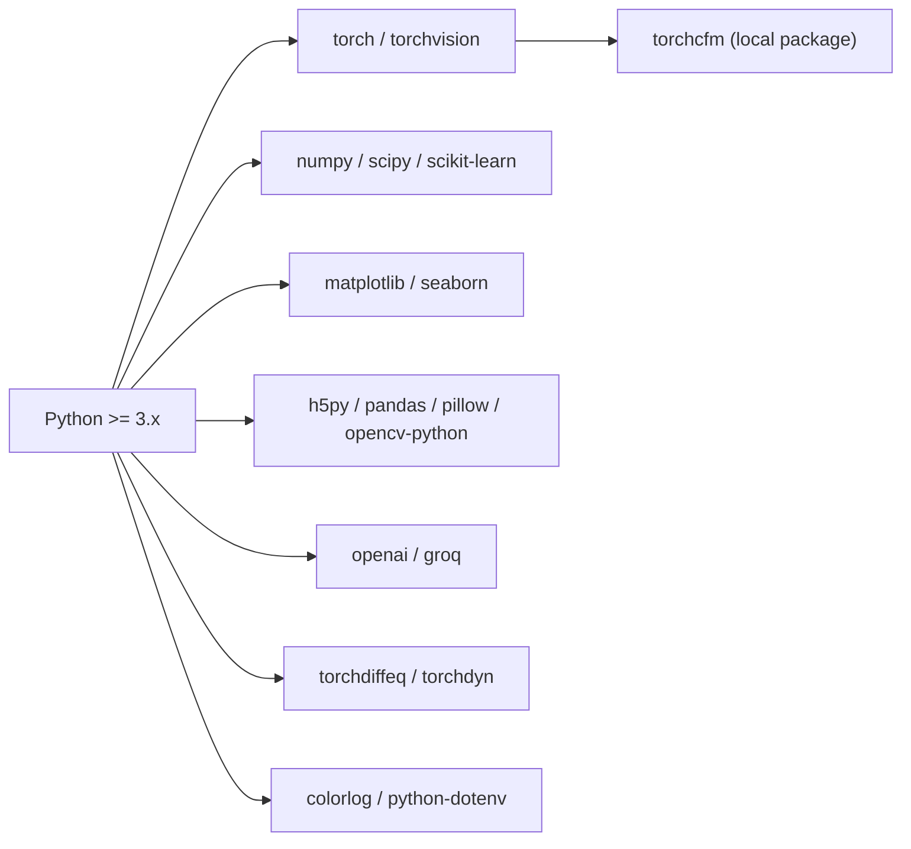

# 部署和运维

<cite>
**本文引用的文件**   
- [README.md](file://conditional-flow-matching-main/README.md)
- [requirements.txt](file://conditional-flow-matching-main/requirements.txt)
- [setup.py](file://conditional-flow-matching-main/setup.py)
- [train.py](file://conditional-flow-matching-main/knitting/train.py)
- [inference.py](file://conditional-flow-matching-main/knitting/inference.py)
- [stage1.yaml](file://conditional-flow-matching-main/configs/stage1.yaml)
- [main.py](file://generator_one/main.py)
- [config.py](file://generator_one/config.py)
- [logger.py](file://generator_one/utils/logger.py)
- [run_pipeline.py](file://run_pipeline.py)
- [version.py](file://conditional-flow-matching-main/torchcfm/version.py)
</cite>

## 目录
1. [简介](#简介)
2. [项目结构](#项目结构)
3. [核心组件](#核心组件)
4. [架构总览](#架构总览)
5. [详细组件分析](#详细组件分析)
6. [依赖分析](#依赖分析)
7. [性能考虑](#性能考虑)
8. [故障排除指南](#故障排除指南)
9. [结论](#结论)
10. [附录](#附录)

## 简介
本指南面向部署与运维人员，提供从环境准备、依赖安装、系统配置到性能优化、监控与日志、版本管理与升级的全流程操作说明。项目由两大部分组成：
- 文本到色码图生成管线（generator_one），负责将自然语言描述转换为可执行的色码图与模拟输入。
- 条件流匹配仿真模块（conditional-flow-matching-main），负责将色码图转换为仿真针织图像。

## 项目结构
项目采用多模块分层组织：
- conditional-flow-matching-main：条件流匹配训练与推理、配置与检查点管理
- generator_one：文本到色码图生成流水线、日志与配置
- outputs/runs：实验运行产物目录（颜色图、仿真图、中间态与统计数据）
- 根目录脚本：统一入口 run_pipeline.py，协调两个模块

图表来源
- [run_pipeline.py:17-279](file://run_pipeline.py#L17-L279)
- [main.py:13-207](file://generator_one/main.py#L13-L207)
- [inference.py:493-720](file://conditional-flow-matching-main/knitting/inference.py#L493-L720)
- [stage1.yaml:1-24](file://conditional-flow-matching-main/configs/stage1.yaml#L1-L24)

章节来源
- [README.md:1-47](file://conditional-flow-matching-main/README.md#L1-L47)
- [run_pipeline.py:17-279](file://run_pipeline.py#L17-L279)

## 核心组件
- 统一入口脚本：根据模式（color/simulate/all）调用相应子模块，自动推断运行目录与设备，确保流程一致性。
- 文本到色码图生成：解析用户提示词，构建图案计划，执行美学与修复流程，输出色码图与仿真输入。
- 条件流匹配推理：按阶段加载模型，构造邻域输入，执行 ODE 积分，批量生成仿真图像，支持多候选导出与拼图。
- 日志与配置：集中式日志配置与输出目录管理，便于运维排障与审计。

章节来源
- [run_pipeline.py:196-279](file://run_pipeline.py#L196-L279)
- [main.py:117-207](file://generator_one/main.py#L117-L207)
- [inference.py:493-720](file://conditional-flow-matching-main/knitting/inference.py#L493-L720)
- [config.py:14-76](file://generator_one/config.py#L14-L76)
- [logger.py:9-52](file://generator_one/utils/logger.py#L9-L52)

## 架构总览
整体工作流分为三层：
- 用户层：通过统一入口脚本选择模式与参数
- 执行层：分别调用生成模块与仿真模块
- 资源层：GPU/CPU、磁盘空间、检查点与日志目录

图表来源
- [run_pipeline.py:250-279](file://run_pipeline.py#L250-L279)
- [main.py:117-207](file://generator_one/main.py#L117-L207)
- [inference.py:615-720](file://conditional-flow-matching-main/knitting/inference.py#L615-L720)

## 详细组件分析

### 统一入口与设备选择
- 自动检测 CUDA 可用性，支持自动回退至 CPU。
- 将参数透传给子模块，保证一致性与可维护性。

图表来源
- [run_pipeline.py:22-37](file://run_pipeline.py#L22-L37)

章节来源
- [run_pipeline.py:22-37](file://run_pipeline.py#L22-L37)

### 文本到色码图生成（generator_one）
- 支持 generate/random 子命令，灵活控制是否启用美学、修复与中间态保存。
- 使用集中式日志配置，输出执行时间、动作分布、张力评分等统计信息。

图表来源
- [main.py:117-207](file://generator_one/main.py#L117-L207)
- [config.py:51-76](file://generator_one/config.py#L51-L76)
- [logger.py:9-52](file://generator_one/utils/logger.py#L9-L52)

章节来源
- [main.py:117-207](file://generator_one/main.py#L117-L207)
- [config.py:14-76](file://generator_one/config.py#L14-L76)
- [logger.py:9-52](file://generator_one/utils/logger.py#L9-L52)

### 条件流匹配推理（conditional-flow-matching-main）
- 按阶段加载模型，支持 Stage 1–4，自动解析 patch_size 并加载最佳权重。
- 构造邻域输入，支持多种噪声模式与 ODE 求解器，批量推理以提升吞吐。
- 多候选导出与拼图功能，便于人工筛选最优结果。

图表来源
- [inference.py:493-720](file://conditional-flow-matching-main/knitting/inference.py#L493-L720)
- [inference.py:64-118](file://conditional-flow-matching-main/knitting/inference.py#L64-L118)
- [inference.py:321-378](file://conditional-flow-matching-main/knitting/inference.py#L321-L378)

章节来源
- [inference.py:493-720](file://conditional-flow-matching-main/knitting/inference.py#L493-L720)
- [inference.py:64-118](file://conditional-flow-matching-main/knitting/inference.py#L64-L118)
- [inference.py:321-378](file://conditional-flow-matching-main/knitting/inference.py#L321-L378)

### 训练与配置（conditional-flow-matching-main）
- DDP 训练支持，分布式采样与权重采样策略，便于大规模数据集训练。
- YAML 配置文件按阶段管理超参，便于版本化与复现。

图表来源
- [stage1.yaml:1-24](file://conditional-flow-matching-main/configs/stage1.yaml#L1-L24)
- [train.py:725-777](file://conditional-flow-matching-main/knitting/train.py#L725-L777)

章节来源
- [stage1.yaml:1-24](file://conditional-flow-matching-main/configs/stage1.yaml#L1-L24)
- [train.py:725-777](file://conditional-flow-matching-main/knitting/train.py#L725-L777)

## 依赖分析
- Python 与深度学习生态：PyTorch、torchvision、SciPy 生态链、科学计算与可视化库。
- 推理与数值微分：torchdiffeq 提供 ODE 求解，支撑仿真推理。
- 日志与环境变量：colorlog、python-dotenv 提供日志格式化与密钥注入。
- 本地包：torchcfm 作为条件流匹配实现，版本号在 version.py 中声明。

图表来源
- [requirements.txt:1-46](file://conditional-flow-matching-main/requirements.txt#L1-L46)
- [setup.py:7-36](file://conditional-flow-matching-main/setup.py#L7-L36)
- [version.py:1-2](file://conditional-flow-matching-main/torchcfm/version.py#L1-L2)

章节来源
- [requirements.txt:1-46](file://conditional-flow-matching-main/requirements.txt#L1-L46)
- [setup.py:7-36](file://conditional-flow-matching-main/setup.py#L7-L36)
- [version.py:1-2](file://conditional-flow-matching-main/torchcfm/version.py#L1-L2)

## 性能考虑
- 设备选择：优先使用 GPU，若 CUDA 不可用则自动回退 CPU；可通过参数强制选择。
- 批处理与分块：推理阶段支持按块大小分批处理，平衡显存占用与吞吐。
- 噪声模式与求解器：不同阶段推荐不同的噪声模式与 ODE 求解器，以兼顾稳定性与速度。
- 多候选导出：通过多种子与拼图导出，减少人工筛选成本。
- 数据加载：训练阶段使用加权采样与分布式采样，提升收敛效率与稳定性。

章节来源
- [run_pipeline.py:30-37](file://run_pipeline.py#L30-L37)
- [inference.py:532-583](file://conditional-flow-matching-main/knitting/inference.py#L532-L583)
- [inference.py:670-720](file://conditional-flow-matching-main/knitting/inference.py#L670-L720)
- [train.py:697-777](file://conditional-flow-matching-main/knitting/train.py#L697-L777)

## 故障排除指南
- CUDA 不可用
  - 现象：请求 cuda 但不可用，自动回退 CPU。
  - 处理：确认驱动与 PyTorch CUDA 版本匹配；或显式设置设备为 cpu。
  - 参考：[run_pipeline.py:30-37](file://run_pipeline.py#L30-L37)
- 检查点缺失
  - 现象：找不到指定阶段的 best.pt。
  - 处理：确认 checkpoints/stageN 下存在权重文件；或提供绝对路径。
  - 参考：[inference.py:68-118](file://conditional-flow-matching-main/knitting/inference.py#L68-L118)
- 输入路径错误
  - 现象：色码图或 instructions.json 不存在。
  - 处理：核对绝对路径；统一入口会进行存在性校验并报错。
  - 参考：[run_pipeline.py:113-129](file://run_pipeline.py#L113-L129)
- 输出未生成
  - 现象：候选拼图或仿真图未生成。
  - 处理：检查 num_candidates 与候选目录；确认命令行参数正确传递。
  - 参考：[run_pipeline.py:133-193](file://run_pipeline.py#L133-L193)
- 日志定位
  - 位置：outputs/logs/app.log；同时输出到控制台。
  - 参考：[logger.py:9-52](file://generator_one/utils/logger.py#L9-L52)，[config.py:71-76](file://generator_one/config.py#L71-L76)

章节来源
- [run_pipeline.py:30-37](file://run_pipeline.py#L30-L37)
- [inference.py:68-118](file://conditional-flow-matching-main/knitting/inference.py#L68-L118)
- [run_pipeline.py:113-129](file://run_pipeline.py#L113-L129)
- [run_pipeline.py:133-193](file://run_pipeline.py#L133-L193)
- [logger.py:9-52](file://generator_one/utils/logger.py#L9-L52)
- [config.py:71-76](file://generator_one/config.py#L71-L76)

## 结论
通过统一入口脚本与模块化设计，项目实现了从文本到仿真图像的端到端自动化。运维侧应重点关注设备可用性、检查点完整性与日志输出，结合批处理与多候选导出策略，获得稳定且高效的运行体验。

## 附录

### 环境配置与依赖安装
- 建议使用 Python 3.8+，并创建隔离虚拟环境。
- 安装依赖：先安装根目录 requirements，再安装 conditional-flow-matching-main 的 setup（如需本地开发）。
- CUDA 环境：确保 PyTorch 与 CUDA 版本匹配；若无 GPU，可使用 CPU 模式。

章节来源
- [requirements.txt:1-46](file://conditional-flow-matching-main/requirements.txt#L1-L46)
- [setup.py:7-36](file://conditional-flow-matching-main/setup.py#L7-L36)

### 硬件要求与资源消耗
- GPU 推荐：NVIDIA RTX 4090/3090 或同等算力；显存不足时减小 batch_size 或 num_candidates。
- CPU：多核 CPU 更利于数据加载与预处理。
- 存储：检查点与输出目录需充足空间；建议定期清理历史 run 目录。

### 监控与日志最佳实践
- 日志级别：生产环境建议 INFO；调试阶段可临时提升至 DEBUG。
- 日志轮转：建议配合系统日志轮转工具，避免单文件过大。
- 关键指标：记录执行时间、候选数量、设备类型、噪声模式与求解器配置，便于对比与回归。

章节来源
- [logger.py:9-52](file://generator_one/utils/logger.py#L9-L52)
- [config.py:71-76](file://generator_one/config.py#L71-L76)

### 版本管理与升级指南
- torchcfm 版本：在 torchcfm/version.py 中声明，升级前需验证与下游模块兼容性。
- 依赖更新：遵循 requirements.txt 的版本范围；注意 numpy/scipy 的兼容性。
- 配置迁移：YAML 配置按阶段拆分，升级时逐项比对新增/废弃字段。

章节来源
- [version.py:1-2](file://conditional-flow-matching-main/torchcfm/version.py#L1-L2)
- [requirements.txt:1-46](file://conditional-flow-matching-main/requirements.txt#L1-L46)
- [stage1.yaml:1-24](file://conditional-flow-matching-main/configs/stage1.yaml#L1-L24)