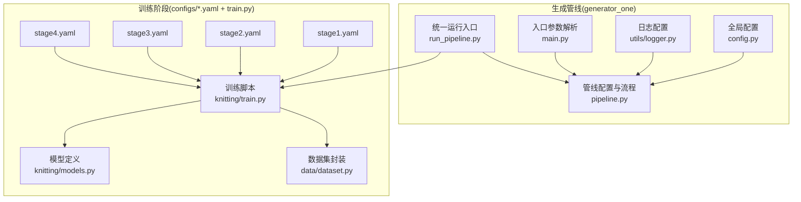
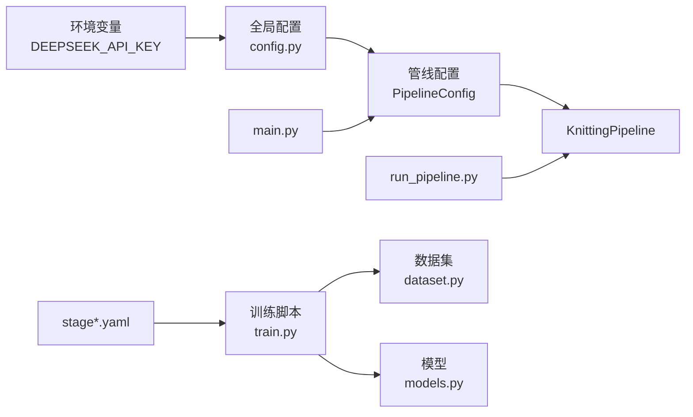
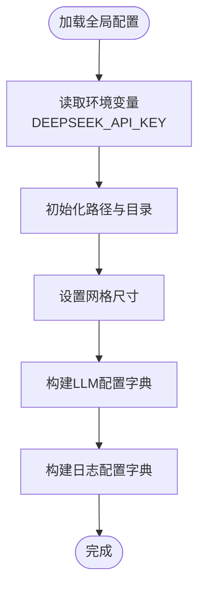
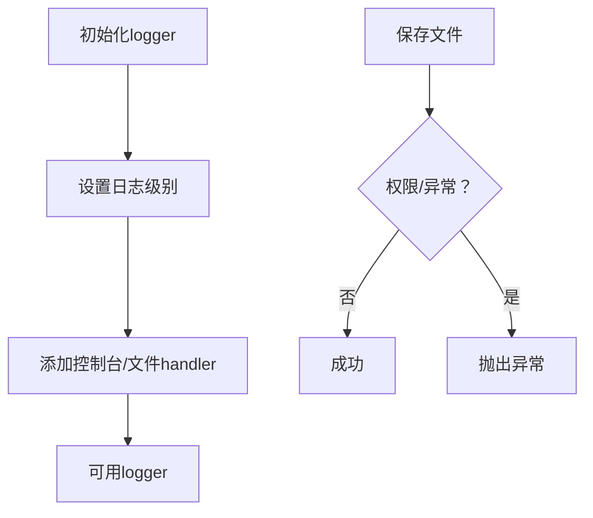
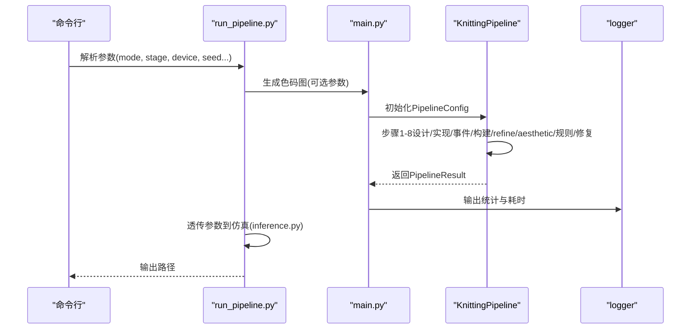
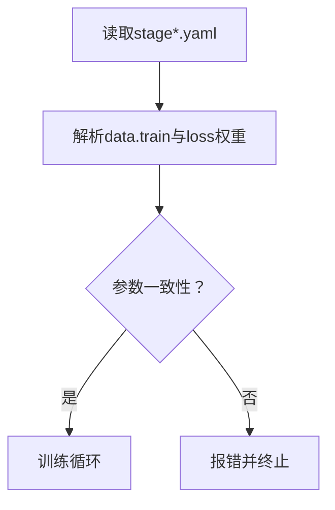
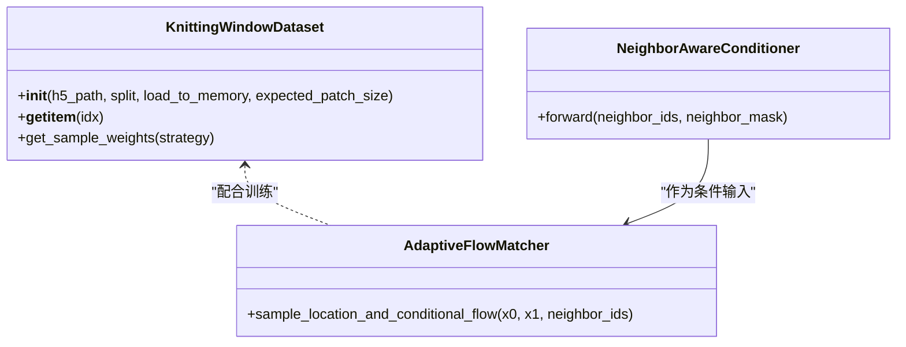
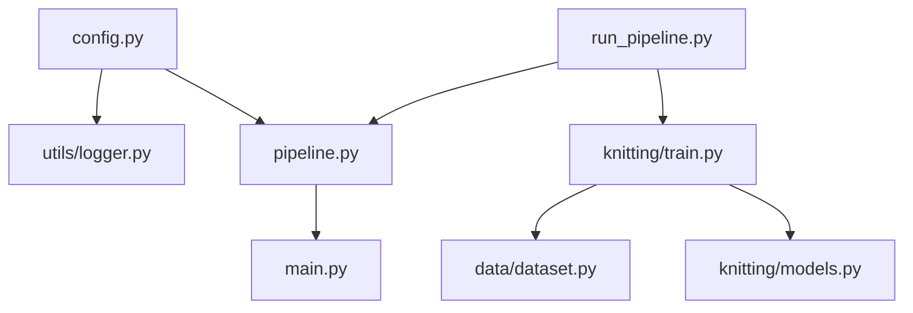

# 配置管理

<cite>
**本文引用的文件**
- [config.py](file://generator_one/config.py)
- [logger.py](file://generator_one/utils/logger.py)
- [file_io.py](file://generator_one/utils/file_io.py)
- [main.py](file://generator_one/main.py)
- [pipeline.py](file://generator_one/pipeline.py)
- [run_pipeline.py](file://run_pipeline.py)
- [stage1.yaml](file://conditional-flow-matching-main/configs/stage1.yaml)
- [stage2.yaml](file://conditional-flow-matching-main/configs/stage2.yaml)
- [stage3.yaml](file://conditional-flow-matching-main/configs/stage3.yaml)
- [stage4.yaml](file://conditional-flow-matching-main/configs/stage4.yaml)
- [train.py](file://conditional-flow-matching-main/knitting/train.py)
- [models.py](file://conditional-flow-matching-main/knitting/models.py)
- [dataset.py](file://conditional-flow-matching-main/data/dataset.py)
</cite>

## 目录
1. [简介](#简介)
2. [项目结构](#项目结构)
3. [核心组件](#核心组件)
4. [架构总览](#架构总览)
5. [详细组件分析](#详细组件分析)
6. [依赖分析](#依赖分析)
7. [性能考虑](#性能考虑)
8. [故障排查指南](#故障排查指南)
9. [结论](#结论)
10. [附录](#附录)

## 简介
本文件系统化梳理了该针织图案生成与仿真项目的配置管理体系，涵盖全局配置、LLM配置、训练配置与环境变量设置，解释各配置文件的作用与参数含义，给出不同运行模式的配置示例，阐明配置优先级与覆盖规则，并总结配置验证与错误处理机制及最佳实践。

## 项目结构
项目由两大部分组成：
- 生成管线（generator_one）：负责从文本提示生成色码图、中间结果与统计信息，支持可选的LLM修复与规则校验。
- 条件流匹配训练（conditional-flow-matching-main）：负责多阶段训练，使用yaml配置控制数据采样、损失权重与模型结构等。

**图表来源**
- [config.py:1-76](file://generator_one/config.py#L1-L76)
- [logger.py:1-52](file://generator_one/utils/logger.py#L1-L52)
- [pipeline.py:69-113](file://generator_one/pipeline.py#L69-L113)
- [main.py:13-144](file://generator_one/main.py#L13-L144)
- [run_pipeline.py:196-247](file://run_pipeline.py#L196-L247)
- [stage1.yaml:1-24](file://conditional-flow-matching-main/configs/stage1.yaml#L1-L24)
- [stage2.yaml:1-24](file://conditional-flow-matching-main/configs/stage2.yaml#L1-L24)
- [stage3.yaml:1-26](file://conditional-flow-matching-main/configs/stage3.yaml#L1-L26)
- [stage4.yaml:1-46](file://conditional-flow-matching-main/configs/stage4.yaml#L1-L46)
- [train.py:17-33](file://conditional-flow-matching-main/knitting/train.py#L17-L33)
- [models.py:10-119](file://conditional-flow-matching-main/knitting/models.py#L10-L119)
- [dataset.py:13-104](file://conditional-flow-matching-main/data/dataset.py#L13-L104)

**章节来源**
- [config.py:1-76](file://generator_one/config.py#L1-L76)
- [run_pipeline.py:196-247](file://run_pipeline.py#L196-L247)

## 核心组件
- 全局配置（generator_one/config.py）
  - 路径与目录：项目根、数据与输出目录、指令信息路径，自动创建必要目录。
  - 网格尺寸：逻辑网格大小（40x40）。
  - LLM配置：提供者、API密钥、基础URL、默认模型、模型映射、超时与重试策略。
  - 日志配置：日志级别、格式、输出文件与控制台开关。
- 日志工具（generator_one/utils/logger.py）
  - 基于全局日志配置创建logger，支持文件与控制台handler。
- 文件IO工具（generator_one/utils/file_io.py）
  - 统一的JSON/Pickle/图像读写接口，含权限与异常处理。
- 管线配置（generator_one/pipeline.py）
  - PipelineConfig：控制是否启用refinement/aesthetic/LLM repair、最大修复轮次、输出缩放、中间结果保存等。
  - KnittingPipeline：串联设计、实现、事件规划、动作构建、后处理、规则检查、LLM修复等步骤。
- 运行入口（generator_one/main.py）
  - 命令行参数解析，生成与随机模式，控制管线配置项。
- 统一运行脚本（run_pipeline.py）
  - 支持color、simulate、all三种模式，设备选择（auto/cuda/cpu），参数透传至子模块。

**章节来源**
- [config.py:24-76](file://generator_one/config.py#L24-L76)
- [logger.py:9-52](file://generator_one/utils/logger.py#L9-L52)
- [file_io.py:14-131](file://generator_one/utils/file_io.py#L14-L131)
- [pipeline.py:69-113](file://generator_one/pipeline.py#L69-L113)
- [main.py:13-144](file://generator_one/main.py#L13-L144)
- [run_pipeline.py:22-36](file://run_pipeline.py#L22-L36)

## 架构总览
配置贯穿三层：
- 全局层：路径、网格、LLM、日志等全局参数。
- 管线层：PipelineConfig控制生成流程的可选项与行为。
- 训练层：stage*.yaml定义数据、训练超参与损失权重。

**图表来源**
- [config.py:51-65](file://generator_one/config.py#L51-L65)
- [pipeline.py:69-113](file://generator_one/pipeline.py#L69-L113)
- [run_pipeline.py:250-279](file://run_pipeline.py#L250-L279)
- [stage1.yaml:1-24](file://conditional-flow-matching-main/configs/stage1.yaml#L1-L24)
- [stage2.yaml:1-24](file://conditional-flow-matching-main/configs/stage2.yaml#L1-L24)
- [stage3.yaml:1-26](file://conditional-flow-matching-main/configs/stage3.yaml#L1-L26)
- [stage4.yaml:1-46](file://conditional-flow-matching-main/configs/stage4.yaml#L1-L46)
- [train.py:17-33](file://conditional-flow-matching-main/knitting/train.py#L17-L33)
- [dataset.py:13-104](file://conditional-flow-matching-main/data/dataset.py#L13-L104)
- [models.py:10-119](file://conditional-flow-matching-main/knitting/models.py#L10-L119)

## 详细组件分析

### 全局配置与环境变量
- 路径与目录
  - 项目根、数据目录、输出目录、指令信息路径；自动创建输出子目录（images、intermediate、logs）。
- 网格尺寸
  - GRID_SIZE为40，决定逻辑网格大小。
- LLM配置
  - provider：默认“deepseek”。
  - api_key：从环境变量DEEPSEEK_API_KEY读取。
  - base_url：默认“https://api.deepseek.com”。
  - default_model：默认“deepseek-chat”。
  - models：提供“chat”和“coder”模型映射。
  - timeout：请求超时秒数。
  - retry：最大尝试次数与回退因子。
- 日志配置
  - level、format、file、console。

**图表来源**
- [config.py:18-76](file://generator_one/config.py#L18-L76)

**章节来源**
- [config.py:24-76](file://generator_one/config.py#L24-L76)

### 日志与文件IO配置
- 日志
  - 依据全局日志配置创建logger，支持控制台与文件handler，避免重复添加。
- 文件IO
  - 统一的JSON/Pickle/图像保存与加载，包含权限与通用异常处理，便于调试与排错。

**图表来源**
- [logger.py:9-52](file://generator_one/utils/logger.py#L9-L52)
- [file_io.py:74-131](file://generator_one/utils/file_io.py#L74-L131)

**章节来源**
- [logger.py:9-52](file://generator_one/utils/logger.py#L9-L52)
- [file_io.py:14-131](file://generator_one/utils/file_io.py#L14-L131)

### 管线配置与运行模式
- PipelineConfig
  - num_few_shot_examples、enable_refinement、enable_aesthetic、auto_fix_physical、enable_llm_repair、max_repair_rounds、output_scale、save_intermediate。
- KnittingPipeline
  - 步骤包括：设计/视觉规格、实现计划、事件规划、动作构建、refinement、aesthetic、编译守卫、规则检查、LLM修复、最终裁剪与导出。
- 运行模式
  - color：仅生成色码图。
  - simulate：仅运行仿真。
  - all：先生成色码图再进行仿真。
  - 设备选择：auto/cuda/cpu，若请求cuda但不可用则回退cpu并告警。

**图表来源**
- [run_pipeline.py:196-247](file://run_pipeline.py#L196-L247)
- [main.py:117-203](file://generator_one/main.py#L117-L203)
- [pipeline.py:93-189](file://generator_one/pipeline.py#L93-L189)

**章节来源**
- [pipeline.py:69-113](file://generator_one/pipeline.py#L69-L113)
- [pipeline.py:114-189](file://generator_one/pipeline.py#L114-L189)
- [run_pipeline.py:22-36](file://run_pipeline.py#L22-L36)
- [run_pipeline.py:250-279](file://run_pipeline.py#L250-L279)

### 训练配置（stage*.yaml）
- 通用字段
  - data：processed_dir、json_path、use_weighted_sampling、sampling_strategy、patch_size、load_to_memory。
  - train：batch_size、epochs、warmup_epochs、lr、num_workers、val_every、save_every、log_every、checkpoint_dir、pretrained_path。
- 损失权重（按阶段递增）
  - stage1：mse_weight、l1_weight。
  - stage2：mse_weight、l1_weight、grad_weight、fft_weight。
  - stage3：mse_weight、l1_weight、grad_weight、fft_weight、physics_weight。
  - stage4：mse_weight、l1_weight、grad_weight、fft_weight、physics_weight、boundary_weight、structure_*、texture_*、sigma_*、boundary_band_width。
- 结构与纹理参数
  - structure_*：结构掩码阈值、方向性比率等。
  - texture_*：对比度伽马等。
  - sigma_*：自适应插值噪声强度。
  - boundary_band_width：边界带宽。

**图表来源**
- [stage1.yaml:1-24](file://conditional-flow-matching-main/configs/stage1.yaml#L1-L24)
- [stage2.yaml:1-24](file://conditional-flow-matching-main/configs/stage2.yaml#L1-L24)
- [stage3.yaml:1-26](file://conditional-flow-matching-main/configs/stage3.yaml#L1-L26)
- [stage4.yaml:1-46](file://conditional-flow-matching-main/configs/stage4.yaml#L1-L46)

**章节来源**
- [stage1.yaml:1-24](file://conditional-flow-matching-main/configs/stage1.yaml#L1-L24)
- [stage2.yaml:1-24](file://conditional-flow-matching-main/configs/stage2.yaml#L1-L24)
- [stage3.yaml:1-26](file://conditional-flow-matching-main/configs/stage3.yaml#L1-L26)
- [stage4.yaml:1-46](file://conditional-flow-matching-main/configs/stage4.yaml#L1-L46)

### 训练脚本与数据集
- 训练脚本（train.py）
  - 支持DDP初始化、损失函数（梯度、FFT、纹理对比、边界、结构等）、自适应插值匹配、跨stage热启动。
  - 通过yaml中的stage字段切换不同模型与损失组合。
- 数据集（dataset.py）
  - HDF5窗口数据集，支持流式读取与内存加载，校验patch_size与mask存在性，提供三档采样权重策略。
- 模型（models.py）
  - 邻居感知条件编码器，结合注意力掩码融合中心与邻居上下文。

**图表来源**
- [dataset.py:13-104](file://conditional-flow-matching-main/data/dataset.py#L13-L104)
- [models.py:10-119](file://conditional-flow-matching-main/knitting/models.py#L10-L119)
- [train.py:529-601](file://conditional-flow-matching-main/knitting/train.py#L529-L601)

**章节来源**
- [train.py:17-33](file://conditional-flow-matching-main/knitting/train.py#L17-L33)
- [dataset.py:13-104](file://conditional-flow-matching-main/data/dataset.py#L13-L104)
- [models.py:10-119](file://conditional-flow-matching-main/knitting/models.py#L10-L119)

## 依赖分析
- 配置耦合
  - 全局配置被日志与管线共享；LLM配置依赖环境变量；训练配置通过yaml注入训练脚本。
- 外部依赖
  - 训练脚本依赖torch、yaml、h5py等；推理阶段依赖下游inference.py参数。
- 潜在环路
  - 当前结构为单向依赖（配置→模块），未见循环导入。

**图表来源**
- [config.py:18-76](file://generator_one/config.py#L18-L76)
- [logger.py:7](file://generator_one/utils/logger.py#L7)
- [pipeline.py:23](file://generator_one/pipeline.py#L23)
- [main.py:10](file://generator_one/main.py#L10)
- [run_pipeline.py:17-19](file://run_pipeline.py#L17-L19)
- [train.py:17-33](file://conditional-flow-matching-main/knitting/train.py#L17-L33)
- [dataset.py:13-104](file://conditional-flow-matching-main/data/dataset.py#L13-L104)
- [models.py:10-119](file://conditional-flow-matching-main/knitting/models.py#L10-L119)

**章节来源**
- [run_pipeline.py:196-247](file://run_pipeline.py#L196-L247)

## 性能考虑
- 训练阶段
  - 使用DDP分布式训练，建议根据GPU数量调整local rank与world size。
  - 采用加权采样与三档权重策略平衡类别分布，减少长尾影响。
  - stage4引入自适应插值与边界带损失，提升块间自然过渡。
- 推理阶段
  - run_pipeline对CUDA可用性进行检测，自动降级至CPU并打印警告，确保稳定性。
  - 通过参数透传（如num_candidates、noise_mode、solver等）优化仿真质量与速度。

[本节为通用指导，无需具体文件分析]

## 故障排查指南
- LLM配置
  - 确认DEEPSEEK_API_KEY已正确设置；若为空，LLM调用可能失败。
- 训练数据
  - 若HDF5缺少neighbor_mask或patch_size不一致，将触发运行时错误，请重新预处理数据。
  - 若找不到dataset.h5，需先执行预处理脚本。
- 推理路径
  - 若指定的色码图或检查点不存在，将抛出FileNotFoundError；请核对路径与stage。
- 日志与权限
  - 文件IO异常会记录详细错误并抛出；检查目标目录权限与磁盘空间。

**章节来源**
- [config.py:51-65](file://generator_one/config.py#L51-L65)
- [dataset.py:26-47](file://conditional-flow-matching-main/data/dataset.py#L26-L47)
- [dataset.py:155-161](file://conditional-flow-matching-main/data/dataset.py#L155-L161)
- [run_pipeline.py:104-109](file://run_pipeline.py#L104-L109)
- [run_pipeline.py:146-147](file://run_pipeline.py#L146-L147)
- [file_io.py:22-27](file://generator_one/utils/file_io.py#L22-L27)

## 结论
本项目采用“全局配置+模块化配置”的分层设计：全局配置统一路径、网格、LLM与日志；管线配置控制生成流程；训练配置通过yaml明确阶段差异。通过严格的参数校验与错误处理，保证在不同运行模式下的稳定性与可维护性。

[本节为总结，无需具体文件分析]

## 附录

### 配置优先级与覆盖规则
- 环境变量优先于硬编码默认值：LLM API密钥来自DEEPSEEK_API_KEY。
- 命令行参数覆盖默认行为：例如禁用refinement/aesthetic/LLM repair，或指定输出目录与前缀。
- YAML配置覆盖默认训练参数：不同stage的yaml决定数据采样、损失权重与模型结构。
- 设备选择优先级：显式指定auto/cuda/cpu，若请求cuda但不可用则自动回退cpu。

**章节来源**
- [config.py:51-65](file://generator_one/config.py#L51-L65)
- [main.py:63-88](file://generator_one/main.py#L63-L88)
- [run_pipeline.py:22-36](file://run_pipeline.py#L22-L36)
- [stage1.yaml:1-24](file://conditional-flow-matching-main/configs/stage1.yaml#L1-L24)

### 不同运行模式的配置示例
- 仅生成色码图（color）
  - 关键参数：prompt、--output/--prefix、--save-intermediate、--no-refinement、--no-aesthetic、--no-repair、--plan-in。
- 仅仿真（simulate）
  - 关键参数：--stage、--checkpoint、--input、--json_path、--device、--seed、--num_candidates、--noise_mode、--solver、--perturb_scale、--batch_size。
- 全流程（all）
  - 组合上述两种模式的所有关键参数。

**章节来源**
- [run_pipeline.py:226-246](file://run_pipeline.py#L226-L246)
- [main.py:44-88](file://generator_one/main.py#L44-L88)

### 最佳实践
- 在本地开发时，将DEEPSEEK_API_KEY加入环境变量，避免提交敏感信息。
- 使用--save-intermediate保存中间结果，便于调试与可视化。
- 训练阶段按顺序推进（stage1→2→3→4），并在后续阶段设置pretrained_path以复用权重。
- 若出现CUDA相关问题，优先检查驱动与CUDA版本，或改为cpu模式运行。

[本节为通用指导，无需具体文件分析]