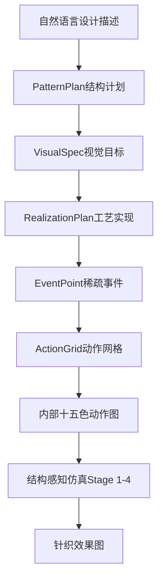
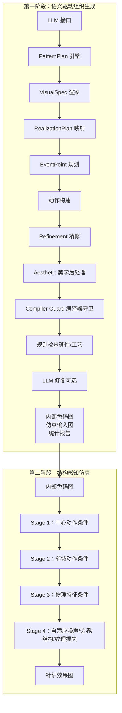
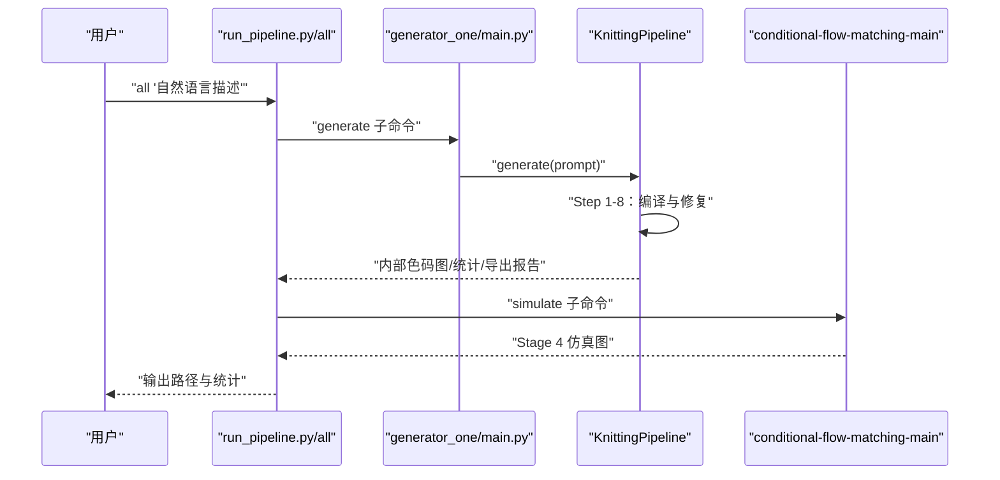
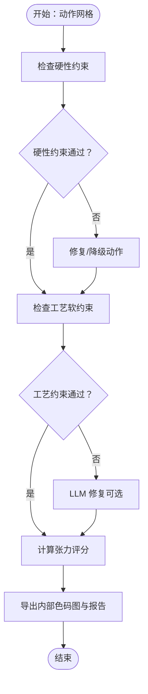
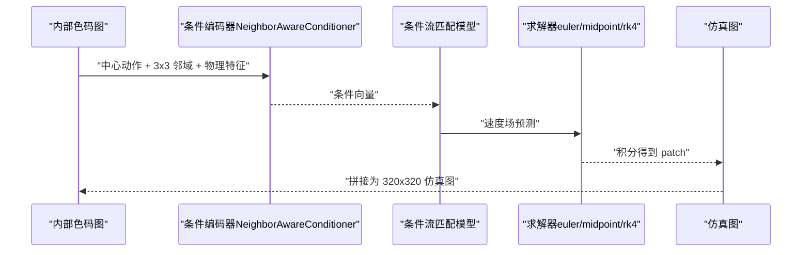
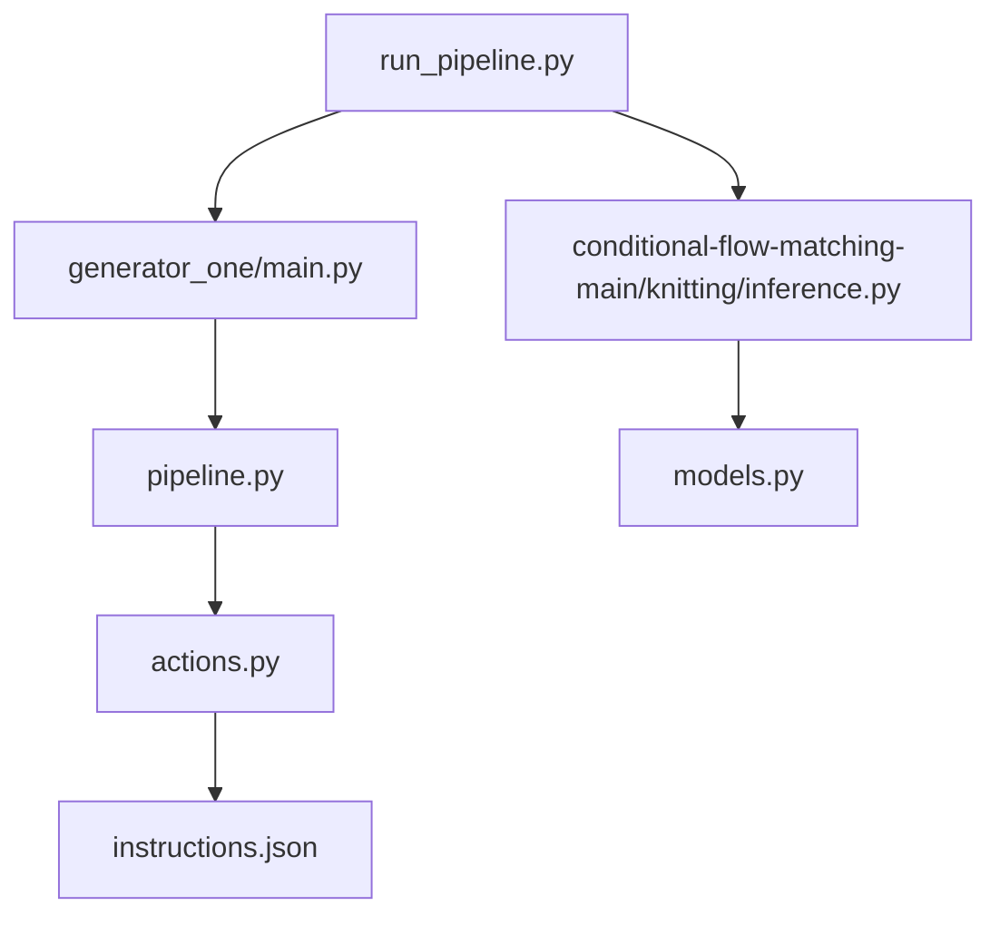

# 应用场景

<cite>
**本文引用的文件**
- [README.md](file://conditional-flow-matching-main/README.md)
- [run_pipeline.py](file://run_pipeline.py)
- [main.py](file://generator_one/main.py)
- [pipeline.py](file://generator_one/pipeline.py)
- [config.py](file://generator_one/config.py)
- [pattern_plan.py](file://generator_one/generation/pattern_plan.py)
- [actions.py](file://generator_one/core/actions.py)
- [models.py](file://conditional-flow-matching-main/knitting/models.py)
- [instructions.json](file://conditional-flow-matching-main/assets/instructions.json)
- [case_05_pattern_plan.json](file://outputs/runs/thesis_main_case_05/color_map/case_05_pattern_plan.json)
- [case_05_machine_export_report.json](file://outputs/runs/thesis_main_case_05/color_map/case_05_machine_export_report.json)
- [case_05_stats.json](file://outputs/runs/thesis_main_case_05/color_map/case_05_stats.json)
- [论文初稿.md](file://docs/论文初稿.md)
</cite>

## 目录
1. [简介](#简介)
2. [项目结构](#项目结构)
3. [核心组件](#核心组件)
4. [架构总览](#架构总览)
5. [详细组件分析](#详细组件分析)
6. [依赖关系分析](#依赖关系分析)
7. [性能考量](#性能考量)
8. [故障排查指南](#故障排查指南)
9. [结论](#结论)
10. [附录](#附录)

## 简介
本文件面向针织图案生成系统在实际生产中的应用场景，聚焦于从自然语言设计描述到可验证组织色码图与结构感知仿真的完整流程。系统以十五色动作空间为核心，结合硬性物理约束、工艺软约束、张力评分与层级裁剪，确保生成结果具备可制造性与可解释性；第二阶段结构感知仿真则提供织物表面效果的可视化验证，便于在设计与打版环节快速迭代。

## 项目结构
系统由两阶段构成：
- 第一阶段：语义驱动组织生成，将自然语言解析为 PatternPlan，再编译为动作色码图（内部十五色），并进行规则校验与后处理。
- 第二阶段：结构感知仿真，以内部色码图为条件输入，生成针织效果图，验证边界连续性、纹理方向与区域层级。

图表来源
- [论文初稿.md:139-141](file://docs/论文初稿.md#L139-L141)
- [run_pipeline.py:250-279](file://run_pipeline.py#L250-L279)

章节来源
- [论文初稿.md:91-141](file://docs/论文初稿.md#L91-L141)
- [run_pipeline.py:1-279](file://run_pipeline.py#L1-L279)

## 核心组件
- 生成管线（KnittingPipeline）：负责从自然语言到动作网格的全流程编译，包含 LLM 解析、视觉目标渲染、事件规划、动作构建、精修、美学后处理、编译器守卫、规则检查与 LLM 修复等步骤。
- 动作空间与规则（actions.py + instructions.json）：定义十五色动作的语义类别、针床属性、偏移、颜色与工艺等级，提供支撑关系、堆叠上限、偏移限制等约束。
- 仿真模块（conditional-flow-matching-main）：以内部色码图为条件，利用邻域动作与物理特征，通过条件流匹配生成结构感知仿真图。
- 统一入口（run_pipeline.py + generator_one/main.py）：提供命令行入口，支持生成色码图、运行仿真与端到端流程。

章节来源
- [pipeline.py:93-189](file://generator_one/pipeline.py#L93-L189)
- [actions.py:1-338](file://generator_one/core/actions.py#L1-L338)
- [instructions.json:1-352](file://conditional-flow-matching-main/assets/instructions.json#L1-L352)
- [README.md:1-47](file://conditional-flow-matching-main/README.md#L1-L47)
- [run_pipeline.py:196-247](file://run_pipeline.py#L196-L247)
- [main.py:13-207](file://generator_one/main.py#L13-L207)

## 架构总览
系统采用“语义解析—结构编译—规则校验—仿真验证”的闭环架构。第一阶段输出内部色码图与统计报告，第二阶段将内部色码图作为条件输入，生成仿真图，形成从设计意图到可观察织物效果的完整链路。

图表来源
- [论文初稿.md:139-141](file://docs/论文初稿.md#L139-L141)
- [pipeline.py:114-189](file://generator_one/pipeline.py#L114-L189)
- [README.md:37-46](file://conditional-flow-matching-main/README.md#L37-L46)

## 详细组件分析

### 组件A：生成管线（KnittingPipeline）
- 流程要点
  - 步骤1：LLM 解析与 PatternPlan 编辑，输出可编辑的结构计划。
  - 步骤2：渲染为 VisualSpec，再映射为 RealizationPlan。
  - 步骤3：事件规划生成稀疏事件点。
  - 步骤4：构建动作网格，执行精修、美学后处理与层级裁剪。
  - 步骤5：编译器守卫与规则检查，必要时触发 LLM 修复。
  - 步骤6：导出内部色码图、仿真输入图与统计报告。
- 关键特性
  - 可配置开关：精修、美学后处理、LLM 修复。
  - 统计输出：动作分布、张力评分、违规统计、层级裁剪审计等。
  - 机器导出报告：动作映射、风险提示与确认项汇总。

图表来源
- [run_pipeline.py:250-279](file://run_pipeline.py#L250-L279)
- [main.py:117-207](file://generator_one/main.py#L117-L207)
- [pipeline.py:114-189](file://generator_one/pipeline.py#L114-L189)
- [README.md:23-35](file://conditional-flow-matching-main/README.md#L23-L35)

章节来源
- [pipeline.py:93-189](file://generator_one/pipeline.py#L93-L189)
- [main.py:13-207](file://generator_one/main.py#L13-L207)
- [run_pipeline.py:196-247](file://run_pipeline.py#L196-L247)

### 组件B：动作空间与规则（actions + instructions）
- 动作定义
  - 十五色动作：成圈（LOOP）、集圈（TUCK）、移针（TRANSFER）、劈针（SPLIT）、空针/落布（EMPTY/DROP）等。
  - 语义属性：针床、偏移、颜色、张力等级、弹性等级、稳定性等级。
- 规则约束
  - 硬性约束：支撑、移针偏移上限、目标越界、同行冲突、连续堆叠、落布上方清空、床间方向冲突。
  - 工艺软约束：前后床连续切换过渡、左右负载平衡、床间移针行支撑、区域边框、镂空隔离、tuck 与 cable 相邻风险。
  - 张力评分：衡量相邻动作切换强度，辅助比较与消融实验。

图表来源
- [pipeline.py:552-575](file://generator_one/pipeline.py#L552-L575)
- [actions.py:138-191](file://generator_one/core/actions.py#L138-L191)
- [instructions.json:13-74](file://conditional-flow-matching-main/assets/instructions.json#L13-L74)

章节来源
- [actions.py:1-338](file://generator_one/core/actions.py#L1-L338)
- [instructions.json:1-352](file://conditional-flow-matching-main/assets/instructions.json#L1-L352)
- [pipeline.py:552-621](file://generator_one/pipeline.py#L552-L621)

### 组件C：结构感知仿真（Conditional Flow Matching）
- 条件表示
  - 输入：内部色码图（40×40 动作编号矩阵），每个动作单元对应 8×8 仿真 patch。
  - 条件：中心动作 ID 与 3×3 邻域动作，结合张力/弹性/稳定性等物理特征。
- 递进阶段
  - Stage 1：中心动作条件（UNet）。
  - Stage 2：邻域动作条件（邻域自注意力与交叉注意力）。
  - Stage 3：邻域+物理特征条件（引入工艺属性先验）。
  - Stage 4：自适应噪声、边界损失、结构损失与纹理损失（提升全图连续性与细节表现）。
- 推理求解器：支持 Euler、Midpoint、RK4，默认 Midpoint。

图表来源
- [models.py:10-119](file://conditional-flow-matching-main/knitting/models.py#L10-L119)
- [README.md:37-46](file://conditional-flow-matching-main/README.md#L37-L46)

章节来源
- [README.md:1-47](file://conditional-flow-matching-main/README.md#L1-L47)
- [models.py:1-119](file://conditional-flow-matching-main/knitting/models.py#L1-L119)

## 依赖关系分析
- 生成管线依赖动作定义与规则，确保动作网格满足支撑、偏移、堆叠与张力等约束。
- 统一入口（run_pipeline.py）协调生成与仿真流程，支持命令行参数传递与设备选择。
- PatternPlan 引擎负责将自然语言解析为可编辑的结构计划，支持随机生成与增量修改。

图表来源
- [run_pipeline.py:196-247](file://run_pipeline.py#L196-L247)
- [main.py:117-207](file://generator_one/main.py#L117-L207)
- [pipeline.py:93-113](file://generator_one/pipeline.py#L93-L113)
- [actions.py:1-338](file://generator_one/core/actions.py#L1-L338)
- [instructions.json:1-352](file://conditional-flow-matching-main/assets/instructions.json#L1-L352)
- [README.md:13-21](file://conditional-flow-matching-main/README.md#L13-L21)

章节来源
- [run_pipeline.py:1-279](file://run_pipeline.py#L1-L279)
- [main.py:1-207](file://generator_one/main.py#L1-L207)
- [pipeline.py:1-749](file://generator_one/pipeline.py#L1-L749)
- [actions.py:1-338](file://generator_one/core/actions.py#L1-L338)
- [instructions.json:1-352](file://conditional-flow-matching-main/assets/instructions.json#L1-L352)

## 性能考量
- 计算资源
  - 支持自动检测 CUDA 并回退至 CPU，便于在不同硬件环境下运行。
  - 推理阶段可指定求解器（euler/midpoint/rk4）与步数，平衡质量与效率。
- 生成效率
  - 通过稀疏事件规划与编译器守卫减少无效动作，降低后续仿真负担。
  - 统一的内部色码图与机器导出报告有助于快速定位高风险动作与确认项。
- 仿真质量
  - Stage 4 引入自适应噪声、边界损失与结构/纹理损失，提升整体连续性与细节表现。

章节来源
- [run_pipeline.py:22-36](file://run_pipeline.py#L22-L36)
- [run_pipeline.py:221-224](file://run_pipeline.py#L221-L224)
- [README.md:37-46](file://conditional-flow-matching-main/README.md#L37-L46)

## 故障排查指南
- 常见问题
  - 硬性约束违规：如移针目标越界、连续集圈超限、床间移针行缺少支撑等。
  - 工艺软约束违规：如前后床连续切换缺少过渡、左右负载不平衡等。
  - 机器导出风险：某些动作需要打版师确认宏参数或速度，系统会在导出报告中标注。
- 处理建议
  - 启用 LLM 修复模块，系统会根据违规统计与张力评分提出修复建议。
  - 检查 PatternPlan 与统计报告（如 violations、layer_clip_audit、wave_pair_guard），定位问题区域。
  - 调整参数：如增大 num_steps、更换求解器、启用/禁用精修/美学后处理等。

章节来源
- [pipeline.py:552-621](file://generator_one/pipeline.py#L552-L621)
- [case_05_machine_export_report.json:1-58](file://outputs/runs/thesis_main_case_05/color_map/case_05_machine_export_report.json#L1-L58)
- [case_05_stats.json:61-139](file://outputs/runs/thesis_main_case_05/color_map/case_05_stats.json#L61-L139)

## 结论
本系统通过语义驱动的结构计划、十五色动作空间与严格约束控制，将自然语言设计描述转化为可验证的组织色码图，并以结构感知仿真提供织物表面效果的可视化验证。该流程适用于服装设计、家居用品制作与艺术创作等多个领域，既保证了可制造性，又提升了设计迭代效率。

## 附录

### 应用场景与风格示例
- 服装设计
  - 圆形结构，内部波浪吊目，外部矩形边框，背景稀疏网眼：适合连衣裙、开衫的领口与袖口装饰。
  - 六边形边框，中间波浪吊目，外部平针：适合马甲或背心的几何图案。
- 家居用品制作
  - 菱形内部波浪吊目，外部稀疏网眼：适合桌布、靠垫的立体纹理。
  - 中心圆形平针结构，外部蜂巢纹理：适合床品的触感与美观平衡。
- 艺术创作
  - 大矩形边框内包含两个圆形网眼区域：适合挂毯或壁饰的多层次构图。
  - 中心菱形，内部蜂巢吊目，背景稀疏网眼：适合艺术围巾的抽象几何。

章节来源
- [论文初稿.md:361-573](file://docs/论文初稿.md#L361-L573)

### 使用流程与参数配置建议
- 基本流程
  - 生成色码图：使用 run_pipeline.py 的 color 模式或 generator_one 的 generate 子命令。
  - 运行仿真：使用 run_pipeline.py 的 simulate 模式或直接调用 conditional-flow-matching-main 的 inference。
  - 端到端：使用 run_pipeline.py 的 all 模式，一键完成生成与仿真。
- 关键参数
  - stage：仿真阶段（1-4），推荐默认 4。
  - solver：求解器（euler/midpoint/rk4），默认 midpoint。
  - num_steps：仿真步数，建议 50。
  - device：设备选择（auto/cuda/cpu），自动检测 CUDA。
  - noise_mode：噪声模式（auto/independent/global_correlated/region_correlated），默认 auto。
  - save_intermediate：保存中间结果，便于调试。
  - no-refinement/no-aesthetic/no-repair：按需禁用精修、美学后处理或 LLM 修复。
- 命令示例
  - 生成色码图：python run_pipeline.py color "自然语言描述" --stage 4 --solver midpoint
  - 运行仿真：python run_pipeline.py simulate --input 色码图路径 --stage 4 --solver midpoint
  - 端到端：python run_pipeline.py all "自然语言描述" --stage 4 --solver midpoint

章节来源
- [run_pipeline.py:196-247](file://run_pipeline.py#L196-L247)
- [README.md:23-35](file://conditional-flow-matching-main/README.md#L23-L35)
- [main.py:13-82](file://generator_one/main.py#L13-L82)

### 成功案例分析与效果对比
- 案例：多个小圆孔组成网眼背景，中间矩形区域为平针
  - PatternPlan：背景 mesh（全幅），中心 panel（plain）。
  - 统计：craft 违规 10 条，经 LLM 修复后降至 0；requires_confirmation 动作 2 类，需打版师确认。
  - 仿真：Stage 4 边界清晰度与纹理连续性最佳。
- 案例：圆形内部密集波浪吊目，背景为平针
  - PatternPlan：中心圆形（wave_tuck），背景平针。
  - 统计：张力评分较高，说明动作切换强度较大；通过修复与后处理保持合法性。
- 案例：菱形内部波浪吊目，外部稀疏网眼
  - PatternPlan：菱形（wave_tuck），外部 mesh。
  - 统计：纹理事件密度适中，张力评分较低，视觉稳定。

章节来源
- [case_05_pattern_plan.json:1-50](file://outputs/runs/thesis_main_case_05/color_map/case_05_pattern_plan.json#L1-L50)
- [case_05_machine_export_report.json:1-58](file://outputs/runs/thesis_main_case_05/color_map/case_05_machine_export_report.json#L1-L58)
- [case_05_stats.json:1-173](file://outputs/runs/thesis_main_case_05/color_map/case_05_stats.json#L1-L173)
- [论文初稿.md:361-573](file://docs/论文初稿.md#L361-L573)