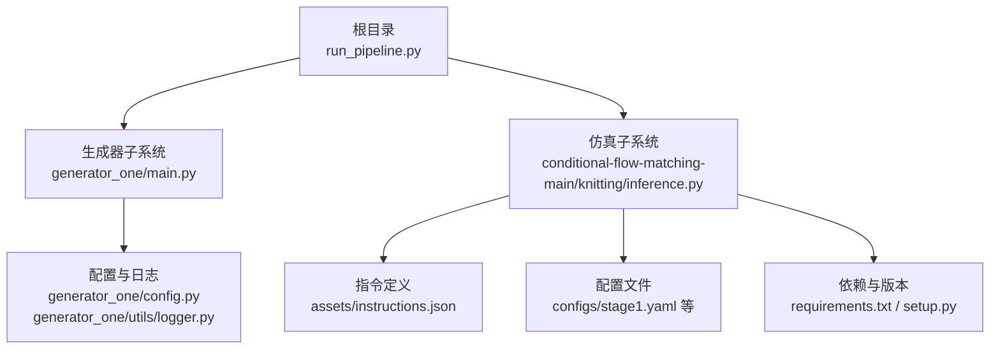
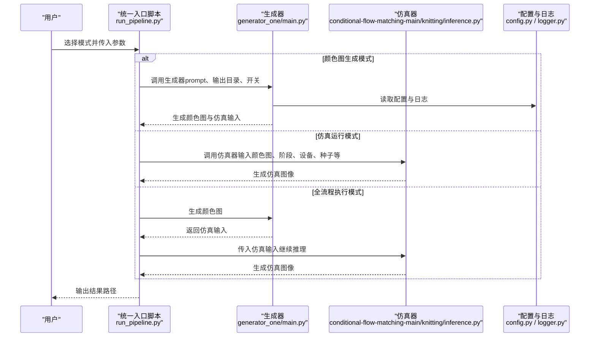
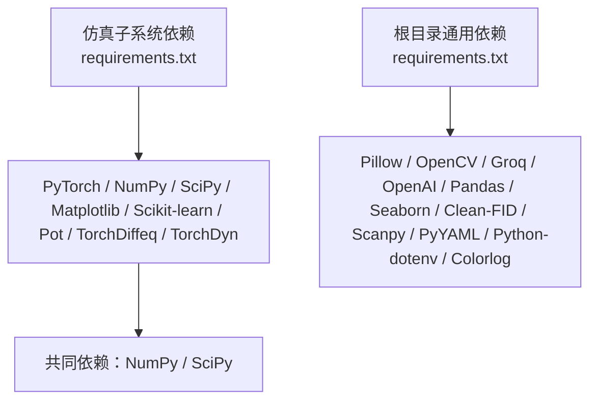

# 快速开始

<cite>
**本文引用的文件**
- [README.md](file://conditional-flow-matching-main/README.md)
- [requirements.txt](file://conditional-flow-matching-main/requirements.txt)
- [setup.py](file://conditional-flow-matching-main/setup.py)
- [requirements.txt](file://requirements.txt)
- [run_pipeline.py](file://run_pipeline.py)
- [main.py](file://generator_one/main.py)
- [config.py](file://generator_one/config.py)
- [logger.py](file://generator_one/utils/logger.py)
- [inference.py](file://conditional-flow-matching-main/knitting/inference.py)
- [stage1.yaml](file://conditional-flow-matching-main/configs/stage1.yaml)
- [instructions.json](file://conditional-flow-matching-main/assets/instructions.json)
- [color_palette.py](file://data/color_palette.py)
</cite>

## 目录
1. [简介](#简介)
2. [项目结构](#项目结构)
3. [核心组件](#核心组件)
4. [架构总览](#架构总览)
5. [详细组件分析](#详细组件分析)
6. [依赖分析](#依赖分析)
7. [性能考虑](#性能考虑)
8. [故障排除指南](#故障排除指南)
9. [结论](#结论)
10. [附录](#附录)

## 简介
本指南面向首次接触针织图案生成系统的用户，帮助你在最短时间内完成环境准备、安装依赖、配置环境变量，并体验三种运行模式：颜色图生成模式、仿真运行模式、全流程执行模式。文档同时提供常见问题与解决方案，确保你能顺利启动系统。

## 项目结构
该项目由两个主要子系统组成：
- 生成器子系统（generator_one）：负责从自然语言描述生成颜色图（color map），并进行美学优化、修复与导出。
- 仿真子系统（conditional-flow-matching-main）：负责将颜色图转换为仿真织物图像（simulation image），通过多阶段神经网络实现条件流匹配。

图表来源
- [run_pipeline.py:1-279](file://run_pipeline.py#L1-L279)
- [main.py:1-207](file://generator_one/main.py#L1-L207)
- [inference.py:1-200](file://conditional-flow-matching-main/knitting/inference.py#L1-L200)
- [config.py:1-76](file://generator_one/config.py#L1-L76)
- [logger.py:1-52](file://generator_one/utils/logger.py#L1-L52)
- [instructions.json:1-200](file://conditional-flow-matching-main/assets/instructions.json#L1-L200)
- [stage1.yaml:1-24](file://conditional-flow-matching-main/configs/stage1.yaml#L1-L24)
- [requirements.txt:1-19](file://conditional-flow-matching-main/requirements.txt#L1-L19)
- [setup.py:1-37](file://conditional-flow-matching-main/setup.py#L1-L37)

章节来源
- [run_pipeline.py:1-279](file://run_pipeline.py#L1-L279)
- [README.md:1-47](file://conditional-flow-matching-main/README.md#L1-L47)

## 核心组件
- 统一入口脚本：提供三种运行模式（颜色图生成、仿真运行、全流程），并负责跨子系统协调。
- 生成器子系统：以自然语言为输入，生成颜色图并可选地进行美学优化、修复与中间结果保存。
- 仿真子系统：将颜色图转换为仿真图像，支持多阶段模型与多种噪声/求解策略。
- 配置与日志：集中管理路径、网格尺寸、LLM连接参数、日志级别与输出目录。
- 指令定义：提供15种语义化针织动作及其工艺属性，用于颜色图与仿真之间的语义对齐。

章节来源
- [run_pipeline.py:196-247](file://run_pipeline.py#L196-L247)
- [main.py:13-202](file://generator_one/main.py#L13-L202)
- [inference.py:64-117](file://conditional-flow-matching-main/knitting/inference.py#L64-L117)
- [config.py:14-76](file://generator_one/config.py#L14-L76)
- [instructions.json:1-200](file://conditional-flow-matching-main/assets/instructions.json#L1-L200)

## 架构总览
下图展示了三种运行模式的端到端流程，以及关键组件间的交互关系。

图表来源
- [run_pipeline.py:250-275](file://run_pipeline.py#L250-L275)
- [main.py:117-202](file://generator_one/main.py#L117-L202)
- [inference.py:10-20](file://conditional-flow-matching-main/knitting/inference.py#L10-L20)
- [config.py:14-76](file://generator_one/config.py#L14-L76)

## 详细组件分析

### 环境配置与依赖安装
- Python 版本要求
  - 推荐使用 Python 3.10 或以上版本，确保与 PyTorch 1.11+ 兼容。
- 依赖包安装
  - 建议先安装仿真子系统依赖（包含 PyTorch、NumPy、SciPy、Matplotlib、Scikit-learn、Pot、TorchDiffeq 等）。
  - 再安装根目录通用依赖（包含 LLM 客户端、OpenCV、Pillow、可视化库、评估工具等）。
- 环境变量设置
  - 生成器子系统通过环境变量加载 LLM 密钥与基础地址，需设置 DEEPSEEK_API_KEY。
  - 日志输出路径与格式在配置文件中定义，确保输出目录存在或允许自动创建。

章节来源
- [requirements.txt:1-19](file://conditional-flow-matching-main/requirements.txt#L1-L19)
- [requirements.txt:1-46](file://requirements.txt#L1-L46)
- [setup.py:7-18](file://conditional-flow-matching-main/setup.py#L7-L18)
- [config.py:51-65](file://generator_one/config.py#L51-L65)

### 三种运行模式使用指南

#### 颜色图生成模式
- 功能：根据自然语言描述生成颜色图与仿真输入。
- 命令示例
  - 生成默认名称的颜色图与仿真输入：python run_pipeline.py color "你的图案描述"
  - 指定输出目录与文件前缀：python run_pipeline.py color "你的图案描述" --output outputs/images --prefix pattern
  - 启用/禁用中间结果保存与各处理阶段：--save-intermediate/--no-refinement/--no-aesthetic/--no-repair
- 关键参数
  - prompt：自然语言描述
  - --output：输出目录
  - --prefix：输出文件前缀
  - --save-intermediate：是否保存中间结果
  - --no-refinement/--no-aesthetic/--no-repair：禁用相应处理阶段

章节来源
- [run_pipeline.py:226-234](file://run_pipeline.py#L226-L234)
- [main.py:44-89](file://generator_one/main.py#L44-L89)

#### 仿真运行模式
- 功能：对现有颜色图进行仿真推理，生成仿真图像。
- 命令示例
  - 基础用法：python run_pipeline.py simulate --input 输入颜色图路径
  - 指定阶段、设备、种子与候选数量：python run_pipeline.py simulate --input 输入颜色图路径 --stage 4 --device auto --seed 42 --num_candidates 4
  - 指定检查点与指令定义：--checkpoint 检查点路径 --json_path 指令定义路径
- 关键参数
  - --input：颜色图路径（绝对或相对根目录）
  - --stage：仿真阶段（1/2/3/4）
  - --device：设备选择（auto/cuda/cpu）
  - --seed：随机种子
  - --num_candidates：候选数量（>1时保存网格图）
  - --checkpoint：检查点路径
  - --json_path：指令定义路径

章节来源
- [run_pipeline.py:235-237](file://run_pipeline.py#L235-L237)
- [run_pipeline.py:113-193](file://run_pipeline.py#L113-L193)
- [inference.py:10-20](file://conditional-flow-matching-main/knitting/inference.py#L10-L20)

#### 全流程执行模式
- 功能：从自然语言描述到颜色图再到仿真图像的完整流程。
- 命令示例
  - python run_pipeline.py all "你的图案描述" --stage 4 --device auto --seed 42
  - 可叠加颜色图生成的所有开关参数：--save-intermediate/--no-refinement/--no-aesthetic/--no-repair
- 关键参数
  - prompt：自然语言描述
  - --stage/--device/--seed 等与仿真模式相同

章节来源
- [run_pipeline.py:238-245](file://run_pipeline.py#L238-L245)
- [run_pipeline.py:267-272](file://run_pipeline.py#L267-L272)

### 命令行参数说明（摘要）
- 统一入口脚本（run_pipeline.py）
  - --run-name：输出文件夹名
  - --stage：仿真阶段（1/2/3/4，默认4）
  - --checkpoint：检查点路径
  - --json_path：指令定义路径（默认 assets/instructions.json）
  - --device：设备选择（auto/cuda/cpu，默认auto）
  - --seed：随机种子（默认42）
  - --num_candidates：候选数量（默认1）
  - --seed_stride：种子步长（默认1）
  - --noise_mode：噪声模式（auto/independent/global_correlated/region_correlated，默认auto）
  - --num_steps：积分步数（可选）
  - --solver：求解器（euler/midpoint/rk4，默认None）
  - --perturb_scale：扰动尺度（可选）
  - --batch_size：批大小（可选，取决于仿真器支持）

章节来源
- [run_pipeline.py:196-247](file://run_pipeline.py#L196-L247)

### 使用示例
- 颜色图生成示例
  - python run_pipeline.py color "中心麻花菱形"
  - python run_pipeline.py color "整幅波浪吊目纹理" --output outputs/images --prefix pattern
- 仿真运行示例
  - python run_pipeline.py simulate --input outputs/runs/时间戳/color_map/pattern_output.bmp --stage 4 --device auto --seed 42
- 全流程示例
  - python run_pipeline.py all "带边框的网眼菱形" --stage 4 --device auto --seed 42

章节来源
- [run_pipeline.py:260-272](file://run_pipeline.py#L260-L272)
- [README.md:23-35](file://conditional-flow-matching-main/README.md#L23-L35)

## 依赖分析
- 仿真子系统依赖
  - PyTorch 1.11+、NumPy 1.26.4、SciPy、Matplotlib、Scikit-learn、Pot、TorchDiffeq、TorchDyn 等。
- 根目录通用依赖
  - NumPy、SciPy、Pillow、OpenCV、Groq/OpenAI（LLM）、Pandas、Seaborn、Clean-FID、Scanpy、PyYAML、Python-dotenv、Colorlog 等。
- 版本兼容性
  - 仿真子系统与根目录依赖存在部分重叠，安装时请遵循各 requirements.txt 的版本约束，避免冲突。

图表来源
- [requirements.txt:1-19](file://conditional-flow-matching-main/requirements.txt#L1-L19)
- [requirements.txt:1-46](file://requirements.txt#L1-L46)

章节来源
- [requirements.txt:1-19](file://conditional-flow-matching-main/requirements.txt#L1-L19)
- [requirements.txt:1-46](file://requirements.txt#L1-L46)
- [setup.py:7-18](file://conditional-flow-matching-main/setup.py#L7-L18)

## 性能考虑
- 设备选择
  - 若系统具备可用 CUDA，建议使用 --device auto 或 --device cuda，以获得更快的推理速度。
- 噪声模式与求解器
  - 不同噪声模式与求解器组合会影响生成质量与耗时，可结合 --num_candidates 与 --seed_stride 进行权衡。
- 候选导出
  - 当 --num_candidates > 1 时，仿真器会生成候选网格图，便于人工挑选最优结果。

章节来源
- [run_pipeline.py:30-36](file://run_pipeline.py#L30-L36)
- [run_pipeline.py:176-187](file://run_pipeline.py#L176-L187)
- [inference.py:10-20](file://conditional-flow-matching-main/knitting/inference.py#L10-L20)

## 故障排除指南
- CUDA 不可用
  - 现象：请求 CUDA 但不可用时会自动回退到 CPU。
  - 处理：确认设备选择与可用性，或显式指定 --device cpu。
- 检查点文件缺失
  - 现象：找不到指定检查点路径。
  - 处理：确认 --checkpoint 路径正确，或使用默认检查点（checkpoints/stageX/best.pt）。
- 颜色图输入不存在
  - 现象：仿真输入颜色图路径无效。
  - 处理：替换为真实存在的颜色图路径，或先执行颜色图生成模式。
- 指令定义文件缺失
  - 现象：找不到指令定义 JSON。
  - 处理：确认 --json_path 指向 assets/instructions.json 或自定义路径。
- LLM API 密钥未设置
  - 现象：生成器无法连接 LLM。
  - 处理：设置 DEEPSEEK_API_KEY 环境变量，并确保 base_url 正确。
- 依赖冲突
  - 现象：安装时报错或运行时报错。
  - 处理：分别安装仿真子系统与根目录依赖，严格遵循版本约束；优先使用虚拟环境隔离。

章节来源
- [run_pipeline.py:30-36](file://run_pipeline.py#L30-L36)
- [run_pipeline.py:140-147](file://run_pipeline.py#L140-L147)
- [run_pipeline.py:118-122](file://run_pipeline.py#L118-L122)
- [run_pipeline.py:124-128](file://run_pipeline.py#L124-L128)
- [config.py:51-65](file://generator_one/config.py#L51-L65)
- [requirements.txt:1-19](file://conditional-flow-matching-main/requirements.txt#L1-L19)
- [requirements.txt:1-46](file://requirements.txt#L1-L46)

## 结论
通过本快速开始指南，你可以在本地完成环境配置与依赖安装，并使用三种运行模式快速体验从自然语言到颜色图再到仿真图像的完整工作流。遇到问题时，可参考故障排除指南定位并解决常见问题。随着实践深入，建议进一步探索仿真阶段与参数调优，以获得更高质量的图案与仿真效果。

## 附录

### 指令定义与颜色映射
- 指令定义文件（assets/instructions.json）提供了15种语义化针织动作及其工艺属性，用于颜色图与仿真之间的语义对齐。
- 颜色映射与调色板（data/color_palette.py）提供 RGB 到 ID 的映射与查找表，支持快速转换与近邻匹配。

章节来源
- [instructions.json:1-200](file://conditional-flow-matching-main/assets/instructions.json#L1-L200)
- [color_palette.py:12-186](file://data/color_palette.py#L12-L186)