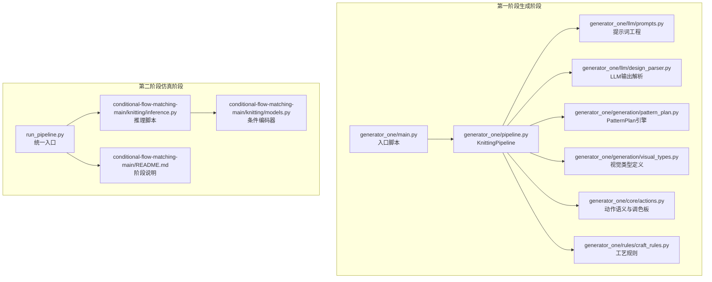
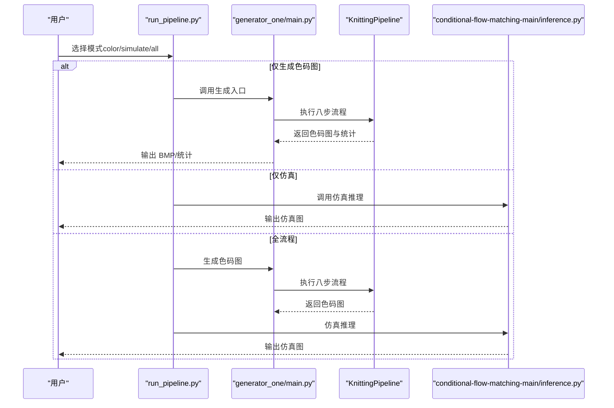
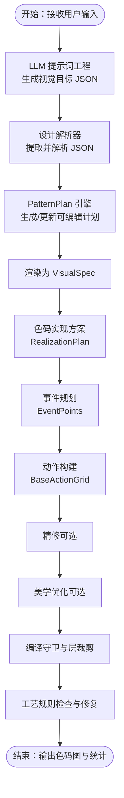
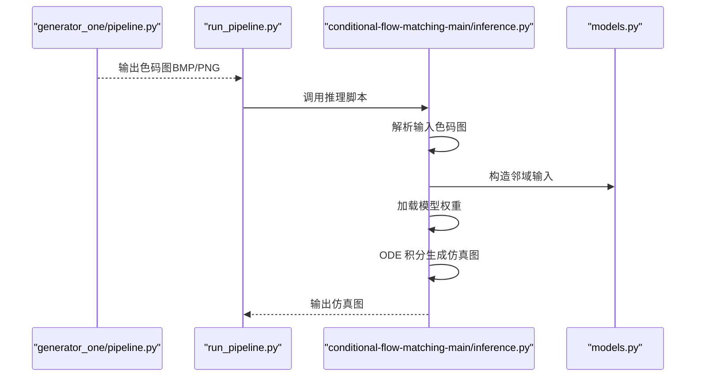
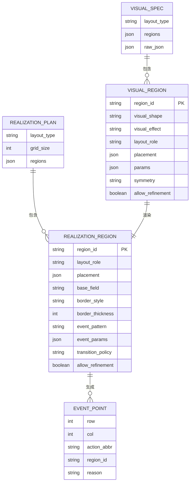
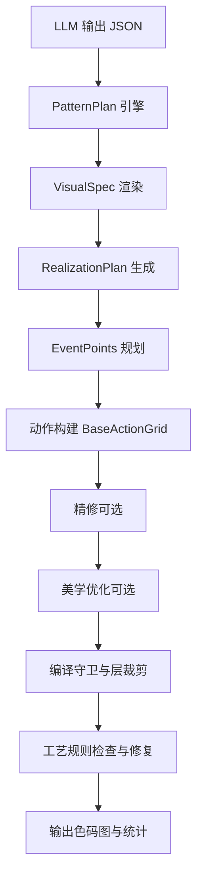
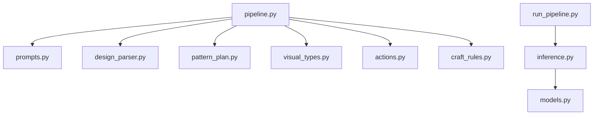

# 技术架构

<cite>
**本文档引用的文件**
- [main.py](file://generator_one/main.py)
- [pipeline.py](file://generator_one/pipeline.py)
- [config.py](file://generator_one/config.py)
- [pattern_plan.py](file://generator_one/generation/pattern_plan.py)
- [design_parser.py](file://generator_one/llm/design_parser.py)
- [prompts.py](file://generator_one/llm/prompts.py)
- [visual_types.py](file://generator_one/generation/visual_types.py)
- [actions.py](file://generator_one/core/actions.py)
- [craft_rules.py](file://generator_one/rules/craft_rules.py)
- [run_pipeline.py](file://run_pipeline.py)
- [README.md](file://conditional-flow-matching-main/README.md)
- [inference.py](file://conditional-flow-matching-main/knitting/inference.py)
- [models.py](file://conditional-flow-matching-main/knitting/models.py)
- [logger.py](file://generator_one/utils/logger.py)
</cite>

## 目录
1. [简介](#简介)
2. [项目结构](#项目结构)
3. [核心组件](#核心组件)
4. [架构总览](#架构总览)
5. [详细组件分析](#详细组件分析)
6. [依赖关系分析](#依赖关系分析)
7. [性能考虑](#性能考虑)
8. [故障排查指南](#故障排查指南)
9. [结论](#结论)

## 简介
本项目是一个基于 LLM 的针织图案生成系统，采用“文本描述 → 色码图 → 仿真图”的两级流水线架构。系统分为两大阶段：
- 第一阶段（LLM解析、图案规划、动作构建）：将自然语言描述转化为可执行的色码图（40×40 动作网格），并进行精修、美学优化与规则校验。
- 第二阶段（条件流匹配、仿真生成）：将色码图作为条件输入，通过条件流匹配模型生成仿真图像，支持多阶段（Stage 1–4）逐步提升结构一致性与细节质量。

系统通过统一入口脚本协调两阶段工作流，提供灵活的参数控制与中间结果保存能力，便于调试与迭代。

## 项目结构
项目采用模块化分层设计，主要目录与职责如下：
- generator_one：核心生成管线与规则引擎
  - llm：提示词工程与 LLM 交互
  - generation：视觉目标到色码图的实现层
  - rules：物理与工艺规则检查与修复
  - core：动作语义与调色板
  - utils：日志与文件 IO
  - outputs：中间结果与最终产物
- conditional-flow-matching-main：条件流匹配仿真阶段
  - knitting：推理脚本与模型封装
  - data：数据预处理与适配
  - configs/checkpoints：训练配置与权重
- run_pipeline.py：统一入口脚本，协调两阶段执行

**图表来源**
- [main.py:13-207](file://generator_one/main.py#L13-L207)
- [pipeline.py:93-189](file://generator_one/pipeline.py#L93-L189)
- [prompts.py:494-654](file://generator_one/llm/prompts.py#L494-L654)
- [design_parser.py:24-415](file://generator_one/llm/design_parser.py#L24-L415)
- [pattern_plan.py:175-370](file://generator_one/generation/pattern_plan.py#L175-L370)
- [visual_types.py:106-196](file://generator_one/generation/visual_types.py#L106-L196)
- [actions.py:18-338](file://generator_one/core/actions.py#L18-L338)
- [craft_rules.py:34-414](file://generator_one/rules/craft_rules.py#L34-L414)
- [run_pipeline.py:1-279](file://run_pipeline.py#L1-L279)
- [inference.py:615-720](file://conditional-flow-matching-main/knitting/inference.py#L615-L720)
- [models.py:10-119](file://conditional-flow-matching-main/knitting/models.py#L10-L119)
- [README.md:1-47](file://conditional-flow-matching-main/README.md#L1-L47)

**章节来源**
- [main.py:13-207](file://generator_one/main.py#L13-L207)
- [run_pipeline.py:1-279](file://run_pipeline.py#L1-L279)

## 核心组件
- KnittingPipeline：端到端生成管线，串联八步处理流程，负责数据流转与控制流调度。
- PatternPlan 与 PatternPlanEngine：可编辑的图案计划层，支持增量修改与启发式修复。
- VisualSpec 与 RealizationPlan：视觉目标与色码实现方案的数据结构。
- LLM 提示词与解析器：将自然语言转换为结构化 JSON，支持多轮对话与错误恢复。
- 动作语义与调色板：统一的动作属性与颜色映射，确保生成与导出一致性。
- 工艺规则引擎：检查与修复动作网格中的工艺违规，保障可织性。
- 条件流匹配推理：将色码图作为条件输入，生成仿真图像，支持多阶段模型。

**章节来源**
- [pipeline.py:93-189](file://generator_one/pipeline.py#L93-L189)
- [pattern_plan.py:175-370](file://generator_one/generation/pattern_plan.py#L175-L370)
- [visual_types.py:106-196](file://generator_one/generation/visual_types.py#L106-L196)
- [prompts.py:494-654](file://generator_one/llm/prompts.py#L494-L654)
- [design_parser.py:24-415](file://generator_one/llm/design_parser.py#L24-L415)
- [actions.py:18-338](file://generator_one/core/actions.py#L18-L338)
- [craft_rules.py:34-414](file://generator_one/rules/craft_rules.py#L34-L414)
- [inference.py:615-720](file://conditional-flow-matching-main/knitting/inference.py#L615-L720)

## 架构总览
系统采用“文本 → 视觉目标 → 色码图 → 仿真图”的两级架构，统一入口脚本负责两阶段的协调与参数传递。

**图表来源**
- [run_pipeline.py:250-279](file://run_pipeline.py#L250-L279)
- [main.py:117-207](file://generator_one/main.py#L117-L207)
- [pipeline.py:114-189](file://generator_one/pipeline.py#L114-L189)
- [inference.py:615-720](file://conditional-flow-matching-main/knitting/inference.py#L615-L720)

## 详细组件分析

### 第一阶段：LLM解析、图案规划、动作构建
- LLM 提示词工程：定义系统提示词与示例，确保输出符合视觉目标 JSON 结构。
- 设计解析器：从 LLM 输出中提取并解析 JSON，兼容旧 schema，提供降级策略。
- 图案计划引擎：将自然语言转换为可编辑的 PatternPlan，支持增量修改与启发式修复。
- 视觉目标与色码实现：定义 VisualSpec 与 RealizationPlan，明确布局角色与事件模式。
- 动作语义与调色板：统一动作属性与颜色映射，保证生成与导出一致性。
- 工艺规则检查：在动作网格上检查与修复工艺违规，保障可织性。

**图表来源**
- [prompts.py:494-654](file://generator_one/llm/prompts.py#L494-L654)
- [design_parser.py:24-415](file://generator_one/llm/design_parser.py#L24-L415)
- [pattern_plan.py:175-370](file://generator_one/generation/pattern_plan.py#L175-L370)
- [visual_types.py:106-196](file://generator_one/generation/visual_types.py#L106-L196)
- [pipeline.py:195-270](file://generator_one/pipeline.py#L195-L270)
- [craft_rules.py:34-414](file://generator_one/rules/craft_rules.py#L34-L414)

**章节来源**
- [prompts.py:494-654](file://generator_one/llm/prompts.py#L494-L654)
- [design_parser.py:24-415](file://generator_one/llm/design_parser.py#L24-L415)
- [pattern_plan.py:175-370](file://generator_one/generation/pattern_plan.py#L175-L370)
- [visual_types.py:106-196](file://generator_one/generation/visual_types.py#L106-L196)
- [pipeline.py:195-270](file://generator_one/pipeline.py#L195-L270)
- [craft_rules.py:34-414](file://generator_one/rules/craft_rules.py#L34-L414)

### 第二阶段：条件流匹配、仿真生成
- 推理脚本：支持 Stage 1–4，加载对应模型与权重，构造邻域输入，执行 ODE 积分生成仿真图。
- 条件编码器：基于邻居感知的条件编码，融合中心与邻居信息，输出结构化的条件向量。
- 统一入口：run_pipeline.py 将第一阶段输出的色码图作为条件输入，驱动第二阶段推理。

**图表来源**
- [pipeline.py:627-677](file://generator_one/pipeline.py#L627-L677)
- [run_pipeline.py:113-194](file://run_pipeline.py#L113-L194)
- [inference.py:459-487](file://conditional-flow-matching-main/knitting/inference.py#L459-L487)
- [models.py:61-119](file://conditional-flow-matching-main/knitting/models.py#L61-L119)

**章节来源**
- [inference.py:615-720](file://conditional-flow-matching-main/knitting/inference.py#L615-L720)
- [models.py:10-119](file://conditional-flow-matching-main/knitting/models.py#L10-L119)
- [run_pipeline.py:113-194](file://run_pipeline.py#L113-L194)

### 数据模型与接口
- VisualSpec/VisualRegion：描述仿真图的视觉目标，包含形状、效果、布局角色与参数。
- RealizationPlan/RealizationRegion：描述如何用色码图实现视觉效果，包含底布、边界样式、事件模式与过渡策略。
- EventPoint：单个工艺事件点，包含行列坐标、动作缩写与区域标识。
- PatternPlan/PatternMotif：可编辑的图案计划，支持增量修改与启发式修复。

**图表来源**
- [visual_types.py:77-196](file://generator_one/generation/visual_types.py#L77-L196)

**章节来源**
- [visual_types.py:77-196](file://generator_one/generation/visual_types.py#L77-L196)

### 控制流程与数据流
- 控制流：KnittingPipeline 按步骤顺序执行，每一步输出中间结果并记录统计信息，支持可选步骤（精修、美学、LLM 修复）。
- 数据流：从 LLM 输出的 JSON 到 PatternPlan，再到 VisualSpec，随后生成 RealizationPlan 与 EventPoints，最终构建 BaseActionGrid 并通过规则检查与修复。

**图表来源**
- [pipeline.py:114-189](file://generator_one/pipeline.py#L114-L189)
- [pattern_plan.py:319-351](file://generator_one/generation/pattern_plan.py#L319-L351)
- [visual_types.py:106-196](file://generator_one/generation/visual_types.py#L106-L196)

**章节来源**
- [pipeline.py:114-189](file://generator_one/pipeline.py#L114-L189)

## 依赖关系分析
- 模块耦合
  - KnittingPipeline 依赖 LLM 提示词、设计解析器、PatternPlan 引擎、视觉类型、动作语义与规则引擎。
  - 推理脚本依赖数据预处理与模型封装，与统一入口脚本通过参数传递耦合。
- 外部依赖
  - LLM 提供者（DeepSeek）与环境变量配置。
  - PyTorch、torchdiffeq 等深度学习与数值积分库。
  - PIL、NumPy 等图像与数组处理库。

**图表来源**
- [pipeline.py:93-113](file://generator_one/pipeline.py#L93-L113)
- [prompts.py:494-654](file://generator_one/llm/prompts.py#L494-L654)
- [design_parser.py:24-415](file://generator_one/llm/design_parser.py#L24-L415)
- [pattern_plan.py:175-370](file://generator_one/generation/pattern_plan.py#L175-L370)
- [visual_types.py:106-196](file://generator_one/generation/visual_types.py#L106-L196)
- [actions.py:18-338](file://generator_one/core/actions.py#L18-L338)
- [craft_rules.py:34-414](file://generator_one/rules/craft_rules.py#L34-L414)
- [run_pipeline.py:1-279](file://run_pipeline.py#L1-L279)
- [inference.py:615-720](file://conditional-flow-matching-main/knitting/inference.py#L615-L720)
- [models.py:10-119](file://conditional-flow-matching-main/knitting/models.py#L10-L119)

**章节来源**
- [pipeline.py:93-113](file://generator_one/pipeline.py#L93-L113)
- [run_pipeline.py:1-279](file://run_pipeline.py#L1-L279)

## 性能考虑
- 推理阶段
  - 多候选导出：支持批量生成多个种子候选，便于人工筛选。
  - 噪声模式：支持独立噪声、全局相关噪声与区域相关噪声，影响生成稳定性与多样性。
  - ODE 求解器：可选择 Euler、Midpoint、RK4，影响收敛速度与质量。
- 生成阶段
  - 可选步骤：精修、美学、LLM 修复可按需关闭，减少计算开销。
  - 编译守卫与层裁剪：在动作网格层面进行上下文清理与层边界裁剪，降低无效操作。
- 资源管理
  - 设备自动检测：CUDA 可用时优先使用 GPU，否则回退 CPU。
  - 日志与中间结果：可选择保存中间文件，便于调试但占用磁盘空间。

[本节为通用指导，不直接分析具体文件]

## 故障排查指南
- LLM 输出解析失败
  - 现象：无法解析 JSON，使用默认 VisualSpec。
  - 处理：检查提示词格式与示例，确保输出严格遵循 JSON Schema。
- 工艺规则违规
  - 现象：动作网格存在 C1–C6 违规，修复后仍有硬性违规。
  - 处理：启用自动修复或使用 LLM 修复代理，查看违规详情与修复建议。
- 推理阶段异常
  - 现象：CUDA 不可用或权重加载失败。
  - 处理：确认设备设置与权重路径，检查 checkpoint 文件完整性。
- 色码图与仿真图不一致
  - 现象：仿真图与预期视觉目标不符。
  - 处理：调整提示词示例与参数，或提高仿真阶段（Stage 4）权重。

**章节来源**
- [design_parser.py:29-44](file://generator_one/llm/design_parser.py#L29-L44)
- [craft_rules.py:34-166](file://generator_one/rules/craft_rules.py#L34-L166)
- [inference.py:69-117](file://conditional-flow-matching-main/knitting/inference.py#L69-L117)
- [run_pipeline.py:140-194](file://run_pipeline.py#L140-L194)

## 结论
本系统通过清晰的两级架构实现了从自然语言到仿真图像的自动化生成。第一阶段专注于语义理解与动作网格生成，第二阶段专注于结构一致性与细节还原。模块化设计与可选步骤使得系统具备良好的可扩展性与可维护性，统一入口脚本进一步简化了使用与集成。未来可在以下方面持续优化：
- 提示词与示例的动态扩展，提升对复杂图案的表达能力。
- 推理阶段的超参数搜索与自动化调参。
- 更丰富的动作语义与规则覆盖，增强可织性与质量。