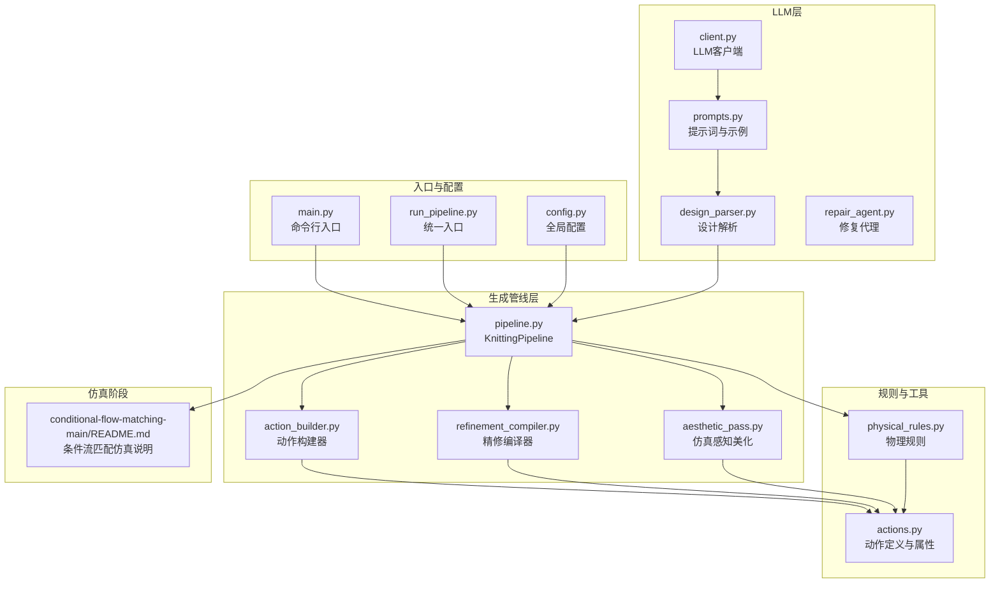
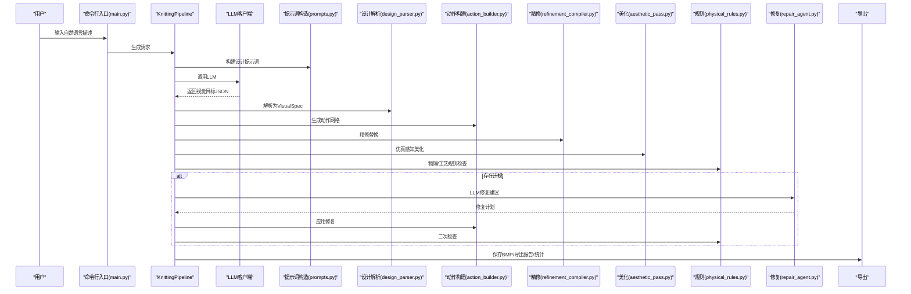
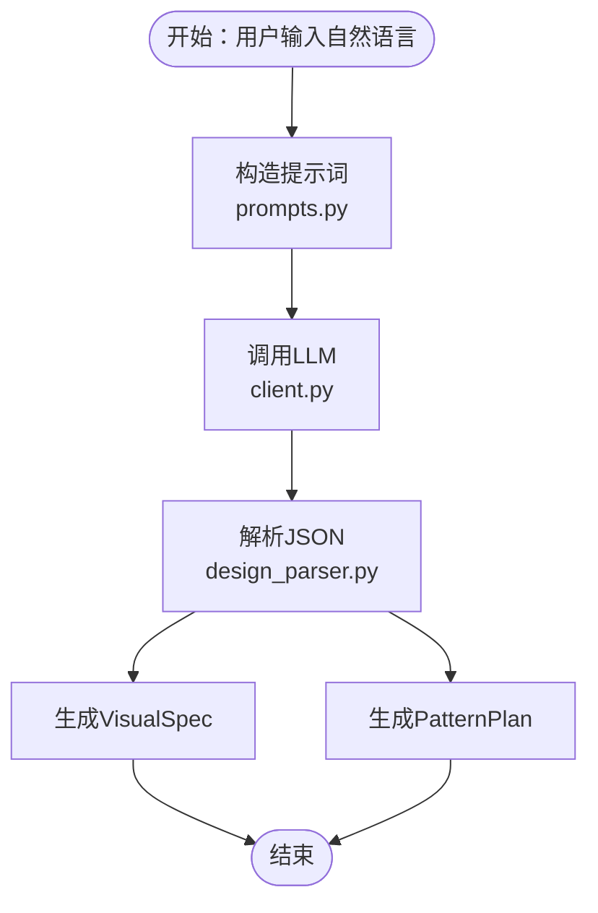
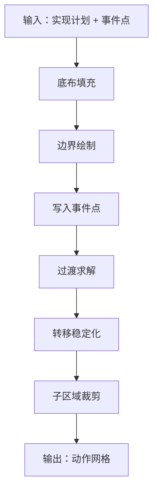
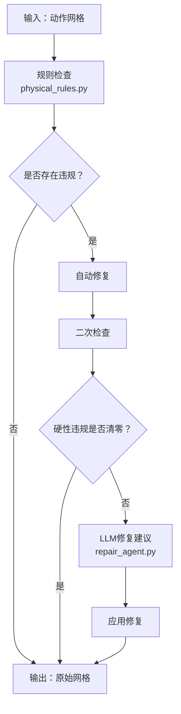
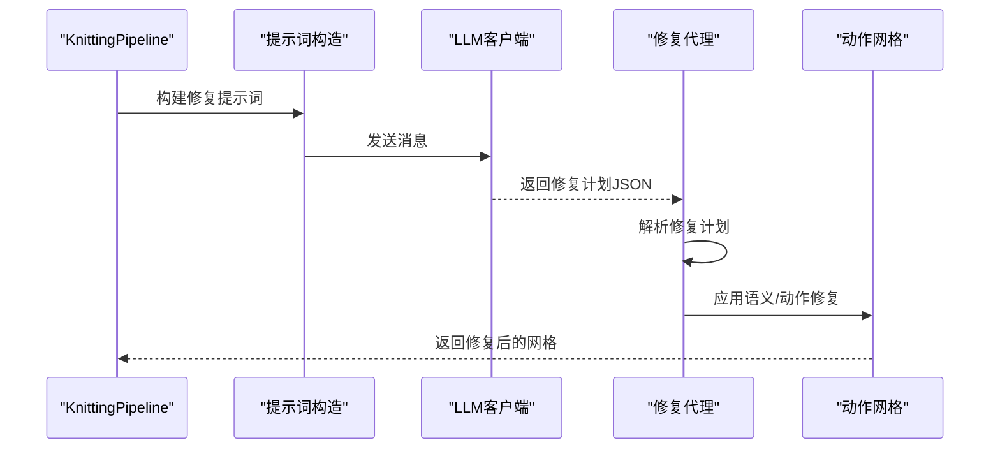
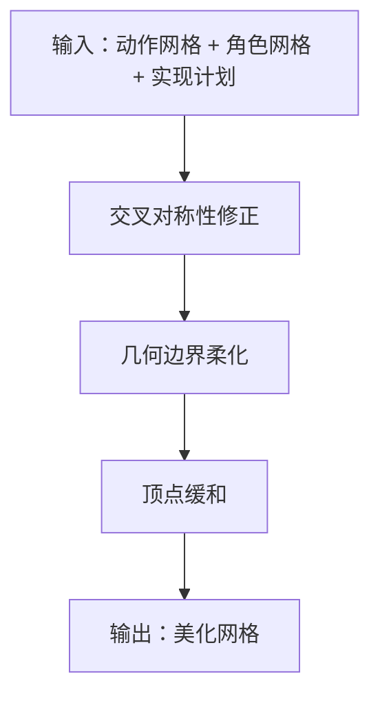
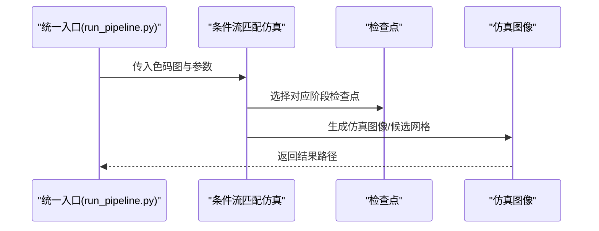
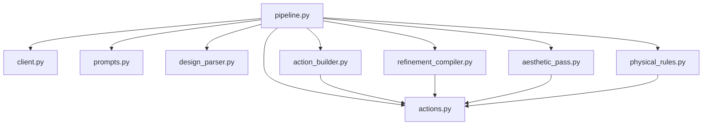

# 核心功能

<cite>
**本文引用的文件**
- [main.py](file://generator_one/main.py)
- [pipeline.py](file://generator_one/pipeline.py)
- [config.py](file://generator_one/config.py)
- [run_pipeline.py](file://run_pipeline.py)
- [client.py](file://generator_one/llm/client.py)
- [prompts.py](file://generator_one/llm/prompts.py)
- [design_parser.py](file://generator_one/llm/design_parser.py)
- [repair_agent.py](file://generator_one/llm/repair_agent.py)
- [action_builder.py](file://generator_one/generation/action_builder.py)
- [refinement_compiler.py](file://generator_one/generation/refinement_compiler.py)
- [aesthetic_pass.py](file://generator_one/generation/aesthetic_pass.py)
- [physical_rules.py](file://generator_one/rules/physical_rules.py)
- [actions.py](file://generator_one/core/actions.py)
- [README.md](file://conditional-flow-matching-main/README.md)
</cite>

## 目录
1. [简介](#简介)
2. [项目结构](#项目结构)
3. [核心组件](#核心组件)
4. [架构总览](#架构总览)
5. [详细组件分析](#详细组件分析)
6. [依赖分析](#依赖分析)
7. [性能考虑](#性能考虑)
8. [故障排查指南](#故障排查指南)
9. [结论](#结论)
10. [附录](#附录)

## 简介
本系统是一个以LLM驱动为核心的针织图案生成与仿真系统，具备以下核心能力：
- LLM驱动的智能设计：将自然语言描述转化为可执行的视觉目标与可编辑的图案计划。
- 图案到动作网格的转换：将视觉目标与实现计划转换为40×40的动作网格，再进一步编译为机器可读的导出报告。
- 物理约束验证与自动修复：在生成过程中进行硬性物理规则与工艺规则检查，并在必要时自动修复或引导LLM修复。
- 智能修复系统：基于规则违反报告，提出最小化修复方案，支持语义级与动作级修复。
- 条件流匹配仿真：将色码图映射为仿真图像，支持多阶段模型与候选评估。

系统强调自动化与智能化，通过LLM、规则引擎与后处理优化，显著降低人工干预，提升生成质量与一致性。

## 项目结构
系统采用模块化分层设计，主要分为三层：
- LLM层：负责自然语言理解、提示词构造与修复建议生成。
- 生成管线层：负责从视觉目标到动作网格的完整编译流程。
- 规则与后处理层：负责物理/工艺规则校验、修复与仿真前的美化。

**图表来源**
- [main.py](file://generator_one/main.py)
- [run_pipeline.py](file://run_pipeline.py)
- [config.py](file://generator_one/config.py)
- [client.py](file://generator_one/llm/client.py)
- [prompts.py](file://generator_one/llm/prompts.py)
- [design_parser.py](file://generator_one/llm/design_parser.py)
- [repair_agent.py](file://generator_one/llm/repair_agent.py)
- [pipeline.py](file://generator_one/pipeline.py)
- [action_builder.py](file://generator_one/generation/action_builder.py)
- [refinement_compiler.py](file://generator_one/generation/refinement_compiler.py)
- [aesthetic_pass.py](file://generator_one/generation/aesthetic_pass.py)
- [physical_rules.py](file://generator_one/rules/physical_rules.py)
- [actions.py](file://generator_one/core/actions.py)
- [README.md](file://conditional-flow-matching-main/README.md)

**章节来源**
- [main.py](file://generator_one/main.py)
- [run_pipeline.py](file://run_pipeline.py)
- [config.py](file://generator_one/config.py)

## 核心组件
- LLM客户端与提示词工程：负责与DeepSeek等LLM交互，构造设计与修复提示词，解析结构化输出。
- 设计解析器：将LLM输出的视觉目标规范化为内部数据结构，兼容历史schema。
- 生成管线KnittingPipeline：串联设计、实现、事件规划、动作构建、精修、美化、规则校验、LLM修复与导出。
- 动作构建器：根据实现计划与事件点生成40×40动作网格，处理边界与过渡。
- 精修编译器：在受控区域内进行稀疏替换，提升细节与张力平衡。
- 仿真感知美化：在不改变逻辑的前提下进行边界与对称性微调，提升仿真视觉质量。
- 物理规则与修复：提供硬性规则检查与自动修复策略，保障可织性。
- 动作定义与导出：统一管理动作属性、颜色与机器导出映射。

**章节来源**
- [client.py](file://generator_one/llm/client.py)
- [prompts.py](file://generator_one/llm/prompts.py)
- [design_parser.py](file://generator_one/llm/design_parser.py)
- [pipeline.py](file://generator_one/pipeline.py)
- [action_builder.py](file://generator_one/generation/action_builder.py)
- [refinement_compiler.py](file://generator_one/generation/refinement_compiler.py)
- [aesthetic_pass.py](file://generator_one/generation/aesthetic_pass.py)
- [physical_rules.py](file://generator_one/rules/physical_rules.py)
- [actions.py](file://generator_one/core/actions.py)

## 架构总览
系统整体工作流如下：

**图表来源**
- [main.py](file://generator_one/main.py)
- [pipeline.py](file://generator_one/pipeline.py)
- [prompts.py](file://generator_one/llm/prompts.py)
- [design_parser.py](file://generator_one/llm/design_parser.py)
- [action_builder.py](file://generator_one/generation/action_builder.py)
- [refinement_compiler.py](file://generator_one/generation/refinement_compiler.py)
- [aesthetic_pass.py](file://generator_one/generation/aesthetic_pass.py)
- [physical_rules.py](file://generator_one/rules/physical_rules.py)
- [repair_agent.py](file://generator_one/llm/repair_agent.py)

## 详细组件分析

### LLM驱动的智能设计
- 功能概述
  - 将自然语言描述转换为可执行的视觉目标（VisualSpec）与可编辑的图案计划（PatternPlan）。
  - 通过few-shot示例与系统提示词，引导LLM输出符合规范的JSON。
- 输入输出
  - 输入：自然语言描述（中文/英文）。
  - 输出：VisualSpec（布局类型、区域、参数等）与PatternPlan（可编辑的结构化计划）。
- 工作机制
  - 提示词构造：根据用户输入选择合适示例，拼接系统提示词与few-shot样例。
  - LLM调用：使用OpenAI兼容接口，支持重试与延迟记录。
  - 解析与降级：提取JSON、修复常见格式问题、兼容旧schema。
- 使用场景
  - 快速生成复杂布局（满地重复、中心主花、带边框、两侧边带等）。
  - 增量修改：基于已有PatternPlan进行小幅调整。
- 最佳实践
  - 描述尽量具体，明确形状、效果与布局角色。
  - 使用few-shot示例中的关键词（如麻花、波浪、网眼、罗纹、蜂巢等）提高成功率。
  - 如需微调，使用“更大/更小/更密/更疏/加一点镂空/往上移”等表述。

**图表来源**
- [prompts.py](file://generator_one/llm/prompts.py)
- [client.py](file://generator_one/llm/client.py)
- [design_parser.py](file://generator_one/llm/design_parser.py)

**章节来源**
- [prompts.py](file://generator_one/llm/prompts.py)
- [client.py](file://generator_one/llm/client.py)
- [design_parser.py](file://generator_one/llm/design_parser.py)

### 图案到动作网格的转换
- 功能概述
  - 将VisualSpec与实现计划转换为40×40的动作网格，随后进行过渡求解、转移稳定化与子区域裁剪。
- 输入输出
  - 输入：RealizationPlan（实现计划）、EventPoint（事件点列表）。
  - 输出：动作网格（40×40，uint8索引）。
- 工作机制
  - 底布填充：按区域布局角色与形状填充基础织组织。
  - 边界绘制：根据边界样式与厚度生成边界。
  - 事件点写入：在指定位置写入动作，记录事件计数。
  - 过渡求解：对局部过渡区域进行求解，保证床与语义切换平滑。
  - 转移稳定化：清理越界/冲突的移针，平衡左右移针数量。
  - 子区域裁剪：剔除父层外的子层特殊动作，避免结构溢出。
- 使用场景
  - 生成中心主花、满地重复、带边框与两侧边带等复杂布局。
  - 为仿真与规则检查提供高质量动作网格。
- 最佳实践
  - 合理设置区域边界厚度与形状，避免边界断裂。
  - 控制事件点密度，避免过渡区域过度拥挤。

**图表来源**
- [action_builder.py](file://generator_one/generation/action_builder.py)

**章节来源**
- [action_builder.py](file://generator_one/generation/action_builder.py)

### 物理约束验证与自动修复
- 功能概述
  - 在生成完成后进行硬性物理规则与工艺规则检查，必要时自动修复或引导LLM修复。
- 输入输出
  - 输入：动作网格。
  - 输出：违规报告（硬性/工艺）、修复后的网格。
- 工作机制
  - 硬性规则（H1-H8）：非法索引、支撑缺失、移针偏移/越界/冲突、垂直堆叠限制、Drop上方未清空、双向床间移针等。
  - 自动修复：针对可判定的违规进行保守修复（如替换为安全动作）。
  - LLM修复：当存在违规时，基于违规报告与统计摘要，让LLM提出最小修复方案。
- 使用场景
  - 确保生成图案可织、可仿真、可导出。
  - 在规则检查后自动修复或引导人工确认。
- 最佳实践
  - 启用自动修复以减少硬性违规。
  - 对于复杂结构，适当放宽某些阈值或手动微调。

**图表来源**
- [physical_rules.py](file://generator_one/rules/physical_rules.py)
- [repair_agent.py](file://generator_one/llm/repair_agent.py)

**章节来源**
- [physical_rules.py](file://generator_one/rules/physical_rules.py)
- [repair_agent.py](file://generator_one/llm/repair_agent.py)

### 智能修复系统
- 功能概述
  - 基于规则违反报告，提出最小修复方案，支持语义级与动作级修复。
- 输入输出
  - 输入：用户输入、违规报告、统计摘要。
  - 输出：修复计划（语义编辑与动作编辑）。
- 工作机制
  - 提示词构造：将违规详情与统计摘要拼装为修复提示词。
  - LLM调用：获取最小修复JSON。
  - 解析与应用：解析修复计划，应用语义或动作级修改。
- 使用场景
  - 当规则检查发现硬性或工艺违规时，快速定位并修复。
  - 与自动修复配合，形成“自动修复+LLM修复”的双重保障。
- 最佳实践
  - 修复前后分别进行规则检查，确保闭环。
  - 对修复次数进行限制，避免过度迭代。

**图表来源**
- [repair_agent.py](file://generator_one/llm/repair_agent.py)
- [prompts.py](file://generator_one/llm/prompts.py)
- [client.py](file://generator_one/llm/client.py)

**章节来源**
- [repair_agent.py](file://generator_one/llm/repair_agent.py)
- [prompts.py](file://generator_one/llm/prompts.py)
- [client.py](file://generator_one/llm/client.py)

### 仿真感知美化
- 功能概述
  - 在最终输出前进行轻量级结构美化，提升仿真视觉质量而不改变图案逻辑。
- 输入输出
  - 输入：动作网格、区域角色网格、实现计划。
  - 输出：美化后的动作网格。
- 工作机制
  - 交叉对称性修正：确保每行左右移针数量平衡。
  - 几何边界柔化：对矩形/圆形/多边形等几何掩码的边缘进行微调，减少颗粒感与锯齿。
  - 顶点缓和：对尖角区域的孤立特殊动作进行回退。
- 使用场景
  - 提升仿真图像的连续性与观感。
  - 在规则检查前进行美化，避免破坏结构完整性。
- 最佳实践
  - 与区域角色网格配合，精准识别边界与过渡区域。
  - 合理设置平滑阈值与顶点阈值，避免误删骨架。

**图表来源**
- [aesthetic_pass.py](file://generator_one/generation/aesthetic_pass.py)

**章节来源**
- [aesthetic_pass.py](file://generator_one/generation/aesthetic_pass.py)

### 条件流匹配仿真
- 功能概述
  - 将色码图映射为仿真图像，支持多阶段模型与候选评估。
- 输入输出
  - 输入：色码图（BMP/PNG）。
  - 输出：仿真图像（PNG）与候选网格（可选）。
- 工作机制
  - 支持Stage 1-4模型，逐步引入邻域条件、物理特征与结构损失。
  - 可设置噪声模式、求解器、步数与候选数量。
- 使用场景
  - 验证生成图案的仿真一致性与视觉效果。
  - 多候选对比与筛选。
- 最佳实践
  - 使用统一入口脚本，自动选择合适检查点与设备。
  - 根据GPU可用性自动选择CUDA或CPU。

**图表来源**
- [run_pipeline.py](file://run_pipeline.py)
- [README.md](file://conditional-flow-matching-main/README.md)

**章节来源**
- [run_pipeline.py](file://run_pipeline.py)
- [README.md](file://conditional-flow-matching-main/README.md)

## 依赖分析
- 组件耦合
  - KnittingPipeline聚合了LLM、提示词、解析器、动作构建器、精修编译器、美化与规则模块，形成高内聚的生成流水线。
  - 动作定义actions.py作为单一数据源，被所有模块共享，降低耦合度。
- 外部依赖
  - LLM客户端依赖OpenAI兼容接口，支持重试与超时控制。
  - 仿真阶段依赖条件流匹配实现与检查点文件。
- 循环依赖
  - 未发现循环导入；模块间通过清晰的接口传递数据。

**图表来源**
- [pipeline.py](file://generator_one/pipeline.py)
- [client.py](file://generator_one/llm/client.py)
- [prompts.py](file://generator_one/llm/prompts.py)
- [design_parser.py](file://generator_one/llm/design_parser.py)
- [action_builder.py](file://generator_one/generation/action_builder.py)
- [refinement_compiler.py](file://generator_one/generation/refinement_compiler.py)
- [aesthetic_pass.py](file://generator_one/generation/aesthetic_pass.py)
- [physical_rules.py](file://generator_one/rules/physical_rules.py)
- [actions.py](file://generator_one/core/actions.py)

**章节来源**
- [pipeline.py](file://generator_one/pipeline.py)
- [actions.py](file://generator_one/core/actions.py)

## 性能考虑
- LLM调用成本
  - 通过few-shot示例与系统提示词减少上下文长度，提高响应稳定性。
  - 合理设置温度与最大token，平衡结构化输出与性能。
- 网格计算
  - 动作构建与过渡求解为O(HW)，在40×40规模下可快速完成。
  - 精修编译器采用稀疏策略，限制替换预算，避免过度修改。
- 规则检查
  - 物理规则扫描为O(HW)，可通过分阶段检查与早期退出优化。
- 仿真阶段
  - 仿真图像生成受设备与候选数量影响，建议在GPU可用时启用CUDA。

## 故障排查指南
- LLM调用失败
  - 现象：LLM返回错误或超时。
  - 处理：检查API Key与网络连接；查看日志中的重试信息；必要时增加重试次数或调整超时。
- JSON解析失败
  - 现象：LLM输出非标准JSON。
  - 处理：使用解析器内置的修复函数；确保few-shot示例与系统提示词一致。
- 违规过多导致修复无效
  - 现象：多次LLM修复后仍存在硬性违规。
  - 处理：检查自动修复策略；适当放宽某些阈值；手动微调关键区域。
- 仿真图像异常
  - 现象：仿真图像出现明显伪影或结构断裂。
  - 处理：检查色码图边界是否留白；确认仿真参数（噪声模式、求解器、候选数量）设置合理。

**章节来源**
- [client.py](file://generator_one/llm/client.py)
- [design_parser.py](file://generator_one/llm/design_parser.py)
- [repair_agent.py](file://generator_one/llm/repair_agent.py)
- [physical_rules.py](file://generator_one/rules/physical_rules.py)

## 结论
本系统通过LLM驱动的设计、严谨的生成管线与规则约束，实现了从自然语言到可织色码图再到仿真图像的全链路自动化。其智能化体现在：
- 设计阶段：以few-shot与系统提示词引导LLM生成高质量视觉目标。
- 生成阶段：动作构建、过渡求解、精修与美化协同，确保结构完整性与视觉质量。
- 验证阶段：物理/工艺规则检查与自动/LLM修复形成闭环，保障可织性。
- 仿真阶段：多阶段条件流匹配仿真，直观验证生成效果。

通过模块化设计与清晰的数据流，系统具备良好的扩展性与可维护性，适合进一步集成更多纹理类型与仿真模型。

## 附录
- 使用示例
  - 生成中心麻花菱形：python main.py generate "中心麻花菱形"
  - 随机生成：python main.py random "随机生成一个针织图案"
  - 禁用精修/美学/LLM修复：添加相应开关参数
  - 统一入口：python run_pipeline.py all "整幅波浪吊目纹理" --stage 4
- 最佳实践
  - 在描述中明确形状、效果与布局角色，使用关键词提升LLM理解精度。
  - 合理设置few-shot示例数量与提示词模板，减少歧义。
  - 生成后及时进行规则检查与修复，必要时进行仿真验证。