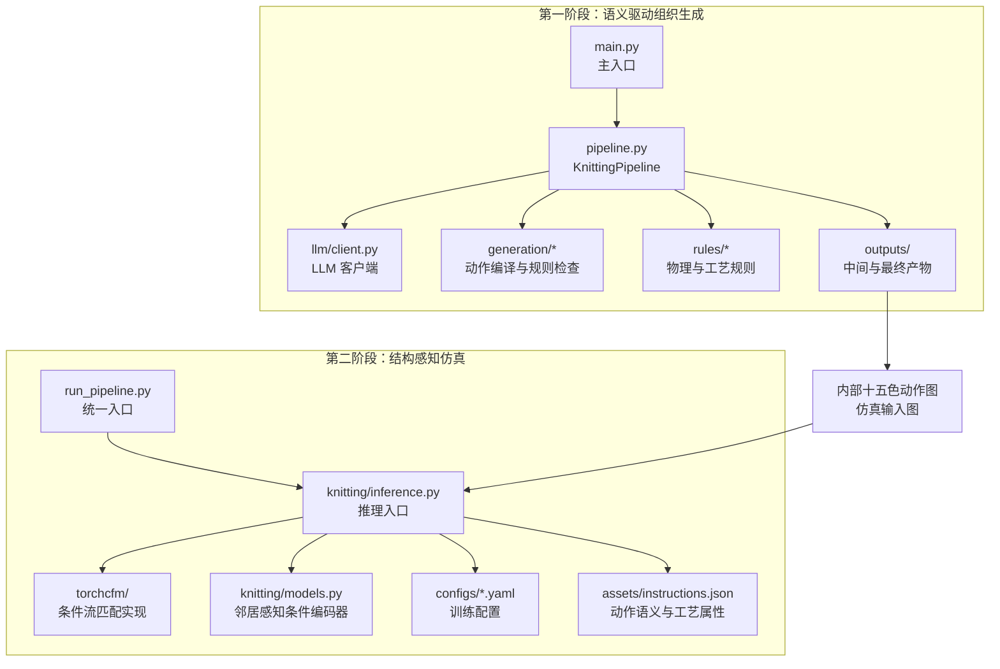
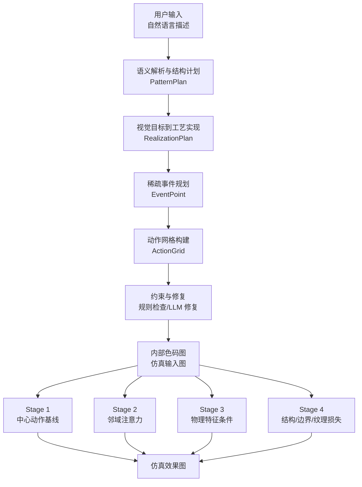
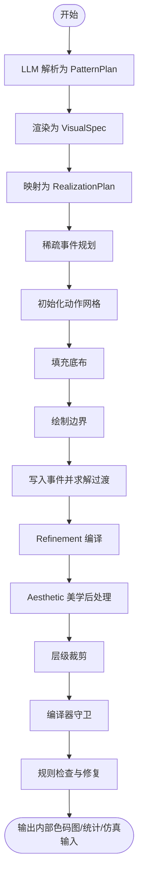
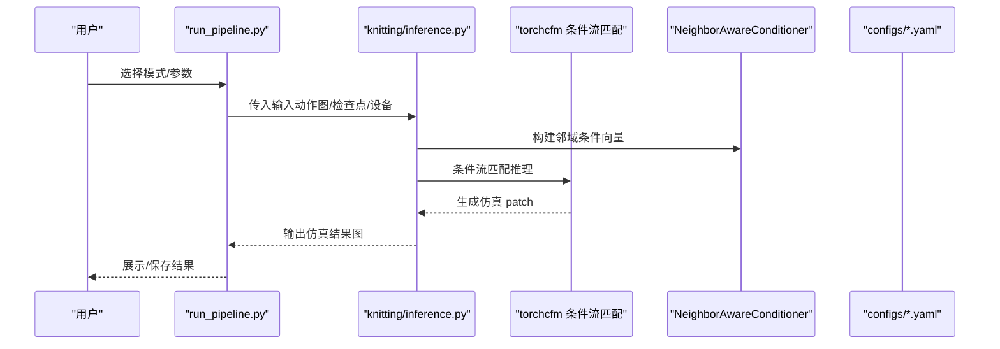
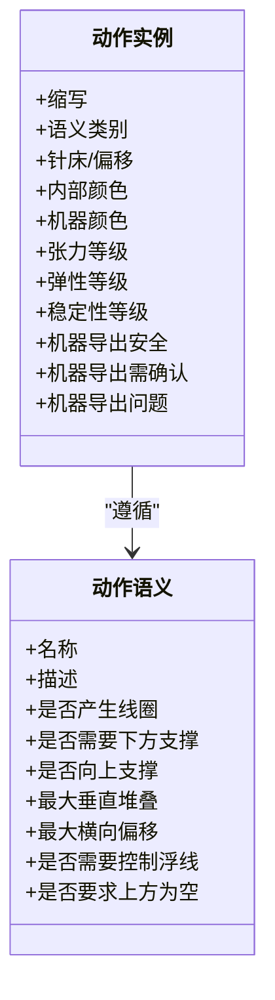
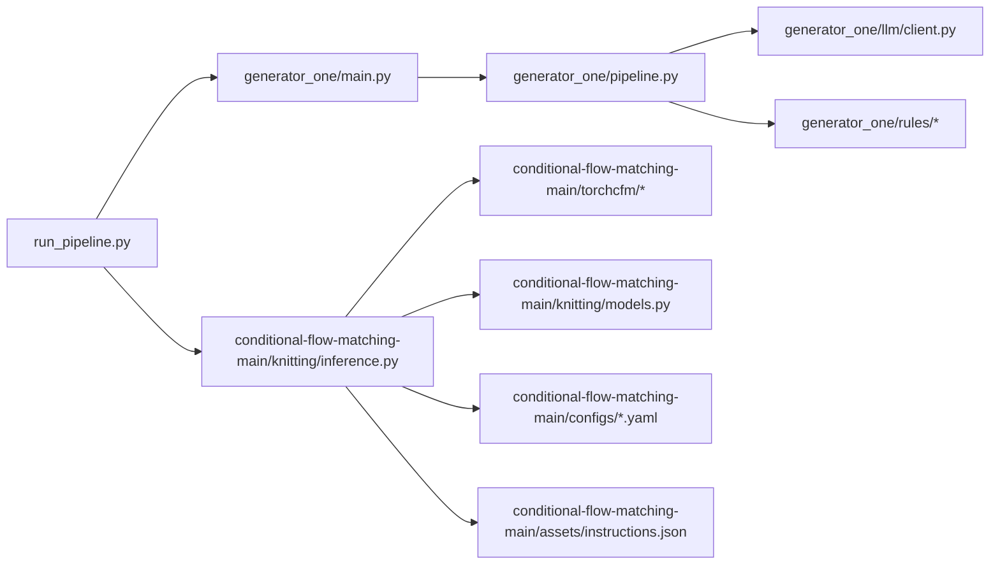

# 系统介绍

<cite>
**本文档引用的文件**
- [README.md](file://conditional-flow-matching-main/README.md)
- [run_pipeline.py](file://run_pipeline.py)
- [main.py](file://generator_one/main.py)
- [pipeline.py](file://generator_one/pipeline.py)
- [client.py](file://generator_one/llm/client.py)
- [models.py](file://conditional-flow-matching-main/knitting/models.py)
- [stage1.yaml](file://conditional-flow-matching-main/configs/stage1.yaml)
- [stage2.yaml](file://conditional-flow-matching-main/configs/stage2.yaml)
- [stage3.yaml](file://conditional-flow-matching-main/configs/stage3.yaml)
- [stage4.yaml](file://conditional-flow-matching-main/configs/stage4.yaml)
- [instructions.json](file://conditional-flow-matching-main/assets/instructions.json)
- [config.py](file://generator_one/config.py)
- [论文初稿.md](file://docs/论文初稿.md)
</cite>

## 目录
1. [引言](#引言)
2. [项目结构](#项目结构)
3. [核心组件](#核心组件)
4. [架构概览](#架构概览)
5. [详细组件分析](#详细组件分析)
6. [依赖分析](#依赖分析)
7. [性能考量](#性能考量)
8. [故障排除指南](#故障排除指南)
9. [结论](#结论)
10. [附录](#附录)

## 引言
本项目面向横机针织制造，提供从自然语言设计描述到组织色码图与结构感知仿真的完整生成链路。系统的核心目标是解决传统针织设计中“从创意到可制造组织”的关键痛点：自然语言与动作语义脱节、缺乏可验证的组织结构、以及缺少结构感知的视觉验证。为此，系统提出“语义驱动组织生成 + 结构感知仿真验证”的双阶段流程，确保输出既符合设计意图，又满足针织工艺约束，并能通过仿真图像直观评估。

系统的核心价值在于：
- 语义到结构的桥梁：将自然语言解析为可编辑的层次化结构计划，再编译为十五色动作网格，保证生成结果具备明确的针织语义与工艺逻辑。
- 约束驱动的生成：在事件规划、动作构建、后处理与输出前检查中嵌入硬性物理约束、工艺软约束、张力评分与成组组织完整性检查，实现“合法+稳定”的组织生成。
- 结构感知仿真：以内部十五色动作图为条件，结合中心动作、邻域动作与物理特征，生成高质量针织效果图，提供边界连续性、纹理方向与区域层级的可视化验证。

## 项目结构
项目由两条主线构成：
- 第一阶段（generator_one）：语义驱动组织生成，输出内部十五色动作图与仿真输入图。
- 第二阶段（conditional-flow-matching-main）：结构感知仿真，将动作图转换为针织效果图。

**图表来源**
- [main.py:117-206](file://generator_one/main.py#L117-L206)
- [pipeline.py:93-189](file://generator_one/pipeline.py#L93-L189)
- [run_pipeline.py:250-278](file://run_pipeline.py#L250-L278)
- [models.py:10-119](file://conditional-flow-matching-main/knitting/models.py#L10-L119)

**章节来源**
- [README.md:1-47](file://conditional-flow-matching-main/README.md#L1-L47)
- [论文初稿.md:1-101](file://docs/论文初稿.md#L1-L101)

## 核心组件
- 统一入口与工作流编排：run_pipeline.py 提供 color、simulate、all 三种模式，串联第一阶段与第二阶段，支持设备选择、候选采样、噪声模式与求解器配置。
- 第一阶段生成管线：KnittingPipeline 将自然语言解析为 PatternPlan，再编译为动作网格，贯穿 refinement、aesthetic、compiler guard、规则检查与 LLM 修复，最终输出内部色码图与统计报告。
- LLM 客户端：封装 OpenAI 兼容接口，负责与 DeepSeek 等模型交互，提供结构化输出与重试机制。
- 第二阶段仿真：基于条件流匹配（Conditional Flow Matching）框架，使用邻居感知条件编码器与多阶段训练配置，生成结构感知的针织效果图。
- 动作语义与工艺属性：instructions.json 定义十五色动作语义、针床属性、张力/弹性/稳定性等级与机器导出映射，为生成与仿真提供统一语义基础。

**章节来源**
- [run_pipeline.py:196-247](file://run_pipeline.py#L196-L247)
- [pipeline.py:93-189](file://generator_one/pipeline.py#L93-L189)
- [client.py:35-161](file://generator_one/llm/client.py#L35-L161)
- [models.py:10-119](file://conditional-flow-matching-main/knitting/models.py#L10-L119)
- [instructions.json:1-352](file://conditional-flow-matching-main/assets/instructions.json#L1-L352)

## 架构概览
系统采用“阶段化、模块化、可验证”的设计思路，第一阶段专注于语义到动作的结构化生成，第二阶段专注于结构感知的视觉验证。两阶段通过内部色码图与仿真输入图衔接，形成闭环。

**图表来源**
- [论文初稿.md:129-141](file://docs/论文初稿.md#L129-L141)
- [README.md:37-42](file://conditional-flow-matching-main/README.md#L37-L42)

## 详细组件分析

### 第一阶段：文本到图案生成
- 流程要点
  - 语义解析：通过 LLM 将自然语言解析为 PatternPlan，包含 motif、effect、role、region、parent 等结构字段。
  - 视觉到工艺：将 PatternPlan 渲染为 VisualSpec，再映射为 RealizationPlan，明确底布、边界、事件模式与参数。
  - 稀疏事件：基于区域 mask 与周期生成稀疏事件点，保证内部纹理不溢出父级区域。
  - 动作网格：填充底布、绘制边界、写入事件并执行局部过渡求解，随后进行 refinement、aesthetic、layer clipping、compiler guard 与规则修复。
  - 输出：内部十五色动作图、仿真输入图、PatternPlan JSON 与统计报告。

**图表来源**
- [pipeline.py:114-189](file://generator_one/pipeline.py#L114-L189)
- [论文初稿.md:145-218](file://docs/论文初稿.md#L145-L218)

**章节来源**
- [main.py:117-206](file://generator_one/main.py#L117-L206)
- [pipeline.py:195-270](file://generator_one/pipeline.py#L195-L270)
- [config.py:45-65](file://generator_one/config.py#L45-L65)

### 第二阶段：条件流匹配仿真生成
- 模块定位：将内部十五色动作图转换为针织效果图，评估边界闭合、纹理连续性与区域层级。
- 条件表示：以中心动作与 3×3 邻域动作及有效性 mask 为条件，结合动作物理特征（张力、弹性、稳定性）编码。
- 条件流匹配：学习从噪声 patch 到目标针织 patch 的速度场，推理阶段通过 ODE 求解器（默认 midpoint）生成目标 patch。
- 阶段演进：Stage 1（中心动作）、Stage 2（邻域注意力）、Stage 3（物理特征）、Stage 4（自适应噪声、边界/结构/纹理复合损失）。

**图表来源**
- [run_pipeline.py:113-193](file://run_pipeline.py#L113-L193)
- [models.py:61-119](file://conditional-flow-matching-main/knitting/models.py#L61-L119)
- [stage1.yaml:1-24](file://conditional-flow-matching-main/configs/stage1.yaml#L1-L24)
- [stage2.yaml:1-24](file://conditional-flow-matching-main/configs/stage2.yaml#L1-L24)
- [stage3.yaml:1-26](file://conditional-flow-matching-main/configs/stage3.yaml#L1-L26)
- [stage4.yaml:1-46](file://conditional-flow-matching-main/configs/stage4.yaml#L1-L46)

**章节来源**
- [README.md:23-46](file://conditional-flow-matching-main/README.md#L23-L46)
- [models.py:10-119](file://conditional-flow-matching-main/knitting/models.py#L10-L119)
- [stage1.yaml:1-24](file://conditional-flow-matching-main/configs/stage1.yaml#L1-L24)
- [stage2.yaml:1-24](file://conditional-flow-matching-main/configs/stage2.yaml#L1-L24)
- [stage3.yaml:1-26](file://conditional-flow-matching-main/configs/stage3.yaml#L1-L26)
- [stage4.yaml:1-46](file://conditional-flow-matching-main/configs/stage4.yaml#L1-L46)

### 动作语义与工艺属性
- 十五色动作空间：涵盖 LOOP（成圈）、TUCK（集圈）、TRANSFER（移针）、SPLIT（劈针）、EMPTY（空针）、DROP（落布）等，每类动作定义语义类别、针床/偏移属性、内部颜色、张力/弹性/稳定性等级与机器导出映射。
- 机器导出报告：系统可输出机器色表映射、安全动作数量、需确认动作与未映射动作统计，辅助打版师确认宏参数与度目。

**图表来源**
- [instructions.json:13-74](file://conditional-flow-matching-main/assets/instructions.json#L13-L74)
- [instructions.json:75-350](file://conditional-flow-matching-main/assets/instructions.json#L75-L350)

**章节来源**
- [instructions.json:1-352](file://conditional-flow-matching-main/assets/instructions.json#L1-L352)

### 统一入口与设备管理
- 设备检测：自动检测 CUDA 可用性，支持 auto/cuda/cpu 三种设备选择。
- 参数传递：统一接收 stage、checkpoint、json_path、device、seed、候选数、噪声模式、求解器等参数，适配不同仿真需求。
- 运行目录：根据输入推断运行目录，支持从现有输出继续仿真。

**章节来源**
- [run_pipeline.py:22-36](file://run_pipeline.py#L22-L36)
- [run_pipeline.py:196-247](file://run_pipeline.py#L196-L247)
- [run_pipeline.py:250-278](file://run_pipeline.py#L250-L278)

## 依赖分析
- 组件耦合
  - 第一阶段与第二阶段通过内部色码图与仿真输入图弱耦合，便于独立扩展与优化。
  - LLM 客户端与生成管线解耦，便于更换模型或替换为本地推理。
  - 仿真模块依赖条件流匹配实现与邻居感知条件编码器，stage 配置文件提供训练与推理参数。
- 外部依赖
  - torch、openai（LLM 接口）、numpy（数组操作）、PyTorch UNet（扩散/流匹配基础）。

**图表来源**
- [run_pipeline.py:17-19](file://run_pipeline.py#L17-L19)
- [main.py:117-144](file://generator_one/main.py#L117-L144)
- [pipeline.py:93-112](file://generator_one/pipeline.py#L93-L112)
- [models.py:10-119](file://conditional-flow-matching-main/knitting/models.py#L10-L119)

**章节来源**
- [run_pipeline.py:17-19](file://run_pipeline.py#L17-L19)
- [main.py:117-144](file://generator_one/main.py#L117-L144)
- [pipeline.py:93-112](file://generator_one/pipeline.py#L93-L112)

## 性能考量
- 设备选择：优先使用 CUDA，若不可用自动回退 CPU；可通过 --device 指定。
- 噪声模式与求解器：Stage 4 默认 midpoint 求解器与自适应噪声，兼顾质量与效率；可通过 --noise_mode、--solver、--num_steps 调优。
- 候选采样：支持多候选生成与网格化保存，便于对比与挑选最优结果。
- 训练配置：不同 stage 的损失权重、学习率与网络结构逐步增强，确保仿真质量稳步提升。

**章节来源**
- [run_pipeline.py:30-36](file://run_pipeline.py#L30-L36)
- [run_pipeline.py:217-224](file://run_pipeline.py#L217-L224)
- [stage4.yaml:11-46](file://conditional-flow-matching-main/configs/stage4.yaml#L11-L46)

## 故障排除指南
- CUDA 不可用：检查设备选择与回退逻辑，必要时切换到 CPU。
- LLM API 问题：确认 DEEPSEEK_API_KEY 环境变量与超时设置，查看重试日志。
- 输入路径错误：统一使用绝对路径或通过 run_pipeline 推断运行目录，确保 color-map 输入存在。
- 检查点缺失：确认 checkpoint 路径与 stage 对应，避免加载失败。
- 修复无效：若规则检查仍有违例，适当开启 LLM repair 并限制最大修复轮次。

**章节来源**
- [run_pipeline.py:22-36](file://run_pipeline.py#L22-L36)
- [run_pipeline.py:118-122](file://run_pipeline.py#L118-L122)
- [run_pipeline.py:140-147](file://run_pipeline.py#L140-L147)
- [client.py:55-77](file://generator_one/llm/client.py#L55-L77)

## 结论
本系统通过“语义驱动组织生成 + 结构感知仿真验证”的双阶段设计，解决了传统针织设计中创意与可制造性脱节的问题。第一阶段以十五色动作空间与严格规则约束确保生成结果具备明确的针织语义与工艺逻辑；第二阶段以条件流匹配与多阶段训练提供高质量结构感知仿真，使用户能在生成早期就观察到织物表面的边界连续性、纹理方向与区域层级。系统在可解释性、可编辑性与可验证性方面形成闭环，为针织图案生成提供了高效、稳健的技术路径。

## 附录
- 快速开始
  - 生成内部色码图：python run_pipeline.py color "你的设计描述"
  - 仅运行仿真：python run_pipeline.py simulate --input 色码图路径
  - 端到端：python run_pipeline.py all "你的设计描述"
- 关键参数
  - --stage：仿真阶段（1-4）
  - --checkpoint：指定检查点路径
  - --device：auto/cuda/cpu
  - --seed/--num_candidates/--noise_mode/--solver/--num_steps

**章节来源**
- [README.md:23-35](file://conditional-flow-matching-main/README.md#L23-L35)
- [run_pipeline.py:226-246](file://run_pipeline.py#L226-L246)