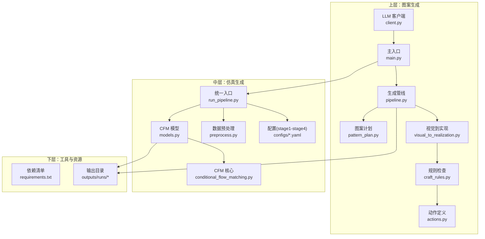
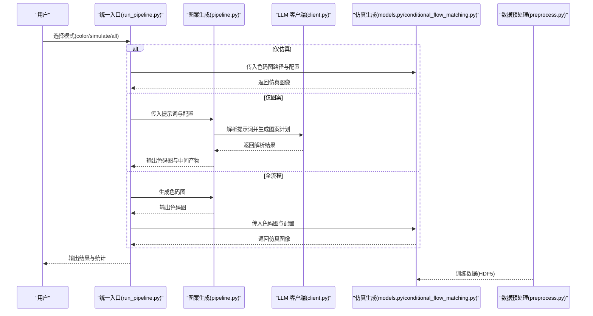
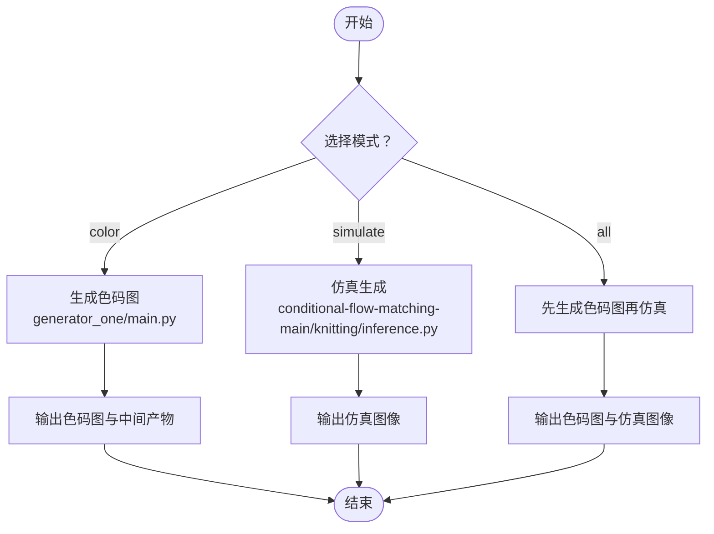
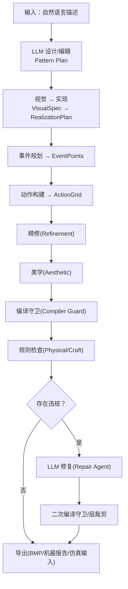
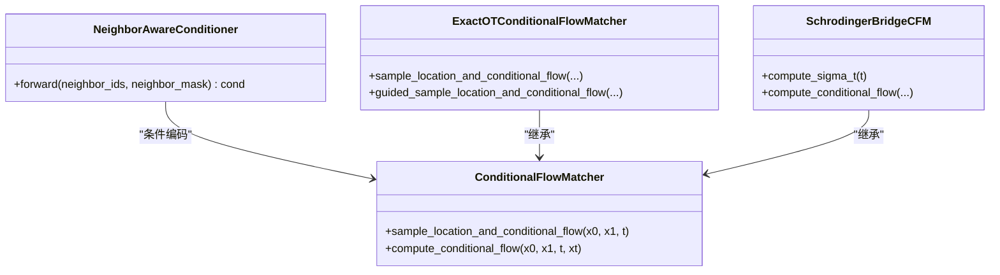
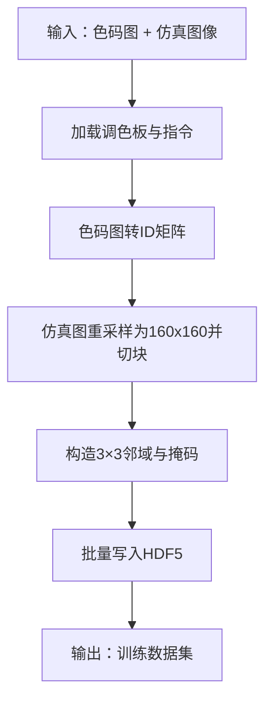
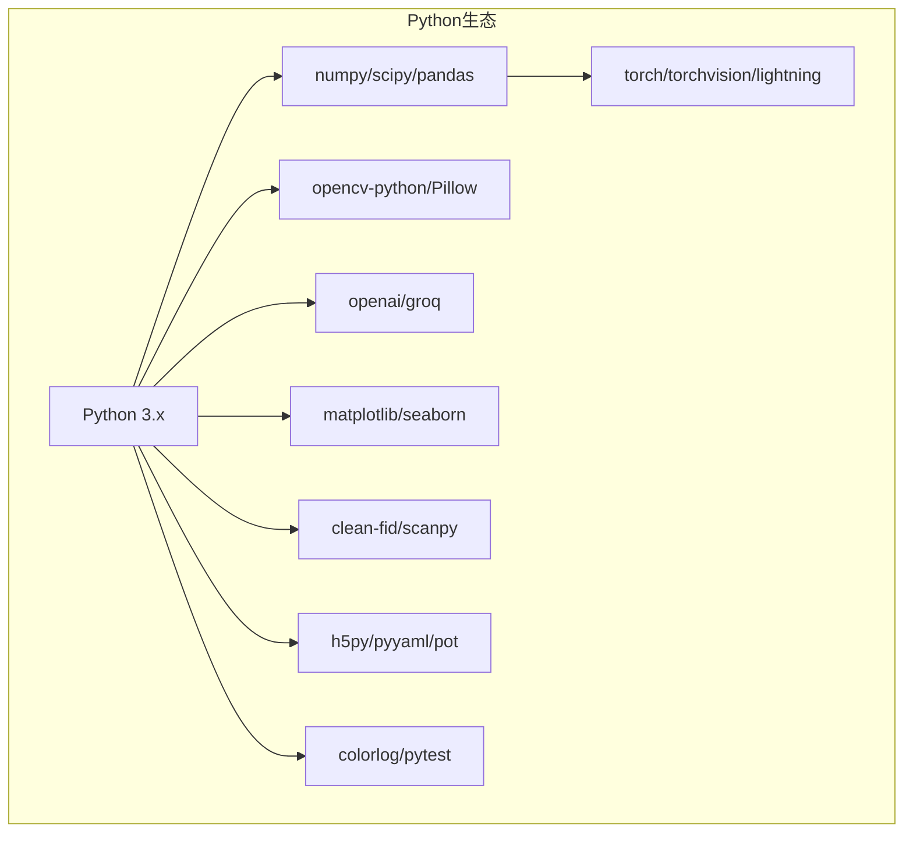

# 项目概述

<cite>
**本文档引用的文件**
- [README.md](file://conditional-flow-matching-main/README.md)
- [run_pipeline.py](file://run_pipeline.py)
- [main.py](file://generator_one/main.py)
- [pipeline.py](file://generator_one/pipeline.py)
- [pattern_plan.py](file://generator_one/generation/pattern_plan.py)
- [visual_to_realization.py](file://generator_one/generation/visual_to_realization.py)
- [craft_rules.py](file://generator_one/rules/craft_rules.py)
- [actions.py](file://generator_one/core/actions.py)
- [client.py](file://generator_one/llm/client.py)
- [models.py](file://conditional-flow-matching-main/knitting/models.py)
- [conditional_flow_matching.py](file://conditional-flow-matching-main/torchcfm/conditional_flow_matching.py)
- [preprocess.py](file://conditional-flow-matching-main/data/preprocess.py)
- [stage1.yaml](file://conditional-flow-matching-main/configs/stage1.yaml)
- [stage2.yaml](file://conditional-flow-matching-main/configs/stage2.yaml)
- [requirements.txt](file://requirements.txt)
</cite>

## 目录
1. [简介](#简介)
2. [项目结构](#项目结构)
3. [核心组件](#核心组件)
4. [架构总览](#架构总览)
5. [详细组件分析](#详细组件分析)
6. [依赖分析](#依赖分析)
7. [性能考虑](#性能考虑)
8. [故障排除指南](#故障排除指南)
9. [结论](#结论)
10. [附录](#附录)

## 简介
本项目是一个面向针织图案生成的端到端系统，目标是将自然语言描述自动转化为可编织的色码图，并进一步生成高质量的仿真图像。系统采用“两阶段协同”的设计：第一阶段（图案生成）由大模型驱动，将用户意图转化为可执行的编织计划；第二阶段（仿真生成）基于条件流匹配（Conditional Flow Matching, CFM）学习色码图与仿真图像之间的映射关系，逐步提升仿真质量。

系统的主要创新点包括：
- 将自然语言描述与色码动作语义解耦，通过“视觉规格 → 实现计划 → 动作网格”的中间层，确保语义一致性与可执行性。
- 在仿真阶段引入邻居感知条件编码与物理/结构损失，显著提升仿真图像的真实感与结构稳定性。
- 提供可编辑的“图案计划”（Pattern Plan）机制，支持增量修改与迭代优化，兼顾创意自由与工程约束。

## 项目结构
项目采用模块化组织，分为三层：
- 上层（generator_one）：负责自然语言解析、图案生成与规则校验。
- 中层（conditional-flow-matching-main）：负责色码图到仿真图像的条件流匹配建模与训练。
- 下层（scripts、data、outputs）：提供数据预处理、运行脚本与实验输出管理。

**图表来源**
- [run_pipeline.py:1-279](file://run_pipeline.py#L1-L279)
- [main.py:1-207](file://generator_one/main.py#L1-L207)
- [pipeline.py:1-749](file://generator_one/pipeline.py#L1-L749)
- [pattern_plan.py:1-800](file://generator_one/generation/pattern_plan.py#L1-L800)
- [visual_to_realization.py:1-978](file://generator_one/generation/visual_to_realization.py#L1-L978)
- [craft_rules.py:1-414](file://generator_one/rules/craft_rules.py#L1-L414)
- [actions.py:1-338](file://generator_one/core/actions.py#L1-L338)
- [client.py:1-168](file://generator_one/llm/client.py#L1-L168)
- [models.py:1-119](file://conditional-flow-matching-main/knitting/models.py#L1-L119)
- [conditional_flow_matching.py:1-619](file://conditional-flow-matching-main/torchcfm/conditional_flow_matching.py#L1-L619)
- [preprocess.py:1-285](file://conditional-flow-matching-main/data/preprocess.py#L1-L285)
- [stage1.yaml:1-24](file://conditional-flow-matching-main/configs/stage1.yaml#L1-L24)
- [stage2.yaml:1-24](file://conditional-flow-matching-main/configs/stage2.yaml#L1-L24)
- [requirements.txt:1-46](file://requirements.txt#L1-L46)

**章节来源**
- [README.md:1-47](file://conditional-flow-matching-main/README.md#L1-L47)
- [run_pipeline.py:1-279](file://run_pipeline.py#L1-L279)
- [main.py:1-207](file://generator_one/main.py#L1-L207)
- [pipeline.py:1-749](file://generator_one/pipeline.py#L1-L749)

## 核心组件
- 统一运行入口（run_pipeline.py）：提供 color、simulate、all 三种模式，串联图案生成与仿真生成，并自动选择设备与检查点。
- 图案生成管线（generator_one/pipeline.py）：包含 LLM 设计、可视化到实现、事件规划、动作构建、精修、美学、编译守卫、规则检查、LLM 修复等步骤。
- 仿真生成模块（conditional-flow-matching-main）：基于 CFM 的色码图到仿真图像映射，包含邻居感知条件编码、训练配置与推理脚本。
- 数据与规则（data/preprocess.py、rules/craft_rules.py）：负责数据预处理与编织工艺/张力规则校验。
- 动作与指令（core/actions.py、assets/instructions.json）：统一的动作语义、张力与机器导出映射。

**章节来源**
- [run_pipeline.py:1-279](file://run_pipeline.py#L1-L279)
- [pipeline.py:1-749](file://generator_one/pipeline.py#L1-L749)
- [preprocess.py:1-285](file://conditional-flow-matching-main/data/preprocess.py#L1-L285)
- [craft_rules.py:1-414](file://generator_one/rules/craft_rules.py#L1-L414)
- [actions.py:1-338](file://generator_one/core/actions.py#L1-L338)

## 架构总览
系统采用“意图 → 色码 → 仿真”的两阶段流水线，两阶段之间通过统一入口协调，形成闭环的可执行工作流。

**图表来源**
- [run_pipeline.py:1-279](file://run_pipeline.py#L1-L279)
- [pipeline.py:1-749](file://generator_one/pipeline.py#L1-L749)
- [client.py:1-168](file://generator_one/llm/client.py#L1-L168)
- [models.py:1-119](file://conditional-flow-matching-main/knitting/models.py#L1-L119)
- [conditional_flow_matching.py:1-619](file://conditional-flow-matching-main/torchcfm/conditional_flow_matching.py#L1-L619)
- [preprocess.py:1-285](file://conditional-flow-matching-main/data/preprocess.py#L1-L285)

## 详细组件分析

### 组件A：统一运行入口（run_pipeline.py）
- 功能：封装 color、simulate、all 三种模式，自动解析设备、检查点与候选输出，协调两阶段执行。
- 关键特性：
  - 自动推断输入色码图对应的运行目录，支持从仿真输入反推运行目录。
  - 支持多候选仿真输出与网格拼接，便于对比不同阶段/噪声模式的结果。
  - 统一参数传递至图案生成与仿真生成模块，保证一致性。

**图表来源**
- [run_pipeline.py:1-279](file://run_pipeline.py#L1-L279)

**章节来源**
- [run_pipeline.py:1-279](file://run_pipeline.py#L1-L279)

### 组件B：图案生成管线（generator_one/pipeline.py）
- 功能：将自然语言描述转化为可编织的色码动作网格，贯穿设计、实现、事件、动作、精修、美学、编译守卫、规则检查与修复等步骤。
- 关键流程：
  - LLM 设计：解析提示词，生成/编辑图案计划（Pattern Plan）。
  - 视觉到实现：将视觉规格转换为可执行的实现计划（Realization Plan）。
  - 事件规划与动作构建：基于实现计划生成动作网格。
  - 精修与美学：对动作网格进行局部优化与风格化。
  - 编译守卫与规则检查：强制满足动作层/语义层约束。
  - LLM 修复：对违规动作进行智能修复与二次校验。
  - 导出：保存 BMP、机器导出报告、仿真输入 PNG 与统计信息。

**图表来源**
- [pipeline.py:1-749](file://generator_one/pipeline.py#L1-L749)
- [pattern_plan.py:1-800](file://generator_one/generation/pattern_plan.py#L1-L800)
- [visual_to_realization.py:1-978](file://generator_one/generation/visual_to_realization.py#L1-L978)
- [craft_rules.py:1-414](file://generator_one/rules/craft_rules.py#L1-L414)
- [actions.py:1-338](file://generator_one/core/actions.py#L1-L338)

**章节来源**
- [pipeline.py:1-749](file://generator_one/pipeline.py#L1-L749)
- [pattern_plan.py:1-800](file://generator_one/generation/pattern_plan.py#L1-L800)
- [visual_to_realization.py:1-978](file://generator_one/generation/visual_to_realization.py#L1-L978)
- [craft_rules.py:1-414](file://generator_one/rules/craft_rules.py#L1-L414)
- [actions.py:1-338](file://generator_one/core/actions.py#L1-L338)

### 组件C：仿真生成（conditional-flow-matching-main）
- 功能：将色码图映射为仿真图像，采用条件流匹配（CFM）框架，逐步提升结构与细节的真实性。
- 关键模块：
  - 模型（models.py）：邻居感知条件编码器，利用注意力掩码融合中心与邻居动作信息。
  - CFM 核心（conditional_flow_matching.py）：提供多种流匹配方法（如 OT-CFM、SB-CFM 等）。
  - 数据预处理（preprocess.py）：将色码图与仿真图像配对，切分为窗口样本并保存为 HDF5。
  - 训练配置（configs/*.yaml）：定义各阶段的采样策略、损失权重与超参数。

**图表来源**
- [models.py:1-119](file://conditional-flow-matching-main/knitting/models.py#L1-L119)
- [conditional_flow_matching.py:1-619](file://conditional-flow-matching-main/torchcfm/conditional_flow_matching.py#L1-L619)

**章节来源**
- [models.py:1-119](file://conditional-flow-matching-main/knitting/models.py#L1-L119)
- [conditional_flow_matching.py:1-619](file://conditional-flow-matching-main/torchcfm/conditional_flow_matching.py#L1-L619)
- [preprocess.py:1-285](file://conditional-flow-matching-main/data/preprocess.py#L1-L285)
- [stage1.yaml:1-24](file://conditional-flow-matching-main/configs/stage1.yaml#L1-L24)
- [stage2.yaml:1-24](file://conditional-flow-matching-main/configs/stage2.yaml#L1-L24)

### 组件D：数据与规则（data/preprocess.py、rules/craft_rules.py）
- 数据预处理：将色码图与仿真图像配对，按 40×40 网格切分为 3×3 邻域窗口样本，生成 HDF5 数据集，包含邻居 ID、掩码、中心类别与仿真块。
- 工艺规则：提供动作层与语义层的规则检查与修复，包括张力评分、前后环切换约束、麻花负载平衡、床间移针支撑等。

**图表来源**
- [preprocess.py:1-285](file://conditional-flow-matching-main/data/preprocess.py#L1-L285)

**章节来源**
- [preprocess.py:1-285](file://conditional-flow-matching-main/data/preprocess.py#L1-L285)
- [craft_rules.py:1-414](file://generator_one/rules/craft_rules.py#L1-L414)

### 组件E：动作与指令（core/actions.py、assets/instructions.json）
- 动作定义：集中管理 15 色动作的语义、张力、床侧、偏移与机器导出映射，统一提供查询接口与分组（基础/精修/元动作）。
- 机器导出：区分内部训练色与机器导出色，生成导出报告，标注需要确认或无法映射的动作。

**章节来源**
- [actions.py:1-338](file://generator_one/core/actions.py#L1-L338)

## 依赖分析
- Python 与科学计算：numpy、scipy、pandas、opencv-python、Pillow。
- LLM 与通信：openai、groq。
- 深度学习：torch、torchvision、lightning-bolts、torchdiffeq、torchdyn。
- 可视化与评估：matplotlib、seaborn、clean-fid、scanpy。
- 数据处理：h5py、pyyaml、pot、scikit-learn。
- 日志与测试：colorlog、pytest、pytest-cov。

**图表来源**
- [requirements.txt:1-46](file://requirements.txt#L1-L46)

**章节来源**
- [requirements.txt:1-46](file://requirements.txt#L1-L46)

## 性能考虑
- 训练效率：Stage 1-2 使用加权采样与梯度/频域损失，提升收敛稳定性；Stage 3-4 引入结构损失与边界损失，强化结构一致性。
- 推理速度：统一入口自动选择 CUDA/CPU，支持批处理与候选网格输出，便于快速对比。
- 数据规模：HDF5 分块存储与 gzip 压缩，降低内存占用；预处理脚本支持并行化与进度监控。
- 规则检查：动作层与语义层规则分离，减少误报与修复成本；张力评分辅助质量评估。

[本节为通用指导，无需具体文件引用]

## 故障排除指南
- LLM 未配置 API Key：检查环境变量或配置文件，确保 API Key 正确设置。
- CUDA 不可用：统一入口会自动回退到 CPU；可在命令行指定设备或安装 GPU 版本 PyTorch。
- 检查点缺失：确认检查点路径正确，或使用默认路径；不同阶段使用不同的检查点目录。
- 数据格式错误：确保色码图与仿真图像命名与目录结构一致，预处理脚本会自动跳过无效配对。
- 违规动作过多：启用 LLM 修复或手动调整提示词；关注张力评分与规则报告。

**章节来源**
- [client.py:1-168](file://generator_one/llm/client.py#L1-L168)
- [run_pipeline.py:1-279](file://run_pipeline.py#L1-L279)
- [preprocess.py:1-285](file://conditional-flow-matching-main/data/preprocess.py#L1-L285)
- [craft_rules.py:1-414](file://generator_one/rules/craft_rules.py#L1-L414)

## 结论
本项目通过“意图 → 色码 → 仿真”的两阶段协同，实现了从自然语言到可编织图案的自动化生成与验证。上层以 LLM 与规则引擎为核心，确保创意与工程约束的平衡；下层以 CFM 为基础，结合邻居感知条件与结构损失，显著提升了仿真质量。系统具备良好的扩展性与可编辑性，适合在教学、设计与生产环境中应用。

[本节为总结性内容，无需具体文件引用]

## 附录

### 常见用例与示例
- 生成中心麻花菱形：使用统一入口 all 模式，传入中文提示词，自动输出色码图与仿真图像。
- 随机生成：使用 random 子命令，支持指定风格描述，快速探索设计空间。
- 禁用精修/美学/修复：通过命令行参数关闭相应步骤，加速调试与对比实验。
- 指定输出目录与前缀：自定义输出路径与文件名前缀，便于批量处理与版本管理。

**章节来源**
- [main.py:1-207](file://generator_one/main.py#L1-L207)
- [run_pipeline.py:1-279](file://run_pipeline.py#L1-L279)