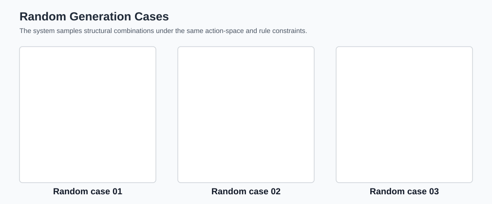
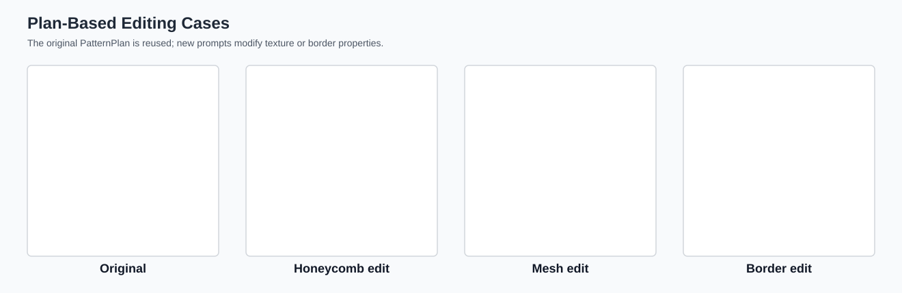

# 面向横机针织的语义驱动动作色码图生成与结构感知仿真方法

*A Semantic-Driven Knitting Structure Generation and Structure-Aware Simulation Method for Flat Knitting Manufacturing*

---

## 摘要

现有生成式人工智能方法已能够根据自然语言生成纺织纹样、服装纹理或色彩方案，但多数结果仍停留在普通视觉图像层面，缺少横机针织制造所需的动作语义和针法约束。横机组织色码图并非一般像素图：每一个色块都对应成圈、集圈、移针、劈针、空针或落布等具体工艺动作，动作之间还存在支撑、偏移、堆叠、边界闭合和张力过渡等制造约束。因此，从自然语言设计描述到可验证组织色码图的自动生成，不能简单套用“文本生成图片”的技术路线。

本文提出一种面向横机针织的语义驱动动作色码图生成与结构感知仿真方法。系统以用户自然语言设计描述为输入，首先借助大语言模型 API 完成基础语义抽取，并将抽取结果约束为可编辑的层次化结构计划，显式表示外轮廓、边框、内部纹理、背景组织及其父子关系；随后基于十五色针织动作空间，将结构计划逐级编译为视觉目标、工艺实现方案、稀疏事件点和动作色码图，并通过硬性物理约束、工艺软约束、张力评分、层级裁剪和成组组织完整性检查完成自修复；最后通过第二阶段结构感知仿真模块生成针织效果图，形成从语义输入、动作组织生成到结构感知视觉预览的闭环。本文中的大语言模型仅承担自然语言到结构化字段的接口作用，生成结果由显式结构表示、工艺规则与后处理校验共同决定。

本文的主要贡献包括：第一，提出自然语言到层次化针织结构计划的语义映射方法，使复杂设计意图在生成前具有可解释、可编辑的中间表示；第二，构建面向十五色针织动作空间的约束生成与自修复机制，将针织工艺知识嵌入动作网格生成过程；第三，设计结构感知仿真验证流程，使生成结果能够通过针织效果图观察边界连续性、纹理方向和区域层级关系。

**关键词**：横机针织；组织色码图；语义驱动生成；工艺约束；结构感知仿真

---

## 1 引言

### 1.1 研究背景与问题

横机针织组织设计通常依赖专业人员逐格编辑色码、设置针法并检查结构合理性。该流程不仅要求设计者理解图案外观，还要求其掌握针床切换、线圈支撑、集圈堆叠、移针偏移和局部张力等工艺知识。对于普通设计师或非专业用户而言，即使能够清楚描述“圆形结构，内部波浪吊目，外部矩形边框，背景稀疏网眼”等设计意图，也难以直接将其转换为具有针织工艺逻辑的组织色码图。

近年来，文本到图像生成、扩散模型、GAN 和服装纹理迁移方法推动了 AI 辅助纺织设计的发展。ColorwAI 关注纺织色彩变体生成，FabricDiffusion 面向服装图像的高保真织物纹理迁移，相关工作说明生成式模型已能够提升纺织视觉设计效率。然而，这类方法生成的通常是 RGB 图像、纹理贴图或色彩方案，不能保证图像像素对应合法的针织动作。

同时，2024 年以来的可制造生成研究开始强调物理约束和功能约束的重要性。Shaping Realities 讨论了 3D 生成中的制造约束，Stylish and Functional 强调物理约束在生成式设计中的作用。这些研究表明，生成式设计正在从“外观看起来合理”转向“结构上能够制造”。横机针织场景中的约束更加细粒度：颜色不是装饰，而是动作编码；形状不是普通轮廓，而是由成圈、集圈、移针和劈针等动作组合形成的组织结构。

因此，本文关注的核心问题是：如何把自然语言设计描述自动转化为具有针织工艺逻辑、满足制造约束、并可通过仿真流程验证的横机组织色码图。

### 1.2 现有方法的不足

现有相关方法在本文任务中主要存在三类不足。

第一，传统横机 CAD 工具能够表达复杂针法并支持组织检查，但其工作流主要依赖人工组织编辑，通常不提供从自然语言设计语义到组织色码图的自动生成能力。

第二，AI 纺织图案生成方法能够生成视觉上类似纺织物的图像，却缺少针织动作语义。对于横机针织制造而言，视觉相似性不足以代表可制造性。一个看起来像波浪、蜂巢或网眼的图案，如果没有合法的集圈、移针、支撑和边界关系，仍然无法稳定进入后续工艺验证流程。

第三，约束感知生成方法虽然强调物理或制造约束，但多数面向 3D 几何、工程结构或材料外观，尚未针对横机组织色码图中的动作空间、针床关系、区域纹理、张力过渡和仿真验证建立完整链路。

### 1.3 本文思路

针对上述问题，本文将横机组织生成拆分为两个阶段。

第一阶段是语义驱动组织生成。系统不直接把文本生成为图片，而是先将自然语言解析为层次化结构计划，再将结构计划编译为动作色码图。该阶段的关键是把“圆形、菱形、矩形边框、波浪吊目、蜂巢纹理、稀疏网眼”等设计语义转换为具有父子关系、区域边界和工艺实现方式的结构单元。

第二阶段是结构感知仿真验证。系统以第一阶段生成的内部十五色动作图为条件输入，结合中心动作、邻域动作和物理工艺特征，生成针织效果图。该阶段为研究和设计迭代提供自动化视觉验证，使用户能够观察纹理连续性、边界闭合程度和区域层级是否清晰。

### 1.4 创新点

本文创新点可概括为以下三点。

**1. 语义输入：自然语言到层次化针织结构计划。** 本文提出面向横机组织生成的结构化中间表示，将用户描述中的图案语义拆解为 motif、effect、role、region、parent relation 等单元。系统使用大语言模型 API 执行初始语义抽取，但不将其输出直接作为最终图案，而是通过 schema 约束、字段归一化和工艺规则校验将其转化为可解释、可修改的针织结构计划。

**2. 约束控制：十五色动作空间上的工艺规则生成与自修复。** 本文基于 Neural Inverse Knitting 数据集中的动作色块体系构建十五色针织动作空间，并为每类动作建立语义类别、针床属性、移针偏移、张力等级、弹性等级和稳定性等级。系统在事件规划、动作构建、后处理和输出前检查中嵌入硬性物理约束、工艺软约束、张力评分和成组组织完整性检查，使生成结果具有针织组织逻辑。

**3. 第二阶段结构感知仿真：动作图到视觉预览的闭环。** 本文将内部色码图作为仿真条件输入，结合中心动作、邻域动作和工艺属性特征生成针织效果图。该过程使系统能够在动作规则检查之外进一步观察织物表面的边界、纹理和层级表现。

---

## 2 相关工作

### 2.1 横机 CAD 与针织组织编辑

传统横机 CAD 工具以专业人员为主要用户，支持针法编辑、组织绘制和工艺参数设置。其优势在于能够细致表达复杂组织；不足在于输入方式主要是人工编辑，缺少将自然语言设计描述自动转换为组织图的能力。本文方法关注语义生成与仿真验证环节，旨在降低从设计意图到组织色码图之间的建模门槛。

### 2.2 AI 纺织图案与服装纹理生成

2024 年后的生成式纺织研究更多关注视觉层面的纹样、纹理和色彩生成。ColorwAI 将 textile colorway 建模为色彩变体生成任务，通过 GAN 与扩散模型改变色彩表达；FabricDiffusion 面向 3D 服装纹理迁移，从服装图像中恢复可平铺织物纹理。这类工作降低了纺织视觉创作门槛，但其输出并非横机动作网格，也不包含成圈、集圈、移针等针织动作语义。

### 2.3 约束感知生成与可制造设计

Shaping Realities 和 Stylish and Functional 等研究表明，生成模型进入制造场景后必须考虑结构、物理和功能约束。本文继承这一问题意识，但约束对象从 3D 几何或工程结构转向横机针织动作色码图。本文的约束不只包括形状对称和边界完整，还包括线圈支撑、移针目标、连续集圈、床间切换和局部张力。

### 2.4 Neural Inverse Knitting 与数据基础

Neural Inverse Knitting: From Images to Manufacturing Instructions 将针织样片图像到动作指令的逆向映射作为研究任务，提供了图像、动作指令和色块编码之间的对应关系。本文的数据集来自该工作公开数据的一部分，并删除了部分重复样本；动作色块定义也继承自该论文的色块编码体系。在此基础上，本文删除两个低频且当前系统未使用的不常用色块，形成十五色动作空间。

与 Neural Inverse Knitting 不同，本文任务不是从已有针织图像反推动作指令，而是从自然语言设计语义生成新的组织色码图。因此，本文更强调语义解析、层次化结构规划、工艺约束生成和仿真验证。

### 2.5 针织仿真与结构感知图像生成

针织仿真通常需要根据组织结构预测织物表面效果。对于本文系统而言，仿真模块承担的是“生成结果验证”而非单纯图像合成任务。第二阶段模型使用中心动作、3 x 3 邻域动作和动作物理特征作为条件，使仿真图能够响应局部组织结构差异。与普通图像翻译不同，该模块的输入是具有工艺语义的动作编号矩阵。

### 2.6 大语言模型语义解析与结构化输出

大语言模型已被用于语义解析任务，即将自然语言转换为计算机可处理的结构化表示。2024 年的相关研究表明，LLM 能够在自然语言到查询、逻辑形式或结构字段的转换中发挥作用，但其输出仍需要格式约束、语义约束和下游校验，以便稳定集成到工程系统中。本文采用这一思路，将大语言模型 API 限定为自然语言接口层：其作用是从用户描述中抽取形状、纹理、位置、层级和参数等候选字段；真正决定组织结果的是 PatternPlan schema、十五色动作空间、工艺约束和后处理修复。因此，本文并未将大模型作为端到端图案生成器，而是将其作为结构化语义输入的辅助模块。

---

## 3 系统与问题定义

### 3.1 任务定义

给定自然语言设计描述 D，本文目标是生成内部组织色码图 P 和结构感知仿真图 S：

$$
D \rightarrow P \rightarrow S
$$

其中，P 表示内部十五色动作图，用于组织生成、规则校验与第二阶段仿真；S 表示结构感知仿真结果，用于观察组织图在视觉层面的呈现形式。本文所定义的有效输出需同时满足语义一致性、工艺合法性与视觉可解释性。

### 3.2 十五色针织动作空间

本文采用十五色动作空间作为基础表示，而非普通 RGB 调色板。动作编号、内部颜色与工艺属性统一定义于动作表中。每个动作由动作缩写、针织语义类别、针床或偏移属性、内部颜色、张力等级、弹性等级与稳定性等级共同描述。

表 1 列出了本文采用的十五个动作。张力等级取值为 1-7，数值越高表示相邻动作切换或局部负载风险越高；弹性与稳定性等级取值为 1-5，分别表征蓄纱/松弛倾向与作为支撑结构的稳定程度。需要指出的是，这三类属性并非来自实测传感器数据，而是结合公开针织工艺资料、Neural Inverse Knitting 指令语义以及本系统在生成、校验与仿真过程中的多轮调试经验建立的工程分级。在本文中，它们作为规则排序、风险评估与物理特征编码的启发式先验，后续仍需通过真实织造样片进一步标定。

| 编号 | 动作缩写 | 动作名称 | 语义类别 | 张力 | 弹性 | 稳定性 |
| --- | --- | --- | --- | --- | --- | --- |
| 0 | f_knit | 前床成圈（正针） | LOOP | 6 | 4 | 5 |
| 1 | b_knit | 后床成圈（反针） | LOOP | 6 | 4 | 5 |
| 2 | xfer_f_b | 移针：前至后 | TRANSFER | 6 | 2 | 4 |
| 3 | xfer_b_f | 移针：后至前 | TRANSFER | 6 | 2 | 4 |
| 4 | b_tuck | 后床集圈 | TUCK | 3 | 5 | 3 |
| 5 | miss | 空针背景（不织） | EMPTY | 2 | 1 | 1 |
| 6 | xfer_l1 | 移针并左移 1 针 | TRANSFER | 7 | 2 | 3 |
| 7 | f_tuck | 前床集圈 | TUCK | 3 | 5 | 3 |
| 8 | f_split | 前床劈针 | SPLIT | 6 | 3 | 4 |
| 9 | b_split | 后床劈针 | SPLIT | 6 | 3 | 4 |
| 10 | f_tuck_2 | 前床集圈变体 | TUCK | 3 | 5 | 2 |
| 11 | carrier | 前后落布 | DROP | 1 | 1 | 1 |
| 12 | split_v | 劈针变体 | SPLIT | 6 | 3 | 4 |
| 13 | b_tuck_2 | 后床集圈变体 | TUCK | 3 | 5 | 2 |
| 14 | xfer_r1 | 移针并右移 1 针 | TRANSFER | 7 | 2 | 3 |

该动作空间可归纳为六类工艺功能：成圈用于形成主体支撑；集圈用于凸起、蓄纱与波浪/蜂巢纹理；移针用于针床切换、孔眼生成与形变控制；劈针用于局部过渡与结构重组；空针用于安全背景与逻辑空位；落布用于消除支撑并形成特殊断开效果。

### 3.3 系统总体流程

系统包含两个阶段。第一阶段将文本描述编译为动作色码图：

$$
\text{Prompt} \rightarrow \text{PatternPlan} \rightarrow \text{VisualSpec} \rightarrow \text{RealizationPlan} \rightarrow \text{EventPoint} \rightarrow \text{ActionGrid}
$$

第二阶段以第一阶段输出的内部动作图为输入，生成针织仿真图。


图 1 展示了本文系统总体框架。第一阶段完成设计语义到动作色码图的结构化生成，第二阶段对生成结果进行结构感知的视觉验证。

---

## 4 第一阶段：语义驱动组织生成方法

### 4.1 层次化结构计划

系统首先将自然语言输入解析为 PatternPlan。实现上，本文使用大语言模型 API 作为自然语言接口，将开放式描述转换为受限字段集合；随后系统对字段进行 schema 校验、层级关系补全、区域归一化与工艺可行性筛选。该设计使大模型承担基础语义识别工作，而结构规划、动作生成和约束修复仍由确定性规则与针织工艺知识主导。

PatternPlan 由多个 motif 组成，每个 motif 表示一个结构单元：

$$
m_i=(id_i,type_i,effect_i,role_i,region_i,params_i,parent_i)
$$

其中 type 表示圆形、菱形、矩形、六边形、边框等形状或结构；effect 表示波浪吊目、蜂巢、网眼、绞花、平针等效果；role 表示主体、边框、内部纹理或背景；region 表示位置和尺寸；params 表示周期、密度、方向和厚度；parent 表示父级区域。

该表示使自然语言中的层级关系显式化。例如，“矩形外框包裹圆形，圆形内部填充波浪吊目”可被拆解为矩形边框、中心圆形与波浪纹理三个 motif，其中波浪纹理的 `parent` 指向圆形区域。在动作生成阶段，波浪事件需被约束于圆形内部。

### 4.2 视觉目标到工艺实现

PatternPlan 被渲染为 VisualSpec 后，系统进一步将其映射为 RealizationPlan。VisualSpec 描述目标视觉外观，RealizationPlan 则描述该外观由哪些针织动作实现。一个区域的 RealizationPlan 通常包含底布、边界、事件模式与事件参数：

$$
g:(shape,effect,role,placement,params)\rightarrow(base,border,event,\theta)
$$

表 2 给出典型语义与工艺实现关系。

| 视觉语义 | 工艺实现 | 事件模式 | 关键约束 |
| --- | --- | --- | --- |
| 波浪吊目 | 前床底布 + split/tuck 组合 | diagonal_wave | 成组出现，边界放不下时整组取消 |
| 蜂巢纹理 | 前后集圈交替 | honeycomb_tuck | 集圈间距、连续堆叠上限 |
| 稀疏网眼 | 底布 + 空针/移针局部事件 | mesh_miss | 孔洞密度、邻近隔离 |
| 菱形/六边形 | 几何 mask + 边界动作 | shape_border | 居中、对称、闭合 |
| 矩形边框 | 后床或罗纹边界 | frame | 连续闭合，不能被内部结构顶破 |
| 绞花/位移 | 左右移针组合 | diamond_side_xfer / cable | 左右负载平衡、目标不冲突 |

对于尚未稳定支持的组合，系统采用保守降级策略，即优先保留轮廓与稳定底布，不生成孤立特殊动作。此举旨在避免视觉上近似某种纹理但缺乏工艺意义的局部色块进入最终结果。

### 4.3 稀疏事件规划

EventPoint 是工艺实现方案到低层动作网格的中间表示。系统并不直接预测 40 x 40 画布中的每个动作，而是根据区域 mask、纹理周期与工艺模式生成稀疏事件点：

$$
E={e_k=(r_k,c_k,a_k,z_k)\mid (r_k,c_k)\in \Omega(z_k),a_k\in A}
$$

其中 r 和 c 为事件坐标，a 为动作，z 为区域编号。对于带父级关系的区域，实际有效区域为：

$$
\Omega'(z)=\Omega(z)\cap \Omega(parent(z))
$$

该机制保证内部纹理不会溢出父级轮廓。例如，当波浪吊目位于圆形内部时，所有 `split` 与 `tuck` 事件均需同时满足波浪区域 mask 与圆形父级 mask。

### 4.4 动作网格构建

ActionGrid 是最终的 40 x 40 动作编号矩阵。构建过程依次完成底布填充、边界绘制、稀疏事件写入，并通过 refinement、aesthetic pass、layer clipping、compiler guard 与规则修复进行稳定化。算法 1 概括了第一阶段流程。

```text
算法 1：语义驱动组织色码图生成
输入：自然语言描述 D
输出：内部色码图 P，统计报告 Q

1. 解析 D，得到层次化结构计划 PatternPlan
2. 将 PatternPlan 渲染为 VisualSpec
3. 将 VisualSpec 映射为 RealizationPlan
4. 根据 event_pattern 生成稀疏事件 EventPoint
5. 初始化 40 x 40 ActionGrid，并填充区域底布
6. 根据 border_style 绘制边界
7. 写入稀疏事件并执行局部过渡求解
8. 执行 refinement、aesthetic pass 和层级裁剪
9. 执行 compiler guard、画布边界安全化和成组组织完整性检查
10. 检查硬性约束、工艺约束和张力评分，并执行保守自修复
11. 导出内部色码图、仿真输入图和统计报告
```

### 4.5 硬性物理约束

硬性物理约束用于过滤会导致动作不合法或结构无法形成的问题。本文实现的硬约束包括 H1-H8。

| 编号 | 约束名称 | 检查对象 | 违反含义 | 修复策略 |
| --- | --- | --- | --- | --- |
| H1 | 非法动作索引 | 动作编号 | 编号不在十五色动作空间内 | 降级为前床成圈 |
| H2 | 下方支撑 | 成圈/集圈/移针/劈针 | 需要支撑的动作下方为空 | 补支撑或降级为空针 |
| H3 | 移针偏移上限 | 移针 | 横向偏移超过允许范围 | 改为劈针或更小位移 |
| H4 | 移针目标越界 | 移针 | 目标列超出画布 | 改为劈针 |
| H5 | 同行目标冲突 | 移针 | 多个来源落到同一目标 | 删除或降级冲突动作 |
| H6 | 集圈连续堆叠 | 集圈 | 同列连续集圈超过上限 | 插入成圈打断 |
| H7 | 落布上方清空 | 落布 | 落布上方仍有支撑结构 | 清空或替换为安全背景 |
| H8 | 同行床间方向冲突 | 床间移针 | 同行同时存在前后相反方向床间移针 | 改为劈针变体 |

这些约束体现了动作网格与一般图像的根本差异：一般图像允许任意颜色相邻，而组织色码图必须满足线圈支撑关系与动作组合关系。

### 4.6 工艺软约束与张力评分

工艺软约束用于评估织物质量风险。它们不必然导致结构失败，但会影响稳定性、外观以及后续人工调整成本。本文实现的工艺约束包括 C1-C6。

| 编号 | 约束名称 | 工艺含义 |
| --- | --- | --- |
| C1 | 前后床成圈连续切换缺少过渡 | 同列 front/back loop 直接切换容易造成结构突变，需要 split 或 transfer 过渡 |
| C2 | 左右移针负载不平衡 | 绞花或位移组织左右负载差异过大，可能造成局部张力不均 |
| C3 | 床间移针行缺少支撑 | 含床间移针的行需要 tuck/miss/b_knit 等结构缓冲 |
| C4 | 特殊区域缺少边框 | cable/tuck 等区域外围需要结构边界提高稳定性 |
| C5 | 镂空区域未隔离 | 相邻 void 容易造成孔洞连通和支撑缺失 |
| C6 | tuck 与 cable 直接相邻 | 高蓄纱和高位移动作相邻会提高局部风险 |

系统同时计算张力评分：

$$
T(A)=\frac{1}{|N|}\sum_{(p,q)\in N}|t(A_p)-t(A_q)|
$$

其中 A_p 和 A_q 为相邻动作，t 表示动作张力等级。该指标用于衡量局部动作切换强度，可用于比较不同生成结果或消融设置下的工艺风险。

### 4.7 成组组织完整性

部分针织效果并非由单一动作构成，而是由多个动作组合实现。例如，波浪吊目通常由 `split` 与 `tuck` 按固定相对位置组成。系统在事件规划与最终输出前均检查组合完整性：

$$
c_{tuck}=c_{split}+\Delta
$$

若 `split` 或 `tuck` 任一侧因边界、mask 或修复而被删除，则另一侧同步删除，以避免最终色码图中出现孤立半组波浪。蜂巢与网眼等纹理亦采用类似的周期、密度与邻域检查。

### 4.8 内部色码输出

动作网格 A 通过内部十五色调色板 C_in 导出为组织色码图 P：

$$
P=C_{in}(A)
$$

该色码图保持与 Neural Inverse Knitting 数据色块体系一致的动作颜色语义，用于规则统计、第二阶段仿真输入与实验可视化。本文的重点在于动作语义生成、工艺约束控制与仿真验证。

---

## 5 第二阶段：结构感知仿真验证

### 5.1 模块定位

第二阶段的目标是将内部十五色动作图转换为针织效果图，以评估第一阶段结果在视觉层面的结构表现。规则检查能够发现显式动作错误，但难以完全反映织物表面效果。例如，边框是否视觉闭合、波浪纹理是否连续、背景网眼是否稀疏等问题，均需要通过仿真结果进行进一步验证。


图 2 展示了第二阶段结构感知仿真模块。该模块以内部十五色动作图为条件输入，通过邻域动作与物理工艺特征生成针织效果图。

### 5.2 条件表示

输入色码图被解析为动作编号矩阵：

$$
I\in \{0,1,\ldots,14\}^{40\times40}
$$

每个动作单元对应一个 8 x 8 仿真 patch，最终得到 320 x 320 的仿真图。对于位置 (i, j)，模型不仅使用中心动作 I_ij，还使用其 3 x 3 邻域动作 N_ij 与有效性 mask：

$$
c_{ij}=F_{cond}(I_{ij},N_{ij},M_{ij},\phi(I_{ij}))
$$

其中 phi 表示动作物理特征，包括 tension、elasticity 与 stability。

### 5.3 条件流匹配

第二阶段采用条件流匹配框架学习从噪声 patch 到目标针织 patch 的速度场。设 x0 为噪声，x1 为真实 patch，t 为时间，c 为条件向量，模型学习：

$$
v_\theta(x_t,t,c)\approx u_t
$$

训练损失为：

$$
\mathcal{L}_{flow}=\mathbb{E}\|v_\theta(x_t,t,c)-u_t\|_2^2
$$

推理阶段通过 ODE 积分得到目标 patch。系统支持 Euler、midpoint 与 RK4，其中默认采用 midpoint 以兼顾质量与效率。

### 5.4 Stage 1 到 Stage 4 的递进

第二阶段训练分为四个 stage，其逐级引入的条件信息如下。

| 阶段 | 条件信息 | 模型特征 | 验证目的 |
| --- | --- | --- | --- |
| Stage 1 | 中心动作 ID | 基础条件 UNet | 建立动作到 patch 的基本映射 |
| Stage 2 | 3 x 3 邻域动作 | 邻域 self-attention 与 cross-attention | 改善边界和上下文一致性 |
| Stage 3 | 邻域 + 物理特征 | tension / elasticity / stability 编码 | 引入工艺属性先验 |
| Stage 4 | 物理特征 + 自适应随机插值 | 边界噪声、结构损失、纹理损失 | 提升全图连续性和纹理表现 |

Stage 4 根据邻域动作差异构造边界图 B，并对区域内部与边界使用不同噪声强度：

$$
\sigma_{ij}=(1-B_{ij})\sigma_{inner}+B_{ij}\sigma_{boundary}
$$

本文配置中 `sigma_inner` 为 0.004，`sigma_boundary` 为 0.040，边界带宽为 2。该设置提高了模型在边界区域的鲁棒性，同时避免内部纹理受到过度扰动。

### 5.5 结构感知复合损失

Stage 4 使用复合损失：

$$
\mathcal{L}=
\lambda_m\mathcal{L}_{flow}
+\lambda_1\mathcal{L}_{1}
+\lambda_g\mathcal{L}_{grad}
+\lambda_f\mathcal{L}_{fft}
+\lambda_p\mathcal{L}_{physics}
+\lambda_b\mathcal{L}_{boundary}
+\lambda_s\mathcal{L}_{structure}
+\lambda_t\mathcal{L}_{texture}
$$

其中，梯度损失用于减少模糊，频域损失用于保持周期纹理，物理损失用于强化动作属性响应，边界损失用于约束区域交界，结构损失用于保留方向性与低频形态，纹理损失用于增强波浪、蜂巢、网眼等细节。

---

## 6 实验设计与结果分析

本章围绕本文的三个核心创新展开验证：语义输入是否能够稳定生成层次化结构计划，约束控制是否能够抑制工艺风险，第二阶段纺织仿真是否能够对组织结果提供可视化验证。除固定语义案例外，实验进一步加入随机生成与基于原始 PatternPlan 的增量修改，以考察系统在开放输入和局部编辑场景下的稳定性。所有实验均在项目根目录执行，输出统一保存在 `outputs/runs/<run-name>`，其中 `run-name` 对应本章表格中的案例编号。

### 6.1 实验设置

本文实验分为六类：语义解析示例、约束消融实验、随机生成实验、基于原版的增量修改实验、动作分布统计与第二阶段仿真消融实验。第一阶段输出包括内部色码图、PatternPlan、统计报告和仿真输入图；第二阶段输出为结构感知仿真图。复现参数采用 `stage=4`、`num_steps=50` 与 `midpoint` 求解器，消融实验仅改变对应模块开关。

```bash
python run_pipeline.py all "圆形结构，内部波浪吊目，外部矩形边框，背景稀疏网眼" --run-name exp_case_01 --prefix case_01 --stage 4 --num_steps 50 --solver midpoint --save-intermediate
python run_pipeline.py all "矩形边框包裹圆形，圆形内部为稀疏蜂巢吊目" --run-name exp_case_01_all --prefix case_01 --stage 4 --num_steps 50 --solver midpoint --save-intermediate
python run_pipeline.py all "多个小圆孔组成网眼背景，中间矩形区域为平针" --run-name thesis_main_case_05 --prefix case_05 --stage 4 --num_steps 50 --solver midpoint --save-intermediate
python run_pipeline.py all "圆形内部密集波浪吊目，背景为平针" --run-name thesis_main_case_06 --prefix case_06 --stage 4 --num_steps 50 --solver midpoint --save-intermediate
python run_pipeline.py all "菱形内部波浪吊目，外部稀疏网眼" --run-name thesis_main_case_07 --prefix case_07 --stage 4 --num_steps 50 --solver midpoint --save-intermediate
python run_pipeline.py all "矩形区域内部为蜂巢纹理，边框加粗，背景为空针" --run-name thesis_main_case_08 --prefix case_08 --stage 4 --num_steps 50 --solver midpoint --save-intermediate
python run_pipeline.py all "中心圆形平针结构，外部蜂巢纹理" --run-name thesis_main_case_09 --prefix case_09 --stage 4 --num_steps 50 --solver midpoint --save-intermediate
python run_pipeline.py all "六边形边框，中间为波浪吊目，外部平针" --run-name thesis_main_case_10 --prefix case_10 --stage 4 --num_steps 50 --solver midpoint --save-intermediate
python run_pipeline.py all "大矩形边框内包含两个圆形网眼区域" --run-name thesis_main_case_11 --prefix case_11 --stage 4 --num_steps 50 --solver midpoint --save-intermediate
python run_pipeline.py all "中心菱形，内部蜂巢吊目，背景稀疏网眼" --run-name thesis_main_case_12 --prefix case_12 --stage 4 --num_steps 50 --solver midpoint --save-intermediate
python run_pipeline.py all "矩形边框包裹中心圆形，圆形内部为波浪吊目，背景为平针" --run-name ablation_full --prefix full --stage 4 --num_steps 50 --solver midpoint --save-intermediate
python run_pipeline.py all "矩形边框包裹中心圆形，圆形内部为波浪吊目，背景为平针" --run-name ablation_no_repair --prefix no_repair --stage 4 --num_steps 50 --solver midpoint --save-intermediate --no-repair
python run_pipeline.py all "矩形边框包裹中心圆形，圆形内部为波浪吊目，背景为平针" --run-name ablation_no_refine --prefix no_refine --stage 4 --num_steps 50 --solver midpoint --save-intermediate --no-refinement
python run_pipeline.py all "矩形边框包裹中心圆形，圆形内部为波浪吊目，背景为平针" --run-name ablation_no_aesthetic --prefix no_aesthetic --stage 4 --num_steps 50 --solver midpoint --save-intermediate --no-aesthetic
cd generator_one
python main.py random "随机生成一个包含主体轮廓、内部纹理和背景组织的针织图案" --output ../outputs/runs/random_case_01/color_map --prefix random_01 --save-intermediate
python main.py random "随机生成一个包含边框、局部吊目和基础组织的针织图案" --output ../outputs/runs/random_case_02/color_map --prefix random_02 --save-intermediate
python main.py random "随机生成一个具有几何主体和稀疏纹理变化的针织图案" --output ../outputs/runs/random_case_03/color_map --prefix random_03 --save-intermediate
cd ..
python run_pipeline.py all "保持原有矩形边框和中心圆形结构，将圆形内部纹理修改为蜂巢吊目，背景保持平针" --plan-in outputs/runs/exp_case_01/color_map/case_01_pattern_plan.json --run-name edit_case_01_honeycomb --prefix edit_01 --stage 4 --num_steps 50 --solver midpoint --save-intermediate
python run_pipeline.py all "保持原有矩形边框和中心圆形结构，将圆形内部纹理修改为稀疏网眼，背景保持平针" --plan-in outputs/runs/exp_case_01/color_map/case_01_pattern_plan.json --run-name edit_case_02_mesh --prefix edit_02 --stage 4 --num_steps 50 --solver midpoint --save-intermediate
python run_pipeline.py all "保持原有中心圆形结构，将外部边框加粗，圆形内部继续使用波浪吊目" --plan-in outputs/runs/exp_case_01/color_map/case_01_pattern_plan.json --run-name edit_case_03_border --prefix edit_03 --stage 4 --num_steps 50 --solver midpoint --save-intermediate
```

### 6.2 语义输入与层次化结构计划

语义输入模块将自然语言解析为 `layout_type`、`motifs`、`region`、`role` 与 `parent_id` 等结构字段。以 `exp_case_01` 为例，系统识别出 `centered` 布局，并抽取出背景网眼、外部矩形边框与内部波浪吊目三个层次对象；`exp_case_01_all` 则识别为 `framed` 布局，并进一步强化边框包裹关系。两组结果表明，该模块不仅能够识别轮廓与纹理，还能够维持“包裹”“包含”与“从属”等层级语义。

| 指标 | `exp_case_01` | `exp_case_01_all` |
| --- | --- | --- |
| Layout type | centered | framed |
| Num regions | 4 | 4 |
| Total events | 54 | 64 |
| Hard violations | 0 | 0 |
| Craft violations | 0 | 0 |
| Layer clip | 27 | 31 |
| Texture outside child | 0 | 0 |
| Tension score | 0.0692 | 0.0885 |


图 3 展示了 `exp_case_01` 的 PatternPlan 摘要，用于说明自然语言输入被拆解为背景、边框与内部纹理等层次化结构单元。


图 4 展示了两个语义输入案例对应的内部十五色动作图，用于对比不同布局解析结果在动作网格层面的差异。

### 6.3 约束控制与自修复消融

本实验采用约束压力测试输入“矩形边框内包含两个靠近边界的小圆形区域，小圆形内部填充密集波浪吊目，背景为平针”，比较完整系统与三种消融版本。该输入同时包含边框约束、靠边小区域、密集成组纹理和多主体布局，能够放大局部纹理事件、张力变化和边界保守化之间的差异。实验仅改变模块开关：无自修复版本关闭 repair，无 refinement 版本关闭局部编译细化，无 aesthetic 版本关闭美学后处理。

为避免仅凭视觉结果评价消融差异，本文定义四类约束评价指标。设 \(V_h\) 与 \(V_c\) 分别为硬性违例数和工艺软违例数，\(N_t\) 为纹理事件数，\(N_o\) 为父级区域外溢纹理数，\(N_u\) 为被判定为不完整组合的波浪/蜂巢单元数，\(T\) 为张力评分。硬性合法率定义为：

$$
Q_h=1-\frac{V_h}{HW+\epsilon}
$$

纹理外溢率定义为：

$$
E_o=\frac{N_o}{N_t+\epsilon}
$$

成组组织完整性定义为：

$$
Q_p=1-\frac{N_u}{N_t+\epsilon}
$$

为衡量在保持合法性的同时是否过度堆叠特殊动作，本文进一步定义约束质量评分：

$$
S_q=\alpha Q_h+\beta(1-E_o)+\gamma Q_p-\delta T-\eta\left|\frac{N_t}{HW}-\rho\right|
$$

其中 \(H=W=40\)，\(\rho\) 表示期望纹理事件密度，\(\epsilon\) 为防止分母为零的极小常数。该评分并非用于替代真实织造评价，而是用于比较不同模块开关下的相对风险。

| 设置 | Run name | Total events | Texture events | Hard 违例数 | Craft 违例数 | 外溢纹理数 | 不完整组合数 | 张力评分 |
| --- | --- | --- | --- | --- | --- | --- | --- | --- |
| full | ablation_full | 16 | 16 | 0 | 0 | 0 | 0 | 0.0308 |
| no repair | ablation_no_repair | 56 | 54 | 0 | 0 | 0 | 0 | 0.1038 |
| no refinement | ablation_no_refine | 48 | 28 | 0 | 0 | 0 | 0 | 0.0500 |
| no aesthetic | ablation_no_aesthetic | 48 | 36 | 0 | 0 | 0 | 0 | 0.0654 |

.png)

图 5 展示了约束压力测试下完整系统与消融版本的生成结果。四组结果保持相同语义输入，差异主要体现在靠边小圆形区域中的波浪纹理密度、边框附近的动作保守化程度以及局部组织的视觉紧凑性。


图 6 给出了纹理事件数与张力评分的定量对比。无自修复版本保留 54 个纹理事件，显著高于完整系统的 16 个纹理事件，同时张力评分由 0.0308 提高到 0.1038，说明关闭 repair 后，系统倾向于保留更多靠边密集波浪事件，从而提高局部动作切换风险。无 refinement 与无 aesthetic 版本的纹理事件数分别为 28 和 36，张力评分介于完整系统与无自修复版本之间，表明二者主要影响局部纹理细化和视觉密度，而非基本动作合法性。


图 7 进一步以归一化雷达图比较不同版本的约束质量。四组结果均未出现硬性违例和层级外溢，说明硬约束、区域裁剪和成组检查能够维持基本合法性；差异主要体现在张力风险和纹理事件密度。完整系统的策略更保守，在靠边小圆形区域中减少高频特殊动作，从而获得最低张力评分。无自修复版本虽然保留了更高纹理密度，但对应的局部张力风险最高。该结果表明，自修复模块的作用并不只是在出现显式错误后删除非法动作，还包括在边界、密集纹理和小区域组合条件下对高风险特殊动作进行保守化筛选。

需要指出的是，本组实验中的 hard/craft 违例数均为 0，并不意味着各模块没有作用，而是说明基础编译器与硬约束已经能够保证最低动作合法性。在这一前提下，repair、refinement 与 aesthetic 的贡献主要表现为对纹理事件密度、张力过渡和局部视觉稳定性的调节。对于横机组织生成而言，这类“合法但高风险”的局部结构同样重要，因为其决定了后续仿真效果和真实织造时的人工调整成本。

### 6.4 随机生成实验

随机生成实验用于验证系统在开放语义输入条件下的鲁棒性。本实验执行三个随机生成案例，观察系统能否在未预定义的语义组合下保持约束稳定性。

| 案例 | Run name | Layout | Regions | Events | Hard 违例 | Craft 违例 | 张力评分 | 主要动作分布 |
|---|---|---|---|---|---|---|---|---|
| random_01 | random_case_01 | centered | 4 | 631 | 0 | 37 (C1) | 0.0 | f_knit:829, b_knit:771 |
| random_02 | random_case_02 | framed | 4 | 30 | 0 | 0 | 0.0577 | f_knit:1206, b_knit:364, f_tuck:15, f_split:15 |
| random_03 | random_case_03 | centered | 3 | 439 | 0 | 39 (C1) | 0.0 | f_knit:1099, b_knit:501 |

random_case_01 与 random_case_03 触发了大量 C1 工艺软约束（前后床成圈连续切换缺少过渡），
系统对 random_case_01 执行了 1 轮 LLM repair，进行 17 次动作编辑，但 37 条 C1 违例在修复
后仍保留。这类违例不影响动作合法性，但提示该区域在真实织造时需要人工介入。random_case_02
未出现工艺违例，生成了少量 tuck 和 split 纹理动作，结果较为保守稳定。



图 8 展示三个随机生成案例的内部色码图，用于说明系统在开放输入下的约束响应差异。


### 6.5 基于原版的增量修改实验

增量修改实验验证 PatternPlan 的可编辑性。系统读取 exp_case_01 的 PatternPlan JSON，
根据用户新指令局部修改字段，保持其余结构不变。本实验执行三个修改案例：圆形内部
纹理改为蜂巢、改为稀疏网眼、外部边框加粗。

| 案例 | Run name | 修改内容 | Regions | Events | Hard | Craft | Layer clip | Texture outside | 张力评分 |
|---|---|---|---|---|---|---|---|---|---|
| 原版 | exp_case_01 | 波浪吊目 | 4 | 54 | 0 | 0 | 27 | 0 | 0.0692 |
| edit_01 | edit_case_01_honeycomb | 圆形内→蜂巢 | 4 | 44 | 0 | 0 | 27 | 0 | 0.1000 |
| edit_02 | edit_case_02_mesh | 圆形内→稀疏网眼 | 4 | 15 | 0 | 0 | 17 | 0 | 0.0 |
| edit_03 | edit_case_03_border | 边框加粗 | 5 | 50 | 0 | 0 | 21 | 0 | 0.0615 |

三个修改案例均未出现硬性违例，texture_actions_outside_child_layers 均为 0，
说明层级裁剪机制在编辑后仍正确约束纹理事件于父级区域内部。edit_01 张力评分
从 0.0692 上升至 0.1000，说明蜂巢集圈的动作切换强度高于波浪 split/tuck 组合；
edit_02 改为稀疏网眼后张力评分降为 0.0；edit_03 加粗边框后区域数从 4 增至 5。
实验验证了 PatternPlan 支持局部编辑且修改后约束仍保持稳定。



图 9 展示三个增量修改案例与原版的对比，用于说明结构中间表示的可编辑性。


### 6.6 十五色动作分布与工艺组合

本文将内部动作空间统一为十五类，用于表达 knit、tuck、transfer、split、carrier 等不同针织工艺及其组合。实验结果表明，`exp_case_01` 与 `exp_case_01_all` 以常规成圈动作为主，少量 tuck 与 split 用于组织纹理起伏，说明系统生成结果并非简单填充，而是具有明确的工艺分工。

| Case | Run name | LOOP % | TUCK % | TRANSFER % | SPLIT % | EMPTY/DROP % | 高张力动作 % | 张力评分 |
| --- | --- | --- | --- | --- | --- | --- | --- | --- |
| case_01 | exp_case_01 | 90.1 | 1.4 | 0 | 1.4 | 7.1 | 3.1 | 0.0692 |
| case_01_all | exp_case_01_all | 90.9 | 1.8 | 0 | 1.8 | 5.5 | 3.6 | 0.0885 |


图 10 展示了代表案例中的动作分布差异，用于分析十五色动作空间中的工艺组合比例。

### 6.7 输出完整性检查

本实验检查各主案例输出链路是否完整。`exp_case_01`、`exp_case_01_all`、`thesis_main_case_05` 到 `thesis_main_case_12` 均已生成内部色码图、PatternPlan JSON、统计报告与仿真输入图，说明第一阶段输出能够稳定进入第二阶段。


图 11 汇总了代表案例的输出统计信息，用于说明第一阶段生成结果、统计报告与第二阶段输入之间的数据链路完整性。

| Case | Run name | 内部色码图 | 仿真输入图 | PatternPlan | 统计报告 | 仿真图 | 数据检查结果 |
| --- | --- | --- | --- | --- | --- | --- | --- |
| case_01 | exp_case_01 | 已有 | 已有 | 已有 | 已有 | 已有 | 通过 |
| case_01_all | exp_case_01_all | 已有 | 已有 | 已有 | 已有 | 已有 | 通过 |
| case_11 | thesis_main_case_11 | 已有 | 已有 | 已有 | 已有 | 已有 | 通过 |
| case_12 | thesis_main_case_12 | 已有 | 已有 | 已有 | 已有 | 已有 | 通过 |

### 6.8 第二阶段仿真消融

第二阶段实验用于比较 Stage 1 到 Stage 4 的视觉收敛过程。结果显示，Stage 1 仍存在噪声和局部断裂；Stage 2 开始形成清晰轮廓；Stage 3 进一步修正边界过渡；Stage 4 的结构最完整，能够较好保持主体闭合、内部纹理连续与背景稳定。

| 输入案例 | Stage | Run name | 边界清晰度 | 纹理连续性 | 区域辨识度 | 整体自然度 |
| --- | --- | --- | --- | --- | --- | --- |
| case_01 | Stage 1 | thesis_sim_case01_stage1 | 2 | 2 | 2 | 2 |
| case_01 | Stage 2 | thesis_sim_case01_stage2 | 3 | 3 | 3 | 3 |
| case_01 | Stage 3 | thesis_sim_case01_stage3 | 4 | 4 | 4 | 4 |
| case_01 | Stage 4 | thesis_sim_case01_stage4 | 5 | 5 | 5 | 5 |
| case_01_all | Stage 1 | thesis_sim_case01all_stage1 | 2 | 2 | 2 | 2 |
| case_01_all | Stage 2 | thesis_sim_case01all_stage2 | 3 | 3 | 3 | 3 |
| case_01_all | Stage 3 | thesis_sim_case01all_stage3 | 4 | 4 | 4 | 4 |
| case_01_all | Stage 4 | thesis_sim_case01all_stage4 | 5 | 5 | 5 | 5 |


图 12 展示了 Stage 1 到 Stage 4 的仿真结果变化，用于说明结构感知条件与复合损失对边界清晰度和纹理连续性的提升作用。

### 6.9 端到端案例展示

端到端案例展示选取 `case_11` 与 `case_12` 作为复杂场景代表。`case_11` 主要体现多区域结构的解析能力，`case_12` 则体现多纹理叠加条件下的约束协调能力。图中按照“自然语言输入、PatternPlan 摘要、内部十五色动作图、Stage 4 仿真图”的顺序展示，完整呈现系统从语义理解到结构生成再到视觉验证的输出链路。


图 13 展示了复杂案例的端到端输出链路，用于说明本文方法能够从自然语言输入连续生成结构计划、动作色码图与仿真结果。

### 6.10 本章小结

本章实验从五个层面验证了本文方法的有效性。首先，语义输入模块能够将自然语言设计描述稳定转化为层次化结构计划，并保持轮廓、纹理与父子关系的一致性。其次，约束控制与自修复机制能够在动作生成过程中抑制越界、外溢与结构冲突，使输出保持较好的工艺可行性。第三，随机生成实验说明系统可用于候选方案探索，但也表明开放组合需要规则筛选以降低工艺风险。第四，基于原版 PatternPlan 的增量修改实验验证了结构中间表示的可编辑性。最后，第二阶段仿真能够进一步将动作色码映射为可观察的织物视觉结果，为生成组织提供直观验证。综合来看，本文方法实现了从设计语义到结构组织再到视觉验证的连续建模流程。

## 7 讨论

本文方法的优势在于将自然语言设计、针织动作知识和仿真验证连接为一个闭环。系统不是让模型直接猜测最终像素，而是通过 PatternPlan、VisualSpec、RealizationPlan、EventPoint 和 ActionGrid 逐级降低生成难度，并在每层保留可解释接口。十五色动作空间和约束规则使生成结果具备明确工艺语义，第二阶段仿真则使结果从动作色码图进一步走向可观察的织物视觉效果。

本文方法仍存在一定局限。首先，动作张力、弹性和稳定性等级来自公开工艺知识、Neural Inverse Knitting 指令语义和系统调试经验，尚未通过大量真实样片进行定量标定。其次，本文使用的数据集来自 Neural Inverse Knitting 的一部分，并进行了重复样本删除，数据规模和动作覆盖仍有进一步扩展空间。第三，第二阶段仿真仍是视觉验证工具，尚不能完全替代真实织造或商业级物理仿真。最后，复杂组织如多针距绞花、复杂收放针和多纱嘴路径仍需更细粒度的指令建模。

---

## 8 结论

本文提出了一种面向横机针织的语义驱动动作色码图生成与结构感知仿真方法。针对现有 AI 图案生成方法缺少针织动作语义、制造约束和仿真验证闭环的问题，本文设计了从自然语言到层次化结构计划、从结构计划到十五色动作网格、从内部色码到结构感知仿真图的完整流程。方法通过语义输入、约束控制和第二阶段仿真三项核心设计，使生成结果从普通视觉图像提升为具有针织工艺逻辑、可解释、可修改并可通过仿真进行视觉检查的组织色码图。

---

## 参考文献草稿

[1] Ludovica Schaerf, Andrea Alfarano, Eric Postma. ColorwAI: Generative Colorways of Textiles through GAN and Diffusion Disentanglement. arXiv:2407.11514, 2024.

[2] Cheng Zhang, Yuanhao Wang, Francisco Vicente Carrasco, Chenglei Wu, Jinlong Yang, Thabo Beeler, Fernando De la Torre. FabricDiffusion: High-Fidelity Texture Transfer for 3D Garments Generation from In-The-Wild Clothing Images. arXiv:2410.01801, 2024.

[3] Faraz Faruqi, Yingtao Tian, Vrushank Phadnis, Varun Jampani, Stefanie Mueller. Shaping Realities: Enhancing 3D Generative AI with Fabrication Constraints. arXiv:2404.10142, 2024.

[4] Yan-Ying Chen, Nikos Arechiga, Chenyang Yuan, Matthew Hong, Matt Klenk, Charlene Wu. Stylish and Functional: Guided Interpolation Subject to Physical Constraints. arXiv:2412.15507, 2024.

[5] Alexandre Kaspar, Kui Wu, Balazs Bickel, Wojciech Matusik. Neural Inverse Knitting: From Images to Manufacturing Instructions. arXiv:1902.02752, 2019.

[6] Yaron Lipman, Ricky T. Q. Chen, Heli Ben-Hamu, Maximilian Nickel, Matt Le. Flow Matching for Generative Modeling. ICLR, 2023.

[7] Phillip Schneider, Manuel Klettner, Kristiina Jokinen, Elena Simperl, Florian Matthes. Evaluating Large Language Models in Semantic Parsing for Conversational Question Answering over Knowledge Graphs. arXiv:2401.01711, 2024.

[8] Michael Xieyang Liu, Frederick Liu, Alexander J. Fiannaca, Terry Koo, Lucas Dixon, Michael Terry, Carrie J. Cai. "We Need Structured Output": Towards User-centered Constraints on Large Language Model Output. arXiv:2404.07362, 2024.

